# 🎬 How to Copy Profitable AI Agents on Blofin (Step-By-Step)

> **Chaîne** : [Alex Carter](https://www.youtube.com/@AlexCarterTrading)  
> **Lien YouTube** : [https://www.youtube.com/watch?v=ZgM1GXu3VjQ](https://www.youtube.com/watch?v=ZgM1GXu3VjQ)  
> **Date de publication** : 20260416  
> **Durée** : 00:15:13  
> **Identifiant vidéo** : `ZgM1GXu3VjQ`  
> **Transcription & Analyse** : `whisper-v3-large-turbo+gemini-3.5-flash-lite`  

---

## 📌 Synthèse Exécutive & Outils

### 💡 Résumé

Cette vidéo présentée par la chaîne Alex Carter explore en profondeur l'automatisation des stratégies de trading crypto sur la plateforme Blofin, en mettant particulièrement l'accent sur l'utilisation de bots de trading propulsés par l'intelligence artificielle pour générer des flux de revenus dits passifs. L'analyste y décortique une suite d'outils automatisés conçus pour fonctionner 24h/24 et 7j/7, éliminant ainsi la nécessité de surveiller en permanence les graphiques ou de céder à la pression émotionnelle des marchés. À travers une démonstration pas à pas, la vidéo enseigne comment exploiter l'assistant de configuration intelligent de Blofin pour identifier et copier des agents IA pré-entraînés, tout en maîtrisant les subtilités techniques de chaque bot disponible.

Le tutoriel ne se limite pas à une simple présentation superficielle : il détaille la configuration mécanique des stratégies phares telles que les grilles de futures, le DCA (Dollar Cost Averaging) avec et sans effet de levier, ainsi que l'utilisation de bots de signaux. L'intervenant démontre comment basculer entre les modes assistés par l'IA et le mode manuel pour garder un contrôle absolu sur les paramètres critiques. Des notions fondamentales de gestion des risques, comme l'ajustement de la fourchette de prix, l'espacement arithmétique ou géométrique des grilles, et l'intégration des ordres de sécurité, sont rigoureusement explicitées pour optimiser l'allocation du capital selon les conditions du marché.

Enfin, la vidéo tisse des ponts vers des architectures de trading plus avancées en évoquant l'intégration d'agents conversationnels et d'outils d'automatisation externes (tels que Claude Code, Grok Bots, TradingView, et Telegram). L'objectif affiché est de structurer un écosystème de trading quantitatif hybride, combinant l'analyse on-chain, l'exécution automatisée sur des bourses comme Blofin ou Hyperliquid, et un suivi nomade des performances, offrant ainsi aux traders une boîte à outils complète pour industrialiser leurs stratégies de scalping et d'investissement à long terme.

---

### 🛠️ Outils, Modèles & Logiciels Présentés

* **Blofin** : Plateforme centralisée de produits dérivés et de trading crypto, dotée d'un tableau de bord complet de bots automatisés et d'assistants de configuration par IA.
* **Grok Bots** : Agents conversationnels et d'analyse propulsés par l'IA utilisés pour assister la prise de décision et le traitement des données de marché.
* **Claude Code** : Modèle d'intelligence artificielle de pointe exploité pour l'ingénierie de stratégies, l'assistance au code et l'automatisation des flux de travail de trading.
* **TradingView** : Plateforme de charting avancée permettant d'analyser les graphiques et de générer des signaux de trading automatisés via Pine Script.
* **Telegram** : Application de messagerie instantanée intégrée pour recevoir des alertes en temps réel, exécuter des commandes et suivre l'activité des bots à distance.
* **Hyperliquid** : Protocole de finance décentralisée (DeFi) utilisé pour l'analyse des positions des baleines et le trading perpétuel avancé.
* **Pine Script** : Langage de programmation dédié à TradingView pour concevoir, backtester et automatiser des indicateurs et des stratégies de trading sur mesure.

---

### 🔑 Points Clés & Enseignements Stratégiques

* **Allocation automatisée par IA** : L'utilisation de l'outil *EasyBot* de Blofin permet de faire correspondre instantanément le profil de risque et les attentes de marché du trader (haussier, baissier, volatil) avec le bot le plus performant basé sur des données historiques.
* **Grilles Futures (Futures Grid)** : Stratégie idéale pour les marchés hautement volatils et en range, consistant à placer un maillage d'ordres d'achat et de vente pour capturer les micro-fluctuations de prix tout en appliquant un effet de levier.
* **DCA Futures (Dollar Cost Averaging)** : Méthode combinant l'accumulation progressive d'actifs et l'effet de levier, conçue pour amplifier les rendements lors de positions directionnelles à long terme.
* **Grilles Spot (Spot Grid)** : Alternative sécurisée aux grilles de futures, permettant d'acheter bas et de vendre haut automatiquement dans des marchés stagnants, sans aucun risque de liquidation grâce à l'absence d'effet de levier.
* **DCA Spot** : L'option la plus conservatrice de la plateforme, qui élimine la charge émotionnelle en achetant périodiquement des actifs au comptant sans surendettement, idéale pour l'investissement passif à long terme.
* **SignalBot** : Outil de pontage permettant d'exécuter et d'automatiser des transactions en direct sur Blofin en se basant exclusivement sur les signaux techniques générés par TradingView.
* **TWAP (Time-Weighted Average Price)** : Algorithme de fractionnement d'ordres conçu pour répartir l'exécution d'une position importante sur une période définie afin de minimiser l'impact sur le marché et d'éviter le slippage.
* **Modes Arithmétique vs Géométrique** : Le mode arithmétique maintient une différence de prix absolue constante entre chaque grille (parfait pour les variations linéaires), tandis que le mode géométrique applique un espacement en pourcentage constant, s'adaptant nettement mieux à la volatilité des cryptomonnaies.
* **Gestion des risques et Stop-Loss** : L'activation des fonctions de take profit et de stop-loss en mode manuel est impérative pour encadrer les pertes potentielles et verrouiller les gains, en particulier lors de l'utilisation de produits dérivés à effet de levier.
* **Paramétrage des ordres de sécurité (DCA)** : Définition précise des paliers de prix (pourcentage de baisse déclenchant un renforcement) et du nombre maximal d'ordres de sécurité pour lisser le prix d'entrée moyen d'une position en phase de correction.
* **Écosystème multi-plateformes** : La synergie entre des outils de pointe (Claude, Grok, TradingView, Telegram et Blofin) permet de concevoir une infrastructure de trading quantitative semi-autonome, rationalisant l'analyse technique et le suivi des flux institutionnels (baleines).

---

## ⏱️ Chronologie & Transcription Complète Audio & Visuelle (Mot pour Mot)

### ⏱️ `[00:00:00 - 00:00:34]` | Segment #01

**🔊 Audio (Transcription Intégrale Mot pour Mot en Français) :**
> Il y a une fonctionnalité dans Blowfin que presque personne n'utilise, et c'est peut-être ce qui se rapproche le plus d'un revenu crypto passif que j'ai jamais vu. Nous parlons de six bots de trading IA qui fonctionnent 24h/24 et 7j/7. Pas de code, pas besoin de surveiller les graphiques, pas besoin de rester assis devant des écrans toute la journée. Il suffit de le configurer et de le laisser tourner. Et dans cette vidéo, je vous présente les six. À la fin de ce tutoriel, vous aurez un bot qui tourne 24 heures sur 24 et qui trade pour vous. De plus, je vais vous montrer comment j'intègre et j'automatise mon trading en ce moment même en utilisant Telegram et TradingView. Entrons donc dans le vif du sujet.

**👁️ Analyse Visuelle d'Écran (gemini-3.5-flash-lite) :**
**Interface & Outils** : Blofin (plateforme d'échange de cryptomonnaies), interface web de trading de bots et interface de trading spot/futures avec graphiques TradingView intégrés.

**Contenu textuel & Code** : Types de bots (Futures Grid, Futures DCA, Spot Grid, Spot DCA, Signal Bot, TWAP), options de configuration de grille (Price Range, Grid Quantity, effet de levier) et performances historiques de bots IA (APR backtestés).

**Action / Démonstration** : Navigation dans le menu de création des bots de trading automatisé et affichage des paramètres de configuration d'une stratégie de grille de futures sur Blofin.

*⏱️ 00:00:09 — Interface de création de bots sur Blofin affichant différentes catégories de bots automatisés (Futures Grid, Futures DCA, Spot Grid, Spot DCA, Signal Bot, TWAP) et des stratégies IA préconfigurées.*

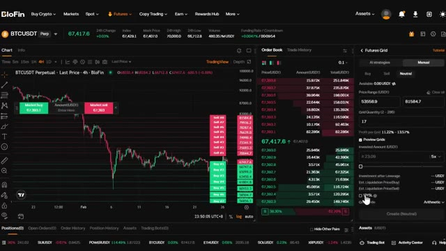
*⏱️ 00:00:17 — Interface de trading de Blofin pour la paire BTCUSDT montrant un graphique des prix en chandelier, un carnet d'ordres en temps réel et le panneau de configuration pour un Futures Grid bot.*

---

### ⏱️ `[00:00:34 - 00:01:12]` | Segment #02

**🔊 Audio (Transcription Intégrale Mot pour Mot en Français) :**
> il. Première des choses, vous avez besoin d'un compte Blofin. Si vous n'en avez pas encore un, cliquez sur le lien dans la description. Vous aurez accès à des bonus exclusifs rien qu'en vous inscrivant et en tradant. Je vous montrerai exactement comment réclamer ceux-ci plus tard dans la vidéo. Cela prend moins d'une minute de créer votre compte. Une fois que vous êtes connecté, assurez-vous d'avoir des fonds sur votre compte. Si vous devez déposer, allez simplement dans actifs, cliquez sur dépôt, sélectionnez USDT, choisissez votre réseau. Je recommande TRC20 pour des frais bas et envoyez vos fonds. Ils arriveront en quelques minutes. Maintenant, entrons dans le vif du sujet avec les bots. Survolez futures dans le menu supérieur et cliquez sur bots de trading. C'est votre tableau de bord de bot. Tout en haut, vous

**👁️ Analyse Visuelle d'Écran (gemini-3.5-flash-lite) :**
**Interface & Outils** : Interface web de la plateforme d'échange de cryptomonnaies BloFin.

**Contenu textuel & Code** : Détails des bonus de bienvenue, sections "Rewards Hub", "Overview", soldes de compte (15.68 USDT).

**Action / Démonstration** : Navigation sur la plateforme BloFin pour présenter les bonus et l'interface du compte.

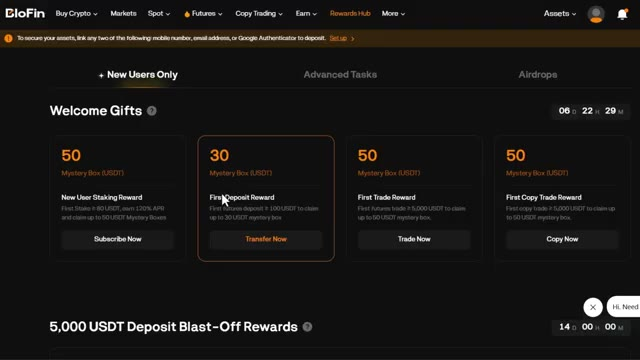
*⏱️ 00:00:44 — Page des récompenses (Rewards Hub) de la plateforme BloFin montrant les bonus de bienvenue.*

*⏱️ 00:00:53 — Page d'accueil de la plateforme d'échange de cryptomonnaies BloFin avec le slogan "Where Whales are Made".*

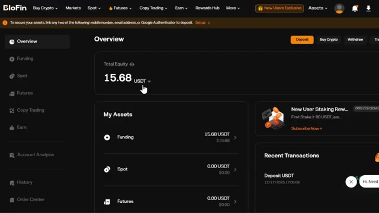
*⏱️ 00:01:02 — Tableau de bord du compte utilisateur sur BloFin affichant un solde de 15.68 USDT dans la section Funding.*

---

### ⏱️ `[00:01:12 - 00:01:36]` | Segment #03

**🔊 Audio (Transcription Intégrale Mot pour Mot en Français) :**
> voir votre P&L total, vos actifs totaux et vos bots en cours d'exécution. Faites maintenant défiler un peu vers le bas et vous verrez quelque chose de vraiment sympa. Blowfin va en fait vous faire correspondre au bon bot de trading en fonction de vos préférences. Cliquez sur essayer EasyBot. Ici, vous pouvez répondre à quelques questions comme sur quels contrats ou quelle devise aimeriez-vous vous concentrer ? Quelle direction du marché attendez-vous ? Haussière, baissière ou volatile ?

**👁️ Analyse Visuelle d'Écran (gemini-3.5-flash-lite) :**
**Interface & Outils** : Interface web de la plateforme d'échange Blofin Trading Bots

**Contenu textuel & Code** : P&L Total (0), Actifs Totaux (0.00), Bots en cours d'exécution (0), options de bots (Futures Grid, Futures DCA, Spot Grid, Spot DCA, Signal Bot, TWAP) et bouton "Try Easy Bot".

**Action / Démonstration** : Navigation sur la page des bots de trading de Blofin pour présenter les fonctionnalités de matching et de création de bots automatisés.

*⏱️ 00:01:18 — Capture d'écran de l'interface des bots de trading de la plateforme Blofin montrant le tableau de bord avec les métriques P&L, les actifs totaux, la section de matching des bots et les options de création de bots (Futures Grid, Futures DCA, Spot Grid, Spot DCA, Signal Bot, TWAP).*

---

### ⏱️ `[00:01:36 - 00:01:54]` | Segment #04

**🔊 Audio (Transcription Intégrale Mot pour Mot en Français) :**
> Une fois que vous avez terminé, cliquez sur obtenir ma correspondance. L'intelligence artificielle de Blowfin choisira la meilleure correspondance en fonction de vos critères. Vous pouvez voir le type de bot, le taux annuel en pourcentage testé sur données historiques, la période suggérée, et même la raison pour laquelle l'intelligence artificielle de Blowfin vous a associé à ce bot. C'est parfait si vous voulez simplement commencer rapidement sans trop réfléchir.

**👁️ Analyse Visuelle d'Écran (gemini-3.5-flash-lite) :**
**Interface & Outils** : Interface web de la plateforme de trading de bots BioFin.

**Contenu textuel & Code** : Actif sélectionné (BTCUSDT), orientation du marché (Bullish), type de bot recommandé (Futures Grid), APR backtesté (+737,42%), période suggérée (7 - 20 jours).

**Action / Démonstration** : Sélection de la paire de trading et de la tendance de marché pour obtenir une correspondance de bot de trading automatisé.

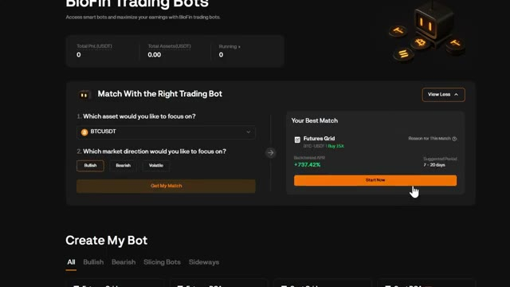
*⏱️ 00:01:41 — Interface des bots de trading BioFin montrant l'outil de correspondance avec suggestion de bot (Futures Grid) affichant un APR de +737,42%.*

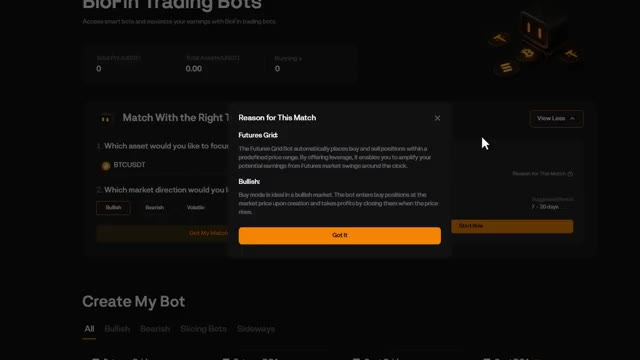
*⏱️ 00:01:50 — Fenêtre contextuelle affichant la raison de la correspondance (Reason for This Match) expliquant le fonctionnement du Futures Grid Bot.*

---

### ⏱️ `[00:01:55 - 00:02:16]` | Segment #05

**🔊 Audio (Transcription Intégrale Mot pour Mot en Français) :**
> Maintenant, faites défiler un peu plus bas et vous verrez la section Créer mon bot. Ici, vous pouvez voir tous les bots disponibles. Vous pouvez également voir la direction du marché et le bon bot pour cette condition de marché. Des bots haussiers, baissiers, de découpage et latéraux. Nous reviendrons sur la façon d'en créer un vous-même dans quelques minutes. Faites défiler un peu plus bas et vous verrez les bots IA fournis par Blowfin.

**👁️ Analyse Visuelle d'Écran (gemini-3.5-flash-lite) :**
**Interface & Outils** : Interface web de trading automatisé ou d'échange de cryptomonnaies.

**Contenu textuel & Code** : Liste des bots de trading classés par stratégie (Futures Grid, Futures DCA, Spot Grid, Spot DCA, Signal Bot, TWAP) et filtres par direction du marché (All, Bullish, Bearish, Slicing Bots, Sideways).

**Action / Démonstration** : Présentation des différents types de bots de trading et de leur correspondance avec les conditions de marché.

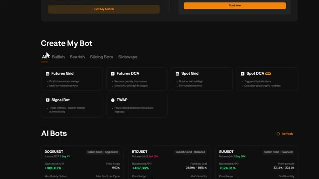
*⏱️ 00:02:00 — Capture d'écran montrant la section "Create My Bot" avec les différentes catégories de robots de trading disponibles (Futures Grid, Futures DCA, Spot Grid, Spot DCA, Signal Bot, TWAP) et les filtres de conditions de marché.*

---

### ⏱️ `[00:02:16 - 00:02:40]` | Segment #06

**🔊 Audio (Transcription Intégrale Mot pour Mot en Français) :**
> Ici, vous pouvez voir la crypto, le type de tendance dans laquelle elle se trouve, le type de robot recommandé, le biais et l'effet de levier utilisé. Vous pouvez également voir l'APR testé par anticipation, le profit par grille, la fourchette de prix et la quantité de grilles. Cela vous donne une tonne de données pour décider si vous voulez copier l'un de ces robots. Une fois que vous cliquez sur créer maintenant sur l'un de ces robots, cela vous amène au tableau de bord de trading où vous pouvez voir tous les paramètres.

**👁️ Analyse Visuelle d'Écran (gemini-3.5-flash-lite) :**
**Interface & Outils** : Interface web de trading de cryptomonnaies / section AI Bots.

**Contenu textuel & Code** : Paires de cryptos (DOGEUSDT, BTCUSDT, SUIUSDT, SOLUSDT, ETHUSDT, XRPUSDT), types de robots (Futures DCA, Futures Grid), tendances de marché (Bullish/Bearish Trend), APR testés par anticipation (+365.07%, +467.36%, +524.31%), effets de levier (Buy 7X, Sell 10X), fourchettes de prix, et boutons 'Create Now'.

**Action / Démonstration** : Survol du curseur de la souris sur le premier robot de trading (DOGEUSDT) pour la création d'un bot de trading.

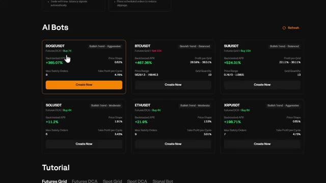
*⏱️ 00:02:22 — Capture d'écran montrant une interface de robots de trading automatisés (AI Bots) avec plusieurs paires de cryptomonnaies telles que DOGEUSDT, BTCUSDT et SUIUSDT, affichant leurs performances et paramètres.*

---

### ⏱️ `[00:02:41 - 00:03:01]` | Segment #07

**🔊 Audio (Transcription Intégrale Mot pour Mot en Français) :**
> Tout ce que vous avez à faire est de saisir votre montant d'investissement et de cliquer sur créer, qu'il s'agisse d'une position d'achat ou de vente. Maintenant que vous savez comment naviguer sur le tableau de bord, parlons de tous les types de bots disponibles. Ici, vous pouvez voir différents types de bots. Futures Grid. C'est idéal pour les marchés volatils. Il tire profit des fluctuations de prix en plaçant des ordres d'achat et de vente sur une plage de prix définie.

**👁️ Analyse Visuelle d'Écran (gemini-3.5-flash-lite) :**
**Interface & Outils** : Plateforme de trading Blofin (Interface Futures et section Trading Bots)

**Contenu textuel & Code** : Graphique de prix BTCUSDT (4H), indicateurs de tendance, carnet d'ordres, paramètres de bot Grid (levier x10, fourchette de prix, montant d'investissement) et liste des types de bots de trading.

**Action / Démonstration** : Navigation sur la plateforme, saisie du montant d'investissement et présentation des différents types de bots de trading disponibles.

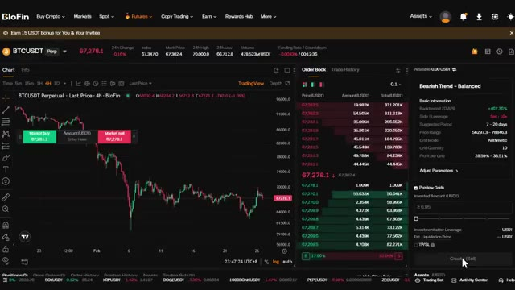
*⏱️ 00:02:46 — Interface de trading Blofin montrant un graphique BTCUSDT Perpetual sur 4 heures, un carnet d'ordres et le panneau de configuration d'un bot Grid avec le bouton de création.*

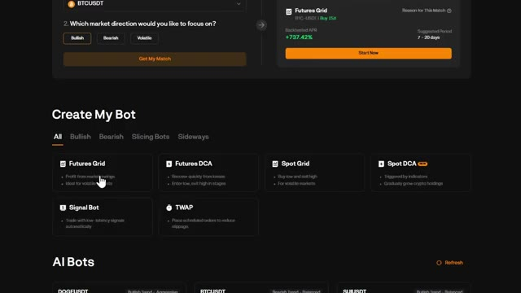
*⏱️ 00:02:51 — Page de création de bots sur la plateforme Blofin affichant les différents types de bots disponibles (Futures Grid, Futures DCA, Spot Grid, Spot DCA, Signal Bot, TWAP).*

---

### ⏱️ `[00:03:02 - 00:03:33]` | Segment #08

**🔊 Audio (Transcription Intégrale Mot pour Mot en Français) :**
> Futures DCA. Il s'agit d'achats périodiques par moyennes de coûts pour les contrats à terme. Cela achète à intervalles réguliers quel que soit le prix, parfait pour l'accumulation à long terme avec effet de levier. Grid Spot. Cela fonctionne comme une grille de futures, mais sans effet de levier. Idéal pour les marchés stagnants où vous souhaitez acheter bas et vendre haut automatiquement. DCA Spot. C'est l'option la plus sûre. Cela achète la cryptomonnaie de votre choix à intervalles réguliers sans effet de levier, éliminant ainsi l'émotion de l'investissement. SignalBot. Celui-ci est unique.

**👁️ Analyse Visuelle d'Écran (gemini-3.5-flash-lite) :**
**Interface & Outils** : Interface web d'une plateforme de trading (type exchange crypto).

**Contenu textuel & Code** : Menu de sélection des bots avec les options : Futures Grid, Futures DCA, Spot Grid, Spot DCA, Signal Bot, et TWAP, ainsi qu'une section 'AI Bots'.

**Action / Démonstration** : Le curseur de la souris survole et sélectionne l'option 'Futures DCA'.

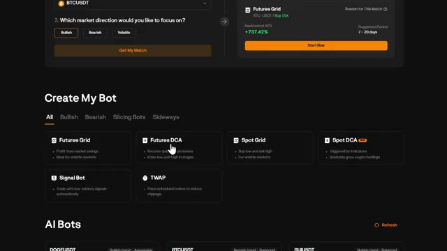
*⏱️ 00:03:09 — Interface de création de bots de trading affichant les différentes stratégies disponibles (Futures Grid, Futures DCA, Spot Grid, Spot DCA, Signal Bot, TWAP).*

---

### ⏱️ `[00:03:33 - 00:03:52]` | Segment #09

**🔊 Audio (Transcription Intégrale Mot pour Mot en Français) :**
> Il vous permet d'automatiser des transactions basées sur des signaux TradingView. TWAP ou prix moyen pondéré dans le temps. Cela répartit votre ordre sur une période définie pour éviter le slippage. Maintenant, laissez-moi vous montrer comment créer chacun d'eux, en commençant par le plus populaire, la grille Futures. Créons un bot de grille Futures à partir de zéro.

**👁️ Analyse Visuelle d'Écran (gemini-3.5-flash-lite) :**
**Interface & Outils** : Interface web de trading de bots (type exchange crypto).

**Contenu textuel & Code** : Options de bots disponibles : Futures Grid, Futures DCA, Spot Grid, Spot DCA, Signal Bot, et TWAP (Place scheduled orders to reduce slippage).

**Action / Démonstration** : Le curseur de la souris survole et sélectionne l'option de stratégie TWAP pour la création d'un bot.

*⏱️ 00:03:38 — Interface de création de bot montrant différentes stratégies de trading, avec un curseur sur l'option TWAP.*

---

### ⏱️ `[00:03:52 - 00:04:13]` | Segment #10

**🔊 Audio (Transcription Intégrale Mot pour Mot en Français) :**
> C'est l'un des bots les plus populaires car il tire profit de la volatilité. Cliquez sur Grille de Futures. En haut à gauche, vous pouvez sélectionner votre paire de trading. Prenons Bitcoin USDT. Vous pouvez rechercher n'importe quelle paire que vous voulez ici. Sur le côté droit, vous verrez les sélections de Blowfin AI. Ce sont des bots pré-conçus avec leurs statistiques si vous voulez les utiliser comme référence.

**👁️ Analyse Visuelle d'Écran (gemini-3.5-flash-lite) :**
**Interface & Outils** : Interface de la plateforme d'échange de cryptomonnaies Blofin (section Futures et bots de trading).

**Contenu textuel & Code** : Options de création de bots (Futures Grid, Futures DCA, Spot Grid, Spot DCA, Signal Bot, TWAP), graphique des prix du BTCUSDT avec indicateurs techniques, carnet d'ordres en temps réel et stratégies de grille de futures avec performances affichées (APR).

**Action / Démonstration** : Navigation dans le menu de création de bots, sélection du type de bot "Futures Grid" et visualisation de l'interface de trading avec le panneau de configuration des grilles sur le côté droit.

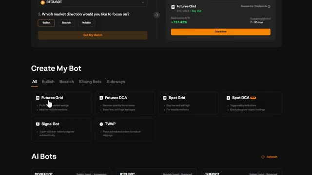
*⏱️ 00:03:57 — Interface de création de bot sur Blofin, montrant les différentes options de trading automatisé comme le Futures Grid.*

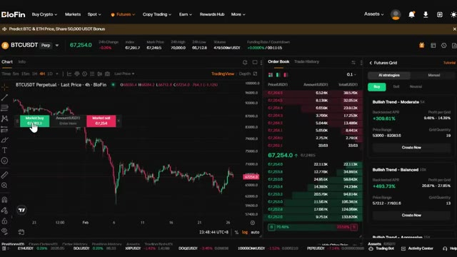
*⏱️ 00:04:02 — Interface de trading Blofin pour la paire BTCUSDT, affichant un graphique en chandeliers en haut à gauche, un carnet d'ordres au centre et le module Futures Grid sur la droite.*

---

### ⏱️ `[00:04:13 - 00:04:47]` | Segment #11

**🔊 Audio (Transcription Intégrale Mot pour Mot en Français) :**
> Vous avez deux modes, les stratégies d'IA et le mode manuel. Commençons par la stratégie d'IA. Ici, l'IA de Blowfin vous montrera les bots pré-conçus. Vous pouvez choisir la direction ici, telle que l'achat, la vente et le neutre. Ici, vous pouvez également voir le nom du bot, l'effet de levier utilisé, le taux annuel en pourcentage (APR) testé rétroactivement, la fourchette de prix, les profits par grille et la quantité de grilles en fonction des conditions actuelles du marché. Une fois que vous cliquez sur créer maintenant, tout ce que vous avez à faire est d'entrer votre montant d'investissement total. Vous pouvez voir sur le graphique du côté gauche l'aperçu des grilles où il achètera ou vendra en fonction de vos paramètres. Maintenant, si vous voulez tout

**👁️ Analyse Visuelle d'Écran (gemini-3.5-flash-lite) :**
**Interface & Outils** : Plateforme d'échange de cryptomonnaies BloFin (interface Futures Grid).

**Contenu textuel & Code** : Graphique en chandeliers 4H du BTCUSDT, carnet d'ordres en temps réel, et panneaux des stratégies de bots IA (Bullish Trend - Moderate avec un APR backtesté de +309,61%, fourchette de prix 53060 - 82083,6).

**Action / Démonstration** : Présentation et explication du mode de stratégies d'IA pour les bots de grille pré-conçus sur BloFin, montrant les performances et les paramètres de prix.

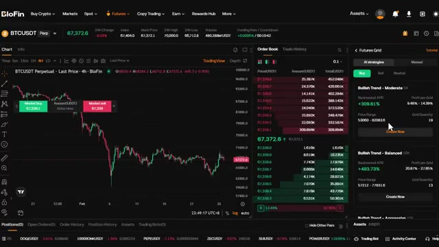
*⏱️ 00:04:22 — Capture d'écran de l'interface de trading BloFin affichant le graphique du BTCUSDT, le carnet d'ordres et le panneau de configuration des bots de grille (Futures Grid) avec les stratégies d'IA sélectionnées.*

---

### ⏱️ `[00:04:47 - 00:05:21]` | Segment #12

**🔊 Audio (Transcription Intégrale Mot pour Mot en Français) :**
> contrôle, vous pouvez passer en mode manuel en cliquant sur ajuster les paramètres. Ici, vous pouvez définir manuellement la fourchette de prix, le nombre de grilles et votre effet de levier. Vous pouvez également voir le take profit et le stop loss, qu'il est fortement recommandé d'activer. Ceux-ci sont optionnels, mais ils vous donnent un contrôle supplémentaire sur la gestion des risques. Vous pouvez également définir le mode de grille tel que arithmétique et géométrique. Arithmétique signifie que la différence de prix entre chaque grille est égale. Donc, si vous définissez des grilles espacées de 100 dollars, chaque grille sera exactement espacée de 100 dollars. Géométrique signifie que la différence en pourcentage entre les grilles est égale.

**👁️ Analyse Visuelle d'Écran (gemini-3.5-flash-lite) :**
**Interface & Outils** : Plateforme d'échange de cryptomonnaies Blofin (section Futures Grid / Trading Bots).

**Contenu textuel & Code** : Paramètres de trading de grille (Futures Grid) incluant la fourchette de prix, le nombre de grilles (17), l'effet de levier (5x) et les champs de configuration Take Profit (TP) et Stop Loss (SL).

**Action / Démonstration** : Ajustement manuel de l'effet de levier et configuration des seuils de protection (Take Profit / Stop Loss) pour un bot de grille futures.

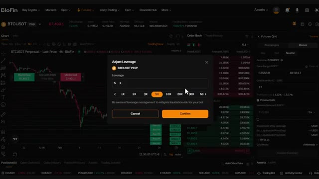
*⏱️ 00:04:55 — Interface de la plateforme Blofin montrant une fenêtre pop-up pour ajuster l'effet de levier (réglé sur 5x) sur une paire BTC/USDT.*

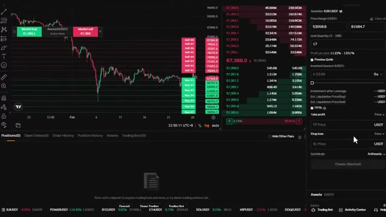
*⏱️ 00:05:04 — Interface de configuration des bots de trading de Blofin, mettant en évidence les options de Take Profit et Stop Loss dans le panneau latéral droit.*

---

### ⏱️ `[00:05:21 - 00:05:55]` | Segment #13

**🔊 Audio (Transcription Intégrale Mot pour Mot en Français) :**
> C'est mieux pour les marchés volatils car cela s'ajuste à des fluctuations de prix plus importantes. Une fois que tout semble bon, cliquez sur créer et votre bot grid futures devient actif. Ensuite, voici le bot DCA futures, le « dollar cost averaging » avec effet de levier. C'est idéal si vous voulez accumuler une position au fil du temps tout en utilisant l'effet de levier pour amplifier vos rendements. Voici comment cela fonctionne : tout d'abord, sélectionnez votre paire de trading, choisissez la crypto dans laquelle vous voulez investir dans le coin supérieur gauche. Sur le côté droit, vous pouvez toujours voir deux modes comme auparavant, stratégies IA et manuel. Vous pouvez choisir entre acheter et vendre et voir le blowfin.

**👁️ Analyse Visuelle d'Écran (gemini-3.5-flash-lite) :**
**Interface & Outils** : Blofin (plateforme d'échange de cryptomonnaies)

**Contenu textuel & Code** : Options de bots de trading (Futures Grid, Futures DCA, Spot Grid, Spot DCA, Signal Bot, TWAP), stratégies IA de DCA avec des APR backtestés (+14,70 %, +58,35 %), et carnet d'ordres en temps réel.

**Action / Démonstration** : Navigation dans le menu de création de bots de trading automatisés puis visualisation de l'interface de trading avec le panneau Futures DCA.

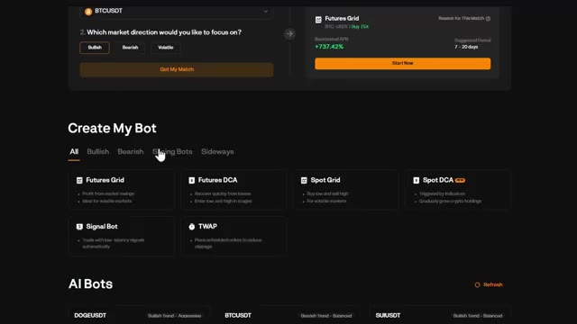
*⏱️ 00:05:30 — Interface de création de bot sur une plateforme crypto, affichant différentes options de bots comme le Futures Grid et le Futures DCA.*

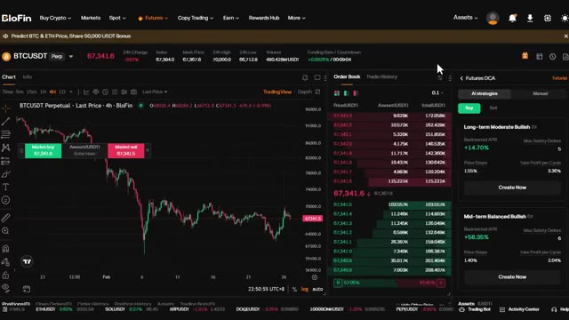
*⏱️ 00:05:38 — Interface de trading de la plateforme Blofin montrant un graphique de prix BTCUSDT en chandelier, le carnet d'ordres et le panneau de configuration du bot Futures DCA.*

---

### ⏱️ `[00:05:55 - 00:06:30]` | Segment #14

**🔊 Audio (Transcription Intégrale Mot pour Mot en Français) :**
> Recommandations de robots IA. Vous pouvez voir le nom, l'effet de levier utilisé, le taux annuel en pourcentage (APR) testé sur l'historique, le nombre maximal d'ordres de sécurité, les paliers de prix et le cycle de take profit. Si vous avez sélectionné celui qui vous plaît, cliquez sur créer maintenant. Ici, vous pouvez saisir le montant investi. Une fois que vous avez tout configuré, cliquez sur créer, et le bot s'occupe du reste. Maintenant, si vous voulez un contrôle total, vous pouvez l'ajuster en passant en mode manuel en cliquant sur ajuster les paramètres. Ici, vous pouvez définir manuellement les paliers de prix, le take profit par cycle et le nombre maximal d'ordres de sécurité. Les paliers de prix déterminent de combien le prix doit baisser avant que le bot n'achète à nouveau.

**👁️ Analyse Visuelle d'Écran (gemini-3.5-flash-lite) :**
**Interface & Outils** : BloFin (Échange de cryptomonnaies / Interface Futures DCA)

**Contenu textuel & Code** : Graphique de prix BTCUSDT, carnet d'ordres en temps réel, et configurations de robots IA (stratégie 'Long-term Moderate Bullish' avec un APR backtesté de +14,70%, 5 ordres de sécurité maximum, paliers de prix à 1,55%, et Take Profit par cycle à 3,36% ; stratégie 'Mid-term Balanced Bullish' avec un APR de +56,35%, 6 ordres de sécurité, paliers à 1,40%, Take Profit à 2,04%).

**Action / Démonstration** : Sélection et présentation des recommandations de robots IA, avec le curseur de la souris positionné sur le bouton 'Create Now'.

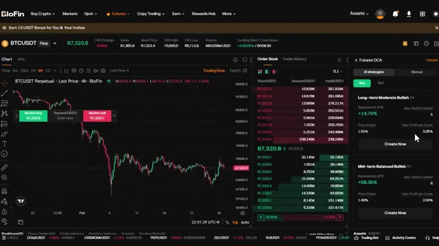
*⏱️ 00:06:04 — Interface de la plateforme BloFin affichant un graphique de prix BTCUSDT en unités 4h, le carnet d'ordres au centre et un panneau de stratégies de robots IA pour le Futures DCA sur la droite.*

---

### ⏱️ `[00:06:31 - 00:07:03]` | Segment #15

**🔊 Audio (Transcription Intégrale Mot pour Mot en Français) :**
> Les ordres de sécurité maximum correspondent au nombre maximal de fois où le bot renforcera votre position. Le take profit par cycle définit le pourcentage de profit que le bot vise avant de clôturer l'ensemble de la position. Une fois que tout vous convient, cliquez sur créer et le bot sera actif. Au fait, si vous voulez les instructions de configuration complètes sur la façon de trader en utilisant votre application Telegram, comment intégrer Claude à TradingView ou analyser les baleines sur Hyperliquid, le tout automatiquement, chaque invite, chaque guide étape par étape et tous les modèles d'agents que j'utilise personnellement, tout cela se trouve à l'intérieur

**👁️ Analyse Visuelle d'Écran (gemini-3.5-flash-lite) :**
**Interface & Outils** : Interface d'échange de cryptomonnaies (Blofin) et page web de documentation technique.

**Contenu textuel & Code** : Paramètres de bot DCA (Take Profit par cycle, Max Safety Orders) et documentation sur l'automatisation de TradingView.

**Action / Démonstration** : Configuration des paramètres d'un bot de trading automatisé et navigation dans la documentation technique.

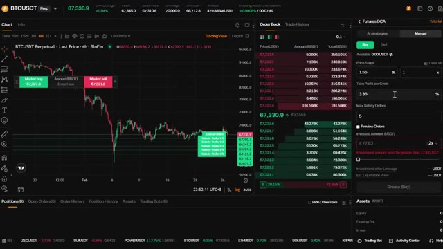
*⏱️ 00:06:39 — Interface de trading de contrats à terme (Futures DCA) affichant un graphique de prix Bitcoin, un carnet d'ordres et les paramètres de configuration du bot.*

---

### ⏱️ `[00:07:03 - 00:07:36]` | Segment #16

**🔊 Audio (Transcription Intégrale Mot pour Mot en Français) :**
> le lien de la communauté ai trade edge est dans la description le bot de grille au comptant fonctionne exactement comme la grille futures mais sans effet de levier il est parfait si vous voulez acheter bas et vendre haut automatiquement dans un marché en range sans le risque de liquidation en haut à gauche vous pouvez sélectionner votre paire de trading allons-y avec Ethereum USDT vous pouvez rechercher n'importe quelle paire que vous voulez ici sur le côté droit vous verrez les sélections de Blofin AI ce sont des bots préconçus avec leurs statistiques si vous voulez les utiliser comme référence vous avez deux modes les stratégies IA et le mode manuel commençons par

**👁️ Analyse Visuelle d'Écran (gemini-3.5-flash-lite) :**
**Interface & Outils** : Plateforme d'échange de cryptomonnaies Blofin (Interface Spot Grid et TradingView intégré).

**Contenu textuel & Code** : Options de bots de trading (Spot Grid, Futures Grid, Futures DCA, Spot DCA, Signal Bot, TWAP) et stratégies AI avec Backtested APR et plages de prix.

**Action / Démonstration** : Sélection et présentation de la stratégie 'Spot Grid' pour automatiser l'achat bas et la vente haut sans effet de levier.

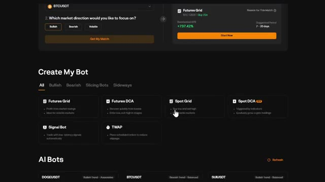
*⏱️ 00:07:12 — Interface de création de bot sur Blofin, montrant différentes options de bots de trading dont le 'Spot Grid' sélectionné par le curseur.*

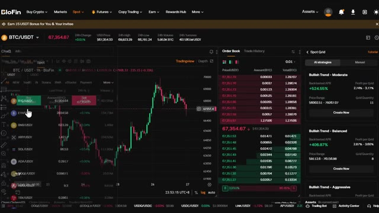
*⏱️ 00:07:20 — Interface de trading de la plateforme Blofin affichant un graphique en chandeliers BTC/USDT, le carnet d'ordres et les stratégies de bots 'Spot Grid' sur le panneau latéral droit.*

---

### ⏱️ `[00:07:36 - 00:08:10]` | Segment #17

**🔊 Audio (Transcription Intégrale Mot pour Mot en Français) :**
> stratégie IA. Ici, l'IA de Blofin vous montrera les bots pré-fabriqués. Ici, vous pouvez également voir le nom du bot, le taux de rendement annuel (APR) testé sur données historiques, la fourchette de prix, les profits par grille et la quantité de grilles en fonction des conditions actuelles du marché. Remarquez qu'il n'y a pas d'effet de levier ici. Vous tradez uniquement avec votre propre capital, ce qui rend cela beaucoup plus sûr. Une fois que vous cliquez sur créer maintenant, tout ce que vous avez à faire est d'entrer votre montant total d'investissement. Vous pouvez voir sur un graphique sur le côté gauche les grilles de prévision où il achètera ou vendra en fonction de vos paramètres. Le bot placera des ordres d'achat à l'extrémité inférieure de la fourchette et vendra

**👁️ Analyse Visuelle d'Écran (gemini-3.5-flash-lite) :**
**Interface & Outils** : Échange de cryptomonnaies Blofin (interface web de trading spot et bots grid)

**Contenu textuel & Code** : Graphique en chandeliers ETH/USDT en unité 1h, carnet d'ordres en temps réel, et options de stratégie IA de grille (Spot Grid) affichant des taux de rendement (Backtested APR) comme +478,95 % et +358,30 %, ainsi que des fourchettes de prix et le nombre de grilles.

**Action / Démonstration** : Sélection et présentation des stratégies de bots de trading automatisés basés sur l'IA (Spot Grid) proposées par la plateforme Blofin.

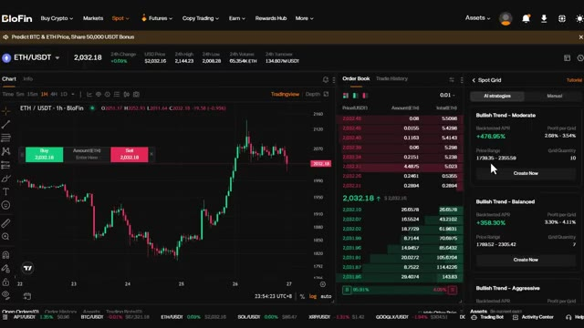
*⏱️ 00:07:45 — Interface de trading de la plateforme Blofin montrant le graphique de la paire ETH/USDT, le carnet d'ordres et le panneau latéral de configuration des bots "Spot Grid" avec des stratégies IA prédéfinies.*

---

### ⏱️ `[00:08:10 - 00:08:44]` | Segment #18

**🔊 Audio (Transcription Intégrale Mot pour Mot en Français) :**
> des ordres sur la partie supérieure, en capturant les profits à chaque fluctuation des prix. C'est idéal pour accumuler une position au fil du temps sans effet de levier. Maintenant, si vous voulez un contrôle total, vous pouvez passer en mode manuel en cliquant sur ajuster les paramètres. Ici, vous pouvez définir manuellement la plage de prix et le nombre de grilles vous-même. Vous pouvez également définir le mode de grille, comme arithmétique et géométrique, tout comme avec la grille de contrats futures. Une fois que tout semble correct, cliquez sur créer et votre bot de grille au comptant se lance. Le bot DCA au comptant est l'option la plus sûre. Il est parfait pour les investisseurs à long terme qui veulent accumuler

**👁️ Analyse Visuelle d'Écran (gemini-3.5-flash-lite) :**
**Interface & Outils** : BloFin (Échange de cryptomonnaies)

**Contenu textuel & Code** : Paire ETH/USDT, graphique des prix en chandelier 1h, carnet d'ordres en temps réel, panneau de configuration "Spot Grid" (mode Manuel sélectionné, stratégie "Bullish Trend - Moderate", Backtested 7D APY +470.95%, plage de prix 1739.35 - 2355.59, 10 grilles arithmétiques).

**Action / Démonstration** : Présentation du panneau de configuration manuelle des grilles sur BloFin pour ajuster les paramètres de trading.

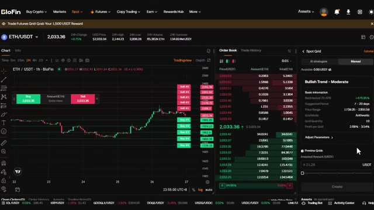
*⏱️ 00:08:19 — Interface de trading de la plateforme BloFin montrant le graphique de la paire ETH/USDT en mode Spot Grid, avec le carnet d'ordres au centre et les paramètres de stratégie manuelle sur le panneau de droite.*

---

### ⏱️ `[00:08:44 - 00:09:19]` | Segment #19

**🔊 Audio (Transcription Intégrale Mot pour Mot en Français) :**
> sans effet de levier et sans vous soucier du timing du marché. Cliquez sur DCA au comptant. Voici comment cela fonctionne. D'abord, sélectionnez votre paire de trading. Choisissez la crypto dans laquelle vous voulez investir dans le coin supérieur gauche. Sur le côté droit, vous pouvez toujours voir deux modes comme avant, stratégies IA et manuel. Vous pouvez voir le nom, le taux annuel effectif global testé sur l'historique, les ordres de sécurité maximum, les paliers de prix et le cycle de prise de profits. Remarquez qu'il n'y a pas d'effet de levier ici. Il s'agit de trading au comptant pur, ce qui signifie que vous utilisez uniquement votre propre capital avec un risque de liquidation nul. Si vous avez sélectionné celle qui vous plaît, cliquez sur créer maintenant. Ici, vous pouvez entrer le

**👁️ Analyse Visuelle d'Écran (gemini-3.5-flash-lite) :**
**Interface & Outils** : BloFin (Échange de cryptomonnaies)

**Contenu textuel & Code** : Paire BTC/USDT sélectionnée en haut à gauche (prix actuel autour de 67 303.92 USDT), graphique de bougies japonaises en unité 1h, carnet d'ordres (Order Book) au milieu, et module de stratégie « Spot DCA » avec des options automatisées sur la droite (« Long-term Moderate Bullish », « Mid-term Balanced Bullish »).

**Action / Démonstration** : Sélection de la paire de trading et présentation de l'interface Spot DCA sur la plateforme BloFin.

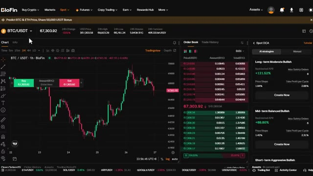
*⏱️ 00:08:53 — Interface de la plateforme BloFin montrant le graphique de la paire BTC/USDT en mode Spot, avec le carnet d'ordres au centre et les options Spot DCA sur le panneau de droite.*

---

### ⏱️ `[00:09:19 - 00:09:53]` | Segment #20

**🔊 Audio (Transcription Intégrale Mot pour Mot en Français) :**
> montant investi. Le bot achètera automatiquement à intervalles réguliers, peu importe le prix. Cela élimine toute émotion de l'investissement et vous aide à vous constituer une position au fil du temps. Une fois que vous avez tout configuré, cliquez sur créer, et le bot s'occupe du reste. Maintenant, si vous voulez un contrôle total, vous pouvez l'ajuster en passant en mode manuel en cliquant sur ajuster les paramètres, ici vous pouvez définir manuellement les paliers de prix, le take profit par cycle et les ordres de sécurité max. C'est la stratégie ultime du "régler et oublier", vous n'avez pas besoin de surveiller les graphiques, vous n'avez pas besoin de chronométrer le marché, vous laissez simplement le bot

**👁️ Analyse Visuelle d'Écran (gemini-3.5-flash-lite) :**
**Interface & Outils** : Plateforme d'échange de cryptomonnaies BloFin, interface de trading Spot et bot Spot DCA.

**Contenu textuel & Code** : Paire BTC/USDT au prix de 67,359.68 USD, carnet d'ordres en direct, graphique de prix avec des marqueurs verts indiquant les niveaux de "Safety Orders" (ordres de sécurité) du DCA, et le panneau de configuration du bot affichant une stratégie "Bullish Trend - Moderate" avec un Backtested 7D APR de +121.52%.

**Action / Démonstration** : Configuration et visualisation des paramètres d'un bot Spot DCA sur la plateforme BloFin pour automatiser les achats périodiques de Bitcoin.

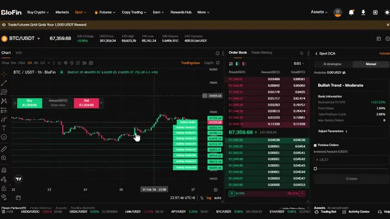
*⏱️ 00:09:27 — Capture d'écran de l'interface de la plateforme de trading BloFin montrant le graphique de la paire BTC/USDT en unité de temps 1h, avec le carnet d'ordres et le panneau de configuration d'un bot Spot DCA (Dollar Cost Averaging).*

---

### ⏱️ `[00:09:53 - 00:10:14]` | Segment #21

**🔊 Audio (Transcription Intégrale Mot pour Mot en Français) :**
> s'accumuler pour vous sur des semaines, des mois ou même des années. Une fois que tout est à votre convenance, cliquez sur créer et le bot sera actif. Maintenant, parlons du bot de signal. Celui-ci est vraiment intéressant parce qu'il vous permet d'automatiser des trades basés sur des signaux TradingView. Lorsque vous cliquez sur SignalBot, cela vous amène au tableau de bord de trading. En haut à droite, vous verrez un bouton Ajouter un signal.

**👁️ Analyse Visuelle d'Écran (gemini-3.5-flash-lite) :**
**Interface & Outils** : Plateforme d'échange de cryptomonnaies Blofin (interface de bot de trading Spot DCA et menu de sélection des bots).

**Contenu textuel & Code** : Graphique de prix BTC/USDT, niveaux de safety orders d'un bot DCA, carnet d'ordres (Order Book), paramètres de configuration de bot (Price Steps, Take Profit, Invested Amount) et types de bots disponibles (Futures Grid, Futures DCA, Spot Grid, Spot DCA, Signal Bot, TWAP).

**Action / Démonstration** : Configuration et finalisation d'un bot Spot DCA sur l'image 1, puis navigation vers le menu de création de bots pour sélectionner le Signal Bot sur l'image 2.

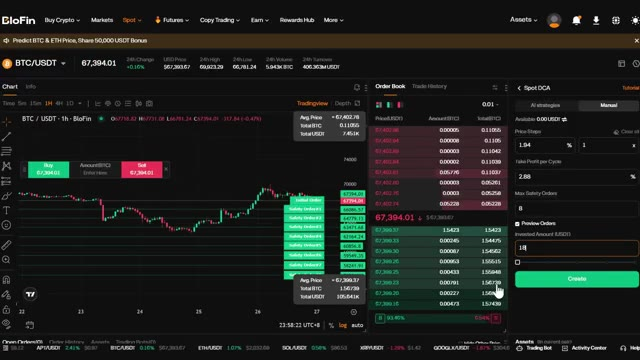
*⏱️ 00:09:59 — Interface de trading de la plateforme Blofin montrant un graphique BTC/USDT en bougies 1h avec les niveaux d'un bot Spot DCA configurés, un carnet d'ordres central et un panneau latéral de configuration manuelle.*

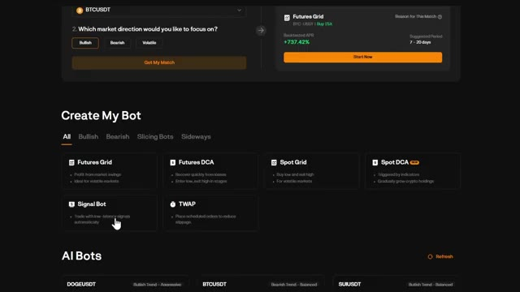
*⏱️ 00:10:04 — Page de sélection des bots de trading sur Blofin ("Create My Bot") avec le curseur de la souris pointant sur l'option "Signal Bot" permettant d'automatiser des trades basés sur des signaux.*

---

### ⏱️ `[00:10:14 - 00:10:47]` | Segment #22

**🔊 Audio (Transcription Intégrale Mot pour Mot en Français) :**
> Cliquez sur ceci. Voici comment cela fonctionne. Les SignalBots de Blofin peuvent analyser les signaux générés par les scripts de stratégie TradingView. Cela signifie que si vous avez une stratégie de trading sur TradingView, vous pouvez la connecter directement à Blofin et automatiser vos trades. Maintenant, voici ce que vous devez savoir. Ne partagez votre URL de webhook ou votre jeton de signal avec personne. Blofin ne prend en charge que le mode de position à sens unique. Assurez-vous que votre stratégie TradingView ne repose pas sur le mode de couverture. Il peut y dans les risques de perte ou de retard de signal puisque cela repose sur une plateforme tierce. Très bien,

**👁️ Analyse Visuelle d'Écran (gemini-3.5-flash-lite) :**
**Interface & Outils** : Plateforme d'échange Blofin (interface web avec graphique BTCUSDT en arrière-plan et panneau de SignalBot).

**Contenu textuel & Code** : Fenêtre pop-up de configuration d'un signal Webhook avec des consignes textuelles ("Setup Tutorial") concernant l'utilisation des scripts de stratégie TradingView, le mode de position "One-way", ainsi que des champs pour nommer et décrire le signal.

**Action / Démonstration** : Configuration d'un bot de signal sur Blofin pour connecter une stratégie TradingView via webhook.

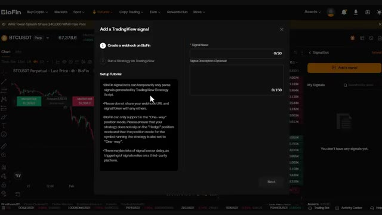
*⏱️ 00:10:22 — Interface de la plateforme Blofin affichant une fenêtre modale de configuration pour ajouter un signal TradingView ("Add a TradingView signal") avec des instructions et des champs de nom.*

---

### ⏱️ `[00:10:47 - 00:11:22]` | Segment #23

**🔊 Audio (Transcription Intégrale Mot pour Mot en Français) :**
> Voici comment le configurer. Premièrement, créez un nom de signal et une description de signal. C'est juste pour votre propre référence. Une fois que vous avez fait cela, cliquez sur suivant. Blowfin vous fournira un webhook, une URL et un message d'alerte. Copiez cette URL de webhook. Vous en aurez besoin pour TradingView. Allez maintenant sur TradingView, ouvrez votre stratégie, cliquez sur les alertes, et collez l'URL du webhook et le message d'alerte dans vos paramètres d'alerte. Une fois que vous avez terminé, cliquez sur terminer sur Blowfin. Votre signal apparaîtra désormais dans Mes signaux. À partir de là, vous pouvez créer un bot basé sur ces signaux. Cliquez sur Créer un bot. Ici, vous pouvez

**👁️ Analyse Visuelle d'Écran (gemini-3.5-flash-lite) :**
**Interface & Outils** : Blofin, TradingView.

**Contenu textuel & Code** : URL de webhook Blofin, payload JSON pour l'alerte TradingView, paramètres d'alerte de prix (BNBUSDT), carnet d'ordres et graphique de trading BTCUSDT.

**Action / Démonstration** : Configuration et association d'un signal webhook entre Blofin et TradingView.

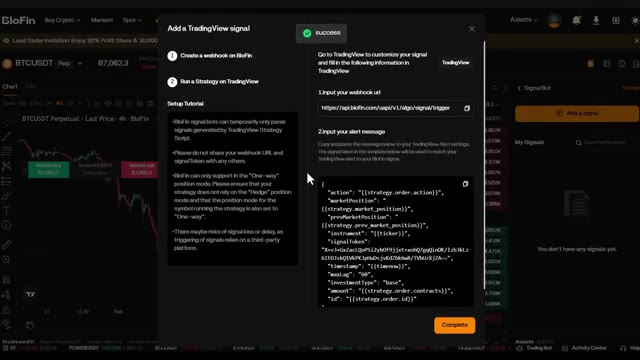
*⏱️ 00:10:56 — Interface de configuration d'un signal TradingView sur la plateforme Blofin montrant l'URL du webhook et le message d'alerte JSON.*

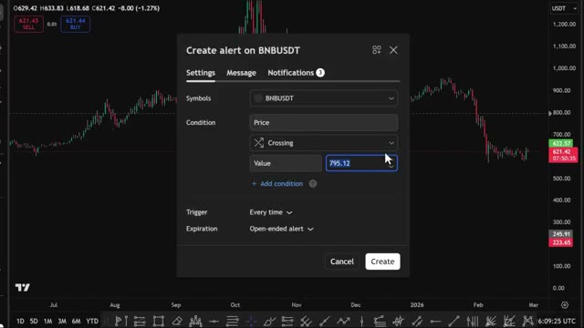
*⏱️ 00:11:05 — Fenêtre de création d'alerte sur le graphique TradingView pour BNBUSDT (paramètres, condition, prix).*

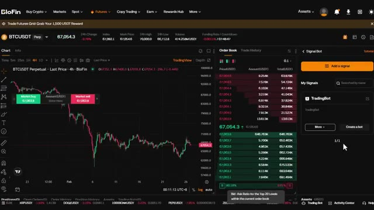
*⏱️ 00:11:13 — Interface principale de Blofin montrant le graphique de BTCUSDT, le carnet d'ordres et le panneau latéral du Bot de signaux.*

---

### ⏱️ `[00:11:22 - 00:11:50]` | Segment #24

**🔊 Audio (Transcription Intégrale Mot pour Mot en Français) :**
> modifiez le symbole, définissez votre effet de levier et saisissez votre marge investie. Dans les paramètres avancés, vous pouvez choisir vos paramètres d'entrée. Vous pouvez vous baser sur le signal TradingView, utiliser une marge fixe, un pourcentage de votre marge ou un pourcentage de votre investissement libre. Vous pouvez également activer les entrées multiples. Cela permet au bot d'ajouter à votre position si le signal se déclenche à nouveau. C'est parfait pour se renforcer progressivement dans les positions. Définissez vos niveaux de take profit et de stop loss. Une fois que vous avez terminé, cliquez sur créer le bot.

**👁️ Analyse Visuelle d'Écran (gemini-3.5-flash-lite) :**
**Interface & Outils** : Plateforme d'échange de cryptomonnaies BloFin (Futures, TradingView intégré).

**Contenu textuel & Code** : Paire BTCUSDT Perpetual à 67,051.1 $, carnet d'ordres en temps réel, panneau "Create a bot" avec sélection du symbole (BTC-USDT), levier (5x), marge investie et paramètres avancés ("Advanced settings").

**Action / Démonstration** : Configuration et paramétrage d'un bot de trading automatisé sur BloFin, ajustement de l'effet de levier et de la marge.

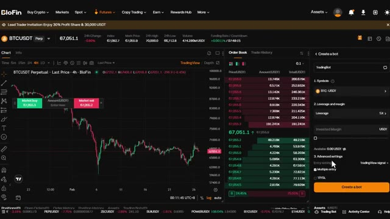
*⏱️ 00:11:29 — Interface de la plateforme BloFin affichant le graphique de trading du BTCUSDT en 4h, le carnet d'ordres et le panneau de configuration d'un bot de trading.*

---

### ⏱️ `[00:11:50 - 00:12:09]` | Segment #25

**🔊 Audio (Transcription Intégrale Mot pour Mot en Français) :**
> If you ever want to delete or edit a signal, just click on more next to the signal name. The last spot is TWAP, Time-Weighted Average Price. This spot is designed to spread your order over a set period of time to avoid slippage and get a better average entry price. Here's how it works. You can see the margin mode and leverage settings at the top.

**👁️ Analyse Visuelle d'Écran (gemini-3.5-flash-lite) :**
**Interface & Outils** : Interface de la plateforme de trading Blofin (graphique TradingView, carnet d'ordres, panneau Signal Bot et menu de création de bots).

**Contenu textuel & Code** : Paire BTCUSDT Perp, options de bots (Futures Grid, Futures DCA, Spot Grid, Spot DCA, Signal Bot, TWAP), options d'édition et de suppression de signaux.

**Action / Démonstration** : Navigation dans l'interface de Blofin pour montrer comment éditer/supprimer un signal puis présentation de l'option TWAP pour les bots de trading.

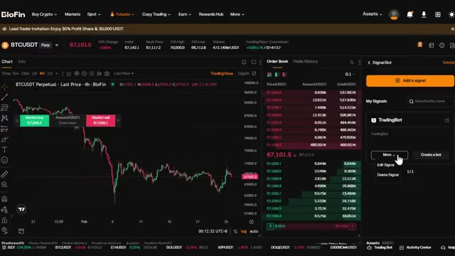
*⏱️ 00:11:55 — Interface de trading Blofin montrant un graphique BTCUSDT en 4h, un carnet d'ordres et le panneau 'Signal Bot' sur la droite avec un menu déroulant affichant 'Edit Signal' et 'Delete Signal'.*

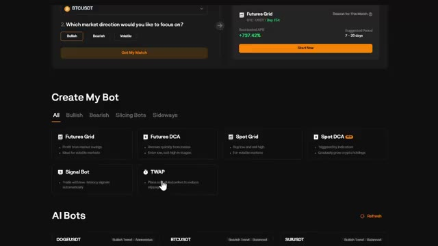
*⏱️ 00:12:00 — Page de création de bots sur Blofin montrant différentes options de bots de trading, avec le curseur pointant sur l'option 'TWAP'.*

---

### ⏱️ `[00:12:10 - 00:12:31]` | Segment #26

**🔊 Audio (Transcription Intégrale Mot pour Mot en Français) :**
> Ensuite, saisissez le montant que vous souhaitez investir et définissez la durée totale. Vous pouvez définir cela en heures et en minutes. Vous pouvez également modifier la fréquence, de 5 secondes jusqu'à 60 secondes. Cela contrôle la fréquence à laquelle le bot place des ordres dans la période de temps que vous avez définie. Voici pourquoi c'est utile. Si vous entrez sur une position importante, placer un seul ordre au marché important peut faire évoluer le prix contre vous.

**👁️ Analyse Visuelle d'Écran (gemini-3.5-flash-lite) :**
**Interface & Outils** : BloFin Futures Trading Interface

**Contenu textuel & Code** : Graphique de prix BTCUSDT en unités de 4 heures, carnet d'ordres en temps réel, et module de stratégie TWAP (Time-Weighted Average Price) avec les champs de saisie du montant en USDT, de la durée totale (heures et minutes), et de la fréquence des ordres (réglée à 30 secondes).

**Action / Démonstration** : Configuration des paramètres de la stratégie de trading algorithmique TWAP (montant, durée et fréquence d'exécution des ordres).

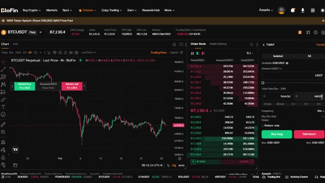
*⏱️ 00:12:15 — Interface de trading de la plateforme BloFin montrant le graphique du Bitcoin, le carnet d'ordres et le panneau de configuration de l'algorithme TWAP à droite.*

---

### ⏱️ `[00:12:32 - 00:12:52]` | Segment #27

**🔊 Audio (Transcription Intégrale Mot pour Mot en Français) :**
> TWAP fragmente votre ordre en plus petits morceaux et les exécute au fil du temps, ce qui vous offre un meilleur prix moyen et réduit l'impact sur le marché. Une fois que vous avez terminé, cliquez sur acheter long si vous partez à l'achat ou vendre court si vous partez à la vente. Le bot répartira automatiquement votre ordre sur la période que vous avez définie. Maintenant, avant de conclure, laissez-moi vous montrer comment réclamer vos bonus.

**👁️ Analyse Visuelle d'Écran (gemini-3.5-flash-lite) :**
**Interface & Outils** : BloFin (interface de courtier / exchange crypto)

**Contenu textuel & Code** : Paire BTCUSDT Perpetual, prix actuel à 67 269,0 USDT, carnet d'ordres (Order Book), options de configuration TWAP (mode Isolé/5X, montant en USDT, durée totale, fréquence, quantité par sous-ordre) et boutons "Buy long" / "Sell short".

**Action / Démonstration** : Configuration d'un ordre de type TWAP et survol du panneau de trading pour passer un ordre long ou short sur le marché des contrats futures.

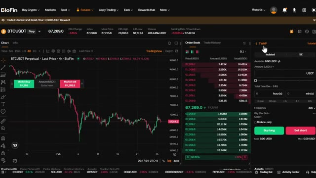
*⏱️ 00:12:37 — Interface de trading de la plateforme BloFin montrant le graphique du Bitcoin (BTCUSDT) en unité 4h ainsi que le panneau latéral de configuration pour un ordre TWAP avec les boutons d'exécution "Buy long" et "Sell short".*

---

### ⏱️ `[00:12:53 - 00:13:13]` | Segment #28

**🔊 Audio (Transcription Intégrale Mot pour Mot en Français) :**
> Si vous vous êtes inscrit avec mon lien dans la description, vous avez accès à des récompenses exclusives. Allez dans le hub des récompenses de votre compte. Ici, vous pouvez voir tous les bonus disponibles, les bonus sur dépôt, les récompenses sur le volume de trading, et plus encore. Assurez-vous de les réclamer. C'est littéralement de l'argent gratuit juste pour avoir utilisé la plateforme. Les bonus exacts dépendent de votre région et du statut de votre compte.

**👁️ Analyse Visuelle d'Écran (gemini-3.5-flash-lite) :**
**Interface & Outils** : Interface web de l'échange BloFin (section Trading Bots & Rewards Hub).

**Contenu textuel & Code** : Menus de navigation, options de bots de trading (Futures Grid), et section 'Rewards Hub'.

**Action / Démonstration** : Le curseur de la souris survole l'onglet 'Rewards Hub' dans le menu supérieur.

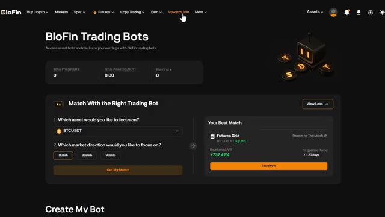
*⏱️ 00:12:58 — Capture d'écran de l'interface de la plateforme BloFin montrant la section des bots de trading et le curseur de la souris sur l'onglet 'Rewards Hub'.*

---

### ⏱️ `[00:13:13 - 00:13:32]` | Segment #29

**🔊 Audio (Transcription Intégrale Mot pour Mot en Français) :**
> Alors, vérifiez votre centre de récompenses pour voir ce qui est disponible pour vous. Et au cours des prochaines années, deux types de traders existeront : l'un qui utilise l'IA et se simplifie la vie, et l'autre qui ne l'utilise pas et fait toujours tout manuellement. Et sur le même marché, cela façonnera un résultat très différent. Je lance la communauté AI Trade Edge.

**👁️ Analyse Visuelle d'Écran (gemini-3.5-flash-lite) :**
**Interface & Outils** : Interface du réseau social X et plateforme de graphiques financiers TradingView.

**Contenu textuel & Code** : Publication textuelle sur X listant les points forts de l'IA (« AI is smarter than you », « AI never sleeps », etc.) et graphique des prix Bitcoin (autour de 69,800 - 70,000 USDT).

**Action / Démonstration** : Présentation d'arguments en faveur de l'utilisation de l'IA en trading puis affichage d'un graphique de marché pour illustrer la volatilité.

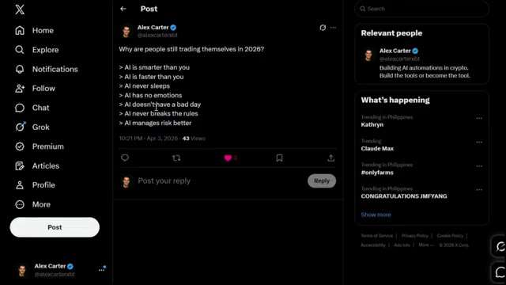
*⏱️ 00:13:18 — Capture d'écran du réseau social X montrant une publication d'Alex Carter listant les avantages du trading automatisé par l'IA.*

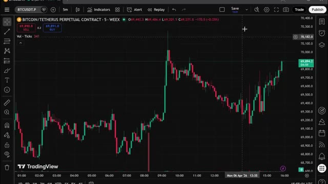
*⏱️ 00:13:27 — Graphique de trading en chandeliers japonais sur TradingView pour la paire BTCUSDT.P en unité de temps 5 minutes.*

---

### ⏱️ `[00:13:32 - 00:13:53]` | Segment #30

**🔊 Audio (Transcription Intégrale Mot pour Mot en Français) :**
> Chaque prompt, bot, agent, modèle et guide étape par étape que j'utilise personnellement, le tout réuni au même endroit. Et tout ce que je construirai à l'avenir sera ajouté directement dans le groupe. Chaque nouvelle intégration, chaque nouvelle stratégie, chaque nouveau prompt, chaque mise à jour. De l'intégration TradingView au trading sur Telegram et au suivi des baleines sur Hyperliquid.

**👁️ Analyse Visuelle d'Écran (gemini-3.5-flash-lite) :**
**Interface & Outils** : Page web de tutoriel ou documentation de trading.

**Contenu textuel & Code** : Texte explicatif décrivant les fonctionnalités : "Whale Scanning", "Sentiment Analysis", "Trade Ideas" et "Wallet Lookup" connectées à Hyperliquid.

**Action / Démonstration** : Présentation des fonctionnalités clés du système de suivi des portefeuilles de baleines.

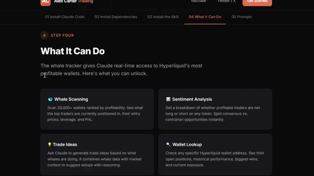
*⏱️ 00:13:38 — Capture d'écran montrant l'interface d'un guide étape par étape avec la section "What It Can Do" listant les fonctionnalités du tracker de baleines.*

---

### ⏱️ `[00:13:53 - 00:14:12]` | Segment #31

**🔊 Audio (Transcription Intégrale Mot pour Mot en Français) :**
> Dès que vous vous inscrivez, vous obtenez tout. Le prix est de 79,99 $ par mois. Et honnêtement, quand on y pense, ce que c'est vraiment, la configuration de trading par IA la plus avancée disponible pour les traders particuliers en ce moment, constamment mise à jour avec tout inclus. Ce n'est pas beaucoup d'argent. Un seul bon trade le couvre.

**👁️ Analyse Visuelle d'Écran (gemini-3.5-flash-lite) :**
**Interface & Outils** : Plateforme de e-commerce Whop et site de cours en ligne de trading.

**Contenu textuel & Code** : Tarification d'abonnement (79,99 $ / mois) et listes de fonctionnalités IA pour TradingView (Chart Reading, Chart Control).

**Action / Démonstration** : Navigation sur la page de vente et présentation des capacités techniques de l'outil d'IA pour le trading.

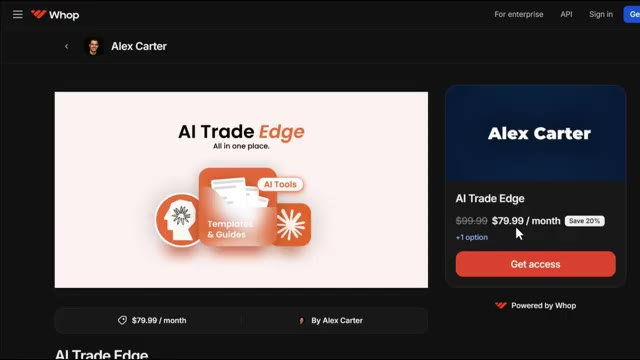
*⏱️ 00:13:58 — Page de paiement Whop affichant l'offre "AI Trade Edge" d'Alex Carter au prix de 79,99 $ par mois.*

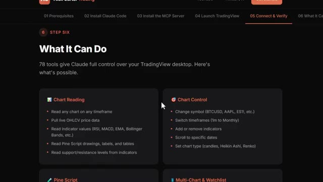
*⏱️ 00:14:03 — Interface de cours ou documentation en ligne listant les fonctionnalités des 78 outils connectant Claude à TradingView ("What It Can Do").*

---

### ⏱️ `[00:14:12 - 00:14:49]` | Segment #32

**🔊 Audio (Transcription Intégrale Mot pour Mot en Français) :**
> Mais les 100 premiers membres bloquent ce tarif de façon permanente. Après cela, le prix augmente. Donc plus vous arrivez tôt, meilleure est l'offre. Le lien est dans la description. Inscrivez-vous dès maintenant avant que le prix n'augmente. Vous ne pouvez vraiment pas vous permettre de manquer ça. Très bien, maintenant vous savez donc comment utiliser absolument tous les bots de trading sur Blowfin. Que vous souhaitiez profiter de la volatilité avec les bots de grille, accumuler avec le DCA, automatiser vos stratégies de TradingView avec les SignalBots, ou exécuter de gros ordres avec le TWAP. Vous avez les outils. Et n'oubliez pas, si vous vous êtes inscrit avec mon lien dans la description, assurez-vous de consulter le centre des récompenses et de réclamer vos bonus. Si vous voulez un

**👁️ Analyse Visuelle d'Écran (gemini-3.5-flash-lite) :**
**Interface & Outils** : Page de vente Whop et interface de bots de trading automatisés.

**Contenu textuel & Code** : Tarifs d'abonnement ($79.99/mois), options de bots de trading (Futures Grid, Futures DCA, Spot Grid, Signal Bot, TWAP) et métriques de performance de bots IA (APR backtesté).
[DESC_IMAGE_1] Présentation de l'offre payante de la communauté d'Alex Carter sur Whop avec réduction promotionnelle.
[DESC_IMAGE_2] Navigation dans le tableau de bord de configuration et sélection de bots de trading automatisés.

**Action / Démonstration** : Explications face caméra et analyse conceptuelle des marchés.

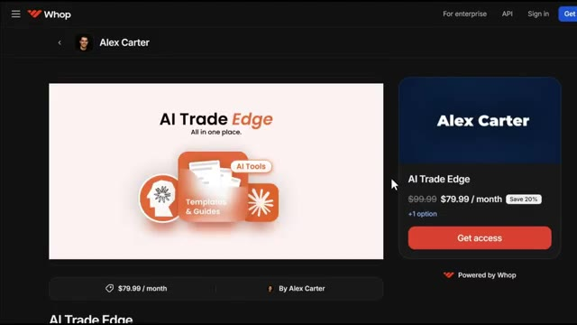
*⏱️ 00:14:21 — Capture d'écran montrant une page web sur la plateforme Whop avec l'offre "AI Trade Edge" d'Alex Carter affichée à 79.99 $ par mois (au lieu de 99.99 $), incluant des outils d'IA, des templates et des guides.*

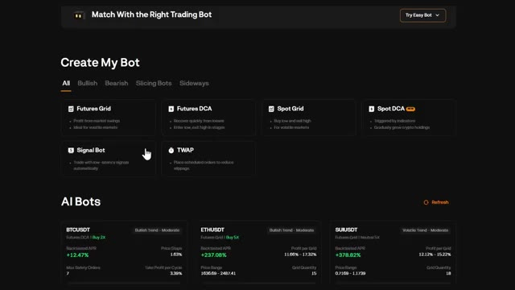
*⏱️ 00:14:31 — Interface de création de bot de trading montrant différentes stratégies disponibles (Futures Grid, Futures DCA, Spot Grid, Signal Bot, TWAP) ainsi que des performances de bots IA pour BTCUSDT, ETHUSDT et SUIUSDT.*

---

### ⏱️ `[00:14:49 - 00:15:13]` | Segment #33

**🔊 Audio (Transcription Intégrale Mot pour Mot en Français) :**
> pour une visite guidée plus détaillée de la plateforme Blofin, comment déposer, trader des contrats à terme et utiliser toutes les fonctionnalités, cliquez sur la vidéo qui apparaît à l'écran dès maintenant. Si vous voulez voir la démonstration complète sur la façon de configurer l'exécution automatisée des trades en utilisant Telegram et TradingView, elle s'affiche également à l'écran dès maintenant. Si vous avez trouvé cela utile, laissez un pouce bleu, cela aide vraiment la chaîne, abonnez-vous si ce n'est pas déjà fait, et je vous vois dans la prochaine.

**👁️ Analyse Visuelle d'Écran (gemini-3.5-flash-lite) :**
**Interface & Outils** : Plateforme d'échange de cryptomonnaies Blofin (interface de trading Futures et création de bot).

**Contenu textuel & Code** : Graphique BTCUSDT Perpetual, carnet d'ordres (Order Book), paramètres de configuration de bot (effet de levier 5x, réglages avancés avec options de signaux TradingView, Fixed Margin, % of the margin, % of front investment).

**Action / Démonstration** : Configuration d'un bot de trading sur Blofin avec sélection des paramètres de signal TradingView et de gestion de marge.

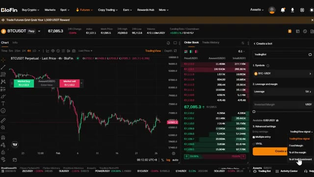
*⏱️ 00:14:55 — Interface de trading de la plateforme Blofin montrant un graphique BTCUSDT en chandelier (unité 4h), un carnet d'ordres au centre et un panneau de configuration de bot de trading à droite avec un menu déroulant pour les signaux TradingView.*

---

