# 🎬 Opus 4.7 Just Released! (It's Not What You Think)

> **Chaîne** : [Alex Carter](https://www.youtube.com/@AlexCarterTrading)  
> **Lien YouTube** : [https://www.youtube.com/watch?v=w_oeMbcpCgg](https://www.youtube.com/watch?v=w_oeMbcpCgg)  
> **Date de publication** : 20260416  
> **Durée** : 00:05:34  
> **Identifiant vidéo** : `w_oeMbcpCgg`  
> **Transcription & Analyse** : `whisper-v3-large-turbo+gemini-3.5-flash-lite`  

---

## 📌 Synthèse Exécutive & Outils

### 💡 Résumé
L'industrie du trading quantitatif et du développement d'agents autonomes fait face à une zone de turbulences et d'opportunités avec la sortie d'Opus 4.7 par Anthropic. En tant qu'analyste, la réalité de ce modèle se situe bien au-delà de la simple dichotomie médiatique : s'il ne s'agit pas du bond générationnel tant espéré — marquant même des régressions notables sur les fenêtres de contexte étendu par rapport au 4.6 —, ses performances en matière de codage agentique (64 %) et de raisonnement visuel (jusqu'à 91 % avec outils) redéfinissent les standards de l'automatisation des stratégies. Pour les traders algorithmiques, cette version s'impose comme un outil redoutable capable d'analyser des graphiques complexes à haute résolution et de structurer des architectures d'ingénierie financière de pointe.

La vidéo décortique l'impact de ces avancées technologiques sur l'écosystème du trading algorithmique moderne, où l'intégration entre outils d'analyse visuelle et exécution automatisée devient la norme. Face à un marché impitoyable, la fracture se creuse irrémédiablement entre les opérateurs manuels et ceux qui déploient des agents IA capables d'interagir en temps réel avec des écosystèmes complexes. Cette transition vers l'automatisation intégrale pousse à une redéfinition des avantages compétitifs, obligeant les traders quantitatifs à exploiter des piles technologiques hybrides combinant scripts de calcul, surveillance des flux de liquidité des baleines et exécution instantanée via des passerelles sécurisées.

Pour répondre à cette mutation structurelle, la présentation met en lumière des méthodologies concrètes d'implémentation opérationnelle, notamment à travers l'écosystème communautaire *AI Trade Edge*. L'objectif est de démontrer comment industrialiser le déploiement de bots de trading, synchroniser des alertes de plateformes graphiques avec des applications de messagerie instantanée, et structurer des boucles de rétroaction algorithmiques. L'enjeu n'est plus seulement de concevoir une stratégie performante, mais d'automatiser sa résilience et son exécution pour éliminer tout biais émotionnel face aux fluctuations erratiques des marchés mondiaux.

### 🛠️ Outils, Modèles & Logiciels Présentés
* **Opus 4.7** : Dernier modèle d'Anthropic offrant des bonds significatifs en codage agentique (64 %) et en raisonnement visuel, idéal pour concevoir des architectures de trading autonomes.
* **Claude Code** : Environnement de développement et d'assistance au code intégrant de nouvelles commandes dédiées à la revue rigoureuse des scripts et des stratégies.
* **Mythos** : Modèle de référence supérieur en matière de performances brutes de codage agentique, servant de benchmark ultime de comparaison.
* **Codex** : Solution de pointe concurrente surpassant les outils de bureau d'Anthropic sur certains aspects du développement assisté.
* **TradingView** : Plateforme graphique de référence utilisée pour l'analyse technique, le paramétrage des indicateurs et le déclenchement d'alertes automatisées.
* **Telegram** : Canal de messagerie instantanée exploité pour la réception de signaux et la commande d'exécution rapide des ordres de trading.
* **Hyperliquid** : Protocole décentralisé utilisé pour le suivi en temps réel des flux de capitaux institutionnels et des mouvements des baleines.
* **AI Trade Edge** : Communauté et hub opérationnel centralisant l'ensemble des invites, bots, agents et guides pratiques pour l'automatisation des stratégies de marché.

### 🔑 Points Clés & Enseignements Stratégiques
* **Arbitrage entre versions de modèles** : Malgré les performances globales d'Opus 4.7 en vision et en agentique, le modèle Opus 4.6 reste supérieur sur les tâches exigeant de très longs contextes (chute de 91,9 % à 59,2 % à 256k tokens), un paramètre critique pour l'analyse de vastes bases de code de backtesting.
* **Maîtrise de l'ingénierie financière par agent** : Le score de 64 % atteint par Opus 4.7 sur les benchmarks d'ingénierie financière valide sa capacité à concevoir, auditer et optimiser des algorithmes de trading complexes sans intervention humaine constante.
* **Optimisation de la granularité visuelle** : Grâce à une capacité de lecture d'images à une résolution plus de trois fois supérieure, le modèle révolutionne l'analyse automatisée de graphiques en identifiant des configurations techniques subtiles sur des échelles de temps réduites.
* **Contrôle dynamique du raisonnement** : L'utilisation du nouveau niveau d'effort paramétrique « xhigh » sur l'API permet d'ajuster dynamiquement la puissance de calcul allouée à la résolution de problèmes mathématiques et logiques ardus en scalping.
* **Automatisation du pipeline de scalping** : La synchronisation entre les alertes de TradingView et l'exécution via des bots connectés à Telegram permet de réduire la latence d'intervention à la fraction de seconde, un impératif absolu pour le trading à haute fréquence.
* **Suivi institutionnel et des flux de capitaux** : L'intégration d'outils de tracking sur Hyperliquid permet d'identifier les accumulations ou distributions massives initiées par les « baleines », servant de filtre de validation contextuelle pour les signaux d'entrée en position.
* **Élimination des biais cognitifs par l'agentique** : Le recours à des agents de trading autonomes garantit une application stricte des règles mathématiques du plan de trading, protégeant l'opérateur contre l'excès de confiance, le *revenge trading* et la panique.
* **Sélection rigoureuse des environnements de développement** : L'utilisation de commandes spécifiques comme `/alter review` dans Claude Code permet de simuler un regard critique externe, signalant instantanément les failles logiques ou les vulnérabilités dans les scripts de gestion des risques.
* **Gestion proactive du risque (Risk Management)** : Tout agent ou script automatisé déployé doit intégrer des clauses strictes de limitation de perte maximale par session (drawdown cap) pour parer aux anomalies soudaines de liquidité sur les marchés cryptos ou dérivés.
* **Avantage compétitif asymétrique** : Sur les marchés contemporains, l'adoption précoce d'assistants IA et de bots interconnectés ne constitue plus un luxe technologique, mais la condition sine qua non pour maintenir une espérance de gain mathématiquement positive face aux algorithmes institutionnels.

---

## ⏱️ Chronologie & Transcription Complète Audio & Visuelle (Mot pour Mot)

### ⏱️ `[00:00:00 - 00:00:35]` | Segment #01

**🔊 Audio (Transcription Intégrale Mot pour Mot en Français) :**
> Anthropic vient de lancer Opus 4.7, et Internet est divisé sur la question. La moitié des gens disent que c'est une mise à niveau massive. L'autre moitié qualifie cela de mythe amoindri et affirme que cela ne vaut pas le battage médiatique. Et honnêteté, après avoir examiné les benchmarks moi-même, la vérité est quelque part au milieu, et c'est en fait plus intéressant que ce que l'un ou l'autre camp prétend. Alors laissez-moi décortiquer exactement ce qui a changé, ce qui est vraiment bon, et là où il pèche encore, parce que ce n'est pas le modèle que tout le monde attendait. Alors tout d'abord, qu'est-ce qui s'est réellement amélioré ? Le code agentique a fait un bond

**👁️ Analyse Visuelle d'Écran (gemini-3.5-flash-lite) :**
**Interface & Outils** : Navigateur web affichant le réseau social X et une page de benchmarks comparative d'intelligence artificielle.

**Contenu textuel & Code** : Tableau de benchmarks techniques incluant Agentic coding, Multidisciplinary reasoning, Agentic search, Agentic financial analysis et autres métriques comparatives avec des pourcentages précis (ex: 64.3%, 87.6%).

**Action / Démonstration** : Navigation et présentation visuelle des résultats de benchmarks pour analyser objectivement les capacités d'Opus 4.7.

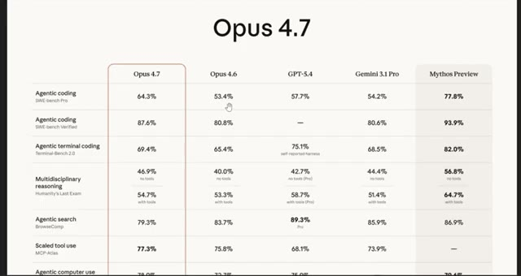
*⏱️ 00:00:18 — Tableau comparatif détaillé des performances de l'IA Opus 4.7 face à d'autres modèles (Opus 4.6, GPT-5.4, Gemini 3.1 Pro, Mythos Preview) sur différents benchmarks.*

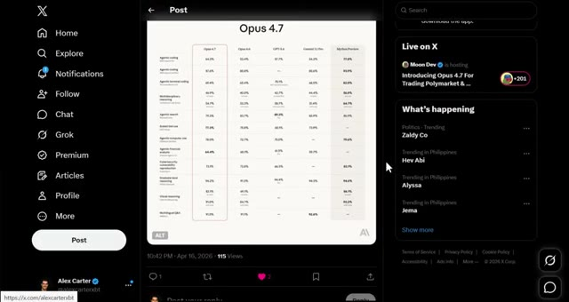
*⏱️ 00:00:26 — Publication sur le réseau social X affichant le tableau des benchmarks d'Opus 4.7 au centre de l'interface.*

---

### ⏱️ `[00:00:35 - 00:01:13]` | Segment #02

**🔊 Audio (Transcription Intégrale Mot pour Mot en Français) :**
> de 53 % jusqu'à 64 %. C'est une augmentation de 11 points, et c'est désormais nettement meilleur que GPT et Gemini en matière de programmation. Gardez à l'esprit qu'il s'agit d'un fossé massif dans le monde de l'IA. Le raisonnement visuel a également bénéficié d'une énorme amélioration, passant de 69 % à 82 % sans outils et de 84 % à 91 % avec des outils. Il peut désormais lire des images à une résolution plus de trois fois supérieure. Donc, si vous l'utilisez pour analyser des graphiques, des diapositives ou des documents, ce sera beaucoup plus précis dès maintenant. L'analyse financière par agent est passée de 60 %

**👁️ Analyse Visuelle d'Écran (gemini-3.5-flash-lite) :**
**Interface & Outils** : Interface web de Gemini, tableau de benchmarks d'IA, et graphique de trading (Bybit / TradingView).

**Contenu textuel & Code** : Scores de performance en pourcentage (ex: 64.4%, 91.0%, 82.1%) pour différentes tâches d'IA et cours du Bitcoin (BTCUSDT Perpetual Contract).

**Action / Démonstration** : Présentation comparative des capacités d'IA et analyse de graphique boursier.

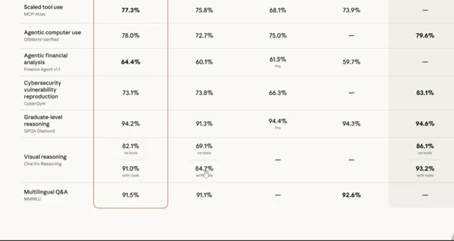
*⏱️ 00:00:54 — Tableau de performance comparant différents modèles d'IA sur des critères d'analyse financière et de raisonnement visuel.*

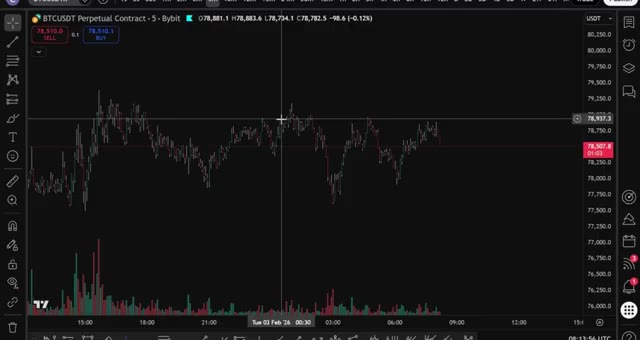
*⏱️ 00:01:04 — Graphique de trading interactif (TradingView / Bybit) affichant le cours du BTCUSDT avec volumes.*

---

### ⏱️ `[00:01:13 - 00:01:37]` | Segment #03

**🔊 Audio (Transcription Intégrale Mot pour Mot en Français) :**
> à 64 %. Maintenant, je sais que cela ne parait pas énorme, mais dans les benchmarks d'ingénierie financière, c'est en réalité considéré comme mythique dans certains cas. Et pour quiconque développe des agents de trading autonomes, ce modèle est conçu pour cela. Le raisonnement de niveau universitaire se situe à 94,2 %, pratiquement inchangé par rapport à avant, ce qui est déjà insensé. Maintenant, est-il meilleur que Mythos ? Pas tout à fait.

**👁️ Analyse Visuelle d'Écran (gemini-3.5-flash-lite) :**
**Interface & Outils** : Tableau de bord de benchmarks de performance de modèles IA.

**Contenu textuel & Code** : Lignes de benchmarks incluant « Agentic financial analysis » avec un score de 64.4 %, ainsi que d'autres tests comme « Agentic terminal coding », « Multidisciplinary reasoning », et « Graduate-level reasoning » (GPQA Diamond).

**Action / Démonstration** : Le présentateur met en avant le score de 64.4 % dans la catégorie d'analyse financière agentique.

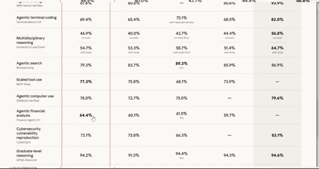
*⏱️ 00:01:19 — Tableau comparatif de benchmarks montrant divers scores pour des modèles d'intelligence artificielle, avec un curseur pointant sur la métrique d'analyse financière.*

---

### ⏱️ `[00:01:37 - 00:02:16]` | Segment #04

**🔊 Audio (Transcription Intégrale Mot pour Mot en Français) :**
> Mythos gagne toujours sur la plupart des benchmarks. Le codage agentique sur Mythos est à 77,8 % contre 64,3 % ici. Gardez donc cela à l'esprit. Mais en tant que modèle Opus, c'est le meilleur à ce jour, et c'est une mise à niveau très solide par rapport au 4.6. Il y a aussi de nouvelles fonctionnalités qui valent la peine d'être connues. Sur l'API, il y a un nouveau niveau d'effort appelé xhigh, situé entre high et max, vous donnant plus de contrôle sur la vitesse de raisonnement sur les problèmes difficiles. Et dans Claude code, il y a une nouvelle commande slash alter review qui lance une session de revue dédiée et signale ce qu'un examinateur attentif repérerait. C'est en fait très utile. Maintenant,

**👁️ Analyse Visuelle d'Écran (gemini-3.5-flash-lite) :**
**Interface & Outils** : Tableau comparatif web et terminal de commandes Claude Code (CLI).

**Contenu textuel & Code** : Scores de performance sur les benchmarks de codage agentique (SWE-bench Pro, Terminal-Bench 2.0) et messages d'information du terminal.

**Action / Démonstration** : Présentation comparative des scores des différents modèles et affichage du terminal Claude Code.

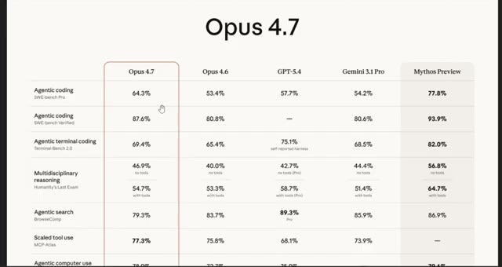
*⏱️ 00:01:47 — Un tableau comparatif des performances des modèles d'IA (Opus 4.7, Opus 4.6, GPT-5.4, Gemini 3.1 Pro et Mythos Preview) sur divers benchmarks comme l'Agentic coding.*

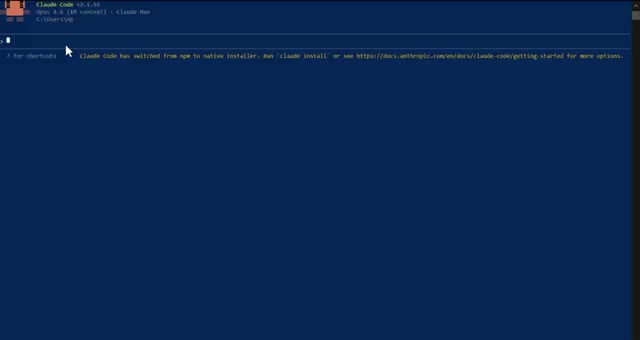
*⏱️ 00:02:06 — Une interface de terminal de commandes affichant l'outil Claude Code v2.1.92 avec Opus 4.6 en contexte.*

---

### ⏱️ `[00:02:16 - 00:02:42]` | Segment #05

**🔊 Audio (Transcription Intégrale Mot pour Mot en Français) :**
> Pour être juste, beaucoup de personnes dans ce domaine disent que ce n'est pas si impressionnant que ça. Et honnêtement, je comprends. Presque chaque test de référence se situe dans une fourchette de 50 % par rapport à Mythos. Il est moins bon pour l'utilisation du navigateur que le précédent opus, et beaucoup de gens le qualifient de Mythos bridé plutôt que de véritable modèle de nouvelle génération. Le clan de ceux qui auraient souhaité que ce soit Mythos n'a pas tort. Et si l'on prend encore plus de recul, Anthropic peut sembler en avance en ce moment en raison de la quantité pure et simple de sorties.

**👁️ Analyse Visuelle d'Écran (gemini-3.5-flash-lite) :**
**Interface & Outils** : Tableau de benchmarks de performance d'IA et interface web du réseau social X (Twitter).

**Contenu textuel & Code** : Tableaux de métriques chiffrées (évaluations de modèles comme Opus 4.7, GPT-4, Mythos) et tweets associés.

**Action / Démonstration** : Présentation et analyse comparative des performances de différents modèles d'intelligence artificielle à travers des benchmarks.

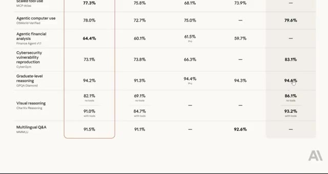
*⏱️ 00:02:22 — Gros plan sur un tableau de benchmarks comparant différents modèles d'IA avec des pourcentages de réussite.*

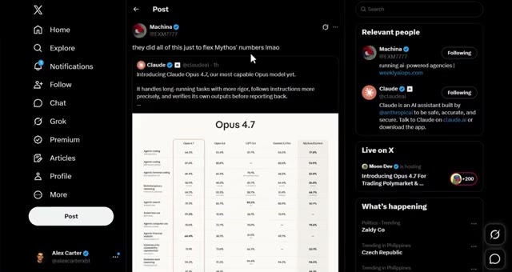
*⏱️ 00:02:29 — Interface du réseau social X montrant un post commentant les performances comparatives de modèles d'IA.*

---

### ⏱️ `[00:02:42 - 00:03:15]` | Segment #06

**🔊 Audio (Transcription Intégrale Mot pour Mot en Français) :**
> Mais regardez la comparaison de qualité. Codex a toujours une longueur d'avance sur le nouveau produit de bureau Cloud Code, et la super application d'OpenAI est honnêtement dix fois meilleure que ce que nous voyons ici. Et c'est là que ça devient intéressant et dont beaucoup de gens ne parlent pas. Sur le benchmark de contexte MRCRV2, qui teste la façon dont le modèle gère les longues fenêtres de contexte, Opus 4.7 obtient en fait des résultats nettement moins bons que le 4.6. À un contexte de 256k, le 4.6 se situait à 91,9 %.

**👁️ Analyse Visuelle d'Écran (gemini-3.5-flash-lite) :**
**Interface & Outils** : Interface du réseau social X (Twitter) et interface web d'OpenAI.

**Contenu textuel & Code** : Publication sur X montrant des scores de benchmark (Opus 4.7 Max et Opus 4.6 sur MRCR v2 8-needle) avec pourcentages et graphiques statistiques.

**Action / Démonstration** : Présentation de publications et de données de benchmarks comparatifs d'intelligences artificielles sur les réseaux sociaux.

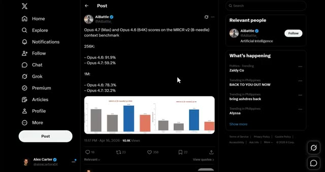
*⏱️ 00:02:59 — Capture d'écran du réseau social X (Twitter) affichant un post de 'AiBattle' détaillant les scores de benchmarks de modèles d'IA avec des graphiques en barres.*

---

### ⏱️ `[00:03:16 - 00:03:51]` | Segment #07

**🔊 Audio (Transcription Intégrale Mot pour Mot en Français) :**
> 4,7 chute complètement jusqu'à 59,2 %. Et à 1 million, 4,6 était à 78,3 %. 4,7 tombe à 32,2 %. C'est une régression massive. Donc, si vous travaillez avec de très longs documents ou de grandes bases de code, gardez cela à l'esprit car en ce moment, le 4,6 est en réalité le meilleur choix pour ce cas d'utilisation spécifique. Donc oui, une mise à niveau solide par rapport au 4,6, il bat Mythos et l'ingénierie financière, offre un excellent raisonnement visuel, fonctionne bien sur les tâches à long contexte, mais ce n'est pas le bond en avant que tout le monde espérait.

**👁️ Analyse Visuelle d'Écran (gemini-3.5-flash-lite) :**
**Interface & Outils** : Application X (Twitter) affichant des publications de benchmarks et graphiques analytiques.

**Contenu textuel & Code** : Scores et graphiques du benchmark MRCR v2 (8-needle) à 256k et 1M de contexte, ainsi qu'un tableau comparatif des capacités des modèles d'IA (Opus 4.7, Opus 4.6, GPT-5.4, Gemini 3.1 Pro, Mythos Preview).

**Action / Démonstration** : Présentation et analyse comparative des scores de régression et de performance entre les versions d'IA.

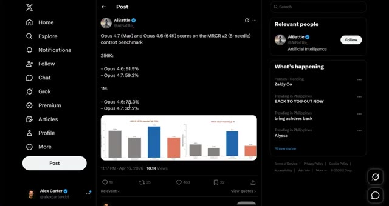
*⏱️ 00:03:25 — Capture d'écran d'un tweet montrant les scores de performance des modèles d'IA Opus 4.7 et Opus 4.6 sur le benchmark MRCR v2.*

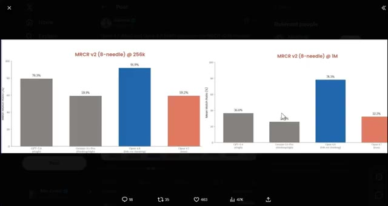
*⏱️ 00:03:34 — Gros plan sur les graphiques à barres comparant les performances des modèles à 256k et 1M de contexte.*

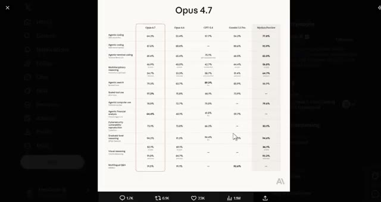
*⏱️ 00:03:42 — Tableau comparatif détaillé des performances de "Opus 4.7" face à d'autres modèles sur divers critères (codage, raisonnement, etc.).*

---

### ⏱️ `[00:03:51 - 00:04:12]` | Segment #08

**🔊 Audio (Transcription Intégrale Mot pour Mot en Français) :**
> Même pas comparable à ce qui arrive avec des modèles comme Spud à l'avenir. Et regardez, c'est exactement pour cela qu'il est important de savoir de quel côté de l'IA vous vous situez. Au cours des prochaines années, il va y avoir deux types de traders. Celui qui utilise l'IA et se simplifie la vie, et celui qui ne le fait pas et fait encore tout manuellement. Même marché, résultat très différent.

**👁️ Analyse Visuelle d'Écran (gemini-3.5-flash-lite) :**
**Interface & Outils** : Interface web du réseau social X (Twitter).

**Contenu textuel & Code** : Publication textuelle : "Why are people still trading themselves in 2026? > AI is smarter than you, > AI is faster than you, > AI never sleeps, > AI has no emotions, > AI doesn't have a bad day, > AI never breaks the rules, > AI manages risk better".

**Action / Démonstration** : Affichage et lecture d'un tweet argumentant sur la suprématie de l'intelligence artificielle face aux traders humains en 2026.

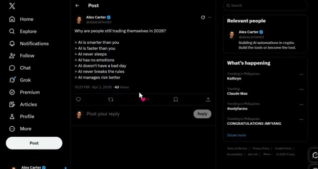
*⏱️ 00:03:56 — Capture d'écran du réseau social X (anciennement Twitter) montrant un post publié par le compte d'Alex Carter avec une liste comparative sur les avantages de l'IA en trading.*

---

### ⏱️ `[00:04:13 - 00:04:37]` | Segment #09

**🔊 Audio (Transcription Intégrale Mot pour Mot en Français) :**
> Je lance la communauté AI Trade Edge. Chaque invite, bot, agent, modèle et guide étape par étape que j'utilise personnellement, le tout au même endroit. Intégration de TradingView, trading sur Telegram, suivi des baleines sur Hyperliquid, tout y est déjà. Et tout ce que je construirai à l'avenir y sera directement ajouté. 79,99 $ par mois. Les 100 premiers membres bloquent ce tarif de façon permanente.

**👁️ Analyse Visuelle d'Écran (gemini-3.5-flash-lite) :**
**Interface & Outils** : Interface web (Whop), application de messagerie (Telegram).

**Contenu textuel & Code** : Tarifs d'abonnement à la communauté (79.99 $/mois), instructions d'appairage de bot Telegram (/start, /status, commandes de liaison avec Claude Code).

**Action / Démonstration** : Présentation de l'accès payant à la communauté et démonstration du bot Telegram de pont vers Claude Code.

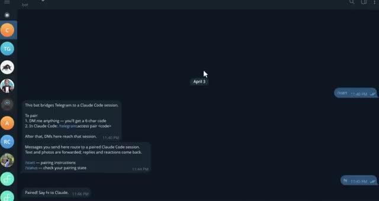
*⏱️ 00:04:25 — Interface d'une application de messagerie (Telegram) montrant un bot de pont entre Telegram et une session Claude Code avec des instructions d'appairage.*

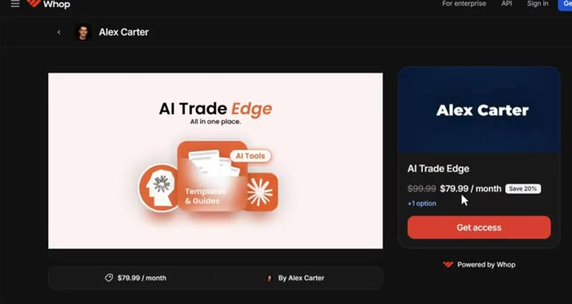
*⏱️ 00:04:31 — Page de paiement et d'abonnement de la plateforme Whop pour la communauté 'AI Trade Edge' d'Alex Carter au prix de 79.99 $ par mois.*

---

### ⏱️ `[00:04:37 - 00:05:11]` | Segment #10

**🔊 Audio (Transcription Intégrale Mot pour Mot en Français) :**
> Après cela, le prix augmente. Un seul bon trade le rentabilise. Le lien est dans la description. Quoi qu'il en soit, je vais tester ce modèle au cours des prochains jours, en me penchant spécifiquement sur ce qu'il donne avec le trading agentique et si cela vaut vraiment le coup d'y passer. Je vous tiendrai au courant de cela. Dites-moi dans les commentaires ce que vous pensez de ce nouveau modèle. Êtes-vous impressionnés ou vous attendiez-vous à plus ? Quoi qu'il en soit, Anthropic est clairement en train de nous préparer du lourd en ce moment. Opus 4.7 est disponible aujourd'hui sur Claude.ai et sur toutes les principales plateformes cloud. Si vous êtes

**👁️ Analyse Visuelle d'Écran (gemini-3.5-flash-lite) :**
**Interface & Outils** : Tableau comparatif de performances d'IA et graphique TradingView pour le trading de cryptomonnaies.

**Contenu textuel & Code** : Scores de performances comparés pour Opus 4.7 (Agentic coding, reasoning, financial analysis) et graphique de prix BTCUSDT avec signaux Long/Short et RSI.

**Action / Démonstration** : Analyse comparative des capacités du nouveau modèle d'IA et visualisation des signaux de trading sur un graphique de cryptomonnaies.

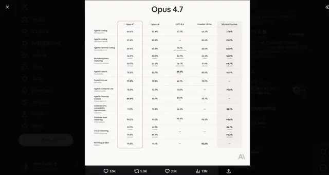
*⏱️ 00:04:46 — Capture d'écran montrant un tableau comparatif détaillé des performances du modèle IA Opus 4.7 face à d'autres versions et concurrents sur différentes tâches (coding, raisonnement, etc.).*

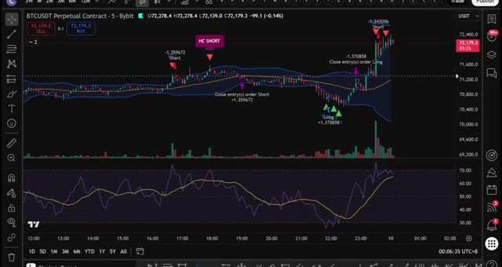
*⏱️ 00:04:54 — Graphique de trading TradingView montrant l'actif BTCUSDT en contrat perpétuel avec des indicateurs techniques, des bandes de Bollinger, un oscillateur RSI en bas et des signaux d'achat/vente.*

---

### ⏱️ `[00:05:11 - 00:05:34]` | Segment #11

**🔊 Audio (Transcription Intégrale Mot pour Mot en Français) :**
> que vous construisiez quoi que ce soit d'agentique, des bots de trading, des outils de codage, de l'analyse financière, cela vaut le coup d'y jeter un œil. Si vous voulez voir la démonstration complète sur la façon de configurer l'exécution de trades automatisés en utilisant Telegram et TradingView, allez voir la vidéo qui apparaît à l'écran dès maintenant. Si vous avez trouvé cela utile, laissez un pouce bleu. Cela aide vraiment la chaîne. Abonnez-vous si ce n'est pas déjà fait, et je vous vois dans la prochaine.

**👁️ Analyse Visuelle d'Écran (gemini-3.5-flash-lite) :**
**Interface & Outils** : Application Telegram, interface de chat et bot de trading automatisé.

**Contenu textuel & Code** : Détails de positions de trading exécutées : BTCUSDT LONG 5x, SOLUSDT LONG 5x, DOGEUSDT SHORT 5x avec prix d'entrée, SL et TP. Prompt de configuration de trade automatisé visible dans la boîte de légende.

**Action / Démonstration** : Configuration et envoi de commandes d'exécution de trades automatisés via l'interface du bot Telegram couplé à des graphiques.

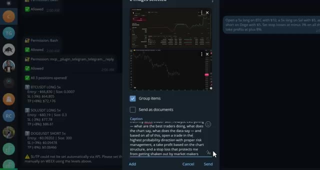
*⏱️ 00:05:22 — Interface de messagerie Telegram affichant un bot de trading automatisé avec des exécutions d'ordres sur BTC, SOL et DOGE (positions long et short, niveaux d'entrée, stop-loss et take-profit) ainsi que des graphiques joints.*

---

