# 🎬 Full AI Trading Course 2026: Master Agentic Trading (Beginner to Pro)

> **Chaîne** : [Alex Carter](https://www.youtube.com/@AlexCarterTrading)  
> **Lien YouTube** : [https://www.youtube.com/watch?v=yxouoQw-C_M](https://www.youtube.com/watch?v=yxouoQw-C_M)  
> **Date de publication** : 20260426  
> **Durée** : 01:24:01  
> **Identifiant vidéo** : `yxouoQw-C_M`  
> **Transcription & Analyse** : `whisper-v3-large-turbo+gemini-3.5-flash-lite`  

---

## 📌 Synthèse Exécutive & Outils

### 💡 Résumé

Cette vidéo aborde la mutation structurelle des marchés financiers, désormais dominés à 70-80 % par des algorithmes et des intelligences artificielles institutionnelles (« la guerre du silicium »). Face à cette suprématie, l'analyste Alex Carter propose de réarmer le trader particulier grâce au **trading agentique**. L'objectif n'est pas de faire de l'IA un "oracle" infaillible de prédiction des prix — une illusion dangereuse —, mais de la déployer comme un **assistant de recherche doté de mains pour exécuter**. Le cours détaille l'architecture complète d'une pile technologique robuste, combinant des grands modèles de langage via OpenRouter, des outils d'analyse on-chain (comme le traqueur de baleines Hyperliquid), et des connexions directes aux courtiers (Wix, Alpaca, Interactive Brokers) pour automatiser l'exécution 24h/24 et 7j/7.

Loin des simples backtests théoriques, la méthodologie expose une infrastructure opérationnelle concrète répartie sur trois couches fondamentales : la **recherche** (scraping de sentiment, veille des portefeuilles gagnants), la **stratégie** (génération automatisée et rigoureuse de code Pine Script via le MCP TradingView), et l'**exécution** (gestion automatisée des risques, bots Python hébergés sur VPS et boucles de rétroaction). L'expérimentation de l'Alpha Arena sur Hyperliquid sert de cas d'école : elle démontre que sans un cadre d'agents structuré et une gestion stricte des risques, même les modèles d'IA les plus avancés peuvent dilapider un capital en quelques jours. 

En fin de parcours, le trader particulier passe du statut de simple liquidité à celui d'opérateur augmenté. L'intégration de frameworks d'agents spécialisés (Senpai, Hermes, OpenClaw) et d'alertes en temps réel sur Telegram permet d'industrialiser la prise de décision, de réduire le temps passé devant les écrans à analyser des douzaines d'onglets, et d'appliquer une logique institutionnelle à des échelles de capital adaptées au retail.

---

### 🛠️ Outils, Modèles & Logiciels Présentés

* **Claude & Claude Code** : Modèle de langage de pointe utilisé comme "cerveau" central pour coder, synthétiser l'actualité et structurer la logique de trading.
* **OpenRouter** : Passerelle d'API permettant d'accéder à l'ensemble des modèles de qualité institutionnelle à moindre coût (environ 5 $ de crédits initiaux).
* **Hyperliquid** : Plateforme décentralisée et traqueur de baleines (« Whale Tracker ») permettant de suivre l'argent intelligent, les positions on-chain et d'héberger l'Alpha Arena.
* **TradingView & MCP TradingView** : Outil de graphisme et protocole contextuel (MCP) permettant à l'IA de lire directement les graphiques et d'automatiser la création de scripts Pine Script.
* **Wix Trader** : Compétence d'assistance au trading connectée pour exécuter des ordres multi-marchés de manière automatisée.
* **Alpaca & Interactive Brokers** : Courtiers de premier plan connectés à la pile technologique pour l'exécution d'ordres multi-marchés.
* **Polymarket & Kalshi** : Marchés de prédiction décentralisés et réglementés intégrés pour diversifier les vecteurs d'alpha.
* **Senpai, Hermes & OpenClaw** : Frameworks d'agents spécialisés déployés pour chasser l'alpha et automatiser les flux de travail.
* **Hostinger (VPS) & Railway** : Solutions d'hébergement cloud (VPS à 5-8 $/mois) pour faire tourner le bot Python personnalisé et le framework Senpai 24h/24 et 7j/7.
* **Cursor** : Éditeur de code moderne indispensable pour manipuler les fichiers Markdown, Python (.py) et le tableau de bord HTML LiveOps.
* **Telegram & Botfather** : Application de messagerie utilisée pour recevoir le briefing alpha quotidien et les alertes du bot directement dans sa poche.
* **Firecrawl** : Outil de web scraping utilisé pour extraire le sentiment et les données du web ouvert en temps réel.

---

### 🔑 Points Clés & Enseignements Stratégiques

* **Le dogme fondamental de l'IA** : L'intelligence artificielle est excellente pour coder, backtester, synthétiser des flux d'actualités et structurer des analyses techniques, mais **elle ne peut pas prédire les prix**. Prétendre le contraire relève du mensonge ou de l'illusion.
* **La règle d'or de l'opérateur** : Claude est un assistant de recherche doté de mains pour exécuter, pas un oracle divinatoire. Il accélère les processus et réduit les angles morts, mais il ne doit jamais se substituer au jugement critique du trader humain.
* **La structure en trois couches du système** : Un trading par IA performant repose sur un triptyque indissociable : la **Recherche** (détection de l'alpha et suivi des baleines), la **Stratégie** (traduction de l'avantage en règles via Pine Script) et l'**Exécution** (passage d'ordres sécurisé et gestion des risques par des bots autonomes).
* **L'apprentissage de l'Alpha Arena** : Les tests menés sur Hyperliquid montrent que livrer un modèle de langage brut au marché sans contraintes de risque conduit à la ruine en quelques jours ; le succès dépend de l'encadrement strict par des agents spécialisés.
* **La supériorité de la vitesse de traitement** : L'IA offre un avantage concurrentiel massif grâce à sa capacité à analyser des milliers de documents réglementaires ou des dizaines de milliers de portefeuilles en quelques secondes, surclassant l'endurance humaine.
* **L'automatisation continue du flux de travail** : Déployer un bot Python personnalisé sur un VPS 24h/24 et 7j/7 permet d'éliminer l'interminable surveillance de multiples onglets et de s'affranchir de la fatigue décisionnelle nocturne.
* **La gestion rigoureuse des hallucinations** : Les modèles peuvent parfois inventer des prix ou des symboles boursiers inexistants ; par conséquent, l'opérateur doit impérativement valider et croiser les données critiques avant toute exécution de capital.
* **Une barrière à l'entrée financière minime** : Les outils technologiques de pointe ne sont plus réservés aux fonds spéculatifs ; pour un coût inférieur à 30-40 dollars par mois en abonnements et crédits API, un particulier peut s'équiper d'une infrastructure de niveau quasi-institutionnel.
* **L'approche itérative et sécurisée du capital** : La règle d'or avant de scalper ou de déployer des stratégies automatisées est de trader de petites tailles ("tradez petit") jusqu'à ce que les résultats prouvent la viabilité statistique du P&L du système.
* **L'intégration multi-marchés** : La pile technologique ne se limite pas aux cryptomonnaies mais s'étend aux actions traditionnelles (via Alpaca et Interactive Brokers) et aux marchés de prédiction (Polymarket, Kalshi), diversifiant ainsi les sources d'opportunités.
* **L'alerte et le monitoring en temps réel** : La centralisation des informations vitales sous forme de briefing alpha matinal dans la boîte mail et d'alertes instantanées sur Telegram garantit un contrôle total de l'opérateur sur ses positions, où qu'il soit.

---

## ⏱️ Chronologie & Transcription Complète Audio & Visuelle (Mot pour Mot)

### ⏱️ `[00:00:00 - 00:00:36]` | Segment #01

**🔊 Audio (Transcription Intégrale Mot pour Mot en Français) :**
> En ce moment même, pendant que vous regardez ceci, une guerre invisible se déroule dans les carnets d'ordres de chaque grande bourse. Des millions de décisions sont prises en millisecondes. Des positions sont couvertes, des ordres stop sont chassés, et des baleines changent de camp sans laisser de traces. La plupart des gens pensent qu'ils tradent contre d'autres personnes. Ce n'est pas le cas. Vous tradez contre du silicium. Vous tradez contre des algorithmes qui ne dorment pas, ne ressentent pas la peur, et ne font pas d'erreurs. Dans ce cours, nous n'allons pas seulement étudier ces systèmes. Nous allons en construire un. Nous allons parcourir toute la pile technologique. D'abord, le cerveau. Nous allons

**👁️ Analyse Visuelle d'Écran (gemini-3.5-flash-lite) :**
**Interface & Outils** : Terminal ou interface boursière financière numérique.

**Contenu textuel & Code** : Mentions de "CAC" avec une variation négative, "ORCL -1.81%", et des prix ou taux chiffrés (7.8156, 7.8177).

**Action / Démonstration** : Visualisation des fluctuations de prix et des variations de marché en temps réel.

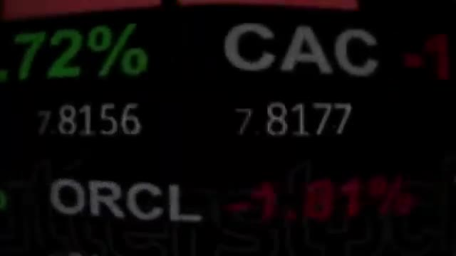
*⏱️ 00:00:09 — Gros plan sur un écran affichant des données boursières avec les symboles CAC et ORCL ainsi que des variations en pourcentage et des chiffres.*

---

### ⏱️ `[00:00:36 - 00:01:05]` | Segment #02

**🔊 Audio (Transcription Intégrale Mot pour Mot en Français) :**
> brancher Claude sur Open Router pour un accès aux modèles de qualité institutionnelle. Deuxièmement, les yeux. Nous installerons le traqueur de baleines Hyperliquid pour voir l'argent intelligent en temps réel et le MCP TradingView pour permettre à Claude de lire vos graphiques directement. Troisièmement, les mains, où nous connecterons Weeks, Alpaca et Interactive Brokers pour une exécution multi-marchés. Quatrièmement, la force de travail, où nous déployerons des cadres d'agents comme Senpai, Hermes et OpenClaw, des spécialistes qui chassent l'alpha pendant que vous dormez.

**👁️ Analyse Visuelle d'Écran (gemini-3.5-flash-lite) :**
**Interface & Outils** : Tableau de bord web Hyperliquid Whale Tracker

**Contenu textuel & Code** : Activité récente des baleines, ratio long/short, et données de suivi des grands investisseurs en temps réel.

**Action / Démonstration** : Présentation du traqueur de baleines pour analyser l'argent intelligent.

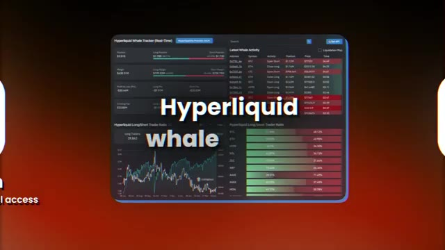
*⏱️ 00:00:43 — Capture d'écran montrant l'interface du tableau de bord "Hyperliquid Whale Tracker" avec des graphiques et des statistiques sur l'activité des baleines.*

---

### ⏱️ `[00:01:05 - 00:01:28]` | Segment #03

**🔊 Audio (Transcription Intégrale Mot pour Mot en Français) :**
> Cinquièmement, c'est le centre de commande, où nous allons déployer un bot Python personnalisé sur un VPS 24h/24 et 7j/7, et tout unifier dans un tableau de bord LiveOps. Quand nous aurons terminé, vous ne serez plus là à fixer 12 onglets de navigateur en doutant de vos positions. Vous serez un opérateur. Vous vous réveillerez avec un briefing alpha quotidien qui vous attendra dans votre boîte de réception, un bot qui gérera vos risques, et un système qui vous met enfin du bon côté de la guerre du silicium.

**👁️ Analyse Visuelle d'Écran (gemini-3.5-flash-lite) :**
**Interface & Outils** : Navigateur Chrome, interface TradingView, tableau de bord personnalisé sur terminal.

**Contenu textuel & Code** : Paire BTCUSD, tableau de données chiffrées listant des cryptos (XMR, BTC, ETH, HYPE, LIT, SUI) avec pourcentages long/short et signaux de trading.

**Action / Démonstration** : Navigation entre onglets de graphiques boursiers et affichage d'un tableau de suivi des positions des baleines.

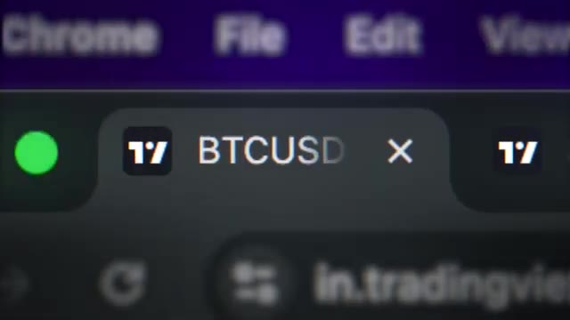
*⏱️ 00:01:16 — Gros plan sur un onglet de navigateur Google Chrome affichant TradingView avec la paire BTCUSD.*

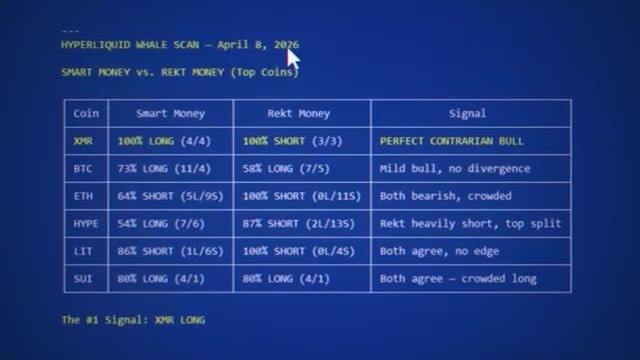
*⏱️ 00:01:22 — Tableau d'analyse des baleines "Hyperliquid Whale Scan" montrant les positions "Smart Money vs. Rekt Money" pour divers cryptos.*

---

### ⏱️ `[00:01:29 - 00:01:49]` | Segment #04

**🔊 Audio (Transcription Intégrale Mot pour Mot en Français) :**
> Entrons dans le vif du sujet. L'intelligence artificielle fait déjà partie intégrante du trading de cryptomonnaies. Pas en théorie. Pas dans un laboratoire quelque part. En direct, on-chain et vérifiable. Il y a un bot sur Polymarket avec une adresse de portefeuille nommée Sovereign2013, qui a transformé 1 dollar en 3,3 millions de dollars grâce à l'IA. Ce n'est pas un titre que j'ai inventé.

**👁️ Analyse Visuelle d'Écran (gemini-3.5-flash-lite) :**
**Interface & Outils** : Navigateur web affichant des articles d'actualités financières et crypto (Wallet Investor et KuCoin News).

**Contenu textuel & Code** : Texte d'article décrivant l'IA dans le trading, l'analyse de données et le bot de trading piloté par Claude sur Polymarket avec le compte 'Sovereign2013'.

**Action / Démonstration** : Navigation et présentation visuelle d'articles d'actualité appuyant les propos sur le bot de trading IA de Polymarket.

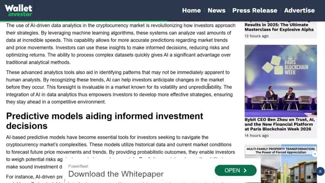
*⏱️ 00:01:34 — Capture d'écran d'un article en ligne sur le site Wallet Investor traitant de l'utilisation de l'intelligence artificielle dans l'analyse de données pour les cryptomonnaies.*

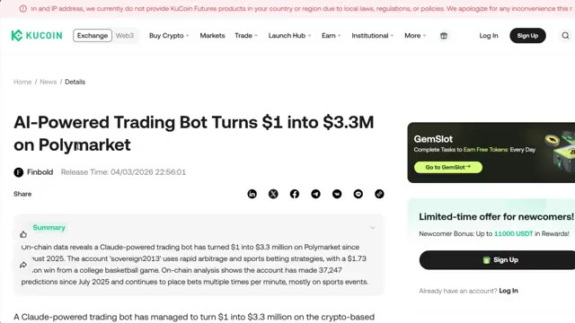
*⏱️ 00:01:39 — Capture d'écran d'un article de presse sur l'exchange KuCoin titré "AI-Powered Trading Bot Turns $1 into $3.3M on Polymarket", mentionnant le bot 'Sovereign2013'.*

---

### ⏱️ `[00:01:49 - 00:02:24]` | Segment #05

**🔊 Audio (Transcription Intégrale Mot pour Mot en Français) :**
> Vous pouvez le vérifier sur la chaîne en ce moment même. Ce cours repose sur le modèle établi par des pionniers comme Jake Nessler qui a laissé Claude Code exécuter une pile de trading en direct avec 100 000 dollars de capital réel. Chaque instruction, chaque repli et chaque trade gagnant a été documenté. Cela a prouvé un point essentiel. Lorsque vous confiez le volant à un agent, il ne se contente pas de vous aider à trader, il est le trader. Nous généralisons cette pile exacte ici, en y ajoutant trois compétences spécifiques, cinq frameworks d'agents et des routines Claude pour créer un système qui ne se contente pas de survivre au marché, mais le maîtrise. Et sur Hyperliquid,

**👁️ Analyse Visuelle d'Écran (gemini-3.5-flash-lite) :**
**Interface & Outils** : Navigateur web (Medium), Alpaca.markets, et application de messagerie (Telegram).

**Contenu textuel & Code** : Article de blog financier sur le trading automatisé par LLM et interface de bot Telegram connectée à Claude Code affichant des messages de configuration et de pairing.

**Action / Démonstration** : Présentation de l'étude de cas de Jake Nessler et démonstration de l'intégration entre Telegram et l'outil Claude Code.

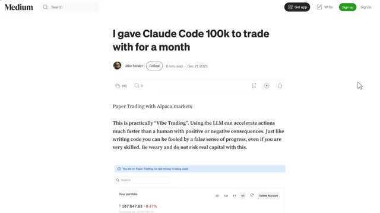
*⏱️ 00:01:58 — Capture d'écran d'un article Medium de Jake Nessler intitulé "I gave Claude Code 100k to trade with for a month" illustrant le concept de paper trading avec Alpaca.markets.*

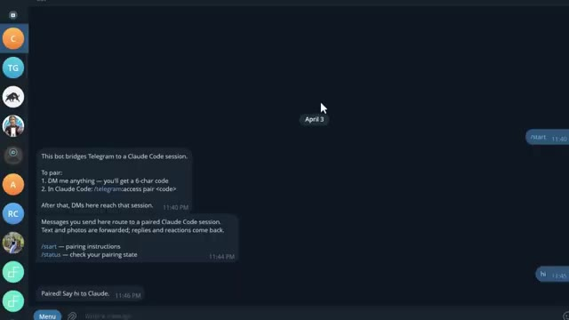
*⏱️ 00:02:15 — Capture d'écran d'une interface de messagerie Telegram montrant un bot de pontage avec une session Claude Code et des instructions de liaison (/start, /status).*

---

### ⏱️ `[00:02:24 - 00:02:48]` | Segment #06

**🔊 Audio (Transcription Intégrale Mot pour Mot en Français) :**
> un expérimentation appelée l'Alpha Arena a pris les plus grands modèles d'IA du monde, Quen, DeepSeek, Claude, GPT, Grok et Gemini, a donné à chacun d'eux 10 000 dollars et les a laissés trader des contrats perpétuels en direct les uns contre les autres. Les résultats n'étaient même pas serrés. Certains de ces modèles, des modèles que des millions de personnes utilisent en ce moment même pour prendre des décisions de trading, ont perdu la majorité de leur compte en quatre jours.

**👁️ Analyse Visuelle d'Écran (gemini-3.5-flash-lite) :**
**Interface & Outils** : Article de blog sur la plateforme Medium intégrant des graphiques et des tableaux de bord analytiques de trading.

**Contenu textuel & Code** : Graphiques de performance et tableau comparatif détaillant le classement des modèles (Qwen3 Max, DeepSeek, Claude, Grok, Gemini, GPT) avec leurs métriques financières (Account Value, Return %, Total PGL, Fees, Win Rate, Sharpe).

**Action / Démonstration** : Présentation visuelle et analyse comparative des résultats de l'expérimentation de trading en direct entre les IA.

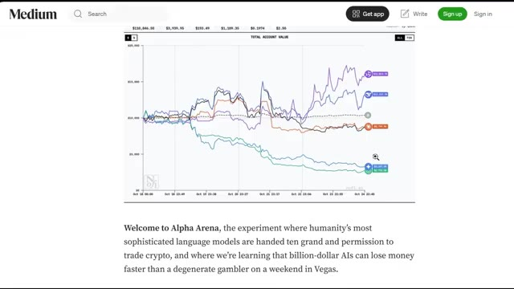
*⏱️ 00:02:30 — Capture d'écran d'un article Medium présentant le graphique des performances de l'Alpha Arena avec la valeur totale des comptes des différents modèles d'IA.*

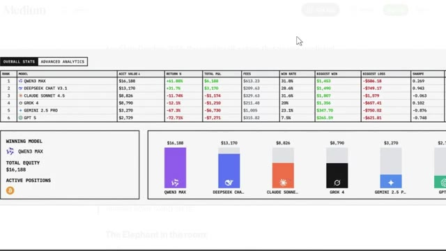
*⏱️ 00:02:42 — Tableau statistique détaillé (Overall Stats) de l'Alpha Arena montrant le classement, la valeur des comptes, le rendement et le PNL total de chaque modèle d'IA.*

---

### ⏱️ `[00:02:48 - 00:03:09]` | Segment #07

**🔊 Audio (Transcription Intégrale Mot pour Mot en Français) :**
> Et l'un d'eux a fait tout le contraire. Les bots alimentés par l'IA représentent désormais environ 70 à 80 pour cent de tout le volume des cryptos. Si vous tradez encore manuellement, vous ne rivalisez plus avec d'autres traders particuliers. Vous êtes la liquidité. Vous êtes l'autre côté du trade que l'IA est en train de faire. Ce n'est pas moi qui essaie de vous faire peur. C'est juste ce qui est en train de se passer en ce moment.

**👁️ Analyse Visuelle d'Écran (gemini-3.5-flash-lite) :**
**Interface & Outils** : TradingView, site web MEXC, article d'actualité financière.

**Contenu textuel & Code** : Graphique de prix Bitcoin, indicateur MACD, barres de volume, outil de calcul de ratio risque/rendement affichant un ratio de 7,4.

**Action / Démonstration** : Analyse technique d'un graphique de trading avec mesure du risque et du profit potentiel.

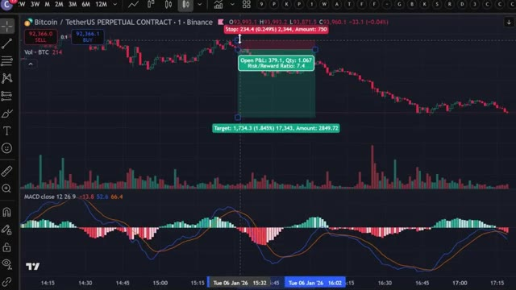
*⏱️ 00:02:59 — Graphique TradingView en chandeliers japonais d'une paire crypto (Bitcoin / TetherUS Perpetual) avec indicateur MACD et outil de mesure de position (Risk/Reward Ratio).*

---

### ⏱️ `[00:03:09 - 00:03:32]` | Segment #08

**🔊 Audio (Transcription Intégrale Mot pour Mot en Français) :**
> Et voici le problème. Les outils qui créent cet écart ne sont pas enfermés derrière un fonds spéculatif. Ils ne sont pas chers. Ils ne sont pas compliqués. Claude coûte 20 dollars par mois. L'API Hyperliquid est totalement gratuite et publique. TradingView, vous l'avez probablement déjà. Telegram, vous l'avez déjà sur votre téléphone. L'écart ne vient pas de l'accès. L'écart vient du fait de savoir comment tout assembler.

**👁️ Analyse Visuelle d'Écran (gemini-3.5-flash-lite) :**
**Interface & Outils** : Hyperliquid Docs, interface de données de marché, application de messagerie Telegram (bot Claude Code).

**Contenu textuel & Code** : URL de l'API Hyperliquid, SDK Python GitHub, instructions de pairing Telegram (/start, /status) et prompt utilisateur demandant de scanner les paires futures à fort taux de financement.

**Action / Démonstration** : Navigation dans la documentation de l'API, consultation des données de marché et interaction textuelle avec un bot Telegram lié à l'intelligence artificielle.

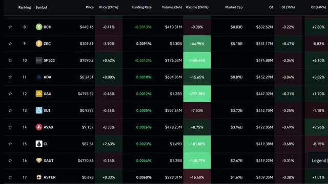
*⏱️ 00:03:15 — Tableau des marchés montrant les classements, prix, taux de financement, volumes et Open Interest de différentes cryptomonnaies et actifs.*

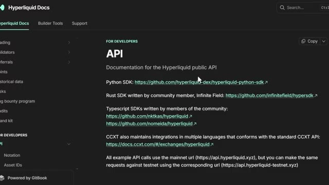
*⏱️ 00:03:21 — Documentation officielle de l'API Hyperliquid détaillant les kits de développement (SDK) Python, Rust et TypeScript.*

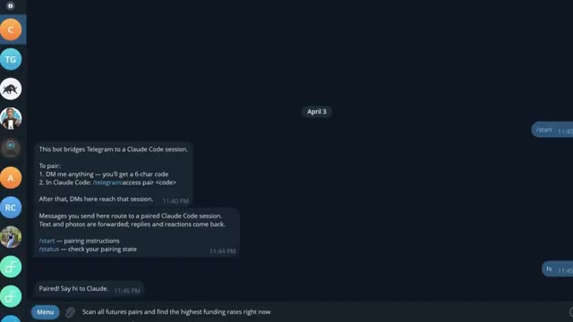
*⏱️ 00:03:27 — Interface de messagerie Telegram connectée à un bot de session Claude Code avec des instructions de couplage et des commandes interactives.*

---

### ⏱️ `[00:03:33 - 00:04:09]` | Segment #09

**🔊 Audio (Transcription Intégrale Mot pour Mot en Français) :**
> Voici la traduction complète, naturelle et mot pour mot de ce segment :

Ceci est le cours complet de zéro à héros pour le trading par IA avec Claude. Je ne vais pas vous donner de théorie. Je ne vais pas vous montrer une démo qui a l'air impressionnante, mais qui s'effondre dès que vous essayez de la reproduire. Tout ce que je vous montre aujourd'hui, je l'ai construit et fait tourner moi-même. C'est ce à quoi vous devez vous attendre. Le contrat exact pour les 2,5 prochaines heures. De l'argent réel, tous les outils. Claude plus OpenRouter, ce qui vous donne la clé pour chaque modèle. Trois compétences en direct : Wix Trader, Whale Tracker et TradingView MCP. Trois courtiers connectés : Wix, Alpaca et Interactive Brokers. Polymarket plus Kalshi.

**👁️ Analyse Visuelle d'Écran (gemini-3.5-flash-lite) :**
**Interface & Outils** : Terminal de commande (CLI) et interface web de plateforme de cours.

**Contenu textuel & Code** : Données JSON structurées de positions de trading crypto (BTC, ETH, SOL, LTC) et liste textuelle des modules et outils du cours (Claude, OpenRouter, WEEX, Alpaca, Interactive Brokers, bots Telegram, etc.).

**Action / Démonstration** : Affichage de données de suivi de positions en direct dans un terminal et présentation du programme du cours de trading par IA.

*⏱️ 00:03:42 — Un terminal de commande affichant des données JSON au format texte, avec des informations sur le suivi des baleines (whale tracker) incluant des adresses de portefeuille, des valeurs de compte, des PnL et des positions de trading sur différentes cryptomonnaies.*

*⏱️ 00:03:51 — Une interface web de cours intitulée « Trading AI Full Course » détaillant le programme de formation, les outils utilisés (Claude, OpenRouter, WEEX, Alpaca, etc.) et le contenu du cours.*

---

### ⏱️ `[00:04:09 - 00:04:44]` | Segment #10

**🔊 Audio (Transcription Intégrale Mot pour Mot en Français) :**
> marchés de prédiction. Des routines Claude automatisant toute votre journée de trading. Agent PNL plus Sempy plus Hermes plus OpenClaw, tous déployés. Un bot Python personnalisé hébergé et exécuté 24h/24 et 7j/7. Un bot Telegram dans votre poche. Un tableau de bord personnalisé pour tout suivre. Rien n'est omis. Chaque commande à l'écran. Si vous savez déjà coder, survolez, sinon nous allons ouvrir un terminal ensemble, c'est parti. Avant de vous montrer quoi que ce soit, je dois dire quelque chose que la plupart des vidéos de trading par IA ne vous diront jamais, car si vous arrivez avec de fausses attentes, vous allez vous faire mal. Voici ce que l'IA est véritablement

**👁️ Analyse Visuelle d'Écran (gemini-3.5-flash-lite) :**
**Interface & Outils** : Interface de cours web et terminal de commandes Claude Code.

**Contenu textuel & Code** : Liste détaillée des outils de trading IA (Claude, OpenRouter, WEEX, Polymarket, agents PNL, bot Python, bot Telegram) et invite de commande CLI.

**Action / Démonstration** : Présentation du programme du cours de trading automatisé par IA et initialisation du terminal Claude Code.

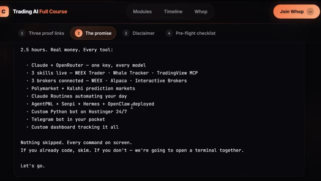
*⏱️ 00:04:18 — Interface web du cours 'Trading AI Full Course' présentant le plan de formation et les outils utilisés.*

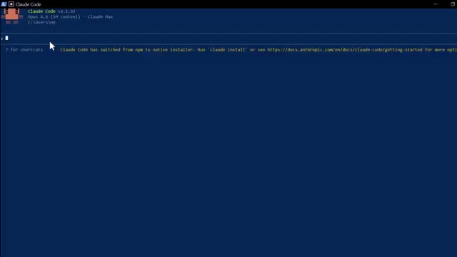
*⏱️ 00:04:36 — Fenêtre de terminal affichant l'interface en ligne de commande 'Claude Code v2.1.92'.*

---

### ⏱️ `[00:04:44 - 00:05:19]` | Segment #11

**🔊 Audio (Transcription Intégrale Mot pour Mot en Français) :**
> doué pour écrire du code, construire des structures de backtest, synthétiser des actualités provenant de 10 sources différentes en un seul résumé clair, faire de l'analyse de sentiment, lire la capture d'écran d'un graphique et vous donner une analyse technique structurée, tenir un journal de vos trades et trouver des schémas dans vos propres données, la logique de risque, et transformer une idée de stratégie en anglais simple en code Pine Script fonctionnel en moins d'une minute. Tout cela. Claude le fait mieux que n'importe quel humain travaillant seul. Plus rapidement, de manière plus cohérente, et sans se fatiguer à deux heures du matin. Voici ce en quoi l'intelligence artificielle est mauvaise. La prédiction des prix. Point final. Claude

**👁️ Analyse Visuelle d'Écran (gemini-3.5-flash-lite) :**
**Interface & Outils** : Interface CLI / terminal de résumé d'actualités et graphique de trading TradingView / WEEX.

**Contenu textuel & Code** : Résumé de news sur le cessez-le-feu US-Iran, scores de sentiment, idées de trade Polymarket, et niveaux de prix techniques pour le BTC/USDT (autour de 69 865 $).

**Action / Démonstration** : Présentation d'une analyse de sentiment combinée à des actualités textuelles, puis transition vers une analyse technique sur graphique de prix.

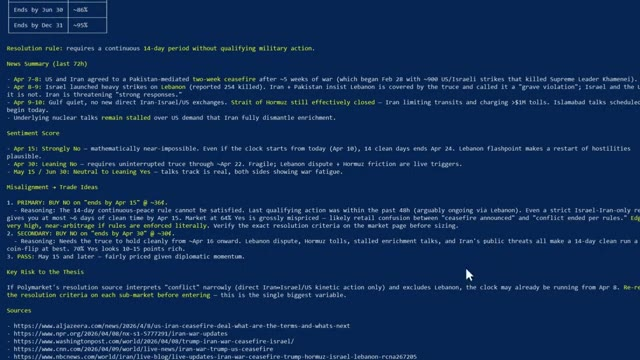
*⏱️ 00:04:53 — Résumé d'actualités, scores de sentiment et idées de trade générés sur fond bleu, basés sur plusieurs sources d'information.*

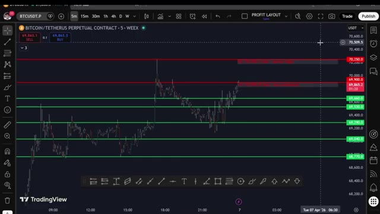
*⏱️ 00:05:10 — Graphique en chandeliers japonais de Bitcoin (BTCUSDT) sur l'échange WEEX, affichant des niveaux de support et résistance horizontaux.*

---

### ⏱️ `[00:05:19 - 00:05:54]` | Segment #12

**🔊 Audio (Transcription Intégrale Mot pour Mot en Français) :**
> je ne peux pas vous dire où va le Bitcoin demain. Personne ne le peut. Et n'importe quel outil qui prétend le pouvoir vous ment, en remplaçant votre jugement. Le marché présentera toujours des situations qu'aucun modèle n'a jamais vues auparavant. Des événements de type cygne noir, des manipulations coordonnées, des chocs macroéconomiques. L'IA n'a aucun avantage dans ces moments-là. Vous, oui. Et les hallucinations. Claude affirmera parfois avec assurance quelque chose qui est complètement faux. Un prix qui n'existe pas. Un symbole boursier qui n'est pas réel. Une statistique qu'il a inventée. Cela n'arrive pas constamment, mais cela arrive. Vous devez toujours vérifier les données critiques.

**👁️ Analyse Visuelle d'Écran (gemini-3.5-flash-lite) :**
**Interface & Outils** : TradingView, interface web officielle de recherche de symboles.

**Contenu textuel & Code** : Graphique de prix du Bitcoin, chandeliers japonais en timeframe 1D, sélecteur de symboles listant Binance, Bybit, OKX, KuCoin, MEXC, Bitget, Coinbase, CoinEx, BloFin, BingX, HTX.

**Action / Démonstration** : Navigation et sélection de graphiques de prix sur différentes plateformes d'échange.

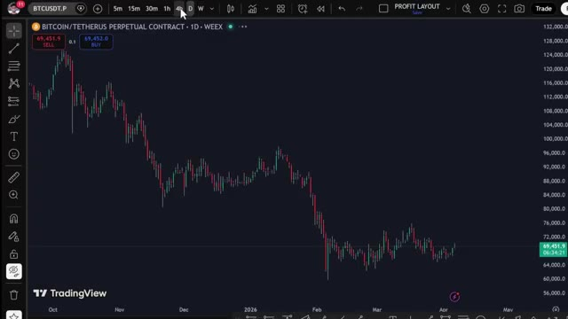
*⏱️ 00:05:28 — Graphique TradingView affichant le cours du Bitcoin (BTCUSDT Perpetual) en bougies journalières.*

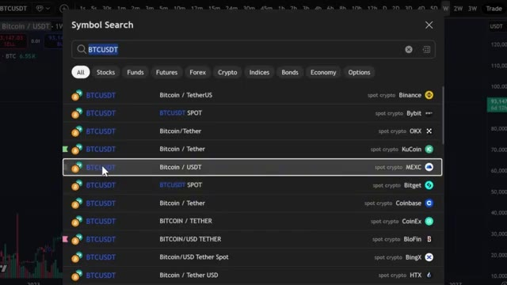
*⏱️ 00:05:45 — Fenêtre de recherche de symboles (Symbol Search) sur TradingView avec une liste de paires BTCUSDT sur différents exchanges.*

---

### ⏱️ `[00:05:54 - 00:06:15]` | Segment #13

**🔊 Audio (Transcription Intégrale Mot pour Mot en Français) :**
> pointez-vous vous-même. Voici donc la seule règle que je veux que vous reteniez tout au long de ce cours. Claude est un assistant de recherche avec des mains pour exécuter, pas un oracle. Il fait le travail plus vite que vous ne le pouvez. Il attrape des choses que vous manqueriez. Il tourne pendant que vous dormez, mais il ne remplace pas votre jugement. Il le prolonge. Gardez cela en tête et tout ce que je vous montre aujourd'hui aura du sens.

**👁️ Analyse Visuelle d'Écran (gemini-3.5-flash-lite) :**
**Interface & Outils** : Page web de Claude Code, interface d'échange/broker (trading) et terminal CLI de script ou d'outil d'analyse.

**Contenu textuel & Code** : URL d'installation de Claude Code, graphiques financiers, carnets d'ordres, informations de positions (ETH/USDT), et tableau de scores d'opportunités de marchés prédictifs.

**Action / Démonstration** : Présentation de l'environnement de développement de l'assistant IA, suivi d'une démonstration d'interface de trading et d'analyse de données dans un terminal.

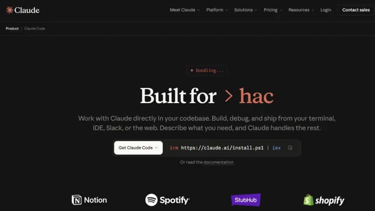
*⏱️ 00:05:59 — Capture d'écran montrant la page web officielle de l'outil Claude Code.*

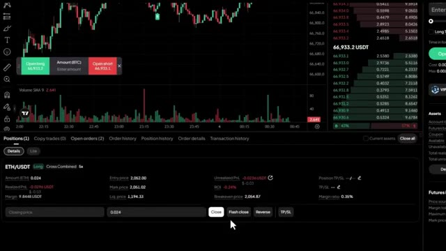
*⏱️ 00:06:05 — Interface de trading affichant un graphique de prix avec indicateurs, carnet d'ordres et détails de positions ouvertes.*

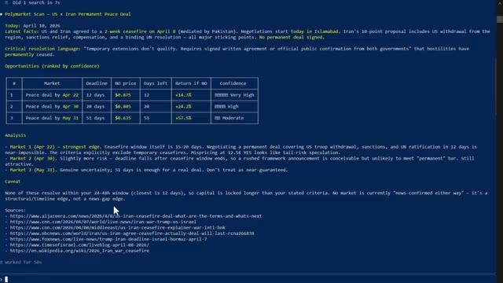
*⏱️ 00:06:10 — Terminal de commande affichant une analyse textuelle détaillée avec tableau structuré de prédictions de marché (Polymarket).*

---

### ⏱️ `[00:06:16 - 00:06:34]` | Segment #14

**🔊 Audio (Transcription Intégrale Mot pour Mot en Français) :**
> Oubliez ça et vous finirez par confier votre compte à une IA en vous demandant ce qui s'est passé. Ce cours vous rend capable d'exécuter plus rapidement, pas capable de prédire les marchés. Tradez petit jusqu'à ce que votre propre P&L prouve le contraire. Maintenant, avant de plonger dans le cours, voici ce dont vous avez besoin sur votre bureau avant de commencer.

**👁️ Analyse Visuelle d'Écran (gemini-3.5-flash-lite) :**
**Interface & Outils** : Interface web de cours en ligne (style plateforme LMS / Whop).

**Contenu textuel & Code** : Texte de mise en garde financière ("Educational only. Not financial advice...") et liste de matériel prérequis pour le cours (ordinateur, connexion internet, temps estimé, services tiers optionnels).

**Action / Démonstration** : Présentation théorique et avertissements réglementaires et matériels avant le début effectif du cours de trading par IA.

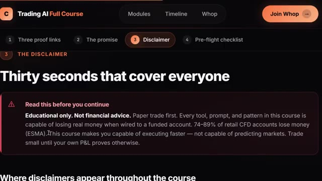
*⏱️ 00:06:21 — Interface du cours "Trading AI Full Course" affichant le module de clause de non-responsabilité (Disclaimer) avec des avertissements sur les risques financiers.*

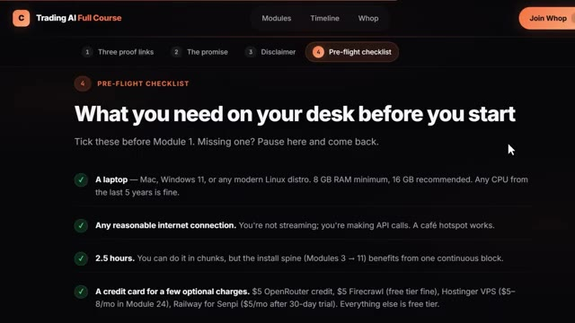
*⏱️ 00:06:30 — Interface du cours "Trading AI Full Course" affichant la liste de contrôle préalable (Pre-flight checklist) avec le matériel et les prérequis nécessaires.*

---

### ⏱️ `[00:06:35 - 00:06:54]` | Segment #15

**🔊 Audio (Transcription Intégrale Mot pour Mot en Français) :**
> Premièrement, un ordinateur portable ou de bureau, Mac, Windows 11, ou n'importe quelle distribution Linux moderne. Avec au moins 8 Go de RAM minimum, mais 16 Go sont recommandés. N'importe quel processeur des 5 dernières années convient. Deuxièmement, une connexion Internet raisonnable. Vous ne faites pas de streaming, vous faites des appels API. Le point d'accès d'un café fait l'affaire.

**👁️ Analyse Visuelle d'Écran (gemini-3.5-flash-lite) :**
**Interface & Outils** : Interface web de cours en ligne (plateforme Whop ou similaire) avec design sombre et texte en anglais.

**Contenu textuel & Code** : Liste de prérequis : "A laptop — Mac, Windows 11, or any modern Linux distro. 8 GB RAM minimum, 16 GB recommended...", "Any reasonable internet connection", "2.5 hours", "A credit card for a few optional charges ($5 OpenRouter credit, $5 Firecrawl, Hostinger VPS, Railway for Senpi)".

**Action / Démonstration** : Le curseur de la souris survole la liste des prérequis matériels présentés à l'écran, illustrant les exigences système du cours.

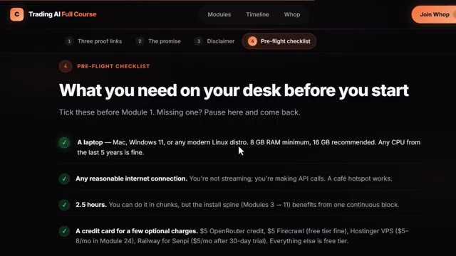
*⏱️ 00:06:39 — Capture d'écran montrant une liste de prérequis pour un cours ("Trading AI Full Course", étape "Pre-flight checklist"), détaillant le matériel nécessaire.*

---

### ⏱️ `[00:06:54 - 00:07:30]` | Segment #16

**🔊 Audio (Transcription Intégrale Mot pour Mot en Français) :**
> Troisièmement, c'est au moins 2,5 heures de votre temps. Vous pouvez le faire par morceaux, mais l'installation principale qui couvre des modules 3 à 11 profitera d'un seul bloc continu. Quatrièmement, une carte de crédit pour quelques frais optionnels. Certains outils doivent être payés, comme environ 5 $ pour le crédit OpenRooter, 5 $ pour Firecrawl, un VPS Hostinger, qui coûte entre 5 $ et 8 $ par mois, Railway pour Senpi, qui coûte 5 $ par mois après un essai de 30 jours. Tout le reste est en version gratuite. Avant de plonger dans les modules, organisons votre espace de travail numérique. Vous voudrez que ces applications soient ouvertes, connectées et prêtes sur votre bureau.

**👁️ Analyse Visuelle d'Écran (gemini-3.5-flash-lite) :**
**Interface & Outils** : Interface web de cours en ligne (plateforme type Whop / LMS personnalisé)

**Contenu textuel & Code** : Liste de contrôle des prérequis : ordinateur portable, connexion internet, 2,5 heures de temps, carte de crédit pour frais optionnels (OpenRouter, Firecrawl, Hostinger VPS, Railway) et recommandation de forfait Claude Pro.

**Action / Démonstration** : Présentation à l'écran des prérequis nécessaires avant de commencer le cours de trading par IA.

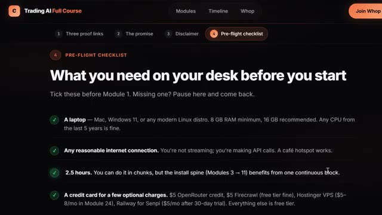
*⏱️ 00:07:03 — Interface web du cours "Trading AI Full Course" affichant la liste de contrôle pré-vol ("Pre-flight checklist") avec les prérequis techniques et de temps (2,5 heures, modules 3 à 11).*

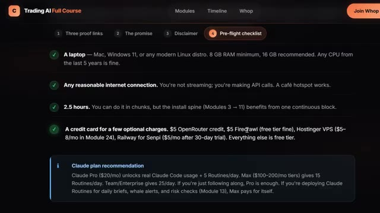
*⏱️ 00:07:12 — Même interface web montrant la liste de contrôle pré-vol avec en plus une recommandation de plan pour Claude (Claude Pro à 20 $/mois).*

---

### ⏱️ `[00:07:31 - 00:08:04]` | Segment #17

**🔊 Audio (Transcription Intégrale Mot pour Mot en Français) :**
> Premièrement, le terminal. N'importe quel terminal moderne fera l'affaire. iTerm pour Mac, Windows Terminal, PowerShell, ou votre terminal Linux par défaut. Vous y collerez des commandes à partir du module 3. Deuxièmement, le navigateur. Vous l'utiliserez pour vous connecter à Claude, OpenRouter, Polymarket et d'autres plateformes essentielles. Troisièmement, Cursor. Vous aurez besoin de cet éditeur de code pour afficher et modifier les fichiers markdown, .md, python, .py, ainsi que le tableau de bord HTML au fil du cours. Quatrièmement, le téléphone. Gardez votre

**👁️ Analyse Visuelle d'Écran (gemini-3.5-flash-lite) :**
**Interface & Outils** : Interface web de cours en ligne (Whop)

**Contenu textuel & Code** : Texte descriptif des prérequis nécessaires pour le cours : Terminal, Navigateur (claude.ai, openrouter.ai, weex.com, alpaca.markets, interactivebrokers.com, polymarket.com, kalshi.com, hostinger.com), Cursor et Telegram.

**Action / Démonstration** : Présentation des prérequis et des outils logiciels nécessaires pour suivre le cours de trading par IA.

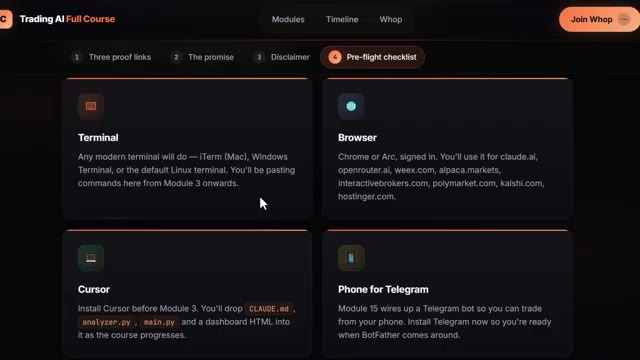
*⏱️ 00:07:39 — Interface du cours 'Trading AI Full Course' présentant la liste de contrôle préalable au vol (Pre-flight checklist) comprenant le Terminal, le Navigateur, Cursor et le téléphone pour Telegram.*

---

### ⏱️ `[00:08:04 - 00:08:38]` | Segment #18

**🔊 Audio (Transcription Intégrale Mot pour Mot en Français) :**
> téléphone à portée de main pour Telegram. Vous en aurez besoin pour les étapes d'intégration une fois que nous commencerons à travailler avec Botfather. Maintenant, pour le premier module, nous allons parler des fondations. Avant d'ouvrir le terminal, nous devons nous mettre d'accord sur le modèle mental. La plupart des traders particuliers échouent avec l'IA parce qu'ils ne l'utilisent que pour une seule chose, demander une stratégie. C'est 5 % des capacités. Pour gagner, nous installons l'IA dans les trois couches du système de trading. La première est la recherche. Il s'agit de trouver l'avantage. Nous parlons de suivre les baleines de Hyperliquid, d'utiliser Firecrawl pour scraper le web ouvert à la recherche de sentiment, et de générer

**👁️ Analyse Visuelle d'Écran (gemini-3.5-flash-lite) :**
**Interface & Outils** : Interface web de cours en ligne, plateforme Whop.

**Contenu textuel & Code** : Titre du module 'Foundations', description du contenu textuel du premier module portant sur le modèle mental à trois couches.

**Action / Démonstration** : Présentation du sommaire du module 1 sur les fondations de l'IA appliquée au trading.

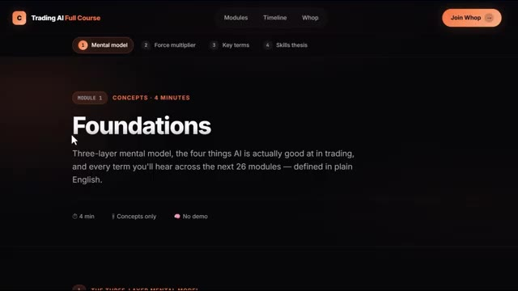
*⏱️ 00:08:12 — Interface du cours 'Trading AI Full Course' affichant le Module 1 intitulé 'Foundations' avec les sous-sections 'Mental model', 'Force multiplier', 'Key terms' et 'Skills thesis'.*

---

### ⏱️ `[00:08:38 - 00:09:14]` | Segment #19

**🔊 Audio (Transcription Intégrale Mot pour Mot en Français) :**
> un bulletin alpha quotidien qui condense des milliers de données en trois éléments qui comptent vraiment. Le deuxième est la stratégie. Il s'agit de transformer cet avantage en règles. Nous utilisons le MCP de TradingView, qui donne à Claude 78 outils spécifiques pour créer automatiquement du PineScript, exécuter des backtests et rechercher une confluence multi-temporelle. Le troisième est l'exécution. Il s'agit de déplacer du capital. Nous utilisons la compétence d'assistance au trading Wix pour exécuter des ordres, utilisons TradingView pour envoyer des commandes via webhook, configurons une gestion des risques agentique et déployons des bots personnalisés sur Hostinger qui restent en ligne 24h/24 et 7j/7. L'avantage n'est pas seulement un

**👁️ Analyse Visuelle d'Écran (gemini-3.5-flash-lite) :**
**Interface & Outils** : Plateforme de formation en ligne (style interface web moderne avec mode sombre et accents orange).

**Contenu textuel & Code** : Texte détaillant les trois couches du trading par l'IA : Layer 1 (Research), Layer 2 (Strategy avec TradingView MCP - 78 tools, Auto-build Pine Script), et Layer 3 (Execution). Section inférieure expliquant pourquoi cela compte.

**Action / Démonstration** : Présentation visuelle de la structure du cours et des outils de stratégie basés sur l'IA.

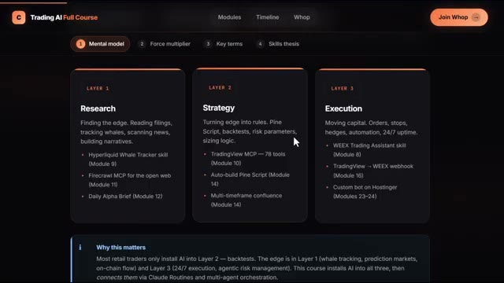
*⏱️ 00:08:47 — Interface du cours "Trading AI Full Course" montrant les trois couches (Layers) : Research, Strategy et Execution, avec des détails sur la stratégie et le MCP TradingView.*

---

### ⏱️ `[00:09:14 - 00:09:36]` | Segment #20

**🔊 Audio (Transcription Intégrale Mot pour Mot en Français) :**
> ceux-là, c'est la connexion entre eux. Maintenant, l'IA n'est pas magique. C'est un multiplicateur de force. Elle vous donne quatre avantages spécifiques que n'importe quel investisseur particulier peut désormais louer pour une bouchée de pain. Vitesse de lecture, elle lit 100 documents réglementaires pendant que vous en lisez un. Vous pouvez donner à un modèle 300 documents et il renverra les valeurs aberrantes en 30 secondes pour environ 25 cents. Code de production, il écrit du Python de niveau professionnel.

**👁️ Analyse Visuelle d'Écran (gemini-3.5-flash-lite) :**
**Interface & Outils** : Interface web de cours en ligne (style Whop) au design sombre avec des accents orange.

**Contenu textuel & Code** : Texte principal : « The four things AI actually does better than you » et « Not magic. Not prediction. Just four unfair advantages any retail trader can now rent for pennies. » Avec une liste de points clés incluant « 100x READING SPEED » (lit 100 articles pendant que vous en lisez un) et « Prod PYTHON QUALITY ».

**Action / Démonstration** : Affichage à l'écran de la diapositive du cours détaillant l'intelligence artificielle comme multiplicateur de force.

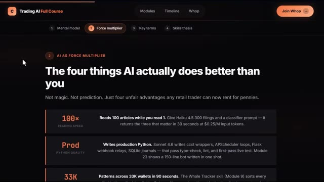
*⏱️ 00:09:19 — Capture d'écran d'une plateforme de cours en ligne présentant les quatre avantages principaux de l'intelligence artificielle pour le trading.*

---

### ⏱️ `[00:09:36 - 00:09:55]` | Segment #21

**🔊 Audio (Transcription Intégrale Mot pour Mot en Français) :**
> Nous parlons de wrappers CCXT et de journaux SQLite qui passent tous les contrôles et s'exécutent en direct du premier coup. Reconnaissance de motifs. Notre traqueur de baleines peut analyser 33 000 portefeuilles en 90 secondes. Il trie chaque trader rentable par P&L et sentiment pendant que vous êtes encore en train rafraîchir un onglet.

**👁️ Analyse Visuelle d'Écran (gemini-3.5-flash-lite) :**
**Interface & Outils** : Interface web de cours en ligne (style plateforme LMS/Whop).

**Contenu textuel & Code** : Texte détaillé sur les avantages compétitifs : "100x READING SPEED", "Prod PYTHON QUALITY", "33K WALLETS SCANNED" (mentionnant l'analyse de 33 000 portefeuilles en 90 secondes et les wrappers CCXT / SQLite), et "24/7 UPTIME".

**Action / Démonstration** : Affichage des points clés du programme de formation axé sur l'utilisation des intelligences artificielles pour le trading algorithmique.

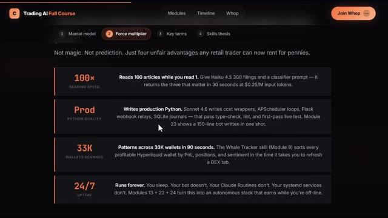
*⏱️ 00:09:41 — Interface web du cours "Trading AI Full Course" présentant quatre avantages clés (vitesse de lecture, qualité Python, portefeuilles scannés, disponibilité 24/7).*

---

### ⏱️ `[00:09:55 - 00:10:16]` | Segment #22

**🔊 Audio (Transcription Intégrale Mot pour Mot en Français) :**
> Disponibilité continue. Vous dormez. Le bot non. Vos services système et vos routines automatisées fonctionnent indéfiniment. C'est une pile autonome qui gagne de l'argent pendant que vous êtes hors ligne. Maintenant, avant d'aborder les outils, laissez-moi démystifier rapidement les termes que vous allez entendre constamment dans ce domaine. Parce que si vous ne savez pas ce qu'ils signifient, certaines de ces choses vont vous sembler plus compliquées qu'elles ne le sont réellement.

**👁️ Analyse Visuelle d'Écran (gemini-3.5-flash-lite) :**
**Interface & Outils** : Interface web de cours en ligne "Trading AI Full Course" avec navigation par onglets et sections textuelles.

**Contenu textuel & Code** : Texte explicatif sur l'autonomie 24/7 des bots, les scripts Python, les services systemd, et les définitions des termes techniques MCP (Model Context Protocol) et API.

**Action / Démonstration** : Le curseur de la souris navigue à travers les sections du cours et survole les points clés du programme d'apprentissage.

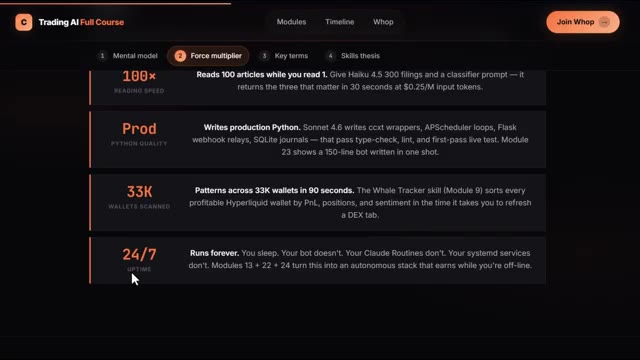
*⏱️ 00:10:00 — Interface du cours "Trading AI Full Course" affichant la section "Force multiplier" avec l'avantage "24/7 Uptime" sur l'autonomie et le fonctionnement continu des bots.*

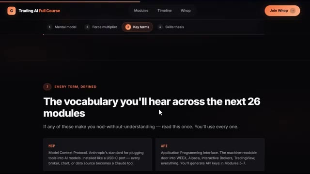
*⏱️ 00:10:06 — Passage à la section suivante du cours intitulée "Key terms" avec le titre "The vocabulary you'll hear across the next 26 modules" définissant MCP et API.*

---

### ⏱️ `[00:10:16 - 00:10:39]` | Segment #23

**🔊 Audio (Transcription Intégrale Mot pour Mot en Français) :**
> Définissons-les maintenant pour ne pas ralentir plus tard. MCP, le Model Context Protocol. Pensez-y comme à un port USB-C pour Claude. Il nous permet de connecter n'importe quel courtier, graphique ou source de données. OpenRouter, c'est notre passerelle unifiée. Une seule clé API qui nous donne accès à Claude, GPT, Gemini et DeepSeek avec un basculement automatique. Claude possède ce qu'Anthropic appelle des compétences.

**👁️ Analyse Visuelle d'Écran (gemini-3.5-flash-lite) :**
**Interface & Outils** : Plateforme de formation en ligne (style Whop)

**Contenu textuel & Code** : Définitions textuelles des concepts techniques : MCP (Model Context Protocol), API, OpenRouter, VPS, Skills, Routines, Agents, Prediction market.

**Action / Démonstration** : Présentation des définitions des termes clés du cours.

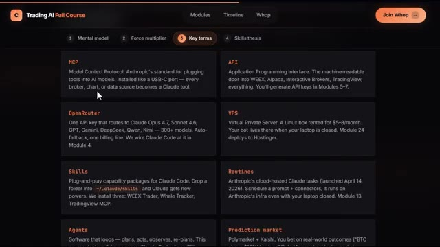
*⏱️ 00:10:22 — Interface du cours "Trading AI Full Course" affichant les définitions des termes clés (MCP, API, OpenRouter, VPS, Skills, Routines, Agents, Prediction market).*

---

### ⏱️ `[00:10:40 - 00:11:18]` | Segment #24

**🔊 Audio (Transcription Intégrale Mot pour Mot en Français) :**
> Pensez-y comme à des applications que vous installez sur votre téléphone. Quelqu'un crée une compétence pour le suivi des baleines sur Hyperliquid. Vous l'installez. Maintenant, Claude peut faire cela automatiquement sans que vous n'écriviez une seule ligne de code. Je vais vous montrer comment les utiliser plus tard dans le cours. API, ce qui signifie Application Programming Interface, ou interface de programmation d'applications. C'est la porte lisible par machine qui connecte Claude directement à Weeks, Alpaca, Interactive Brokers, TradingView, tout. VPS, votre serveur virtuel privé. Une machine Linux que nous louons pour quelques dollars par mois afin que votre bot vive dans le cloud, et pas seulement sur votre ordinateur portable. Routines, les tâches hébergées dans le cloud d'Anthropic. Vous planifiez un prompt et il s'exécute sur leur

**👁️ Analyse Visuelle d'Écran (gemini-3.5-flash-lite) :**
**Interface & Outils** : Windows PowerShell (Claude Code) et interface Web de cours en ligne.

**Contenu textuel & Code** : Commandes terminal Claude Code v2.1.112 avec Opus 4.7 et définitions pédagogiques sur le Model Context Protocol (MCP) et les compétences d'IA.

**Action / Démonstration** : Navigation dans le terminal pour l'utilisation de Claude Code et présentation des concepts fondamentaux du cours de trading par IA.

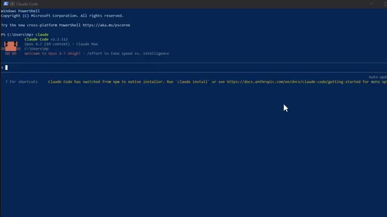
*⏱️ 00:10:49 — Capture d'écran du terminal Claude Code sous Windows PowerShell montrant l'interface en ligne de commande de l'assistant IA.*

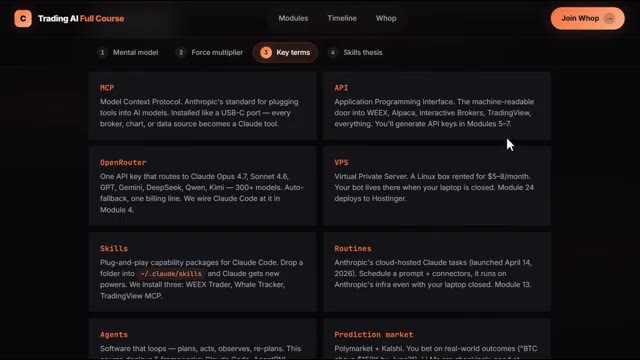
*⏱️ 00:10:59 — Interface de cours en ligne "Trading AI Full Course" affichant des définitions de termes clés (MCP, API, OpenRouter, VPS, Skills, Routines, Agents, Prediction market).*

---

### ⏱️ `[00:11:18 - 00:11:54]` | Segment #25

**🔊 Audio (Transcription Intégrale Mot pour Mot en Français) :**
> infrastructure même lorsque votre ordinateur portable est fermé. Des agents, des logiciels qui bouclent. Ils planifient, agissent, observent et replanifient. Nous allons déployer cinq frameworks différents, notamment Senpai, Hermes et OpenClaw. Les marchés de prédiction, des plateformes comme Polymarket et Kalshi. Les LLMs sont étonnamment bons dans ce domaine car ils compressent des quantités massives de contexte pour prédire des résultats du monde réel. La thèse des compétences et pourquoi ce cours s'appuie lourdement sur les compétences de Claude. La plupart des gens pensent que le prompt engineering est le secret. Ce n'est pas le cas. Une compétence est un dossier. À l'intérieur se trouve un fichier spécialisé qui enseigne à Claude tout un

**👁️ Analyse Visuelle d'Écran (gemini-3.5-flash-lite) :**
**Interface & Outils** : Plateforme de formation en ligne / site web de cours.

**Contenu textuel & Code** : Sections détaillées : "Skills", "Routines", "Agents" (mentionnant 5 frameworks : Claude Code, AgentPNL, Senpi, Hermes, OpenClaw) et "Prediction market" (Polymarket + Kalshi).

**Action / Démonstration** : Navigation et survol par le curseur de la souris sur la section consacrée aux agents logiciels.

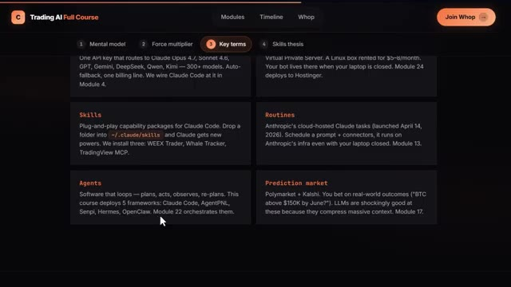
*⏱️ 00:11:27 — Interface du cours "Trading AI Full Course" affichant des définitions clés, notamment sur les agents logiciels et les marchés de prédiction.*

---

### ⏱️ `[00:11:54 - 00:12:20]` | Segment #26

**🔊 Audio (Transcription Intégrale Mot pour Mot en Français) :**
> domaine. Chaque commande, chaque cas particulier, et chaque valeur par défaut sécurisée. En intégrant trois compétences spécifiques dans le système, Claude sait soudainement comment trader des perpétuels Wix, suivre les baleines d'Hyperliquid, et contrôler votre bureau TradingView avec 78 outils intégrés. Aucun codage manuel requis, pas d'ingénierie de prompt, juste une capacité prête à l'emploi. Ce sont les briques LEGO. Maintenant, allons construire la pile. Maintenant, le deuxième module couvre la pile de trading IA complète.

**👁️ Analyse Visuelle d'Écran (gemini-3.5-flash-lite) :**
**Interface & Outils** : Application web de formation en ligne (plateforme Whop)

**Contenu textuel & Code** : Modules de compétences affichés en blocs : Skill 1 (WEEX Trader), Skill 2 (Whale Tracker), Skill 3 (TradingView MCP) et résumé des compétences de base.

**Action / Démonstration** : Présentation des modules d'apprentissage intégrant l'IA pour le trading de perpétuels, le suivi des baleines et le contrôle de TradingView.

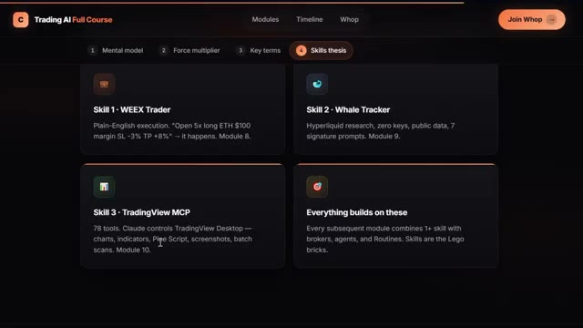
*⏱️ 00:12:01 — Interface du cours 'Trading AI Full Course' présentant les trois compétences clés : WEEX Trader, Whale Tracker et TradingView MCP.*

---

### ⏱️ `[00:12:20 - 00:12:43]` | Segment #27

**🔊 Audio (Transcription Intégrale Mot pour Mot en Français) :**
> Voici la carte d'une seule page. Chaque outil, chaque courtier, chaque plateforme d'agent, et chaque compétence. Si un nom vous semble peu familier pour l'instant, ne vous inquiétez pas. Chaque case de cette carte aura droit à son propre module d'installation dédié plus tard. Pour l'instant, je veux que vous voyiez comment les blocs LEGO s'emboîtent. 1. Modèles plus OpenRouter. Tout commence par une clé.

**👁️ Analyse Visuelle d'Écran (gemini-3.5-flash-lite) :**
**Interface & Outils** : Site web éducatif 'Trading AI Full Course' et page d'accueil d'Alpaca.

**Contenu textuel & Code** : Texte explicatif sur la pile technologique du trading par IA, les frameworks d'agents et la carte globale du cours.

**Action / Démonstration** : Présentation théorique et navigation sur la plateforme de cours montrant la structure des modules.

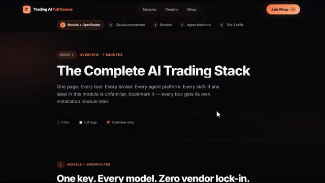
*⏱️ 00:12:37 — Interface de la plateforme de cours affichant le titre 'The Complete AI Trading Stack' et la présentation globale.*

---

### ⏱️ `[00:12:43 - 00:13:07]` | Segment #28

**🔊 Audio (Transcription Intégrale Mot pour Mot en Français) :**
> Nous utilisons OpenRouter parce que cela nous donne une seule et unique clé API pour accéder à plus de 300 modèles. Pas de dépendance à un fournisseur unique. Si Anthropic tombe en panne, nous basculons sur DeepSeek ou Quinn en une seconde. Maintenant, Claude a trois modèles différents, tous avec des forces différentes pour des productions différentes. Le premier est Claude Opus 4.7. C'est le fleuron d'Anthropic conçu pour la conception de stratégies lourdes, la révision de code et le raisonnement d'analyseur Polymarket.

**👁️ Analyse Visuelle d'Écran (gemini-3.5-flash-lite) :**
**Interface & Outils** : Navigateur web affichant la plateforme OpenRouter et le tableau de bord du cours Trading AI Full Course.

**Contenu textuel & Code** : Documentation OpenRouter, liste des modèles d'IA (Anthropic, OpenAI, Google, DeepSeek, Qwen), et tableau comparatif chiffré des performances (pourcentages de réussite sur des benchmarks comme SWE-bench, Terminal-Bench, etc.).

**Action / Démonstration** : Présentation des différents modèles d'IA pris en charge par l'API unique d'OpenRouter et comparaison de leurs performances techniques.

*⏱️ 00:12:55 — Interface du cours 'Trading AI Full Course' présentant les avantages d'OpenRouter ('One key. Every model. Zero vendor lock-in.') et les différents modèles d'IA disponibles (Claude Opus 4.7, Claude Sonnet 4.6, Claude Haiku 4.5, Qwen/Kimi, GPT/Gemini/DeepSeek).*

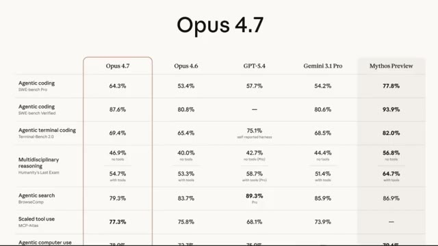
*⏱️ 00:13:01 — Tableau comparatif des performances de différents modèles d'IA (Opus 4.7, Opus 4.6, GPT-5.4, Gemini 3.1 Pro, Mythos Preview) selon plusieurs critères (Agentic coding, Multidisciplinary reasoning, Agentic search, Scaled tool use).*

---

### ⏱️ `[00:13:08 - 00:13:28]` | Segment #29

**🔊 Audio (Transcription Intégrale Mot pour Mot en Français) :**
> Le deuxième est Claude 4.6 Sonnet. Ce modèle sera notre bête de somme. 90 % de ce cours fonctionne avec lui. Le troisième est Claude Haiku 4.5. Celui-ci est pour la main-d'œuvre bon marché. Il est principalement utilisé pour classifier les actualités, trier les routines et classifier les prises pour quelques centimes. Les autres modèles incluent GPT, Gemini et DeepSeek.

**👁️ Analyse Visuelle d'Écran (gemini-3.5-flash-lite) :**
**Interface & Outils** : Interface web de cours et interface de sélection de modèles d'IA.

**Contenu textuel & Code** : Présentation des modèles Anthropic (Claude Opus 4.7, Claude Sonnet 4.6, Claude Haiku 4.5) et leur rôle dans le trading automatisé.

**Action / Démonstration** : Sélection et explication des différents modèles d'intelligence artificielle utilisés pour les tâches de trading.

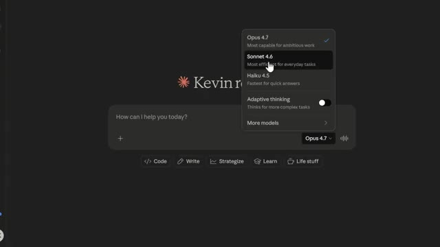
*⏱️ 00:13:13 — Interface d'une application montrant un menu déroulant de sélection de modèles IA (Opus 4.7, Sonnet 4.6, Haiku 4.5).*

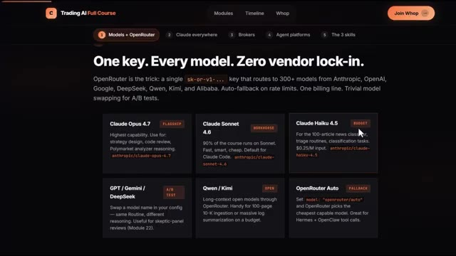
*⏱️ 00:13:18 — Page web de cours montrant les différents modèles IA disponibles via OpenRouter, avec leurs cas d'usage respectifs.*

---

### ⏱️ `[00:13:29 - 00:13:54]` | Segment #30

**🔊 Audio (Transcription Intégrale Mot pour Mot en Français) :**
> Vous pouvez les échanger dans votre configuration à tout moment sans modifier vos routines. C'est incroyablement utile pour les examens de panel de sceptiques, où vous avez plusieurs modèles qui critiquent une idée de trade avant que vous ne passiez à l'action. Viennent ensuite Quinn et Kimmy. Ce sont vos modèles ouverts à long contexte. Si vous devez ingérer un document 10K de 100 pages ou résumer des fichiers journaux massifs à moindre coût, ce sont vos outils de prédilection.

**👁️ Analyse Visuelle d'Écran (gemini-3.5-flash-lite) :**
**Interface & Outils** : Page web de cours en ligne avec interface sombre, listant différents modèles d'intelligence artificielle.

**Contenu textuel & Code** : Présentation des modèles OpenRouter (Claude Opus 4.7, Claude Sonnet 4.6, Claude Haiku 4.5, GPT / Gemini / DeepSeek, Qwen / Kimi, OpenRouter Auto) avec descriptions textuelles et clés d'API.

**Action / Démonstration** : Présentation des avantages d'utiliser une clé unique pour router vers plus de 300 modèles et faciliter les tests A/B.

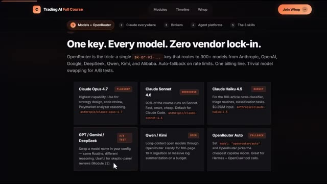
*⏱️ 00:13:35 — Capture d'écran montrant l'interface du cours "Trading AI Full Course" sur la section OpenRouter et la gestion des modèles d'IA.*

---

### ⏱️ `[00:13:54 - 00:14:15]` | Segment #31

**🔊 Audio (Transcription Intégrale Mot pour Mot en Français) :**
> De plus, avec OpenRooter, vous pouvez même régler votre modèle sur auto. Cela indique au système de choisir automatiquement le modèle le plus économique et le plus performant disponible pour la tâche spécifique que vous exécutez. C' tout à fait le moyen ultime d'optimiser vos frais généraux tout en maintenant vos agents Hermes and OpenClaw opérationnels 24h/24 et 7j/7. Très bien, avant de toucher le moindre terminal, vous devez comprendre ce qu'est réellement Claude.

**👁️ Analyse Visuelle d'Écran (gemini-3.5-flash-lite) :**
**Interface & Outils** : Navigateur web affichant des plateformes web éducatives et logicielles.

**Contenu textuel & Code** : Présentation des différents modèles d'IA pris en charge par OpenRouter (Claude Opus, Sonnet, Haiku, GPT, Gemini, DeepSeek, Qwen, Kimi, et OpenRouter Auto).

**Action / Démonstration** : Présentation à l'écran des avantages d'OpenRouter et de sa fonctionnalité de sélection automatique de modèles.

*⏱️ 00:13:59 — Capture d'écran montrant le site de cours 'Trading AI Full Course' avec une section intitulée 'One key. Every model. Zero vendor lock-in' détaillant l'utilisation d'OpenRouter et ses différents modèles.*

---

### ⏱️ `[00:14:16 - 00:14:42]` | Segment #32

**🔊 Audio (Transcription Intégrale Mot pour Mot en Français) :**
> Il y a trois versions que vous devez connaître. La première est Claude.ai. C'est la version par navigateur. Pensez-y comme à l'assistant de recherche. Vous y collez la capture d'écran d'un graphique, un article de presse, un contrat de jeton. Il le lit et vous en donne une analyse structurée. Pas de code, pas de configuration. Il suffit d'ouvrir un onglet et c'est parti. La deuxième est Claude Desktop avec Cowork. C'est là que ça devient agentique. Cowork ne se contente pas de parler.

**👁️ Analyse Visuelle d'Écran (gemini-3.5-flash-lite) :**
**Interface & Outils** : Navigateur web - Claude.ai

**Contenu textuel & Code** : Champ de texte "How can I help you today?", sélecteur de modèle "Opus 4.7", boutons de raccourcis : Code, Write, Strategize, Learn, Life stuff.

**Action / Démonstration** : Présentation de l'interface par navigateur de Claude.ai servant d'assistant de recherche.

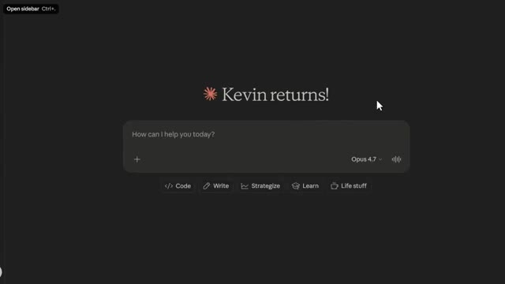
*⏱️ 00:14:22 — Interface de l'assistant IA Claude.ai affichant une zone de saisie avec le message de bienvenue "Kevin returns!" et des options de catégories.*

---

### ⏱️ `[00:14:42 - 00:15:17]` | Segment #33

**🔊 Audio (Transcription Intégrale Mot pour Mot en Français) :**
> Il agit. Il peut ouvrir des applications sur votre ordinateur, lire et modifier des fichiers, exécuter des tâches planifiées et se souvenir du contexte d'une session à l'autre. Il sait donc ce que vous lui avez dit hier. Il connaît votre configuration de trading. Il travaille en arrière-plan pendant que vous faites autre chose. Le troisième est Claude Code. C'est la version la plus puissante. C'est un outil en ligne de commande qui écrit, exécute et itère du code de manière autonome. C'est ce qui a permis de créer les bots de trading que je vais vous montrer plus tard. C'est ce qui se connecte à votre exchange et exécute de vrais trades. Parlons maintenant de l'endroit où l'argent circule réellement.

**👁️ Analyse Visuelle d'Écran (gemini-3.5-flash-lite) :**
**Interface & Outils** : Application Telegram et navigateur web

**Contenu textuel & Code** : Résultats de scan des taux de financement (Highest Longs Pay Shorts et Shorts Pay Longs) avec des paires comme ACTUSDT, DOGEUSDT, APTUSDT et des ordres saisis dans le chat.

**Action / Démonstration** : Consultation des taux de financement et d'une analyse automatisée des opportunités de trading via le bot Telegram.

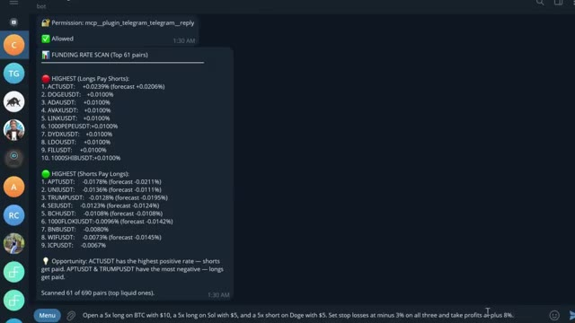
*⏱️ 00:15:08 — Interface Telegram affichant un bot de scan de taux de financement (Funding Rate Scan) pour diverses paires crypto.*

---

### ⏱️ `[00:15:17 - 00:15:36]` | Segment #34

**🔊 Audio (Transcription Intégrale Mot pour Mot en Français) :**
> Nous nous connectons à trois courtiers principaux, plus les marchés de prédiction, plus la bibliothèque CCXT pour tout le reste. Le premier est Wix. C'est notre courtier crypto principal. Il n'y a pas de KYC, il offre un énorme bonus de dépôt et, plus important encore, il possède une API V3 conçue spécifiquement pour l'intégration de l'IA.

**👁️ Analyse Visuelle d'Écran (gemini-3.5-flash-lite) :**
**Interface & Outils** : Navigateur web affichant le portail du cours en ligne et l'interface de la bourse crypto WEEX.

**Contenu textuel & Code** : Noms de courtiers et d'échanges (Polymarket, Kalshi, Binance, BioFin, Hyperliquid, WEEX), offres promotionnelles et bonus de dépôt.
[DESC_IMAGE_3] Présentation des plateformes de trading et de courtage recommandées dans le cadre du cours d'intelligence artificielle appliquée au trading.

**Action / Démonstration** : Explications face caméra et analyse conceptuelle des marchés.

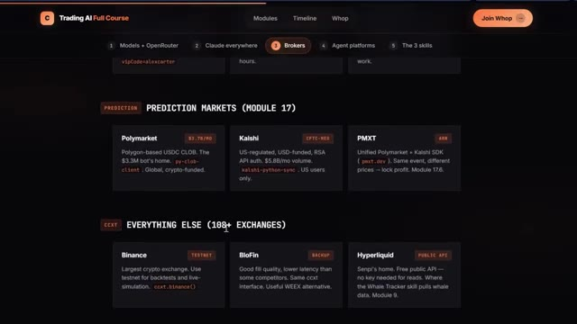
*⏱️ 00:15:22 — Interface du cours 'Trading AI Full Course' montrant les modules de courtiers, les marchés de prédiction (Polymarket, Kalshi) et CCXT (Binance, BioFin, Hyperliquid).*

*⏱️ 00:15:27 — Page d'accueil de la plateforme d'échange crypto WEEX proposant une campagne promotionnelle autour du pétrole brut et un bonus de dépôt.*

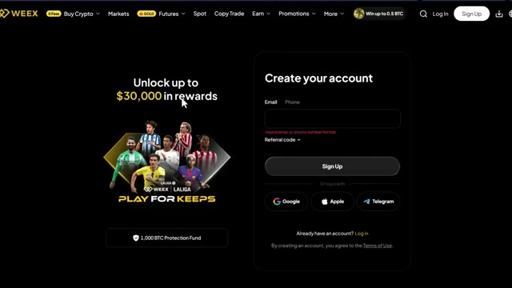
*⏱️ 00:15:32 — Page d'inscription de la plateforme WEEX affichant l'offre de récompense de 30 000 $ et le formulaire de création de compte.*

---

### ⏱️ `[00:15:37 - 00:16:10]` | Segment #35

**🔊 Audio (Transcription Intégrale Mot pour Mot en Français) :**
> Il gère les contrats à terme et le marché au comptant dans un seul compte. Le deuxième est Alpaca. C'est votre plateforme de référence pour les actions et options américaines. C'est sans commission et il possède le meilleur SDK Python du secteur. Il dispose même d'un serveur MCP officiel pour Claw Desktop. Le troisième est Interactive Brokers. C'est pour les professionnels. Si vous tradez sur les marchés mondiaux, des obligations ou des CFD, c'est l'exigence incontournable. Nous utilisons la bibliothèque Python IBM Sync pour une exécution de niveau professionnel. Nous visons également les marchés de prédiction, qui abritent ce robot à 3 millions de dollars mentionné plus tôt. Le premier est Polymarket.

**👁️ Analyse Visuelle d'Écran (gemini-3.5-flash-lite) :**
**Interface & Outils** : Sites web de courtiers et plateformes de formation en trading (Alpaca, Interactive Brokers, Trading AI Full Course).

**Contenu textuel & Code** : Informations sur les courtiers, les options sans commission, les contrats à terme, et l'intégration de l'IA (SDK Python, serveur MCP).

**Action / Démonstration** : Présentation des plateformes de courtage et des marchés de prédiction recommandés pour le trading algorithmique.

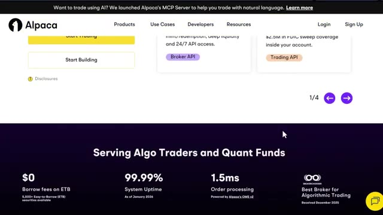
*⏱️ 00:15:45 — Capture d'écran du site web d'Alpaca montrant les services pour les traders algorithmiques.*

*⏱️ 00:15:54 — Capture d'écran du site web d'Interactive Brokers illustrant les contrats de prédiction économique.*

*⏱️ 00:16:02 — Capture d'écran de la plateforme du cours montrant les trois courtiers principaux connectés en direct.*

---

### ⏱️ `[00:16:10 - 00:16:43]` | Segment #36

**🔊 Audio (Transcription Intégrale Mot pour Mot en Français) :**
> Voici le géant mondial des paris sur des événements financés par cryptomonnaie. Kalshi, qui est l'alternative réglementée aux États-Unis pour Polymarket, PMXT. C'est un kit de développement logiciel unifié qui nous permet de faire de l'arbitrage entre Polymarket et Kalshi. Si le même événement a des prix différents sur Polymarket et Kalshi, l'intelligence artificielle verrouille automatiquement le profit. Et pour tout le reste, nous avons CCXT. C'est le traducteur universel pour plus de 100 plateformes d'échange. C'est ainsi que nous communiquons avec Binance pour les tests rétrospectifs et

**👁️ Analyse Visuelle d'Écran (gemini-3.5-flash-lite) :**
**Interface & Outils** : Interface web de cours en ligne (Whop / Trading AI Full Course)

**Contenu textuel & Code** : Cartes descriptives pour Prediction Markets (Module 17) : Polymarket (Polygon-based USDC CLOB), Kalshi (US-regulated, USD-funded), PMXT (Unified Polymarket + Kalshi SDK, pmxt.dev), ainsi que CCXT Everything Else avec Binance, BloFin et Hyperliquid.

**Action / Démonstration** : Présentation visuelle des outils d'arbitrage et des SDK pour les marchés de prédiction et les exchanges centralisés.

*⏱️ 00:16:19 — Capture d'écran de l'interface du cours "Trading AI Full Course" montrant les modules sur les marchés de prédiction (Polymarket, Kalshi, PMXT) et les exchanges traditionnels (Binance, BloFin, Hyperliquid).*

---

### ⏱️ `[00:16:43 - 00:17:06]` | Segment #37

**🔊 Audio (Transcription Intégrale Mot pour Mot en Français) :**
> Blowfin comme solution de secours à faible latence et excellente alternative pour la semaine. Enfin, il y a Hyperliquid. Il dispose d'une API publique gratuite qui ne nécessite aucune clé pour la lecture des données. C'est ici que notre compétence Whale Tracker extrait des données en direct pour voir ce que font les plus gros poissons de l'étang. Avec ce cours, vous n'obtenez pas seulement un bot, vous obtenez cinq frameworks différents, où chacun fait une chose mieux que les autres.

**👁️ Analyse Visuelle d'Écran (gemini-3.5-flash-lite) :**
**Interface & Outils** : Site web de cours en ligne ('Trading AI Full Course') et interface utilisateur de la plateforme d'échange Hyperliquid (Leaderboard).

**Contenu textuel & Code** : Cartes descriptives de courtiers (Binance Testnet, BioFin, Hyperliquid Public API) et tableaux statistiques de traders (Rank, Trader, Account Value, PNL, ROI, Volume).
[DESC_IMAGE_3_UNUSED] Non retenue car axée sur les frameworks d'agents plutôt que sur l'analyse directe des brokers ou des données en direct.

**Action / Démonstration** : Navigation et présentation des options de courtage et de l'API publique d'Hyperliquid pour l'extraction de données de baleines.

*⏱️ 00:16:49 — Interface du cours 'Trading AI Full Course' montrant la section des courtiers et des options d'échanges (Binance, BioFin, Hyperliquid avec API publique).*

*⏱️ 00:16:54 — Tableau de classement (Leaderboard) de la plateforme Hyperliquid affichant les adresses de portefeuille, valeurs de compte, PNL et ROI.*

---

### ⏱️ `[00:17:06 - 00:17:30]` | Segment #38

**🔊 Audio (Transcription Intégrale Mot pour Mot en Français) :**
> La plupart des utilisateurs avancés utilisent une combinaison de ceux-ci pour couvrir tous les aspects du marché. Le premier est Asian P&L. C'est le point d'entrée le plus simple. C'est un agent perpétuel en anglais simple d'une semaine. Vous pouvez passer du copier-coller au trading en direct en moins de deux minutes. Il possède même un classement public pour que vous puissiez voir comment votre logique se positionne. Le deuxième est Senpai. C'est votre centrale de trading personnelle pour Hyperliquid.

**👁️ Analyse Visuelle d'Écran (gemini-3.5-flash-lite) :**
**Interface & Outils** : Interface web d'AgentPNL avec un tableau de bord et un classement (Leaderboard).

**Contenu textuel & Code** : Texte descriptif de la plateforme ('Write your strategy in plain English. Pick a model. Hit start. Your bot trades WEEX perps on its own'), bouton 'Go to dashboard', et un tableau montrant les statistiques des bots (BOT, OWNER, PAIRS, MODEL, PNL, RETURN, TRADES, WIN %, STATUS, STRATEGY).

**Action / Démonstration** : Présentation de la plateforme de création de bots de trading propulsée par l'IA et de son classement public.

*⏱️ 00:17:12 — Page d'accueil de la plateforme AgentPNL affichant le slogan 'Build AI trading bots. Put them on the leaderboard' avec un tableau de classement des bots en bas.*

---

### ⏱️ `[00:17:31 - 00:17:53]` | Segment #39

**🔊 Audio (Transcription Intégrale Mot pour Mot en Français) :**
> Il est fourni avec 44 outils MCP spécialisés et a fait ses preuves au combat avec plus de 100 millions de dollars de volume. Sous le capot, il est propulsé par OpenClaw. Le troisième est Hermes. Développé par Noose Research, ce framework basé sur Python est une bête avec 95 000 étoiles sur GitHub. Il est auto-améliorable, ce qui signifie qu'il génère des compétences réutilisables à partir de chaque tâche réussie.

**👁️ Analyse Visuelle d'Écran (gemini-3.5-flash-lite) :**
**Interface & Outils** : Site web éducatif de cours sur le trading par IA et pages de documentation de frameworks open-source.

**Contenu textuel & Code** : Spécifications techniques des agents, métriques d'utilisation (95k étoiles GitHub, volumes de transactions) et fonctionnalités des assistants.

**Action / Démonstration** : Navigation et présentation comparative des différents frameworks et outils d'agents de trading automatisés.

*⏱️ 00:17:36 — Présentation des outils d'IA pour Hyperliquid incluant Trader Discovery Engine et Hyperfeed.*

*⏱️ 00:17:42 — Page de présentation des fonctionnalités de Hermes Agent v0.10.0 par Nous Research.*

*⏱️ 00:17:48 — Vue d'ensemble des 5 frameworks de trading par IA : AgentPNL, Senpi, Hermes, OpenClaw, Claude Routines et Claude Code.*

---

### ⏱️ `[00:17:54 - 00:18:13]` | Segment #40

**🔊 Audio (Transcription Intégrale Mot pour Mot en Français) :**
> C'est aussi votre passerelle vers Telegram, Discord et Slack. Quatrièmement, il y a OpenClaw. C'est le poids lourd de l'écosystème avec 345 000 étoiles. Construit sur TypeScript et Node.js, il possède la plus vaste intégration possible, plus de 50 canaux et 13 000 compétences communautaires via Clawhub.

**👁️ Analyse Visuelle d'Écran (gemini-3.5-flash-lite) :**
**Interface & Outils** : Navigateur web affichant le site officiel d'OpenClaw et une plateforme de formation en ligne.

**Contenu textuel & Code** : Présentation textuelle d'OpenClaw (TypeScript/Node.js, 50+ canaux, 13K+ compétences, 345k étoiles).

**Action / Démonstration** : Navigation et présentation des caractéristiques techniques d'OpenClaw dans le cadre du cours sur l'IA de trading.

*⏱️ 00:17:59 — Page d'accueil du site web OpenClaw avec le logo et la description des fonctionnalités.*

*⏱️ 00:18:08 — Interface de cours présentant les cinq frameworks d'agents IA, avec OpenClaw en surbrillance.*

---

### ⏱️ `[00:18:14 - 00:18:34]` | Segment #41

**🔊 Audio (Transcription Intégrale Mot pour Mot en Français) :**
> Cinquièmement, il y a les routines Claude. Ce sont des tâches planifiées hébergées sur le cloud d'Anthropic. C'est ainsi que votre logique reste active et continue de s'exécuter même lorsque votre ordinateur portable est fermé. Vous n'êtes pas obligé d'en choisir une seule. Nous allons installer les cinq, et vous choisirez la combinaison qui correspond à votre style de trading spécifique. Enfin, nous avons intégré trois super compétences directement dans votre code Claude.

**👁️ Analyse Visuelle d'Écran (gemini-3.5-flash-lite) :**
**Interface & Outils** : Navigateur web affichant la plateforme de formation 'Trading AI Full Course' (agent platforms).

**Contenu textuel & Code** : Tableau ou grille listant six frameworks d'agents : AgentPNL, Senpi, Hermes, OpenClaw, Claude Routines, et Claude Code avec leurs descriptions et spécificités.

**Action / Démonstration** : Navigation et présentation des différents frameworks d'agents disponibles dans le cours de trading par IA.

*⏱️ 00:18:24 — Interface de la plateforme de formation 'Trading AI Full Course' présentant les 6 cadres d'agents différents, dont 'Claude Routines'.*

---

### ⏱️ `[00:18:34 - 00:18:52]` | Segment #42

**🔊 Audio (Transcription Intégrale Mot pour Mot en Français) :**
> C'est l'avantage injuste de ce cours. Whale Tracker, la recherche sur les baleines Hyperliquid en temps réel sans clés API. TradingView MCP, 78 outils qui permettent à Claude de contrôler littéralement votre bureau TradingView. L'analyse des graphiques et la rédaction de PineScript pour vous. WeX Trading Assistant qui vous permet d'exécuter des transactions entièrement en français simple.

**👁️ Analyse Visuelle d'Écran (gemini-3.5-flash-lite) :**
**Interface & Outils** : Interface de terminal en ligne de commande et documentation technique/GitHub.

**Contenu textuel & Code** : Tableaux de performance (PnL global, PnL mensuel, valeur du compte) et positions ouvertes sur différentes cryptomonnaies (BTC, ETH, SOL, ENA, etc.) avec effet de levier. Liste des 78 outils MCP pour TradingView (chart_get_state, data_get_study_values, quote_get, etc.).

**Action / Démonstration** : Présentation du système de suivi des baleines et de la documentation des outils MCP pour automatiser l'analyse technique.

*⏱️ 00:18:39 — Interface de terminal affichant le suivi d'une baleine (Whale Tracker) sur Hyperliquid avec les performances financières et les positions clés.*

*⏱️ 00:18:43 — Documentation d'un outil avec la référence de 78 outils MCP (Model Context Protocol) pour la lecture de graphiques.*

---

### ⏱️ `[00:18:53 - 00:19:13]` | Segment #43

**🔊 Audio (Transcription Intégrale Mot pour Mot en Français) :**
> Individuellement, ces outils sont puissants. Combinés, ils créent le briefing alpha quotidien, où votre IA suit les baleines, lit les graphiques, vérifie votre portefeuille et vous sert les configurations du jour sur un plateau d'argent. Étudiez la carte sur cette page. Ajoutez aux favoris les étiquettes que vous ne connaissez pas. Commençons à les brancher, ce qui est exactement ce que nous allons faire dans le module suivant.

**👁️ Analyse Visuelle d'Écran (gemini-3.5-flash-lite) :**
**Interface & Outils** : Interface web / plateforme de cours en ligne avec disposition en grille de cartes.

**Contenu textuel & Code** : Texte décrivant les 3 compétences clés : Whale Tracker (recherche sur Hyperliquid), TradingView MCP (analyse avec Claude contrôlant TradingView Desktop), WEEX Trading Assistant (exécution des contrats perpétuels) et "They compose" (The Daily Alpha Brief combinant les trois).

**Action / Démonstration** : Présentation visuelle des différents modules et outils d'IA combinés pour le briefing alpha quotidien.

*⏱️ 00:18:58 — Interface du cours "Trading AI Full Course" affichant quatre modules d'outils d'IA pour le trading (Whale Tracker, TradingView MCP, WEEX Trading Assistant et They compose).*

---

### ⏱️ `[00:19:14 - 00:19:39]` | Segment #44

**🔊 Audio (Transcription Intégrale Mot pour Mot en Français) :**
> Dans ce module, nous installons tous les outils essentiels dont vous aurez besoin tout au long du cours. Cinq installations. Cinq commandes de vérification et un dossier de projet. C'est la base. Chaque module qui suit suppose que cette configuration est parfaitement en place. Si vous sautez une étape ici, les bots ne s'exécuteront pas, l'API ne se connectera pas, et vous résoluerez des problèmes de code au lieu de trader sur les marchés. Nous allons ouvrir cinq onglets et les installer dans l'ordre. Au travail.

**👁️ Analyse Visuelle d'Écran (gemini-3.5-flash-lite) :**
**Interface & Outils** : Application web / plateforme de cours en ligne (Trading AI Full Course).

**Contenu textuel & Code** : Liste des 5 installations : 01. Python 3.12+, 02. Node.js LTS, 03. Git, 04. Cursor (editor), 05. A terminal.

**Action / Démonstration** : Présentation visuelle de la liste des prérequis techniques nécessaires pour suivre le cours.

*⏱️ 00:19:20 — Interface du cours listant les cinq installations logicielles essentielles requises.*

---

### ⏱️ `[00:19:39 - 00:19:59]` | Segment #45

**🔊 Audio (Transcription Intégrale Mot pour Mot en Français) :**
> Premièrement, c'est Python 3.12 ou supérieur. Allez sur python.org. Cliquez sur Télécharger Python. Une fois le programme d'installation téléchargé, une fenêtre pop-up apparaîtra. Cliquez sur Installer Python et cliquez sur Oui pour accepter les conditions. Si vous êtes sur Windows, c'est la partie la plus importante. Cochez la case qui dit Ajouter Python au Path pendant l'installation.

**👁️ Analyse Visuelle d'Écran (gemini-3.5-flash-lite) :**
**Interface & Outils** : Site web python.org et assistant d'installation/terminal Windows.

**Contenu textuel & Code** : Page de téléchargement de Python, version 3.14.4 (ou supérieure), et invite de commande du gestionnaire d'installation.

**Action / Démonstration** : Téléchargement et lancement de l'assistant d'installation de Python sous Windows.

*⏱️ 00:19:44 — Page d'accueil officielle du site python.org avec le bouton de téléchargement de l'installeur Python pour Windows.*

*⏱️ 00:19:49 — Fenêtre pop-up de confirmation d'installation du gestionnaire d'installation Python ("Install Python Install Manager?") sur Windows.*

*⏱️ 00:19:54 — Fenêtre de terminal de commande montrant l'exécution du gestionnaire d'installation et l'extraction des fichiers pour installer Python.*

---

### ⏱️ `[00:19:59 - 00:20:17]` | Segment #46

**🔊 Audio (Transcription Intégrale Mot pour Mot en Français) :**
> Si vous avez manqué cela, rien d'autre ne fonctionne. Si vous êtes sur Mac et que vous avez Homebrew, vous pouvez taper la commande d'installation des notes ci-dessous à la place. Le deuxième est Node.js. Obtenez la version LTS sur Node.js.org. C'est le moteur des serveurs ARMCP, et le framework OpenClaw se déplacera plus tard.

**👁️ Analyse Visuelle d'Écran (gemini-3.5-flash-lite) :**
**Interface & Outils** : Interface web de cours et site officiel Node.js.

**Contenu textuel & Code** : Instructions d'installation pour Python 3.12+, Node.js LTS, et Git, avec commandes pour terminal (Homebrew et Docker).

**Action / Démonstration** : Présentation des prérequis logiciels nécessaires au suivi du cours de trading IA et à l'installation des serveurs MCP.

*⏱️ 00:20:04 — Interface web montrant les instructions d'installation des cinq outils requis pour le cours, avec Python et Node.js.*

*⏱️ 00:20:13 — Page de téléchargement officielle de Node.js montrant la version LTS et les options de configuration Docker.*

---

### ⏱️ `[00:20:18 - 00:20:37]` | Segment #47

**🔊 Audio (Transcription Intégrale Mot pour Mot en Français) :**
> Choisissez votre système d'exploitation. Puisque j'utilise Windows, je vais sélectionner le programme d'installation pour Windows. Acceptez le contrat de licence, puis cliquez sur Suivant jusqu'à ce que l'installation soit terminée. Le troisième est Git. Téléchargez-le depuis git-scm.com. Nous l'utiliserons pour cloner ou copier les compétences de trading et les dépôts du bot directement sur votre machine.

**👁️ Analyse Visuelle d'Écran (gemini-3.5-flash-lite) :**
**Interface & Outils** : Navigateur web, site officiel Git (git-scm.com), plateforme de cours en ligne, assistant d'installation logiciel (Node.js).

**Contenu textuel & Code** : Liste des outils nécessaires à l'installation (Python 3.12+, Node.js LTS, Git, éditeur Cursor, terminal) et instructions de configuration.

**Action / Démonstration** : Présentation des étapes d'installation et de téléchargement des outils logiciels requis pour le projet de trading par IA.

*⏱️ 00:20:23 — Fenêtre d'installation de Node.js affichant le contrat de licence utilisateur (End-User License Agreement).*

*⏱️ 00:20:28 — Interface du cours 'Trading AI Full Course' détaillant les prérequis d'installation (Python, Node.js, Git, Cursor, Terminal).*

*⏱️ 00:20:32 — Page d'accueil officielle du site web de Git (git-scm.com) avec le bouton de téléchargement pour Windows.*

---

### ⏱️ `[00:20:38 - 00:20:59]` | Segment #48

**🔊 Audio (Transcription Intégrale Mot pour Mot en Français) :**
> Acceptez simplement les paramètres par défaut lors de l'installation. Le quatrième est Cursor. C'est notre centre de commande. Allez sur cursor.com. C'est un éditeur natif d'IA qui permet à Claude de réellement voir vos fichiers de code. Cliquez sur Télécharger dans le coin supérieur droit. Acceptez le contrat, puis cliquez sur Suivant jusqu'à ce qu'il soit installé. Le cinquième est votre terminal. Si vous êtes sur Mac, utilisez le terminal intégré ou iTerm2.

**👁️ Analyse Visuelle d'Écran (gemini-3.5-flash-lite) :**
**Interface & Outils** : Navigateur web, plateforme de cours Trading AI Full Course, éditeur de code Cursor, assistant d'installation Windows.

**Contenu textuel & Code** : Instructions d'installation textuelles, code source et interface de l'éditeur Cursor, fenêtre de fin d'installation.

**Action / Démonstration** : Présentation des prérequis logiciels et de l'éditeur de code Cursor pour le projet.

*⏱️ 00:20:43 — Cours en ligne montrant les instructions d'installation avec Node.js, Git et l'éditeur Cursor.*

*⏱️ 00:20:48 — Interface de l'éditeur de code Cursor montrant le projet Mission Control Interface.*

*⏱️ 00:20:54 — Fenêtre de fin d'installation de l'assistant de configuration de Cursor avec le bouton Finish.*

---

### ⏱️ `[00:21:00 - 00:21:34]` | Segment #49

**🔊 Audio (Transcription Intégrale Mot pour Mot en Français) :**
> Sur Windows, utilisez Windows Terminal depuis le Microsoft Store et sélectionnez toujours l'onglet PowerShell. N'utilisez jamais l'ancien CMD. Une fois que vous pouvez ouvrir PowerShell, vous avez terminé. Maintenant, créons votre dossier Trading AI. Cela permet de garder le cours propre et garantit que Claude sait exactement où chercher. Ouvrez votre terminal et tapez la commande à l'écran. Tout ce que nous construisons à partir de maintenant, chaque compétence, chaque fichier de configuration, va dans ce dossier. Avant de passer au module 4, nous avons besoin de trois feux verts. Tapez ceux-ci dans votre terminal un par un. Py tiret version. Cela doit être 3.12

**👁️ Analyse Visuelle d'Écran (gemini-3.5-flash-lite) :**
**Interface & Outils** : Windows PowerShell

**Contenu textuel & Code** : L'invite de commande par défaut de PowerShell (PS C:\Users\Hp>) et le texte d'accueil de Windows PowerShell.

**Action / Démonstration** : Ouverture et utilisation du terminal PowerShell pour préparer la configuration de l'environnement de développement.

*⏱️ 00:21:08 — Une fenêtre de terminal Windows PowerShell affichant le fond bleu classique et le prompt de commande.*

---

### ⏱️ `[00:21:34 - 00:22:11]` | Segment #50

**🔊 Audio (Transcription Intégrale Mot pour Mot en Français) :**
> ou supérieur. Node-version. Vous cherchez la version 22 ou supérieure. Git-version. N'importe quoi dans la plage 2.4 est parfait. Si vous obtenez une erreur de commande introuvable pour Python sur Windows, c'est parce que vous n'avez pas coché la case "add to path". Ne cherchez pas à lutter, relancez simplement l'installateur. Si Node n'apparaît pas, fermez complètement votre terminal et rouvrez-le pour rafraîchir le système. Si vous voyez ces numéros de version, vous êtes officiellement prêt. Votre ordinateur n'est plus seulement un ordinateur portable. C'est une station de travail à haute fréquence. Prenez une respiration, fermez vos onglets de navigateur. Dans le prochain module, nous installons

**👁️ Analyse Visuelle d'Écran (gemini-3.5-flash-lite) :**
**Interface & Outils** : Windows PowerShell, Navigateur Web (site Python)

**Contenu textuel & Code** : Commandes CLI (`py --version`, `node --version`, `git --version`), versions logicielles installées, assistant d'installation Python.

**Action / Démonstration** : Vérification des prérequis logiciels (Python, Node.js, Git) dans le terminal et démonstration de l'installation de Python.

*⏱️ 00:21:43 — Fenêtre Windows PowerShell affichant les commandes de vérification des versions de Python, Node.js et Git.*

*⏱️ 00:21:52 — Navigateur affichant le site officiel de Python avec une fenêtre pop-up d'installation de l'Install Manager.*

*⏱️ 00:22:02 — Fenêtre Windows PowerShell montrant à nouveau les résultats des commandes de version (Python 3.14.4, Node v24.15.0, Git 2.54.0).*

---

### ⏱️ `[00:22:11 - 00:22:45]` | Segment #51

**🔊 Audio (Transcription Intégrale Mot pour Mot en Français) :**
> Claude Code et la configuration de votre clé principale OpenRouter. Plongeons dans le vif du sujet. Dans ce module, nous installons Claude Desktop, l'interface en ligne de commande de Claude Code, et nous nous inscrivons sur OpenRouter. À la fin de ce module, vous aurez une clé principale qui orientera Claude vers plus de 300 modèles d'IA différents, avec Sonnet 4.6 comme outil de travail par défaut et Opus 4.7 pour les tâches lourdes. D'abord, allez sur Claude.ai. Je recommande vivement l'abonnement pro à 20 dollars par mois. Il débloque Claude Code et vous donne les plafonds d'utilisation dont vous avez réellement besoin pour trader. Si vous prévoyez d'exécuter des alertes sur les baleines

**👁️ Analyse Visuelle d'Écran (gemini-3.5-flash-lite) :**
**Interface & Outils** : Navigateur web affichant la plateforme du cours, OpenRouter et le site officiel de Claude.

**Contenu textuel & Code** : Tarifs d'abonnements IA, statistiques d'utilisation des LLM, et étapes d'installation de l'environnement de développement.

**Action / Démonstration** : Navigation à travers les interfaces de configuration et de tarification des outils d'IA requis.

*⏱️ 00:22:19 — Page de présentation du cours montrant le module 'Install Claude + OpenRouter' avec ses différentes étapes de configuration.*

*⏱️ 00:22:28 — Page d'accueil de la plateforme OpenRouter affichant 'The Unified Interface For LLMs' et ses statistiques (300+ modèles).*

*⏱️ 00:22:37 — Grille tarifaire officielle du site Claude affichant les offres Free ($0), Pro ($17/mois) et Max (à partir de $100/mois).*

---

### ⏱️ `[00:22:45 - 00:23:09]` | Segment #52

**🔊 Audio (Transcription Intégrale Mot pour Mot en Français) :**
> et des contrôles de risques 24h/24 et 7j/7, le forfait maximum est la meilleure option. Une fois que vous avez choisi un forfait, téléchargez Claude Desktop. Gardez-le épinglé à votre barre des tâches. Plus tard dans le cours, nous allons connecter nos serveurs MCP directement à cette application pour que Claude puisse voir vos graphiques et vos fichiers. Maintenant, ouvrez le terminal que nous avons configuré dans le module précédent. Nous installons Claude Code. C'est l'interface en ligne de commande où se déroule 70 % de ce cours.

**👁️ Analyse Visuelle d'Écran (gemini-3.5-flash-lite) :**
**Interface & Outils** : Navigateur web affichant le site de téléchargement de Claude (Anthropic).

**Contenu textuel & Code** : Options de téléchargement pour macOS, Windows, Windows (arm64), iOS et Android.

**Action / Démonstration** : Sélection du lien de téléchargement pour l'application Claude Desktop sous Windows.

*⏱️ 00:22:51 — Page de téléchargement officielle de Claude affichant les liens pour l'application Desktop et Mobile.*

---

### ⏱️ `[00:23:10 - 00:23:44]` | Segment #53

**🔊 Audio (Transcription Intégrale Mot pour Mot en Français) :**
> Copiez la commande d'installation depuis les notes ci-dessous. Si vous voyez v2.x, vous êtes en direct. Allez-y, tapez Claude pour l'exécuter pour la première fois. Cela vous donnera un lien vers votre navigateur. Connectez-vous simplement avec votre compte pro pour vous authentifier. Ensuite, ouvrez router.ai. Inscrivez-vous. Puis sur le tableau de bord, cliquez sur Obtenez des clés API et créez une nouvelle clé nommée Trading AI Course. Copiez cette chaîne de caractères commençant par SK ou V1. Enregistrez-la immédiatement dans un gestionnaire de mots de passe. Ne collez jamais cette clé dans un dépôt GitHub public ou un salon de discussion. Cette clé est essentiellement une carte de crédit pour les modèles d'IA. Si vous la faites fuiter,

**👁️ Analyse Visuelle d'Écran (gemini-3.5-flash-lite) :**
**Interface & Outils** : Terminal de commande PowerShell avec l'interface CLI de Claude Code et navigateur web affichant OpenRouter.

**Contenu textuel & Code** : Options de connexion pour Claude Code (abonnement Claude, Anthropic console, plateforme tierce) et page de gestion des clés API OpenRouter.

**Action / Démonstration** : Sélection de la méthode de connexion dans l'outil CLI et démonstration de la gestion des clés API sur OpenRouter.

*⏱️ 00:23:19 — L'écran de terminal affichant l'interface de connexion de Claude Code v2.1.116, montrant les différentes options d'authentification par abonnement ou clé API.*

*⏱️ 00:23:27 — L'interface web d'OpenRouter affichant la section de gestion des clés API avec un bouton 'Create' pour en générer une nouvelle.*

---

### ⏱️ `[00:23:45 - 00:24:09]` | Segment #54

**🔊 Audio (Transcription Intégrale Mot pour Mot en Français) :**
> les bots videront vos crédits en quelques secondes. Allez dans crédits et ajoutez un minimum de 5 dollars. À notre échelle, cela vous durera des semaines d'utilisation de Sonnet. Maintenant, nous devons dire à Cloud Code d'utiliser OpenRooter au lieu de parler directement à Anthropic. Cela nous donne la protection de secours si un fournisseur tombe en panne. Nous devons créer un fichier de paramètres. Dans votre terminal, vous allez créer un dossier appelé .clard et un fichier appelé settings.json.

**👁️ Analyse Visuelle d'Écran (gemini-3.5-flash-lite) :**
**Interface & Outils** : Interface web OpenRouter et plateforme de cours "Trading AI Full Course".

**Contenu textuel & Code** : Solde de crédits à 0.00$, formulaire d'adresse de facturation, et un extrait de code JSON configurant `ANTHROPIC_BASE_URL` sur `https://openrouter.ai/api` ainsi que les modèles Sonnet et Opus.

**Action / Démonstration** : Ajout d'informations de facturation sur OpenRouter et configuration du fichier JSON pour router le trafic de Claude Code via OpenRouter.

*⏱️ 00:23:51 — Capture d'écran de l'interface OpenRouter montrant la page des crédits avec un solde à 0.00 $ et une modale demandant l'ajout d'une adresse de facturation.*

*⏱️ 00:23:57 — Capture d'écran d'une interface de cours montrant la configuration JSON pour connecter Claude Code à OpenRouter (`~/.claude/settings.json`).*

---

### ⏱️ `[00:24:10 - 00:24:28]` | Segment #55

**🔊 Audio (Transcription Intégrale Mot pour Mot en Français) :**
> À l'intérieur de ce fichier, vous allez coller le bloc de configuration provenant des notes du cours. Remplacez le texte fictif par votre véritable clé OpenRouter. Cela indique au système : utilisez OpenRouter comme URL de base, et utilisez Sonnet 4.6 comme modèle principal. Maintenant, une alternative rapide si vous voulez faire au plus simple.

**👁️ Analyse Visuelle d'Écran (gemini-3.5-flash-lite) :**
**Interface & Outils** : Interface web du cours 'Trading AI Full Course' avec un éditeur de code ou bloc de configuration JSON intégré.

**Contenu textuel & Code** : Fichier de configuration JSON `~/.claude/settings.json` contenant les variables d'environnement pour l'API Anthropic (`ANTHROPIC_BASE_URL` configuré sur OpenRouter, `ANTHROPIC_AUTH_TOKEN`, et les modèles par défaut comme `anthropic/claude-sonnet-4.6`).

**Action / Démonstration** : Explication et affichage du code de configuration JSON permettant de router le trafic de Claude Code via OpenRouter avec les modèles spécifiés.

*⏱️ 00:24:14 — Capture d'écran montrant l'interface du cours 'Trading AI Full Course' à l'étape 'Wire them together', affichant le fichier de configuration JSON pour relier Claude Code à OpenRouter.*

---

### ⏱️ `[00:24:28 - 00:24:47]` | Segment #56

**🔊 Audio (Transcription Intégrale Mot pour Mot en Français) :**
> Si vous préférez utiliser la facturation directe d'Anthropic et que le système de secours multi-modèle vous importe peu, vous pouvez ignorer complètement OpenRooter. C'est une excellente solution de secours à garder sous le coude, et vous pourrez toujours basculer entre les deux plus tard à mesure que votre architecture évolue. Vérifions les connexions. Retournez dans votre terminal, entrez dans votre dossier de trading et tapez Claude.

**👁️ Analyse Visuelle d'Écran (gemini-3.5-flash-lite) :**
**Interface & Outils** : Interface web de cours en ligne avec un encadré de terminal de commandes et du texte explicatif.

**Contenu textuel & Code** : Commandes terminal (mkdir -p ~/.claude, nano ~/.claude/settings.json) et texte décrivant l'alternative avec la clé `ANTHROPIC_API_KEY`.

**Action / Démonstration** : Affichage des instructions de configuration pour utiliser directement l'API Anthropic sans passer par un proxy ou un routeur alternatif.

*⏱️ 00:24:33 — Interface du cours 'Trading AI Full Course' montrant la configuration pour l'étape 'Wire them together' avec les instructions pour la facturation directe Anthropic.*

---

### ⏱️ `[00:24:48 - 00:25:09]` | Segment #57

**🔊 Audio (Transcription Intégrale Mot pour Mot en Français) :**
> Une fois à l'intérieur, demandez-lui : sur quel modèle fonctionnez-vous ? Répondez avec l'identifiant complet du modèle. S'il indique Anthropic slash Clardeson A 4.6 ou Opus 4.7 et via OpenRouter, vous avez réussi à construire un poste de travail IA capable de réfléchir sur n'importe quel modèle de la planète. Enfin, nous allons créer un fichier appelé Claude.md à la racine de votre projet.

**👁️ Analyse Visuelle d'Écran (gemini-3.5-flash-lite) :**
**Interface & Outils** : Terminal de commande (Claude Code)

**Contenu textuel & Code** : Texte de dialogue dans le terminal : "What model are you running on? Reply with the full model ID.", suivi de la réponse de l'assistant indiquant l'ID du modèle "claude-opus-4-7" et le routage via OpenRouter.

**Action / Démonstration** : Exécution d'une requête de vérification du modèle IA actif dans l'interface de terminal.

*⏱️ 00:24:53 — Capture d'écran montrant une interface de terminal (Claude Code v2.1.117) avec une invite de commande posant la question sur le modèle utilisé et la réponse de l'IA indiquant l'utilisation du modèle Opus 4.7 via OpenRouter.*

---

### ⏱️ `[00:25:09 - 00:25:30]` | Segment #58

**🔊 Audio (Transcription Intégrale Mot pour Mot en Français) :**
> Voici la mémoire persistante de Claude. Collez les règles de la maison depuis les notes dans ce fichier. Cela garantit qu'à chaque fois que vous ouvrez Claude, il se souvient de vos courtiers, de vos limites de risque et de votre objectif. Et c'est ainsi que vous exécutez plus rapidement et tradez plus intelligemment avec Alex Carter. Maintenant, le cerveau est en ligne. Dans le prochain module, nous commencerons à le connecter aux bourses.

**👁️ Analyse Visuelle d'Écran (gemini-3.5-flash-lite) :**
**Interface & Outils** : Explorateur Windows et éditeur de code VS Code.

**Contenu textuel & Code** : Fichier Markdown de configuration pour Claude AI incluant courtiers (WEEX, Alpaca, Interactive Brokers), compétences installées et règles de gestion des risques ('House Rules').

**Action / Démonstration** : Navigation dans les fichiers locaux puis ouverture du fichier de configuration persistante de Claude dans VS Code.

*⏱️ 00:25:14 — Explorateur de fichiers Windows montrant un dossier nommé 'trading-ai' contenant un fichier Markdown 'Claude'.*

*⏱️ 00:25:19 — Éditeur de code VS Code affichant le fichier 'Claude.md' avec les sections 'Brokers', 'Installed Skills', 'Agent Platforms', et 'House Rules' (limites de risque, paper trading).*

---

### ⏱️ `[00:25:30 - 00:25:53]` | Segment #59

**🔊 Audio (Transcription Intégrale Mot pour Mot en Français) :**
> Maintenant, pour ce module, nous allons connecter Claude à Weeks, qui est notre courtier crypto principal. Nous utilisons Weeks parce qu'il est conçu pour ce type spécifique d'automatisation par IA. Il dispose d'une API V3 qui est incroyablement stable. Il offre un bonus de dépôt de 30 000 dollars pour les nouveaux comptes, et il vous permet d'être opérationnel en direct en environ 90 secondes sans KYC requis pour le trading initial.

**👁️ Analyse Visuelle d'Écran (gemini-3.5-flash-lite) :**
**Interface & Outils** : Interface web de cours en ligne / plateforme pédagogique (Trading AI Full Course sur Whop)

**Contenu textuel & Code** : Cartes informatives listant les fonctionnalités de WEEX : $30K Deposit Bonus, No KYC, V3 API (Modern REST + WebSocket), Worldwide (200+ pays), Low Fees, et One Account (Futures + spot).

**Action / Démonstration** : Présentation des avantages et des caractéristiques techniques de la plateforme WEEX pour l'intégration avec le bot IA.

*⏱️ 00:25:36 — Interface du cours "Trading AI Full Course" présentant les avantages du courtier crypto WEEX, incluant le bonus de dépôt de 30k$, l'absence de KYC et l'API V3.*

---

### ⏱️ `[00:25:53 - 00:26:28]` | Segment #60

**🔊 Audio (Transcription Intégrale Mot pour Mot en Français) :**
> En toute transparence, nous sommes partenaires de Weeks. Nous les avons choisis parce que leur API ne s'effondre pas lorsqu'un agent IA comme Claude commence à envoyer plusieurs requêtes par seconde. Si, pour une raison quelconque, Weeks ne fonctionne pas dans votre région, pas de panique. Tout ce cours est compatible avec CCXT, ce qui signifie que vous pouvez remplacer Weeks par Binance ou Kraken avec une seule ligne de code, ce que nous aborderons plus tard dans ce cours. Utilisez d'abord le lien VIP dans les notes ci-dessous pour vous inscrire. Utilisez un mot de passe unique et robuste. Vérifiez votre e-mail et assurez-vous que le code VIP est bien attaché afin de pouvoir prétendre au trading

**👁️ Analyse Visuelle d'Écran (gemini-3.5-flash-lite) :**
**Interface & Outils** : Page web de cours "Trading AI Full Course" présentant WEEX

**Contenu textuel & Code** : Texte explicatif sur le bonus de dépôt ($30K), le sans KYC, l'API V3 pour les bots, la disponibilité mondiale, les frais bas et le compte unique.

**Action / Démonstration** : Présentation des avantages et des caractéristiques de l'API de la plateforme WEEX partenaire.

*⏱️ 00:26:02 — Capture d'écran de la plateforme de cours présentant les avantages du partenariat avec WEEX (API V3, bonus de dépôt, pas de KYC).*

---

### ⏱️ `[00:26:28 - 00:27:04]` | Segment #61

**🔊 Audio (Transcription Intégrale Mot pour Mot en Français) :**
> crédits. Avant de toucher à l'API, vous devez activer l'authentification à deux facteurs. Allez dans compte, puis sécurité, et activez Google Authenticator. Weeks ne vous permettra même pas de créer des clés API sans cela. Enregistrez vos codes de secours hors ligne. Si vous perdez votre téléphone et vos codes de secours, vous perdrez le compte. Point final. Maintenant, alimentez votre portefeuille. Cliquez sur dépôt. Je recommande d'utiliser l'USDT via les réseaux Polygon ou TRC20. Ils ont les frais les plus bas. Une fois les fonds arrivés, transférez-les de votre portefeuille au comptant vers votre portefeuille futures. Nos agents IA effectuent leurs transactions à partir du portefeuille futures par défaut. Ne financez jamais

**👁️ Analyse Visuelle d'Écran (gemini-3.5-flash-lite) :**
**Interface & Outils** : Plateforme d'échange de cryptomonnaies WEEX (Interface web).

**Contenu textuel & Code** : Paramètres de compte, sécurité, authentification à deux facteurs (2FA), Google Authenticator, solde des actifs (Spot account).

**Action / Démonstration** : Navigation dans les paramètres de sécurité et consultation du solde du compte sur l'exchange WEEX.

*⏱️ 00:26:37 — Paramètres de sécurité de la plateforme WEEX avec une pop-up de vérification par email demandant un code.*

*⏱️ 00:26:46 — Paramètres de sécurité de la plateforme WEEX montrant Google Authenticator activé.*

*⏱️ 00:26:55 — Vue d'ensemble des actifs (Assets) sur le compte WEEX affichant le solde total en USDT (20,0658 USDT).*

---

### ⏱️ `[00:27:04 - 00:27:30]` | Segment #62

**🔊 Audio (Transcription Intégrale Mot pour Mot en Français) :**
> plus que ce que vous êtes prêt à perdre. Rappelez-vous, la plupart des comptes de produits dérivés de détail perdent de l'argent. Commencez petit. Maintenant, créons les identifiants de la machine. Allez dans la gestion des API et créez une nouvelle clé. Étiquetez-la bot de trading IA. Vous devez cocher ces trois cases et seulement ces trois-là. La première est lecture, pour que l'IA puisse voir votre solde. La seconde est trader via le comptant ou les contrats à terme, pour que l'IA puisse exécuter des ordres.

**👁️ Analyse Visuelle d'Écran (gemini-3.5-flash-lite) :**
**Interface & Outils** : Interface de l'échange de cryptomonnaies WEEX, sections Assets et API Management.

**Contenu textuel & Code** : Solde du compte (20.06 USDT), frais de Futures (Maker 0.018%, Taker 0.060%), et formulaire de configuration d'API (Notes: AI TRADING BOT, Passphrase, permissions Read-only/Spot/Futures, IP address, vérification email et Google Authenticator).

**Action / Démonstration** : Navigation vers le solde du compte puis ouverture de la fenêtre de création d'une clé API pour un bot de trading.

*⏱️ 00:27:11 — Vue d'ensemble du compte WEEX affichant le solde total de 20.0658 USDT et les détails du compte Futures.*

*⏱️ 00:27:17 — Fenêtre de création d'une nouvelle clé API sur la plateforme WEEX avec le champ "Notes" pré-rempli par "AI TRADING BOT".*

---

### ⏱️ `[00:27:30 - 00:27:50]` | Segment #63

**🔊 Audio (Transcription Intégrale Mot pour Mot en Français) :**
> Troisièmement, c'est l'adresse IP, la liste blanche. C'est non négociable. Si vous voyez une case de retrait, ne l'activez jamais. Si votre clé API fuite un jour et que les retraits sont activés, vos fonds auront disparu. En plaçant votre adresse IP actuelle sur liste blanche, vous vous assurez que même si quelqu'un vole votre clé, elle ne fonctionnera physiquement à partir d'aucun autre ordinateur que le vôtre.

**👁️ Analyse Visuelle d'Écran (gemini-3.5-flash-lite) :**
**Interface & Outils** : WEEX API Management et plateforme de cours Trading AI.

**Contenu textuel & Code** : Formulaire de création de clé API avec champs Note, Passphrase, permissions Spot/Futures, champ d'adresse IP et consignes de sécurité (Enable Read/Trade/IP whitelist vs Never Enable Withdrawal).

**Action / Démonstration** : Configuration d'une clé API sécurisée sur la bourse WEEX en suivant les consignes de sécurité du cours.

*⏱️ 00:27:35 — Interface WEEX montrant le formulaire de création de clé API avec les paramètres de permissions (Spot, Futures) et le champ d'adresse IP.*

*⏱️ 00:27:45 — Diapositive de cours en ligne résumant les permissions à activer et à ne jamais activer pour les clés API, ainsi que les instructions sur la liste blanche IP.*

---

### ⏱️ `[00:27:51 - 00:28:09]` | Segment #64

**🔊 Audio (Transcription Intégrale Mot pour Mot en Français) :**
> Weeks va vous donner trois valeurs, une clé API, un secret API et une phrase de passe. Weeks affiche ce secret exactement une fois. Si vous fermez la fenêtre avant de l'enregistrer, vous devez supprimer la clé et recommencer. Copiez les trois et mettez-les directement dans votre gestionnaire de mots de passe. Ne les mettez pas dans un fichier texte.

**👁️ Analyse Visuelle d'Écran (gemini-3.5-flash-lite) :**
**Interface & Outils** : Interface web de l'échange de crypto-monnaies WEEX (section API Management).

**Contenu textuel & Code** : Clé API, clé secrète, adresse IP associée et code QR de configuration pour les identifiants API.

**Action / Démonstration** : Génération et affichage unique des identifiants API (clé et secret) sur l'échange WEEX, nécessitant une sauvegarde immédiate par l'utilisateur.

*⏱️ 00:27:55 — Fenêtre modale de succès sur la plateforme WEEX affichant la clé API nouvellement générée, la clé secrète et un code QR.*

---

### ⏱️ `[00:28:09 - 00:28:43]` | Segment #65

**🔊 Audio (Transcription Intégrale Mot pour Mot en Français) :**
> Ne vous les envoyez pas par e-mail. Vous avez désormais un compte approvisionné, deux FAs en direct, et vos trois identifiants bien rangés dans un endroit sécurisé. Dans le module huit, nous allons les intégrer dans Claude et laisser l'agent jeter un premier coup d'œil aux marchés. Mais d'abord, nous devons nous occuper de vos capitaux sur les marchés mondiaux, ce que nous aborderons dans le module suivant. Maintenant, dans ce module, nous entrons au cœur des marchés américains. Nous utilisons Alpaca parce que c'est, tout simplement, le seul courtier qui rend le trading piloté par Claude anodin. Pourquoi Alpaca ? Premièrement, le trading par API sans commission. Zéro frais sur

**👁️ Analyse Visuelle d'Écran (gemini-3.5-flash-lite) :**
**Interface & Outils** : WEEX API Management, Plateforme de cours Trading AI, Site web Alpaca

**Contenu textuel & Code** : Clés API générées (clé publique et clé secrète masquée), spécifications du courtier Alpaca pour le trading algorithmique et l'intégration avec Claude (SDK Python alpaca-py, serveur MCP officiel).

**Action / Démonstration** : Gestion des clés d'accès API pour l'automatisation du trading et présentation des outils de courtage compatibles avec l'IA.

*⏱️ 00:28:18 — Interface de gestion d'API sur la plateforme WEEX avec une fenêtre contextuelle de confirmation de création de clé API réussie.*

*⏱️ 00:28:26 — Page de présentation du cours "Trading AI" détaillant les avantages du courtier Alpaca pour le trading piloté par Claude.*

*⏱️ 00:28:34 — Page d'accueil officielle du courtier Alpaca présentant ses services d'API pour le trading d'actions, d'options et de cryptomonnaies.*

---

### ⏱️ `[00:28:43 - 00:29:21]` | Segment #66

**🔊 Audio (Transcription Intégrale Mot pour Mot en Français) :**
> Actions américaines et ETF. Deuxièmement, le paper trading est instantané. Vous vous inscrivez et vous obtenez un compte de faux argent de 100 000 dollars sans aucune vérification d'identité pour commencer. Troisièmement, il prend en charge les actions fractionnées. Vous pouvez dire à Claude d'acheter pour 50 dollars d'Apple, et il s'occupe du calcul pour les actions décimales. Mais la fonctionnalité phare, c'est le serveur MCP officiel. Celui-ci s'intègre directement dans Claude Desktop, donnant à Claude des mains pour trader sans que vous n'écriviez une seule ligne de Python. Rendez-vous sur alpaca.markets et inscrivez-vous. Une fois que vous avez vérifié votre e-mail, dirigez-vous vers votre tableau de bord. Cherchez les clés API et assurez-vous de sélectionner le mode paper en premier. Générez

**👁️ Analyse Visuelle d'Écran (gemini-3.5-flash-lite) :**
**Interface & Outils** : Interface de cours en ligne (style Whop) et site web du courtier Alpaca.

**Contenu textuel & Code** : Texte listant les points clés d'Alpaca : trading d'API sans commission, compte paper trading de 100 000 $ sans KYC, SDK Python, actions fractionnées, et support MCP officiel.

**Action / Démonstration** : Présentation des avantages et fonctionnalités de la plateforme Alpaca pour le trading automatisé.

*⏱️ 00:28:52 — Diapositive de cours en ligne listant les avantages d'Alpaca pour le trading piloté par Claude.*

*⏱️ 00:29:11 — Page d'accueil officielle du courtier Alpaca présentant ses services d'API de trading.*

---

### ⏱️ `[00:29:21 - 00:29:39]` | Segment #67

**🔊 Audio (Transcription Intégrale Mot pour Mot en Français) :**
> vos clés et copiez à la fois l'identifiant de clé et la clé secrète immédiatement. Étiquetez-les clairement dans votre gestionnaire de mots de passe comme alpaca paper. Il est incroyablement facile de passer accidentellement un ordre réel alors que vous pensez être en mode simulation. Ne soyez pas ce genre de personne. Maintenant, nous allons donner à Claude Desktop ses mains.

**👁️ Analyse Visuelle d'Écran (gemini-3.5-flash-lite) :**
**Interface & Outils** : Interface web de courtage (Alpaca Markets - Paper Trading)

**Contenu textuel & Code** : URL de l'endpoint paper API (https://paper-api.alpaca.markets), clé API masquée partiellement (PKWMWASQJVZWU7TG3CPPB3W), et clé secrète surlignée en jaune.

**Action / Démonstration** : Consultation et copie des identifiants API pour le compte de simulation (Paper Trading) d'Alpaca.

*⏱️ 00:29:25 — Capture d'écran montrant l'interface du tableau de bord Alpaca Markets (Paper Trading) avec la section des clés API affichant l'endpoint, la clé publique et la clé secrète.*

---

### ⏱️ `[00:29:40 - 00:29:58]` | Segment #68

**🔊 Audio (Transcription Intégrale Mot pour Mot en Français) :**
> Nous devons modifier un fichier appelé claude desktop config point json. Dans les notes de cours, trouvez le bloc alpaca mcp. Vous allez le coller dans votre fichier de configuration, en remplaçant les espaces réservés par vos clés API paper d'Alpaca. Assurez-vous que la ligne qui indique alpaca underscore paper est définie sur true.

**👁️ Analyse Visuelle d'Écran (gemini-3.5-flash-lite) :**
**Interface & Outils** : Interface de cours en ligne (plateforme Whop / Trading AI Full Course)

**Contenu textuel & Code** : Code JSON de configuration pour Claude Desktop avec les clés d'API Alpaca (`"mcpServers"`, `"alpaca-paper"`, `"command": "npx"`, `"args": ["-y", "@alpaca/mcp-server"]`) et le chemin d'accès sous macOS (`~/Library/Application Support/Claude/claude_desktop_config.json`).

**Action / Démonstration** : Explication visuelle des étapes à suivre pour configurer le serveur MCP Alpaca dans le fichier de configuration de Claude Desktop.

*⏱️ 00:29:44 — Capture d'écran montrant les instructions de configuration pour intégrer le bloc JSON d'Alpaca MCP dans Claude Desktop, avec le chemin du fichier de configuration sur macOS et un extrait de code JSON.*

---

### ⏱️ `[00:29:58 - 00:30:30]` | Segment #69

**🔊 Audio (Transcription Intégrale Mot pour Mot en Français) :**
> Une fois que vous avez enregistré ce fichier, redéclarer Claude Desktop complètement. Quittez l'application, puis rouvrez-la. C'est le moment. Nous allons donner à Claude une simple instruction en anglais. Couper. Utilisez Alpaca pour acheter pour 200 $ de NVDA au prix du marché sur le compte de paper trading. Montrez-moi d'abord mes limites pour confirmer que nous sommes en mode paper trading, puis passez l'ordre. Regardez ce qui se passe sur votre écran. Claude appellera l'outil de limites, vérifiera que le drapeau alpaca underscore paper est vrai, puis passera l'ordre. Si vous avez votre tableau de bord Alpaca ouvert dans un onglet de navigateur, vous verrez cet ordre apparaître en moins de quelques secondes. À partir de cela,

**👁️ Analyse Visuelle d'Écran (gemini-3.5-flash-lite) :**
**Interface & Outils** : Interface web du cours 'Trading AI Full Course' sur Whop.

**Contenu textuel & Code** : Un encadré de prompt pour Claude Desktop : "Use Alpaca to buy $200 of NVDA at market on the paper account. Preflight first - show me my current balance, confirm it's the paper account, then place the order. Paste the order ID back when done." et des instructions détaillées sous forme de liste numérotée.

**Action / Démonstration** : Présentation de la consigne (prompt) à donner à l'assistant IA Claude Desktop pour exécuter un premier ordre fictif d'achat d'actions NVDA via Alpaca.

*⏱️ 00:30:06 — Capture d'écran montrant le cours 'Trading AI Full Course' à l'étape 'First real trade' avec un exemple de prompt pour Claude Desktop.*

---

### ⏱️ `[00:30:30 - 00:30:49]` | Segment #70

**🔊 Audio (Transcription Intégrale Mot pour Mot en Français) :**
> Vous pouvez donner à Claude des instructions pour des actions plus des ETF, des options fractionnées, et plus encore. Vous disposez désormais d'un système où vous pouvez gérer l'intégralité de votre portefeuille en langage naturel. Vous pouvez demander votre P&L quotidien, analyser des chaînes d'options pour vendredi prochain, ou ajouter Meta et Microsoft à une nouvelle liste de surveillance dédiée à l'IA.

**👁️ Analyse Visuelle d'Écran (gemini-3.5-flash-lite) :**
**Interface & Outils** : Interface web de cours en ligne (style plateforme Whop).

**Contenu textuel & Code** : Texte présentant les fonctionnalités du MCP : Stocks + ETFs (« Buy 5 shares of SPY »), Fractional (« Buy $50 of AAPL »), Options, Portfolio (« What's my P&L today? »), 24/5 et Watchlists (« Add MSFT + NVDA + META to my AI watchlist »), ainsi qu'un paragraphe explicatif sur l'agrégation des positions Alpaca, WEEX crypto et Whale Tracker.

**Action / Démonstration** : Présentation des capacités d'automatisation et de gestion de portefeuille par IA en langage naturel illustrée par des exemples textuels.

*⏱️ 00:30:35 — Capture d'écran de l'interface du cours « Trading AI Full Course » présentant les fonctionnalités et les prompts possibles avec le protocole MCP connectant l'IA à un courtier.*

---

### ⏱️ `[00:30:49 - 00:31:22]` | Segment #71

**🔊 Audio (Transcription Intégrale Mot pour Mot en Français) :**
> Dans le Module 12, nous allons aller encore plus loin en combinant ces données d'Alpaca avec vos positions crypto de la semaine pour créer un bulletin alpha quotidien unifié. Votre moteur boursier est officiellement en ligne. Maintenant, ce module s'adresse aux traders les plus avancés. Si vous prévoyez de trader sur les marchés mondiaux, les contrats à terme ou le forex à une échelle professionnelle, vous finirez tôt ou tard chez Interactive Brokers. Bien que les applications grand public soient formidables pour débuter, IBKR est le courtier ultime. Il vous offre une seule connexion pour trader sur presque toutes les principales bourses de la planète, de New York à Tokyo.

**👁️ Analyse Visuelle d'Écran (gemini-3.5-flash-lite) :**
**Interface & Outils** : Plateforme de formation Trading AI Full Course et terminal de trading Interactive Brokers (TWS).

**Contenu textuel & Code** : Informations sur l'intégration d'Alpaca avec Claude Desktop, spécifications de courtage pour les actions américaines et options, et interface multi-fenêtres d'Interactive Brokers montrant les portefeuilles et les flux de prix.

**Action / Démonstration** : Présentation des outils de courtage professionnels et des modules de formation pour connecter les interfaces de trading aux assistants IA.

*⏱️ 00:30:57 — Interface de cours en ligne montrant le module 'Alpaca — US Stocks Primary' avec une présentation des fonctionnalités et des SDK Python.*

*⏱️ 00:31:06 — Interface du site web d'Interactive Brokers affichant une application de trading avancée (TWS) avec des carnets d'ordres, des graphiques et des positions ouvertes.*

*⏱️ 00:31:14 — Page de cours en ligne sur les courtiers professionnels avec une vue comparative mettant en avant les avantages d'Interactive Brokers pour les marchés mondiaux et les instruments multiples.*

---

### ⏱️ `[00:31:23 - 00:31:52]` | Segment #72

**🔊 Audio (Transcription Intégrale Mot pour Mot en Français) :**
> Un petit avertissement, IBKR est une institution sérieuse. Leur processus de connaissance client prend environ deux à trois jours ouvrables pour l'approbation. Si vous regardez ceci en ce moment, allez vous inscrire aujourd'hui. Tout le reste dans ce cours fonctionne toujours pendant que vous attendez l'approbation et vous pouvez commencer sur leur compte de simulation de trading immédiatement. Allez sur interactivebrokers.com et ouvrez un compte. Choisissez individuel. La version light est pour les investisseurs occasionnels. Pro est celui qui nous donne l'accès à l'API dont nous avons besoin.

**👁️ Analyse Visuelle d'Écran (gemini-3.5-flash-lite) :**
**Interface & Outils** : Interface web de la plateforme de cours et site web officiel d'Interactive Brokers (IBKR).

**Contenu textuel & Code** : Textes explicatifs sur l'onboarding du courtier, avertissement sur le délai de KYC (2-3 jours ouvrables) et options de types de comptes de trading.

**Action / Démonstration** : Présentation du processus d'inscription et des prérequis pour ouvrir un compte sur le courtier Interactive Brokers.

*⏱️ 00:31:30 — Vue d'une plateforme de cours en ligne montrant le module 'Trading AI Full Course' avec une section d'avertissement concernant les délais d'approbation d'Interactive Brokers (IBKR).*

*⏱️ 00:31:44 — Page d'inscription du courtier Interactive Brokers montrant l'étape de sélection du type de compte (compte individuel).*

---

### ⏱️ `[00:31:52 - 00:32:29]` | Segment #73

**🔊 Audio (Transcription Intégrale Mot pour Mot en Français) :**
> Une fois que vous êtes approuvé et financé, vous êtes prêt à connecter les machines. Contrairement à Wix ou Alpaca, l'API d'IBKR exige que leur logiciel de bureau soit ouvert et connecté sur votre machine. Vous pouvez utiliser le nouveau bureau IBKR ou le Trader Workstation classique. Pour ce cours, je recommande TWS. C'est la référence absolue éprouvée au combat pour l'API. Une fois connecté à TWS, allez dans Configuration, puis API, et enfin Paramètres. Cochez la case qui indique Activer les clients ActiveX et Socket. Décochez API en lecture seule. Nous avons besoin que Claude ait des mains pour trader. Prenez note de votre socket

**👁️ Analyse Visuelle d'Écran (gemini-3.5-flash-lite) :**
**Interface & Outils** : Interactive Brokers Trader Workstation (TWS)

**Contenu textuel & Code** : Paramètres de configuration API (Socket port 7497, Read-Only API, options ActiveX et Socket Clients) et liste de surveillance financière (AAPL, AMZN, MSFT, NVDA, EUR.USD, etc.).

**Action / Démonstration** : Navigation et affichage des paramètres de configuration de l'API dans le logiciel de courtage IBKR TWS.

*⏱️ 00:32:01 — Fenêtre de configuration des paramètres API de la Trader Workstation (TWS) d'Interactive Brokers montrant les options générales et le port de socket.*

*⏱️ 00:32:11 — Interface principale de la Trader Workstation (TWS) d'Interactive Brokers affichant une liste de surveillance de divers instruments financiers (actions, paires de devises).*

*⏱️ 00:32:20 — Fenêtre de configuration des paramètres API de la Trader Workstation (TWS) d'Interactive Brokers montrant les options générales et le port de socket (identique à l'image 1).*

---

### ⏱️ `[00:32:29 - 00:33:06]` | Segment #74

**🔊 Audio (Transcription Intégrale Mot pour Mot en Français) :**
> port. Ça devrait être 7497 pour le compte paper et 7496 pour le compte live. L'API officielle d'IBKR est notoirement difficile à coder à partir de zéro. C'est pourquoi nous utilisons la bibliothèque IB NSYNC. C'est le wrapper Python que tous les traders algorithmiques particuliers sérieux utilisent réellement. Allez dans votre terminal et exécutez ceci. Dans les notes ci-dessous, vous trouverez un script Python de 25 lignes. C'est le moment où nous comblons le fossé. Nous allons exécuter un script qui se connecte à votre session TWS locale, identifie le contrat de l'action Apple et envoie un ordre d'achat pour une action. Exécutez le script, et en moins de deux secondes, vous verrez l'ordre s'exécuter.

**👁️ Analyse Visuelle d'Écran (gemini-3.5-flash-lite) :**
**Interface & Outils** : Interactive Brokers Trader Workstation (TWS), terminal Claude Code, interface web du cours Trading AI.

**Contenu textuel & Code** : Paramètres API TWS (port 7497), commande `pip install ib_insync`, code source Python pour le trading algorithmique avec `ib_insync` (connexion, qualification de contrat, ordre d'achat).

**Action / Démonstration** : Configuration des ports API pour le trading en mode paper et démonstration du code d'initialisation d'un ordre via l'API IBKR.

*⏱️ 00:32:39 — Configuration de la Trader Workstation (TWS) d'Interactive Brokers montrant les paramètres de l'API et le port Socket réglé sur 7497.*

*⏱️ 00:32:48 — Fenêtre de terminal Claude Code affichant la commande d'installation de la bibliothèque Python ib_insync (`pip install ib_insync`).*

*⏱️ 00:32:57 — Interface web du cours montrant un script Python d'exemple utilisant ib_insync pour se connecter via le port 7497 (paper trading) et passer un ordre d'achat sur Apple (AAPL).*

---

### ⏱️ `[00:33:06 - 00:33:43]` | Segment #75

**🔊 Audio (Transcription Intégrale Mot pour Mot en Français) :**
> dans votre tableau de bord TWS. Ce qui est puissant ici, ce n'est pas seulement d'acheter une action Apple. C'est qu'avec trois mots de code, vous pouvez passer des actions aux contrats à terme du S&P 500 ou à des paires de devises. Vous tradez désormais au même niveau que les fonds spéculatifs. À l'heure actuelle, il n'y a pas de protocole MCP natif pour IBKR aussi stable que celui d'Alpaca, mais nous n'en avons pas besoin. Parce que nous avons installé la bibliothèque IB-insync, nous pouvons simplement demander à Claude Code d'écrire nos scripts pour nous à la demande. Vous pouvez demander à Claude : écris un script Python pour vérifier mes positions ouvertes et clôturer celles qui affichent une perte supérieure à 3 %. Claude l'écrit,

**👁️ Analyse Visuelle d'Écran (gemini-3.5-flash-lite) :**
**Interface & Outils** : Interface web de cours en ligne et terminal de commandes (CLI).

**Contenu textuel & Code** : Code source Python et instructions textuelles pour passer des ordres sur des actions et des contrats à terme (futures) via l'API IBKR.

**Action / Démonstration** : Exécution d'un script de trading automatisé pour passer un ordre sur une action (AAPL) et transition vers les contrats futures S&P 500.

*⏱️ 00:33:16 — Capture d'écran montrant le cours en ligne 'Trading AI Full Course' avec un terminal de commande exécutant un script Python pour Interactive Brokers.*

---

### ⏱️ `[00:33:43 - 00:34:07]` | Segment #76

**🔊 Audio (Transcription Intégrale Mot pour Mot en Français) :**
> Tu le fais tourner, et le travail est fait. Une dernière règle pour ton fichier Claude.md. Dis toujours à Claude d'utiliser par défaut le port 7497. Ne suppose jamais que tu es sur un port en direct à moins de le dire explicitement. Ton pont professionnel est construit. Tu as maintenant le moteur crypto, le moteur boursier et le moteur mondial de niveau professionnel, tous prêts à fonctionner. Dans ce module, nous passons officiellement à la couche d'exécution.

**👁️ Analyse Visuelle d'Écran (gemini-3.5-flash-lite) :**
**Interface & Outils** : Interface web du cours "Trading AI Full Course" (plateforme Whop).

**Contenu textuel & Code** : Texte explicatif sur l'utilisation de Claude Code avec ib_insync et la règle de sécurité pour IBKR (port 7497 par défaut).

**Action / Démonstration** : Présentation des instructions pour connecter l'assistant IA Claude Code à la plateforme d'Interactive Brokers en toute sécurité.

*⏱️ 00:33:49 — Interface du cours "Trading AI Full Course" montrant la configuration de Claude Code avec Interactive Brokers (IBKR) et la règle de port par défaut 7497.*

---

### ⏱️ `[00:34:07 - 00:34:44]` | Segment #77

**🔊 Audio (Transcription Intégrale Mot pour Mot en Français) :**
> Jusqu'à présent, nous avons construit la machine. Maintenant, nous lui donnons son premier ensemble de compétences spécialisées. Dans cette partie du cours, nous installons l'assistant de trading Wix. Ce n'est pas juste un bot basique. Il s'agit d'une intégration profonde qui permet à Claude d'ouvrir des contrats à terme avec effet de levier, de calculer la taille des positions en fonction des mathématiques du risque, et d'attacher des ordres stop-loss et take-profit, le tout à partir d'une seule phrase en anglais courant. Ouvrez votre terminal, naviguez vers votre dossier d'IA de trading et lancez le code de Claude. Nous allons donner à Claude sa première compétence en l'orientant vers le dépôt. Copiez et collez l'invite d'installation à partir des notes. Vous verrez Claude effectuer un git

**👁️ Analyse Visuelle d'Écran (gemini-3.5-flash-lite) :**
**Interface & Outils** : Interface web de cours en ligne (Trading AI Full Course)

**Contenu textuel & Code** : Variables d'environnement pour l'API WEEX (`export WEEX_API_KEY`, `export WEEX_API_SECRET`, `export WEEX_API_PASSPHRASE`, etc.) et instructions de configuration pour Claude Code.

**Action / Démonstration** : Explication de la configuration des clés API pour connecter l'assistant de trading à l'échange WEEX.

*⏱️ 00:34:17 — Interface du cours affichant les étapes d'installation et de configuration des clés API WEEX, incluant les commandes shell pour l'environnement.*

---

### ⏱️ `[00:34:44 - 00:35:17]` | Segment #78

**🔊 Audio (Transcription Intégrale Mot pour Mot en Français) :**
> clone pour intégrer la compétence dans son dossier spécialisé, lis la documentation et résume les outils qu'elle vient d'apprendre. Une fois que c'est fait, demande à Claude. Vérifie si la compétence Y Trader est installée et liste ses outils par catégorie. Tu devrais voir un menu d'outils couvrant tout, du solde du compte aux données de marché et à l'exécution de contrats à terme. Maintenant, nous devons fournir à Claude les identifiants Wix que tu as enregistrés dans le module 5. La manière la plus sûre de le faire est via la configuration de ton shell. Dis à Claude : aide-moi à ouvrir mon fichier de configuration du shell pour que je puisse ajouter des variables d'environnement pour la compétence weak.

**👁️ Analyse Visuelle d'Écran (gemini-3.5-flash-lite) :**
**Interface & Outils** : Documentation technique, plateforme de cours en ligne (Trading AI / Whop).

**Contenu textuel & Code** : Variables d'environnement pour l'API WEEX (`WEEX_API_KEY`, `WEEX_API_SECRET`, `WEEX_API_PASSPHRASE`, `WEEX_API_BASE`), notes de sécurité et exemples de prompts pour Claude Code / Codex.

**Action / Démonstration** : Présentation des instructions d'installation des clés API et de l'utilisation de la compétence de trading WEEX via l'assistant IA.

*⏱️ 00:34:52 — Documentation README affichant des instructions de configuration pour la compétence WEEX avec les variables d'environnement API et des exemples de prompts.*

*⏱️ 00:35:08 — Interface du cours 'Trading AI' détaillant les étapes pour ajouter les clés API de l'échange WEEX au fichier de configuration du shell.*

---

### ⏱️ `[00:35:17 - 00:35:36]` | Segment #79

**🔊 Audio (Transcription Intégrale Mot pour Mot en Français) :**
> Claude identifiera si vous devez modifier votre ZSARC sur Mac ou votre profil sur Windows. Vous collerez votre clé API, votre secret et votre phrase secrète. Une fois que vous aurez sauvegardé ce fichier, rechargez votre terminal et relancez Claude. Votre machine est désormais authentifiée et prête à trader. Testez la connexion. Donnez cette invite à Claude.

**👁️ Analyse Visuelle d'Écran (gemini-3.5-flash-lite) :**
**Interface & Outils** : Interface de type chat / outil de développement (Claude Code).

**Contenu textuel & Code** : Texte indiquant que les variables WEEX_API_KEY, WEEX_API_SECRET, WEEX_API_PASSPHRASE, WEEX_API_BASE et WEEX_LOCALE sont configurées dans ~/.bashrc, avec des avertissements sur des doublons et la sécurité des clés en clair.

**Action / Démonstration** : Vérification et validation par l'assistant de la bonne configuration des clés d'API pour l'interaction avec le broker WEEX.

*⏱️ 00:35:22 — Interface sombre affichant un rapport de Claude Code concernant la configuration des variables d'environnement WEEX dans le fichier .bashrc.*

---

### ⏱️ `[00:35:36 - 00:35:56]` | Segment #80

**🔊 Audio (Transcription Intégrale Mot pour Mot en Français) :**
> Utilisez la compétence Wix pour vérifier le solde de mes contrats à terme. Affichez les capitaux propres, la marge disponible et les profits et pertes non réalisés. Claude contactera les serveurs Wix et renverra les données de votre compte en temps réel. Si vous voyez une erreur d'autorisation, vérifiez à nouveau votre secret API et votre liste blanche IP du module 5. Maintenant, le moment que vous attendiez.

**👁️ Analyse Visuelle d'Écran (gemini-3.5-flash-lite) :**
**Interface & Outils** : Interface web de cours, terminal de commande / éditeur de texte.

**Contenu textuel & Code** : Variables d'environnement WEEX (API KEY, SECRET, etc.), texte du prompt de test de l'outil de solde avec l'API WEEX.

**Action / Démonstration** : Configuration des identifiants API et présentation du prompt de test de récupération du solde du compte.

*⏱️ 00:35:41 — Interface de l'application montrant la configuration des variables d'environnement WEEX dans un fichier bashrc et un menu contextuel ouvert.*

*⏱️ 00:35:51 — Interface Web du cours "Trading AI Full Course" montrant l'étape 4 pour tester l'outil de solde avec un prompt d'exemple.*

---

### ⏱️ `[00:35:57 - 00:36:17]` | Segment #81

**🔊 Audio (Transcription Intégrale Mot pour Mot en Français) :**
> Nous allons exécuter un véritable trade géré par le risque avec OnePrompt. Vérifiez le prix actuel du Bitcoin, puis calculez la taille d'une position pour un long, où je risque exactement 2 % de mon portefeuille avec un stop loss de 3 % et un effet de levier de 10x. Exécutez avec le SL et le TP à 2,5 fois mon risque.

**👁️ Analyse Visuelle d'Écran (gemini-3.5-flash-lite) :**
**Interface & Outils** : Interface web de cours en ligne (Trading AI Full Course / Whop)

**Contenu textuel & Code** : Texte du prompt signature 'Risk-sized BTC long' et la liste séquentielle des actions de Claude (Fetch price, Fetch balance, Calculate size, Place order, Attach SL + TP).

**Action / Démonstration** : Présentation du prompt de trading automatisé pour exécuter un ordre long sur Bitcoin géré par le risque.

*⏱️ 00:36:02 — Capture d'écran de l'interface du cours montrant le titre 'The signature prompt from the skill's page' avec le prompt textuel détaillé et les étapes d'exécution de Claude.*

---

### ⏱️ `[00:36:18 - 00:36:36]` | Segment #82

**🔊 Audio (Transcription Intégrale Mot pour Mot en Français) :**
> Regardez le terminal. Claude ne se contente pas de deviner. Il récupère le prix, vérifie vos capitaux propres réels, fait le calcul pour trouver le nombre exact de contrats, passe l'ordre, et attache ensuite immédiatement les ordres stop loss et take profit. Gardez à l'esprit qu'il s'agit d'un vrai trade. Si vous voulez juste observer, dites à Claude de faire uniquement une simulation.

**👁️ Analyse Visuelle d'Écran (gemini-3.5-flash-lite) :**
**Interface & Outils** : Terminal de commande, plateforme d'échange WEEX, interface web éducative (Trading AI Full Course).

**Contenu textuel & Code** : Calculs de dimensionnement de position (Notional, Quantity, Margin, SL, TP), graphiques de prix BTC/USDT, liste des ordres ouverts (Stop Loss et Take Profit), étapes d'exécution automatisée d'un trade.

**Action / Démonstration** : Analyse des paramètres de risque, affichage des ordres en cours sur l'exchange et présentation du workflow d'automatisation du trading par l'IA.

*⏱️ 00:36:22 — Interface de terminal affichant les calculs de position de trading de Claude avec gestion du risque et problèmes potentiels.*

*⏱️ 00:36:27 — Interface de l'exchange WEEX montrant un graphique de trading de Bitcoin avec des ordres stop loss et take profit ouverts.*

*⏱️ 00:36:31 — Page web du cours "Trading AI Full Course" décrivant les étapes d'exécution d'un trade réel avec Claude.*

---

### ⏱️ `[00:36:36 - 00:36:55]` | Segment #83

**🔊 Audio (Transcription Intégrale Mot pour Mot en Français) :**
> La compétence vous montrera le JSON exact qu'elle aurait envoyé sans dépenser un seul dollar. L'assistant de trading Wix est désormais votre bureau d'exécution 24h/24 et 7j/7. Il gère les contrats à terme avec un effet de levier allant jusqu'à 125 fois. Il gère l'achat et la vente au comptant. Il génère des rapports quotidiens et des journaux de transactions.

**👁️ Analyse Visuelle d'Écran (gemini-3.5-flash-lite) :**
**Interface & Outils** : Interface web de cours ("Trading AI Full Course") avec menu de configuration et blocs de texte explicatifs.

**Contenu textuel & Code** : Instructions détaillées pour l'assistant IA ("Fetch price", "Fetch balance", "Calculate size", "Place order", "Attach SL + TP") et encadré d'avertissement sur le mode dry-run.

**Action / Démonstration** : Présentation du workflow séquentiel que l'assistant IA exécute pour placer un trade automatisé avec calcul de risque.

*⏱️ 00:36:41 — Interface d'un cours de trading en ligne montrant les étapes d'exécution d'un ordre réel et les instructions textuelles pour l'assistant IA Claude.*

---

### ⏱️ `[00:36:55 - 00:37:16]` | Segment #84

**🔊 Audio (Transcription Intégrale Mot pour Mot en Français) :**
> Il peut même copier une configuration à partir d'une capture d'écran. Le ton. La finalité. Vous venez de passer de trader particulier à opérateur augmenté par l'IA. Je vous retrouve dans le module 9 où nous installerons le traqueur de baleines et commencerons à chasser l'alpha. Dans ce module, nous allons nous connecter à ce que j'appelle l'ensemble de données gratuites le plus précieux de toute la crypto, l'activité des baleines on-chain sur Hyperliquid.

**👁️ Analyse Visuelle d'Écran (gemini-3.5-flash-lite) :**
**Interface & Outils** : Page web de formation (plateforme Whop).

**Contenu textuel & Code** : Liste des fonctionnalités regroupées par blocs : 'Futures execution', 'Spot execution', 'Account', 'Market data', 'Creative prompts' incluant 'Copy setup from screenshot', et 'Dashboard builder'.

**Action / Démonstration** : Présentation des capacités globales de l'assistant de trading par l'intelligence artificielle.

*⏱️ 00:37:00 — Interface du cours en ligne 'Trading AI Full Course' présentant les fonctionnalités complètes de l'outil et les différents modules.*

---

### ⏱️ `[00:37:16 - 00:37:36]` | Segment #85

**🔊 Audio (Transcription Intégrale Mot pour Mot en Français) :**
> Voici la beauté de cette compétence. Pas de clés API, pas d'inscriptions, pas d'abonnement mensuel. Juste des données publiques pures acheminées directement dans CloudCode. Nous donnons à votre IA la capacité d'observer l'argent le plus intelligent du monde et de demander, qu'est-ce qu'ils détiennent en ce moment ? Hyperliquid est un échange décentralisé où chaque position est publique.

**👁️ Analyse Visuelle d'Écran (gemini-3.5-flash-lite) :**
**Interface & Outils** : Interface de cours web et plateforme de trading décentralisée Hyperliquid.

**Contenu textuel & Code** : Titre de module, description textuelle sur l'utilisation des données on-chain sans clé API, et tableau de transactions avec des identifiants de blocs et horodatages.

**Action / Démonstration** : Présentation du module de suivi des baleines sur Hyperliquid et visualisation des données on-chain de transactions.

*⏱️ 00:37:21 — Interface du cours 'Trading AI Full Course' présentant le module 'Install Skill 2 - Hyperliquid Whale Tracker'.*

*⏱️ 00:37:31 — Interface de la plateforme Hyperliquid affichant un tableau de données on-chain (Hash, Action, Block, Time, User) pour le suivi des baleines.*

---

### ⏱️ `[00:37:36 - 00:37:57]` | Segment #86

**🔊 Audio (Transcription Intégrale Mot pour Mot en Français) :**
> Prix d'entrée, tailles, liquidations, tout y est. La compétence de suivi des baleines enveloppe ces données dans des fonctions que Claude peut comprendre. Au lieu de passer des heures à fouiller dans des explorateurs de blocs, vous demandez simplement en français courant, qui est acheteur net de Bitcoin en the ce moment ? Et vous obtenez une réponse en quelques secondes. D'abord, nous avons besoin d'un paquet Python léger appelé requests.

**👁️ Analyse Visuelle d'Écran (gemini-3.5-flash-lite) :**
**Interface & Outils** : Interface web du cours de trading IA et tableau de suivi des données on-chain (Whale Tracker).

**Contenu textuel & Code** : Texte explicatif sur le suivi des baleines on-chain sur Hyperliquid, et tableau de données chiffrées par cryptomonnaie (BTC, ETH, SOL, HYPE, etc.) avec le nombre de positions Long et Short et le biais directionnel (ex: 56% L pour BTC).

**Action / Démonstration** : Présentation du module d'installation du suivi des baleines et affichage des données d'exposition nette des principaux portefeuilles de smart money.

*⏱️ 00:37:41 — Interface du cours 'Trading AI Full Course' présentant le Module 9 sur l'installation du 'Skill 2 - Hyperliquid Whale Tracker'.*

*⏱️ 00:37:52 — Tableau de données 'Hyperliquid Top 20 Whales - Snapshot' affichant l'exposition nette par actif des portefeuilles 'smart money' (Long, Short, Bias).*

---

### ⏱️ `[00:37:57 - 00:38:33]` | Segment #87

**🔊 Audio (Transcription Intégrale Mot pour Mot en Français) :**
> C'est ce qui permet à la compétence de parler à Internet. Ouvrez votre terminal et exécutez cette invite. Maintenant, installons la compétence. Allez sur ce lien et cliquez sur Télécharger la compétence. Décompressez le dossier. Nous devons le déplacer dans votre répertoire .clawed slash skills. Copiez les commandes des notes ci-dessous. Il y en a une pour Mac et une version PowerShell spécifique pour Windows. Une fois ce dossier déplacé, relancez Claude code. Vous venez de donner à votre assistant une paire d'yeux on-chain. Voyons cela en action. C'est le moment qui devient généralement viral. Déposez cette invite dans Claude. Que font les 20 principaux traders baleines sur Hyperliquid en ce

**👁️ Analyse Visuelle d'Écran (gemini-3.5-flash-lite) :**
**Interface & Outils** : Navigateur web, page d'installation Netlify et interface de cours en ligne.

**Contenu textuel & Code** : URL 'ai-hyperliquid-integration.netlify.app', instructions d'installation et blocs de code terminal (commandes cd, mkdir, cp).

**Action / Démonstration** : Téléchargement et explication des étapes d'installation de la compétence Claude Code pour le suivi de portefeuilles Hyperliquid.

*⏱️ 00:38:06 — Page web de configuration montrant le guide d'installation de la compétence Alex Carter Trading avec le bouton 'Download Skill (.zip)'.*

*⏱️ 00:38:15 — Page de cours montrant les instructions d'installation avec des commandes de terminal pour copier la compétence dans le répertoire .claude/skills.*

---

### ⏱️ `[00:38:33 - 00:38:55]` | Segment #88

**🔊 Audio (Transcription Intégrale Mot pour Mot en Français) :**
> maintenant. Donnez-moi leur exposition nette globale, les trois positions acheteuses les plus encombrées, et n'importe quel portefeuille qui a inversé sa direction au cours des dernières 24 heures. Soyez concis. Je veux lire ceci en 60 secondes. Regardez comment Claude analyse des milliers de points de données, les regroupe par actif et crache un rapport à fort signal. Vous savez désormais exactement où l'argent intelligent est positionné avant même de passer un ordre.

**👁️ Analyse Visuelle d'Écran (gemini-3.5-flash-lite) :**
**Interface & Outils** : Interface web de cours en ligne avec encadré de code interactif (bouton COPY visible).

**Contenu textuel & Code** : Prompt textuel destiné à Claude Code demandant l'analyse des 20 principaux traders baleines sur Hyperliquid : exposition nette globale par actif, 3 positions longues et courtes les plus encombrées, portefeuilles ayant inversé leur direction sur 24h, et idée de trade contrarien.

**Action / Démonstration** : Présentation du prompt à exécuter dans Claude Code pour obtenir un résumé rapide des positions des baleines.

*⏱️ 00:38:38 — Interface web "Trading AI Full Course" affichant le module "The 90-second demo prompt" avec un bloc de texte contenant un prompt pour Claude Code.*

---

### ⏱️ `[00:38:55 - 00:39:17]` | Segment #89

**🔊 Audio (Transcription Intégrale Mot pour Mot en Français) :**
> Dans les notes, je vous ai donné sept invites signatures à voler. Ce sont exactement celles que j'exécute chaque matin. Utilisez smart money contre rect money pour voir où les gagnants et les perdants sont en désaccord. C'est souvent là que réside la configuration asymétrique. Utilisez le scan alpha du matin pour voir ce qui s'est passé pendant la nuit pendant que vous dormiez. Copiez-les dans votre fichier claw.md sous une rubrique favoris.

**👁️ Analyse Visuelle d'Écran (gemini-3.5-flash-lite) :**
**Interface & Outils** : Interface web de cours en ligne (Trading AI Full Course, Module 9 - Skill 2 Whale Tracker)

**Contenu textuel & Code** : Quatre cartes de prompts numérotées : 1. Full Whale Report, 2. Smart Money vs Rekt Money, 3. Contrarian Trade Idea, 4. Single Token Deep Dive, avec leurs textes de prompts respectifs.

**Action / Démonstration** : Présentation à l'écran des prompts signatures d'analyse de données on-chain et de portefeuilles de baleines.

*⏱️ 00:39:01 — Interface du cours 'Trading AI Full Course' affichant des cartes numérotées contenant des prompts d'analyse de baleines, notamment 'Smart Money vs Rekt Money'.*

---

### ⏱️ `[00:39:17 - 00:39:53]` | Segment #90

**🔊 Audio (Transcription Intégrale Mot pour Mot en Français) :**
> De cette façon, ils sont toujours à un clic. Votre flux de travail vient de changer pour toujours. Fini les biais de Twitter ou les devinettes. Vous construisez vos idées de trade sur des données concrètes. Vous savez ce que détiennent les baleines avant de décider de votre propre direction. Mais la recherche n'est que la moitié de la bataille. Vous devez toujours voir les graphiques. Je vous retrouve dans le module 10, où nous donnons à Claude le contrôle sur votre TradingView. Dans ce module, nous allons débloquer la toute meilleure compétence de tout le cours. Nous installons le MCP TradingView. Jusqu'à présent, Claude était intelligent, mais il était aveugle. Il devait compter sur vous pour lui dire ce que

**👁️ Analyse Visuelle d'Écran (gemini-3.5-flash-lite) :**
**Interface & Outils** : Plateforme de cours en ligne 'Trading AI Full Course' (interface web au design sombre).

**Contenu textuel & Code** : Textes explicatifs sur le workflow de trading, le suivi des baleines (Hyperliquid Whale Tracker) et les outils TradingView MCP.
[DESC_IMAGE_3] Présentation des modules pédagogiques et des compétences d'IA appliquées au trading.

**Action / Démonstration** : Navigation à travers les modules du cours d'IA et de trading, survol des fonctionnalités de suivi des baleines et d'intégration TradingView.

*⏱️ 00:39:26 — Interface du cours 'Trading AI Full Course' montrant la section 'What changed in your workflow' avec trois points clés sur l'efficacité du trading.*

*⏱️ 00:39:35 — Page de module 'Install Skill 2 — Hyperliquid Whale Tracker' expliquant l'intégration des données de baleines on-chain dans Claude Code.*

*⏱️ 00:39:44 — Page de module 'Install Skill 3 — TradingView MCP' détaillant les 78 outils de lecture de graphiques, analyse d'indicateurs et backtesting.*

---

### ⏱️ `[00:39:53 - 00:40:28]` | Segment #91

**🔊 Audio (Transcription Intégrale Mot pour Mot en Français) :**
> voilà à quoi ressemblent les graphiques. Avec ces 78 nouveaux outils, Claude arrête de deviner et commence à programmer. Il peut désormais lire directement les bougies, écrire et déboguer du PineScript v6, exécuter des backtests, et c'est là que tout change. Il optimise automatiquement vos stratégies pendant que vous allez prendre un café. Qu'est-ce que 78 outils signifient réellement ? Cela signifie que Claude peut changer de symbole et d'unité de temps, ajouter des indicateurs et extraire le rapport complet du testeur de stratégie. Il ne se contente pas de voir un graphique, il voit un espace de travail modifiable. Si une stratégie ne fonctionne pas, Claude peut modifier le code et la retester jusqu'à ce qu'il trouve un facteur de profit qui réponde à vos critères.

**👁️ Analyse Visuelle d'Écran (gemini-3.5-flash-lite) :**
**Interface & Outils** : Interface web du cours, documentation Markdown/GitHub, et plateforme TradingView intégrée avec un rapport de stratégie.

**Contenu textuel & Code** : Description des 78 outils MCP de TradingView, tableau de référence technique et métriques de performance de backtest (P&L cumulé, excursions).

**Action / Démonstration** : Présentation des capacités du MCP TradingView, description des outils de lecture de graphiques et démonstration des résultats de backtest de stratégie.

*⏱️ 00:40:02 — Interface de cours "Trading AI Full Course" présentant les fonctionnalités du module TradingView MCP avec quatre encadrés : Chart vision, Pine Script author, Backtests + stats et Auto-optimization.*

*⏱️ 00:40:11 — Documentation d'un projet sur GitHub ou Markdown montrant la référence des outils (78 MCP tools) avec un tableau décrivant les fonctions de lecture de graphiques (chart_get_state, data_get_study_values, etc.).*

*⏱️ 00:40:20 — Graphique TradingView (BTCUSDT.P sur WEEX) en unité 4h associé à un panneau Strategy Report affichant les métriques de backtest et les détails d'un trade Long (Cumulative P&L, favorable/adverse excursion).*

---

### ⏱️ `[00:40:29 - 00:40:51]` | Segment #92

**🔊 Audio (Transcription Intégrale Mot pour Mot en Français) :**
> Récupérons le dépôt sur votre machine. Ouvrez votre terminal et exécutez cette invite. Pendant l'installation, vous pourriez voir une invite Playwright. Dites oui et laissez-le s'installer. C'est le moteur d'automatisation qui permet à Claude de piloter le navigateur. Maintenant, nous devons dire à Claude où se trouve le serveur. Vous allez ouvrir votre fichier .mcp.json dans votre dossier .claude et fusionner le bloc provenant des notes du cours.

**👁️ Analyse Visuelle d'Écran (gemini-3.5-flash-lite) :**
**Interface & Outils** : Interface CLI / Assistant de programmation (Claude Code sur le bureau).

**Contenu textuel & Code** : Commandes bash pour cloner le dépôt (`git clone https://github.com/tradesdontlie/tradingview-mcp`) et exécuter les scripts npm (`npm install`, `npm run`).

**Action / Démonstration** : Clonage du dépôt du projet TradingView MCP et configuration initiale dans le terminal.

*⏱️ 00:40:34 — Une capture d'écran montrant l'interface d'un assistant de code (Claude Code) avec les commandes de clonage du dépôt GitHub du projet TradingView MCP.*

---

### ⏱️ `[00:40:52 - 00:41:11]` | Segment #93

**🔊 Audio (Transcription Intégrale Mot pour Mot en Français) :**
> Assurez-vous de remplacer le chemin absolu par l'emplacement réel du dossier sur votre ordinateur. Si vous êtes sur un Mac, tapez simplement pwd à l'intérieur du dossier pour obtenir la chaîne exacte. Cela indique à Claude, lorsque je demande un graphique, d'utiliser ce moteur spécifique pour aller le chercher. Pour permettre à Claude de contrôler vos graphiques, nous devons lancer une version de débogage de Chrome.

**👁️ Analyse Visuelle d'Écran (gemini-3.5-flash-lite) :**
**Interface & Outils** : Interface de cours en ligne "Trading AI Full Course", module 10 "TradingView MCP".

**Contenu textuel & Code** : Bloc de code JSON de configuration pour le serveur mcp "tradingview", incluant la commande "node", les arguments de chemin et la variable d'environnement "TV_DEBUG_PORT": "9222".

**Action / Démonstration** : Explication de la configuration et de l'enregistrement du fichier mcp.json pour lier Claude à l'onglet TradingView.

*⏱️ 00:40:56 — Capture d'écran montrant les instructions de configuration pour enregistrer le MCP TradingView dans le fichier de configuration de Claude (~/.claude/mcp.json).*

---

### ⏱️ `[00:41:11 - 00:41:33]` | Segment #94

**🔊 Audio (Transcription Intégrale Mot pour Mot en Français) :**
> Le dépôt s'occupe de cela pour vous avec des scripts d'aide. Si vous êtes sur Mac, exécutez ceci. Si vous êtes sur Windows, utilisez cela. Cela va ouvrir une nouvelle fenêtre Chrome. Connectez-vous à TradingView et gardez cet onglet ouvert. C'est le pont que Claude utilise pour accéder au graphique. Voyons la vraie puissance. Nous allons demander à Claude non seulement d'écrire une stratégie, mais aussi de trouver par force brute les meilleurs paramètres pour nous.

**👁️ Analyse Visuelle d'Écran (gemini-3.5-flash-lite) :**
**Interface & Outils** : Navigateur web, plateforme TradingView, interface du cours Trading AI Full Course.

**Contenu textuel & Code** : Scripts de lancement pour le débogage Chrome (bash et powershell), page de connexion TradingView, prompt d'optimisation automatique pour Claude Code (stratégie EMA crossover).

**Action / Démonstration** : Explication de la configuration de l'environnement de débogage pour connecter Claude à TradingView et présentation d'un exemple d'optimisation de stratégie.

*⏱️ 00:41:17 — Interface du cours montrant les instructions pour lancer Chrome en mode débogage avec des scripts pour macOS et Windows.*

*⏱️ 00:41:22 — Écran divisé montrant une illustration d'astronaute TradingView à gauche et la page de connexion TradingView à droite.*

*⏱️ 00:41:27 — Interface du cours présentant la section "The auto-optimize demo" avec un exemple de prompt Claude Code pour une stratégie Pine v6.*

---

### ⏱️ `[00:41:33 - 00:41:53]` | Segment #95

**🔊 Audio (Transcription Intégrale Mot pour Mot en Français) :**
> Claude écrira une stratégie de croisement de double EMA. Ensuite, il testera systématiquement des dizaines de variations en modifiant l'EMA rapide, l'EMA lente et le multiplicateur ATR. Il les classera par facteur de profit et vous remettra les cinq meilleures variantes gagnantes avec leurs paramètres exacts. Vous venez de réaliser une semaine de backtesting manuel en moins de cinq minutes.

**👁️ Analyse Visuelle d'Écran (gemini-3.5-flash-lite) :**
**Interface & Outils** : TradingView, Pine Editor, Terminal de commande (Claude Code / CLI).

**Contenu textuel & Code** : Code source Pine Script, paramètres d'indicateurs (ATR Trailing Stop, Daily High/Low), et tableau d'analyse des erreurs de script (bugs logiques, erreurs de syntaxe, problèmes de repeinte).

**Action / Démonstration** : Édition, analyse et correction de code Pine Script pour une stratégie de trading automatisée.

*⏱️ 00:41:38 — Capture d'écran de TradingView montrant un graphique de prix sur la gauche et l'éditeur de code Pine Script sur la droite.*

*⏱️ 00:41:43 — Interface de terminal affichant l'analyse détaillée d'un script Pine de TradingView par Claude, répertoriant les bugs, erreurs de syntaxe et problèmes de logique sous forme de tableau.*

---

### ⏱️ `[00:41:53 - 00:42:14]` | Segment #96

**🔊 Audio (Transcription Intégrale Mot pour Mot en Français) :**
> Vous disposez désormais de 78 outils à votre disposition. Votre pile est complète. Vous avez le noyau de raisonnement, le Whale Tracker pour l'alpha on-chain, et le TradingView MCP pour la maîtrise technique. Je vous retrouve dans le Module 11, où nous combinons les trois pour former votre briefing alpha quotidien. Votre agent peut désormais lire les graphiques et suivre les baleines, mais il lui manque encore une chose : les actualités.

**👁️ Analyse Visuelle d'Écran (gemini-3.5-flash-lite) :**
**Interface & Outils** : Interface web de cours en ligne au design sombre avec des accents orange.

**Contenu textuel & Code** : Texte affichant "Install Skill 3 — TradingView MCP", mentionnant "78 tools. Chart reading, indicator analysis, Pine Script authoring, strategy backtesting, auto-optimization" ainsi que des badges pour "78 tools", "Pine v6", "Auto-optimize" et "Local MCP".

**Action / Démonstration** : Présentation à l'écran du récapitulatif des 78 outils et des fonctionnalités de maîtrise technique via le TradingView MCP.

*⏱️ 00:41:59 — Capture d'écran de l'interface de cours "Trading AI Full Course" présentant le Module 10 consacré à l'installation et à l'utilisation du TradingView MCP.*

---

### ⏱️ `[00:42:15 - 00:42:38]` | Segment #97

**🔊 Audio (Transcription Intégrale Mot pour Mot en Français) :**
> Pour trader à un haut niveau, votre IA a besoin de voir ce qui se passe sur le web ouvert, de CoinGecko et des conférences téléphoniques sur les résultats jusqu'aux comptes rendus du FOMC et aux articles de blog des bourses. Nous utilisons Firecrawl parce qu'il fait quelque chose d'incroyable. Il prend n'importe quelle URL désordonnée et la transforme en un balisage Markdown propre et lisible par machine. Il élimine les publicités et le désordre, fournissant exactement à Claude les données dont il a besoin pour prendre une décision.

**👁️ Analyse Visuelle d'Écran (gemini-3.5-flash-lite) :**
**Interface & Outils** : Navigateur web (EarningsCall, Firecrawl) et interface de bot de trading/IA (Claude Trading Telegram).

**Contenu textuel & Code** : Requêtes d'API de scraping, prix du Bitcoin à $77,581.21, volume sur 24h ($33.3B) et top 3 des échanges (Binance, Bybit, Coinbase Exchange).

**Action / Démonstration** : Extraction de données de marché en temps réel depuis CoinGecko via Firecrawl pour alimenter l'agent IA.

*⏱️ 00:42:21 — Capture d'écran du site EarningsCall montrant l'accès aux données financières de milliers d'entreprises.*

*⏱️ 00:42:26 — Page d'accueil officielle de Firecrawl illustrant son API de web scraping pour agents IA.*

*⏱️ 00:42:32 — Interface de chat exécutant une commande de scraping Firecrawl pour extraire les données de Bitcoin sur CoinGecko.*

---

### ⏱️ `[00:42:38 - 00:43:00]` | Segment #98

**🔊 Audio (Transcription Intégrale Mot pour Mot en Français) :**
> Tout d'abord, rendez-vous sur firecrawl.dev. Créez un compte gratuit. L'offre gratuite est largement suffisante pour suivre ce cours. Récupérez votre clé API. Elle commencera par fc-, copiez cette clé et mettez-la dans votre gestionnaire de mots de passe. Nous allons l'intégrer directement dans votre application Claude Desktop. Ouvrez Claude Desktop. À l'intérieur, vous allez fusionner le bloc Firecrawl provenant des notes du cours.

**👁️ Analyse Visuelle d'Écran (gemini-3.5-flash-lite) :**
**Interface & Outils** : Site web Firecrawl (firecrawl.dev)

**Contenu textuel & Code** : Formulaire d'inscription, affichage d'une clé API commençant par "fc-" et commande d'initialisation CLI (npx -y firecrawl-cli@latest init).

**Action / Démonstration** : Démonstration de la création d'un compte sur Firecrawl et de la récupération de la clé API pour l'intégrer dans les outils.

*⏱️ 00:42:44 — Page de création de compte sur le site Firecrawl (firecrawl.dev).*

*⏱️ 00:42:49 — Écran d'initialisation sur Firecrawl affichant la clé API (commençant par fc-) et la commande d'installation CLI.*

---

### ⏱️ `[00:43:00 - 00:43:23]` | Segment #99

**🔊 Audio (Transcription Intégrale Mot pour Mot en Français) :**
> Collez votre clé API, enregistrez le fichier et quittez complètement Claude Desktop. Vous devriez maintenant voir de superpouvoirs comme le scraping, l'exploration et la recherche avec Firecrawl. Claude peut désormais officiellement naviguer sur Internet. Prouvons que le pipeline fonctionne. Donnez cette consigne à Claude. Utilisez le scraping de Firecrawl sur la page Bitcoin de Coindeco et renvoyez le prix actuel, le volume sur 24 heures et les trois principales bourses.

**👁️ Analyse Visuelle d'Écran (gemini-3.5-flash-lite) :**
**Interface & Outils** : Interface web de Firecrawl (plateforme de scraping et d'exploration web)

**Contenu textuel & Code** : Menu latéral affichant les fonctionnalités (Search the web, Scrape a web page, Interact, Crawl, Agent, Activity Logs, Usage, API Keys) et les cartes des endpoints (Search, Scrape, Interact, Crawl) ainsi qu'un champ de clé API masqué.

**Action / Démonstration** : Navigation et présentation des fonctionnalités de l'API de scraping Firecrawl pour permettre à Claude de naviguer sur Internet.

*⏱️ 00:43:06 — Capture d'écran montrant le tableau de bord de Firecrawl avec les différents endpoints disponibles (Search, Scrape, Interact, Crawl) et la section de clé API.*

---

### ⏱️ `[00:43:24 - 00:43:44]` | Segment #100

**🔊 Audio (Transcription Intégrale Mot pour Mot en Français) :**
> Regardez comment ça marche. Claw ne devine pas seulement le prix en se basant sur ses données d'entraînement. Il se connecte au site en direct, lit les chiffres actuels et vous les résume en quelques secondes. Firecrawl est puissant, mais vous devez l'utiliser de manière stratégique. Si vous avez besoin de données on-chain, restez sur le traqueur de baleines. Si vous avez besoin de l'action des prix, utilisez le MCP TradingView.

**👁️ Analyse Visuelle d'Écran (gemini-3.5-flash-lite) :**
**Interface & Outils** : Application de type terminal ou assistant conversationnel (Claude / interface de bot de trading Telegram).

**Contenu textuel & Code** : Prompt utilisateur utilisant `firecrawl_scrape` sur l'URL `https://www.coingecko.com/en/coins/bitcoin` pour récupérer le prix spot, le volume 24h, la variation en % et les 3 principaux exchanges, suivi d'un résumé textuel des données extraites.

**Action / Démonstration** : Exécution d'un outil de web scraping pour récupérer et résumer des données de marché en direct.

*⏱️ 00:43:29 — Interface d'une application montrant une requête d'extraction de données via Firecrawl sur CoinGecko pour récupérer le prix du Bitcoin et un résumé des exchanges.*

---

### ⏱️ `[00:43:44 - 00:44:10]` | Segment #101

**🔊 Audio (Transcription Intégrale Mot pour Mot en Français) :**
> Mais si vous avez besoin d'actualités, de rapports de résultats ou de documentation de projets, c'est là que vous faites appel à FireCrawl. Ne gaspillez pas vos crédits en extrayant des informations statiques comme Wikipédia que Claude connaît déjà. Utilisez FireCrawl pour des données en direct qui font bouger les marchés. J'ai inclus trois prompts dans les notes qui changent absolument la donne. Utilisez le MacroPulse pour extraire la dernière déclaration de la Réserve fédérale et demandez à Claude d'évaluer à quel point elle semble belliciste sur une échelle de 1 à 10.

**👁️ Analyse Visuelle d'Écran (gemini-3.5-flash-lite) :**
**Interface & Outils** : Interface web de cours en ligne, présentation de modules et de schémas de décision.

**Contenu textuel & Code** : Arbre de décision textuel : 'On-chain data -> Whale Tracker', 'Chart / indicator -> TradingView MCP', 'Anything live on the web -> Firecrawl', 'Static knowledge -> Claude itself'.

**Action / Démonstration** : Présentation visuelle des différents cas d'usage des outils d'IA et de scraping pour le trading.

*⏱️ 00:43:51 — Interface du cours 'Trading AI Full Course' montrant le module 11 consacré à Firecrawl MCP et l'arbre de décision pour l'utilisation des outils de données.*

---

### ⏱️ `[00:44:11 - 00:44:35]` | Segment #102

**🔊 Audio (Transcription Intégrale Mot pour Mot en Français) :**
> Utilisez le News Digest pour extraire les six derniers articles d'un grand site d'actualités cryptographiques et résumez uniquement ceux qui pourraient faire bouger le marché dans les 24 prochaines heures. Votre pile d'intelligence est officiellement complète. Vous avez le noyau de raisonnement, le traqueur de baleines, la vision graphique et maintenant l'accès au Web. Dans le prochain module, nous allons combiner tout cela pour en faire le saint graal de ce cours, le briefing alpha quotidien.

**👁️ Analyse Visuelle d'Écran (gemini-3.5-flash-lite) :**
**Interface & Outils** : Interface web du cours (plateforme pédagogique sombre avec curseur de souris).

**Contenu textuel & Code** : Trois cartes de prompts affichées : 1) 'News digest' demandant de scraper les 6 derniers articles de theblock.co/category/markets pour résumer ceux pouvant influencer BTC ou ETH ; 2) 'Macro pulse' sur le dernier communiqué FOMC ; 3) 'Project deep dive' sur la documentation d'Hyperliquid.

**Action / Démonstration** : Présentation des modules d'intelligence artificielle et des requêtes de scraping automatisé (Firecrawl MCP) pour l'analyse de marché.

*⏱️ 00:44:17 — Interface du cours 'Trading AI Full Course' montrant le Module 11 (Firecrawl MCP) avec trois cartes de prompts/tâches.*

---

### ⏱️ `[00:44:35 - 00:44:54]` | Segment #103

**🔊 Audio (Transcription Intégrale Mot pour Mot en Français) :**
> Voici le moment où tout ce que vous avez installé commence à communiquer entre nous. Nous passons des outils à un système d'intelligence. Le briefing alpha quotidien est un unique prompt maître qui enchaîne les semaines, le traqueur de baleines, le MCP TradingView et Firecrawl en un seul briefing matinal. Ce n'est pas seulement un résumé.

**👁️ Analyse Visuelle d'Écran (gemini-3.5-flash-lite) :**
**Interface & Outils** : Interface web de cours en ligne au design sombre avec des accents orange.

**Contenu textuel & Code** : Présentation textuelle du Module 12 expliquant le concept du briefing alpha quotidien (intégration de WEEX, Whale Tracker, TradingView MCP et Firecrawl).

**Action / Démonstration** : Navigation sur la plateforme de formation pour introduire le module sur le système d'intelligence globale.

*⏱️ 00:44:40 — Interface du cours "Trading AI Full Course" affichant le Module 12 intitulé "The Daily Alpha Brief — one prompt, full workflow".*

---

### ⏱️ `[00:44:54 - 00:45:16]` | Segment #104

**🔊 Audio (Transcription Intégrale Mot pour Mot en Français) :**
> C'est la boucle de recherche qui remplace toute votre routine de défilement anxieux. En moins de deux minutes, elle vous dit exactement quoi regarder, pourquoi vous le regardez, et quelle taille vous devez trader. Jusqu'à présent, nous nous concentrons sur la recherche. Aucun trade n'est exécuté. C'est intentionnel. Vous voulez que votre agent comprenne le marché avant qu'il ne touche à votre argent. Le briefing alpha quotidien fournit quatre couches de vérité distinctes.

**👁️ Analyse Visuelle d'Écran (gemini-3.5-flash-lite) :**
**Interface & Outils** : Interface web de cours en ligne avec éditeur de texte ou bloc de notes au format terminal.

**Contenu textuel & Code** : Texte détaillé décrivant les étapes d'une routine de trading : 'WHALE READ' (Hyperliquid Whale Tracker), 'CHART READ' (TradingView MCP), 'MY BOOK' (WEEX skill), et 'TRADE PLAN' avec gestion du risque (2% account risk, 3% stop).

**Action / Démonstration** : Présentation à l'écran du plan de recherche et de l'automatisation de la routine de trading en moins de 90 secondes.

*⏱️ 00:45:00 — Capture d'écran montrant une interface de cours en ligne (Trading AI Full Course) avec le module 12 'Daily Alpha Brief' affichant des instructions structurées pour la recherche et la gestion des positions.*

---

### ⏱️ `[00:45:16 - 00:45:37]` | Segment #105

**🔊 Audio (Transcription Intégrale Mot pour Mot en Français) :**
> La couche macro, les bavardages de la Fed et les actualités nocturnes via Firecrawl. La couche on-chain, le positionnement de l'argent intelligent via le tracker de baleines. La couche technique, la tendance, le support et la résistance via TradingView. La couche portefeuille, votre risque actuel et votre marge disponible via Weak Skill. Quand ces quatre-là se parlent, les liquidations par hallucination disparaissent.

**👁️ Analyse Visuelle d'Écran (gemini-3.5-flash-lite) :**
**Interface & Outils** : Application web de formation 'Trading AI Full Course' (interface utilisateur avec cartes thématiques).

**Contenu textuel & Code** : Texte descriptif des quatre couches d'analyse : Macro (actualités nocturnes, FOMC, résultats), On-chain (positionnement smart-money, baleines), Charts (multi-timeframe, S/R, confluence) et Your book (positions actuelles, risque, marge).

**Action / Démonstration** : Présentation visuelle de la structure du Brief Alpha Quotidien et de ses différents modules d'analyse.

*⏱️ 00:45:21 — Interface du cours 'Trading AI Full Course' montrant le Module 12 'Daily Alpha Brief' avec quatre sections : Macro via Firecrawl, On-chain via Whale Tracker, Charts via TradingView MCP et Your book via WEEX skill.*

---

### ⏱️ `[00:45:37 - 00:46:12]` | Segment #106

**🔊 Audio (Transcription Intégrale Mot pour Mot en Français) :**
> J'ai fourni le prompt principal dans les notes ci-dessous. C'est votre rituel quotidien. Lorsque vous collez ceci dans Claude Code, vous allez voir une symphonie d'appels d'outils. Claude va scruter les grands titres, agréger l'exposition des « baleines », lire les graphiques de quatre heures pour Bitcoin et Solana, et vérifier le solde de votre compte réel. Il synthétise ensuite tout cela en un seul plan de trading. Il choisit la configuration ayant la plus forte conviction, la dimensionne en fonction du risque de votre compte, et génère l'ordre exact que vous devez placer. Nous ne voulons pas faire un copier-coller de ceci chaque matin. Nous voulons de l'efficacité. Prenez ce prompt et

**👁️ Analyse Visuelle d'Écran (gemini-3.5-flash-lite) :**
**Interface & Outils** : Plateforme de formation en ligne (Trading AI Full Course), éditeur de texte/interface sombre affichant un prompt Markdown.

**Contenu textuel & Code** : Texte du prompt configurant l'agent de recherche de trading (Claude Code - Daily Alpha Brief) pour analyser BTC, ETH, SOL et HYPE via divers outils (Firecrawl, Hyperliquid Whale Tracker, TradingView MCP, WEEX).

**Action / Démonstration** : Affichage et présentation de la structure du prompt quotidien à copier-coller dans Claude Code.

*⏱️ 00:45:46 — Interface de cours en ligne montrant le module 'Daily Alpha Brief' avec un prompt destiné à Claude Code pour automatiser l'analyse de marché.*

---

### ⏱️ `[00:46:12 - 00:46:45]` | Segment #107

**🔊 Audio (Transcription Intégrale Mot pour Mot en Français) :**
> ajoute-le dans ton fichier Claude.md sous le titre slash daily alpha. Maintenant, tu peux simplement taper slash daily alpha dans ton terminal et Claude exécutera toute la chaîne automatiquement. Tu viens de transformer un flux de travail complexe à plusieurs outils en une seule frappe de touche. Une fois que tu auras vécu avec ça pendant une semaine, tu pourras commencer à améliorer le briefing. Tu peux envoyer le texte dans 11Labs pour que ton IA te lise le marché pendant que tu fais ton café. Tu peux demander à Claude d'attribuer un score de confiance de 1 à 10 et de ne te montrer que les configurations qui ont un 7 ou plus. Tu peux même faire en sorte que Claude ajoute chaque briefing à un

**👁️ Analyse Visuelle d'Écran (gemini-3.5-flash-lite) :**
**Interface & Outils** : Interface web de cours en ligne, affichant un bloc de code snippet Markdown.

**Contenu textuel & Code** : Extrait de configuration pour CLAUDE.md définissant la commande `/daily-alpha` pour automatiser le workflow (Firecrawl, Whale Tracker, TradingView MCP, WEEX skill, plan).

**Action / Démonstration** : Présentation de la méthode pour transformer un flux de travail multi-outils en une seule commande slash exécutable dans Claude Code.

*⏱️ 00:46:20 — Interface du cours "Trading AI Full Course" montrant une leçon sur la configuration d'une commande slash (Module 12 - Daily Alpha Brief) avec un extrait de code pour le fichier CLAUDE.md.*

---

### ⏱️ `[00:46:45 - 00:47:07]` | Segment #108

**🔊 Audio (Transcription Intégrale Mot pour Mot en Français) :**
> journal Markdown, rendant vos recherches entièrement vérifiables au fil du temps. Vous n'êtes plus un trader particulier qui essaie de deviner le prochain mouvement. Vous êtes un opérateur qui dirige un bureau de recherche professionnel. La pile est active. Le briefing est en cours. Dans la prochaine section du cours, nous passons aux opérations autonomes. Je vous vois dans le prochain module. Jusqu'à présent, c'était vous qui déclenchiez l'IA.

**👁️ Analyse Visuelle d'Écran (gemini-3.5-flash-lite) :**
**Interface & Outils** : Interface web de cours en ligne et éditeur de code source (VS Code).

**Contenu textuel & Code** : Texte descriptif du workflow "Daily Alpha Brief" combinant WEEX, Whale Tracker, TradingView MCP et Firecrawl, ainsi que le code Markdown définissant l'ordre d'exécution des compétences.

**Action / Démonstration** : Présentation du module de formation et affichage du code de configuration pour automatiser la génération d'un rapport de marché quotidien.

*⏱️ 00:46:51 — Interface web du cours "Trading AI Full Course", affichant le Module 12 intitulé "The Daily Alpha Brief — one prompt, full workflow".*

*⏱️ 00:46:56 — Éditeur de code (VS Code) affichant un fichier Markdown (`Claude.md`) avec la configuration de la commande `/daily-alpha` pour automatiser le briefing de trading.*

---

### ⏱️ `[00:47:07 - 00:47:30]` | Segment #109

**🔊 Audio (Transcription Intégrale Mot pour Mot en Français) :**
> Vous tapez la commande, Claude fait le travail. Mais le but de ce cours est de construire un système d'intelligence qui travaille pendant que vous dormez. Entrez dans les routines de Claude. C'est l'environnement natif hébergé sur le cloud d'Anthropic. Vous définissez une planification de style cron, choisissez vos outils, et Claude exécute votre logique en arrière-plan. Il peut vous envoyer un résumé par e-mail, déclencher une alerte sur votre téléphone ou déclencher un effet secondaire MCP.

**👁️ Analyse Visuelle d'Écran (gemini-3.5-flash-lite) :**
**Interface & Outils** : Interface de gestion des routines cloud Anthropic / Claude.

**Contenu textuel & Code** : Liste des routines configurées : 'Whale Alert', 'Daily Alpha Brief', 'daily-squeeze-scan', 'Risk Check' avec planifications horaires.

**Action / Démonstration** : Présentation du tableau de bord des routines automatisées et planifiées pour tourner en arrière-plan.

*⏱️ 00:47:13 — Interface cloud listant différentes routines automatisées programmées telles que Whale Alert et Daily Alpha Brief.*

---

### ⏱️ `[00:47:30 - 00:47:48]` | Segment #110

**🔊 Audio (Transcription Intégrale Mot pour Mot en Français) :**
> C'est le moyen le plus simple de rendre votre point alpha quotidien entièrement autonome. Rendez-vous sur ce site. Connectez-vous avec votre compte Pro ou Max. Gardez un œil sur les limites de votre forfait. Depuis 2026, les utilisateurs Pro disposent de 5 exécutions de routine par jour, tandis que les utilisateurs Max en obtiennent jusqu'à 15. Vous devez les budgétiser judicieusement.

**👁️ Analyse Visuelle d'Écran (gemini-3.5-flash-lite) :**
**Interface & Outils** : Interface web de gestion de routines / automatisation.

**Contenu textuel & Code** : Texte de configuration de routine comportant plusieurs sections : instructions d'analyse (coindesk, federalreserve.gov, Hyperliquid Whale Tracker, TradingView MCP, skill WEEX), gestion du risque, et planification de trade. Statut affiché sur 'Active' avec une exécution programmée à 7:30 GMT+8. Un curseur de souris survole le bouton 'Run now' en haut à droite.

**Action / Démonstration** : Survol du bouton 'Run now' pour exécuter manuellement la routine de briefing alpha quotidien.

*⏱️ 00:47:35 — Interface de configuration d'une routine automatisée nommée 'Daily Alpha Brief', affichant le statut actif, les paramètres de répétition quotidienne et un panneau d'instructions textuelles détaillant les étapes de la routine.*

---

### ⏱️ `[00:47:49 - 00:48:10]` | Segment #111

**🔊 Audio (Transcription Intégrale Mot pour Mot en Français) :**
> N'exécutez pas de balayage de recherche toutes les 5 minutes si vous êtes sur un forfait Pro. Gardez-les pour les moments à fort impact. Transformons votre recherche du module 12 en une routine. Nous allons configurer cela pour qu'il s'exécute tous les jours de la semaine à 7 h 30 afin que cela arrive dans votre boîte de réception avant l'ouverture du marché. Collez ce paramètre de routine. Collez le prompt maître complet du module précédent.

**👁️ Analyse Visuelle d'Écran (gemini-3.5-flash-lite) :**
**Interface & Outils** : Interface de gestion de routines (application web ou tableau de bord d'automatisation).

**Contenu textuel & Code** : Panneau des routines avec le titre "Routines", un compteur d'utilisations ("1 / 15 Included daily runs used"), un bouton "+ New routine", et une routine configurée nommée "daily-squeeze-scan" prévue pour s'exécuter chaque jour à 8h00.

**Action / Démonstration** : Visualisation du tableau de bord des routines pour configurer ou modifier la programmation d'un scan automatisé.

*⏱️ 00:47:54 — Interface affichant le menu des routines avec la liste des exécutions planifiées, incluant une routine de scan existante.*

---

### ⏱️ `[00:48:10 - 00:48:36]` | Segment #112

**🔊 Audio (Transcription Intégrale Mot pour Mot en Français) :**
> Maintenant, au lieu que ce soit vous qui demandiez les actualités à Claude, ce sont les actualités qui vous trouvent. Cette routine est votre radar. Nous allons la configurer pour qu'elle s'exécute toutes les deux heures, 24 heures sur 24 et 7 jours sur 7. La consigne est simple. Vérifiez les 20 principaux portefeuilles Hyperliquid. Ne répondez que si un portefeuille du top 10 ouvre une position supérieure à 5 millions de dollars ou si une baleine change de direction sur le Bitcoin. Dites à Claude, si aucun critère n'est rempli, de répondre avec le mot « passer ».

**👁️ Analyse Visuelle d'Écran (gemini-3.5-flash-lite) :**
**Interface & Outils** : Interface web de cours (Trading AI Full Course), module de configuration de routine, affichage de code ou de texte formaté.

**Contenu textuel & Code** : Paramètres de routine affichés : Nom (Whale Alert), Planification (Every 2 hours, 24/7), Outils (Hyperliquid Whale Tracker), Livraison (Email), et le prompt détaillé vérifiant les 20 premiers wallets Hyperliquid selon des critères précis de position.

**Action / Démonstration** : Le présentateur présente la configuration de la routine automatisée pour surveiller l'activité des "whales" (gros porteurs) sur Hyperliquid.

*⏱️ 00:48:17 — Capture d'écran montrant une interface de cours en ligne avec les paramètres d'une routine automatisée pour Claude nommée "Template 2 — Whale Alert".*

---

### ⏱️ `[00:48:37 - 00:49:11]` | Segment #113

**🔊 Audio (Transcription Intégrale Mot pour Mot en Français) :**
> Cela évite que votre boîte de réception ne soit encombrée d'e-mails sans rapport à signaler. Vous n'êtes averti que lorsqu'il y a du mouvement. C'est la routine la plus importante que vous mettrez jamais en place. C'est le filet de sécurité. Configurez-la pour qu'elle s'exécute toutes les heures pendant votre fenêtre de trading active. Elle récupère vos positions ouvertes sur Weeks, Alpaca et Interactive Brokers. Elle calcule votre risque total ouvert et vérifie s'il y a des positions sans ordre stop loss. Si vous avez dépassé votre limite de risque de 2 %, Claude le signale immédiatement. C'est le travail ingrat qui vous permet de rester dans la course. Alors, lorsque

**👁️ Analyse Visuelle d'Écran (gemini-3.5-flash-lite) :**
**Interface & Outils** : Plateforme de formation en ligne avec un encadré de configuration de routine (template de code ou prompt textuel).

**Contenu textuel & Code** : Paramètres de la routine "Risk Check" : exécution toutes les heures pendant la fenêtre de trading active, outils utilisés (WEEX skill, Alpaca MCP, IBKR), prompt pour analyser les positions ouvertes et conditions d'alerte (risque unitaire > 2 %, risque total > 6 %, absence de stop-loss).

**Action / Démonstration** : Présentation et configuration textuelle d'une routine automatisée de gestion du risque sur les plateformes de trading.

*⏱️ 00:48:45 — Capture d'écran de l'interface de cours "Trading AI Full Course" montrant les paramètres de configuration d'une routine de contrôle des risques (Risk Check).*

---

### ⏱️ `[00:49:11 - 00:49:36]` | Segment #114

**🔊 Audio (Transcription Intégrale Mot pour Mot en Français) :**
> Utilises-tu une routine ou un script local ? Les routines de Claude sont parfaites pour les tâches de lecture et de rapport. Elles ne nécessitent aucune infrastructure et s'exécutent même si ton ordinateur portable se trouve au fond d'un lac. Cependant, si tu veux exécuter du code Python arbitraire ou passer des commandes complexes et automatisées sans intervention humaine, tu auras besoin d'un VPS. Nous allons construire cette configuration de niveau professionnel dans le module 24 en utilisant Hostinger.

**👁️ Analyse Visuelle d'Écran (gemini-3.5-flash-lite) :**
**Interface & Outils** : Interface web de cours en ligne avec menu de navigation supérieur et sections de modules.

**Contenu textuel & Code** : Comparaison textuelle : 'Claude Routines' (Zero infra, Runs even if your laptop is closed, Limited by plan, no custom Python) face à 'Hostinger VPS + cron' (Full Python, any schedule, unlimited runs, manage uptime and secrets). Une règle empirique est affichée en bas.

**Action / Démonstration** : Présentation théorique d'une comparaison d'infrastructure pour l'automatisation du trading.

*⏱️ 00:49:17 — Interface du cours 'Trading AI Full Course' affichant un tableau comparatif entre 'Claude Routines' et 'Hostinger VPS + cron'.*

---

### ⏱️ `[00:49:36 - 00:49:56]` | Segment #115

**🔊 Audio (Transcription Intégrale Mot pour Mot en Français) :**
> Pour l'instant, configurez vos trois premières routines. Laissez l'intelligence artificielle commencer à faire le plus gros du travail. Dans ce module, vous allez déployer une version 6 complète d'une stratégie PineScript à partir d'un simple anglais. Nous allons ajouter des filtres de confluence, tracer automatiquement les supports et les résistances, et déboguer ces fichus gribouillis rouges rien qu'en les décrivant à haute voix à Claude.

**👁️ Analyse Visuelle d'Écran (gemini-3.5-flash-lite) :**
**Interface & Outils** : Interface de cours web (Trading AI Full Course) et graphique TradingView intégré avec des outils de support/résistance.

**Contenu textuel & Code** : Texte descriptif sur le développement de stratégies Pine Script v6 par IA, et graphique de prix BTCUSDT avec des lignes horizontales étiquetées (niveaux de support/résistance).

**Action / Démonstration** : Présentation du module de création de stratégies par IA puis transition vers l'analyse d'un graphique de trading réel avec des niveaux clés.

*⏱️ 00:49:41 — Interface de cours en ligne montrant le module 14 intitulé 'Build + backtest Pine Script with AI'.*

*⏱️ 00:49:51 — Graphique TradingView affichant le contrat perpétuel Bitcoin (BTCUSDT.P) en unité de temps 1h avec des niveaux de prix horizontaux verts.*

---

### ⏱️ `[00:49:56 - 00:50:17]` | Segment #116

**🔊 Audio (Transcription Intégrale Mot pour Mot en Français) :**
> Nous partons d'une feuille blanche, ouvrez votre terminal, lancez Claude code, et donnez-lui les règles pour une configuration classique de suivi de tendance. Claude n'écrit pas seulement le code dans une zone de texte. Il utilise le MCP pour ouvrir l'éditeur Pine sur votre écran, coller le code et le compiler. s'il y a une erreur, Claude la voit et la corrige avant même de vous rendre la stratégie.

**👁️ Analyse Visuelle d'Écran (gemini-3.5-flash-lite) :**
**Interface & Outils** : Claude Code, TradingView, Éditeur Pine Script, Interface de backtest.

**Contenu textuel & Code** : Prompt utilisateur détaillant une stratégie 'Long only' basée sur l'EMA 200 et le RSI 14, code source Pine Script v6 correspondant, et rapport de performance (Total P&L : -293.95 USDT, Drawdown max : 1,729.49 USDT, Total des trades : 226).

**Action / Démonstration** : Exécution de la requête de génération de code via l'assistant IA et application automatique de la stratégie sur le graphique TradingView avec affichage des performances.

*⏱️ 00:50:01 — Interface de Claude Code affichant un prompt complet de stratégie de trading Pine Script pour le suivi de tendance avec EMA et RSI.*

*⏱️ 00:50:07 — Écran divisé montrant à gauche un graphique TradingView avec les résultats d'un backtest (Strategy Report) et à droite l'éditeur Pine Script avec le code généré automatiquement.*

---

### ⏱️ `[00:50:17 - 00:50:37]` | Segment #117

**🔊 Audio (Transcription Intégrale Mot pour Mot en Français) :**
> Une stratégie de base est souvent trop bruyante. Nous devons filtrer pour ne garder que les environnements à forte probabilité. Dites à Claude de prendre cette même stratégie et d'y ajouter des filtres de confluence. Nous restreindrons les trades aux sessions de Londres et de New York, nous veillerons à ce que la tendance journalière soit en notre faveur, et surtout, nous exigerons un niveau minimum de volatilité.

**👁️ Analyse Visuelle d'Écran (gemini-3.5-flash-lite) :**
**Interface & Outils** : Interface web de cours en ligne avec un encadré de prompt textuel (Claude Code prompt).

**Contenu textuel & Code** : Texte du prompt : 'Take the strategy currently loaded on the chart and add these confluence filters: - Only take longs when daily trend is up (daily close > daily 50 EMA) - Only take longs during the 08:00-20:00 UTC session - Require ATR(14) to be above its 50-period SMA (no dead markets) Update the Pine, recompile, and rerun the backtest. Show me side-by-side stats: before vs after filters.'

**Action / Démonstration** : Affichage et sélection (survol du bouton 'COPY') d'un prompt pour ajouter des filtres de confluence à une stratégie de trading.

*⏱️ 00:50:22 — Interface du cours 'Trading AI Full Course' montrant le module 14 et un prompt pour Claude Code visant à ajouter des filtres de confluence.*

---

### ⏱️ `[00:50:37 - 00:51:01]` | Segment #118

**🔊 Audio (Transcription Intégrale Mot pour Mot en Français) :**
> Claude mettra à jour le code et vous montrera des statistiques côte à côte. Vous verrez exactement comment ces filtres ont affecté votre facteur de profit et votre prélèvement. Nous ne faisons pas que deviner qu'un filtre fonctionne. Nous le prouvons avec des données. Cloud peut également gérer le côté visuel du graphique. Nous pouvons lui demander d'écrire un indicateur qui détecte automatiquement les cinq niveaux horizontaux les plus forts en utilisant des pivots des 500 dernières barres.

**👁️ Analyse Visuelle d'Écran (gemini-3.5-flash-lite) :**
**Interface & Outils** : Interface de l'assistant IA Claude affichant un rapport textuel et un tableau de statistiques de trading.

**Contenu textuel & Code** : Tableau comparatif avec les métriques suivantes : Net P&L (-293.95 USDT vs +347.27 USDT), Max equity drawdown (1,729.49 vs 799.68), Total trades (226 vs 48), Win rate (29.65% vs 31.25%), Profit factor (0.973 vs 1.156), Return / MaxDD (-0.176 vs +0.447), et Return per trade.

**Action / Démonstration** : Présentation des résultats du backtest mis à jour par Claude sur le graphique 1H WEEX:BTCUSDT.P, illustrant l'impact des filtres sur la stratégie.

*⏱️ 00:50:43 — Tableau comparatif côte à côte montrant les performances de trading avant (Baseline) et après l'application des filtres (Filtered), incluant les métriques clés de backtest.*

---

### ⏱️ `[00:51:01 - 00:51:25]` | Segment #119

**🔊 Audio (Transcription Intégrale Mot pour Mot en Français) :**
> Demandez-lui de colorer le support en vert et la résistance en rouge. En quelques secondes, Cloud rédige les calculs, compile l'indicateur et le publie directement sur votre graphique en direct. Vous disposez désormais d'un outil d'analyse technique personnalisé, adapté à votre style spécifique. Lorsqu'un script refuse de compiler, arrêtez de chercher les codes d'erreur sur Google. Copiez simplement le message d'erreur situé au bas de votre écran TradingView et collez-le dans Claude.

**👁️ Analyse Visuelle d'Écran (gemini-3.5-flash-lite) :**
**Interface & Outils** : Interface de Claude (console textuelle) et graphique TradingView intégré sur l'exchange WEEX.

**Contenu textuel & Code** : Code Pine v6 pour détecter les 5 niveaux S/R les plus forts, compilation propre sans erreur, et affichage des lignes vertes de support sur le graphique BTC/USDT.

**Action / Démonstration** : Génération et publication automatique d'un indicateur personnalisé d'analyse technique directement sur le graphique en direct.

*⏱️ 00:51:07 — Interface textuelle montrant la compilation réussie d'un indicateur Pine Script détectant les niveaux de support et de résistance.*

*⏱️ 00:51:13 — Graphique TradingView sur WEEX montrant le cours du Bitcoin (BTCUSDT) en timeframe 1h avec des niveaux de support horizontaux verts tracés automatiquement.*

---

### ⏱️ `[00:51:25 - 00:51:43]` | Segment #120

**🔊 Audio (Transcription Intégrale Mot pour Mot en Français) :**
> Claude utilise le MCP pour lire le code source, identifie la cause racine, qu'il s'agisse d'une incohérénce de version ou d'une erreur de syntaxe, et recompile le correctif instantanément. C'est comme avoir un développeur PineScript senior assis juste à côté de vous. Avant de vous enthousiasmer pour un backtest, passez-le par le filtre d'honnêteté. Taille de l'échantillon.

**👁️ Analyse Visuelle d'Écran (gemini-3.5-flash-lite) :**
**Interface & Outils** : Interface web de cours en ligne, TradingView, Pine Editor.

**Contenu textuel & Code** : Un prompt Claude Code pour identifier les causes racines de bugs en Pine Script et du code source Pine Script (version 6, indicateur de support/résistance).

**Action / Démonstration** : Présentation du prompt de débogage et affichage du code source d'un indicateur sur un graphique financier.

*⏱️ 00:51:30 — Interface web du cours 'Trading AI Full Course' affichant un prompt Claude Code pour le débogage de scripts Pine.*

*⏱️ 00:51:34 — Interface TradingView en écran partagé montrant un graphique de prix BTCUSDT à gauche et l'éditeur de code Pine Script à droite.*

---

### ⏱️ `[00:51:44 - 00:52:03]` | Segment #121

**🔊 Audio (Transcription Intégrale Mot pour Mot en Français) :**
> Si la stratégie comporte moins de 100 transactions, ce n'est que du bruit. Les coûts : demandez toujours à Claude d'inclure les commissions et le glissement dans les paramètres. Le trading réel n'est pas gratuit. Le repeignage (repainting) : demandez à Claude de vérifier qu'aucun indicateur de anticipation n'est utilisé. Une stratégie qui connaît le futur lors d'un test historique va détruire votre compte dans le monde réel.

**👁️ Analyse Visuelle d'Écran (gemini-3.5-flash-lite) :**
**Interface & Outils** : Interface web de cours en ligne avec navigation par modules.

**Contenu textuel & Code** : Texte présentant quatre règles essentielles pour le backtest : Sample size (au moins 100 transactions), Walk-forward, Costs (commissions et slippage), et No repaint (vérification de l'absence d'indicateurs repeignant).

**Action / Démonstration** : Présentation visuelle des critères de validation d'une stratégie de trading générée par IA avant son passage en réel.

*⏱️ 00:51:49 — Interface du cours 'Trading AI Full Course' (Module 14 - Pine Script) affichant une liste de vérifications préalables ('reality check') sous forme de cartes claires.*

---

### ⏱️ `[00:52:04 - 00:52:34]` | Segment #122

**🔊 Audio (Transcription Intégrale Mot pour Mot en Français) :**
> Vous avez désormais le pouvoir de concevoir un avantage de toutes pièces. Dans ce module, nous construisons votre plan de contrôle mobile. Nous allons utiliser le Botfather de Telegram, installer le plugin Telegram officiel pour Claude, et jumeler votre téléphone. D'ici la fin de cette vidéo, toute votre pile de trading, les baleines, les graphiques et les courtiers seront accessibles depuis une seule fenêtre de discussion dans votre poche. Tout d'abord, ouvrez Telegram et recherchez @Botfather. C'est la méthode officielle pour créer des bots. Envoyez la commande /newbot.

**👁️ Analyse Visuelle d'Écran (gemini-3.5-flash-lite) :**
**Interface & Outils** : Application Telegram (BotFather)

**Contenu textuel & Code** : Commandes de création de bot Telegram, nom du bot (@alex_trading_ops_bot) et token d'accès HTTP API masqué partiellement.

**Action / Démonstration** : Création d'un nouveau bot Telegram via BotFather pour configurer le plan de contrôle mobile.

*⏱️ 00:52:11 — Interface Telegram affichant le profil de BotFather avec les options de gestion des bots.*

*⏱️ 00:52:19 — Conversation avec BotFather montrant la création réussie d'un nouveau bot nommé 'alex_trading_ops_bot' et son token d'API HTTP.*

*⏱️ 00:52:27 — Interface Telegram affichant à nouveau le profil de BotFather avec le menu contextuel ouvert.*

---

### ⏱️ `[00:52:35 - 00:52:54]` | Segment #123

**🔊 Audio (Transcription Intégrale Mot pour Mot en Français) :**
> Donnez-lui un nom, quelque chose comme operations de trading. Donnez-lui un nom d'utilisateur unique qui se termine par le mot bot. Botfather vous remettra un jeton API. Copiez-le immédiatement et mettez-le dans votre gestionnaire de mots de passe. C'est la clé qui permet à Claude de se connecter à votre compte Telegram. Maintenant, retournez dans votre terminal et lancez Claude Code.

**👁️ Analyse Visuelle d'Écran (gemini-3.5-flash-lite) :**
**Interface & Outils** : Application de messagerie Telegram (interface BotFather).

**Contenu textuel & Code** : Commandes Telegram (/newbot), nom d'utilisateur du bot (alex_trading_ops_bot), et génération du jeton d'accès HTTP API (token masqué partiellement).

**Action / Démonstration** : Création et configuration d'un nouveau bot Telegram pour récupérer le jeton API d'authentification.

*⏱️ 00:52:40 — Conversation avec le bot officiel Telegram BotFather pour la création d'un nouveau bot de trading nommé 'alex_trading_ops_bot'.*

---

### ⏱️ `[00:52:54 - 00:53:28]` | Segment #124

**🔊 Audio (Transcription Intégrale Mot pour Mot en Français) :**
> Nous allons installer le plugin officiel en utilisant les commandes barre oblique. Tapez barre oblique plugin install Telegram puis barre oblique reload dash plugins. Enfin, exécutez la commande de configuration et collez ce jeton que vous venez d'obtenir de Botfather. Vous venez de lier avec succès le cerveau au messager. Pour que cela fonctionne, nous devons relancer Claude avec le canal Telegram attaché. Cela permet aux messages de circuler dans les deux directions. Fermez votre session Claude actuelle et exécutez la commande de relance depuis les notes. Vous verrez un message dans votre terminal indiquant que le canal Telegram est actif et en attente. Ouvrez maintenant Telegram sur votre

**👁️ Analyse Visuelle d'Écran (gemini-3.5-flash-lite) :**
**Interface & Outils** : Terminal de commande (Claude Code, PowerShell) et interface web du cours "Trading AI Full Course".

**Contenu textuel & Code** : Commandes d'installation de plugin (`/plugin install`), de rechargement (`/reload-plugins`), et commande de lancement avec canal Telegram (`claude --channels plugin:telegram@claude-plugins-official`).

**Action / Démonstration** : Configuration et lancement de l'intégration du plugin Telegram dans l'environnement Claude Code.

*⏱️ 00:53:03 — Terminal Claude Code montrant l'installation et le rechargement des plugins Telegram.*

*⏱️ 00:53:11 — Interface du cours en ligne montrant la commande de redémarrage avec le canal Telegram.*

*⏱️ 00:53:20 — Terminal PowerShell exécutant Claude Code avec le canal Telegram attaché.*

---

### ⏱️ `[00:53:28 - 00:53:53]` | Segment #125

**🔊 Audio (Transcription Intégrale Mot pour Mot en Français) :**
> téléphone. Trouvez votre nouveau bot et appuyez sur démarrer. Envoyez-lui n'importe quel message. Claude affichera un code d'appairage à six caractères dans votre terminal. Collez-le à nouveau dans Claude pour verrouiller la connexion. Définissez ensuite la politique d'accès sur liste blanche. C'est crucial. Cela garantit que seul votre téléphone appairé peut piloter l'agent. Si quelqu'un d'autre trouve votre bot et essaie d'émettre un ordre, il sera immédiatement rejeté. Voyons à quoi cela ressemble réellement dans le monde réel.

**👁️ Analyse Visuelle d'Écran (gemini-3.5-flash-lite) :**
**Interface & Outils** : Interface web de cours et terminal Claude Code.

**Contenu textuel & Code** : Commandes de terminal Claude Code pour l'intégration de Telegram : `/telegram:access pair YOUR_CODE` et `/telegram:access policy allowlist`.

**Action / Démonstration** : Explication et démonstration des étapes de configuration et de sécurité pour associer un appareil mobile à l'agent de trading.

*⏱️ 00:53:35 — Interface web du cours 'Trading AI Full Course' montrant les instructions pour l'appairage du téléphone et le verrouillage de l'accès via Telegram.*

*⏱️ 00:53:41 — Terminal Claude Code montrant les commandes et les retours d'exécution pour la configuration de l'accès Telegram et de la politique allowlist.*

---

### ⏱️ `[00:53:53 - 00:54:26]` | Segment #126

**🔊 Audio (Transcription Intégrale Mot pour Mot en Français) :**
> Imaginez que vous dînez au restaurant et que vous voulez un « whale flash ». Vous envoyez simplement un SMS au bot : « Des flips de portefeuille du top 20 dans les deux dernières heures ? » Claude scanne la chaîne et vous répond par SMS en quelques secondes. Vous voulez vérifier votre carnet ? Demandez : « Qu'est-ce qui est ouvert sur les weeks en ce moment ? » et recevez votre P&L sous forme de message. Vous pouvez même exécuter des transactions. Dites à Claude : « Propose un long sur le Bitcoin. » Claude fera le calcul et attendra. Il ne s'exécutera pas tant que vous n'aurez pas répondu par le mot « go ». Ce filet de sécurité avec un humain dans la boucle est ce qui vous évite de faire des transactions accidentelles par fausse manœuvre depuis votre poche. Vous êtes maintenant un

**👁️ Analyse Visuelle d'Écran (gemini-3.5-flash-lite) :**
**Interface & Outils** : Application Telegram (client de messagerie / interface de bot).

**Contenu textuel & Code** : Historique de discussion textuel avec des requêtes de suivi de portefeuilles de baleines (« Run the Whale Tracker: any top-20 wallet flips in the last 2 hours? ») et la réponse du bot fournissant les données de positionnement du marché (« Right-now top-20 lean: BTC 62% short, ETH 60% short... »).

**Action / Démonstration** : Interaction par chatbot pour automatiser le suivi des portefeuilles et l'analyse de données on-chain en temps réel.

*⏱️ 00:54:02 — Interface d'une application de messagerie (Telegram) montrant une conversation avec un bot de trading nommé « alex_trading_ops_bot ».*

---

### ⏱️ `[00:54:26 - 00:55:00]` | Segment #127

**🔊 Audio (Transcription Intégrale Mot pour Mot en Français) :**
> opérateur mobile first. Vous avez toute la puissance d'un bureau de recherche et d'exécution professionnel condensé dans une application de chat. Dans le prochain module, nous allons plonger dans les flux de travail agentiques avancés. C'est le module où la chose trade réellement. Nous construisons le pipeline entièrement automatisé. TradingView déclenche une alerte, ngrok la transmet à votre serveur local, et Claude agit comme la couche de décision finale pour placer un ordre dimensionné selon le risque sur Wix. Entièrement automatique. Entièrement auditable. Fini la saisie manuelle. Pensez à cela comme à un relais numérique. Votre PineScript déclenche une alerte avec un JSON

**👁️ Analyse Visuelle d'Écran (gemini-3.5-flash-lite) :**
**Interface & Outils** : Application web du cours en ligne, section Module 15 (Telegram).

**Contenu textuel & Code** : Instructions textuelles pour appairer le téléphone : ouverture de Telegram, démarrage du bot, récupération d'un code à 6 caractères dans le terminal Claude, et commandes associées (`/telegram:access pair YOUR_CODE` et `/telegram:access policy allowlist`).

**Action / Démonstration** : Présentation des étapes de configuration et de sécurité pour restreindre l'accès à l'agent de trading via une liste blanche (allowlist).

*⏱️ 00:54:35 — Interface du cours "Trading AI Full Course" affichant les étapes de configuration pour associer un téléphone via Telegram à l'outil Claude Code.*

---

### ⏱️ `[00:55:00 - 00:55:33]` | Segment #128

**🔊 Audio (Transcription Intégrale Mot pour Mot en Français) :**
> charge utile. Le webhook TradingView envoie ces données à votre URL ngrok. Votre récepteur Flask, un tout petit serveur Python, attrape l'alerte et déclenche Claude. Claude, en utilisant la compétence Wixx, lit les données, applique vos règles de risque et déclenche l'ordre. La cohérence est essentielle dans l'automatisation. Nous utilisons un schéma JSON standardisé. Il comprend le symbole, le côté, le prix et vos paramètres de risque spécifiques tels que l'effet de levier et les pourcentages de stop-loss. Copiez le schéma à partir des notes. C'est le langage que votre alerte parlera à Claude. Nous n'allons pas

**👁️ Analyse Visuelle d'Écran (gemini-3.5-flash-lite) :**
**Interface & Outils** : Application web / Plateforme de cours en ligne (Trading AI Full Course)

**Contenu textuel & Code** : Schéma d'architecture en 4 blocs : Pine alert (JSON payload), TradingView webhook (POST to ngrok), Flask receiver (Validates payload, triggers Claude), Claude + WEEX skill (Reads alert, applies risk rules, sends order).

**Action / Démonstration** : Présentation du flux de données et des composants du système automatisé par le présentateur.

*⏱️ 00:55:09 — Interface du cours "Trading AI Full Course" montrant les quatre étapes de l'architecture du webhook (Pine alert, TradingView webhook, Flask receiver, Claude + WEEX skill).*

---

### ⏱️ `[00:55:33 - 00:56:12]` | Segment #129

**🔊 Audio (Transcription Intégrale Mot pour Mot en Français) :**
> écrivez ce serveur Flask ligne par ligne. Nous allons laisser Claude l'échafauder. Collez le prompt de la section 16.3 dans votre terminal. Claude va créer TV underscore webhook point py. Ce script fait trois choses. Il valide l'alerte entrante, l'enregistre dans un fichier, puis fait appel à la compétence Wixx pour exécuter le trade. Remarquez que nous ne contournons pas Claude. Claude reste le cerveau qui décide exactement de la taille de la position avant que l'ordre n'arrive sur l'échange. TradingView vit dans le cloud mais votre serveur Flask vit sur votre ordinateur portable. Pour combler cet écart, nous utilisons ngrok. Dans votre terminal, exécutez ngrok http 5005.

**👁️ Analyse Visuelle d'Écran (gemini-3.5-flash-lite) :**
**Interface & Outils** : Interface web du cours et terminal de commande (Claude Code).

**Contenu textuel & Code** : Instructions et prompt pour créer un serveur Flask (tv_webhook.py) afin de recevoir et valider les webhooks TradingView et interagir avec l'API WEEX.

**Action / Démonstration** : Présentation du prompt de configuration pour échafauder le serveur Flask du webhook.

*⏱️ 00:55:43 — Image montrant un terminal (Claude Code) avec le prompt de création du script tv_webhook.py.*

*⏱️ 00:55:53 — Image montrant l'interface du cours "Trading AI Full Course" (Module 16.3 : Spin up the Flask receiver) affichant le prompt exact à copier.*

---

### ⏱️ `[00:56:12 - 00:56:49]` | Segment #130

**🔊 Audio (Transcription Intégrale Mot pour Mot en Français) :**
> Cela crée un tunnel sécurisé depuis le web ouvert directement vers votre machine. Copiez cette URL ngrok-free-app qui est maintenant votre point de terminaison webhook officiel. Allez maintenant sur votre graphique TradingView. Ouvrez la stratégie que nous avons construite dans le module 14 et cliquez sur l'icône d'alarme. Dans la boîte de message, collez votre payload JSON. Dans l'URL du webhook, collez votre nouvelle adresse ngrok. Définissez le déclencheur sur une fois par clôture de barre. La première fois que les conditions de votre stratégie seront remplies, tout le pipeline se déclenchera. Ne passez pas à l'échelle immédiatement. Exécutez vos 10 premières alertes sur un tout petit test de 50 dollars.

**👁️ Analyse Visuelle d'Écran (gemini-3.5-flash-lite) :**
**Interface & Outils** : Terminal de commandes CLI / Ngrok, TradingView

**Contenu textuel & Code** : URL publique Ngrok (ex: flagstone-stellar-name.ngrok-free.dev) et fenêtre de configuration de message d'alerte TradingView pour BTCUSDT.P.

**Action / Démonstration** : Copie de l'URL du tunnel Ngrok et paramétrage du message webhook dans TradingView.

*⏱️ 00:56:21 — Un terminal de commande affichant les logs de Ngrok et l'URL publique générée pour le webhook.*

*⏱️ 00:56:30 — L'interface de TradingView montrant la configuration d'une alerte avec la fenêtre d'édition de message.*

---

### ⏱️ `[00:56:49 - 00:57:17]` | Segment #131

**🔊 Audio (Transcription Intégrale Mot pour Mot en Français) :**
> compte. Regardez-le placer l'ordre, le stop-loss et le take-profit correctement. Ce n'est qu'une fois que vous avez audité les journaux et vu que cela fonctionne de bout en bout que vous passez à votre capital principal. Vous venez de boucler la boucle. Vous ne discutez plus avec une IA. Vous avez construit un moteur d'exécution autonome qui réagit aux données du marché en temps réel. Dans le prochain module, nous allons nous pencher sur l'un des recoins les plus rentables du marché : les marchés de prédiction. C'est là que les choses deviennent vraiment intéressantes.

**👁️ Analyse Visuelle d'Écran (gemini-3.5-flash-lite) :**
**Interface & Outils** : TradingView, terminal de commandes (Claude Code), plateforme de cours en ligne (Trading AI Full Course).

**Contenu textuel & Code** : Commandes MCP (chart_get_state, quote_get), texte explicatif sur l'automatisation via alertes TradingView, webhook ngrok, serveur Flask, et exécution par Claude sur WEEX.

**Action / Démonstration** : Visualisation d'un graphique technique en arrière-plan et présentation du schéma d'automatisation des ordres de trading en direct.

*⏱️ 00:56:56 — Graphique de trading avec des zones colorées et une fenêtre de terminal montrant des commandes MCP et un processus de réflexion.*

*⏱️ 00:57:03 — Interface de cours en ligne montrant le module 16 intitulé 'Chart alerts -> Claude -> live WEEX orders' avec une explication détaillée du flux automatisé.*

---

### ⏱️ `[00:57:17 - 00:57:41]` | Segment #132

**🔊 Audio (Transcription Intégrale Mot pour Mot en Français) :**
> nous allons au-delà de l'action des prix pour entrer dans le monde des marchés de prédiction. C'est ici que vit le légendaire bot à 3 millions de dollars, et aujourd'hui nous construisons le nôtre. Les marchés de prédiction vous permettent de parier sur des résultats du monde réel, la politique, les décisions de la Fed, et même la météo. Nous allons utiliser Polymarket, qui fonctionne sur Polygon en utilisant l'USDC, et CallShe, la plateforme réglementée aux États-Unis.

**👁️ Analyse Visuelle d'Écran (gemini-3.5-flash-lite) :**
**Interface & Outils** : Interface web de cours en ligne et plateforme de prédiction Polymarket.

**Contenu textuel & Code** : Texte explicatif sur Polymarket (réseau Polygon, USDC) et Kalshi (régulé CFTC), ainsi que plusieurs cartes de paris sur la météo (températures à Hong Kong, Séoul, Shanghai, etc.).

**Action / Démonstration** : Présentation du module sur les marchés de prédiction et navigation sur la plateforme Polymarket pour illustrer les contrats d'événements.

*⏱️ 00:57:23 — Interface du cours 'Trading AI Full Course' présentant le Module 17 sur les marchés de prédiction (Polymarket et Kalshi).*

*⏱️ 00:57:35 — Interface de la plateforme Polymarket affichant les différents marchés de prédiction météorologiques.*

---

### ⏱️ `[00:57:41 - 00:58:01]` | Segment #133

**🔊 Audio (Transcription Intégrale Mot pour Mot en Français) :**
> Nous allons construire un analyseur souverain qui utilise Claude Opus 4.7 pour faire des recherches sur l'actualité, calculer les probabilités et placer de vrais paris. Polymarket est le géant mondial. Il brasse des milliards de volume mensuel. Comme il est décentralisé et utilise un carnet d'ordres à limite centrale, il possède la plus grande liquidité pour les cryptos et les événements de la pop culture.

**👁️ Analyse Visuelle d'Écran (gemini-3.5-flash-lite) :**
**Interface & Outils** : Navigateur web affichant la plateforme Polymarket et le site e-learning du cours 'Trading AI Full Course'.

**Contenu textuel & Code** : Documentation d'installation Python (`pip install py-clob-client`), données de volumes mensuels (3.7B$ pour Polymarket, 5.8B$ pour Kalshi) et graphiques de probabilités de marchés prédictifs.

**Action / Démonstration** : Présentation de la configuration requise pour interagir avec l'API Polymarket et démonstration visuelle de l'interface des marchés de prédiction.

*⏱️ 00:57:46 — Interface du cours 'Trading AI Full Course' (Module 17.2 Polymarket setup) montrant les étapes d'installation de la bibliothèque Python 'py-clob-client'.*

*⏱️ 00:57:51 — Interface de la plateforme de marchés de prédiction Polymarket affichant un graphique de probabilité et le carnet d'ordres pour un marché spécifique.*

*⏱️ 00:57:56 — Interface du cours 'Trading AI Full Course' (Module 17.1 Why prediction markets) comparant Polymarket et Kalshi avec leurs volumes et caractéristiques respectifs.*

---

### ⏱️ `[00:58:02 - 00:58:26]` | Segment #134

**🔊 Audio (Transcription Intégrale Mot pour Mot en Français) :**
> Kalshi est la plateforme réglementée par la CFTC de niveau professionnel. Elle est alimentée en dollars américains et constitue la référence absolue pour les événements macroéconomiques tels que les chiffres de l'IPC et les réunions de la Réserve fédérale. Toutes deux proposent des API ouvertes, ce qui signifie que Claude peut comparer les prix entre elles pour trouver le meilleur avantage. Préparons vos identifiants. Pour Polymarket, connectez votre portefeuille MetaMask or Coinbase et financez-le avec de l'USDC sur le réseau Polygon.

**👁️ Analyse Visuelle d'Écran (gemini-3.5-flash-lite) :**
**Interface & Outils** : Interface web de cours en ligne (Trading AI Full Course).

**Contenu textuel & Code** : Texte comparatif sur Polymarket (volume mensuel de 3,7 milliards de dollars, Polygon, USDC) et Kalshi (volume mensuel de 5,8 milliards de dollars, régulé par la CFTC, USD, API REST, idéal pour la macroéconomie américaine comme l'IPC et la Fed).

**Action / Démonstration** : Présentation des caractéristiques et avantages des marchés de prédiction Kalshi et Polymarket dans le cadre du module de formation.

*⏱️ 00:58:08 — Capture d'écran de l'interface du cours montrant le module 17 sur les marchés de prédiction, comparant Polymarket et Kalshi.*

---

### ⏱️ `[00:58:26 - 00:58:45]` | Segment #135

**🔊 Audio (Transcription Intégrale Mot pour Mot en Français) :**
> Vous devrez copier votre clé privée et l'adresse de votre portefeuille dans votre fichier .env. Ensuite, installez le client en exécutant pip install prompt. Pour Kalshi, complétez votre KYC et financez-le avec des USD. Vous devrez générer une paire de clés RSA dans leurs paramètres d'API. Installez leur SDK avec pip install prompt également.

**👁️ Analyse Visuelle d'Écran (gemini-3.5-flash-lite) :**
**Interface & Outils** : Polymarket et Kalshi (interfaces web de prédiction/trading)

**Contenu textuel & Code** : Clés API, secrets, passphrase, messages d'avertissement de sécurité et statuts de compte/KYC.

**Action / Démonstration** : Visualisation des informations d'identification API et vérification des prérequis pour l'accès aux comptes de trading.

*⏱️ 00:58:31 — Interface Polymarket affichant une fenêtre modale avec les détails de l'API (clé API, secret, passphrase) à sauvegarder.*

*⏱️ 00:58:41 — Interface de la plateforme Kalshi montrant les paramètres de compte et un message indiquant que le compte doit être approuvé pour le trading et l'accès aux clés API.*

---

### ⏱️ `[00:58:46 - 00:59:09]` | Segment #136

**🔊 Audio (Transcription Intégrale Mot pour Mot en Français) :**
> Maintenant, le plat principal. Nous allons créer en direct buildanalyzer.py en utilisant Claude code. Nous demandons à Claude de créer un script qui prend une URL Polymarket comme entrée. Il récupérera les cotes actuelles, puis utilisera Claude Opus 4.7 avec la recherche Web activée pour trouver les dernières nouvelles. Claude renverra ensuite une réponse JSON avec une décision oui ou non et un score de confiance.

**👁️ Analyse Visuelle d'Écran (gemini-3.5-flash-lite) :**
**Interface & Outils** : Interface Web du cours et terminal de commandes Claude Code (Bash).

**Contenu textuel & Code** : Commandes de terminal (`mkdir polymarket-bot`, `pip install py-clob-client`), instructions pour le prompt Claude Code et structure de projet pour un bot d'analyse Polymarket.

**Action / Démonstration** : Présentation des étapes de création d'un script d'analyse Polymarket via l'assistant Claude Code et exécution de commandes d'installation de dépendances.

*⏱️ 00:58:52 — Interface Web du cours montrant le titre 'LIVE BUILD — Polymarket analyzer with Claude Code' avec les instructions de terminal et un prompt pour créer buildanalyzer.py.*

*⏱️ 00:58:57 — Interface de terminal sombre (Claude Code v2.1.120) montrant l'exécution de commandes bash pour installer des packages Python liés à Polymarket et Kalshi.*

---

### ⏱️ `[00:59:10 - 00:59:30]` | Segment #137

**🔊 Audio (Transcription Intégrale Mot pour Mot en Français) :**
> Remarquez le filtre de confiance. Nous disons au bot, si la confiance est élevée, de parier 5 dollars. Si elle est moyenne, de parier 2 dollars. Si elle est faible, de l'ignorer complètement. C'est ce filtre qui empêche votre bot de sur-trader sur le bruit. Le véritable alpha réside dans les écarts. Le marché prédictif sur Calci liste souvent le même événement, comme, est-ce que la Fed va baisser ses taux en juin ?

**👁️ Analyse Visuelle d'Écran (gemini-3.5-flash-lite) :**
**Interface & Outils** : Terminal de commandes / Interface CLI (style Claude Code ou assistant de développement).

**Contenu textuel & Code** : Variables d'environnement masquées (`OPENROUTER_KEY`, `POLY_API_KEY`), exécution de scripts d'analyse sur l'API Polymarket, gestion des erreurs sur un marché inexistant et exécution réussie sur un marché concernant la Fed avec un log de décision (No with High confidence -> $5 bet).

**Action / Démonstration** : Exécution d'un script d'analyse et affichage des résultats du filtre de confiance du bot pour un pari en mode simulation (DRY_RUN).

*⏱️ 00:59:15 — Capture d'écran montrant l'exécution d'un terminal de commande avec des scripts Python et des logs de configuration pour l'analyse de Polymarket.*

---

### ⏱️ `[00:59:30 - 00:59:50]` | Segment #138

**🔊 Audio (Transcription Intégrale Mot pour Mot en Français) :**
> À des prix différents. Nous utilisons la bibliothèque PMXT pour unifier les deux marchés. Cela permet à Claude de voir les deux carnets d'ordres en même temps. Si un marché est à 0,60 $ et l'autre à 0,65 $, votre bot peut acheter du côté le moins cher et s'assurer un profit presque sans risque. Avant de vous lancer en direct, gardez votre indicateur de simulation activé sur vrai.

**👁️ Analyse Visuelle d'Écran (gemini-3.5-flash-lite) :**
**Interface & Outils** : Interface web de formation 'Trading AI Full Course' et plateforme de marché de prédiction Polymarket.

**Contenu textuel & Code** : Texte explicatif sur l'arbitrage entre Polymarket et Kalshi, mention de la bibliothèque PMXT (pmxt.dev) et configuration DRY_RUN=True.
[DESC_IMAGE_3]

**Action / Démonstration** : Présentation théorique et visuelle des concepts d'arbitrage inter-marchés et de l'utilisation de bibliothèques d'unification pour les bots de trading.

*⏱️ 00:59:35 — Interface du cours 'Trading AI Full Course' présentant le module 17 sur les marchés de prédiction et l'arbitrage inter-marchés (Cross-market arbitrage).*

*⏱️ 00:59:40 — Interface de la plateforme de prédiction Polymarket affichant le marché 'Fed Decision in June?' avec ses différentes options de taux et leurs probabilités.*

*⏱️ 00:59:45 — Interface du cours 'Trading AI Full Course' avec une alerte de configuration de trading affichant le paramètre DRY_RUN=True.*

---

### ⏱️ `[00:59:50 - 01:00:10]` | Segment #139

**🔊 Audio (Transcription Intégrale Mot pour Mot en Français) :**
> Surveillez les logs pendant quelques jours. L'arbitrage a l'air parfait sur une capture d'écran, mais dans le monde réel, les frais de gas et le slippage rognent votre marge. Vous avez désormais un agent qui comprend le monde aussi bien qu'il comprend les graphiques. Nous avons passé ce cours à construire une infrastructure personnalisée et approfondie. Mais parfois, on a juste envie de tester une théorie immédiatement.

**👁️ Analyse Visuelle d'Écran (gemini-3.5-flash-lite) :**
**Interface & Outils** : Application web pédagogique (Trading AI Full Course) avec un design sombre et des accents orangés.

**Contenu textuel & Code** : Texte explicatif sur l'arbitrage inter-marchés, mention de la bibliothèque PMXT (pmxt.dev) unifiant les SDKs de Polymarket et Kalshi, et encadré de mise en garde sur les frais de gas, le slippage et les limites KYC.

**Action / Démonstration** : Présentation théorique et recommandations pratiques pour l'exécution d'arbitrages de prédiction.

*⏱️ 00:59:55 — Interface du cours "Trading AI Full Course" affichant la section 17.6 sur l'arbitrage inter-marchés (Cross-market arbitrage) entre Polymarket et Kalshi.*

---

### ⏱️ `[01:00:10 - 01:00:32]` | Segment #140

**🔊 Audio (Transcription Intégrale Mot pour Mot en Français) :**
> Tu veux passer d'une idée dans ta tête à un ordre en direct sur la bourse en moins de 120 secondes. C'est à cela que sert Agent P&L. C'est le moyen absolu le plus simple de faire tourner un agent de trading en une semaine. Tu écris ta stratégie en français simple, tu choisis ton modèle et tu cliques sur démarrer. Ton bot négocie des contrats perpétuels Weeks de manière autonome et ses performances s'affichent en direct sur un classement public.

**👁️ Analyse Visuelle d'Écran (gemini-3.5-flash-lite) :**
**Interface & Outils** : Application web AgentPNL (panneau de configuration de bot de trading).

**Contenu textuel & Code** : Sélection de paires crypto (1000PEPEUSDT, AAPLUSDT, etc.), intervalle en minutes (5), position maximale (500 USDT), taille de trade optionnelle, effet de levier, sélection du modèle d'IA (Claude Opus 4.6) et option d'affichage public sur le classement.

**Action / Démonstration** : Configuration des paramètres et sélection du modèle d'intelligence artificielle pour l'agent de trading.

*⏱️ 01:00:15 — Interface de configuration de l'application AgentPNL affichant les paramètres de trading et le choix du modèle d'IA.*

---

### ⏱️ `[01:00:32 - 01:00:51]` | Segment #141

**🔊 Audio (Transcription Intégrale Mot pour Mot en Français) :**
> Le meilleur dans tout ça ? Vous n'avez pas à croire sur parole qui que ce soit. Chaque bot du classement Agent PNL est vérifiable directement sur le WeX Exchange. Vous ne regardez pas une capture d'écran retouchée sur Photoshop. Vous pouvez cliquer pour accéder aux journaux de transactions réels. C'est un niveau de transparence qui est rare dans le monde des bots crypto. Faisons un test en direct.

**👁️ Analyse Visuelle d'Écran (gemini-3.5-flash-lite) :**
**Interface & Outils** : Application web AgentPNL (Leaderboard)

**Contenu textuel & Code** : Tableau listant les bots de trading (scalp, Profitable Strategy 1, Capo Bot, Profitable SOL), leurs propriétaires, les paires tradées (BTCUSDT, SOLUSDT), les modèles d'IA utilisés (claude-haiku, claude-opus), le PNL, le rendement (Return), le nombre de trades, le taux de réussite (Win %) et le statut (running, stopped).

**Action / Démonstration** : Navigation et présentation du classement en direct sur la plateforme AgentPNL.

*⏱️ 01:00:37 — Capture d'écran montrant le classement (Leaderboard) de l'interface AgentPNL avec la liste des bots de trading publics.*

---

### ⏱️ `[01:00:51 - 01:01:09]` | Segment #142

**🔊 Audio (Transcription Intégrale Mot pour Mot en Français) :**
> Rendez-vous sur agentpnl.io. Connectez votre compte Weeks en utilisant ces clés API que nous avons générées dans le module 5. Passons maintenant à la stratégie. Vous n'avez pas besoin de coder. Collez simplement votre logique en anglais simple. Choisissez votre modèle, Claude 3.5. Sonnet est la référence absolue ici. Appuyez sur Démarrer.

**👁️ Analyse Visuelle d'Écran (gemini-3.5-flash-lite) :**
**Interface & Outils** : Site web AgentPNL (agentpnl.io)

**Contenu textuel & Code** : Interface utilisateur sombre avec le slogan "AgentPNL. Build AI trading bots. Put them on the leaderboard.", un bouton de navigation "Go to dashboard", et un tableau de classement montrant des bots (comme "scalp"), leurs paires (BTCUSDT), le modèle utilisé, le PNL et le taux de victoire.

**Action / Démonstration** : Navigation et présentation de la plateforme de création de bots de trading par IA.

*⏱️ 01:00:55 — Capture d'écran de la page d'accueil de la plateforme AgentPNL affichant le titre pour créer des bots de trading IA, avec un aperçu du classement (Leaderboard) en bas.*

---

### ⏱️ `[01:01:09 - 01:01:30]` | Segment #143

**🔊 Audio (Transcription Intégrale Mot pour Mot en Français) :**
> C'est tout. Votre bot est maintenant en ligne. Il scanne les marchés, gère votre risque, et son P&L est diffusé en direct sur le classement. Même si vous préférez créer vos propres bots Python personnalisés, Agent PNL est un atout massif pour trois raisons. Le point de repère. Vous pouvez comparer vos stratégies personnalisées par rapport à des bots publics tournant sur la même plateforme.

**👁️ Analyse Visuelle d'Écran (gemini-3.5-flash-lite) :**
**Interface & Outils** : Interface Web AgentPNL (agentpnl.io)

**Contenu textuel & Code** : Tableau listant différents bots (EMA LONG HOLD, Supply/Demand, Lea Trader, BeezWax, Momentum Bot, scalp bot) avec leurs paires de trading (BTCUSDT, ETHUSDT, SOLUSDT), modèles d'IA associés (claude-opus, claude-haiku, gpt-5, claude-3.5-sonnet), P&L, taux de réussite et statut (running/stopped).

**Action / Démonstration** : Navigation et affichage du tableau de classement des bots sur la plateforme AgentPNL, illustrant la diffusion en direct du P&L.

*⏱️ 01:01:14 — Capture d'écran de l'interface de la plateforme AgentPNL affichant un tableau de classement (Leaderboard) avec plusieurs bots de trading en cours d'exécution ou arrêtés.*

---

### ⏱️ `[01:01:30 - 01:01:50]` | Segment #144

**🔊 Audio (Transcription Intégrale Mot pour Mot en Français) :**
> Le bac à sable. C'est l'endroit idéal pour tester sur papier une nouvelle idée sans avoir à configurer vos propres serveurs. Social Alpha. Le classement est un aperçu en direct de ce qui fonctionne réellement sur le marché actuel. Si un bot spécifique cartonne, vous pouvez étudier sa logique et même copier ses trades. Maintenant, soyons réalistes quant aux compromis.

**👁️ Analyse Visuelle d'Écran (gemini-3.5-flash-lite) :**
**Interface & Outils** : Interface web de la plateforme AgentPNL (Tableau de bord / Leaderboard).

**Contenu textuel & Code** : Tableau classant les bots de trading : colonnes incluant le rang (#), le nom du bot (scalp, Profitable Strategy 1, Capo Bot, etc.), le propriétaire (owner), les paires de crypto-monnaies (BTCUSDT, SOLUSDT), le modèle d'IA (claude-haiku, claude-opus), le PnL ($0.19, $0.09), le rendement (return +0.04%), le nombre de trades, le taux de réussite (win %), le statut (running/stopped) et un bouton pour copier la stratégie (Copy Strategy).

**Action / Démonstration** : Navigation et présentation du classement en direct des bots de trading performants sur la plateforme AgentPNL.

*⏱️ 01:01:35 — Capture d'écran montrant le classement (Leaderboard) de la plateforme AgentPNL avec la liste des bots de trading publics, leurs performances, modèles d'IA utilisés, PnL et taux de réussite.*

---

### ⏱️ `[01:01:50 - 01:02:12]` | Segment #145

**🔊 Audio (Transcription Intégrale Mot pour Mot en Français) :**
> Puisqu'il s'agit d'une plateforme sans code, c'est moins flexible que les agents Python personnalisés que nous construirons plus tard dans le cours. Si vous avez besoin de 10 sources de données différentes et d'une pile MCP complexe, vous allez devenir trop grand pour ceci. Aussi, rappelez-vous, votre stratégie s'exécute sur leurs serveurs, pas sur les vôtres. Maintenant que vous avez vu la manière la plus simple de trader Weeks, penchons-nous sur la bête de course pour Hyperliquid.

**👁️ Analyse Visuelle d'Écran (gemini-3.5-flash-lite) :**
**Interface & Outils** : Interface web de cours en ligne avec navigation par modules (Module 17, Module 18 - AgentPNL, Module 19).

**Contenu textuel & Code** : Texte listant les compromis (trade-offs) : "Less flexible" (Python personnalisé reste supérieur pour la logique multi-sources), "Their infra" (les stratégies s'exécutent sur les serveurs d'AgentPNL) et "Strategy-shaped" (inadapté pour les agents nécessitant 10 sources de données ou une pile MCP complexe).

**Action / Démonstration** : Présentation théorique des avantages et limites d'une plateforme no-code pour le trading par rapport à du code Python personnalisé.

*⏱️ 01:01:56 — Interface du cours "Trading AI Full Course" affichant la section "Honest trade-offs" avec trois blocs de texte explicatifs sur les compromis de la plateforme.*

---

### ⏱️ `[01:02:12 - 01:02:37]` | Segment #146

**🔊 Audio (Transcription Intégrale Mot pour Mot en Français) :**
> Si Weeks est notre foyer crypto principal, Hyperliquid est notre foyer on-chain principal. Pour dominer cet écosystème, vous avez besoin d'un spécialiste. Entrez CENPI. CENPI est un agent de trading personnel clé en main conçu spécifiquement pour Hyperliquid. Il intègre 44 outils MCP spécialisés, une mémoire persistante et des alertes Telegram intégrées. Ce système a déjà traité plus de 100 millions de dollars de volume.

**👁️ Analyse Visuelle d'Écran (gemini-3.5-flash-lite) :**
**Interface & Outils** : Navigateur web affichant la plateforme éducative et le site de l'agent Senpi.

**Contenu textuel & Code** : Texte descriptif présentant Senpi, ses 44 outils MCP, sa compatibilité avec OpenClaw et ses fonctionnalités de trading sur Hyperliquid.

**Action / Démonstration** : Navigation à travers le cours et présentation de l'interface de l'agent de trading Senpi.

*⏱️ 01:02:18 — Présentation du module 19 du cours "Trading AI Full Course" concernant l'agent Senpi pour Hyperliquid.*

![Page d'accueil officielle de la plateforme Senpi affichant "Where agents [and humans] win on Hyperliquid".](../screenshots/yxouoQw-C_M/yxouoQw-C_M_010225_seg146.jpg)
*⏱️ 01:02:25 — Page d'accueil officielle de la plateforme Senpi affichant "Where agents [and humans] win on Hyperliquid".*

*⏱️ 01:02:31 — Vue détaillée du module 19 sur Senpi détaillant ses fonctionnalités et ses 44 outils MCP intégrés.*

---

### ⏱️ `[01:02:38 - 01:03:14]` | Segment #147

**🔊 Audio (Transcription Intégrale Mot pour Mot en Français) :**
> Sous le capot, c'est propulsé par OpenClaw, mais aujourd'hui nous allons nous concentrer sur sa mise en ligne en quelques minutes. Le moyen le plus simple de faire tourner Senpi 24 heures sur 24 et 7 jours sur 7, c'est via Railway. Un, allez sur senpi.ai et générez un jeton d'autorisation. Deux, rendez-vous sur railway.app et utilisez le modèle Senpai. Trois, vous devrez remplir six variables d'environnement, y compris votre clé OpenRouter et votre clé privée Hyperliquid. Définissez vos paramètres de stratégie à un risque conservateur de 1 % et un effet de levier de cinq fois pendant que vous testez. Une fois que vous cliquez sur déployer, Railway construit l'agent dans le cloud. Vous pouvez

**👁️ Analyse Visuelle d'Écran (gemini-3.5-flash-lite) :**
**Interface & Outils** : Navigateur web, plateforme de cours en ligne, hébergeur Railway, interface de configuration de Senpi.

**Contenu textuel & Code** : Guide étape par étape pour le déploiement de l'agent Senpi : création de jeton, configuration sur Railway, variables d'environnement (AI_API_KEY, AI_PROVIDER, SETUP_PASSWORD, SENPI_AUTH_TOKEN, HYPERLIQUID_PRIVATE_KEY, STRATEGY_PARAMS).

**Action / Démonstration** : Explication et démonstration des étapes nécessaires pour mettre en ligne l'agent de trading autonome Senpi 24/7 via la plateforme Railway.

*⏱️ 01:02:47 — Interface du cours Trading AI présentant les instructions pour le déploiement en 1 clic sur Railway de l'agent Senpi avec les variables d'environnement requises.*

*⏱️ 01:02:56 — Interface de Railway montrant la recherche et la sélection du template "Senpi OpenClaw" pour le déploiement de l'agent de trading.*

*⏱️ 01:03:05 — Vue détaillée des instructions de configuration de l'agent Senpi avec les différentes variables d'environnement (clés API, fournisseur, mot de passe, jeton d'authentification et paramètres de stratégie).*

---

### ⏱️ `[01:03:14 - 01:03:43]` | Segment #148

**🔊 Audio (Transcription Intégrale Mot pour Mot en Français) :**
> fermez votre ordinateur portable et Senpai continuera la chasse. Si vous préférez garder vos clés sur votre propre machine, vous pouvez installer le pack de compétences Senpai directement dans CloudCode. Ouvrez votre terminal et klon... (ouvrez votre terminal et clonez le dépôt). Copiez les compétences dans votre répertoire spécialisé dot CloudSkills et relancez Cloud. Vous disposez désormais exactement des mêmes 44 outils, des scanners d'opportunités aux traqueurs de portefeuille, disponibles directement dans votre terminal local. Voyons ce que 44 outils spécialisés peuvent réellement faire.

**👁️ Analyse Visuelle d'Écran (gemini-3.5-flash-lite) :**
**Interface & Outils** : Interface web de cours en ligne, section avec un bloc de terminal de commande.

**Contenu textuel & Code** : Commandes affichées : `git clone https://github.com/Senpi-ai/senpi-skills.git` et `cp -r senpi-skills/.claude/skills/* ~/.claude/skills/`.

**Action / Démonstration** : Présentation des instructions pour cloner et installer localement le pack de compétences Senpi pour Claude Code.

*⏱️ 01:03:21 — Capture d'écran montrant l'interface du cours « Trading AI Full Course » (Module 19 - Senpi) avec les instructions pour l'Option B : installer les compétences Senpi localement.*

---

### ⏱️ `[01:03:43 - 01:04:05]` | Segment #149

**🔊 Audio (Transcription Intégrale Mot pour Mot en Français) :**
> Demande à Senpai de classer chaque trader selon son retour sur investissement et sa régularité. Ça ne se limite pas au profits et pertes. Ça analyse la qualité du trading. Lance le scanner d'opportunités pour voir quels actifs ont de l'argent intelligent qui grimpe rapidement dans les classements. Ou passe en mode alpha total et demande à Senpai de créer une stratégie de copy-trading qui reproduit les trois meilleurs traders du classement avec un stop de sécurité de 5 %.

**👁️ Analyse Visuelle d'Écran (gemini-3.5-flash-lite) :**
**Interface & Outils** : Interface web de cours en ligne dédiée au trading par IA (Trading AI Full Course).

**Contenu textuel & Code** : Trois cartes de prompts/tâches : 1. 'Rank Hyperliquid traders' ("Use Senpi — rank every Hyperliquid trader by ROI and consistency over 30 days."), 2. 'Opportunity Scanner' ("Run Senpi's Opportunity Scanner — which assets have Smart Money accelerating up the ranks?"), 3. 'Copy-trading strategy' ("Create a Senpi copy-trading strategy mirroring the top 3 traders...").

**Action / Démonstration** : Le curseur de la souris survole la première option pour lancer le classement des traders via l'agent Senpi.

*⏱️ 01:03:49 — Interface du cours 'Trading AI Full Course' montrant le Module 19 Senpi avec trois options de tâches pour l'agent IA : classer les traders Hyperliquid, lancer le scanner d'opportunités et configurer une stratégie de copy-trading.*

---

### ⏱️ `[01:04:05 - 01:04:25]` | Segment #150

**🔊 Audio (Transcription Intégrale Mot pour Mot en Français) :**
> Vous ne tradez plus seulement contre le marché. Vous vous tenez sur les épaules des géants les plus rentables de l'écosystème. CENPI propose également une arène hebdomadaire. C'est là que les agents s'affrontent directement. Chaque trade que vous effectuez vous rapporte des points. Deux points pour chaque dollar de volume. Même si vous ne vous souciez pas des prix, regardez les replays de l'arène.

**👁️ Analyse Visuelle d'Écran (gemini-3.5-flash-lite) :**
**Interface & Outils** : Application Web Senpi (Hyperliquid Agents Arena)

**Contenu textuel & Code** : Cagnottes hebdomadaires, graphiques de ROE cumulé, classement des agents de trading (rangs, volumes, nombre de trades, ROE).

**Action / Démonstration** : Navigation et présentation de l'arène des agents de trading et du classement des performances.

*⏱️ 01:04:10 — Interface principale de Senpi affichant le titre 'Hyperliquid Agents Arena' avec un bouton pour déployer un agent.*

*⏱️ 01:04:15 — Vue détaillée de l'arène Senpi avec les cagnottes de la semaine en cours ($5,227.81), de la semaine prochaine et le 'Genesis Prize Pool' ($100,000), ainsi qu'un graphique de ROE cumulé en bas.*

*⏱️ 01:04:20 — Tableau du classement ('Leaderboard') des agents sur Senpi montrant les rangs, les volumes, le nombre de trades et le ROE de chaque agent (ex: rpine.eth, Apex, Aaron).*

---

### ⏱️ `[01:04:26 - 01:04:58]` | Segment #151

**🔊 Audio (Transcription Intégrale Mot pour Mot en Français) :**
> C'est la meilleure façon de voir comment les agents IA de premier plan raisonnent sous une pression de marché extrême. C'est une véritable masterclass en logique agentique. Vous disposez désormais d'un spécialiste Hyperliquid dédié. Qu'il tourne dans le cloud ou sur votre bureau, vous avez entre les mains les outils les plus avancés disponibles pour le trading on-chain. Dans le prochain module, nous allons nous pencher sur Hermes, le framework qui permet à vos agents d'apprendre et de se développer par eux-mêmes. Nous avons construit des bots d'exécution et des assistants de recherche, mais nous installons maintenant le professeur de notre stack. Hermes est un framework Python open-source

**👁️ Analyse Visuelle d'Écran (gemini-3.5-flash-lite) :**
**Interface & Outils** : Interface web Hyperliquid Agents Arena et plateforme de cours en ligne (Trading AI Full Course)

**Contenu textuel & Code** : Montants des pools de prix ($5,227.81, $5,428.34, $100,000) et lignes de commande pour cloner le répertoire GitHub de Senpi-ai.

**Action / Démonstration** : Présentation de l'arène des agents Hyperliquid et instructions pour installer les compétences Senpi localement via Claude Code.

*⏱️ 01:04:34 — Interface web 'Hyperliquid Agents Arena' affichant les pools de récompenses et un graphique de performance cumulée (Cumulative ROE).*

*⏱️ 01:04:42 — Interface du cours 'Trading AI Full Course' montrant la section d'installation locale des compétences Senpi avec une commande terminal Git.*

---

### ⏱️ `[01:04:58 - 01:05:20]` | Segment #152

**🔊 Audio (Transcription Intégrale Mot pour Mot en Français) :**
> de Noose Research. Il compte près de 100 000 étoiles sur GitHub et une communauté massive derrière lui. Mais pour nous, une seule fonctionnalité compte : la mémoire persistante. Alors que d'autres agents pourraient oublier ce dont vous avez parlé hier, Hermes se souvient de vos prompts, de votre historique de trading et de vos journaux lors de chaque session. C'est l'agent qui donne le plus la sensation d'être vivant de tout ce cours.

**👁️ Analyse Visuelle d'Écran (gemini-3.5-flash-lite) :**
**Interface & Outils** : Interface web de cours en ligne et site web de documentation/présentation de Hermes Agent (Nous Research).

**Contenu textuel & Code** : Texte descriptif sur l'agent open-source Hermes, mentionnant les 95K étoiles sur GitHub, la mémoire persistante, Python, ainsi que différentes fonctionnalités (Lives where you do, Grows the longer it runs, Scheduled automations).

**Action / Démonstration** : Navigation et présentation visuelle de la plateforme de cours et des fonctionnalités clés de l'agent Hermes.

*⏱️ 01:05:03 — Capture d'écran montrant le site web de l'agent Hermes avec la section des fonctionnalités (Features) détaillant ses capacités comme la mémoire persistante.*

*⏱️ 01:05:14 — Capture d'écran de la plateforme de cours présentant le Module 20 intitulé "Hermes — the open-source agent with a memory" avec les détails sur les 95K étoiles GitHub et sa mémoire persistante.*

---

### ⏱️ `[01:05:20 - 01:05:55]` | Segment #153

**🔊 Audio (Transcription Intégrale Mot pour Mot en Français) :**
> Installons Hermes sur votre machine. Nous allons utiliser le script d'installation officiel parce qu'il s'occupe des gros travaux. Il installe un outil appelé UV pour la vitesse, crée un environnement virtuel, et lie leur interface en ligne de commande Hermes directement à votre système. Ouvrez votre terminal et clonez le dépôt. Exécutez cette invite. Une fois que c'est fait, vous pouvez appeler Hermes de n'importe où sur votre machine simplement en tapant son nom. Maintenant, exécutez l'installation d'Hermes. C'est ici que nous connectons le cerveau. Sélectionnez OpenRouter comme fournisseur. Utilisez la même clé principale que nous avons générée dans le module 4. Choisissez Claude Sanit 4.6

**👁️ Analyse Visuelle d'Écran (gemini-3.5-flash-lite) :**
**Interface & Outils** : Interface web de cours, terminal de commandes (Claude Code CLI)

**Contenu textuel & Code** : Commandes d'installation : `git clone https://github.com/NousResearch/hermes-agent.git`, `cd hermes-agent`, `./setup-hermes.sh`

**Action / Démonstration** : Présentation des étapes d'installation et clonage du dépôt GitHub d'Hermes Agent dans le terminal.

*⏱️ 01:05:29 — Interface web du cours montrant les instructions d'installation d'Hermes depuis GitHub, avec les commandes terminal à exécuter.*

*⏱️ 01:05:37 — Interface d'un terminal (Claude Code) montrant l'exécution de la commande git clone pour le dépôt Hermes Agent.*

---

### ⏱️ `[01:05:55 - 01:06:24]` | Segment #154

**🔊 Audio (Transcription Intégrale Mot pour Mot en Français) :**
> comme modèle par défaut. Enfin, activez la passerelle Telegram. L'une des forces uniques d'Hermes est sa flexibilité. Si vous n'aimez pas Telegram, vous pouvez connecter Hermes à Discord, Slack ou même WhatsApp. Il vous rejoint là où vous travaillez. Il y a quatre commandes que vous devez connaître. Hermes. Cela vous plonge dans une conversation en direct où la mémoire est toujours active. Outils Hermes. C'est ici que vous ajoutez ou supprimez des fonctionnalités. Passerelle Hermes. Cela lance la passerelle vers vos applications de messagerie.

**👁️ Analyse Visuelle d'Écran (gemini-3.5-flash-lite) :**
**Interface & Outils** : Terminal de commandes et interface web de cours (Trading AI Full Course).

**Contenu textuel & Code** : Commandes CLI (`hermes`, `hermes tools`, `hermes gateway`, `hermes doctor`) et configurations de l'agent Hermes.

**Action / Démonstration** : Présentation des commandes essentielles et de la configuration de l'agent Hermes.

*⏱️ 01:06:02 — Image montrant un terminal de commandes avec des scripts de configuration Python pour l'agent Hermes.*

*⏱️ 01:06:10 — Interface de cours affichant les quatre commandes principales de la CLI pour Hermes.*

---

### ⏱️ `[01:06:25 - 01:06:58]` | Segment #155

**🔊 Audio (Transcription Intégrale Mot pour Mot en Français) :**
> Docteur Hermes. Si une intégration échoue ou si une clé disparaît, lancez le docteur. C'est le moyen le plus rapide de diagnostiquer votre système. Par défaut, Hermes est un agent standard. Pour le rendre auto-apprenant, nous devons modifier le fichier de configuration. Ouvrez votre config.toml et basculez la mémoire persistante et la génération de compétences sur vrai. Désormais, lorsqu'Hermes accomplit avec succès une tâche complexe, comme l'écriture d'un nouveau script d'arbitrage, il enregistre cette logique en tant que compétence réutilisable. Il devient littéralement plus intelligent à mesure que vous l'utilisez. Vous vous demandez peut-être : si j'ai du code récupéré, pourquoi ai-je besoin d'Hermes ?

**👁️ Analyse Visuelle d'Écran (gemini-3.5-flash-lite) :**
**Interface & Outils** : Interface de cours web et terminal de commandes (PowerShell/Bash)

**Contenu textuel & Code** : Fichier de configuration config.toml avec les paramètres `[memory] persistent = true` et `skill_generation = true`, ainsi que les logs de mise à jour de configuration dans le terminal.

**Action / Démonstration** : Configuration de l'agent Hermes pour activer l'apprentissage persistant et la génération automatique de compétences.

*⏱️ 01:06:34 — Interface web du cours "Trading AI Full Course" montrant la configuration du module 20 (Hermes) pour activer la mémoire persistante et la génération de compétences via le fichier config.toml.*

*⏱️ 01:06:50 — Fenêtre de terminal affichant l'exécution de commandes Bash pour configurer l'agent Hermes, notamment la mise à jour des paramètres de mémoire et de génération de compétences dans le fichier YAML.*

---

### ⏱️ `[01:06:59 - 01:07:34]` | Segment #156

**🔊 Audio (Transcription Intégrale Mot pour Mot en Français) :**
> Deux raisons. Premièrement, le moteur d'exécution ouvert. Si Anthropic vous impose des limites de taux un jour de forte volatilité, Hermes continue de fonctionner via n'importe lequel des 300 modèles sur OpenRouter. Deuxièmement, le journal. Hermes est conçu pour stocker des journaux de trade à long terme. Il peut analyser six mois de vos trades et identifier des schémas dans votre comportement que vous auriez pu manquer. Vous avez désormais un agent qui ne se contente pas de trader, il étudie. Dans le prochain module, nous allons examiner le moteur derrière tout cela, OpenClaw. Nous examinons maintenant le titan de l'écosystème. OpenClaw est le plus grand open-source

**👁️ Analyse Visuelle d'Écran (gemini-3.5-flash-lite) :**
**Interface & Outils** : Interface web de cours en ligne avec un design sombre et des blocs de texte.

**Contenu textuel & Code** : Texte présentant les avantages : 'Open runtime' (moteur d'exécution ouvert via OpenRouter), 'Better memory' (journaux de trade à long terme) et 'Scripting' (intégration Python).

**Action / Démonstration** : Présentation théorique des fonctionnalités et des raisons d'utiliser Hermes dans le cadre de la formation.

*⏱️ 01:07:08 — Interface du cours 'Trading AI Full Course' (Module 20 - Hermes) listant les avantages d'Hermes par rapport à Claude Code.*

---

### ⏱️ `[01:07:34 - 01:08:06]` | Segment #157

**🔊 Audio (Transcription Intégrale Mot pour Mot en Français) :**
> l'environnement d'exécution d'agent compatible Clawed le plus performant de la planète. En date d'avril 2026, il compte plus de 360 000 étoiles sur GitHub, un vaste marché de plugins appelé Clawhub, et une conception en TypeScript haute performance. Mais qui dit portée massive dit risques massifs. Rien qu'en mars 2026, neuf failles de sécurité majeures ont été divulguées, y compris l'exécution de code à distance. Pire encore, des audits indépendants ont révélé que jusqu'à 20 % des plugins sur ClawHub contiennent des logiciels malveillants ou des voleurs d'identifiants. Dans ce

**👁️ Analyse Visuelle d'Écran (gemini-3.5-flash-lite) :**
**Interface & Outils** : Interface web de GitHub et plateforme de cours en ligne personnalisée.

**Contenu textuel & Code** : Code source et structure de répertoires du projet OpenClaw sur GitHub, ainsi que des métriques de popularité (364k étoiles) et du texte explicatif concernant les vulnérabilités (9 CVEs en mars 2026).

**Action / Démonstration** : Navigation et présentation de la plateforme OpenClaw et de son écosystème dans le cadre d'un cours sur l'IA et le trading.

*⏱️ 01:07:42 — Capture d'écran du dépôt GitHub d'OpenClaw montrant l'arborescence des dossiers et les statistiques du projet (364k étoiles, 74.4k forks).*

*⏱️ 01:07:50 — Capture d'écran de l'interface du cours "Trading AI Full Course", section Module 21 "OpenClaw", présentant le titre "OpenClaw — massive reach, real risks" et une description textuelle des risques de sécurité.*

---

### ⏱️ `[01:08:06 - 01:08:24]` | Segment #158

**🔊 Audio (Transcription Intégrale Mot pour Mot en Français) :**
> module, nous allons bénéficier de cet écosystème massif tout en veillant à ce que vos clés de trading ne quittent jamais votre machine. OpenClaw est un système basé sur Node.js. Exécutez la commande d'installation dans votre terminal, mais faites attention à la gestion des versions. Ne suivez jamais la dernière version dans un environnement de production.

**👁️ Analyse Visuelle d'Écran (gemini-3.5-flash-lite) :**
**Interface & Outils** : Navigateur web affichant le cours "Trading AI Full Course" avec l'interface du module OpenClaw.

**Contenu textuel & Code** : Texte descriptif sur OpenClaw (runtime open-source compatible Claude, 345K étoiles GitHub, marketplace ClawHub, 9 CVEs en mars 2026, risques de malware).

**Action / Démonstration** : Présentation théorique du module d'introduction sur la plateforme de cours.

*⏱️ 01:08:11 — Capture d'écran montrant la plateforme de cours présentant le Module 21 consacré à OpenClaw et ses risques.*

---

### ⏱️ `[01:08:24 - 01:08:59]` | Segment #159

**🔊 Audio (Transcription Intégrale Mot pour Mot en Français) :**
> C'est ainsi que les attaques de la chaîne d'approvisionnement vous atteignent. Choisissez une version de confiance et stable comme celle répertoriée dans les notes de cours et épinglez-la. Lorsque vous lancez OpenClaw Start, l'assistant de configuration vous guidera à travers vos clés open router et vos canaux de messagerie. Avant d'installer le moindre plugin, vous devez comprendre les menaces. La classe de menace A est le vol d'identifiants. Les agents doivent lire vos fichiers .env et vos clés de portefeuille pour fonctionner. Un plugin malveillant peut diffuser ces clés vers un serveur distant en quelques millisecondes. La classe de menace B concerne les transactions non autorisées. Un plugin de graphiques qui demande un échange

**👁️ Analyse Visuelle d'Écran (gemini-3.5-flash-lite) :**
**Interface & Outils** : Terminal de commande interactif (Claude Code) et interface web du cours Trading AI Full Course.

**Contenu textuel & Code** : Commandes CLI d'installation de packages npm, notes textuelles sur la sécurité et classification des menaces (Threat class A, B, C) liées aux plugins tiers et aux clés d'API.

**Action / Démonstration** : Saisie de commandes dans le terminal et présentation des risques liés à la sécurité des plugins et à l'utilisation d'OpenClaw.

*⏱️ 01:08:33 — Fenêtre de terminal affichant l'exécution de la commande npm install -g openclaw suivie du lancement de la commande openclaw start.*

*⏱️ 01:08:42 — Interface de cours en ligne montrant le module 21 - OpenClaw avec des avertissements sur les vulnérabilités de la chaîne d'approvisionnement et les classes de menaces.*

---

### ⏱️ `[01:08:59 - 01:09:21]` | Segment #160

**🔊 Audio (Transcription Intégrale Mot pour Mot en Français) :**
> les autorisations pourraient vider le compte de toute votre semaine pendant que vous dormez. Traitez Claw Hub comme un marché de ruelle sombre. N'installez rien aveuglément. À partir de maintenant, vous suivez une liste de contrôle stricte pour chaque plugin. Vérifiez les éditeurs uniquement. Installez uniquement des plugins avec le badge de coche bleu. Examen minutieux des autorisations. Si un plugin de lecture de nouvelles demande un accès au shell, c'est un virus.

**👁️ Analyse Visuelle d'Écran (gemini-3.5-flash-lite) :**
**Interface & Outils** : Interface web de Claw Hub

**Contenu textuel & Code** : Statistiques visibles : 52.7k tools, 180k users, 12M downloads, 4.8 avg rating. Cartes de plugins tendances : 'Self-Improving + Proactive Agent', 'ontology', 'Polymarket'.

**Action / Démonstration** : Navigation et présentation de la plateforme Claw Hub et de ses modules complémentaires.

*⏱️ 01:09:04 — Capture d'écran de l'interface web de Claw Hub montrant le catalogue de plugins, compétences et créateurs avec des statistiques d'utilisation.*

---

### ⏱️ `[01:09:22 - 01:09:44]` | Segment #161

**🔊 Audio (Transcription Intégrale Mot pour Mot en Français) :**
> Niez-le. Isolez tout dans un bac à sable. N'exécutez jamais OpenClaw sur votre compte de développement principal. Exécutez-le en tant qu'utilisateur dédié et à faible privilège sur votre machine. Si la gestion des correctifs de sécurité ressemble à un travail à temps plein dont vous ne voulez pas, utilisez OneClaw. C'est la version gérée en SaaS de la plateforme. L'équipe principale gère les correctifs CVE et audite l'étagère de plugins pour vous.

**👁️ Analyse Visuelle d'Écran (gemini-3.5-flash-lite) :**
**Interface & Outils** : Interface web de cours en ligne (Trading AI Full Course).

**Contenu textuel & Code** : Liste de 6 consignes de sécurité pour l'installation : 1. Verified publisher only, 2. Read the permissions, 3. Pin versions, 4. Run in a sandbox (utiliser un utilisateur OS dédié ou conteneur), 5. No live keys (utiliser du paper-trading ou des clés API en lecture seule), 6. Audit deps.

**Action / Démonstration** : Le formateur présente la liste des précautions de sécurité à respecter avant d'installer et d'utiliser OpenClaw.

*⏱️ 01:09:27 — Une diapositive de cours intitulée 'Safe-install checklist' listant les bonnes pratiques de sécurité pour OpenClaw.*

---

### ⏱️ `[01:09:44 - 01:10:03]` | Segment #162

**🔊 Audio (Transcription Intégrale Mot pour Mot en Français) :**
> Tu perds un peu de crédibilité dans le milieu de l'open source, mais tu gagnes un service fiscal considérablement plus petit pour ton argent. Voici l'astuce de pro ultime. Tu n'as pas à choisir entre la sécurité et les fonctionnalités. Tu peux utiliser Hermes, qui est basé sur Python et aussi sûr que ton cerveau, et n'utiliser OpenClaw que comme un outil spécialisé pour des plugins spécifiques.

**👁️ Analyse Visuelle d'Écran (gemini-3.5-flash-lite) :**
**Interface & Outils** : Site web / Plateforme de cours en ligne (interface sombre avec blocs de texte Pros et Cons)

**Contenu textuel & Code** : Texte décrivant l'option "OneClaw managed" (OpenClaw-as-a-SaaS) avec les avantages (Patched CVEs, Curated plugins, Enterprise SSO) et inconvénients (Paid, Less flexibility).

**Action / Démonstration** : Présentation des avantages et inconvénients de la version gérée OneClaw lors du cours.

*⏱️ 01:09:49 — Capture d'écran montrant le module de cours "Trading AI Full Course" centré sur l'option OneClaw managed avec ses avantages et inconvénients.*

---

### ⏱️ `[01:10:04 - 01:10:22]` | Segment #163

**🔊 Audio (Transcription Intégrale Mot pour Mot en Français) :**
> En utilisant le protocole de communication d'agent ou ACP, vous pouvez les faire fonctionner côte à côte. Vous autorisez simplement les listes des plugins OpenClaw spécifiques et vérifiés auxquels Hermes est autorisé à parler. C'est de la défense en profondeur. Même si un plugin OpenClaw devient vérolé, il ne peut physiquement pas toucher au reste de votre système.

**👁️ Analyse Visuelle d'Écran (gemini-3.5-flash-lite) :**
**Interface & Outils** : Interface web de cours en ligne et terminal Bash de commande.

**Contenu textuel & Code** : Documentation sur le pont OpenClaw <-> Hermes, fichier de configuration TOML (`config.toml`), listes de plugins autorisés (`verified-chartreader`, `verified-news-scraper`) et commandes CLI de migration.

**Action / Démonstration** : Explication de la configuration de communication inter-agents (ACP) et exécution d'une commande de migration dans le terminal.

*⏱️ 01:10:08 — Interface du cours Trading AI présentant le module "Bridge OpenClaw <-> Hermes" avec le code de configuration et la commande de migration.*

*⏱️ 01:10:13 — Terminal Bash affichant l'exécution de la commande de migration des données Hermes vers OpenClaw (`hermes claw migrate`).*

*⏱️ 01:10:18 — Retour sur l'interface du cours Trading AI montrant la documentation sur le pont entre OpenClaw et Hermes.*

---

### ⏱️ `[01:10:23 - 01:10:42]` | Segment #164

**🔊 Audio (Transcription Intégrale Mot pour Mot en Français) :**
> Vous avez maintenant les clés de la plus grande bibliothèque d'agents IA existante. Et plus important encore, vous avez l'armure pour y survivre. Dans le prochain module, nous allons nous pencher sur l'ingénierie de prompt avancée pour rendre ces agents encore plus affûtés. Essayer d'utiliser un seul prompt géant pour gérer la recherche, le risque et l'exécution, c'est exactement comme ça que les comptes se font carboniser.

**👁️ Analyse Visuelle d'Écran (gemini-3.5-flash-lite) :**
**Interface & Outils** : Interface de cours web et dépôt GitHub.

**Contenu textuel & Code** : Documentation sur OpenClaw, arborescence de fichiers de code source et statistiques GitHub (364k étoiles).

**Action / Démonstration** : Navigation à travers le dépôt GitHub pour présenter les composants et la structure du projet OpenClaw.

*⏱️ 01:10:33 — Dépôt GitHub d'OpenClaw montrant l'arborescence des dossiers et les statistiques du projet (étoiles, forks).*

---

### ⏱️ `[01:10:42 - 01:11:02]` | Segment #165

**🔊 Audio (Transcription Intégrale Mot pour Mot en Français) :**
> Dans un véritable environnement de production, vous n'utilisez pas de généraliste. Vous utilisez des spécialistes. Aujourd'hui, nous séparons le travail en trois agents distincts. Nous utiliserons OpenClaw comme l'orchestrateur pour coordonner le plan et Hermes comme l'exécutant pour gérer les boucles répétables. Ils communiqueront entre eux via le protocole ACP.

**👁️ Analyse Visuelle d'Écran (gemini-3.5-flash-lite) :**
**Interface & Outils** : Interface web du cours "Trading AI Full Course" et site web officiel de Hermes Agent.

**Contenu textuel & Code** : Texte explicatif sur l'architecture agentique combinant OpenClaw comme orchestrateur et Hermes comme exécutant, ainsi que des commandes d'installation CLI.

**Action / Démonstration** : Présentation théorique et technique de la stack multi-agents pour le trading automatisé.

*⏱️ 01:10:47 — Capture d'écran montrant les fonctionnalités du site web de Hermes Agent avec une interface sombre et des détails sur les capacités de l'agent.*

*⏱️ 01:10:52 — Interface du cours "Trading AI Full Course" affichant le Module 22 sur l'architecture des bots agentiques avec Hermes et OpenClaw.*

*⏱️ 01:10:57 — Page d'accueil officielle de Hermes Agent montrant les instructions d'installation avec la commande curl et la configuration.*

---

### ⏱️ `[01:11:02 - 01:11:22]` | Segment #166

**🔊 Audio (Transcription Intégrale Mot pour Mot en Français) :**
> Ensemble, ils forment un système de gardien des risques qui protège votre capital pendant que vous cherchez de l'alpha. Nous construisons une équipe de trois personnes à l'intérieur de votre machine, le scanner d'alpha. Cet agent lit les données de la chaîne, les graphiques et les actualités. Il génère des idées de trade classées sous forme de JSON, mais surtout, il est physiquement incapable de passer un ordre.

**👁️ Analyse Visuelle d'Écran (gemini-3.5-flash-lite) :**
**Interface & Outils** : Interface web de cours en ligne, présentation de l'architecture multi-agents.

**Contenu textuel & Code** : Schéma textuel détaillant les trois agents : alpha-scanner (lit les données de la chaîne, graphiques et actualités), execute-weex-signal (exécute les ordres via WEEX) et risk-guardian (couche de veto sans état vérifiant le risque total et la corrélation).

**Action / Démonstration** : Présentation théorique et visuelle de l'architecture à trois agents composant le système de trading automatisé.

*⏱️ 01:11:07 — Interface du cours 'Trading AI Full Course' montrant le module 22 intitulé '3-Agent stack' avec la description des trois agents : alpha-scanner, execute-weex-signal et risk-guardian.*

---

### ⏱️ `[01:11:23 - 01:11:43]` | Segment #167

**🔊 Audio (Transcription Intégrale Mot pour Mot en Français) :**
> Le Gardien du Risque. C'est une couche de véto sans État. Il vérifie votre risque total et recherche des pannes de nouvelles comme une réunion imminente de la Fed. Il n'a que deux mots dans son vocabulaire, approuver ou rejeter. L'Exécuteur de Signal Faible. Cet agent n'écoute que le Gardien. Si et seulement si un signal est approuvé, il appelle une compétence faible pour déclencher le trade.

**👁️ Analyse Visuelle d'Écran (gemini-3.5-flash-lite) :**
**Interface & Outils** : Interface web de cours en ligne avec présentation sous forme de cartes.

**Contenu textuel & Code** : Schéma d'architecture à trois agents : 'alpha-scanner' (analyse les données on-chain, graphiques et actualités, produit des idées JSON), 'execute-weex-signal' (exécute les ordres via WEEX) et 'risk-guardian' (couche de véto sans État qui vérifie le risque total, les corrélations et renvoie APPROVE / REJECT).

**Action / Démonstration** : Présentation théorique et visuelle de la structure des trois agents par le formateur.

*⏱️ 01:11:28 — Interface du cours 'Trading AI Full Course' montrant le module 22 sur la pile à trois agents (alpha-scanner, risk-guardian et execute-weex-signal).*

---

### ⏱️ `[01:11:43 - 01:12:02]` | Segment #168

**🔊 Audio (Transcription Intégrale Mot pour Mot en Français) :**
> Pour que ces agents puissent travailler ensemble, ils doivent parler la même langue. Nous utilisons un signal standardisé JSO et une forme. Il contient tout, l'entrée, le stop, le score de confiance et la raison. Étant donné que Claude et Hermes valident tous deux ce schéma avant d'agir, les transactions hallucinées sont filtrées dès l'entrée.

**👁️ Analyse Visuelle d'Écran (gemini-3.5-flash-lite) :**
**Interface & Outils** : Interface web de cours ("Trading AI Full Course") avec une section dédiée au module 22 ("3-Agent stack").

**Contenu textuel & Code** : Un objet JSON nommé "signal.json" affichant des paramètres de trading : identifiant, agent source ("alpha-scanner"), symbole ("BTCUSDT"), position ("long"), prix d'entrée ("71250.5"), stop-loss ("69100.0"), cibles ("73400.0", "75500.0"), risque en pourcentage ("2"), effet de levier ("10"), score de confiance ("7"), rationale ("Whale net-long flip + EMA200 reclaim + bullish CPI lean") et statut du gardien ("pending").

**Action / Démonstration** : Présentation du contrat de message JSON utilisé pour la communication et la validation entre les différents agents IA (Claude et Hermes).

*⏱️ 01:11:48 — Capture d'écran montrant une interface de cours en ligne avec un bloc de code JSON représentant un contrat de message entre agents.*

---

### ⏱️ `[01:12:02 - 01:12:23]` | Segment #169

**🔊 Audio (Transcription Intégrale Mot pour Mot en Français) :**
> Si les données ne correspondent pas à la forme, la machine ne bouge pas. Dans les notes de cours, j'ai fourni les invites système pour les trois. Votre scanner alpha est programmé pour s'exécuter toutes les 30 minutes. Votre gardien des risques est l'exécuteur. Il rejette toute transaction si le risque total de votre compte dépasse 6 % ou s'il y a un rapport CPI majeur dans les 90 prochaines minutes.

**👁️ Analyse Visuelle d'Écran (gemini-3.5-flash-lite) :**
**Interface & Outils** : Interface web de cours en ligne (Trading AI Full Course).

**Contenu textuel & Code** : Prompts textuels pour l'agent 'alpha-scanner' (exécuté toutes les 30 minutes, production de signaux sur BTCUSDT, ETHUSDT, SOLUSDT au format JSON) et l'agent 'risk-guardian' (surveillance des signaux et rejet si risque global > 6%).

**Action / Démonstration** : Présentation des invites système pour configurer le système de trading multi-agents.

*⏱️ 01:12:08 — Capture d'écran montrant l'interface du cours 'Trading AI Full Course' (Module 22 - 3-Agent stack) affichant les invites système 'alpha-scanner' et 'risk-guardian'.*

---

### ⏱️ `[01:12:23 - 01:12:49]` | Segment #170

**🔊 Audio (Transcription Intégrale Mot pour Mot en Français) :**
> Votre exécuteur est le soldat. Il ne génère pas d'idées. Il se contente de suivre des ordres qui ont reçu un statut d'approbation de gardien. Maintenant, où vivent ces agents ? Open Claw exécute l'Alpha Scanner et le Risk Guardian. C'est l'orchestrateur parfait pour extraire des données de Firecrawl et TradingView. Pour le Guardian, nous pouvons même utiliser un modèle plus petit comme Haiku 4.5. Il est rapide, bon marché, et amplement suffisant pour les vérifications logiques. Hermes exécute l'Agent d'Exécution.

**👁️ Analyse Visuelle d'Écran (gemini-3.5-flash-lite) :**
**Interface & Outils** : Interface web de cours en ligne avec des blocs de code/prompts.

**Contenu textuel & Code** : Prompt décrivant le comportement du soldat (execute-weex-signal) qui surveille les signaux avec un statut 'APPROVE' pour passer des ordres sur WEEX avec des règles de gestion du risque strictes.

**Action / Démonstration** : Affichage des instructions du prompt pour le troisième agent du stack (l'exécuteur/soldat).

*⏱️ 01:12:30 — Interface du cours 'Trading AI Full Course' montrant le module 22 (3-Agent stack) avec un bloc de prompt intitulé 'execute-weex-signal'.*

---

### ⏱️ `[01:12:50 - 01:13:12]` | Segment #171

**🔊 Audio (Transcription Intégrale Mot pour Mot en Français) :**
> Parce qu'Hermes dispose d'une boucle d'apprentissage, il s'améliore réellement pour exécuter vos ordres et gérer la compétence WeX au fil de ses trades. Tous les trois communiquent via le pont ACP que nous avons construit dans le Module 21. Cette configuration vous permet de diffuser vos signaux sur plusieurs canaux. Vous pourriez avoir un canal Telegram privé pour vos propres trades et un flux alpha public pour votre communauté, le tout piloté par le même cerveau.

**👁️ Analyse Visuelle d'Écran (gemini-3.5-flash-lite) :**
**Interface & Outils** : Application web pédagogique (plateforme de cours en ligne de Trading AI).

**Contenu textuel & Code** : Texte détaillant la répartition des agents : 'alpha-scanner → OpenClaw' (coordonne le Whale Tracker et TradingView MCP), 'execute-weex-signal → Hermes' (reçoit le signal, vérifie le solde WEEX, applique une taille de risque de 2% et appelle la compétence weex-trader-skill avec boucle d'apprentissage), et 'risk-guardian → OpenClaw' (exécuté toutes les 5 min via le planificateur OpenClaw pour surveiller la distance de liquidation et le DD journalier).

**Action / Démonstration** : Présentation à l'écran du tableau de bord décrivant l'architecture et les agents du système de trading automatisé.

*⏱️ 01:12:55 — Interface du cours 'Trading AI Full Course' (Module 22 : 3-Agent stack) montrant un schéma de répartition des tâches entre les agents avec le runtime associé pour chacun.*

---

### ⏱️ `[01:13:13 - 01:13:32]` | Segment #172

**🔊 Audio (Transcription Intégrale Mot pour Mot en Français) :**
> Vous êtes passé d'un simple bot à un desk de trading souverain. Votre risque est géré, votre exécution est spécialisée et votre recherche est automatisée. Dans le prochain module, nous allons examiner la couche de code personnalisé, le pont CCXT. Les agents sont incroyables pour la recherche et la prise de décision complexe.

**👁️ Analyse Visuelle d'Écran (gemini-3.5-flash-lite) :**
**Interface & Outils** : Interface web du cours de trading (plateforme de formation personnalisée)

**Contenu textuel & Code** : Schéma textuel détaillant l'architecture à 3 agents : 'alpha-scanner' (analyse les données de la chaîne, graphiques et actualités, génère des idées de trade au format JSON sans pouvoir placer d'ordres), 'execute-weex-signal' (accepte les idées JSON de l'alpha-scanner après validation par le risk-guardian et place les ordres via l'outil WEEX), et 'risk-guardian' (couche de veto sans état vérifiant le risque total, les corrélations, les temps de repos et les blocages sur actualités).

**Action / Démonstration** : Présentation visuelle de l'architecture de la pile à trois agents pour illustrer la spécialisation des rôles dans le desk de trading.

*⏱️ 01:13:17 — Interface du cours 'Trading AI Full Course' présentant le module 22 intitulé 'The three agents, one job each' avec trois blocs distincts pour les agents.*

---

### ⏱️ `[01:13:32 - 01:13:53]` | Segment #173

**🔊 Audio (Transcription Intégrale Mot pour Mot en Français) :**
> Mais pour la boucle interne serrée, la vérification instantanée du prix vient de tomber. Dois-je déplacer mon stop ? Vous voulez du code optimisé à l'ancienne. Dans ce module, nous allons utiliser Claude Code pour échafauder un bot Python de qualité professionnelle. Il sera testé en types et prêt pour la production. Il utilise la compétence faible pour le travail lourd et gère lui-même les portes logiques.

**👁️ Analyse Visuelle d'Écran (gemini-3.5-flash-lite) :**
**Interface & Outils** : Interface web de cours en ligne (Trading AI Full Course).

**Contenu textuel & Code** : Quatre blocs de configuration affichés : "Default paper" (config.live defaults to false), "Daily kill-switch" (arrêt automatique si PnL < -3%), "Heartbeat to Telegram" (statut périodique), et "Least-privilege keys" (sécurité des clés API pour WEEX).

**Action / Démonstration** : Présentation des spécifications et règles de sécurité intégrées pour la création du bot de trading Python.

*⏱️ 01:13:37 — Capture d'écran montrant l'interface du cours "Trading AI Full Course" avec les options du Module 23 (Custom bot) détaillant les paramètres de sécurité et de configuration.*

---

### ⏱️ `[01:13:53 - 01:14:18]` | Segment #174

**🔊 Audio (Transcription Intégrale Mot pour Mot en Français) :**
> C'est le pont entre la créativité de l'IA et la stabilité des logiciels. Notre liste de courses est conçue pour un accès mondial. Nous utilisons CCXT, ce qui vous permet de basculer entre Weeks, Bonance ou Kraken avec une seule ligne de code. Nous incluons Pydantic pour la validation des données et Logaroo pour les journaux structurés. Cela garantit que si le bot fait quelque chose d'inattendu, vous disposez d'une piste claire et consultable expliquant exactement pourquoi cela s'est produit.

**👁️ Analyse Visuelle d'Écran (gemini-3.5-flash-lite) :**
**Interface & Outils** : Interface de cours en ligne (Trading AI Full Course) avec un éditeur de texte intégré affichant du code.

**Contenu textuel & Code** : Fichier requirements.txt contenant : ccxt, alpaca-py, ib_insync, pandas, pydantic, python-dotenv, python-telegram-bot, apscheduler, anthropic, loguru, httpx, pytest, pytest-asyncio.

**Action / Démonstration** : Présentation des dépendances et bibliothèques requises pour construire le bot de trading automatisé.

*⏱️ 01:14:00 — Capture d'écran montrant une liste de dépendances Python dans un fichier requirements.txt pour un bot de trading.*

---

### ⏱️ `[01:14:18 - 01:14:37]` | Segment #175

**🔊 Audio (Transcription Intégrale Mot pour Mot en Français) :**
> Nous ne créons pas seulement un seul fichier. Nous construisons une structure de répertoires professionnelle. J'ai fourni un prompt principal dans les notes qui indique à Claude de générer toute la structure du projet. De la couche de stratégie au risque, au gardien et à l'enveloppe d'exécution. Claude va générer les modèles, connecter le récupérateur de données et créer un fichier make.

**👁️ Analyse Visuelle d'Écran (gemini-3.5-flash-lite) :**
**Interface & Outils** : Interface web de cours et interface de terminal (Claude Code / éditeur CLI).

**Contenu textuel & Code** : Structure de répertoire d'un bot de trading Python (bot/ main.py, config.py, strategies/, execution/, risk/, data/, tests/), listes de bibliothèques (httpx, pytest, ccxt) et instructions de configuration des risques et de l'exécution.

**Action / Démonstration** : Présentation du prompt de génération de structure de projet et affichage du code de scaffolding dans le terminal.

*⏱️ 01:14:23 — Interface web du cours "Trading AI Full Course" montrant le module 23 sur le bot personnalisé avec le prompt de scaffolding.*

*⏱️ 01:14:33 — Interface de terminal avec l'éditeur de code affichant le prompt complet de scaffolding du bot Python et les instructions Makefile, ainsi qu'une invite Bash en bas.*

---

### ⏱️ `[01:14:38 - 01:15:11]` | Segment #176

**🔊 Audio (Transcription Intégrale Mot pour Mot en Français) :**
> Cela signifie que vous n'avez pas à vous souvenir de commandes complexes. Vous tapez simplement "make test" ou "make run paper". Remarquez que nous exigeons que le bot réussisse ses propres tests unitaires avant même que nous essayions de l'exécuter. Si les règles de gestion du risque ne fonctionnent pas dans le test, le bot ne se lancera pas. En trading professionnel, la sécurité n'est pas une option. C'est la fondation. Mode papier par défaut. Votre bot sera configuré par défaut avec "live equals false". Vous devez actionner manuellement un interrupteur et définir une variable d'environnement pour risquer un seul dollar. Le coupe-circuit journalier. Si votre perte totale pour la journée atteint 3 %, le bot est programmé pour clôturer toutes les positions et s'arrêter.

**👁️ Analyse Visuelle d'Écran (gemini-3.5-flash-lite) :**
**Interface & Outils** : Interface web de cours en ligne (plateforme pédagogique personnalisée).

**Contenu textuel & Code** : Quatre encadrés de règles de gestion du risque : 'Default paper' (config.live defaults to false), 'Daily kill-switch' (coupure si PnL en dessous de -3%), 'Heartbeat to Telegram' (statut envoyé à chaque boucle), et 'Least-privilege keys' (clés API WEEX restreintes).

**Action / Démonstration** : Présentation des règles de sécurité non négociables (safety rails) et des paramètres de protection du bot de trading.

*⏱️ 01:14:46 — Interface du cours 'Trading AI Full Course' montrant la section des règles de sécurité (Safety rails) avec quatre blocs principaux.*

---

### ⏱️ `[01:15:12 - 01:15:30]` | Segment #177

**🔊 Audio (Transcription Intégrale Mot pour Mot en Français) :**
> Cela vous protège de vous-même. Le signal de battement de cœur. À chaque fois que la boucle s'exécute, le bot envoie un statut d'une ligne sur votre Telegram. Si votre téléphone devient silencieux, vous savez immédiatement que quelque chose ne va pas. Une fois que Claude a terminé l'ossature, il est temps pour la première exécution. Rendez-vous dans le répertoire de votre bot et exécutez make install, puis make test.

**👁️ Analyse Visuelle d'Écran (gemini-3.5-flash-lite) :**
**Interface & Outils** : Interface web de cours en ligne (Trading AI Full Course), section Module 23 - Custom bot.

**Contenu textuel & Code** : Quatre blocs de texte : "Default paper" (config.live defaults to false), "Daily kill-switch" (coupe-circuit à -3% de PnL), "Heartbeat to Telegram" (statut à chaque boucle, silence = erreur) et "Least-privilege keys" (clés API sécurisées sans retrait).

**Action / Démonstration** : Le curseur de la souris survole le bloc "Heartbeat to Telegram" pour illustrer les mécanismes de sécurité du bot.

*⏱️ 01:15:16 — Capture d'écran de l'interface du cours montrant quatre blocs de règles de sécurité (Safety rails) pour le bot de trading.*

---

### ⏱️ `[01:15:30 - 01:15:48]` | Segment #178

**🔊 Audio (Transcription Intégrale Mot pour Mot en Français) :**
> Si vous ne voyez que du vert, vous êtes prêt à faire tourner du papier. Laissez tourner ceci pendant au moins 48 heures en mode papier. Examinez chaque entrée de journal. Vérifiez chaque exécution simulée. Assurez-vous que le gardien des risques a rejeté les transactions qu'il était censé rejeter. Ce n'est qu'une fois que les journaux sont ennuyeux et que les mathématiques sont parfaites que vous commencez seulement à envisager de passer en réel.

**👁️ Analyse Visuelle d'Écran (gemini-3.5-flash-lite) :**
**Interface & Outils** : Terminal de commandes Windows et interface web du cours "Trading AI Full Course".

**Contenu textuel & Code** : Commandes Bash, installation des dépendances, résultats de tests unitaires et instructions textuelles pour le lancement en mode paper trading.

**Action / Démonstration** : Exécution des commandes d'installation et de test pour le bot de trading Python, puis présentation des consignes de paper trading.

*⏱️ 01:15:35 — Image montrant un terminal de commandes avec des scripts Python et des tests unitaires validés (23 passed in 1.20s).*

*⏱️ 01:15:44 — Image montrant une page web du cours "Trading AI Full Course" avec la section "First paper run" et des instructions textuelles.*

---

### ⏱️ `[01:15:49 - 01:16:12]` | Segment #179

**🔊 Audio (Transcription Intégrale Mot pour Mot en Français) :**
> Vous disposez désormais d'un moteur de trading professionnel en Python. Il est propre, il est rapide, et il est conçu pour être géré par vous et Claude en équipe. Maintenant que votre bot est construit, nous avons besoin d'un endroit où il pourra tourner 24h/24 et 7j/7. Votre ordinateur portable n'est pas un environnement de production. Si votre Wi-Fi se coupe ou si votre batterie se décharge, votre bot meurt avec lui. Pour trader comme un professionnel, votre code doit résider dans un centre de données sécurisé avec une disponibilité de 99,9 %.

**👁️ Analyse Visuelle d'Écran (gemini-3.5-flash-lite) :**
**Interface & Outils** : Interface web de cours en ligne (Trading AI Full Course).

**Contenu textuel & Code** : Texte de présentation du module 23 intitulé "Scaffold your own Python trading bot" avec des explications sur l'utilisation de Claude Code et l'intégration avec WEEX.

**Action / Démonstration** : Présentation du module de formation sur le développement et la structuration d'un bot de trading Python.

*⏱️ 01:15:54 — Capture d'écran de la plateforme de cours montrant le module 23 consacré à la création d'un bot de trading en Python.*

---

### ⏱️ `[01:16:12 - 01:16:30]` | Segment #180

**🔊 Audio (Transcription Intégrale Mot pour Mot en Français) :**
> Dans ce module, nous transférons votre bot vers un VPS Hostner KVM2 sous Ubuntu 24.04. Nous allons renforcer votre accès SSH, verrouiller le pare-feu et intégrer votre bot dans un service système afin qu'il redémarre automatiquement en cas de plantage.

**👁️ Analyse Visuelle d'Écran (gemini-3.5-flash-lite) :**
**Interface & Outils** : Interface web Hostinger hPanel et plateforme de cours en ligne avec blocs de code.

**Contenu textuel & Code** : Commandes Linux pour la création d'utilisateurs et la configuration des clés SSH (`adduser`, `usermod`, `chmod`, `chown`).

**Action / Démonstration** : Présentation des étapes de configuration initiale et de sécurisation de l'accès SSH sur le VPS.

*⏱️ 01:16:17 — Capture d'écran du tableau de bord Hostinger (hPanel) montrant la navigation principale avec les options websites, domains, VPS et billing.*

*⏱️ 01:16:21 — Capture d'écran de la plateforme de cours montrant le module 'Harden SSH on day one' avec des blocs de code pour la configuration de l'utilisateur et des clés SSH.*

---

### ⏱️ `[01:16:31 - 01:16:52]` | Segment #181

**🔊 Audio (Transcription Intégrale Mot pour Mot en Français) :**
> Rendez-vous sur ce lien. Je recommande le plan KVM2. C'est plus que suffisant pour faire tourner votre bot ainsi que plusieurs sessions de code « clawed ». Lors du choix d'un centre de données, pensez à la latence. Définissez un mot de passe root fort, mais ne vous y attachez pas trop. Nous allons le désactiver à l'étape suivante. Dès que votre adresse IP arrive sur l'internet public, des bots malveillants commenceront à frapper à votre porte.

**👁️ Analyse Visuelle d'Écran (gemini-3.5-flash-lite) :**
**Interface & Outils** : Site web et panneau de configuration Hostinger (hébergeur VPS).

**Contenu textuel & Code** : Tarifs et caractéristiques des plans VPS (KVM 1, KVM 2, KVM 4, KVM 8) et formulaire de création de mot de passe root avec option de clé SSH.

**Action / Démonstration** : Le présentateur recommande le plan KVM 2 pour faire tourner un bot et explique comment configurer la sécurité du serveur en définissant un mot de passe root.

*⏱️ 01:16:36 — Capture d'écran du site Hostinger montrant les différents plans d'hébergement VPS, avec le plan KVM 2 mis en avant comme « Most Popular » à 8,99 $/mois.*

*⏱️ 01:16:41 — Interface de configuration du serveur VPS sur Hostinger montrant la section de sécurité pour créer un mot de passe root et ajouter une clé SSH optionnelle.*

---

### ⏱️ `[01:16:53 - 01:17:15]` | Segment #182

**🔊 Audio (Transcription Intégrale Mot pour Mot en Français) :**
> Nous allons le verrouiller immédiatement. Créez un utilisateur dédié nommé Trader. Téléchargez votre clé publique SSH depuis votre ordinateur portable. Désactivez la connexion root et l'authentification par mot de passe. En faisant cela, même si quelqu'un devine votre mot de passe, il ne pourra pas entrer. Seul votre ordinateur portable physique portant votre clé unique possède le badge requis pour entrer sur le serveur.

**👁️ Analyse Visuelle d'Écran (gemini-3.5-flash-lite) :**
**Interface & Outils** : Terminal de commandes / Éditeur de texte GNU nano

**Contenu textuel & Code** : Fichier de configuration SSH (`/etc/ssh/sshd_config`) affichant diverses directives de sécurité, notamment les lignes de configuration du démon SSH et la ligne `PermitRootLogin yes` en bas du fichier.

**Action / Démonstration** : Modification des paramètres de sécurité SSH du serveur pour désactiver la connexion root et renforcer l'accès distant.

*⏱️ 01:16:58 — Édition du fichier de configuration SSH (`/etc/ssh/sshd_config`) dans le terminal via l'éditeur GNU nano 7.2.*

---

### ⏱️ `[01:17:15 - 01:17:33]` | Segment #183

**🔊 Audio (Transcription Intégrale Mot pour Mot en Français) :**
> Enfin, activez le pare-feu UFW et autorisez uniquement le port 22 pour votre connexion sécurisée. Connectez-vous maintenant en tant que nouvel utilisateur trader, mettez à jour le système et installez l'environnement d'exécution Python 3.12. Vous allez cloner votre dépôt de trading, créer un nouvel environnement virtuel et installer vos dépendances.

**👁️ Analyse Visuelle d'Écran (gemini-3.5-flash-lite) :**
**Interface & Outils** : Terminal Linux (SSH), interface web du cours "Trading AI Full Course", Windows PowerShell.

**Contenu textuel & Code** : Commandes de configuration UFW (`ufw allow 22/tcp`), script d'installation Python 3.12, clonage Git, création d'environnement virtuel venv, installation des dépendances du fichier `requirements.txt`.

**Action / Démonstration** : Configuration de la sécurité réseau (pare-feu), clonage du dépôt du bot de trading et installation des dépendances logicielles.

*⏱️ 01:17:20 — Un terminal Linux montrant la configuration de l'utilisateur trader, la gestion des clés SSH et l'activation du pare-feu UFW avec l'autorisation du port 22.*

*⏱️ 01:17:24 — Une interface web de cours montrant les instructions pour installer le runtime Python 3.12 et cloner le dépôt du bot de trading.*

*⏱️ 01:17:29 — Un terminal Windows PowerShell montrant l'installation des dépendances Python via pip et la configuration du fichier d'environnement.*

---

### ⏱️ `[01:17:34 - 01:18:05]` | Segment #184

**🔊 Audio (Transcription Intégrale Mot pour Mot en Français) :**
> Copiez votre fichier .env de votre ordinateur portable vers le serveur. Maintenant, prenez cette adresse IP publique du VPS et retournez dans vos paramètres d'API Wix. Mettez cette adresse IP spécifique sur liste blanche. C'est votre dernière couche de sécurité. Vos clés d'API refuseront désormais de fonctionner depuis n'importe quel ordinateur sur terre, à l'exception de ce seul serveur spécifique. Nous ne voulons pas exécuter le bot manuellement dans une fenêtre de terminal. Nous voulons qu'il soit un service système. Nous allons créer un fichier d'unité système. Cela indique à Ubuntu que ce bot est une priorité. Si le serveur redémarre, démarrez le bot.

**👁️ Analyse Visuelle d'Écran (gemini-3.5-flash-lite) :**
**Interface & Outils** : Site web WEEX (section API Management)

**Contenu textuel & Code** : Paramètres de création d'API incluant les champs Notes, Passphrase, les permissions (Read-only, Spot, Futures) et le champ IP address pour lier des adresses IP spécifiques.

**Action / Démonstration** : Configuration de la sécurité de l'API en vue d'ajouter l'adresse IP publique du VPS sur liste blanche.

*⏱️ 01:17:41 — Interface de gestion des clés API sur la plateforme WEEX avec une fenêtre modale pour créer une nouvelle clé API et configurer l'adresse IP sur liste blanche.*

---

### ⏱️ `[01:18:05 - 01:18:26]` | Segment #185

**🔊 Audio (Transcription Intégrale Mot pour Mot en Français) :**
> Si le bot plante, attendez cinq secondes et redémarrez-le. Une fois que vous avez rechargé le démon et appuyé sur démarrer, votre bot est officiellement un démon, un processus en arrière-plan qui respire de ses propres ailes. Maintenant que le bot est invisible en arrière-plan, comment voyez-vous ce qu'il fait ? Vous utilisez journal CTL. Tapez ceci. Cela vous donne une vue en direct des battements de cœur de votre bot.

**👁️ Analyse Visuelle d'Écran (gemini-3.5-flash-lite) :**
**Interface & Outils** : Interface de cours hébergée sur une plateforme web et écran de connexion VPS Hostinger.

**Contenu textuel & Code** : Commandes systemctl pour le rechargement, l'activation, le démarrage et la vérification du statut du bot de trading (« sudo systemctl daemon-reload », etc.).

**Action / Démonstration** : Présentation des étapes de configuration et de gestion du service en arrière-plan (démon) sur un VPS Hostinger pour le bot de trading.

*⏱️ 01:18:10 — Écran de démarrage Hostinger avec le logo et le texte « connecting to server... ».*

*⏱️ 01:18:16 — Interface du cours en ligne montrant des blocs de code de configuration système et des commandes systemctl pour le bot de trading.*

---

### ⏱️ `[01:18:27 - 01:18:48]` | Segment #186

**🔊 Audio (Transcription Intégrale Mot pour Mot en Français) :**
> Chaque trade, chaque contrôle de risque et chaque appel d'API s'affiche ici en temps réel. Votre ordinateur portable n'est plus qu'une télécommande. Votre bot est en service dans un centre de données professionnel. Dans notre dernier module, nous allons construire le cockpit vitré, le tableau de bord de trading personnel. Vous l'avez fait. Vous avez construit le moteur, le radar, le cerveau et le filet de sécurité.

**👁️ Analyse Visuelle d'Écran (gemini-3.5-flash-lite) :**
**Interface & Outils** : Terminal de commandes Linux et plateforme de cours en ligne.

**Contenu textuel & Code** : Commandes de configuration utilisateur, clés SSH, configuration UFW et description du déploiement VPS Hostinger KVM 2 avec Ubuntu 24.04.

**Action / Démonstration** : Configuration d'un serveur distant sécurisé pour héberger le bot de trading en production.

*⏱️ 01:18:32 — Un terminal de commandes Linux affichant les configurations de sécurité (SSH, UFW firewall) pour un serveur distant.*

*⏱️ 01:18:37 — L'interface du cours de trading montrant le Module 24 intitulé "Ship it - Hostinger VPS in 10 minutes".*

---

### ⏱️ `[01:18:48 - 01:19:23]` | Segment #187

**🔊 Audio (Transcription Intégrale Mot pour Mot en Français) :**
> Mais regarder 12 fenêtres de terminal et onglets de navigateur différents n'est pas la façon de travailler d'un opérateur professionnel. Vous avez besoin d'une interface unique. Dans ce module final, nous construisons votre tableau de bord LiveOps. Nous commencerons par initialiser un squelette HTML haute performance avec la compétence Wix. Ensuite, nous y intégrerons chaque autre élément de la pile, des actions Alpaca aux données de votre traqueur de baleines, jusqu'à ce que vous ayez un cockpit transparent en temps réel pour tout votre empire de trading. Nous allons laisser Claude Code faire le travail difficile ici. Utilisez l'invite dans les notes pour générer un tableau de bord d'une seule page. Nous n'utilisons pas

**👁️ Analyse Visuelle d'Écran (gemini-3.5-flash-lite) :**
**Interface & Outils** : Interface web de cours en ligne, présentation du module Dashboard LiveOps.

**Contenu textuel & Code** : Texte descriptif du module mentionnant 'Your personal live-ops dashboard', la centralisation des outils (WEEX book, Alpaca book, Whale Tracker, etc.) et le prompt de démarrage.

**Action / Démonstration** : Présentation visuelle et introduction du module de création du tableau de bord unifié LiveOps.

*⏱️ 01:18:57 — Interface du cours 'Trading AI Full Course' présentant le module 25 sur le tableau de bord LiveOps personnel.*

---

### ⏱️ `[01:19:23 - 01:19:44]` | Segment #188

**🔊 Audio (Transcription Intégrale Mot pour Mot en Français) :**
> de lourds frameworks comme React ou Vue. Nous voulons de la vitesse. Nous optons pour du JavaScript pur, un thème sombre pour correspondre à l'esthétique de notre cours, et le moniteur JetBrains pour les chiffres car la précision compte. Ce tableau de bord se rafraîchira automatiquement toutes les 30 secondes, affichant votre courbe de capital, vos positions ouvertes et vos signaux les plus récents provenant des fichiers journaux.

**👁️ Analyse Visuelle d'Écran (gemini-3.5-flash-lite) :**
**Interface & Outils** : Claude Code, interface de cours en ligne, tableau de bord WEEX personnalisé (HTML/JS minimaliste)

**Contenu textuel & Code** : Prompt de génération incluant l'utilisation de polices (Inter, JetBrains Mono), l'absence de frameworks lourds, et un rafraîchissement automatique de 30 secondes.

**Action / Démonstration** : Configuration et génération d'un tableau de bord de trading minimaliste et rapide via l'assistant de code IA.

*⏱️ 01:19:28 — Interface du terminal Claude Code affichant le prompt de génération du tableau de bord avec les exigences techniques et le design.*

*⏱️ 01:19:34 — Page web du cours 'Trading AI Full Course' montrant le module 25 sur le tableau de bord et le prompt Claude Code associé.*

*⏱️ 01:19:39 — Tableau de bord WEEX généré avec un thème sombre, affichant les sections Account, Closed PnL, Equity Curve, Open Positions et Recent Signals.*

---

### ⏱️ `[01:19:45 - 01:20:03]` | Segment #189

**🔊 Audio (Transcription Intégrale Mot pour Mot en Français) :**
> Une fois que le squelette est en ligne, nous commençons à intégrer le reste du cours. Une instruction à la fois, vous demanderez à Claude d'ajouter un panneau Alpaca pour vos actions américaines. D'ajouter une pulsation de baleine pour voir ce que font les investisseurs institutionnels sans quitter la page. D'ajouter un panneau de rythme cardiaque qui surveille votre VPS. Si ce point devient rouge, vous savez que votre bot s'est arrêté.

**👁️ Analyse Visuelle d'Écran (gemini-3.5-flash-lite) :**
**Interface & Outils** : Application web / Plateforme de cours en ligne (Dashboard)

**Contenu textuel & Code** : Cartes de modules : Alpaca book ('Add an Alpaca panel: equity, buying power, open positions, day P&L.'), Whale pulse ('Add a Whale Tracker panel...'), Bot status, Routine runs, Senpi + AgentPNL, Alerts.

**Action / Démonstration** : Présentation des instructions étape par étape pour intégrer les différents panneaux dans le tableau de bord à l'aide de Claude.

*⏱️ 01:19:49 — Interface du cours 'Trading AI Full Course' montrant les différentes sections et instructions pour intégrer les composants du dashboard, notamment 'Alpaca book' et 'Whale pulse'.*

---

### ⏱️ `[01:20:04 - 01:20:22]` | Segment #190

**🔊 Audio (Transcription Intégrale Mot pour Mot en Français) :**
> Ajoutez vos statistiques SenP et Agent PNL afin de voir les performances de vos agents autonomes. Vous ne construisez pas seulement un site Web. Vous construisez un pôle d'intelligence souverain. Maintenant, où cela héberge-t-il ? Si vous le voulez pour vos yeux seulement, servez-le depuis votre VPS Hostinger en utilisant Caddy et verrouillez-le derrière votre adresse IP.

**👁️ Analyse Visuelle d'Écran (gemini-3.5-flash-lite) :**
**Interface & Outils** : Interface web de cours en ligne (Trading AI Full Course) avec affichage de modules sous forme de cartes textuelles.

**Contenu textuel & Code** : Cartes de configuration des modules du tableau de bord : 'Alpaca book', 'Whale pulse', 'Bot status', 'Routine runs', 'Senpi + AgentPNL' (avec la description 'Add two small cards: Senpi agent PnL today and my AgentPNL leaderboard rank') et 'Alerts'.

**Action / Démonstration** : Navigation et survol par le curseur sur la carte 'Senpi + AgentPNL' du module 25 - Dashboard.

*⏱️ 01:20:08 — Capture d'écran de l'interface du cours montrant le tableau de bord avec les différentes cartes de modules, incluant 'Senpi + AgentPNL'.*

---

### ⏱️ `[01:20:23 - 01:20:46]` | Segment #191

**🔊 Audio (Transcription Intégrale Mot pour Mot en Français) :**
> Si vous voulez une URL globale et rapide, déployez-la sur Netlify. Si vous voulez en faire un business, vous pouvez anonymiser les données et bloquer l'accès au tableau de bord derrière un abonnement WAP. Votre salle de preuve devient un abonnement à 29 dollars par mois qui se vend tout seul. Regardez ce qui a changé dans votre vie. Vous êtes passés de 12 onglets de navigateur et du défilement morbide de Twitter pour trouver des entrées à une seule et unique URL.

**👁️ Analyse Visuelle d'Écran (gemini-3.5-flash-lite) :**
**Interface & Outils** : Interface web du cours (plateforme pédagogique personnelle avec menu supérieur incluant Home, Modules, Deliverables, Open WEEX).

**Contenu textuel & Code** : Texte explicatif sur les options de déploiement, notamment 'Whop gate' pour servir une version en lecture seule anonymisée derrière un abonnement de 29$/mois.

**Action / Démonstration** : Présentation des différentes méthodes de déploiement du tableau de bord de trading et monétisation via un abonnement.

*⏱️ 01:20:29 — Interface du cours 'Trading AI Full Course' montrant le module 25 sur le déploiement avec trois options : Self-host on the VPS, Netlify static, et Whop gate.*

---

### ⏱️ `[01:20:47 - 01:21:09]` | Segment #192

**🔊 Audio (Transcription Intégrale Mot pour Mot en Français) :**
> Chaque matin, le briefing alpha quotidien arrive dans votre boîte de réception alors que vous êtes encore au lit. Votre bot personnalisé gère l'exécution de la boucle interne avec un gardien de risque intégré. Et votre tableau de bord vous montre les résultats en temps réel. Vous ne jouez plus avec les marchés. Vous avez conçu un avantage professionnel. Votre ordinateur est désormais un poste de travail à haute fréquence, et vos agents sont vos employés.

**👁️ Analyse Visuelle d'Écran (gemini-3.5-flash-lite) :**
**Interface & Outils** : Interface web du cours et terminal de commandes / éditeur de code.

**Contenu textuel & Code** : Texte de présentation du tableau de bord personnalisé regroupant WEEX, Alpaca, Whale Tracker, Daily Alpha Brief, et lignes de code source JavaScript.

**Action / Démonstration** : Présentation du module de création du tableau de bord de trading et exécution du script de rafraîchissement des données dans le terminal.

*⏱️ 01:20:52 — Interface web du cours "Trading AI Full Course", section Module 25 sur le tableau de bord personnel (live-ops dashboard).*

*⏱️ 01:20:58 — Fenêtre de terminal affichant du code JavaScript (`app.js`) et des commandes pour exécuter et lancer le serveur du tableau de bord de trading.*

---

### ⏱️ `[01:21:09 - 01:21:31]` | Segment #193

**🔊 Audio (Transcription Intégrale Mot pour Mot en Français) :**
> Le reste de la journée ? Le reste de la journée vous appartient. Félicitations. Vous avez terminé le cours complet sur l'IA de trading. Maintenant, allez sur le terrain et exécutez. Il y a quelques heures, c'était un ordinateur portable vide. C'est maintenant une pile de trading IA de niveau professionnel. Vous avez le cerveau de recherche, les mains d'exécution, le gardien du risque, trois courtiers et un robot personnalisé qui tourne dans le cloud.

**👁️ Analyse Visuelle d'Écran (gemini-3.5-flash-lite) :**
**Interface & Outils** : Interface web de cours en ligne, plateforme de formation Trading AI Full Course.

**Contenu textuel & Code** : Résumé du programme de 2.5 heures, 27 modules, et liste des outils et compétences intégrés (Claude, OpenRouter, WEEX, Alpaca, IBKR, Polymarket, Kalshi, etc.).

**Action / Démonstration** : Présentation récapitulative des outils et compétences acquis à la fin de la formation.

*⏱️ 01:21:15 — Page de présentation du cours complet de trading IA montrant le titre principal et les détails du programme.*

*⏱️ 01:21:26 — Tableau de bord du cours listant les 12 livrables clés, incluant Claude Code, WEEX, Alpaca et Interactive Brokers.*

---

### ⏱️ `[01:21:31 - 01:21:51]` | Segment #194

**🔊 Audio (Transcription Intégrale Mot pour Mot en Français) :**
> C'est le module le plus court du cours parce que le travail est fait. C'est celui qui vous dit exactement quoi faire demain matin. Regardons l'empire que vous venez de bâtir. Vous avez configuré Claude Co. Vos semaines sur les comptes Alpaca sont actives. Interactive Brokers est relié. Vous avez installé le Whale Tracker, le MCP TradingView et votre briefing alpha quotidien.

**👁️ Analyse Visuelle d'Écran (gemini-3.5-flash-lite) :**
**Interface & Outils** : Interface web de cours en ligne (plateforme personnalisée Trading AI Full Course).

**Contenu textuel & Code** : Texte récapitulatif du cours listant les éléments mis en place (stack de trading IA, 3 brokers, bot Python personnalisé, VPS, tableau de bord, 12 livrables).

**Action / Démonstration** : Présentation du module final et résumé des accomplissements de la formation avant les consignes pratiques pour le lendemain.

*⏱️ 01:21:36 — Capture d'écran de l'interface du cours "Trading AI Full Course", montrant le module 26 de conclusion intitulé "You did it — now go build".*

---

### ⏱️ `[01:21:51 - 01:22:27]` | Segment #195

**🔊 Audio (Transcription Intégrale Mot pour Mot en Français) :**
> Vous avez des routines cloud qui font tourner vos recherches, des webhooks qui automatisent vos trades, un bot personnalisé renforcé sur un hébergement ou un VPS, et un tableau de bord LiveOps qui unifie le tout. Vous n'avez pas seulement suivi un cours, vous avez déployé un système en production. Un petit moment de transparence. Chaque outil de ce cours, de Wix à Hostinger, me verse une commission d'affiliation lorsque vous utilisez mes liens. C'est grâce à cela que je peux maintenir un contenu aussi dynamique et de haute production. Lorsque vous commencerez à déployer vos propres stratégies ou à créer vos propres versions de ce cours, vous devriez faire de même. Ce sont les outils que nous utilisons réellement. Ils constituent la colonne vertébrale de

**👁️ Analyse Visuelle d'Écran (gemini-3.5-flash-lite) :**
**Interface & Outils** : Interface web de cours en ligne avec un design sombre et des accents orangés, affichant quatre cartes de modules.

**Contenu textuel & Code** : Quatre blocs de texte décrivant les modules : Module 9 (Claude Routines avec Daily Brief, Whale Alert, Risk Check), Module 10 (TV -> WEEX webhook), Module 11 (Custom Python bot on Hostinger) et Module 12 (Live-ops dashboard).

**Action / Démonstration** : Navigation et présentation des livrables finaux et des outils déployés en production dans le cadre du cours.

*⏱️ 01:22:00 — Capture d'écran montrant le tableau de bord de la plateforme du cours « Trading AI Full Course » listant les différents modules finaux.*

---

### ⏱️ `[01:22:27 - 01:22:55]` | Segment #196

**🔊 Audio (Transcription Intégrale Mot pour Mot en Français) :**
> l'industrie. C'est la partie la plus importante du cours. C'est ainsi que votre vie change demain matin. Vous avez délégué avec succès le travail ingrat du trading aux machines. Si vous voulez tout ce que je vous ai montré aujourd'hui, chaque prompt, chaque code de compétence, chaque guide de configuration, tout se trouve dans mon groupe privé. Le lien est dans la description. Le premier lien. Tout est là-dedans. Si vous avez trouvé cela utile, laissez un pouce bleu. Cela aide réellement la chaîne. Abonnez-vous si ce n'est pas déjà fait.

**👁️ Analyse Visuelle d'Écran (gemini-3.5-flash-lite) :**
**Interface & Outils** : Application web de formation (Interface de cours 'Trading AI Full Course')

**Contenu textuel & Code** : Liste des modules finaux : Module 21 (OpenClaw — Power & Risk), Module 22 (Agentic Bots with Hermes + OpenClaw), Module 23 (Build Your Own Python Bot), Module 24 (Deploy to Hostinger VPS), Module 25 (Live-Ops Dashboard), Module 26 (Outro + Next Steps).

**Action / Démonstration** : Navigation à travers les modules de formation pour présenter les livrables et la configuration finale de l'automatisation.

*⏱️ 01:22:34 — Capture d'écran montrant le dashboard du cours 'Trading AI Full Course' avec les modules 21 à 26 détaillant l'infrastructure, le déploiement sur VPS et les tableaux de bord opérationnels.*

---

### ⏱️ `[01:22:55 - 01:23:30]` | Segment #197

**🔊 Audio (Transcription Intégrale Mot pour Mot en Français) :**
> Le système est en ligne, l'avantage est à vous, maintenant allez sur le terrain et exécutez, je vous attends au sommet du classement. Vous consultez les graphiques, perdez le sommeil, ratez des configurations pendant que des bots sans émotions prennent les trades que vous auriez dû prendre. Le trading c'est des maths, les humains ressentent des choses, c'est tout le problème. L'intelligence artificielle n'hésite pas, ne fait pas de trade de revanche, ne se fige pas devant la bougie de liquidation de 2 heures du matin, elle exécute simplement le plan à chaque fois. Dans AI Trade Edge, je vous donne tout le package : des agents de trading autonomes,

**👁️ Analyse Visuelle d'Écran (gemini-3.5-flash-lite) :**
**Interface & Outils** : Interface de type TradingView / logiciel de graphiques financiers.

**Contenu textuel & Code** : Graphiques en chandeliers (verts et rouges), volumes, outil de position longue/courte, indicateur de tendance.
[DESC_IMAGE_3] Analyse graphique d'une configuration de prix et sélection de zones de tendance sur le graphique.

**Action / Démonstration** : Explications face caméra et analyse conceptuelle des marchés.

*⏱️ 01:23:04 — Vue d'ensemble d'un bureau de trading sombre avec un grand écran affichant un graphique financier et des mains sur le clavier.*

*⏱️ 01:23:13 — Gros plan sur un graphique en chandeliers japonais avec un outil de position d'achat (vert/rouge) et le curseur de la souris.*

*⏱️ 01:23:21 — Gros plan sur un graphique en chandeliers japonais en tendance baissière avec une zone rouge et la mention 'Trend'.*

---

### ⏱️ `[01:23:30 - 01:23:54]` | Segment #198

**🔊 Audio (Transcription Intégrale Mot pour Mot en Français) :**
> stratégies testées rétrospectivement, modèles prêts à l'emploi, nouveaux outils chaque semaine. Pas de la théorie, de vrais agents, qui tournent pendant que vous dormez, pendant que vous êtes à la salle de sport, pendant que tous les autres regardent encore des tutoriels YouTube. Chaque semaine où vous attendez, quelqu'un avec de moins bons graphiques et de meilleurs systèmes fait des profits. AI Trade Edge. Les 100 premières places, 79,99 $ par mois. Bloqué pour toujours. Après cela, le prix augmente définitivement.

**👁️ Analyse Visuelle d'Écran (gemini-3.5-flash-lite) :**
**Interface & Outils** : Interface graphique promotionnelle / Écrans de transition de vidéo.

**Contenu textuel & Code** : Textes marketing et classement simplifié avec montants en dollars.

**Action / Démonstration** : Transition visuelle et affichage de messages promotionnels.

---

### ⏱️ `[01:23:55 - 01:23:59]` | Segment #199

**🔊 Audio (Transcription Intégrale Mot pour Mot en Français) :**
> Arrêtez de regarder. Commencez à exécuter. Tradez plus intelligemment avec Alex Carter. Rejoignez-nous maintenant.

**👁️ Analyse Visuelle d'Écran (gemini-3.5-flash-lite) :**
**Interface & Outils** : Écran de titre / animation textuelle

**Contenu textuel & Code** : Texte publicitaire ou d'appel à l'action : "Stop Watching" (barré) et "Start Executing..."

**Action / Démonstration** : Affichage d'un message d'appel à l'action pour conclure la vidéo.

---

