# 🎬 The Best Crypto Exchanges in 2026

> **Chaîne** : [Alex Carter](https://www.youtube.com/@AlexCarterTrading)  
> **Lien YouTube** : [https://www.youtube.com/watch?v=jT8DHB6KRPc](https://www.youtube.com/watch?v=jT8DHB6KRPc)  
> **Date de publication** : 20260505  
> **Durée** : 00:19:41  
> **Identifiant vidéo** : `jT8DHB6KRPc`  
> **Transcription & Analyse** : `whisper-v3-large-turbo+gemini-3.5-flash-lite`  

---

## 📌 Synthèse Exécutive & Outils

### 💡 Résumé
L'industrie des cryptomonnaies en 2026 exige une rigueur analytique absolue, loin des approximations du passé, tant le paysage des plateformes d'échange est fragmenté par les régulations géographiques et les risques de contrepartie. Cette analyse comparative approfondie de 38 plateformes à travers 13 cas d'utilisation redéfinit la sélection d'un exchange non plus seulement par ses frais, mais par sa robustesse institutionnelle, ses preuves de réserves et son intégration technologique de pointe. La transition vers des outils de trading automatisés et l'intelligence artificielle agentique, incarnée par des kits d'agents de trading connectés directement aux carnets d'ordres, bouleverse l'exécution des stratégies de scalping et de placement algorithmique.

Au-delà de la simple exécution d'ordres, la vidéo démontre l'importance cruciale d'une architecture de gestion du risque (*risk management*) diversifiée face aux failles de sécurité et aux restrictions réglementaires strictes (MICA en Europe, durcissement du KYC aux États-Unis). Les traders professionnels et quantitatifs doivent désormais articuler leurs flux de travail entre liquidité brute, options de marge unifiée, et interfaces programmables. L'émergence d'assistants conversationnels pilotant des scripts et des ordres de marché en langage naturel marque le début d'une nouvelle ère pour l'automatisation tactique sur les marchés dérivés.

### 🛠️ Outils, Modèles & Logiciels Présentés
* **OKX** : Plateforme d'échange globale classée numéro un, offrant des preuves de réserves ZK Stark mensuelles, une régulation MICA/VARA, un portefeuille Web3 de 130+ chaînes et des bots natifs.
* **Agent Trade Kit d'OKX** : Kit d'outils open source officiel permettant de connecter des assistants IA (comme Claude) directement aux données de marché et aux actions de trading en langage naturel.
* **Binance** : Leader incontesté de la liquidité brute et de la profondeur de carnet, doté d'une grille de frais agressive pour les volumes institutionnels et d'un écosystème étendu.
* **Bybit** : Exchange spécialisé dans les produits dérivés doté d'un compte de trading unifié, marqué par une résilience post-incident démontrée suite au piratage de 2025.
* **Kraken** : Référence incontournable pour les traders américains et européens cherchant une conformité réglementaire irréprochable et un historique de sécurité sans faille.
* **Coinbase Advanced** : Passerelle idéale pour les débutants aux États-Unis et en Occident, combinant conformité boursière stricte et outils d'ordres avancés.
* **Bitvavo** : Solution de change au comptant en euros hautement sécurisée et optimisée pour les virements bancaires au sein de l'espace européen.
* **TradingView / Pine Script** : Outils de référence pour le backtesting, le design d'indicateurs personnalisés et la mise en place de stratégies de scalping automatisées.
* **Claude Code & Grok Bots** : Assistants et agents conversationnels de pointe intégrés aux flux de données de marché pour exécuter des ordres complexes de manière autonome.

### 🔑 Points Clés & Enseignements Stratégiques
* **Diversification du risque de contrepartie** : Aucun exchange n'étant sûr à 100 %, l'utilisation simultanée de plusieurs plateformes est impérative pour parer aux défaillances systémiques de type FTX ou aux gels de liquidité.
* **Exigences de sécurité institutionnelle** : Privilégier systématiquement les acteurs proposant des preuves de réserves vérifiables (ZKP), un stockage à froid rigoureux, ainsi qu'une authentification à deux facteurs et par clés d'accès.
* **Impact de la fragmentation réglementaire** : Le zonage géographique (KYC strict sous MICA en Europe, restrictions aux USA/Canada) impose de choisir sa plateforme en fonction de sa juridiction de résidence plutôt que de simples critères publicitaires.
* **Suprématie de la liquidité brute** : Pour le trading à haute fréquence et l'exécution de volumes institutionnels importants, les plateformes dotées des carnets d'ordres les plus profonds réduisent drastiquement le slippage.
* **Révolution de l'IA agentique en trading** : L'intégration d'outils comme l'*Agent Trade Kit* permet de traduire instantanément des consignes complexes de gestion de portefeuille et de placement de stop-loss en langage naturel vers des ordres exécutés.
* **Optimisation des structures de frais** : Si les frais de base se valent sur les exchanges professionnels, l'utilisation de jetons natifs de réduction (comme le BNB) ou l'atteinte de paliers de volume VIP modifient radicalement la rentabilité du scalping.
* **Puissance des comptes de marge unifiés** : L'utilisation de marges croisées mutualisées sur l'ensemble des positions (comptant, perpétuels, options) optimise l'efficacité du capital et prévient les liquidations en cascade prématurées.
* **Gestion rigoureuse du risque (*Risk Management*)** : Tout plan de trading actif doit intégrer des ordres de *stop-loss* stricts, un dimensionnement des positions proportionnel à la volatilité et l'exclusion totale des solutions de contournement par VPN, génératrices de risques juridiques fatals.
* **Spécificités des passerelles fiat régionales** : S'adapter aux solutions bancaires locales agréées (comme les passerelles INR en Inde ou les virements SEPA aux Pays-Bas) pour sécuriser les flux de capitaux entrants et sortants sans friction.

---

## ⏱️ Chronologie & Transcription Complète Audio & Visuelle (Mot pour Mot)

### ⏱️ `[00:00:00 - 00:00:35]` | Segment #01

**🔊 Audio (Transcription Intégrale Mot pour Mot en Français) :**
> L'industrie de la crypto se développe plus rapidement que jamais. De nouveaux investisseurs débarquent chaque jour. Mais voici le problème. Cet univers est aussi rempli d'arnaques, de complexité et de confusion. Et l'une des plus grandes sources de cette confusion, ce sont les plateformes d'échange de cryptomonnaies. Car contrairement à la finance traditionnelle, où un seul courtier peut répondre à tous vos besoins, les plateformes crypto ne se valent pas toutes. Certaines sont conçues pour les débutants. D'autres sont faites pour les traders avancés. Certaines proposent des milliers d'altcoins. Certaines vous bloquent selon l'endroit où vous habitez. Et certaines, comme FTX, se sont totalement effondrées. Donc dans cette vidéo, je vais

**👁️ Analyse Visuelle d'Écran (gemini-3.5-flash-lite) :**
**Interface & Outils** : Interactive Brokers, MEXC (Exchange crypto).

**Contenu textuel & Code** : Cours des crypto-monnaies (BTC/USDT, ETH/USDT, SOL/USDT, BNB/USDT, XRP/USDT) avec prix, variations sur 24h, plus hauts et plus bas.

**Action / Démonstration** : Navigation et présentation des interfaces de plateformes de trading et d'échange.

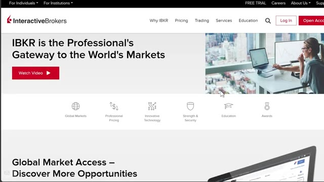
*⏱️ 00:00:17 — Page d'accueil du site Interactive Brokers montrant l'accès aux marchés mondiaux.*

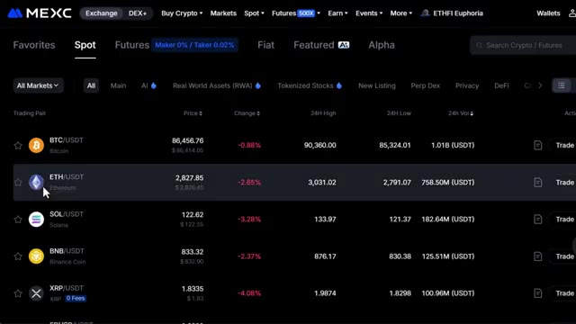
*⏱️ 00:00:26 — Interface de la plateforme d'échange MEXC affichant les paires de trading spot avec leurs prix et variations.*

---

### ⏱️ `[00:00:35 - 00:01:08]` | Segment #02

**🔊 Audio (Transcription Intégrale Mot pour Mot en Français) :**
> vous montrer exactement comment choisir le meilleur échange de cryptomonnaies pour vos besoins spécifiques. J'ai évalué plus de 38 plateformes d'échange à travers 13 cas d'utilisation différents, et je vais vous présenter tout cela en détail aujourd'hui. À la fin de cette vidéo, vous saurez exactement quelle plateforme ou quelles plateformes vous conviennent. Entrons dans le vif du sujet. Maintenant, avant d'aborder les plateformes, je veux rapidement passer en revue les six facteurs les plus importants que vous devez examiner lorsque vous évaluez n'importe quel échange de cryptomonnaies. Parce que sans comprendre cela, vous ne pourrez pas faire le bon choix. Et je vais également révéler à

**👁️ Analyse Visuelle d'Écran (gemini-3.5-flash-lite) :**
**Interface & Outils** : Site web de comparateur d'échanges de cryptomonnaies (Exchange Comparer).

**Contenu textuel & Code** : Statistiques sur 38+ exchanges évalués, 13 cas d'utilisation, tableaux de comparaison géographique et grille tarifaire des frais maker/taker.

**Action / Démonstration** : Navigation et présentation des outils de comparaison des plateformes d'échange de cryptomonnaies.

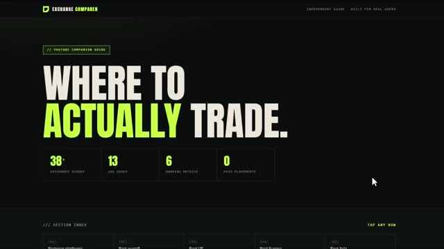
*⏱️ 00:00:43 — Page d'accueil du comparateur d'échanges de cryptomonnaies montrant les statistiques clés.*

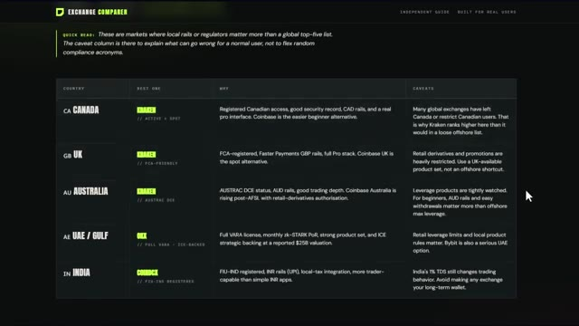
*⏱️ 00:00:51 — Tableau comparatif des plateformes par pays (Canada, UK, Australie, UAE, Inde) avec leurs spécificités et réserves.*

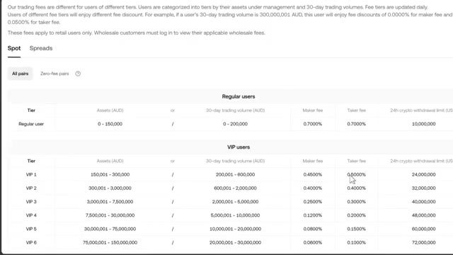
*⏱️ 00:00:59 — Tableau détaillé des frais de trading spot et des paliers VIP en fonction du volume ou des actifs.*

---

### ⏱️ `[00:01:08 - 00:01:32]` | Segment #03

**🔊 Audio (Transcription Intégrale Mot pour Mot en Français) :**
> la fin, quel échange j'utilise personnellement et pourquoi. Donc restez avec moi pour ça. Le premier facteur est la sécurité. C'est évidemment le facteur le plus important. Vous ne voulez jamais risquer de perdre vos fonds. Lorsque vous évaluez un échange de crypto-monnaies, vous voulez vous assurer qu'ils disposent d'options de stockage à froid, d'une preuve de réserves montrant combien d'argent ils détiennent à tout moment, d'une authentification à deux facteurs et d'une authentification par clé d'accès.

**👁️ Analyse Visuelle d'Écran (gemini-3.5-flash-lite) :**
**Interface & Outils** : Navigateur web affichant les plateformes MEXC, Blockware Solutions et Kraken.

**Contenu textuel & Code** : Informations sur la sécurité des échanges, fonds de garantie, et rapports de preuve de réserves (PoR) avec pourcentages de couverture (ex: BTC 100.3%, ETH 101.3%, USDC 105%+).

**Action / Démonstration** : Présentation des critères de sécurité lors de l'évaluation d'un échange de crypto-monnaies.

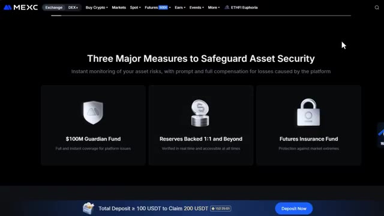
*⏱️ 00:01:14 — Page web de l'échange MEXC présentant les mesures de sécurité des actifs, incluant un fonds de garantie de 100M$, des réserves garanties à 1:1 et un fonds d'assurance futures.*

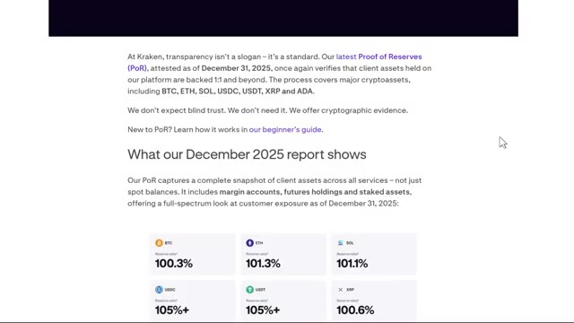
*⏱️ 00:01:26 — Rapport de preuve de réserves (PoR) de Kraken montrant des ratios de couverture supérieurs à 100% pour divers actifs cryptographiques (BTC, ETH, SOL, USDC, USDT, XRP).*

---

### ⏱️ `[00:01:32 - 00:01:51]` | Segment #04

**🔊 Audio (Transcription Intégrale Mot pour Mot en Français) :**
> Ces choses aident vraiment et gardez à l'esprit qu'aucun échange n'est sûr à 100 %. Nous l'avons bien vu avec FTX. Ce ne sont pas des banques, alors diversifiez toujours votre risque en ayant plusieurs plateformes d'échange disponibles au cas où un problème surviendrait avec l'une d'elles. Le deuxième facteur concerne la région et l'accessibilité au KYC.

**👁️ Analyse Visuelle d'Écran (gemini-3.5-flash-lite) :**
**Interface & Outils** : Investopedia, Bybit, Blofin

**Contenu textuel & Code** : Articles d'actualité financière sur FTX, soldes de portefeuilles de cryptomonnaies sur différentes plateformes (12,41 USD sur Bybit, 15,68 USDT sur Blofin).

**Action / Démonstration** : Navigation sur un site d'actualités financières et présentation de différents comptes d'échange pour illustrer la diversification des plateformes.

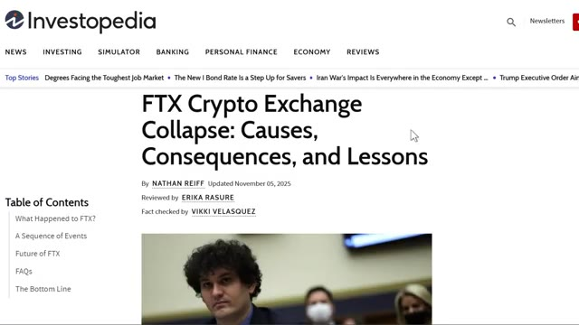
*⏱️ 00:01:37 — Capture d'écran d'un article d'Investopedia intitulé "FTX Crypto Exchange Collapse: Causes, Consequences, and Lessons".*

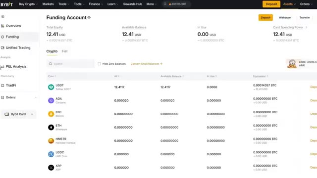
*⏱️ 00:01:42 — Interface de l'échange Bybit montrant le compte de financement (Funding Account) avec un solde total de 12,41 USD et la liste des cryptomonnaies.*

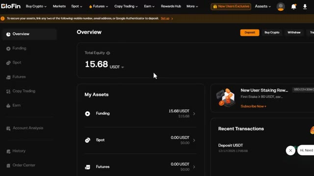
*⏱️ 00:01:46 — Interface de l'échange Blofin affichant un aperçu des actifs du compte avec un solde total de 15,68 USDT.*

---

### ⏱️ `[00:01:51 - 00:02:09]` | Segment #05

**🔊 Audio (Transcription Intégrale Mot pour Mot en Français) :**
> Avec une régulation qui devient de plus en plus stricte, de nombreuses plateformes d'échange tournent le dos aux utilisateurs des pays fortement réglementés. Les États-Unis, le Canada, le Royaume-Uni, la France, l'Allemagne, le Japon, l'Inde, la Corée, et bien d'autres. Nous allons donc aborder les options d'échange qui sont largement accessibles à travers le monde. Le troisième facteur est la sélection des cryptomonnaies.

**👁️ Analyse Visuelle d'Écran (gemini-3.5-flash-lite) :**
**Interface & Outils** : Site web TRM Labs et carte interactive mondiale de régulation.

**Contenu textuel & Code** : Statistiques sur les politiques cryptographiques, rapport sur 30 juridictions, et tableau d'évaluation réglementaire par pays.

**Action / Démonstration** : Présentation des données mondiales sur la régulation des cryptomonnaies et des stablecoins.

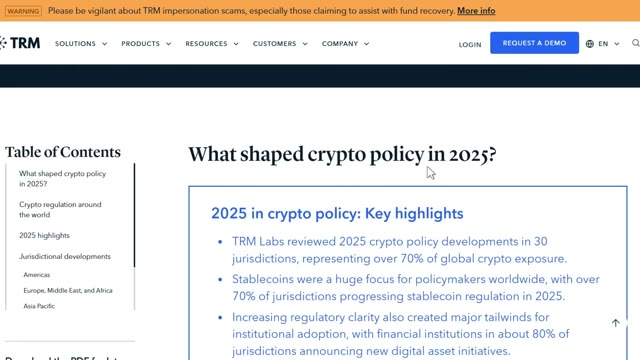
*⏱️ 00:01:56 — Capture d'écran du site web TRM Labs affichant les points clés de la politique cryptographique en 2025.*

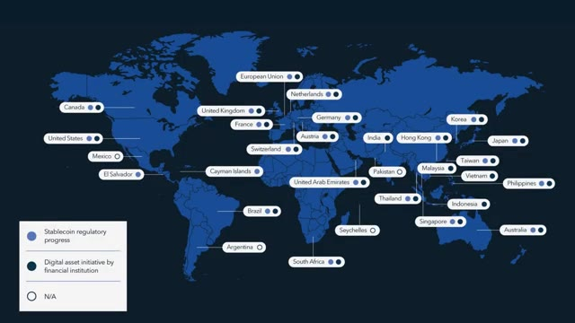
*⏱️ 00:02:00 — Carte du monde interactive illustrant la régulation des stablecoins et les initiatives sur les actifs numériques par pays.*

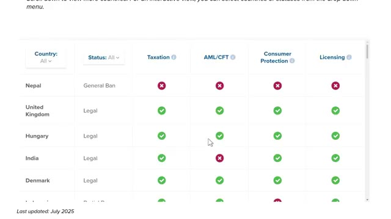
*⏱️ 00:02:05 — Tableau comparatif détaillé de la régulation cryptographique par pays (fiscalité, AML/CFT, protection des consommateurs, licences).*

---

### ⏱️ `[00:02:10 - 00:02:28]` | Segment #06

**🔊 Audio (Transcription Intégrale Mot pour Mot en Français) :**
> L'une des principales raisons pour lesquelles les gens envisagent différentes plateformes d'échange est d'accéder à une plus grande variété d'altcoins. La plupart des plateformes proposent les principales crypto-monnaies populaires du top 200 à 300, mais seules quelques-unes disposent d'une plus grande sélection d'altcoins exotiques. Nous allons passer en revue les plateformes d'échange proposant les sélections d'altcoins les plus vastes.

**👁️ Analyse Visuelle d'Écran (gemini-3.5-flash-lite) :**
**Interface & Outils** : CoinGecko, Plateforme d'échange de crypto-monnaies Bybit, Interface Web informative

**Contenu textuel & Code** : Listes de crypto-monnaies, paires de trading USDT, graphiques de prix en chandelier, statistiques sur le nombre de pièces et de paires disponibles (1961 coins, 2481 pairs), carnets d'ordres.

**Action / Démonstration** : Navigation et présentation des différentes plateformes d'échange et de leur variété d'altcoins disponibles.

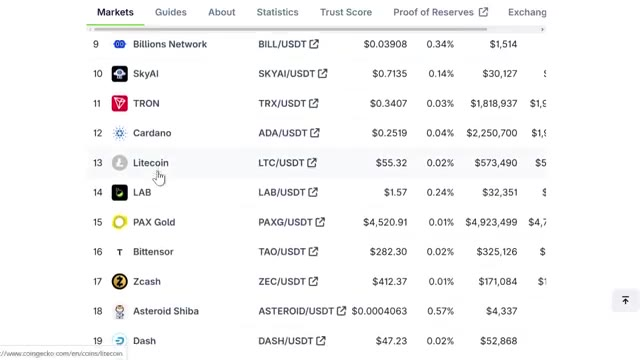
*⏱️ 00:02:14 — Capture d'écran montrant une liste de crypto-monnaies sur un site web de type agrégateur (CoinGecko) avec divers altcoins et paires de trading.*

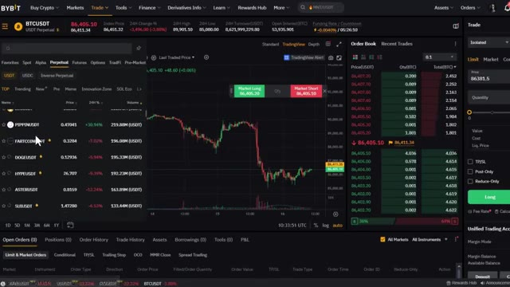
*⏱️ 00:02:19 — Interface de trading de la plateforme Bybit affichant un graphique de prix au centre, un carnet d'ordres à droite et une liste de paires perpétuelles à gauche.*

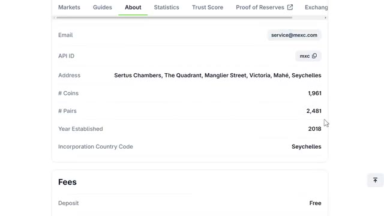
*⏱️ 00:02:23 — Page d'informations détaillées d'une plateforme d'échange (section 'About') affichant le nombre de pièces (1 961) et de paires (2 481).*

---

### ⏱️ `[00:02:28 - 00:02:49]` | Segment #07

**🔊 Audio (Transcription Intégrale Mot pour Mot en Français) :**
> Le facteur numéro quatre est l'expérience utilisateur. C'est particulièrement important pour les débutants. L'interface doit être conviviale et facile à naviguer. Certaines plateformes ont une application mobile supérieure qui est facile à utiliser pour les débutants, et nous couvrirons celles-ci. Le facteur numéro cinq est constitué des fonctionnalités avancées. Ce sont des choses que les utilisateurs avancés pourraient vouloir.

**👁️ Analyse Visuelle d'Écran (gemini-3.5-flash-lite) :**
**Interface & Outils** : Sites web de courtiers / échanges cryptos (Bybit et MEXC)

**Contenu textuel & Code** : Interface utilisateur, menus de navigation, bannières promotionnelles et statistiques de trading

**Action / Démonstration** : Navigation sur les interfaces de plateformes d'échange de cryptomonnaies pour illustrer l'expérience utilisateur.

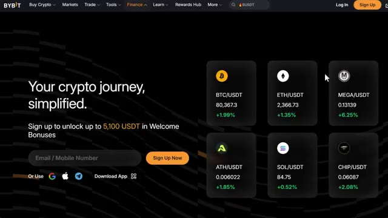
*⏱️ 00:02:33 — Page d'accueil de la plateforme Bybit mettant en avant la simplification du trading et les bonus d'inscription.*

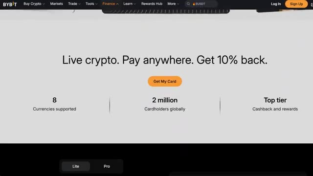
*⏱️ 00:02:39 — Page de présentation de la carte crypto Bybit affichant les fonctionnalités de paiement et les options Lite/Pro.*

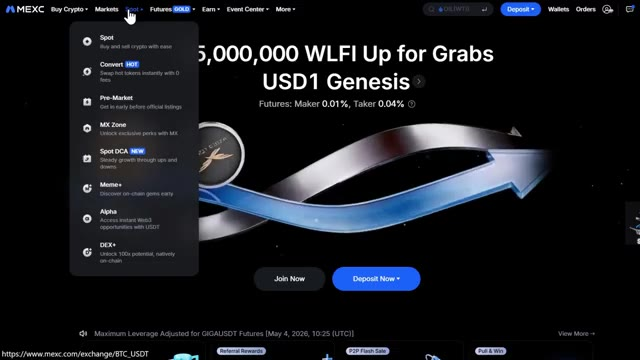
*⏱️ 00:02:44 — Page d'accueil de l'échange MEXC montrant le menu déroulant du marché Spot et les options de trading.*

---

### ⏱️ `[00:02:49 - 00:03:16]` | Segment #08

**🔊 Audio (Transcription Intégrale Mot pour Mot en Français) :**
> le copy trading, des plateformes de lancement pour accéder à de nouveaux jetons, des bots de trading, ou un portefeuille Web3 intégré. Le facteur numéro six concerne les frais de transaction. Je mets cela en dernier parce que la plupart des échanges de cryptomonnaies ont des pourcentages de frais de transaction très similaires. Tant que vous utilisez un véritable échange de cryptomonnaies par rapport à une application grand public, vous devriez être tranquille sur le plan des frais. Mais il y a une exception, et je vais aborder cela. Très bien, passons aux plateformes, et commençons par le meilleur du meilleur.

**👁️ Analyse Visuelle d'Écran (gemini-3.5-flash-lite) :**
**Interface & Outils** : Interface web de la plateforme Toobit et page d'inscription/connexion avec interface mobile intégrée.

**Contenu textuel & Code** : Tableau des frais de transaction chiffrés (maker/taker en pourcentage) pour les marchés Futures et Spot (USDT et USDC) classés par niveaux VIP (VIP0 à VIP6) et exigences de volume/solde.

**Action / Démonstration** : Présentation comparative et illustration visuelle des frais de transaction sur la plateforme de trading Toobit.

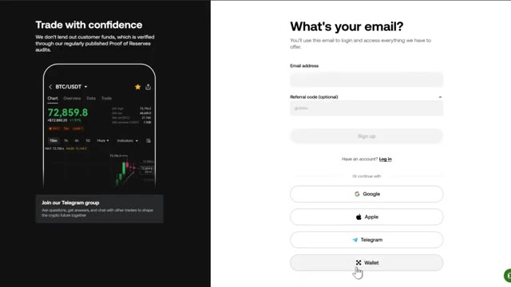
*⏱️ 00:02:56 — Interface d'inscription d'une plateforme d'échange affichant un formulaire avec des options de connexion via e-mail, Google, Apple, Telegram ou portefeuille Web3, et un aperçu mobile montrant un graphique BTC/USDT.*

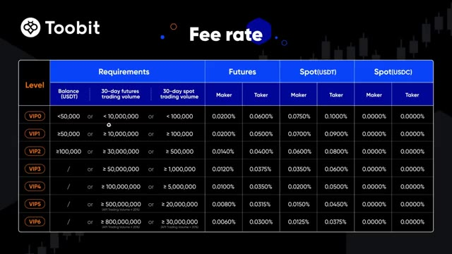
*⏱️ 00:03:03 — Tableau complet des frais de transaction (Fee rate) de la plateforme Toobit, détaillant les taux maker et taker pour les marchés Futures et Spot selon les niveaux VIP.*

---

### ⏱️ `[00:03:16 - 00:03:36]` | Segment #09

**🔊 Audio (Transcription Intégrale Mot pour Mot en Français) :**
> Après avoir évalué 38 plateformes d'échange à travers 13 cas d'utilisation différents, la meilleure plateforme d'échange globale à l'heure actuelle est OKX, avec un score de 92 sur 100. Vous vous attendiez peut-être à voir Binance ici. Et ne vous méprenez pas, Binance reste le roi incontesté de la liquidité brute. Je vais expliquer dans un instant pourquoi elle n'arrive qu'en deuxième position dans cette liste.

**👁️ Analyse Visuelle d'Écran (gemini-3.5-flash-lite) :**
**Interface & Outils** : Site web comparateur d'échanges (Exchange Comparer)

**Contenu textuel & Code** : Scores de notation pondérés pour OKX (92/100 au total, Liquidité: 9.0/10, Produits: 9.5/10, PoR Rigor: 9.5/10, Automation: 9.0/10, Fees: 9.0/10, Regulation: 8.5/10, Reputation: 7.5/10).

**Action / Démonstration** : Présentation visuelle de la plateforme d'échange classée première globale et de sa grille de notation détaillée.

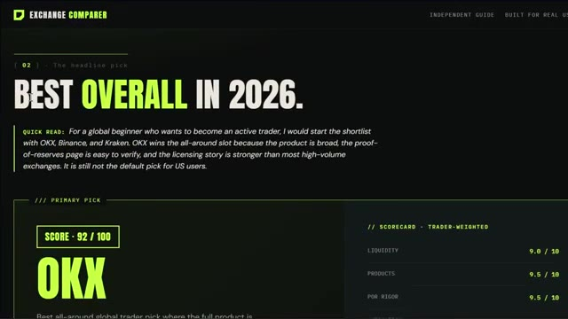
*⏱️ 00:03:21 — Capture d'écran du site Web Exchange Comparer affichant le titre 'BEST OVERALL IN 2026' avec le choix principal OKX noté 92/100.*

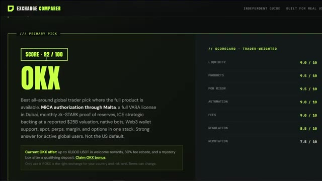
*⏱️ 00:03:26 — Capture d'écran montrant les détails et la grille de notation détaillée d'OKX (Liquidité 9.0, Produits 9.5, Frais 9.0, etc.) avec un score de 92/100.*

---

### ⏱️ `[00:03:36 - 00:03:55]` | Segment #10

**🔊 Audio (Transcription Intégrale Mot pour Mot en Français) :**
> Mais OKX remporte la place du meilleur dans l'ensemble parce que le produit est plus large. La page de preuve des réserves est facile à vérifier, et l'historique des licences est plus solide que celui de la plupart des bourses à volume élevé. OKX possède une autorisation MICA par l'intermédiaire de Malte, ce qui signifie qu'elle est passeportée dans toute l'Union européenne.

**👁️ Analyse Visuelle d'Écran (gemini-3.5-flash-lite) :**
**Interface & Outils** : Site web de l'échange de cryptomonnaies OKX (pages Proof of Reserves et OKX Learn).

**Contenu textuel & Code** : Ratios de réserves (106% pour BTC, 110% pour USDT, etc.), volumes d'actifs et détails sur la licence européenne MiCA.

**Action / Démonstration** : Présentation visuelle des preuves de réserves et des licences réglementaires de la plateforme OKX.

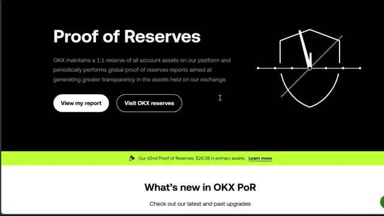
*⏱️ 00:03:41 — Page web officielle d'OKX affichant le titre 'Proof of Reserves' avec des options pour voir les rapports.*

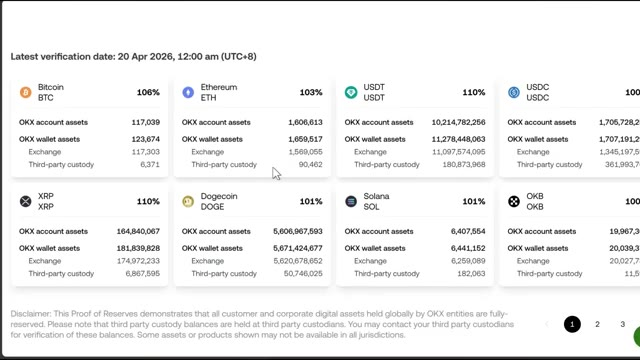
*⏱️ 00:03:46 — Tableau détaillé des réserves d'OKX par cryptomonnaie (BTC, ETH, USDT, USDC, etc.) montrant les ratios de collatéralisation.*

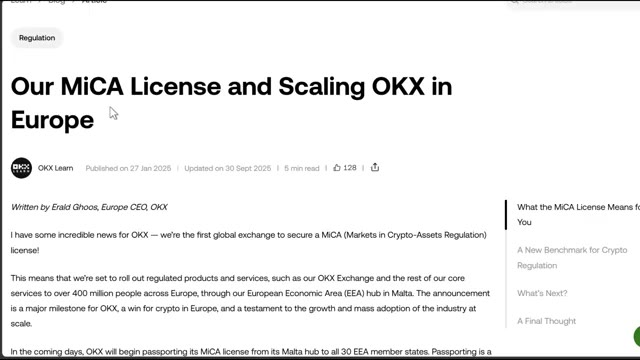
*⏱️ 00:03:50 — Article de blog d'OKX Learn titré 'Our MiCa License and Scaling OKX in Europe' détaillant l'obtention de la licence MiCA.*

---

### ⏱️ `[00:03:55 - 00:04:17]` | Segment #11

**🔊 Audio (Transcription Intégrale Mot pour Mot en Français) :**
> Ils possèdent une licence VARA complète à Dubaï. Ils publient chaque mois des preuves de réserves ZK Stark, ce qui représente l'une des méthodes de vérification des réserves les plus rigoureuses de l'industrie. Ils intègrent des bots de trading natifs, des bots de grille, des bots DCA, des outils d'arbitrage. Ils possèdent un portefeuille Web3 complet prenant en charge plus de 130 chaînes.

**👁️ Analyse Visuelle d'Écran (gemini-3.5-flash-lite) :**
**Interface & Outils** : Site web officiel d'OKX / Interface de trading et de gestion des bots de la plateforme OKX.

**Contenu textuel & Code** : Documentation sur les zk-STARKs, les arbres de Merkle, et le menu de sélection des bots de trading automatisés (Spot Grid, Spot DCA, Iceberg, TWAP).

**Action / Démonstration** : Présentation de la documentation sur la transparence des réserves puis navigation dans l'interface de sélection des outils de trading automatisé.

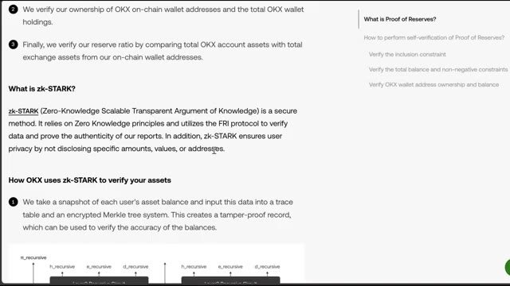
*⏱️ 00:04:01 — Page web officielle d'OKX expliquant la Preuve de Réserves (Proof of Reserves) et l'utilisation de la technologie zk-STARK pour vérifier la sécurité et l'authenticité des actifs.*

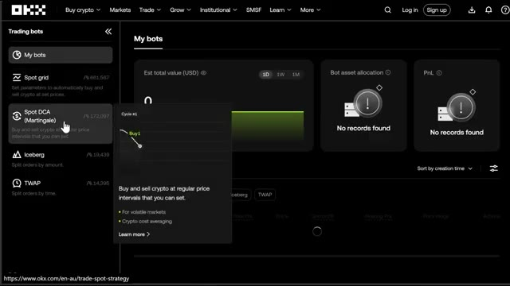
*⏱️ 00:04:12 — Interface de la plateforme OKX montrant l'onglet des bots de trading, avec les options Spot grid, Spot DCA (Martingale), Iceberg et TWAP.*

---

### ⏱️ `[00:04:18 - 00:04:43]` | Segment #12

**🔊 Audio (Transcription Intégrale Mot pour Mot en Français) :**
> Et ils ont le comptant, les perpétuels, la marge et les options, le tout dans une seule pile. Et voici ce qui distingue vraiment OKEx en ce moment. Ils ont lancé quelque chose appelé l'Agent Trade Kit. Il s'agit d'un kit d'outils open source officiel qui vous permet de connecter des assistants IA comme Claude directement aux données de marché d'OKEx, aux vues de portefeuille, aux commandes de bots et aux actions de trading.

**👁️ Analyse Visuelle d'Écran (gemini-3.5-flash-lite) :**
**Interface & Outils** : Site web officiel d'OKX / Documentation technique de l'Agent Trade Kit.

**Contenu textuel & Code** : Commandes de terminal (`npx skills add okx/agent-skills`, `npm i -g @okx_ai/okx-trade-cli`) et intégrations avec des outils comme Claude Code, Codex et Cursor.
[DESC_IMAGE_3] Visualisation des instructions de configuration et d'installation des assistants IA pour le trading automatisé.

**Action / Démonstration** : Explications face caméra et analyse conceptuelle des marchés.

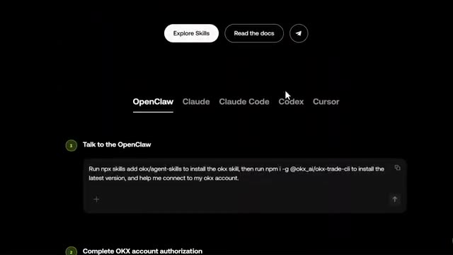
*⏱️ 00:04:37 — Interface montrant les instructions d'installation des compétences d'agent avec des commandes npx et npm pour connecter des assistants IA.*

---

### ⏱️ `[00:04:43 - 00:05:19]` | Segment #13

**🔊 Audio (Transcription Intégrale Mot pour Mot en Français) :**
> plus de 83 outils disponibles, vous pouvez littéralement taper une commande en langage naturel comme afficher le solde de mon compte OKX, acheter pour 500 USDT de BTC au prix du marché, placer un stop-loss à 84 000, et l'IA l'exécute. Ce n'est pas du marketing, c'est un vrai produit qui est en ligne dès maintenant. Le suivant est Binance, qui obtient un score de 90 sur 100. Binance reste le leader incontesté de la liquidité brute, avec la meilleure profondeur, la meilleure grille de frais dès que votre volume mensuel dépasse environ 1 million de dollars, et l'écosystème le plus vaste de la crypto. La raison pour laquelle il est numéro deux

**👁️ Analyse Visuelle d'Écran (gemini-3.5-flash-lite) :**
**Interface & Outils** : Interface web d'agent de trading et tableau comparateur de plateformes d'échange de cryptomonnaies.

**Contenu textuel & Code** : Invite de commande en langage naturel : "Show my OKX account balance, buy 500 USDT of BTC at market, stop-loss at 84,000" et classement noté des exchanges (OKX 92, Binance 90, Kraken 86, Bybit 84, Bitget 82).

**Action / Démonstration** : Saisie d'une commande textuelle pour exécuter des ordres de trading automatisés via une IA et présentation d'un comparatif de courtiers.

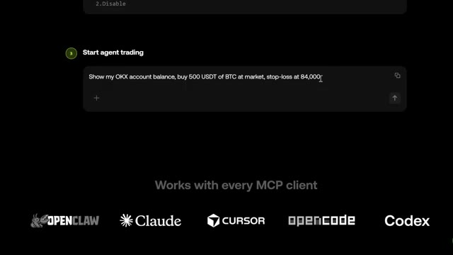
*⏱️ 00:04:52 — Interface d'un agent de trading avec un champ de saisie en langage naturel et les logos des clients MCP compatibles (OpenClaw, Claude, Cursor, Opencode, Codex).*

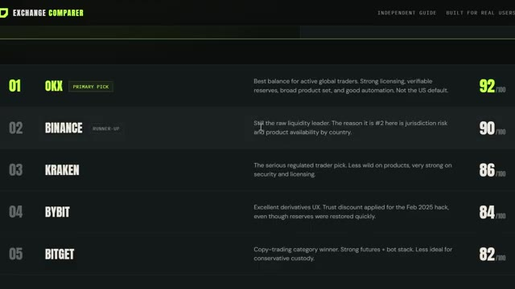
*⏱️ 00:05:10 — Tableau comparatif d'échanges cryptographiques (Exchange Comparer) classant OKX en première position avec une note de 92/100, suivi de Binance, Kraken, Bybit et Bitget.*

---

### ⏱️ `[00:05:19 - 00:05:56]` | Segment #14

**🔊 Audio (Transcription Intégrale Mot pour Mot en Français) :**
> voici le risque de juridiction. Si vous venez des États-Unis, du Canada ou du Royaume-Uni, vous ne pouvez pas accéder à l'application mondiale, mais si vous pouvez accéder à Binance, cela reste l'une des meilleures options disponibles. Ensuite, il y a Bybit, qui obtient un score de 84 sur 100. Bybit possède une excellente interface de produits dérivés et un compte de trading unifié qui vous permet d'utiliser une marge croisée sur toutes vos positions. Cependant, et c'est important, Bybit a subi un piratage de 1,5 milliard de dollars en février 2025. Le groupe Lazarus de Corée du Nord a utilisé une attaque d'ingénierie sociale pour vider environ 401 000 Ethereum de leur portefeuille principal. Maintenant, Bybit

**👁️ Analyse Visuelle d'Écran (gemini-3.5-flash-lite) :**
**Interface & Outils** : Interface de l'échange Bybit et articles web d'information (Binance et BBC).

**Contenu textuel & Code** : Graphique de prix BTCUSDT, carnet d'ordres en temps réel, boutons d'achat/vente (Long/Short), détails de contrat et informations textuelles réglementaires ou de piratage.

**Action / Démonstration** : Navigation sur la plateforme de trading Bybit et présentation des interfaces d'échanges crypto.

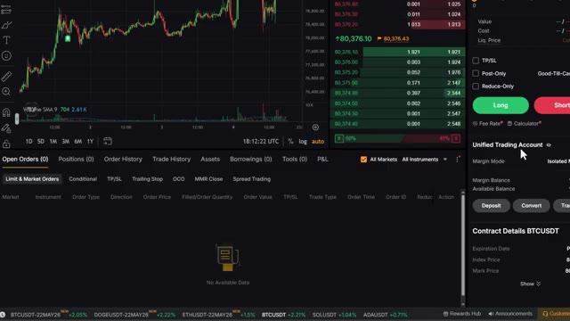
*⏱️ 00:05:38 — Interface de trading de la plateforme Bybit affichant un graphique de prix BTCUSDT, un carnet d'ordres et les options de compte unifié.*

---

### ⏱️ `[00:05:56 - 00:06:30]` | Segment #15

**🔊 Audio (Transcription Intégrale Mot pour Mot en Français) :**
> a reconstitué ses réserves en moins de 72 heures en obtenant des fonds d'urgence auprès d'entreprises comme Galaxy Digital et Wintermute. Et Hacking a confirmé par la suite qu'ils avaient plus de 100 % de réserves. Ils ont donc bien géré la situation. Mais la décote de confiance s'applique toujours. Gardez cela à l'esprit. Gardez également à l'esprit que Bybit est restreint dans plusieurs grandes juridictions, notamment les États-Unis, le Canada, Singapour et Hong Kong. Maintenant, le meilleur échange global ne sert à rien si vous ne pouvez pas y accéder depuis l'endroit où vous vivez. Laissez-moi donc ventiler cela par région. Pour les traders américains, le classement américain est complètement différent parce que

**👁️ Analyse Visuelle d'Écran (gemini-3.5-flash-lite) :**
**Interface & Outils** : BBC News, site web ByBit et interface de trading de l'échange OKX (TradingView, carnet d'ordres).

**Contenu textuel & Code** : Article d'actualité sur un piratage, conditions d'utilisation/restrictions géographiques d'un broker, et graphique de prix du Bitcoin (BTC/USDT) avec indicateurs de volume et carnet d'ordres en temps réel.

**Action / Démonstration** : Navigation sur un site d'actualités, consultation des conditions d'utilisation d'une plateforme d'échange et observation d'un graphique boursier crypto.

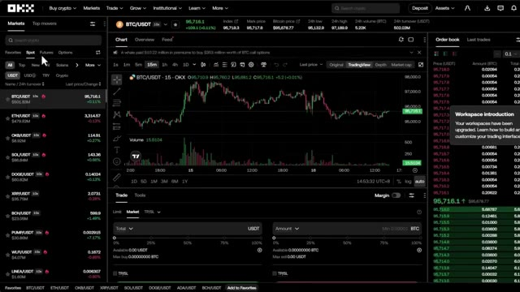
*⏱️ 00:06:22 — Interface de trading de la plateforme OKX affichant un graphique TradingView de la paire BTC/USDT en unité 15 minutes avec le carnet d'ordres à droite et la liste des paires à gauche.*

---

### ⏱️ `[00:06:30 - 00:07:07]` | Segment #16

**🔊 Audio (Transcription Intégrale Mot pour Mot en Français) :**
> les plus grandes applications mondiales soit ne desservent pas les utilisateurs américains, soit proposent une gamme de produits limitée et n'utilisent pas de VPN pour accéder aux plateformes offshore. Ce n'est pas une solution. C'est un risque. La meilleure option pour les traders américains actifs est Kraken, qui obtient un score de 94 sur 100 pour le marché américain. Kraken n'a subi aucun piratage majeur de plateforme depuis son lancement. Ils disposent de solides certifications de sécurité. Ils ont une véritable interface de trading professionnel. Et leur acquisition récente leur ouvre la voie vers le trading sur marge réglementé aux États-Unis. Sérieux ? Un peu moins tape-à-l'œil. Et c'est précisément le but. Pour les débutants américains,

**👁️ Analyse Visuelle d'Écran (gemini-3.5-flash-lite) :**
**Interface & Outils** : Site web de comparatif d'échanges (Exchange Comparer) et page de blog officielle Kraken (Blog).

**Contenu textuel & Code** : Classement des plateformes crypto pour les utilisateurs US (Kraken, Coinbase, Gemini) avec notes sur 100, arguments de sécurité, conformité réglementaire, et annonce d'acquisition de Bitnomal par Payward.

**Action / Démonstration** : Présentation comparative des meilleures options d'échanges régulés pour les traders actifs aux États-Unis sans recourir à un VPN.

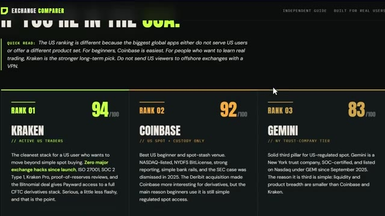
*⏱️ 00:06:40 — Capture d'écran d'un site web de comparatif d'échanges ("Exchange Comparer") classant les plateformes pour les utilisateurs américains, avec Kraken en première position (94/100), suivi de Coinbase (92/100) et Gemini (83/100).*

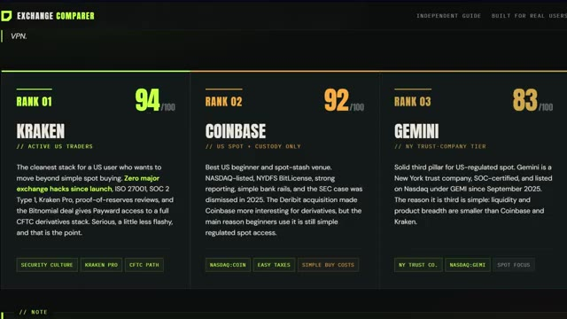
*⏱️ 00:06:49 — Suite du tableau comparatif sur le site "Exchange Comparer" montrant les scores et détails pour Kraken, Coinbase et Gemini, avec des tags de fonctionnalités en bas de chaque colonne.*

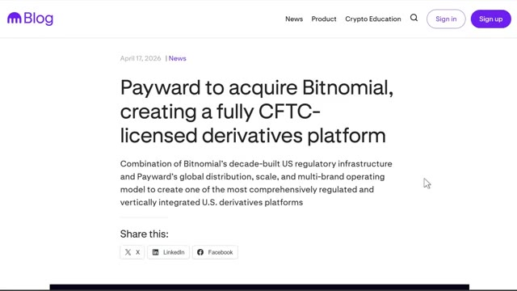
*⏱️ 00:06:58 — Capture d'écran d'un article de blog officiel annonçant l'acquisition de Bitnomal par Payward (Kraken) pour créer une plateforme de dérivés régulée par la CFTC.*

---

### ⏱️ `[00:07:07 - 00:07:39]` | Segment #17

**🔊 Audio (Transcription Intégrale Mot pour Mot en Français) :**
> Coinbase reste le point de départ le plus simple. Il est coté en bourse, entièrement réglementé, propose des passerelles bancaires simples, et l'affaire de la SEC contre eux a été rejetée en 2025. C'est idéal pour l'achat, la détention et la déclaration fiscale. Gardez simplement à l'esprit que Coinbase n'offre pas le meilleur rapport qualité-prix pour le trading actif et fréquent. Une fois que vous comprenez les ordres de base, passez à Coinbase Advanced. Si vous êtes en Europe, la période de transition de l'UE prend fin le 1er juillet 2026, l'accès, les stablecoins et la liste des produits peuvent donc changer rapidement.

**👁️ Analyse Visuelle d'Écran (gemini-3.5-flash-lite) :**
**Interface & Outils** : Navigateur web affichant le site de la SEC, la plateforme Coinbase et un comparateur d'échanges crypto.

**Contenu textuel & Code** : Texte officiel juridique, informations sur la régulation des cryptos en Australie et classements de courtiers en Europe (MiCA, notes sur 100).

**Action / Démonstration** : Présentation des arguments réglementaires et des meilleures options de plateformes selon les zones géographiques.

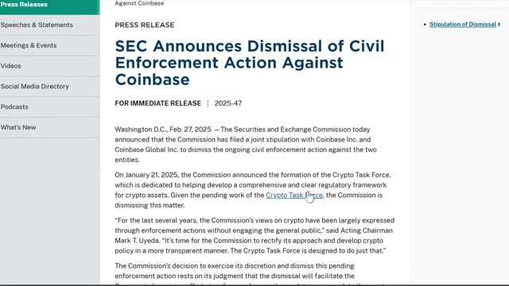
*⏱️ 00:07:15 — Communiqué de presse officiel de la SEC annonçant le rejet de l'action civile contre Coinbase.*

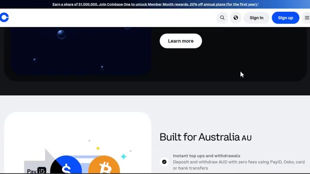
*⏱️ 00:07:23 — Page d'accueil de la plateforme Coinbase affichant les services et fonctionnalités pour l'Australie.*

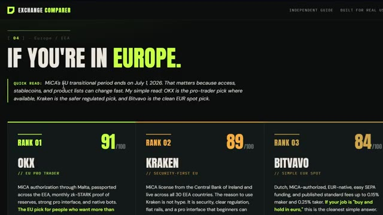
*⏱️ 00:07:31 — Tableau comparatif des plateformes d'échange pour l'Europe (Exchange Comparer) classant OKX, Kraken et Bitvavo.*

---

### ⏱️ `[00:07:39 - 00:07:58]` | Segment #18

**🔊 Audio (Transcription Intégrale Mot pour Mot en Français) :**
> Le choix des traders pros pour l'Europe est OKX, entièrement autorisé dans toute l'UE, avec des preuves de réserves mensuelles et des bots natifs intégrés. Le choix plus sûr et régulé est Kraken, licencié et actif dans les 30 pays de l'EEE. Et pour un achat au comptant simple en euros, Bitvavo est la solution la plus nette.

**👁️ Analyse Visuelle d'Écran (gemini-3.5-flash-lite) :**
**Interface & Outils** : Page web comparative (Exchange Comparer)

**Contenu textuel & Code** : Classement de trois exchanges : Rang 1 pour OKX (91/100, MiCA Malta, ZK-STARK, Pro Tools), Rang 2 pour Kraken (89/100, MiCA Ireland, 30 EEA, Security-First), et Rang 3 pour Bitvavo (84/100, MiCA Day-1 NL, 0.15% maker, EUR-native).

**Action / Démonstration** : Présentation visuelle et comparaison des caractéristiques réglementaires et fonctionnelles des exchanges OKX, Kraken et Bitvavo pour les utilisateurs européens.

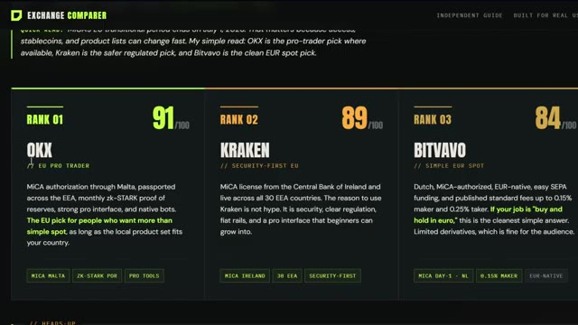
*⏱️ 00:07:44 — Capture d'écran montrant un comparateur d'échanges de cryptomonnaies classant trois plateformes avec des scores et des descriptions détaillées.*

---

### ⏱️ `[00:07:59 - 00:08:20]` | Segment #19

**🔊 Audio (Transcription Intégrale Mot pour Mot en Français) :**
> Les virements bancaires européens en euros autorisés par les Pays-Bas. Si vous êtes en Asie, vous devez savoir que l'Asie n'est pas un marché unique. Le Japon, la Corée, Hong Kong, Singapour et l'Asie du Sud-Est ont tous des règles complètement différentes. Pour le trading actif à large échelle où le produit mondial est disponible, le trio de tête est OKX, Bybit et Binance.

**👁️ Analyse Visuelle d'Écran (gemini-3.5-flash-lite) :**
**Interface & Outils** : Site web 'Exchange Comparer' spécialisé dans l'évaluation des plateformes crypto.

**Contenu textuel & Code** : Classement des exchanges pour l'Asie : OKX (91/100, rang 1), Bybit (86/100, rang 2), Binance (85/100, rang 3), avec des notes explicatives sur la réglementation et la liquidité.

**Action / Démonstration** : Navigation et lecture du comparateur d'échanges pour analyser les spécificités du marché asiatique.

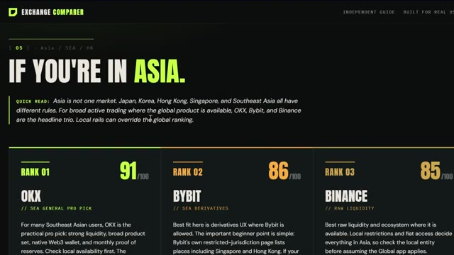
*⏱️ 00:08:04 — Vue d'ensemble du site Exchange Comparer affichant le titre 'If you're in Asia' avec un paragraphe introductif et un classement des exchanges.*

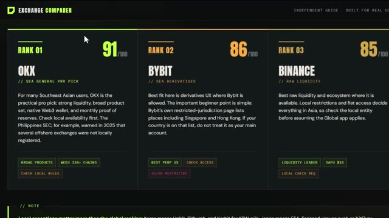
*⏱️ 00:08:14 — Zoom vers le bas sur le classement des exchanges (OKX rang 1, Bybit rang 2, Binance rang 3) avec leurs scores et descriptions respectifs.*

---

### ⏱️ `[00:08:20 - 00:08:41]` | Segment #20

**🔊 Audio (Transcription Intégrale Mot pour Mot en Français) :**
> Mais les règles locales peuvent supplanter complètement le classement mondial. Si vous êtes en Corée, utilisez Upbit, Bithum ou Corbit pour les passerelles en monnaie locale. Pour le Japon, utilisez des plateformes sous licence locale comme Bitflyer ou Bitbank. Pour Hong Kong, utilisez des plateformes sous licence locale comme Hashkey ou OSL. Vérifiez toujours la disponibilité locale avant de supposer qu'une application mondiale s'applique à vous.

**👁️ Analyse Visuelle d'Écran (gemini-3.5-flash-lite) :**
**Interface & Outils** : Sites web officiels des plateformes d'échange Bithumb, Bitflyer et HashKey Global.

**Contenu textuel & Code** : Menus de navigation, formulaires d'inscription, informations réglementaires (licence) et bannières promotionnelles.

**Action / Démonstration** : Navigation et présentation visuelle des plateformes d'échange locales recommandées par région.

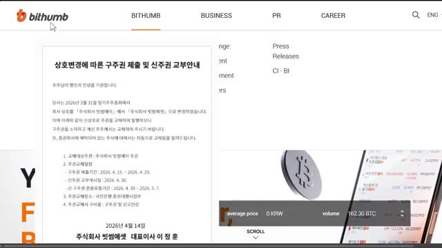
*⏱️ 00:08:25 — Page d'accueil du site web de l'échange cryptographique sud-coréen Bithumb.*

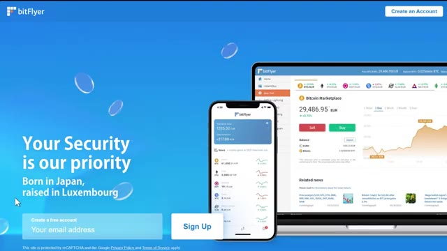
*⏱️ 00:08:30 — Page d'accueil de la plateforme japonaise sous licence Bitflyer avec affichage de l'interface mobile et desktop.*

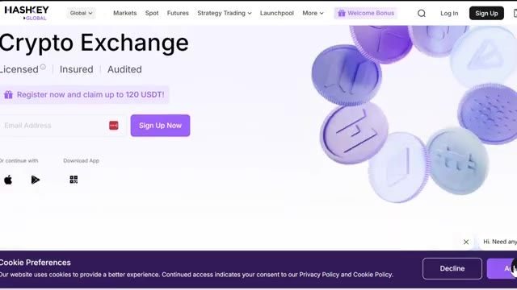
*⏱️ 00:08:36 — Page d'accueil de la plateforme d'échange de crypto-monnaies HashKey Global.*

---

### ⏱️ `[00:08:41 - 00:09:08]` | Segment #21

**🔊 Audio (Transcription Intégrale Mot pour Mot en Français) :**
> Voici les recommandations pour les autres pays clés. Si vous êtes au Canada, le Royaume-Uni, Kraken est le meilleur choix dans les deux. Un accès fortement réglementé, un bon historique de sécurité et une véritable interface de trading. Si vous êtes en Australie, Kraken encore une fois avec un enregistrement local et des détails australiens. Pour les Émirats arabes unis, OKX est la plateforme qu'il vous faut, qui détient une licence locale complète à Dubaï et est soutenue par l'ICE à une valorisation estimée à 25 milliards de dollars.

**👁️ Analyse Visuelle d'Écran (gemini-3.5-flash-lite) :**
**Interface & Outils** : Site web de comparaison d'échanges ("EXCHANGE COMPARER").

**Contenu textuel & Code** : Tableau avec les colonnes Country, Best One, Why, Caveats. Les lignes listent le Canada (Kraken), le Royaume-Uni (Kraken), l'Australie (Kraken), les Émirats arabes unis (OKX) et l'Inde (CoinDCX), avec des détails réglementaires et des avertissements.

**Action / Démonstration** : Présentation visuelle des recommandations de plateformes crypto adaptées par juridiction géographique.

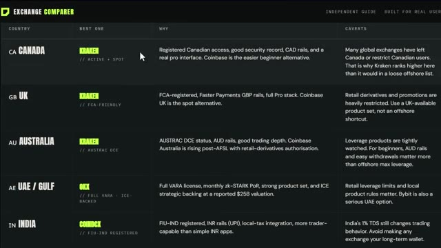
*⏱️ 00:08:48 — Un tableau comparatif des plateformes d'échange de cryptomonnaies par pays, montrant les recommandations pour le Canada, le Royaume-Uni, l'Australie, les Émirats arabes unis et l'Inde.*

---

### ⏱️ `[00:09:09 - 00:09:37]` | Segment #22

**🔊 Audio (Transcription Intégrale Mot pour Mot en Français) :**
> Si vous êtes en Inde, CoinDCX, qui est enregistré localement avec des passerelles INR et un support UPI intégré. Maintenant, si vous tradez activement, le classement change complètement. Il s'agit d'exécution, d'outils, de contrats perpétuels, de types d'ordres, d'API et de bots. Numéro un, OKX, avec un score de 94 sur 100. Interface pro, types d'ordres avancés, bots de grille et DCA natifs, API robuste et preuve de réserves mensuelle.

**👁️ Analyse Visuelle d'Écran (gemini-3.5-flash-lite) :**
**Interface & Outils** : CoinDCX, Exchange Comparer, plateforme de trading OKX.

**Contenu textuel & Code** : Classement des exchanges crypto (OKX, Binance, Bybit), graphique TradingView BTCUSDT (Timeframe 15m), carnet d'ordres, et indicateurs de volume.

**Action / Démonstration** : Comparaison des plateformes d'échange de cryptomonnaies et présentation de l'interface de trading d'OKX.

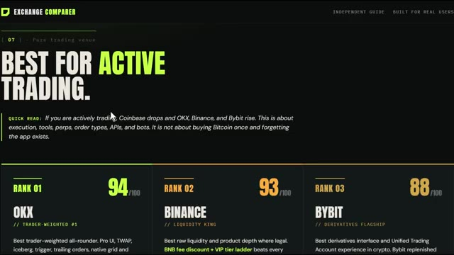
*⏱️ 00:09:23 — Tableau comparatif de plateformes d'échange montrant OKX en première position avec un score de 94/100, suivi de Binance et Bybit pour le trading actif.*

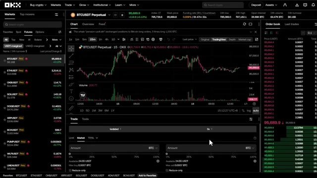
*⏱️ 00:09:30 — Interface de trading de la plateforme OKX affichant un graphique de prix BTCUSDT Perpetual, un carnet d'ordres et les options de passage d'ordres.*

---

### ⏱️ `[00:09:37 - 00:09:55]` | Segment #23

**🔊 Audio (Transcription Intégrale Mot pour Mot en Français) :**
> La pile professionnelle la plus complète pour les utilisateurs mondiaux en dehors du niveau VIP de Binance. Numéro deux, Binance, obtenant un score de 93 sur 100. La meilleure liquidité brute et la meilleure profondeur de produits là où c'est légal. La réduction des frais en BNB plus l'échelle des niveaux VIP bat toutes les autres plateformes dès que votre volume mensuel devient sérieux.

**👁️ Analyse Visuelle d'Écran (gemini-3.5-flash-lite) :**
**Interface & Outils** : Sites web de comparaison d'échanges (Exchange Comparer) et de guides financiers (SmallDrift)

**Contenu textuel & Code** : Scores des exchanges (OKX 94, Binance 93, Bybit 88), détails sur les frais BNB, statistiques de réserves de cryptomonnaies

**Action / Démonstration** : Comparaison et analyse des notations, des avantages et des réductions de frais sur les plateformes d'échange de cryptomonnaies

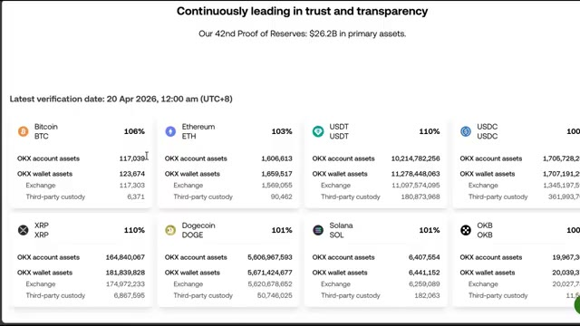
*⏱️ 00:09:41 — Tableau de vérification des réserves d'OKX affichant les pourcentages et actifs pour diverses cryptomonnaies (Bitcoin, Ethereum, USDT, etc.)*

*⏱️ 00:09:46 — Comparateur d'échanges crypto affichant les rangs, notes et détails pour OKX, Binance (93/100) et Bybit*

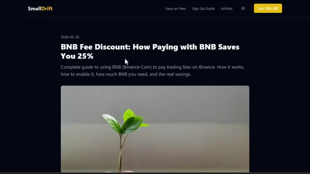
*⏱️ 00:09:51 — Page web du site SmallDrift intitulée 'BNB Fee Discount: How Paying with BNB Saves You 25%'*

---

### ⏱️ `[00:09:56 - 00:10:18]` | Segment #24

**🔊 Audio (Transcription Intégrale Mot pour Mot en Français) :**
> Réservé aux particuliers des États-Unis, du Canada et du Royaume-Uni pour les produits dérivés. Gardez cela à l'esprit. Numéro trois, Bybit, avec un score de 88 sur 100. La meilleure interface de produits dérivés dans la crypto. Les réserves ont été restaurées rapidement après le piratage de février 2025 et confirmées à plus de 100 % par la suite. La décote de confiance s'applique toujours, mais le produit est véritablement excellent pour le trading de produits dérivés.

**👁️ Analyse Visuelle d'Écran (gemini-3.5-flash-lite) :**
**Interface & Outils** : Interface web de Bybit, tableau comparatif Exchange Comparer, et article d'actualité crypto.

**Contenu textuel & Code** : Scores des plateformes d'échange, interface de dérivés Bybit, paires de trading perpétuelles, graphique de volume de trading (eXch Daily Bitcoin Trading Volume).

**Action / Démonstration** : Présentation du classement des exchanges, démonstration de l'interface de dérivés Bybit et analyse de l'impact du piratage sur le volume.

*⏱️ 00:10:02 — Capture montrant un tableau comparatif de plateformes d'échange crypto avec Bybit classé troisième (score 88/100).*

*⏱️ 00:10:07 — Interface de trading de la plateforme Bybit affichant le graphique du BTCUSDT, le carnet d'ordres et les outils de passage d'ordres perpétuels.*

*⏱️ 00:10:13 — Article de presse et graphique de Elliptic illustrant le volume de trading de eXch en lien avec le piratage de Bybit.*

---

### ⏱️ `[00:10:18 - 00:10:53]` | Segment #25

**🔊 Audio (Transcription Intégrale Mot pour Mot en Français) :**
> Maintenant, si vous recherchez la plus grande sélection d'altcoins, les classements changent à nouveau. Numéro un pour les altcoins est MEXI, avec un score de 90 sur 100. MEXI reste la réponse la plus simple pour les listings de niche et l'accès rapide aux altcoins. Ils proposent plus de 2 400 altcoins différents, de loin la plus grande sélection de toutes les bourses que nous couvrons aujourd'hui. La plupart des autres bourses en proposent tout au plus environ 800. MEXI se classe également généralement dans le top 10 des bourses par volume de transactions. Maintenant, voici quelque chose qui fait encore plus démarquer MEXI et la plupart des gens ne le savent pas.

**👁️ Analyse Visuelle d'Écran (gemini-3.5-flash-lite) :**
**Interface & Outils** : Site web de comparaison d'échanges et interface web d'information sur les cryptomonnaies.

**Contenu textuel & Code** : Classement des plateformes d'échange, scores sur 100, statistiques de listing (1 961 coins et 2 481 paires pour MEXC), informations légales et bonus de parrainage.

**Action / Démonstration** : Comparaison des plateformes d'échange de cryptomonnaies et présentation des statistiques de MEXC pour le trading d'altcoins.

*⏱️ 00:10:27 — Capture d'écran d'un comparateur d'échanges classant MEXC en première position avec un score de 90/100, suivi de LBank (86/100) et OKX (82/100).*

*⏱️ 00:10:36 — Page d'informations détaillées sur l'échange MEXC montrant le nombre de coins (1 961) et de paires (2 481), l'année de création (2018) et le pays d'incorporation (Seychelles).*

---

### ⏱️ `[00:10:53 - 00:11:30]` | Segment #26

**🔊 Audio (Transcription Intégrale Mot pour Mot en Français) :**
> MEXI possède un homologue d'échange décentralisé appelé MEXI DEXPLUS. Celui-ci est intégré directement dans la plateforme MEXI, ce qui signifie que vous n'avez pas besoin de quitter l'échange ni de configurer un portefeuille séparé juste pour accéder au trading décentralisé. Avec DEXPLUS, vous pouvez échanger des tokens qui n'ont même pas encore été listés sur un échange centralisé, vous entrez donc dans des cryptomonnaies au tout premier stade possible avant qu'elles ne reçoivent une quelconque attention grand public. Vous connectez votre portefeuille Web3 directement à l'intérieur de la plateforme et échangez des tokens sur plusieurs chaînes sans passer par un DEX tiers comme Uniswap.

**👁️ Analyse Visuelle d'Écran (gemini-3.5-flash-lite) :**
**Interface & Outils** : MEXC DEXPLUS (plateforme d'échange décentralisée intégrée)

**Contenu textuel & Code** : Listes de tokens Solana, capitalisations boursières, liquidités, volumes de trading, indicateurs de risque de sécurité (Non-Freezable, Liquidity Locked), et adresses de portefeuille.
[DESC_IMAGE_3] Affichage du portefeuille Solana intégré sur MEXC DEXPLUS avec l'adresse et le QR code de dépôt.

**Action / Démonstration** : Navigation et présentation des fonctionnalités de trading décentralisé et des listes de tokens sur la plateforme MEXC DEXPLUS.

*⏱️ 00:11:02 — Interface de MEXC DEXPLUS affichant l'onglet 'Top Movers' avec les tokens Solana et leurs métriques de marché.*

*⏱️ 00:11:12 — Navigation dans l'onglet 'Alpha' de MEXC DEXPLUS montrant la liste des cryptomonnaies et les volumes de trading.*

*⏱️ 00:11:21 — Affichage du portefeuille Solana intégré sur MEXC DEXPLUS avec l'adresse et le QR code de dépôt.*

---

### ⏱️ `[00:11:30 - 00:12:06]` | Segment #27

**🔊 Audio (Transcription Intégrale Mot pour Mot en Français) :**
> ou Radium. Pour les chasseurs d'altcoins, c'est une combinaison très puissante à avoir au même endroit. Numéro deux pour les altcoins, c'est LBank, qui obtient un score de 86 sur 100. LBank est une plateforme de listage précoce agressive avec sa grande liste d'altcoins et un fort accent sur les pièces mèmes. Ils listent les pièces mèmes tendance et les nouveaux jetons extrêmement rapidement, parfois dans les 48 heures suivant leur lancement. Ils ont plus de 800 actifs disponibles, un KYC optionnel, et prennent en charge plus de 200 pays. Ils ont également une rampe de lancement appelée LBank Edge avec un filtrage par IA pour les nouveaux projets. Donc, si vous voulez vous lancer dans les pièces avant qu'elles n'atteignent

**👁️ Analyse Visuelle d'Écran (gemini-3.5-flash-lite) :**
**Interface & Outils** : Site web comparateur d'échanges et interface de la plateforme crypto LBank.

**Contenu textuel & Code** : Scores de classement d'échanges (90/100 pour MEXC, 86/100 pour LBank, 82/100 pour OKX), liste de paires de trading spot avec prix, variations en pourcentage (ex: -30.19%, +8.18%) et volumes, ainsi que des statistiques de la plateforme LBank.

**Action / Démonstration** : Navigation et présentation comparative des bourses de cryptomonnaies axées sur les altcoins et les listages précoces.

*⏱️ 00:11:39 — Capture montrant un comparateur d'échanges crypto (Exchange Comparer) classant MEXC (Rank 01, 90/100), LBank (Rank 02, 86/100) et OKX (Rank 03, 82/100).*

*⏱️ 00:11:48 — Interface de la bourse crypto LBank affichant une liste de paires de trading altcoins/memecoins (comme TROLL, LAB, TAG, BUTTCOIN1) avec leurs prix et variations.*

*⏱️ 00:11:57 — Page d'accueil de la plateforme LBank mettant en avant des statistiques clés comme "800+ Niche Tokens", "20,000,000+ Registered Users" et "210+ Countries".*

---

### ⏱️ `[00:12:06 - 00:12:43]` | Segment #28

**🔊 Audio (Transcription Intégrale Mot pour Mot en Français) :**
> les plus grands exchanges, LBank vaut la peine d'avoir un compte dessus. Gardez juste à l'esprit que ce n'est pas l'exchange le plus sûr de la liste. Gardez les dépôts petits, faites le trade, et retirez. Utilisez-le pour la découverte, pas pour stocker du capital. Numéro trois, OKX pour une liste d'altcoins plus sélectionnée avec une meilleure exécution et des contrôles de compte plus solides. Maintenant, si vous cherchez des exchanges avec des exigences de KYC faibles ou nulles, cette section est pour vous. Mais je veux être franc sur quelque chose d'abord. Aucun exchange centralisé majeur n'offre encore un véritable accès sans KYC à une échelle significative en 2026. Les options restantes

**👁️ Analyse Visuelle d'Écran (gemini-3.5-flash-lite) :**
**Interface & Outils** : Navigateur web affichant un comparateur de plateformes d'échange de cryptomonnaies (Exchange Comparer).

**Contenu textuel & Code** : Classements, scores sur 100, bonus de bienvenue en USDT, notes de sécurité et conditions KYC pour différents exchanges (MEXC, LBank, OKX, Blofin, Toobit, Weex).

**Action / Démonstration** : Navigation et présentation comparative des meilleurs exchanges pour le trading d'altcoins et la gestion des risques de dépôt.

*⏱️ 00:12:16 — Capture d'écran montrant la page web officielle de LBank EDGE avec ses avantages, fonds d'écosystème et garanties de trading.*

*⏱️ 00:12:25 — Tableau comparatif des exchanges affichant le classement de MEXC (1er), LBank (2e) et OKX (3e) avec scores et bonus.*

*⏱️ 00:12:34 — Section du comparateur d'échanges classant Blofin, Toobit et Weex dans la catégorie des options No-KYC.*

---

### ⏱️ `[00:12:43 - 00:13:01]` | Segment #29

**🔊 Audio (Transcription Intégrale Mot pour Mot en Français) :**
> sont plus petits, plus délocalisés, et comportent plus de risques. Utilisez-les uniquement avec de petits soldes de trading. Et si votre véritable objectif est la confidentialité à grande échelle, la voie la plus propre est l'auto-garde, l'exécution sur DEX et le rampe d'accès illégal. Cela dit, voici les meilleures options. Numéro un, Blovin, obtenant un score de 78 sur 100.

**👁️ Analyse Visuelle d'Écran (gemini-3.5-flash-lite) :**
**Interface & Outils** : Page web de comparateur d'échanges (Exchange Comparer).

**Contenu textuel & Code** : Classements et notes sur 100 de trois plateformes : Blofin (78/100, limite 20 000 USDT/24h sans KYC), Toobit (76/100, limite 5 BTC/24h) et WEEX (74/100). Mentions des risques offshore, de liquidité et de gel des comptes.

**Action / Démonstration** : Présentation des plateformes alternatives plus petites et plus risquées mentionnées dans l'audio.

*⏱️ 00:12:48 — Un tableau comparatif de plateformes d'échange évaluant les limites et les risques des différents exchanges sans KYC.*

---

### ⏱️ `[00:13:02 - 00:13:22]` | Segment #30

**🔊 Audio (Transcription Intégrale Mot pour Mot en Français) :**
> Blofen a la divulgation officielle la plus claire de ce niveau. Leur centre d'aide liste 20 000 USDT par 24 heures sans KYC, et l'accès aux contrats à terme est disponible au niveau de base zéro. Aucun blocage d'IP, accessible globalement, et vous pouvez compléter un KYC avancé plus tard pour débloquer des limites plus élevées.

**👁️ Analyse Visuelle d'Écran (gemini-3.5-flash-lite) :**
**Interface & Outils** : Interface web de l'échange de cryptomonnaies Blofin et tableau comparateur d'échanges.

**Contenu textuel & Code** : Limites de retrait de 20 000 USDT pour le niveau Basic, accès aux contrats à terme (Futures), notes explicatives sur les limites sans KYC et scores comparatifs des plateformes.

**Action / Démonstration** : Navigation et présentation des fonctionnalités de compte, des limites de retrait et de comparaison des plateformes d'échange.

*⏱️ 00:13:07 — Capture d'écran montrant la page de vérification de compte de Blofin avec les différents niveaux (Basic, Personal Information, Address Proof) et les limites de retrait associées.*

*⏱️ 00:13:12 — Capture d'écran de l'interface de l'échange Blofin montrant le menu déroulant "Futures" et les options de trading associées.*

*⏱️ 00:13:17 — Tableau comparatif d'échanges ("Exchange Comparer") classant Blofin en première position (rang 01, score 78/100) suivi de Toobit et WEEX.*

---

### ⏱️ `[00:13:22 - 00:13:42]` | Segment #31

**🔊 Audio (Transcription Intégrale Mot pour Mot en Français) :**
> Le compromis, c'est une réglementation plus faible et moins de recours en cas de problème. Gardez les rebonds au niveau du capital de trading uniquement. Numéro deux, 2Bit, avec un score de 76 sur 100. 2Bit affiche une limite de retrait de 5 Bitcoins par période de 24 heures au niveau de l'inscription, l'une des limites sans KYC les plus élevées publiées dans l'industrie.

**👁️ Analyse Visuelle d'Écran (gemini-3.5-flash-lite) :**
**Interface & Outils** : Blofin exchange interface, Exchange Comparer dashboard, documentation web de vérification.

**Contenu textuel & Code** : Solde du compte (15.68 USDT), scores des plateformes (Blofin: 78, Toobit: 76, WEEX: 74), limites de retrait de 5 BTC pour Toobit au niveau inscription.

**Action / Démonstration** : Présentation comparative des plateformes d'échange de cryptomonnaies et de leurs conditions de KYC et de limites de retrait.

*⏱️ 00:13:27 — Interface du broker Blofin affichant l'aperçu du compte avec un solde total de 15,68 USDT.*

*⏱️ 00:13:32 — Tableau comparatif des plateformes d'échange évaluant Blofin, Toobit et WEEX avec leurs scores et limites respectifs.*

*⏱️ 00:13:37 — Tableau détaillé des niveaux de vérification montrant les limites de retrait et de dépôt selon le niveau (Registration, Basic, Advanced).*

---

### ⏱️ `[00:13:42 - 00:14:21]` | Segment #32

**🔊 Audio (Transcription Intégrale Mot pour Mot en Français) :**
> Les dépôts et les reprises ne sont pas bloqués par le KYC. Ils proposent du trading au comptant, des contrats à terme perpétuels avec un effet de levier allant jusqu'à 200 fois, du copy trading, des bots de trading et un mode de trading démo. Ils sont soutenus en partie par Bybit et Huobi, ce qui leur confère un solide niveau de crédibilité pour un échange de cette catégorie. Numéro trois, WIX, obtenant un score de 74 sur 100. WIX est l'alternative sans KYC si le copy trading compte pour vous. Pas de KYC obligatoire pour le trading de base, vous pouvez déposer, trader et retirer sans vérification d'identité. Ils proposent plus de 1 700 paires de trading, jusqu'à 400 fois de levier sur les contrats à terme,

**👁️ Analyse Visuelle d'Écran (gemini-3.5-flash-lite) :**
**Interface & Outils** : Sites web de comparaison d'échanges (Exchange Comparer) et de plateformes crypto (Toobit, CryptoWinRate/WEEX).

**Contenu textuel & Code** : Scores de classement des exchanges (78/100, 76/100, 74/100), conditions de retrait sans KYC (20 000 USDT, 5 BTC), et tableaux de limites de transaction.

**Action / Démonstration** : Navigation et présentation comparative des plateformes de trading sans KYC par le présentateur.

*⏱️ 00:13:52 — Interface du site Toobit montrant les options de trading et les différents types de contrats et de bots disponibles.*

*⏱️ 00:14:02 — Comparateur d'échanges crypto listant Blofin, Toobit et WEEX avec leurs notes respectives, conditions de KYC et bonus.*

*⏱️ 00:14:12 — Article du site CryptoWinRate abordant la sécurité et les limites de retrait sans KYC sur l'échange WEEX.*

---

### ⏱️ `[00:14:21 - 00:14:42]` | Segment #33

**🔊 Audio (Transcription Intégrale Mot pour Mot en Français) :**
> du copy trading, et un fonds de protection de 1 000 BTC avec preuve de réserves. Un bonus de bienvenue allant jusqu'à 30 000 $ pour les nouveaux utilisateurs. Bon ensemble de fonctionnalités. Vérifiez simplement la limite de retrait exacte à l'intérieur du compte avant de dimensionner votre position, car les limites peuvent changer. Et rapidement, les échanges décentralisés, ou DEX.

**👁️ Analyse Visuelle d'Écran (gemini-3.5-flash-lite) :**
**Interface & Outils** : Échange de cryptomonnaies WEEX (page Proof of Reserves et interface de trading Spot/Futures).

**Contenu textuel & Code** : Ratios de réserves audités (ETH à 114.26%, USDT à 111.13%, BTC à 122.83%), graphique en chandelier BTC/USDT, carnet d'ordres, et options d'achat/vente (Buy/Sell BTC).

**Action / Démonstration** : Présentation de la preuve de réserves de la plateforme puis navigation vers l'interface de trading de la paire BTC/USDT.

*⏱️ 00:14:26 — La page de preuve de réserves (Proof of Reserves) de la plateforme WEEX montrant les ratios d'audit pour l'ETH, l'USDT et le BTC.*

*⏱️ 00:14:31 — L'interface de trading Spot et Futures de la bourse WEEX pour la paire BTC/USDT, avec le graphique des prix et le carnet d'ordres.*

---

### ⏱️ `[00:14:42 - 00:15:14]` | Segment #34

**🔊 Audio (Transcription Intégrale Mot pour Mot en Français) :**
> Les DEX ne sont pas automatiquement plus sûrs. Ils éliminent les risques liés à la garde par un échange, mais ils ajoutent des risques liés au portefeuille, aux contrats intelligents, aux ponts, au MEV et à la liquidation. Utilisez-les lorsque l'auto-garde importe plus que le support des monnaies fiat. Pour le trading de contrats perpétuels décentralisés, Hyperliquid est la réponse évidente, un véritable carnet d'ordres sur chaîne, un volume solide, une exécution semblable à celle d'un échange centralisé sans laisser de fonds sur l'échange. Vous êtes responsable de la sécurité du portefeuille et du risque de liquidation, mais le produit est vraiment excellent. Le suivant est Aster, qui est un challenger en ascension rapide avec

**👁️ Analyse Visuelle d'Écran (gemini-3.5-flash-lite) :**
**Interface & Outils** : Site web Exchange Comparer et interface de trading DEX Hyperliquid

**Contenu textuel & Code** : Classement de DEX (Hyperliquid noté 9.0, Aster 7.5, Uniswap 8.5), avertissements sur les risques des DEX, graphiques de prix cryptographiques, carnet d'ordres (Order Book) et volume pour la paire HYPE/USDC.

**Action / Démonstration** : Présentation comparative des plateformes décentralisées et démonstration de l'interface d'un exchange décentralisé (DEX).

*⏱️ 00:14:50 — Capture d'écran du site Web « Exchange Comparer » montrant un classement des DEX avec le titre « WHEN YOU NEED A DEX » et des détails sur Hyperliquid, Aster et Uniswap.*

*⏱️ 00:14:58 — Capture d'écran de l'interface de trading de la plateforme Hyperliquid affichant un graphique des prix HYPE/USDC, un carnet d'ordres et les volumes.*

---

### ⏱️ `[00:15:14 - 00:15:39]` | Segment #35

**🔊 Audio (Transcription Intégrale Mot pour Mot en Français) :**
> un effet de levier allant jusqu'à 1 000 fois. Ce n'est pas une fonctionnalité pour débutant. Considérez-le uniquement comme une plateforme de trading à haut risque. Et pour le trading sur les exchanges décentralisés au comptant sur les chaînes EVM, Uniswap v4 est la norme par défaut. Pour les transactions au comptant plus importantes, comparez le routage via CowSwap ou 1inch pour réduire les mauvaises exécutions. Passons maintenant aux fonctionnalités avancées et aux bourses spécifiques qui offrent les meilleures options pour chacune d'elles. Tout d'abord, les bots de trading.

**👁️ Analyse Visuelle d'Écran (gemini-3.5-flash-lite) :**
**Interface & Outils** : Navigateur web affichant la documentation technique d'un protocole on-chain, une interface de DEX de type Uniswap, et un comparateur d'échanges et de bots de trading.

**Contenu textuel & Code** : Mentions de levier jusqu'à 1001x, paires de trading perpétuelles, options de swap de tokens (ETH), et scores de bots de trading (Pionex : 92/100, OKX : 90/100, Binance : 86/100).

**Action / Démonstration** : Navigation à travers la documentation de trading à haut levier, présentation d'une interface de swap décentralisé et analyse comparative des meilleurs outils de trading automatisé.

*⏱️ 00:15:21 — Documentation d'une plateforme de trading décentralisée (Aster Chain / 1001x) détaillant le fonctionnement des contrats perpétuels on-chain avec un effet de levier élevé.*

*⏱️ 00:15:27 — Interface utilisateur d'un échange décentralisé (DEX) pour le swap de jetons (ex: ETH vers un autre token), affichant les options de trading au comptant.*

*⏱️ 00:15:33 — Tableau comparatif des meilleurs bots de trading (Exchange Comparer) listant Pionex, OKX et Binance avec leurs scores de performance respectifs.*

---

### ⏱️ `[00:15:39 - 00:15:59]` | Segment #36

**🔊 Audio (Transcription Intégrale Mot pour Mot en Français) :**
> Pour les débutants, tenez-vous-en aux exchanges dotés de bots natifs. Les outils tiers ajoutent des risques liés aux clés API et des coûts d'abonnement. Commencez avec les outils intégrés, désactivez les retraits sur n'importe quelle clé API, et faites de petits tests avant d'utiliser l'effet de levier. Le meilleur exchange de bots natifs est Pyonex, qui obtient un score de 92 sur 100. Tout leur exchange est conçu autour des bots de trading.

**👁️ Analyse Visuelle d'Écran (gemini-3.5-flash-lite) :**
**Interface & Outils** : Page web "Exchange Comparer" (tableau de classement des plateformes).

**Contenu textuel & Code** : Classement affichant Pionex (92/100, "Best beginner bot exchange"), OKX (90/100, "Advanced suite") et Binance (86/100, "Liquidity + Bots"), avec un encadré de résumé pour les débutants.

**Action / Démonstration** : Présentation comparative des exchanges et mise en avant des recommandations de bots natifs pour débutants.

*⏱️ 00:15:44 — Capture d'écran montrant un comparateur de plateformes d'échange de cryptomonnaies classant les meilleurs exchanges dotés de bots natifs.*

---

### ⏱️ `[00:16:00 - 00:16:19]` | Segment #37

**🔊 Audio (Transcription Intégrale Mot pour Mot en Français) :**
> Bots de grille, bots DCA, bots de contrats à terme. Configuration simple, aucun abonnement séparé nécessaire. OKX arrive en deuxième position avec la suite de bots la plus avancée disponible, incluant en plus le kit de trading d'agents. Et Binance complète le top trois avec de bons bots natifs et une liquidité profonde derrière chaque exécution. Le deuxième est le copy trading.

**👁️ Analyse Visuelle d'Écran (gemini-3.5-flash-lite) :**
**Interface & Outils** : Pionex, OKX, Binance (interfaces web d'échanges cryptographiques)

**Contenu textuel & Code** : Graphique de prix BTC/USDT (chandeliers), carnets d'ordres, statistiques de performance de bots (APR, AUM), catégories de bots de trading (Spot Grid, Futures Grid, Futures DCA).

**Action / Démonstration** : Navigation et présentation des interfaces de trading automatisé et de bots sur les plateformes Pionex, OKX et Binance.

*⏱️ 00:16:05 — Interface de la plateforme Pionex affichant un graphique de trading de BTC/USDT en chandelier japonais avec des indicateurs de volume et un panneau latéral de bots de futures.*

*⏱️ 00:16:10 — Interface de la section "Trading bots" de la bourse OKX, présentant différentes options de grilles de futures sur métaux précieux et actions perpétuelles.*

*⏱️ 00:16:14 — Page d'accueil de la section "Trading Bots" de Binance, affichant les statistiques globales (stratégies actives, valeur totale) et les différentes catégories de bots (Spot Grid, Futures Grid, Futures DCA).*

---

### ⏱️ `[00:16:19 - 00:16:41]` | Segment #38

**🔊 Audio (Transcription Intégrale Mot pour Mot en Français) :**
> Le grand vainqueur de la catégorie est BitChit, avec un score de 94 sur 100. Plus de 80 000 traders vedettes, un fonds de protection de 780 millions de dollars, et une nouvelle couche de copy trading par bot lancée en 2026, ce qui vous permet désormais de copier des stratégies de bots, et pas seulement des traders manuels. Une remarque importante, la plupart des classements affichent le retour sur investissement sans le prélèvement maximum ni les pertes en cours.

**👁️ Analyse Visuelle d'Écran (gemini-3.5-flash-lite) :**
**Interface & Outils** : Interface web de l'échange Bitget et tableau comparatif d'échanges (Exchange Comparer).

**Contenu textuel & Code** : Métriques de trading (ROI de +1 570,37 %, win rate de 85,71 %), score global de 94/100, et description des fonctionnalités de copy trading.

**Action / Démonstration** : Présentation des meilleurs traders à copier et analyse comparative des plateformes de copy trading.

*⏱️ 00:16:25 — Interface de copy trading de l'échange Bitget affichant des profils de traders avec leurs performances (ROI, PnL, Win rate).*

*⏱️ 00:16:35 — Tableau comparatif sur un site web montrant l'évaluation de Bitget avec un score de 94/100 et ses fonctionnalités principales.*

---

### ⏱️ `[00:16:41 - 00:17:00]` | Segment #39

**🔊 Audio (Transcription Intégrale Mot pour Mot en Français) :**
> Filtrez par profits et pertes réalisés sur au moins six mois. Le prélèvement maximal affiché et le total des actifs sous gestion. Plafonnez les allocations de copy trading individuelles à 10 % de votre capital de trading. Bybit est un solide second avec plus de 3 millions d'utilisateurs de copy trading. Le troisième est le trading par IA. La plupart des affirmations concernant le trading par IA relèvent du marketing.

**👁️ Analyse Visuelle d'Écran (gemini-3.5-flash-lite) :**
**Interface & Outils** : Interface web de comparaison d'échanges et interface de la plateforme de copy trading Bybit.

**Contenu textuel & Code** : Texte explicatif sur la réalité du copy trading, filtres de P&L réalisé, AUM (actifs sous gestion), prélèvement maximal (max drawdown), et interface du classement des traders sur Bybit.

**Action / Démonstration** : Navigation et présentation des critères essentiels pour analyser les performances des traders en copy trading et affichage de la plateforme Bybit.

*⏱️ 00:16:46 — Interface d'un comparateur d'échanges présentant les règles de gestion des risques pour le copy trading, notamment les critères de P&L réalisé et de prélèvement maximal.*

*⏱️ 00:16:55 — Interface de la plateforme Bybit affichant la section « Copy Trading Classic » avec le classement des traders et les différentes catégories de filtres.*

---

### ⏱️ `[00:17:00 - 00:17:34]` | Segment #40

**🔊 Audio (Transcription Intégrale Mot pour Mot en Français) :**
> OKEx, c'est du sérieux, avec une note de 95 sur 100. Le kit de trading pour agent connecte des assistants IA comme Claw directement à OKEx avec plus de 83 outils pour les données de marché, la gestion de portefeuille et l'exécution de transactions en direct, avec un mode de simulation complet pour que vous puissiez tester avant de vous lancer en direct. Et voici le point important : pour les prochaines années, il existera deux types de traders de crypto : celui qui sait exactement quelle bourse utiliser, quand l'utiliser et comment maximiser chaque fonctionnalité à sa disposition, et celui qui cherche encore ses repères dans le même marché, ce qui dessinera un avenir très différent.

**👁️ Analyse Visuelle d'Écran (gemini-3.5-flash-lite) :**
**Interface & Outils** : Interface web de configuration MCP, plateforme d'échange MEXC (DEX Screener) et interface de trading Hyperliquid.

**Contenu textuel & Code** : URL d'API de test MCP, métriques de tokens (Liquidité, Market Cap, Trades, Volume, Prix) et graphique de prix journalier avec carnet d'ordres complet.

**Action / Démonstration** : Configuration d'une connexion d'agent IA via protocole MCP et visualisation de données de marché de tokens crypto sur des interfaces d'échange.

*⏱️ 00:17:09 — Interface de configuration affichant les paramètres pour connecter un assistant IA (OpenClaw, Claude, Codex, Cursor) à un serveur MCP personnalisé.*

*⏱️ 00:17:17 — Tableau de classement des tokens (DEX Screener sur MEXC) montrant les liquidités, capitalisations boursières et volumes de trading pour diverses cryptomonnaies.*

*⏱️ 00:17:26 — Interface de trading Hyperliquid affichant un graphique de prix pour HYPE/USDC, un carnet d'ordres en temps réel et les indicateurs de volume.*

---

### ⏱️ `[00:17:34 - 00:18:04]` | Segment #41

**🔊 Audio (Transcription Intégrale Mot pour Mot en Français) :**
> résultat. Voici comment vous y prendre pour avoir une longueur d'avance. J'ai un groupe appelé AI Trade Edge Community. Chaque invite, bot, agent, modèle et guide étape par étape que j'utilise personnellement, tout est regroupé au même endroit, et tout ce que je construirai à l'avenir sera ajouté directement dans le groupe. Chaque nouvelle intégration, chaque nouvelle stratégie, chaque nouvelle invite, chaque mise à jour. De l'intégration de TradingView aux alertes de trading Telegram en passant par le suivi des baleines sur Hyperliquid, tout y est déjà dès l'instant où vous rejoignez.

**👁️ Analyse Visuelle d'Écran (gemini-3.5-flash-lite) :**
**Interface & Outils** : Plateforme Whop et interface web de documentation de la communauté AI Trade Edge.

**Contenu textuel & Code** : Offre tarifaire à 79,99 $/mois, questions fréquentes, et modules de fonctionnalités (Whale Scanning, Sentiment Analysis, Trade Ideas, Wallet Lookup, Smart vs. Rekt, Real-Time Data).

**Action / Démonstration** : Navigation sur la page de présentation de la communauté et de ses fonctionnalités par le présentateur.

*⏱️ 00:17:42 — Page de vente Whop pour "AI Trade Edge" présentant l'accès aux bots, guides et modèles de trading d'Alex Carter, avec une section FAQ.*

*⏱️ 00:17:49 — Interface de documentation de la communauté montrant les onglets d'installation (Claude Code, dépendances, skill) et les fonctionnalités ("What It Can Do").*

---

### ⏱️ `[00:18:04 - 00:18:43]` | Segment #42

**🔊 Audio (Transcription Intégrale Mot pour Mot en Français) :**
> Et voici ce qui différencie ceci de tout le reste sur le marché. À l'intérieur du groupe, vous apprendrez à construire votre propre agent IA qui trade réellement pour vous. Nous avons un cours complet à l'intérieur, du niveau débutant à expert, couvrant tout ce dont vous avez besoin pour passer de zéro à la possession de votre propre système de trading agentique en marche. Il dure environ 2,5 heures et vous guide à travers toute la configuration étape par étape. Aucune expérience en programmation n'est nécessaire. Suivez simplement le mouvement et à la fin, vous aurez quelque chose que la plupart des traders particuliers ne savent même pas être possible en ce moment. Le prix est de 79,99 $ par mois et honnêtement, quand on y pense, ce que c'est vraiment. Le plus à la pointe

**👁️ Analyse Visuelle d'Écran (gemini-3.5-flash-lite) :**
**Interface & Outils** : Interface web de formation en ligne (plateforme Whop ou similaire)

**Contenu textuel & Code** : Présentation du contenu d'un cours de trading par IA (modules 21 à 26, prérequis techniques, installation de bots Python et outils d'automatisation).

**Action / Démonstration** : Navigation sur la plateforme de présentation du cours en ligne.

---

### ⏱️ `[00:18:43 - 00:19:19]` | Segment #43

**🔊 Audio (Transcription Intégrale Mot pour Mot en Français) :**
> Configuration de trading par IA disponible pour les traders particuliers en ce moment, constamment mise à jour avec tout inclus, ce n'est pas beaucoup d'argent, un seul bon trade couvre les frais, mais les 100 premiers membres bloquent ce tarif définitivement, après quoi le prix augmente, donc le plus tôt vous vous inscrivez, meilleure est l'offre, le lien est dans la description, inscrivez-vous maintenant avant que le prix n'augmente, vous ne pouvez vraiment pas vous permettre de rater ça et c'est tout, chaque exchange, chaque facteur, chaque recommandation, tout est couvert, maintenant si vous voulez parcourir tous les exchanges vous-même et les comparer côte à côte, j'ai le comparateur d'exchanges complet

**👁️ Analyse Visuelle d'Écran (gemini-3.5-flash-lite) :**
**Interface & Outils** : Navigateur web affichant la plateforme de vente Whop et des outils de présentation.

**Contenu textuel & Code** : Tarification de l'abonnement "AI Trade Edge" à 79,99 $/mois au lieu de 99,99 $/mois avec une réduction de 20%.

**Action / Démonstration** : Navigation sur la page de paiement et de présentation de l'offre d'abonnement du formateur.

*⏱️ 00:19:01 — Page de vente de la plateforme Whop montrant l'offre "AI Trade Edge" d'Alex Carter au prix de 79,99 $ par mois.*

---

### ⏱️ `[00:19:19 - 00:19:40]` | Segment #44

**🔊 Audio (Transcription Intégrale Mot pour Mot en Français) :**
> liens dans la description ci-dessous. Allez consulter ça à votre rythme. Et si vous voulez regarder le cours complet sur la façon de créer votre propre système de trading agentique en utilisant Claude, cette vidéo s'affiche à l'écran dès maintenant. Allez voir ça ensuite. Si vous avez trouvé cela utile, laissez un pouce bleu. Ça aide vraiment la chaîne. Abonnez-vous si ce n'est pas déjà fait, et je vous vois dans la prochaine.

**👁️ Analyse Visuelle d'Écran (gemini-3.5-flash-lite) :**
**Interface & Outils** : Interface web de cours en ligne, présentation de modules pédagogiques sur le trading algorithmique.

**Contenu textuel & Code** : Sommaire des modules, descriptions des cours (Daily Alpha Brief, Pine Script, WEEX, Polymarket, agents Claude et Hyperliquid).

**Action / Démonstration** : Navigation et présentation du programme complet de formation au trading agentique.

*⏱️ 00:19:24 — Page de présentation principale du cours complet sur le trading par IA, affichant le titre et le contenu du programme.*

*⏱️ 00:19:30 — Grille détaillée des modules du cours couvrant les workflows, les webhooks, Pine Script et les agents de trading.*

---

