# 🎬 How to Trade Crypto on Binance 2026 (Step-By-Step)

> **Chaîne** : [Alex Carter](https://www.youtube.com/@AlexCarterTrading)  
> **Lien YouTube** : [https://www.youtube.com/watch?v=9htJXq3byfM](https://www.youtube.com/watch?v=9htJXq3byfM)  
> **Date de publication** : 20260507  
> **Durée** : 00:15:13  
> **Identifiant vidéo** : `9htJXq3byfM`  
> **Transcription & Analyse** : `whisper-v3-large-turbo+gemini-3.5-flash-lite`  

---

## 📌 Synthèse Exécutive & Outils

### 💡 Résumé
Cette vidéo de la chaîne Alex Carter propose un guide pratique, rigoureux et sans fioritures pour maîtriser le trading de cryptomonnaies sur Binance, de la configuration initiale du compte jusqu’à l'exécution sécurisée d'un premier ordre à effet de levier. Conçu pour faire passer les débutants au statut de traders opérationnels, le tutoriel démystifie l'architecture des portefeuilles de la première bourse mondiale en volume, tout en intégrant des stratégies d'optimisation des rendements via l'utilisation de liens d'affiliation exclusifs permettant de débloquer des bonus en USDT et des jetons natifs (WCT et HUMA).

L’analyse met l'accent sur la gestion rigoureuse des risques et la maîtrise des interfaces de trading. L'animateur détaille les protocoles techniques indispensables, tels que le choix des réseaux de transfert (comme le TRC20 pour minimiser les frais) et la distinction cruciale entre les modes de marge isolée et croisée. Le processus de trading est décortiqué pas à pas : de la conversion des actifs spot à l'utilisation des graphiques avancés, en passant par le dimensionnement précis des positions et l'application d'un effet de levier modéré adapté aux profils débutants pour préserver le capital.

### 🛠️ Outils, Modèles & Logiciels Présentés
* **Binance** : Première bourse mondiale en volume de transactions, offrant une liquidité massive, un fonds de garantie SafeU d'un milliard de dollars en stablecoins USDC, et une suite complète de services (Spot, Futures, Earn, Web3).
* **Binance Earn** : Plateforme de staking et de rendement passif proposant des termes flexibles ou bloqués sur plus de 300 actifs numériques.
* **Binance P2P** : Module d'échange pair à pair sécurisé par tiers de confiance, indispensable pour effectuer des dépôts et retraits en monnaie fiat via virement bancaire ou paiement mobile.
* **Wallet Connect (WCT)** : Jeton natif associé au protocole de connectivité Web3, proposé sous forme de bon de récompense dans le centre Binance.
* **Huma Protocol** : Protocole de prêt d'actifs du monde réel (RWA) dont les jetons sont offerts via le centre de récompenses de la plateforme.
* **Interface de Trading Futures Binance** : Tableau de bord centralisé intégrant le carnet d'ordres en temps réel, les graphiques de prix avancés, les flux de transactions et le panneau de gestion de l'effet de levier.

### 🔑 Points Clés & Enseignements Stratégiques
* **Avantage de la liquidité** : Privilégier une bourse à fort volume comme Binance garantit une exécution des ordres au prix affiché, minimisant le slippage même en cas d'utilisation d'un effet de levier.
* **Sécurité des fonds** : Le fonds SafeU de Binance, doté de plus d'un milliard de dollars en USDC, agit comme une assurance d'urgence pour protéger les utilisateurs contre les risques systémiques.
* **Optimisation des bonus d'inscription** : L'utilisation d'un lien d'affiliation spécifique est obligatoire pour débloquer le package complet de récompenses (jusqu'à 100 $ en USDT et des allocations de jetons WCT et HUMA).
* **Architecture compartimentée des comptes** : Comprendre la distinction entre le portefeuille de financement (point d'entrée), le compte Fiat/Spot (trading sans levier), les comptes de marge (futures) et le compte Earn pour éviter toute confusion opérationnelle.
* **Sécurité des transferts on-chain** : Lors des dépôts de cryptomonnaies (comme l'USDT), l'utilisation du réseau TRC20 est fortement recommandée pour sa rapidité et la faiblesse de ses frais.
* **Protocole de transaction test** : Envoyer systématiquement un montant minime (10 à 20 dollars) et valider la correspondance exacte des réseaux des deux côtés avant tout transfert de fonds important pour éviter une perte définitive.
* **Alternative Fiat via P2P** : En l'absence de dépôt direct par virement bancaire classique, le marché P2P de Binance permet d'acheter des USDT en toute sécurité via des tiers de confiance en utilisant des devises locales.
* **Conversion et transfert inter-comptes** : Maîtriser le parcours de conversion (Spot vers USDT) et le transfert des liquidités vers les comptes de marge isolée ou croisée avant d'initier toute position à effet de levier.
* **Gestion du risque via la marge isolée** : L'utilisation de la marge isolée est impérative pour les débutants ; elle cloisonne le risque en limitant la perte potentielle au montant investi dans la position spécifique, contrairement à la marge croisée qui engage l'ensemble du capital futures.
* **Maîtrise de l'effet de levier** : Restreindre l'effet de levier à un maximum de 5x (sur un plafond théorique de 10x proposé par Binance) lors des phases d'apprentissage pour éviter une liquidation rapide du capital en cas de volatilité défavorable.

---

## ⏱️ Chronologie & Transcription Complète Audio & Visuelle (Mot pour Mot)

### ⏱️ `[00:00:00 - 00:00:22]` | Segment #01

**🔊 Audio (Transcription Intégrale Mot pour Mot en Français) :**
> La plupart des vidéos sur Internet compliquent le trading sur Binance, mais c'est en réalité très simple à utiliser, et je vais vous le prouver dans les prochaines minutes. Dans cette vidéo, je vais vous faire passer du statut de débutant complet à celui de trader capable de placer sa tout première transaction en toute confiance. Nous verrons tout : la configuration du compte, les dépôts, l'interface de trading et des instructions étape par étape pour exécuter votre premier trade.

**👁️ Analyse Visuelle d'Écran (gemini-3.5-flash-lite) :**
**Interface & Outils** : Interface web de l'échange de cryptomonnaies Binance (pages d'accueil, d'inscription et terminal de trading Spot).

**Contenu textuel & Code** : Graphique de prix BTC/USDT en chandeliers journaliers, moyennes mobiles (MA 7, 25, 99), carnets d'ordres, volumes de trading et formulaire d'inscription.

**Action / Démonstration** : Navigation sur le site web de Binance, exploration du menu utilisateur et présentation de l'interface de trading.

*⏱️ 00:00:06 — Page d'accueil de la plateforme Binance avec un menu déroulant affichant les différentes sections de portefeuille.*

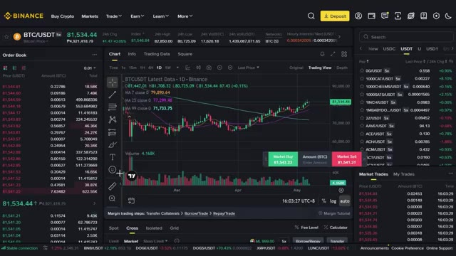
*⏱️ 00:00:11 — Interface de trading spot de Binance affichant le graphique en chandeliers du BTC/USDT, le carnet d'ordres et les options d'achat/vente.*

*⏱️ 00:00:17 — Page d'inscription de Binance proposant des bonus de bienvenue et des options de connexion via e-mail ou réseaux sociaux.*

---

### ⏱️ `[00:00:23 - 00:00:41]` | Segment #02

**🔊 Audio (Transcription Intégrale Mot pour Mot en Français) :**
> Aucune étape sautée, aucune supposition faite. Et avec mon lien exclusif ci-dessous, vous débloquez jusqu'à 100 dollars de récompenses à l'inscription, en plus de bons pour des jetons WCT et HUMA dans le centre de récompenses. À la fin de cette vidéo, vous saurez exactement comment utiliser Binance et comment réclamer chaque bonus disponible pour vous.

**👁️ Analyse Visuelle d'Écran (gemini-3.5-flash-lite) :**
**Interface & Outils** : Site web de la plateforme d'échange Binance.

**Contenu textuel & Code** : Offres de bonus d'inscription (100 USD), bons pour des jetons WCT et HUMA, liste des cryptomonnaies populaires (BTC, ETH, BNB, XRP, ASTER), solde estimé du compte (50,02 USDT).

**Action / Démonstration** : Présentation des étapes d'inscription et des récompenses disponibles sur la plateforme Binance.

*⏱️ 00:00:27 — Page d'inscription de Binance affichant l'offre de récompense de 100 USD.*

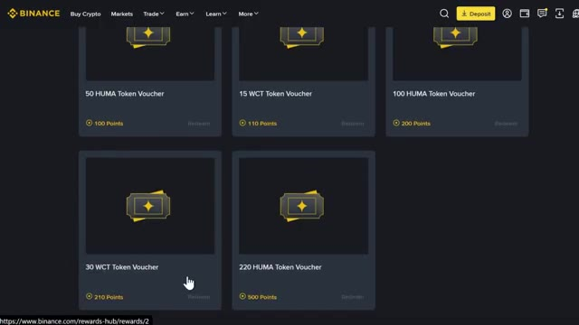
*⏱️ 00:00:32 — Centre de récompenses de Binance montrant les bons pour des jetons WCT et HUMA.*

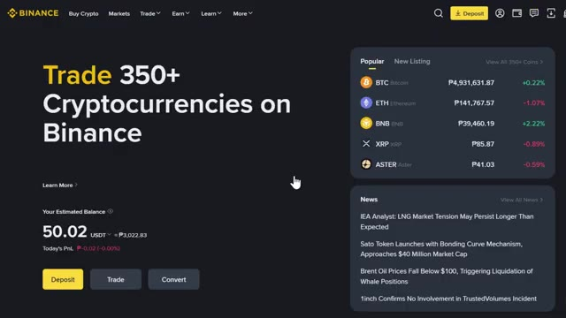
*⏱️ 00:00:36 — Page d'accueil de la plateforme Binance montrant le solde du compte et la liste des cryptomonnaies populaires.*

---

### ⏱️ `[00:00:41 - 00:01:18]` | Segment #03

**🔊 Audio (Transcription Intégrale Mot pour Mot en Français) :**
> Alors commençons. Voici pourquoi Binance est mon premier choix et, honnêtement, il n'y a même pas photo. Binance est la première bourse mondiale en volume de transactions. Selon CoinGecko, Binance détient environ 39 % du volume des 10 principales bourses. C'est énorme. Nous parlons de milliards de dollars échangés chaque jour, ce qui signifie une grande liquidité, ce qui veut dire que vos ordres s'exécutent au prix que vous voyez réellement, même en utilisant un effet de levier. En plus de cela, Binance détient plus d'un milliard de dollars dans son fonds SafeU. Cela signifie Fonds d'actifs sécurisés pour les utilisateurs, qui est détenu en stablecoins USDC.

**👁️ Analyse Visuelle d'Écran (gemini-3.5-flash-lite) :**
**Interface & Outils** : CoinGecko et page d'inscription officielle de Binance

**Contenu textuel & Code** : Statistiques de volume des bourses centralisées, parts de marché par paire (USDC/USDT 20,6 %, BTC/USDT 13,1 %) et par devise (USDT 69,3 %)

**Action / Démonstration** : Analyse comparative du volume des plateformes d'échange et présentation de l'interface d'inscription de Binance

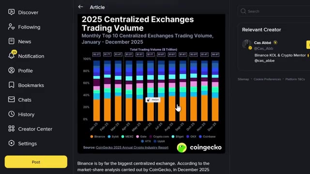
*⏱️ 00:00:50 — Graphique en barres empilées montrant le volume de transactions des bourses centralisées en 2025 issu d'un rapport CoinGecko.*

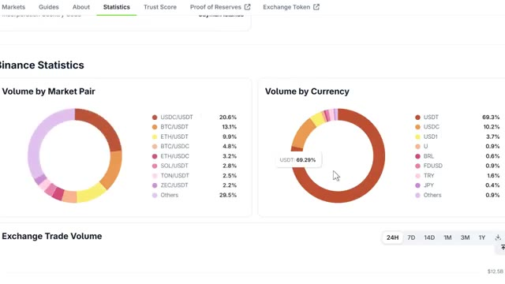
*⏱️ 00:01:00 — Graphiques circulaires détaillant les statistiques de Binance, notamment le volume par paire de marché et par devise (USDT à 69,3 %).*

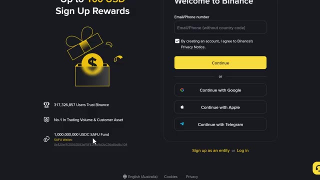
*⏱️ 00:01:09 — Page d'inscription de Binance affichant les bonus de bienvenue, le nombre d'utilisateurs et le fonds SAFU en USDC.*

---

### ⏱️ `[00:01:18 - 00:01:40]` | Segment #04

**🔊 Audio (Transcription Intégrale Mot pour Mot en Français) :**
> Il s'agit fondamentalement d'un fonds d'assurance d'urgence pour protéger vos actifs. Cela vous donne un niveau très élevé de confiance et de sécurité. Binance propose également une immense gamme de pièces, du Bitcoin et de l'Ethereum à des centaines d'altcoins. Vous avez du trading au comptant, du trading de contrats à terme avec un effet de levier allant jusqu'à 10 fois, du copy trading, des fonctionnalités de gains et un portefeuille Web3 complet.

**👁️ Analyse Visuelle d'Écran (gemini-3.5-flash-lite) :**
**Interface & Outils** : Site web et interface de la bourse de cryptomonnaies Binance (plateforme d'échange et page d'inscription).

**Contenu textuel & Code** : Informations sur le fonds de sécurité SAFU de Binance, liste des cryptomonnaies populaires (BTC, ETH, BNB), graphique technique de trading pour la paire BTC/USDT avec des moyennes mobiles et indicateurs de volume.
[HONEYPOT] Navigation sur la plateforme Binance, présentation des fonctionnalités de sécurité et des marchés de cryptomonnaies disponibles.

**Action / Démonstration** : Explications face caméra et analyse conceptuelle des marchés.

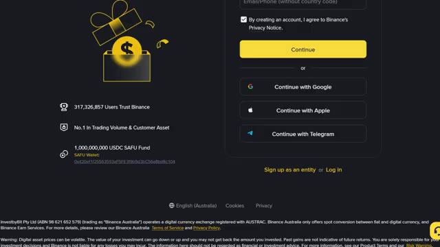
*⏱️ 00:01:24 — Page d'inscription de Binance affichant les détails du fonds SAFU d'un milliard de dollars.*

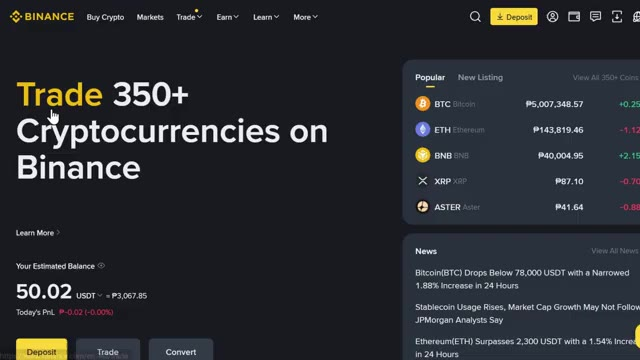
*⏱️ 00:01:29 — Page d'accueil de la plateforme Binance montrant l'option de trading pour plus de 350 cryptomonnaies.*

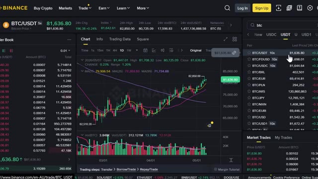
*⏱️ 00:01:34 — Interface de trading de Binance affichant le graphique des prix du BTC/USDT en chandelier japonais avec les volumes et le carnet d'ordres.*

---

### ⏱️ `[00:01:40 - 00:01:59]` | Segment #05

**🔊 Audio (Transcription Intégrale Mot pour Mot en Français) :**
> C'est à la fois parfait pour les débutants et les traders avancés. Et avec mon lien, vous obtenez jusqu'à 100 $ de récompenses d'inscription en plus de tout le reste. Très bien, entrons dans le vif du sujet. La première chose à faire est de cliquer sur le lien dans la description. C'est très important. Utiliser mon lien est ce qui débloque le package de bonus complet pour vous. Sans lui, vous obtiendrez une offre complètement différente.

**👁️ Analyse Visuelle d'Écran (gemini-3.5-flash-lite) :**
**Interface & Outils** : Navigateur web affichant la plateforme d'échange Binance.

**Contenu textuel & Code** : Offre de récompense d'inscription de 100 USD, formulaire de création de compte par email/téléphone, options de connexion rapide (Google, Apple, Telegram).

**Action / Démonstration** : Présentation de la page d'inscription pour inciter les spectateurs à utiliser le lien affilié.

*⏱️ 00:01:45 — Capture d'écran de la page d'inscription de Binance affichant une offre de bonus de 100 USD.*

*⏱️ 00:01:49 — Capture d'écran similaire montrant le formulaire d'inscription avec des informations de sécurité supplémentaires en bas à gauche.*

---

### ⏱️ `[00:01:59 - 00:02:18]` | Segment #06

**🔊 Audio (Transcription Intégrale Mot pour Mot en Français) :**
> Une fois que vous êtes sur la page de Binance, vous pouvez vous inscrire avec votre e-mail ou votre numéro de téléphone, ou vous pouvez vous connecter via Google ou Apple. Pour ce tutoriel, j'utiliserai l'e-mail. Remplissez simplement vos informations, créez un mot de passe fort, et vous y êtes. Tout le processus prend moins d'une minute. Une fois à l'intérieur de votre compte Binance, les bonus commenceront à se débloquer au fur et à mesure que vous accomplirez certaines actions.

**👁️ Analyse Visuelle d'Écran (gemini-3.5-flash-lite) :**
**Interface & Outils** : Site web de l'échange de cryptomonnaies Binance

**Contenu textuel & Code** : Formulaire d'inscription, options de connexion Google/Apple/Telegram, liste des cryptomonnaies populaires avec leurs variations (BTC, ETH, BNB, XRP), et solde estimé du compte (50.02 USDT).

**Action / Démonstration** : Navigation sur la plateforme Binance montrant le processus d'inscription et le tableau de bord utilisateur.

*⏱️ 00:02:04 — Page d'inscription de Binance avec un champ pour l'e-mail ou le numéro de téléphone et des options de connexion alternatives.*

*⏱️ 00:02:13 — Tableau de bord principal de Binance affichant le solde estimé du compte et les cryptomonnaies populaires.*

---

### ⏱️ `[00:02:18 - 00:02:45]` | Segment #07

**🔊 Audio (Transcription Intégrale Mot pour Mot en Français) :**
> Je vais vous guider à travers tout cela. Maintenant, avant de déposer quoi que ce soit, laissez-moi vous expliquer rapidement comment Binance organise vos fonds, car c'est un point qui embrouille beaucoup de débutants. Binance utilise différents types de comptes pour garder les choses organisées. Tout d'abord, vous avez votre compte de financement, et c'est là qu'arrivent vos dépôts en premier. Considérez-le comme le point d'entrée principal pour votre argent. Ensuite, vous avez votre compte fiat et spot. C'est là que vous achetez et vendez des cryptomonnaies aux prix du marché.

**👁️ Analyse Visuelle d'Écran (gemini-3.5-flash-lite) :**
**Interface & Outils** : Interface web de l'échange de cryptomonnaies Binance (page Portefeuille/Wallet).

**Contenu textuel & Code** : Menus des comptes Binance (Overview, Spot, Margin, Futures, Options, Trading Bots, Earn, Funding) et liste des cryptomonnaies dans le portefeuille Funding.

**Action / Démonstration** : Navigation à travers les différents comptes de l'exchange pour expliquer l'organisation des fonds aux débutants.

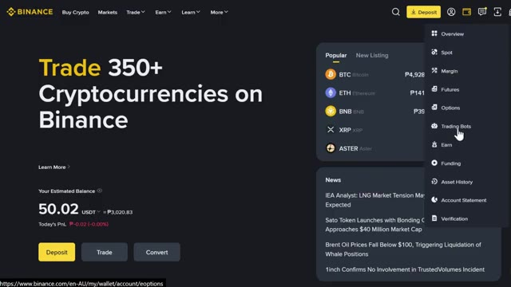
*⏱️ 00:02:25 — Interface de la plateforme Binance montrant la page d'accueil d'un portefeuille avec un menu déroulant affichant les différents types de comptes (Spot, Margin, Futures, Funding, etc.).*

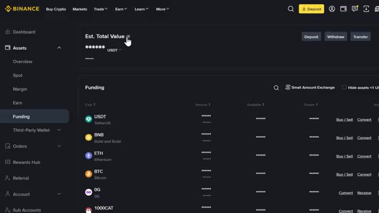
*⏱️ 00:02:32 — Vue détaillée de l'onglet "Funding" (Financement) du portefeuille Binance, masquant les soldes des cryptomonnaies (USDT, BNB, ETH, BTC) avec des astérisques.*

---

### ⏱️ `[00:02:46 - 00:03:08]` | Segment #08

**🔊 Audio (Transcription Intégrale Mot pour Mot en Français) :**
> C'est idéal pour détenir des actifs ou trader sans effet de levier. Viennent ensuite vos comptes de marge isolée et de marge croisée. Ceux-ci sont destinés au trading de futures avec effet de levier, ce que nous aborderons plus tard dans cette vidéo. Ensuite, il y a le compte Earn. C'est ici que vous pouvez staker vos pièces et gagner un revenu passif sur plus de 300 actifs avec des termes à la fois flexibles et bloqués.

**👁️ Analyse Visuelle d'Écran (gemini-3.5-flash-lite) :**
**Interface & Outils** : Échange de cryptomonnaies Binance (interface web)

**Contenu textuel & Code** : Menu latéral des actifs (Assets) avec les options Overview, Spot, Margin, Earn, Funding, et onglets de marge croisée (Cross Margin) et isolée (Isolated Margin) avec des soldes masqués.

**Action / Démonstration** : Navigation dans le tableau de bord des comptes de trading sur marge pour expliquer le fonctionnement de la marge croisée et isolée.

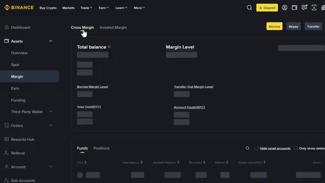
*⏱️ 00:02:51 — Capture d'écran de l'interface de l'échange Binance montrant la section du compte de marge (Margin) avec les onglets Cross Margin et Isolated Margin.*

---

### ⏱️ `[00:03:08 - 00:03:28]` | Segment #09

**🔊 Audio (Transcription Intégrale Mot pour Mot en Français) :**
> Binance propose également des produits de rendement investissement avancés si vous souhaitez aller plus loin là-dedans. Et enfin, Binance dispose d'un portefeuille pour des choses comme le trading P2P et les services tiers. Binance a également des plateformes partenaires régionales comme Binance TR pour la région de la Turquie, Toko Crypto pour l'Indonésie et Binance TH pour la Thaïlande.

**👁️ Analyse Visuelle d'Écran (gemini-3.5-flash-lite) :**
**Interface & Outils** : Site web de Binance (Interface d'échange et de services financiers crypto)

**Contenu textuel & Code** : Page 'Advanced Earn' affichant des options de rendement telles que 'Smart Arbitrage' et 'On-chain Yields', avec des paires de trading comme SOL/USDT et XRP/USDT montrant leurs taux d'intérêt (APR).

**Action / Démonstration** : Navigation et présentation des fonctionnalités de rendement et d'arbitrage avancées proposées par la plateforme Binance.

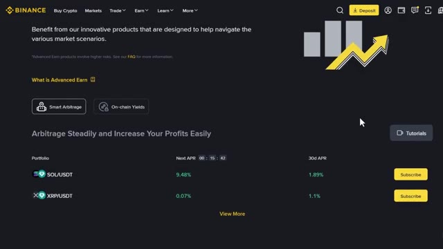
*⏱️ 00:03:13 — Capture d'écran de l'interface du site web de Binance montrant la page des produits de rendement avancé (Advanced Earn) avec les options Smart Arbitrage et On-chain Yields.*

---

### ⏱️ `[00:03:29 - 00:04:07]` | Segment #10

**🔊 Audio (Transcription Intégrale Mot pour Mot en Français) :**
> Ce sont des versions localisées de Binance pour des régions spécifiques qui fonctionnent sous des réglementations locales. Donc la chose essentielle à retenir est que les dépôts vont d'abord dans votre portefeuille de financement ou au comptant, et ensuite vous transférez vers le bon compte selon ce que vous voulez faire. Je vais vous montrer exactement comment faire cela. Très bien, mettons un peu d'argent dans votre compte et commençons à réclamer ces bonus. Allez dans votre portefeuille et cliquez sur dépôt. Vous verrez quelques options ici. Et c'est là que Binance est un peu différente des autres plateformes d'échange. Alors faites attention. Vous verrez des options pour déposer des crypto-monnaies, acheter avec de la monnaie fiat, et le trading P2P. Pour l'instant, concentrons-nous d'abord sur le dépôt de crypto-monnaies. Cliquez sur

**👁️ Analyse Visuelle d'Écran (gemini-3.5-flash-lite) :**
**Interface & Outils** : Site web de Binance (exchange de cryptomonnaies).

**Contenu textuel & Code** : Solde estimé masqué, liste des cryptomonnaies populaires avec cours et variations, options de dépôt en monnaie fiat (AUD) et cryptomonnaies.
[DESC_IMAGE_1] Navigation dans le tableau de bord des actifs et portefeuilles Spot.
[DESC_IMAGE_2] Visualisation de la page d'accueil principale de la plateforme d'échange.
[DESC_IMAGE_3] Sélection des méthodes de dépôt et d'achat de cryptos.

**Action / Démonstration** : Navigation et présentation des fonctionnalités de dépôt et de gestion des portefeuilles sur l'interface Binance.

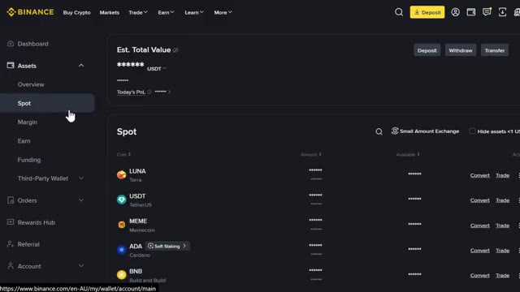
*⏱️ 00:03:38 — Interface du portefeuille Spot de Binance montrant les différents actifs détenus (LUNA, USDT, MEME, ADA, BNB).*

*⏱️ 00:03:48 — Page d'accueil de la plateforme Binance affichant le solde estimé et la liste des cryptomonnaies populaires.*

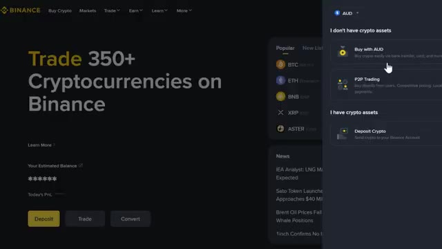
*⏱️ 00:03:58 — Menu déroulant des options de dépôt sur Binance avec les choix d'achat en AUD, trading P2P et dépôt de crypto.*

---

### ⏱️ `[00:04:07 - 00:04:45]` | Segment #11

**🔊 Audio (Transcription Intégrale Mot pour Mot en Français) :**
> déposer des cryptos. Sélectionnez ensuite la cryptomonnaie que vous souhaitez déposer. L'USDT est idéal pour le trading, mais le Bitcoin ou l'Ethereum conviennent également. Lors de la sélection de l'USDT, je vous recommande de choisir le réseau TRC20 car il est rapide et les frais sont très bas. Vous verrez alors votre adresse de dépôt personnelle. Copiez-la soigneusement. Allez sur votre plateforme d'échange ou votre portefeuille actuel, collez l'adresse et envoyez vos cryptos. Cela prend généralement entre 5 et 15 minutes pour arriver. Conseil de pro, envoyez toujours d'abord un petit montant test, peut-être 10 à 20 dollars, et vérifiez bien que le réseau correspond des deux côtés. C'est très important. L'envoi sur le

**👁️ Analyse Visuelle d'Écran (gemini-3.5-flash-lite) :**
**Interface & Outils** : Échange de cryptomonnaies Binance (interface Web de dépôt).

**Contenu textuel & Code** : Menu de sélection de cryptomonnaie avec l'USDT sélectionné, champ de sélection du réseau, section FAQ et historique des dépôts récents (50.000 USDT).

**Action / Démonstration** : Sélection de la cryptomonnaie (USDT) avant de choisir le réseau de dépôt.

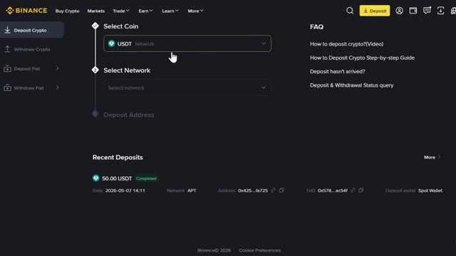
*⏱️ 00:04:17 — Interface de dépôt de la plateforme Binance montrant la sélection de la cryptomonnaie USDT.*

---

### ⏱️ `[00:04:45 - 00:05:19]` | Segment #12

**🔊 Audio (Transcription Intégrale Mot pour Mot en Français) :**
> un mauvais réseau peut signifier la perte de vos fonds. Maintenant, c'est là que les bonus commencent à entrer en jeu. Rendez-vous sur le centre des récompenses. Vous pouvez le trouver dans votre profil ou votre tableau de bord. Dans le centre des récompenses, vous pouvez réclamer des bons, y compris des bons de jetons WCT allant de 15 à 30 WCT et des bons de jetons Huma allant de 50 à 220 HEMA. Le WCT est le jeton de Wallet Connect et Huma est un jeton de protocole de prêt d'actifs du monde réel. Les deux sont des projets en direct que vous pouvez détenir ou échanger. Ceux-ci sont disponibles rien que pour vous être inscrit

**👁️ Analyse Visuelle d'Écran (gemini-3.5-flash-lite) :**
**Interface & Outils** : Site web de l'échange de cryptomonnaies Binance (interface utilisateur du compte et centre de récompenses).

**Contenu textuel & Code** : Menu déroulant du profil utilisateur incluant les options Dashboard, Assets, Account, Rewards Hub, ainsi que divers bons de jetons avec leurs coûts en points.

**Action / Démonstration** : Navigation de l'utilisateur vers le centre des récompenses (Rewards Hub) depuis le menu du profil.

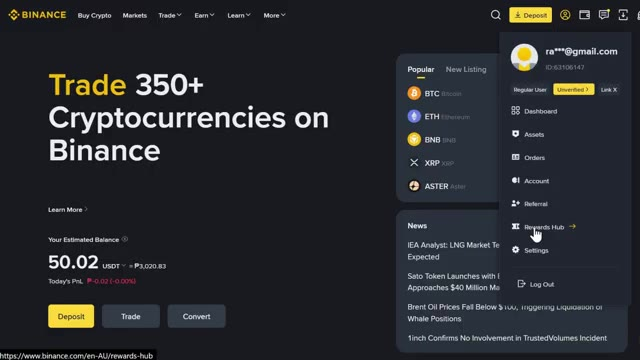
*⏱️ 00:04:53 — Interface du site web Binance montrant le menu du profil utilisateur avec le curseur sur l'option 'Rewards Hub'.*

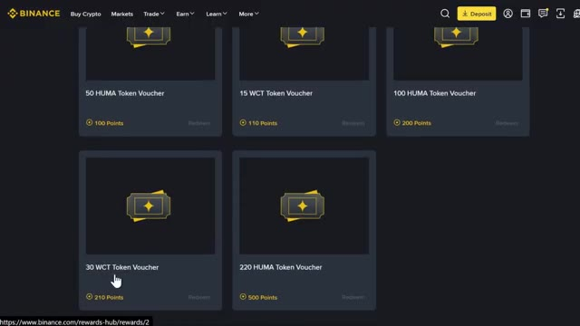
*⏱️ 00:05:02 — Page du 'Rewards Hub' sur Binance présentant divers bons de jetons (comme des bons HUMA et WCT) échangeables contre des points.*

---

### ⏱️ `[00:05:19 - 00:05:54]` | Segment #13

**🔊 Audio (Transcription Intégrale Mot pour Mot en Français) :**
> et en complétant les étapes de base avec mon lien. En plus de ça, vous pouvez obtenir jusqu'à 100 dollars en USDT de récompenses d'inscription en accomplissant des actions comme déposer et trader. Plus vous déposez et tradez, plus vous débloquez de récompenses. Tout s'accumule. Si vous n'avez pas encore de crypto et que vous voulez en acheter directement sur Binance, aucun problème. C'est très simple. Retournez dans la section de dépôt et cette fois, sélectionnez acheter avec de la monnaie fiat. Vous choisirez d'abord votre devise locale, par exemple, des euros ou des dollars américains, puis vous sélectionnerez la crypto que vous voulez recevoir, comme l'USDT ou le Bitcoin. Ensuite, vous choisissez votre paiement

**👁️ Analyse Visuelle d'Écran (gemini-3.5-flash-lite) :**
**Interface & Outils** : Plateforme d'échange de cryptomonnaies Binance (site web).

**Contenu textuel & Code** : Solde de compte (50.02 USDT), prix des cryptomonnaies principales (BTC, ETH, BNB, XRP, SOL), options de dépôt et d'achat de devises fiat.

**Action / Démonstration** : Navigation sur la plateforme Binance, présentation des bonus d'inscription, du tableau de bord utilisateur et de l'interface de dépôt/achat de cryptos.

*⏱️ 00:05:27 — Page d'inscription de Binance affichant l'offre de bonus jusqu'à 100 USD en récompenses d'inscription.*

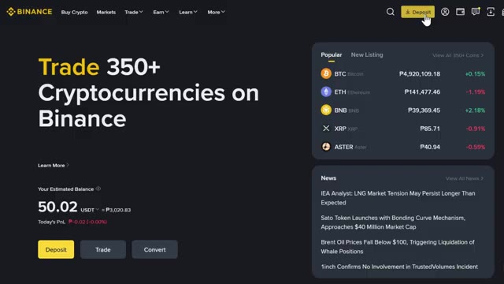
*⏱️ 00:05:36 — Tableau de bord principal du compte Binance montrant un solde estimé de 50.02 USDT et des listes de cryptos populaires.*

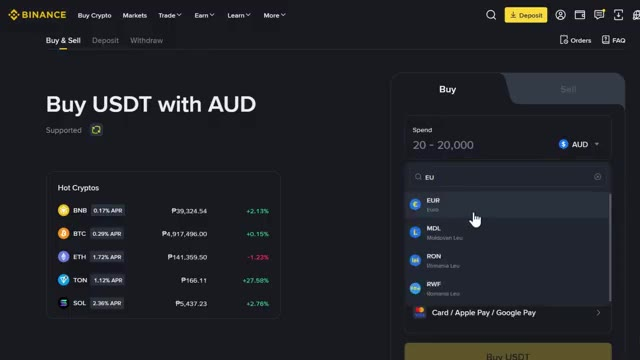
*⏱️ 00:05:45 — Interface d'achat de crypto sur Binance montrant l'option d'achat de USDT avec différentes devises fiat (comme l'AUD et l'EUR).*

---

### ⏱️ `[00:05:54 - 00:06:28]` | Segment #14

**🔊 Audio (Transcription Intégrale Mot pour Mot en Français) :**
> méthode. Vous pouvez utiliser une carte de crédit ou de débit, Apple Pay ou Google Pay. Binance vous montrera le prix exact de la cryptomonnaie dans votre devise locale avant que vous ne confirmiez, afin que vous sachiez exactement ce que vous obtenez. Une fois que vous êtes satisfait, cliquez simplement sur confirmer et la crypto arrivera sur votre compte. Maintenant, si vous voulez acheter en utilisant le trading P2P, c'is aussi disponible. Avec le P2P, vous achetez des USDT directement auprès d'autres utilisateurs. Vous sélectionnez votre devise, choisissez un vendeur, suivez ses instructions de paiement, généralement un virement bancaire ou un paiement mobile. Et une fois que vous confirmez le paiement, les USDT

**👁️ Analyse Visuelle d'Écran (gemini-3.5-flash-lite) :**
**Interface & Outils** : Plateforme d'échange de cryptomonnaies Binance (interface Web).

**Contenu textuel & Code** : Soldes de portefeuille (USDT, LUNA, MEME, ADA), prix du marché P2P, devises fiat (AUD, USD, etc.) et options de paiement.

**Action / Démonstration** : Navigation sur la plateforme Binance, sélection d'une méthode de paiement et consultation des offres P2P.

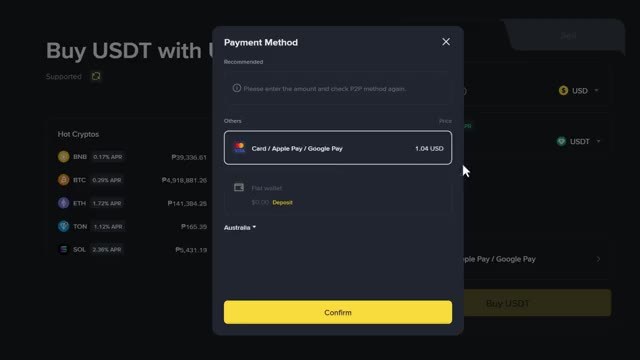
*⏱️ 00:06:02 — Fenêtre de sélection du mode de paiement sur Binance, montrant les options de carte bancaire, Apple Pay et Google Pay.*

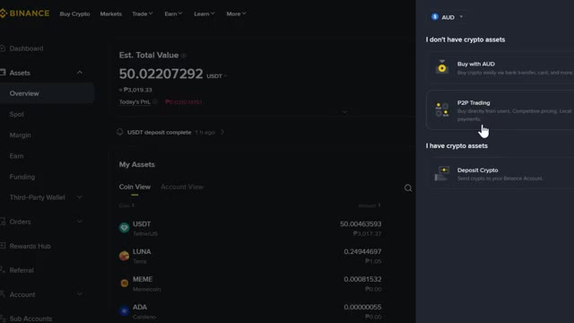
*⏱️ 00:06:11 — Tableau de bord d'un compte Binance affichant le solde total en USDT et la liste des cryptomonnaies possédées.*

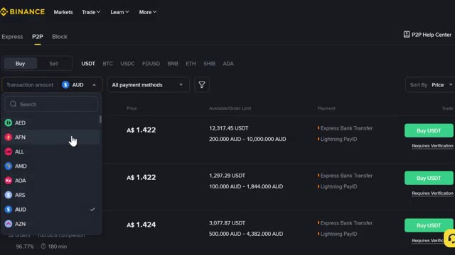
*⏱️ 00:06:19 — Interface P2P de Binance montrant le carnet d'offres d'achat de cryptomonnaies avec les devises locales disponibles.*

---

### ⏱️ `[00:06:28 - 00:07:03]` | Segment #15

**🔊 Audio (Transcription Intégrale Mot pour Mot en Français) :**
> est libéré dans votre portefeuille par le biais d'un tiers de confiance. C'est sécurisé et cela offre souvent de meilleurs taux, mais cela prend un peu plus de temps. Notez que Binance ne propose pas d'option de dépôt par virement bancaire direct en dehors du P2P, mais le P2P vous offre effectivement cette même fonctionnalité. Si vous avez déposé du Bitcoin ou une autre cryptomonnaie mais que vous avez besoin d'USDT pour le trading de contrats à terme, voici comment les convertir rapidement. Allez dans votre portefeuille Spot, cliquez sur Vue d'ensemble, puis cliquez sur Transférer. Déplacez vos fonds de votre portefeuille de financement vers votre compte Fiat et Spot. Une fois que c'est fait, allez dans Trade puis Spot. Recherchez votre paire, par exemple, Bitcoin

**👁️ Analyse Visuelle d'Écran (gemini-3.5-flash-lite) :**
**Interface & Outils** : Site web Binance (Interface de gestion de portefeuille et d'actifs).

**Contenu textuel & Code** : Valeur totale estimée du portefeuille, liste des cryptomonnaies (USDT, BTC, LUNA, MEME, ADA), et options de transfert/dépôt.

**Action / Démonstration** : Navigation dans le tableau de bord des actifs, consultation des soldes et manipulation des options de transfert interne.

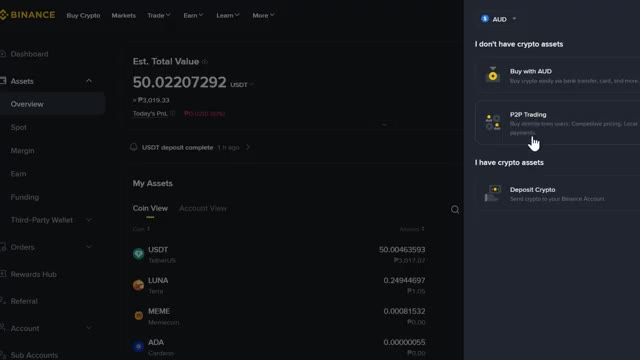
*⏱️ 00:06:37 — Interface Binance montrant le portefeuille avec les options de dépôt et de trading P2P.*

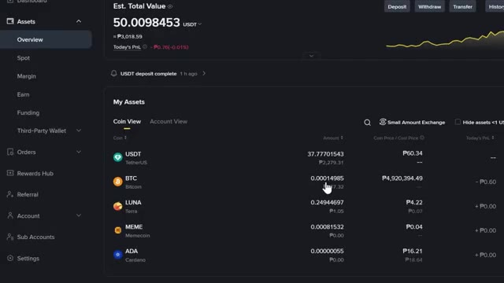
*⏱️ 00:06:45 — Vue d'ensemble des actifs (Coin View) avec le solde total et la liste des cryptomonnaies détenues sur Binance.*

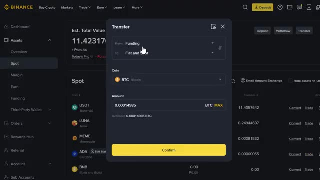
*⏱️ 00:06:54 — Fenêtre modale de transfert de fonds entre le compte Funding et le compte Spot sur Binance.*

---

### ⏱️ `[00:07:03 - 00:07:30]` | Segment #16

**🔊 Audio (Transcription Intégrale Mot pour Mot en Français) :**
> USDT. Sélectionnez l'ordre au marché, allez du côté de la vente, entrez le montant que vous souhaitez convertir, et cliquez sur vendre BTC. Cela convertit instantanément vos Bitcoins en USDT au prix actuel du marché. Maintenant que vous avez des USDT dans votre compte au comptant, retournez dans transfert et déplacez-les de votre compte fiat et au comptant vers votre compte de marge isolée ou de marge croisée, selon celui que vous souhaitez utiliser pour le trading de contrats à terme. Je vais vous expliquer la différence dans un instant.

**👁️ Analyse Visuelle d'Écran (gemini-3.5-flash-lite) :**
**Interface & Outils** : Interface de l'échange de cryptomonnaies Binance (vue trading spot et gestion des actifs).

**Contenu textuel & Code** : Carnet d'ordres en temps réel, graphiques de prix BTC/USDT, montants disponibles en BTC et USDT, et paramètres de transfert.

**Action / Démonstration** : Sélection de l'ordre au marché et exécution de la vente de BTC pour obtenir des USDT, puis manipulation de transfert de fonds.

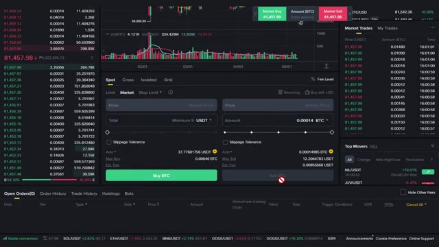
*⏱️ 00:07:09 — Interface de trading spot montrant le carnet d'ordres, le graphique des prix et le panneau de vente au marché pour convertir des BTC en USDT.*

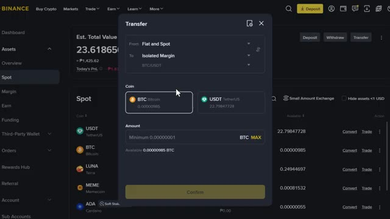
*⏱️ 00:07:23 — Interface de gestion du compte montrant la fenêtre contextuelle de transfert de fonds entre différents portefeuilles (Spot vers Marge Isolée).*

---

### ⏱️ `[00:07:31 - 00:07:49]` | Segment #17

**🔊 Audio (Transcription Intégrale Mot pour Mot en Français) :**
> Très bien, passons maintenant à l'événement principal du trading de contrats à terme. Survolez l'onglet « Trade » dans la barre de navigation supérieure et cliquez sur « Marge ». Cela vous amènera au tableau de bord des contrats à terme de Binance. C'est ici que vous effectuerez la majeure partie de votre trading avec effet de levier. Cela peut sembler un peu intimidant au début, mais je vais décortiquer chaque section pour que tout devienne parfaitement clair.

**👁️ Analyse Visuelle d'Écran (gemini-3.5-flash-lite) :**
**Interface & Outils** : Binance (Interface Web, onglet Trade et tableau de bord Margin/Futures)

**Contenu textuel & Code** : Menu déroulant de navigation avec options de trading (Spot, Margin, P2P, Trading Bots) et interface de trading Margin affichant le carnet d'ordres, le graphique en chandelier BTC/USDT avec indicateurs de moyenne mobile, et les boutons d'achat/vente.

**Action / Démonstration** : Navigation dans les menus de la plateforme Binance pour accéder à la section de trading sur marge (Margin).

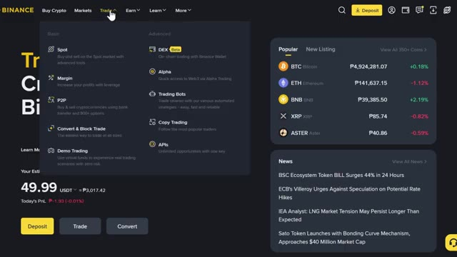
*⏱️ 00:07:35 — Le curseur survole l'onglet "Trade" dans la barre de navigation supérieure de Binance, affichant le menu déroulant avec les options Spot, Margin, P2P, etc.*

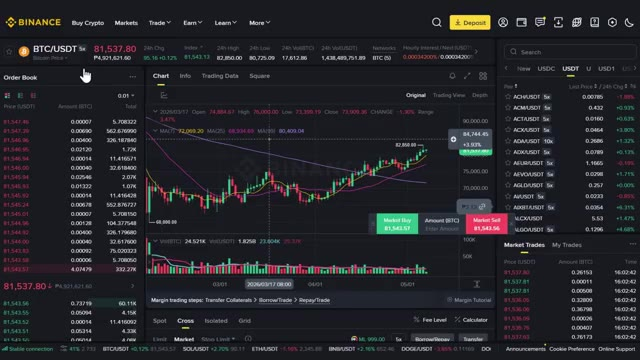
*⏱️ 00:07:40 — Le tableau de bord de trading sur marge de Binance affichant la paire BTC/USDT avec le graphique des prix, le carnet d'ordres et les options de passage d'ordres.*

---

### ⏱️ `[00:07:49 - 00:08:14]` | Segment #18

**🔊 Audio (Transcription Intégrale Mot pour Mot en Français) :**
> Voici ce que vous verrez sur l'écran de trading. En haut à droite, vous trouverez le sélecteur de paires de trading. C'est ici que vous choisissez quelle crypto trader, comme Bitcoin USDT ou ETH USDT. Au centre se trouve le graphique des prix. Il montre l'historique des mouvements de prix de l'actif. Vous pouvez basculer entre la vue standard et le graphique en vue de trading complète, qui vous offre tous les outils de dessin et indicateurs techniques dont vous avez besoin pour l'analyse.

**👁️ Analyse Visuelle d'Écran (gemini-3.5-flash-lite) :**
**Interface & Outils** : Interface web de l'échange de cryptomonnaies Binance (Trading View intégré).

**Contenu textuel & Code** : Graphique en chandeliers japonais de la paire BTC/USDT (cours autour de 81 537,81 $), moyennes mobiles (MA 7, MA 25, MA 99), indicateur de volume, carnet d'ordres (Order Book) en temps réel et sélecteur de paires de trading dans le panneau latéral droit.

**Action / Démonstration** : Présentation et exploration de l'interface graphique de trading et du sélecteur de paires.

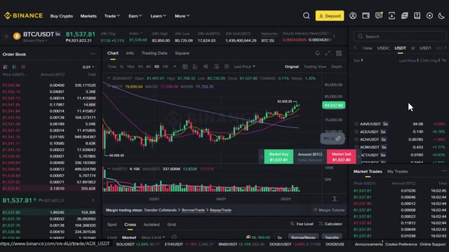
*⏱️ 00:07:55 — Interface de trading de la plateforme Binance affichant le graphique des prix de la paire BTC/USDT en vue journalière (1D) avec le carnet d'ordres à gauche et le sélecteur de paires à droite.*

---

### ⏱️ `[00:08:15 - 00:08:48]` | Segment #19

**🔊 Audio (Transcription Intégrale Mot pour Mot en Français) :**
> Sur le côté gauche se trouve le carnet d'ordres. Les chiffres rouges sont les ordres de vente situés au-dessus du marché et les chiffres verts sont les ordres d'achat situés en dessous. Cela vous montre où se trouve la liquidité. En bas à droite, vous verrez les transactions actuelles du marché. Un flux en direct des transactions récentes exécutées sur la bourse. Et au milieu en bas se trouve le panneau de placement des ordres. C'est ici que vous configurerez et placerez vos transactions, définirez votre effet de levier et gérerez la taille de votre position. Tout ce dont vous avez besoin est ici sur un seul écran. Avant de passer le moindre ordre, vous devez configurer deux paramètres très importants.

**👁️ Analyse Visuelle d'Écran (gemini-3.5-flash-lite) :**
**Interface & Outils** : Interface web de trading de cryptomonnaies (type Binance) avec graphiques TradingView intégrés.

**Contenu textuel & Code** : Graphique journalier (1D) du Bitcoin (BTC/USDT) affichant des moyennes mobiles (MA 7, MA 25, MA 99), le carnet d'ordres en temps réel, les transactions du marché, et le panneau de passage d'ordres (Spot, Cross, Isolated, Grid).

**Action / Démonstration** : Présentation et explication du fonctionnement du carnet d'ordres, des zones de liquidité d'achat et de vente, et du panneau de transactions en direct.

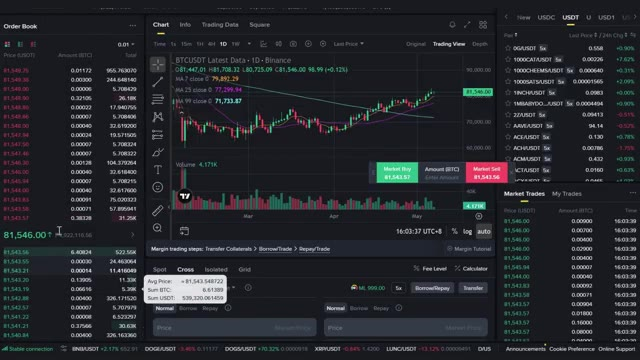
*⏱️ 00:08:23 — Interface d'échange de cryptomonnaies montrant un graphique des prix BTCUSDT au centre, le carnet d'ordres à gauche avec les ordres de vente en rouge et d'achat en vert, ainsi que le carnet des transactions récentes en bas à droite.*

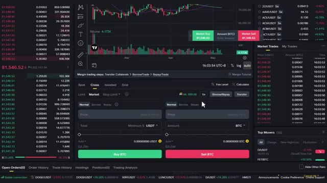
*⏱️ 00:08:40 — Vue de l'interface de trading montrant le graphique, le carnet d'ordres à gauche, et les boutons d'achat/vente (Buy BTC / Sell BTC) en bas avec les options de marge et de trading au comptant.*

---

### ⏱️ `[00:08:48 - 00:09:22]` | Segment #20

**🔊 Audio (Transcription Intégrale Mot pour Mot en Français) :**
> Premièrement, le mode de marge. Vous verrez cela en haut du panneau d'ordres. Je recommande vivement d'utiliser la marge isolée en tant que débutant. Cela signifie que si le trade tourne mal, vous perdez seulement la marge que vous avez investie dans cette position spécifique. Le reste de votre compte est complètement en sécurité. La marge croisée utilise l'ensemble de votre solde futures comme garantie, ce qui est beaucoup plus risqué. De plus, juste pour que vous sachiez, vous pouvez également voir les options de spot et de bot de grille ici sur l'écran de trading. Assurez-vous simplement d'être dans la bonne colonne, qui est isolée, afin de placer un trade futures approprié. Deuxièmement, l'effet de levier.

**👁️ Analyse Visuelle d'Écran (gemini-3.5-flash-lite) :**
**Interface & Outils** : Interface de trading d'un échange (type carnet d'ordres, panneau de passage d'ordres et graphique TradingView intégré).

**Contenu textuel & Code** : Options de trading Spot, Cross, Isolated, Grid, ainsi que les boutons d'achat (Buy BTC) et de vente (Sell BTC) avec un effet de levier réglé sur 10x.

**Action / Démonstration** : Sélection du mode de marge isolée (Isolated) dans le panneau de configuration des ordres de trading.

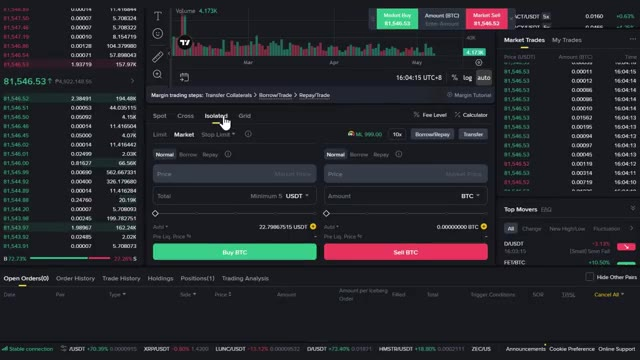
*⏱️ 00:08:57 — Capture d'écran montrant l'interface d'un exchange de cryptomonnaies, avec le curseur de la souris positionné sur le bouton du mode de marge 'Isolated'.*

---

### ⏱️ `[00:09:23 - 00:09:47]` | Segment #21

**🔊 Audio (Transcription Intégrale Mot pour Mot en Français) :**
> Binance permet jusqu'à 10 fois de levier sur les paires USDT, mais n'utilisez pas un effet de levier élevé en tant que débutant. Limitez-vous à cinq fois maximum lorsque vous débutez. Voici comment fonctionne l'effet de levier. Si vous avez 100 dollars et que vous utilisez un effet de levier de cinq fois, vous disposez désormais de 500 dollars de pouvoir d'achat. Vous contrôlez une position de 500 dollars avec seulement 100 dollars de votre propre argent. Cela signifie que les profits sont amplifiés, mais les pertes le sont aussi.

**👁️ Analyse Visuelle d'Écran (gemini-3.5-flash-lite) :**
**Interface & Outils** : Interface de l'échange de cryptomonnaies Binance

**Contenu textuel & Code** : Pop-up "Adjust Max Leverage" affichant une paire BTC/USDT Isolated, avec un curseur positionné sur un effet de levier de 5x et une limite d'emprunt affichée en bas.

**Action / Démonstration** : Ajustement et sélection d'un effet de levier de 5x à l'aide du curseur avant de confirmer.

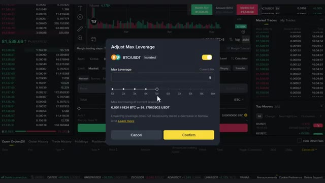
*⏱️ 00:09:29 — Fenêtre pop-up de réglage de l'effet de levier maximum sur la paire BTC/USDT en mode isolé sur Binance.*

---

### ⏱️ `[00:09:47 - 00:10:06]` | Segment #22

**🔊 Audio (Transcription Intégrale Mot pour Mot en Français) :**
> Donc, gardez ça bas et restez prudents. Pour ce tutoriel, je vais utiliser un effet de levier de cinq fois sur marge isolée. Très bien, plaçons un ordre d'achat, ce qui signifie que nous parions que le Bitcoin va monter. Dans le panneau des ordres, sélectionnez l'ordre au marché pour qu'il s'exécute immédiatement au prix actuel. Maintenant, vous verrez une option pour choisir la taille de votre ordre.

**👁️ Analyse Visuelle d'Écran (gemini-3.5-flash-lite) :**
**Interface & Outils** : Interface d'échange de cryptomonnaies (style Binance), graphiques TradingView, carnet d'ordres et panneau de passage d'ordres.

**Contenu textuel & Code** : Graphique journalier du Bitcoin (BTC/USDT), moyennes mobiles (MA 7, 25, 99), carnets d'ordres en temps réel, options de marge isolée et effet de levier.

**Action / Démonstration** : Navigation et configuration de l'interface pour placer un ordre d'achat au marché avec effet de levier sur le Bitcoin.

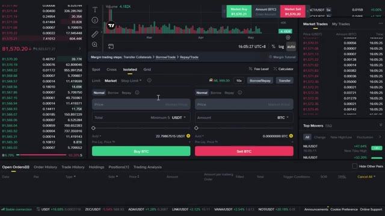
*⏱️ 00:09:52 — Interface de trading sur marge avec le panneau de sélection des ordres au marché et le bouton d'achat Buy BTC.*

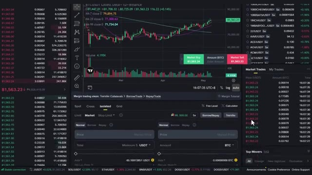
*⏱️ 00:09:57 — Vue du graphique du Bitcoin sur l'interface de trading avec le panneau des transactions récentes en cours.*

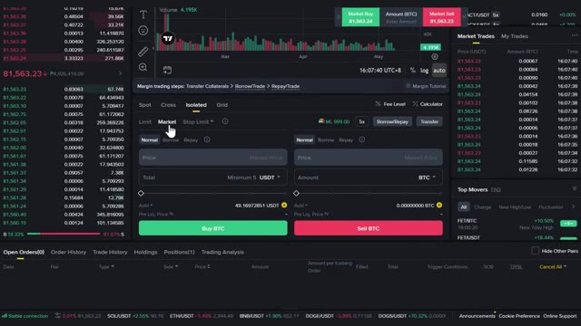
*⏱️ 00:10:01 — Gros plan sur la sélection de l'onglet 'Market' dans le panneau de configuration des ordres de la plateforme de trading.*

---

### ⏱️ `[00:10:06 - 00:10:29]` | Segment #23

**🔊 Audio (Transcription Intégrale Mot pour Mot en Français) :**
> Vous pouvez choisir un ordre par quantité, qui est libellé en BTC, ou un ordre par valeur, qui vous permet de définir la taille de votre position en USDT. Je vais utiliser l'ordre par valeur parce que cela rend le calcul de la taille des positions beaucoup plus facile à comprendre. Définissez la taille de votre position. Par exemple, une position de 50 dollars. Avec un effet de levier de 5 fois, cela signifie que vous n'utilisez que 10 dollars de votre propre capital comme marge.

**👁️ Analyse Visuelle d'Écran (gemini-3.5-flash-lite) :**
**Interface & Outils** : Interface d'échange de cryptomonnaies (type Binance).

**Contenu textuel & Code** : Options d'ordres Market/Limit, champs 'Total' en USDT (Minimum 5 USDT) et 'Amount' en BTC, boutons 'Buy BTC' et 'Sell BTC'.

**Action / Démonstration** : Sélection et explication des différents types d'ordres de trading (par valeur en USDT ou par quantité en BTC).

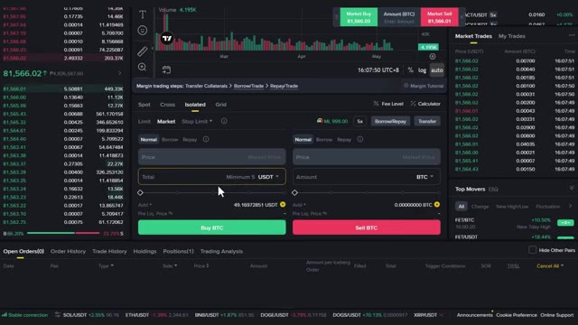
*⏱️ 00:10:12 — Interface de trading affichant les options de passage d'ordre en mode isolé avec les champs de saisie en USDT et en BTC.*

---

### ⏱️ `[00:10:30 - 00:10:50]` | Segment #24

**🔊 Audio (Transcription Intégrale Mot pour Mot en Français) :**
> Maintenant, et c'est très important, une fois que votre position est ouverte, définissez toujours un stop loss et un take profit avant d'ouvrir le trade. Cliquez sur TP slash SL pour ouvrir ces paramètres. Pour cet exemple, je risque 2 dollars pour gagner 6 dollars. C'est un ratio risque/rendement de 1 sur 3, ce qui est une configuration solide.

**👁️ Analyse Visuelle d'Écran (gemini-3.5-flash-lite) :**
**Interface & Outils** : Interface de trading d'une plateforme crypto (style exchange / marge).

**Contenu textuel & Code** : Fenêtre modale "TP/SL for BTC/USDT Position" avec des champs de saisie pour le prix TP (Take Profit), le déclencheur SL (Stop Loss), le prix SL et le montant en USDT/BTC.

**Action / Démonstration** : Configuration des niveaux de gestion des risques (Stop Loss et Take Profit) pour un ordre ou une position en cours.

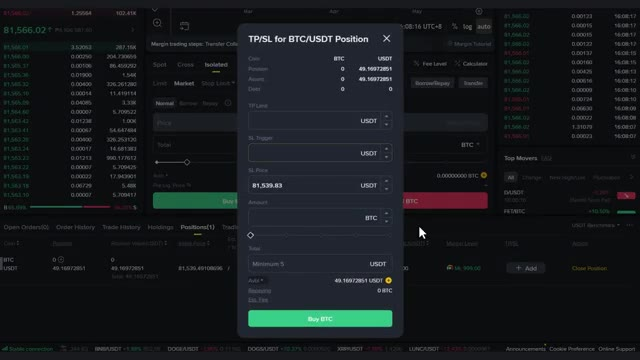
*⏱️ 00:10:35 — Interface d'une plateforme d'échange affichant une fenêtre contextuelle pour configurer le Take Profit et le Stop Loss (TP/SL) sur une position BTC/USDT.*

---

### ⏱️ `[00:10:50 - 00:11:11]` | Segment #25

**🔊 Audio (Transcription Intégrale Mot pour Mot en Français) :**
> Une fois que tout est configuré, cliquez sur Acheter du BTC. Votre transaction est maintenant active. Vous la verrez apparaître dans le panneau des positions en bas. Votre prix d'entrée, votre P&L actuel, votre prix de liquidation, ainsi que vos niveaux de stop loss et de take profit sont tous visibles juste là. Et gardez à l'esprit que votre volume de trading sur les contrats à terme vous aide également à débloquer plus de récompenses depuis le centre des récompenses.

**👁️ Analyse Visuelle d'Écran (gemini-3.5-flash-lite) :**
**Interface & Outils** : Interface de trading en ligne (exchange crypto).

**Contenu textuel & Code** : Tableau des positions affichant BTC/USDT avec la valeur, le prix d'entrée, le P&L et le bouton pour fermer la position.

**Action / Démonstration** : Visualisation de la position active ouverte suite à l'achat de BTC.

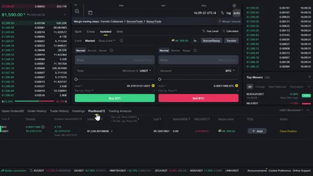
*⏱️ 00:10:55 — Interface d'échange de cryptomonnaies montrant le panneau des positions ouvertes en bas avec une position active sur le BTC.*

---

### ⏱️ `[00:11:11 - 00:11:32]` | Segment #26

**🔊 Audio (Transcription Intégrale Mot pour Mot en Français) :**
> Donc, plus vous tradez, plus vous pouvez réclamer de bonus en plus de vos profits. Maintenant que votre trade est ouvert, parlons de la façon de le gérer. Au fur et à mesure que le trade évolue en votre faveur, vous pouvez ajuster votre ordre stop loss pour verrouiller vos profits. Une fois que vous avez gagné quelques dollars, remontez votre stop loss jusqu'à votre prix d'entrée. C'est ce qu'on appelle passer à l'équilibre, et cela signifie que vous ne pouvez plus perdre sur ce trade.

**👁️ Analyse Visuelle d'Écran (gemini-3.5-flash-lite) :**
**Interface & Outils** : Interface web d'un exchange de cryptomonnaies (mode isolé, carnet d'ordres, panneau des positions).

**Contenu textuel & Code** : Paire BTC/USDT, détails de la position ouverte (taille, valeur, prix d'entrée à 81,539.49, PnL), et champs de configuration TP/SL.

**Action / Démonstration** : Gestion de position avec l'ouverture du panneau de configuration pour ajouter ou ajuster les ordres Stop Loss et Take Profit.

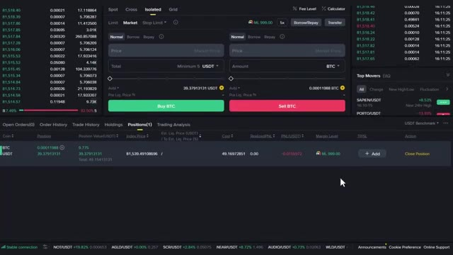
*⏱️ 00:11:16 — Vue générale de l'interface de trading d'une exchange affichant une position ouverte sur la paire BTC/USDT.*

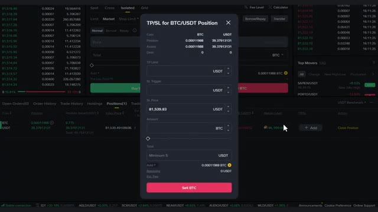
*⏱️ 00:11:22 — Fenêtre modale pop-up permettant de configurer les niveaux de Take Profit et Stop Loss (TP/SL) pour la position ouverte.*

---

### ⏱️ `[00:11:33 - 00:11:53]` | Segment #27

**🔊 Audio (Transcription Intégrale Mot pour Mot en Français) :**
> Vous pouvez également fermer partiellement votre position. Par exemple, si vous êtes largement en bénéfice, vous pouvez fermer 50 % de la transaction pour prendre quelques profits tout en laissant le reste courir. Pour fermer votre transaction, vous avez plusieurs options. La première consiste à laisser votre take profit ou votre stop loss la fermer automatiquement. La suivante consiste à fermer manuellement en cliquant sur le bouton de fermeture de position dans le panneau des positions.

**👁️ Analyse Visuelle d'Écran (gemini-3.5-flash-lite) :**
**Interface & Outils** : Interface web de trading (Exchange/Broker de cryptomonnaies en mode isolé).

**Contenu textuel & Code** : Paire BTC/USDT, détails de position, paramètres de take profit / stop loss, montant en BTC et USDT, ordres ouverts.

**Action / Démonstration** : Configuration des niveaux de sortie de position et placement d'ordres de vente/fermeture.

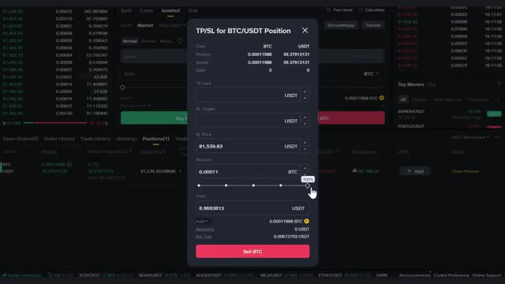
*⏱️ 00:11:38 — Interface de courtier affichant la fenêtre contextuelle pour configurer le Take Profit et le Stop Loss d'une position BTC/USDT.*

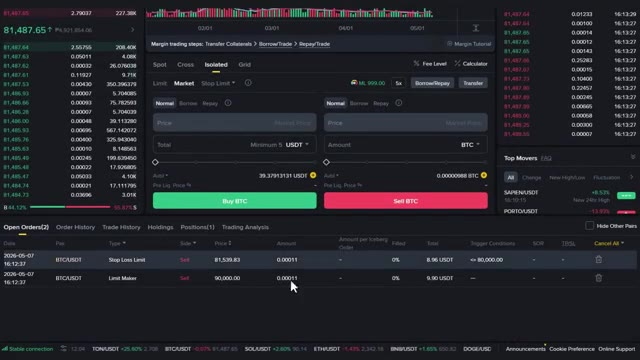
*⏱️ 00:11:48 — Interface de trading montrant le carnet d'ordres, le graphique des prix et le tableau des ordres ouverts (Stop Loss Limit et Limit Maker).*

---

### ⏱️ `[00:11:54 - 00:12:15]` | Segment #28

**🔊 Audio (Transcription Intégrale Mot pour Mot en Français) :**
> Troisièmement, c'est de fermer un pourcentage de la position en utilisant le curseur. Ou quatrièmement, en faisant glisser les lignes TP barre oblique SL directement sur le graphique pour les ajuster visuellement. Si vous voulez trader le marché à la baisse, cliquez simplement sur vendre au lieu d'ouvrir une position long. Même processus, direction opposée. Maintenant, pendant que vous êtes sur la plateforme Binance, il y a quelques autres choses qu'il est bon de savoir.

**👁️ Analyse Visuelle d'Écran (gemini-3.5-flash-lite) :**
**Interface & Outils** : Interface de trading d'une plateforme d'échange (ex: Binance)

**Contenu textuel & Code** : Panneau de trading (Limit, Market, Stop Limit), boutons Buy BTC / Sell BTC, curseur de sélection de pourcentage, carnet d'ordres à gauche, et tableau des positions ouvertes en bas avec les détails de marge et de PnL.

**Action / Démonstration** : Présentation de l'interface de gestion des ordres et des positions ouvertes sur un exchange avec les options de vente/achat et de fermeture de position.

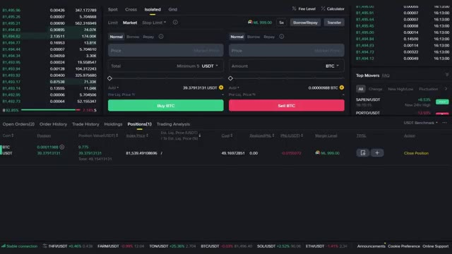
*⏱️ 00:11:59 — Interface d'échange de crypto-monnaies affichant le panneau de passage d'ordres en mode isolé, les carnets d'ordres et la position ouverte active en bas.*

---

### ⏱️ `[00:12:16 - 00:12:40]` | Segment #29

**🔊 Audio (Transcription Intégrale Mot pour Mot en Français) :**
> Binance propose également du trading démo, ce qui est parfait si vous voulez vous entraîner sans risquer d'argent réel. Il y a aussi des bots de trading pour les stratégies automatisées, du copy trading où vous pouvez copier automatiquement des traders expérimentés, et Alpha, la fonction de découverte de jetons en avant-première de Binance. Ils sont également en phase bêta de leur propre DEX, vous donnant accès au trading décentralisé directement depuis la plateforme.

**👁️ Analyse Visuelle d'Écran (gemini-3.5-flash-lite) :**
**Interface & Outils** : Binance (site web et plateforme de trading)

**Contenu textuel & Code** : Menus de navigation Binance, options de trading (Spot, Margin, Bots, Copy Trading, Alpha), listes de cryptomonnaies, performances de traders (PNL, ROI, AUM), graphiques de prix en chandeliers et carnets d'ordres.

**Action / Démonstration** : Navigation à travers les différentes fonctionnalités de la plateforme Binance (démo trading, copy trading et interface Alpha).

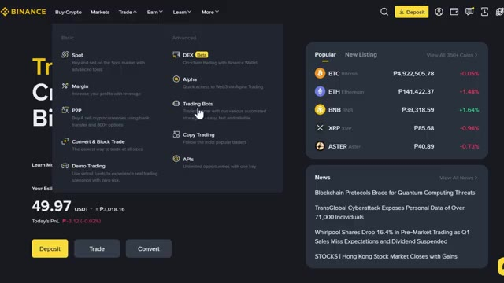
*⏱️ 00:12:22 — Interface principale de Binance affichant le menu déroulant avec les options Spot, Margin, DEX, Trading Bots, Copy Trading et Demo Trading.*

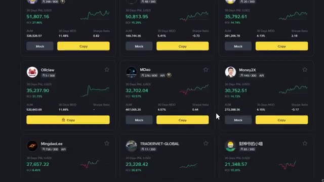
*⏱️ 00:12:28 — Interface de copy trading de Binance présentant une liste de traders expérimentés avec leurs performances, PNL et boutons de copie.*

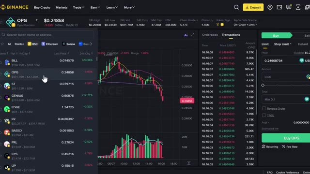
*⏱️ 00:12:34 — Interface de trading Alpha sur Binance montrant les graphiques de prix, le carnet d'ordres et la liste des jetons disponibles.*

---

### ⏱️ `[00:12:40 - 00:13:01]` | Segment #30

**🔊 Audio (Transcription Intégrale Mot pour Mot en Français) :**
> Nous aborderons ces sujets en profondeur dans les prochaines vidéos, alors restez à l'écoute pour cela. Binance n'est pas seulement une plateforme de trading. C'est un écosystème complet. Dans la section Earn, vous pouvez gagner des revenus passifs sur plus de 300 actifs avec des conditions de staking flexibles et verrouillées. Binance propose également des produits d'investissement à rendement avancé si vous souhaitez aller plus loin dans ce domaine.

**👁️ Analyse Visuelle d'Écran (gemini-3.5-flash-lite) :**
**Interface & Outils** : Site web de Binance (plateforme d'échange de cryptomonnaies).

**Contenu textuel & Code** : Soldes de comptes (49.97 USDT), listes de cryptomonnaies populaires avec variations (BTC, ETH, BNB, XRP, ASTER), section "Principal-protected Products" avec les taux d'APR (ex: USDC à 5.56%, USDT à 1.93% - 25%, ETH à 1.4% - 2.48%, WIF à 10.26%) et options de durée (Flexible/Locked).

**Action / Démonstration** : Navigation sur la plateforme Binance, présentation de l'interface d'accueil et de la section Earn pour le staking et les revenus passifs.

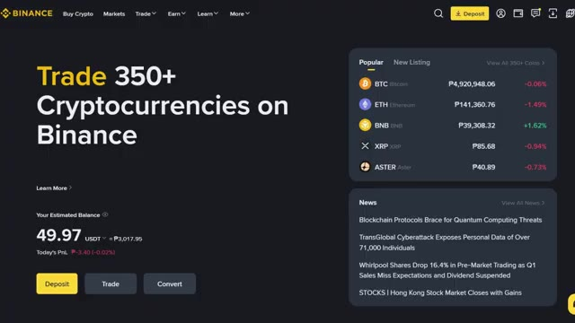
*⏱️ 00:12:45 — Capture d'écran de l'interface principale de la plateforme Binance affichant le solde estimé, les options de trading et les cryptomonnaies populaires.*

*⏱️ 00:12:50 — Capture d'écran de la section "Earn" de Binance montrant les produits protégés en capital (Principal-protected Products) avec les taux d'APR pour différents actifs comme USDC, USDT, ETH et WIF.*

---

### ⏱️ `[00:13:02 - 00:13:21]` | Segment #31

**🔊 Audio (Transcription Intégrale Mot pour Mot en Français) :**
> Il y a aussi une section Apprendre où vous pouvez apprendre comment fonctionne la cryptographie, comment fonctionne la blockchain, et tout le reste. Vous pouvez lire leurs blogs, et ils ont également une section de recherche de niveau institutionnel avec des analyses de marché approfondies et des perspectives. Très utile si vous voulez comprendre ce qui se passe sur le marché.

**👁️ Analyse Visuelle d'Écran (gemini-3.5-flash-lite) :**
**Interface & Outils** : Interface web de la plateforme Binance (sections Learn, Blog et Research).

**Contenu textuel & Code** : Articles éducatifs, rapports de recherche macroéconomique, analyses de marché et actualités de la plateforme.

**Action / Démonstration** : Navigation à travers les sections d'apprentissage, de blogs et de recherche institutionnelle de la plateforme.

*⏱️ 00:13:07 — Capture d'écran montrant une section d'apprentissage de plateforme crypto avec des modules explicatifs comme 'What Is Sonic (S)?'.*

*⏱️ 00:13:12 — Capture d'écran montrant une section de blog avec divers articles communautaires et annonces.*

*⏱️ 00:13:16 — Capture d'écran montrant une section de recherche institutionnelle 'Binance Research' avec des rapports d'analyse de marché récents.*

---

### ⏱️ `[00:13:22 - 00:13:51]` | Segment #32

**🔊 Audio (Transcription Intégrale Mot pour Mot en Français) :**
> Et lorsque vous cliquez sur plus dans la navigation, vous trouverez encore plus de fonctionnalités. Launchpool est l'endroit où vous pouvez staker des BNB ou d'autres tokens pour gagner de nouveaux airdrops de tokens avant même qu'ils ne soient listés sur l'échange. MegaDrop vous permet de bloquer des BNB et de compléter des quêtes Web3 pour obtenir un accès anticipé à de nouveaux projets. Il y a aussi des pools de minage, des prêts, une place de marché NFT, et un accès au Web3 via le portefeuille Binance, un portefeuille auto-gouverné intégré directement dans la plateforme pour la DeFi et les swaps inter-chaînes.

**👁️ Analyse Visuelle d'Écran (gemini-3.5-flash-lite) :**
**Interface & Outils** : Site web de l'échange de cryptomonnaies Binance.

**Contenu textuel & Code** : Menus de navigation, rubriques Launchpool, Megadrop, et sections de staking de tokens.

**Action / Démonstration** : Navigation à travers les menus de l'échange pour présenter les fonctionnalités de staking et d'airdrops.

*⏱️ 00:13:29 — Interface de Binance montrant la section Launchpool et les projets terminés.*

*⏱️ 00:13:37 — Page d'accueil de Binance Megadrop dédiée aux airdrops de tokens.*

*⏱️ 00:13:44 — Menu déroulant "More" sur le site de Binance affichant diverses fonctionnalités dont Launchpool et Megadrop.*

---

### ⏱️ `[00:13:52 - 00:14:14]` | Segment #33

**🔊 Audio (Transcription Intégrale Mot pour Mot en Français) :**
> Et vous pouvez également accéder directement à l'écosystème de la BNB chain à partir d'ici. C'est honnêtement l'une des plateformes les plus complètes de tout l'espace crypto. Avant de conclure, voici les règles essentielles que vous devez suivre en matière de trading. Commencez avec de petites tailles de position. Ne risquez pas plus de deux à cinq pour cent de votre capital sur un seul trade. Utilisez toujours un stop loss. C'est non négociable.

**👁️ Analyse Visuelle d'Écran (gemini-3.5-flash-lite) :**
**Interface & Outils** : Site web BNB Chain, Plateforme d'échange de cryptomonnaies Binance (interface de trading spot/marge).

**Contenu textuel & Code** : Graphique en chandeliers de BTC/USDT (prix autour de 81 353$), moyennes mobiles (MA7, MA25, MA99), carnet d'ordres, liste de paires de trading et tableau des positions ouvertes.

**Action / Démonstration** : Navigation sur l'écosystème de la BNB Chain puis transition vers l'interface de trading de Binance pour montrer des exemples de positions et de gestion du risque.

*⏱️ 00:13:57 — Capture d'écran montrant le site Web de la BNB Chain avec des catégories de solutions (Stablecoin, Real World Assets, Memecoin).*

*⏱️ 00:14:03 — Interface de trading de la plateforme Binance affichant le graphique journalier de la paire BTC/USDT avec les moyennes mobiles, le carnet d'ordres et la liste des marchés.*

*⏱️ 00:14:08 — Vue détaillée du terminal de trading Binance montrant le panneau d'exécution des ordres et le tableau des positions ouvertes avec les détails du PnL.*

---

### ⏱️ `[00:14:14 - 00:14:35]` | Segment #34

**🔊 Audio (Transcription Intégrale Mot pour Mot en Français) :**
> N'ouvrez jamais un trade sans y veiller. Tenez un journal de trading. Notez chaque trade, votre entrée, votre sortie, votre raisonnement. C'est ainsi que vous vous améliorez réellement et ne risquez jamais plus que ce que vous pouvez vous permettre de perdre. Le trading est une compétence qui peut vous offrir une réelle liberté financière, mais cela demande de la répression et de la discipline pour y parvenir. Commencez lentement, restez régulier, et les résultats viendront.

**👁️ Analyse Visuelle d'Écran (gemini-3.5-flash-lite) :**
**Interface & Outils** : Stonk Journal et plateforme d'échange de cryptomonnaies Binance.

**Contenu textuel & Code** : Historique de trades (dates, symboles BTC/SOL, statuts WIN, prix d'entrée/sortie, retours en pourcentage) sur l'image 1 ; graphique des prix du Bitcoin, indicateurs techniques (moyennes mobiles MA), carnet d'ordres et boutons d'achat/vente (Market Buy/Sell) sur l'image 2.

**Action / Démonstration** : Présentation d'un outil de suivi et de journalisation des performances de trading, suivie d'une démonstration sur l'interface d'un exchange.

*⏱️ 00:14:19 — Interface d'un journal de trading personnel (« Stonk Journal ») affichant l'historique des positions, les symboles, les prix d'entrée et de sortie ainsi que les rendements.*

*⏱️ 00:14:30 — Interface de la plateforme de trading Binance montrant un graphique en chandeliers du BTC/USDT, le carnet d'ordres et les options d'achat/vente.*

---

### ⏱️ `[00:14:36 - 00:15:09]` | Segment #35

**🔊 Audio (Transcription Intégrale Mot pour Mot en Français) :**
> Très bien, c'est tout ce que vous devez savoir pour commencer sur Binance. Commencez petit, concentrez-vous sur l'apprentissage et ne courez pas après les profits au début. Si vous êtes prêt à commencer, utilisez le lien dans la description. Il active votre pack de bonus exclusif, incluant jusqu'à 100 dollars de récompenses d'inscription, ainsi que vos bons pour les tokens WCT et H-U-M-A dans le centre de récompenses. Ceux-ci ne sont disponibles que via mon lien, alors assurez-vous de l'utiliser. Je mettrai également en ligne d'autres tutoriels Binance couvrant le copy trading, les stratégies de spot trading et des configurations de futures plus avancées. Assurez-vous donc de vous abonner et d'activer

**👁️ Analyse Visuelle d'Écran (gemini-3.5-flash-lite) :**
**Interface & Outils** : Plateforme d'échange de cryptomonnaies Binance (interface de trading et pages web du programme de parrainage/récompenses).

**Contenu textuel & Code** : Paires de trading BTC/USDT, prix d'entrée, gestion des ordres TP/SL, et offres de bons de tokens échangeables contre des points.

**Action / Démonstration** : Navigation sur la plateforme Binance et présentation des fonctionnalités de trading et des bonus d'inscription.

*⏱️ 00:14:44 — Interface de trading de Binance affichant une position ouverte sur BTC/USDT avec une fenêtre modale de configuration TP/SL.*

*⏱️ 00:14:52 — Page du centre de récompenses (Rewards Hub) de Binance montrant différents bons de tokens (HUMA, WCT).*

*⏱️ 00:15:00 — Page d'inscription officielle de Binance affichant une offre de bonus de bienvenue ("Up to 100 USD Sign Up Rewards").*

---

### ⏱️ `[00:15:09 - 00:15:12]` | Segment #36

**🔊 Audio (Transcription Intégrale Mot pour Mot en Français) :**
> la cloche de notification pour ne pas les rater. Et je vous vois dans la prochaine vidéo.

**👁️ Analyse Visuelle d'Écran (gemini-3.5-flash-lite) :**
**Interface & Outils** : Interface web d'échange de cryptomonnaies (type Binance) avec graphique TradingView intégré, carnet d'ordres et panneau d'exécution d'ordres.

**Contenu textuel & Code** : Graphique journalier (1D) de BTC/USDT, moyennes mobiles (MA 7, MA 25, MA 99), carnets d'ordres en temps réel, volumes de transactions et options de trading sur marge (Spot, Cross, Isolated).

**Action / Démonstration** : Navigation et présentation de l'interface de trading de la plateforme avec les différents modules d'analyse technique et de passage d'ordres.

*⏱️ 00:15:10 — Interface de trading d'une plateforme d'échange affichant un graphique en chandeliers japonais pour la paire BTC/USDT, avec le carnet d'ordres à gauche et la liste des paires à droite.*

*⏱️ 00:15:10 — Vue détaillée de l'interface de passage d'ordres en mode isolé (Isolated) avec les boutons d'achat et de vente en cryptomonnaies ainsi que le panneau des positions ouvertes en bas.*

---

