# 🎬 I Found the 3 BEST Prediction Market Strategies to Print Daily

> **Chaîne** : [Alex Carter](https://www.youtube.com/@AlexCarterTrading)  
> **Lien YouTube** : [https://www.youtube.com/watch?v=k6dz6s5gJ2A](https://www.youtube.com/watch?v=k6dz6s5gJ2A)  
> **Date de publication** : 20260508  
> **Durée** : 00:08:24  
> **Identifiant vidéo** : `k6dz6s5gJ2A`  
> **Transcription & Analyse** : `whisper-v3-large-turbo+gemini-3.5-flash-lite`  

---

## 📌 Synthèse Exécutive & Outils

### 💡 Résumé

Cette vidéo aborde l'exploitation des marchés de prédiction décentralisés, notamment Polymarket, en rejetant l'approche ludique au profit d'une méthodologie de trading quantitatif rigoureuse. L'analyse démontre que l'optimisation du rendement repose sur l'exploitation des inefficacités structurelles, le swing trading dynamique en cours d'événement et l'automatisation par le copy trading sélectif. Loin d'être un simple jeu de hasard, le marché de prédiction offre des fenêtres d'opportunités mathématiques exploitables pour tout opérateur doté d'une discipline de fer et d'une gestion de bankroll stricte.

La démonstration s'appuie sur des cas concrets, illustrant comment neutraliser le risque par l'arbitrage inter-plateforme (entre Polymarket et Caldhsé), exploiter les variations de momentum en direct lors d'événements sportifs (comme un match NBA entre Lakers et Rockets), et filtrer algorithmiquement les meilleurs opérateurs pour du copy trading passif. L'objectif est d'institutionnaliser la démarche du trader particulier en transformant des anomalies de prix à court terme en flux de profits quotidiens récurrents et scalables.

### 🛠️ Outils, Modèles & Logiciels Présentés

* **Polymarket** : Plateforme de prédiction décentralisée majeure fonctionnant sur le réseau Polygon avec l'USDC comme monnaie de règlement.
* **Cal/Calshé** : Marché de prédiction concurrent utilisé pour identifier et exploiter des inefficacités de prix inter-plateformes (arbitrage).
* **TradeFox** : Outil de copy trading spécialisé dans les marchés de prédiction, permettant de filtrer les portefeuilles rentables et de répliquer automatiquement leurs ordres.
* **Metamask, Phantom, OKEx Wallet, Coinbase Wallet & Wallet Connect** : Portefeuilles Web3 indispensables pour interagir avec l'écosystème décentralisé de Polymarket.
* **Claude Code** : Mentionné dans l'univers d'Alex Carter comme assistant d'IA pour le développement de scripts et l'analyse quantitative de données de marché.
* **Pine Script** : Langage de programmation natif de TradingView utilisé pour concevoir des indicateurs techniques et des algorithmes de backtesting.
* **Grok Bots** : Agents conversationnels et de veille basés sur l'IA pour capter le sentiment de marché en temps réel et optimiser l'exécution.
* **TradingView** : Plateforme de graphisme avancée pour l'analyse des prix, du volume et du momentum des actifs financiers et cryptographiques.

### 🔑 Points Clés & Enseignements Stratégiques

* **Arbitrage inter-marchés à risque nul** : Exploiter les écarts de cotation entre Polymarket et une plateforme concurrente (ex: Calshé) en achetant les deux issues complémentaires lorsque la somme des probabilités est strictement inférieure à 1 (ex: 18¢ + 81¢ = 99¢), garantissant un profit mathématique net.
* **Gestion du capital pour l'arbitrage** : Nécessite une bankroll plus conséquente pour absorber les exigences de marge sur plusieurs plateformes tout en sécurisant des gains quotidiens constants (ex: 24 $ à 455 $ de profit garanti selon l'issue).
* **Swing trading en direct (Live Price Inflation)** : Analyser la dynamique d'un événement en temps réel (comme un match de basket) pour identifier des cotes sous-évaluées (ex: des actions de trading à 46¢) lors d'un passage à vide d'une équipe.
* **Flexibilité de sortie anticipée** : Profiter de la liquidité des marchés de prédiction pour revendre une position gagnante en cours de partie (lorsque les cotes remontent à 66¢) sans être contraint d'attendre le résultat final de l'événement.
* **Sélection rigoureuse pour le Copy Trading** : Éviter absolument les traders à haute fréquence dont le volume de transactions excessif (ex: > 5 000 trades/mois) dilue le capital et ralentit les exécutions.
* **Profil type du portefeuille idéal** : Cibler des opérateurs à basse fréquence affichant un taux de réussite élevé (ex: 87 %) et une forte conviction sur un nombre restreint de marchés.
* **Automatisation passive via TradeFox** : Connecter son capital à un portefeuille filtré pour répliquer en temps réel et sans intervention humaine les prises de position des meilleurs parieurs du réseau.
* **Sécurité des réseaux et ponts cryptographiques** : Veiller scrupuleusement à l'adéquation des réseaux (Polygon, Ethereum, Solana, BSC, Base) lors des transferts d'USDC sous peine de perte définitive des fonds.
* **Maîtrise du Risk Management** : Définir strictement la taille des positions et le montant investi par trade automatisé pour lisser la variance et préserver la bankroll sur le long terme.

---

## ⏱️ Chronologie & Transcription Complète Audio & Visuelle (Mot pour Mot)

### ⏱️ `[00:00:00 - 00:00:23]` | Segment #01

**🔊 Audio (Transcription Intégrale Mot pour Mot en Français) :**
> Dans cette vidéo, je vais vous montrer les trois stratégies de marchés de prédiction qui fonctionnent réellement en ce moment sur Polymarket. Parce que regardez, la plupart des gens qui traitent ça comme un jeu de hasard vont perdre sur le long terme. Mais si vous mettez en œuvre ces trois stratégies avec une discipline adéquate et une bonne gestion de bankroll, vous allez être rentable. Cette vidéo sera courte, concise, actionnable. C'est parti.

**👁️ Analyse Visuelle d'Écran (gemini-3.5-flash-lite) :**
**Interface & Outils** : Polymarket et Kalshi (plateformes de marchés de prédiction)

**Contenu textuel & Code** : Graphiques d'évolution des probabilités (en pourcentage), volumes de transaction ($6.06M, $19.9M, $427M), carnets d'ordres (Order Book), prix d'achat/vente pour des paris 'Yes' ou 'No'.

**Action / Démonstration** : Navigation et présentation des marchés de prédiction et de leurs interfaces de trading.

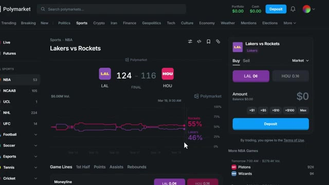
*⏱️ 00:00:06 — Capture d'écran de l'interface Polymarket montrant le marché sportif 'Lakers vs Rockets' avec un graphique de probabilités et le carnet de commandes.*

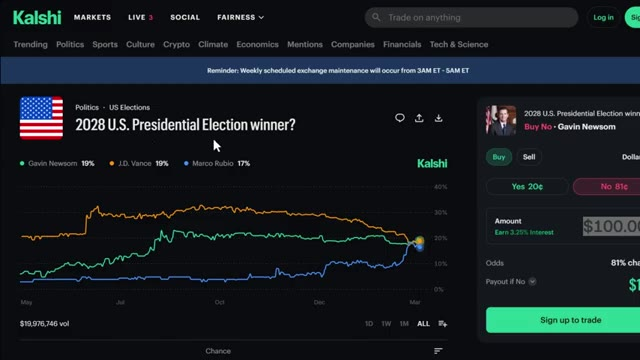
*⏱️ 00:00:11 — Capture d'écran de la plateforme Kalshi montrant le marché de prédiction politique '2028 U.S. Presidential Election winner?' avec des graphiques d'évolution des probabilités.*

*⏱️ 00:00:17 — Capture d'écran détaillée de Polymarket pour le marché 'Presidential Election Winner 2028' affichant les pourcentages des candidats (JD Vance à 21 %, Gavin Newsom à 18 %) et le panneau de trading.*

---

### ⏱️ `[00:00:23 - 00:00:48]` | Segment #02

**🔊 Audio (Transcription Intégrale Mot pour Mot en Français) :**
> Très bien, installons-nous sur Polymarket. D'abord, cliquez sur le lien dans la description ci-dessous. Cela vous mènera directement à la page d'inscription de Polymarket. Vous verrez que vous pouvez continuer en utilisant votre compte Google ou en utilisant une autre adresse e-mail. Vous verrez également l'option de connecter votre portefeuille. Polymarket est une plateforme décentralisée, vous aurez donc besoin d'un portefeuille Web3 comme Metamask, Phantom, OKEx Wallet, Coinbase Wallet ou Wallet Connect.

**👁️ Analyse Visuelle d'Écran (gemini-3.5-flash-lite) :**
**Interface & Outils** : Site web de la plateforme Polymarket et interface d'inscription/connexion.

**Contenu textuel & Code** : Liste des marchés de prédiction populaires (politique, sport, crypto, actualités) avec pourcentages de probabilité et volumes d'échange.

**Action / Démonstration** : Navigation sur la page d'accueil de Polymarket puis affichage de la fenêtre contextuelle d'authentification et de création de compte.

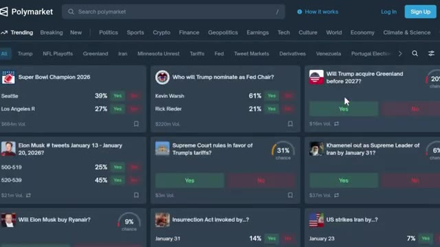
*⏱️ 00:00:29 — Page d'accueil de la plateforme de prédiction Polymarket affichant divers marchés tendance.*

*⏱️ 00:00:35 — Fenêtre modale d'inscription sur Polymarket avec options de connexion par Google, e-mail ou portefeuilles Web3.*

---

### ⏱️ `[00:00:48 - 00:01:08]` | Segment #03

**🔊 Audio (Transcription Intégrale Mot pour Mot en Français) :**
> Pour ce tutoriel, je m'inscris en utilisant mon compte Google parce que c'est le moyen le plus rapide. Après cela, vous serez redirigé vers le tableau de bord de Polymarket. Il faut déposer des fonds. En haut à droite, cliquez sur déposer. Polymarket fonctionne sur le réseau Polygon et utilise l'USDC comme monnaie principale. Vous avez quatre options ici.

**👁️ Analyse Visuelle d'Écran (gemini-3.5-flash-lite) :**
**Interface & Outils** : Site web de Polymarket (marchés de prédiction).

**Contenu textuel & Code** : Interface utilisateur avec les différents marchés de prédiction et options de dépôt de fonds.

**Action / Démonstration** : Navigation sur le tableau de bord de Polymarket et ouverture de la fenêtre de dépôt de fonds.

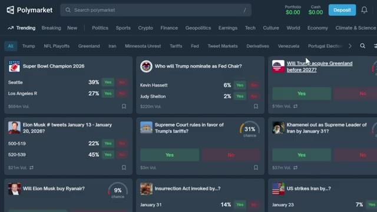
*⏱️ 00:00:53 — Tableau de bord principal de Polymarket affichant divers marchés de prédiction et le bouton de dépôt en haut à droite.*

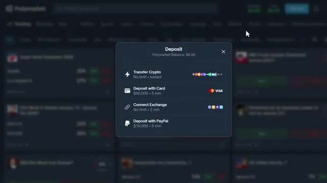
*⏱️ 00:01:03 — Fenêtre modale de dépôt sur Polymarket montrant les différentes options de financement (crypto, carte bancaire, échange, PayPal).*

---

### ⏱️ `[00:01:08 - 00:01:40]` | Segment #04

**🔊 Audio (Transcription Intégrale Mot pour Mot en Français) :**
> Transférer des cryptos, déposer par carte, connecter un échange et déposer avec PayPal. Si vous avez déjà des cryptos dans un autre portefeuille ou échange, vous pouvez les transférer directement ou les transférer via un pont depuis une autre chaîne. Commencez par sélectionner votre jeton. Vous verrez des jetons pris en charge tels que USDC, ARB, BNB, BTCB, Binance, USD et plus encore. Ensuite, choisissez le réseau. Les réseaux disponibles incluent Ethereum, Solana, BSC, Base, Polygon et d'autres. C'est crucial. Assurez-vous

**👁️ Analyse Visuelle d'Écran (gemini-3.5-flash-lite) :**
**Interface & Outils** : Polymarket (site web)

**Contenu textuel & Code** : Fenêtre de dépôt affichant les options : Transfer Crypto (sans limite), Deposit with Card (limite de 50 000 $), Connect Exchange et Deposit with PayPal (limite de 10 000 $).

**Action / Démonstration** : Le curseur de la souris survole l'option de dépôt par PayPal sur la plateforme de prédiction.

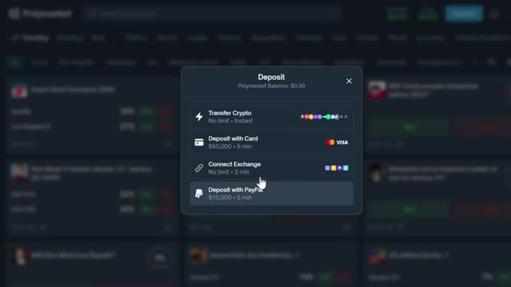
*⏱️ 00:01:16 — Interface de la plateforme montrant la fenêtre pop-up de dépôt avec les différentes options disponibles.*

---

### ⏱️ `[00:01:40 - 00:02:13]` | Segment #05

**🔊 Audio (Transcription Intégrale Mot pour Mot en Français) :**
> que le réseau que vous sélectionnez correspond au réseau à partir duquel vous envoyez. Si vous envoyez de l'USDC sur Ethereum mais sélectionnez Polygon, vos fonds seront perdus pour toujours. Une fois sélectionné, scannez le code QR ou copiez l'adresse du portefeuille à l'aide du bouton de copie pour éviter les erreurs, puis collez-la dans votre portefeuille ou votre échange. Les fonds arrivent généralement en quelques minutes. Au fait, si vous vous inscrivez en utilisant mon lien dans la description, vous pouvez gagner 10 dollars lorsque votre filleul effectue son premier dépôt. Et il y a des récompenses de primes qui vont jusqu'à 1 000 dollars. Les liens sont en bas. Maintenant, laissez-moi vous montrer les stratégies exactes

**👁️ Analyse Visuelle d'Écran (gemini-3.5-flash-lite) :**
**Interface & Outils** : Polymarket, Bitunix

**Contenu textuel & Code** : Adresse de portefeuille, code QR, sélection de réseau (Solana), montants en USDC et frais de transaction (0.8 USDC).
[DESC_IMAGE_3] Visualisation du processus de dépôt et de confirmation de retrait de crypto-monnaie sur des plateformes de marché et d'échange.

**Action / Démonstration** : Explications face caméra et analyse conceptuelle des marchés.

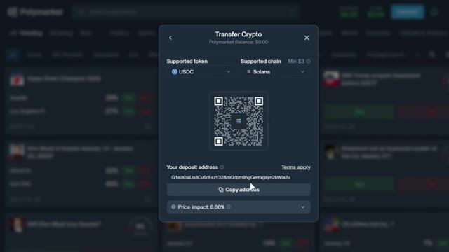
*⏱️ 00:01:48 — Interface Polymarket affichant une fenêtre de transfert de crypto avec un code QR et l'adresse de dépôt pour l'USDC sur Solana.*

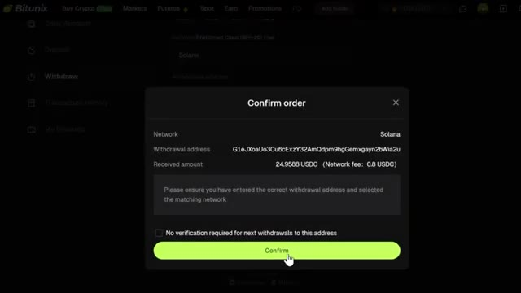
*⏱️ 00:01:56 — Interface Bitunix affichant une fenêtre de confirmation de retrait pour l'USDC via le réseau Solana avec les frais de réseau associés.*

---

### ⏱️ `[00:02:13 - 00:02:32]` | Segment #06

**🔊 Audio (Transcription Intégrale Mot pour Mot en Français) :**
> J'utilise. Ce sont les trois méthodes qui fonctionnent en ce moment. Et n'importe qui peut les utiliser. Maintenant, si vous voulez faire des profits fous grâce à cette première stratégie, vous aurez peut-être besoin d'une bankroll légèrement plus importante. Mais c'est l'une des plus hautes probabilités de gagner de l'argent. Et je ne dis pas cela avec un visage sérieux très souvent. La stratégie numéro un est l'arbitrage.

**👁️ Analyse Visuelle d'Écran (gemini-3.5-flash-lite) :**
**Interface & Outils** : Polymarket (Plateforme de marchés de prédiction décentralisée)

**Contenu textuel & Code** : Marchés affichés : '2026 NCAA Tournament Winner', 'BTC 5 Minute Up or Down' (avec 53% Up, volume et statut LIVE), 'How many Fed rate cuts in 2026?', 'US forces enter Iran by...?', 'Will the US confirm that aliens exist before 2027?', etc.

**Action / Démonstration** : Navigation et présentation des différents marchés de prédiction disponibles sur la plateforme.

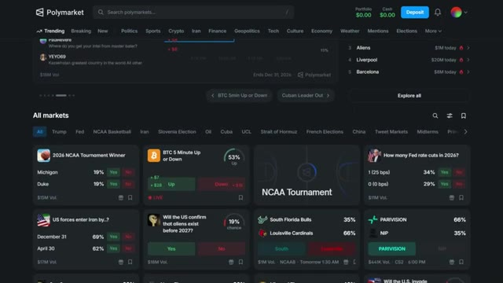
*⏱️ 00:02:18 — Capture d'écran de la plateforme Polymarket affichant divers marchés de prédiction avec des pourcentages de probabilité et des volumes de交易.*

---

### ⏱️ `[00:02:32 - 00:03:11]` | Segment #07

**🔊 Audio (Transcription Intégrale Mot pour Mot en Français) :**
> Voici l'idée. Vous prenez les inefficacités de prix entre deux marchés distincts, Polymarket et Calci par exemple, et vous pariez sur les deux côtés d'une manière qui vous garantit un profit peu importe ce qui se passe. Laissez-moi vous montrer un exemple réel. Sur Polymarket, Gavin Newsom s'échange autour de 18 centimes sur le oui. Si vous misez 100 dollars sur le oui, cela vous rapporte 555 dollars. Cela fait 455 dollars de profit garanti de ce côté-là. Maintenant, allez sur CalSHE sur exactement le même marché. Le non s'échange à 81 centimes. Vous misez 100 dollars sur le non, cela vous rapporte 124 dollars. Alors mettons cela sur

**👁️ Analyse Visuelle d'Écran (gemini-3.5-flash-lite) :**
**Interface & Outils** : Plateformes de marchés de prédiction en ligne (Kalshi et Polymarket)

**Contenu textuel & Code** : Cotes de prédiction, graphiques d'évolution des probabilités, montants de transaction et carnets d'ordres pour des paris politiques.

**Action / Démonstration** : Comparaison des prix et des probabilités entre deux marchés distincts (Kalshi et Polymarket) pour identifier des opportunités d'arbitrage.

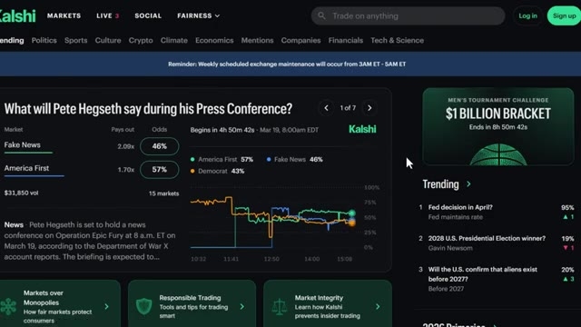
*⏱️ 00:02:42 — Interface de la plateforme Kalshi montrant un marché de prédiction lié à une conférence de presse.*

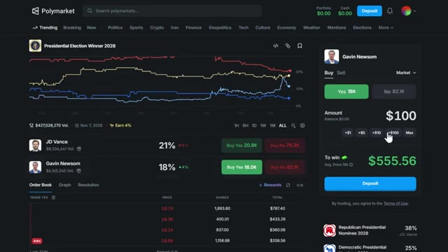
*⏱️ 00:02:51 — Interface de la plateforme Polymarket affichant le marché des vainqueurs de l'élection présidentielle de 2028 avec Gavin Newsom et JD Vance.*

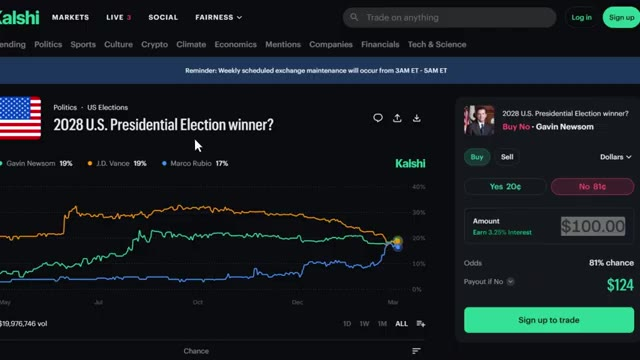
*⏱️ 00:03:01 — Interface de la plateforme Kalshi montrant le marché sur le vainqueur de l'élection présidentielle américaine de 2028 et les cotes associées.*

---

### ⏱️ `[00:03:11 - 00:03:43]` | Segment #08

**🔊 Audio (Transcription Intégrale Mot pour Mot en Français) :**
> papier. Sur CalShe, vous risquez 100 dollars. Vous récupérez 124 dollars sur le non à 81 %. Sur Polymarket, vous risquez 100 dollars. Vous récupérez 555 dollars sur le oui à 18 %. Quoi qu'il arrive, vous êtes bénéficiaire. Soit 24 dollars sur le non, soit 455 dollars sur le oui garantis. La raison pour laquelle cela existe, 18 plus 81 font seulement 99 centimes. Cela n'atteint pas un dollar. Cet écart d'un centime, c'est votre avantage. Et regardez, c'est ennuyeux. Il n'y a aucun frisson à

**👁️ Analyse Visuelle d'Écran (gemini-3.5-flash-lite) :**
**Interface & Outils** : Google Docs

**Contenu textuel & Code** : Texte montrant '2028 US PRESIDENTIAL WINNER', 'KALSHI: NO AT 81 CENTS, BET $100, RETURN IS $124, PROFIT IS $24', et 'POLYMARKET: YES AT 18 CENTS, BET $100, RETURN IS $555, PROFIT IS $455'.

**Action / Démonstration** : Présentation textuelle des calculs d'arbitrage et de profit garanti sur les marchés de prédiction.

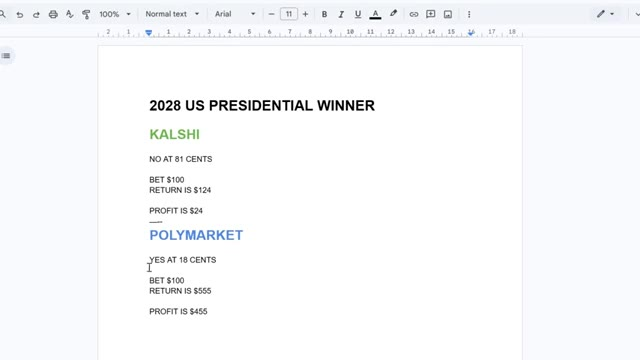
*⏱️ 00:03:19 — Document Google Docs affichant les détails de l'arbitrage pour l'élection présidentielle américaine de 2028 entre Kalshi et Polymarket.*

---

### ⏱️ `[00:03:43 - 00:04:03]` | Segment #09

**🔊 Audio (Transcription Intégrale Mot pour Mot en Français) :**
> mais vous vous garantissez un profit. J'ai vu des gens gagner 66 $, 98 $, 343 $ par jour, simplement en faisant cela régulièrement. Sur quatre jours, 500 $ sans aucun risque. Beaucoup de gens adoreraient ça. Maintenant, la prochaine méthode va demander un peu plus de compétence et de précision, mais le potentiel de gain est insensé.

**👁️ Analyse Visuelle d'Écran (gemini-3.5-flash-lite) :**
**Interface & Outils** : Plateforme de marchés prédictifs Polymarket (interface web)

**Contenu textuel & Code** : Listes de marchés de prédiction (élections, sports, actualités), cotes en pourcentage, volumes de transactions et options d'achat/vente (Buy Yes / Buy No).

**Action / Démonstration** : Navigation et consultation des différents marchés de prédiction disponibles sur la plateforme Polymarket.

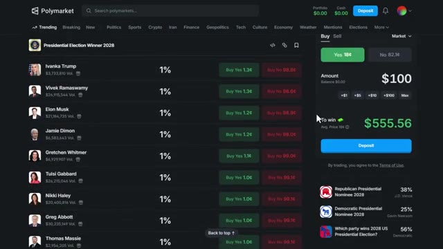
*⏱️ 00:03:48 — Interface de la plateforme Polymarket montrant le marché prédictif de l'élection présidentielle de 2028, avec un panneau de pari latéral affichant une mise de 100 $ pour un gain potentiel de 555,56 $.*

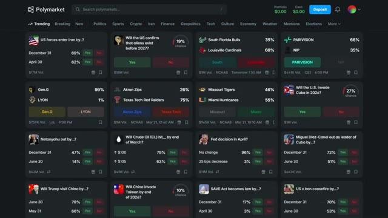
*⏱️ 00:03:53 — Vue d'ensemble de la page d'accueil de Polymarket présentant différents marchés de prédiction tendance (politique, sport, géopolitique, économie).*

---

### ⏱️ `[00:04:04 - 00:04:27]` | Segment #10

**🔊 Audio (Transcription Intégrale Mot pour Mot en Français) :**
> Laissez-moi vous montrer exactement comment cela fonctionne. La deuxième stratégie est l'inflation abusive des prix en direct. Celle-ci demande plus d'attention et de pratique, mais les retours peuvent être massifs. L'idée est simple. Vous regardez un événement en direct, vous identifiez les fluctuations de dynamique et vous faites du swing trading sur les cotes en temps réel. Laissez-moi vous montrer un exemple réel. Le match d'hier soir entre les Lakers et les Rockets, quand les Lakers étaient menés et que le marché donnait les Lakers à 0,46 $.

**👁️ Analyse Visuelle d'Écran (gemini-3.5-flash-lite) :**
**Interface & Outils** : Polymarket (plateforme de marchés prédictifs)

**Contenu textuel & Code** : Liste des événements en direct (Dota 2, Valorant) avec les cotes pour chaque équipe (ex: Team Essence à 35¢, InterActive Philippines à 72¢), volume des paris, et module de passage d'ordre.

**Action / Démonstration** : Navigation et sélection d'un événement sportif en direct pour observer les fluctuations de prix.

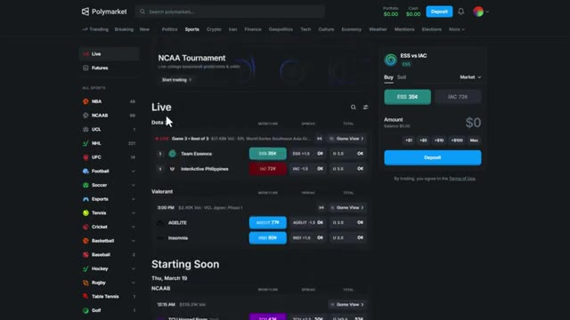
*⏱️ 00:04:09 — Capture d'écran de la plateforme Polymarket montrant les marchés de paris en direct sur le sport et l'esport, avec les cotes en temps réel et le panneau de trading à droite.*

---

### ⏱️ `[00:04:28 - 00:04:49]` | Segment #11

**🔊 Audio (Transcription Intégrale Mot pour Mot en Français) :**
> Si vous placez un ordre limite, vous seriez exécuté juste autour de là. Mais voici la partie magnifique. Les Rockets étaient à 0,55 $ à ce moment-là. Vous détenez donc déjà les deux côtés pour un total combiné de 0,101 $, ce qui signifie que l'un d'eux est mal évalué en votre faveur. Au fur et à mesure que le match avançait et que les Lakers ont commencé à remonter, la cote des Lakers est remontée pour atteindre environ 0,66 $.

**👁️ Analyse Visuelle d'Écran (gemini-3.5-flash-lite) :**
**Interface & Outils** : Polymarket (plateforme de marchés prédictifs)

**Contenu textuel & Code** : Scores du match Lakers (124) vs Rockets (116) avec les pourcentages de probabilité (Rockets 55%, Lakers 46%) et le panneau d'achat/vente.

**Action / Démonstration** : Visualisation des cotes de paris sportifs et des pourcentages de probabilité du marché sur Polymarket.

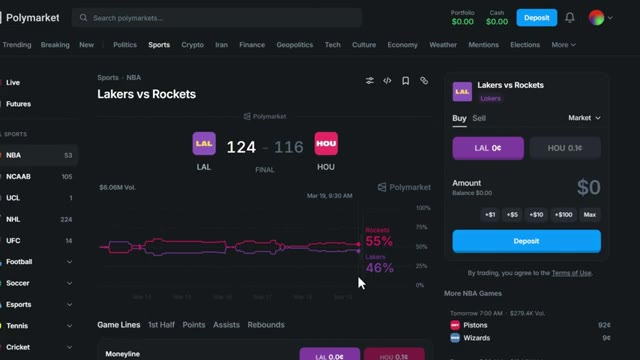
*⏱️ 00:04:33 — Capture d'écran de l'interface Polymarket affichant le match Lakers vs Rockets avec un graphique des cotes et le panneau de trading à droite.*

---

### ⏱️ `[00:04:49 - 00:05:08]` | Segment #12

**🔊 Audio (Transcription Intégrale Mot pour Mot en Français) :**
> C'est déjà un retour sur investissement solide sur votre mise de 0,46 $, et vous pouvez vendre cette position dès maintenant. Vous n'avez pas à attendre le résultat final. Vous vendez la position des Lakers, vous sécurisez votre profit, et vous conservez toujours votre position sur les Rockets si vous pensez qu'ils vont renverser la vapeur. La beauté des marchés de prédiction, c'est que vous pouvez vendre votre position à tout moment.

**👁️ Analyse Visuelle d'Écran (gemini-3.5-flash-lite) :**
**Interface & Outils** : Polymarket (site web de marchés de prédiction)

**Contenu textuel & Code** : Score du match Lakers (124) vs Rockets (116) avec la mention "FINAL", graphique d'évolution des probabilités affichant Lakers 66% et Rockets 34%, et panneau de commande Buy/Sell pour LAL et HOU.

**Action / Démonstration** : Présentation du marché de prédiction sportive et des pourcentages de probabilité finale sur Polymarket.

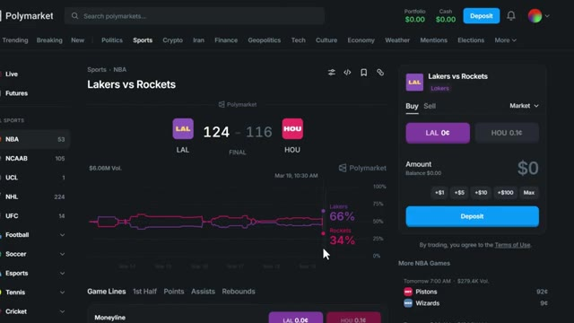
*⏱️ 00:04:54 — Capture d'écran de la plateforme Polymarket montrant le marché du match NBA Lakers vs Rockets avec le score final de 124-116 et le panneau de trading à droite.*

---

### ⏱️ `[00:05:08 - 00:05:28]` | Segment #13

**🔊 Audio (Transcription Intégrale Mot pour Mot en Français) :**
> Tu n'es pas bloqué. Tu peux acheter bas, vendre haut, en cours de partie, exactement comme pour le trading de crypto. Maintenant écoute, celle-ci demande de la pratique. Tu dois regarder le match, ressentir la dynamique. Si une équipe est menée dans le troisième quart-temps à la télévision nationale, il y a de grandes chances qu'elle fasse une remontée. Ces actions à 46 centimes peuvent monter à 70, 75 centimes très rapidement.

**👁️ Analyse Visuelle d'Écran (gemini-3.5-flash-lite) :**
**Interface & Outils** : Interface web de trading de paris sportifs / marchés prédictifs avec menu latéral des sports (NBA, NCAAB, etc.) et panneau de vente d'actions.

**Contenu textuel & Code** : Prix des actions "LAL 99.9¢" vs "HOU 0¢", boutons de pourcentage de position (25%, 50%, Max), bouton violet "Sell Lakers", et liste des matchs du lendemain (Pistons vs Wizards, Magic vs Hornets, Suns vs Spurs) avec volumes associés.

**Action / Démonstration** : Navigation sur la plateforme de marché prédictif et affichage des commentaires d'utilisateurs ainsi que du module de vente de parts sur un match NBA.

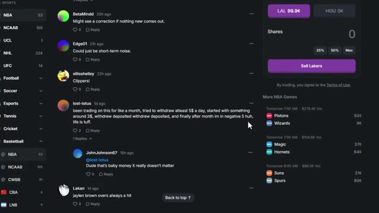
*⏱️ 00:05:13 — Capture d'écran montrant l'interface d'une plateforme de trading de type prédictif/sportif avec un panneau d'échange sur les actions des Lakers, un fil de discussion d'utilisateurs et une liste de matchs NBA à venir dans la barre latérale.*

---

### ⏱️ `[00:05:29 - 00:05:50]` | Segment #14

**🔊 Audio (Transcription Intégrale Mot pour Mot en Français) :**
> Et c'est là que vous prenez votre bénéfice. Il y a des traders qui font cela chaque jour. J'ai vu des gars gagner 44 000 dollars en une seule journée rien qu'en faisant du swing trading sur des prix en direct. C'est une vraie stratégie. Il faut juste du temps pour y devenir bon. Et si vous avez l'impression de ne pas avoir le temps ou l'avantage pour faire cela vous-même, cette troisième stratégie va être parfaite pour vous.

**👁️ Analyse Visuelle d'Écran (gemini-3.5-flash-lite) :**
**Interface & Outils** : Polymarket et Tradefox

**Contenu textuel & Code** : Marchés de prédiction, graphiques de probabilités, classement des meilleurs traders, PnL réalisé et total, pourcentages de ROI et taux de réussite.

**Action / Démonstration** : Navigation et présentation des plateformes de trading et de prédiction.

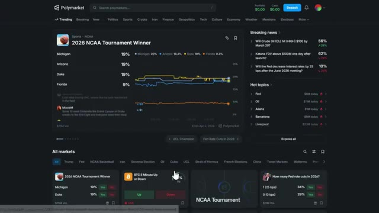
*⏱️ 00:05:34 — Capture d'écran de la plateforme Polymarket montrant les marchés de prédiction et les tendances sportives.*

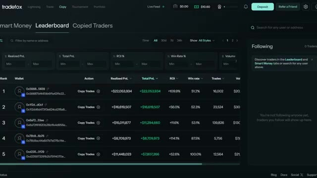
*⏱️ 00:05:44 — Capture d'écran du classement (Leaderboard) de la plateforme Tradefox affichant les performances des traders de smart money et les PnL réalisés.*

---

### ⏱️ `[00:05:50 - 00:06:12]` | Segment #15

**🔊 Audio (Transcription Intégrale Mot pour Mot en Français) :**
> La stratégie numéro trois, c'est le copy trading. Maintenant, faire du copy trading de memecoins dans la crypto ? Pas très rentable, mais le copy trading sur les marchés de prédiction. Si vous choisissez les bons portefeuilles, vous pouvez en vivre. L'outil que j'utilise pour ça, c'est TradeFox. Vous pouvez vous y inscrire juste en bas dans la description. C'est une plateforme de copy trading incroyablement efficace, conçue spécifiquement pour les marchés de prédiction.

**👁️ Analyse Visuelle d'Écran (gemini-3.5-flash-lite) :**
**Interface & Outils** : Plateforme TradeFox (interface web de copy trading)

**Contenu textuel & Code** : Classement (Leaderboard) avec les adresses de portefeuilles (Wallet), le PnL réalisé, le PnL total, le ROI en pourcentage, le taux de réussite (Win rate) et le nombre de trades.

**Action / Démonstration** : Navigation et présentation du classement des traders à copier sur la plateforme TradeFox.

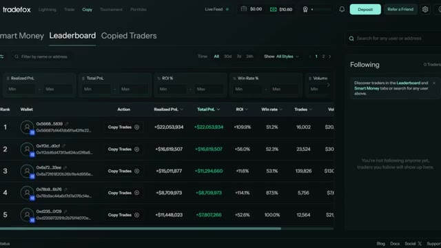
*⏱️ 00:05:56 — Capture d'écran de l'interface de TradeFox montrant le classement (Leaderboard) des meilleurs portefeuilles pour le copy trading de marchés de prédiction.*

---

### ⏱️ `[00:06:12 - 00:06:30]` | Segment #16

**🔊 Audio (Transcription Intégrale Mot pour Mot en Français) :**
> Tu trouves des portefeuilles rentables, tu connectes ton compte, et il reproduit automatiquement leurs trades sur Polymarket pour toi. Maintenant, voici l'élément clé. Tu ne veux pas copier les traders à haute fréquence. Trop de trades signifie que tes exécutions seront lentes et ton capital sera dispersé. Ce que tu veux, c'est un portefeuille à basse fréquence et à fort taux de réussite.

**👁️ Analyse Visuelle d'Écran (gemini-3.5-flash-lite) :**
**Interface & Outils** : Plateforme Web Tradefox (interface de copy trading pour marchés de prédiction / Polymarket).

**Contenu textuel & Code** : Tableaux de statistiques de trading : Realized PnL, Total PnL, ROI %, Win rate %, Trades, Volume, et style de trading (Whale, Active Trader).

**Action / Démonstration** : Navigation et analyse des performances des meilleurs traders sur le leaderboard de Tradefox pour identifier des portefeuilles rentables à copier.

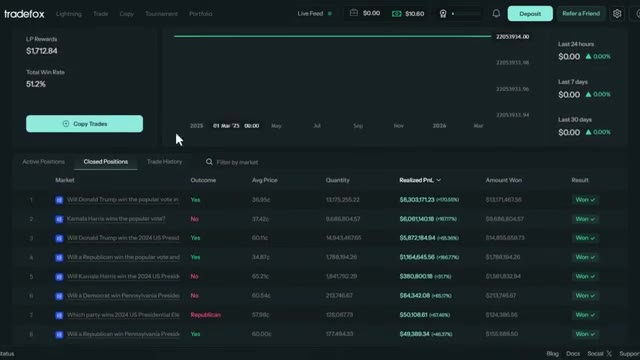
*⏱️ 00:06:17 — Interface Tradefox affichant les détails d'un portefeuille spécifique avec ses positions clôturées, son historique de PnL et un bouton 'Copy Trades'.*

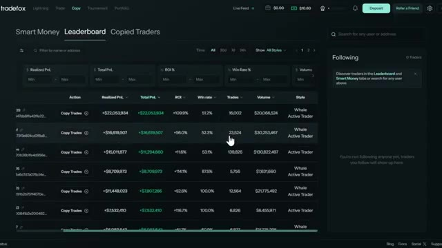
*⏱️ 00:06:21 — Tableau de classement (Leaderboard) de la plateforme Tradefox montrant différents profils de traders, leurs performances (ROI, PnL) et leurs statistiques de trading.*

---

### ⏱️ `[00:06:31 - 00:07:04]` | Segment #17

**🔊 Audio (Transcription Intégrale Mot pour Mot en Français) :**
> Laissez-moi vous montrer comment trouver cela sur TradeFox. Vous pouvez filtrer les portefeuilles par taux de réussite, profit total, nombre de transactions et marchés actifs. C'est exactement ce que vous devez regarder. Triez par taux de réussite et profit total. Et ensuite, regardez le nombre de transactions. Si quelqu'un a un taux de réussite de 87 % mais a effectué plus de 5 000 transactions ce mois-ci, c'est une fréquence trop élevée. Vous voulez quelqu'un qui est sélectif. Le portefeuille de copy trading parfait ressemble à peu près à ceci : faible nombre de transactions, taux de réussite élevé, profits constants semaine après semaine.

**👁️ Analyse Visuelle d'Écran (gemini-3.5-flash-lite) :**
**Interface & Outils** : TradeFox (Plateforme Web de Copy Trading / Analyse de portefeuilles crypto)

**Contenu textuel & Code** : Filtres de recherche avancés (Realized PnL, Total PnL, ROI %, Win Rate % entre 80 et 100, Volume) et tableau listant des portefeuilles avec leurs adresses, boutons "Copy Trades", PnL réalisé, PnL total, ROI, taux de réussite, nombre de trades et volume.

**Action / Démonstration** : Navigation et démonstration des filtres du classement des traders sur la plateforme TradeFox pour identifier les portefeuilles performants.

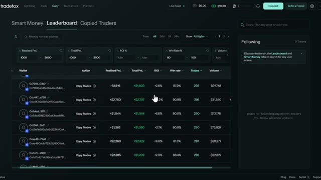
*⏱️ 00:06:39 — Capture d'écran de l'interface TradeFox montrant le classement (Leaderboard) avec des filtres appliqués sur le taux de réussite (Win Rate) et les profits.*

---

### ⏱️ `[00:07:04 - 00:07:37]` | Segment #18

**🔊 Audio (Transcription Intégrale Mot pour Mot en Français) :**
> Quelqu'un qui ne négocie que des configurations à forte conviction et qui ne jette pas simplement de l'argent sur n'importe quel marché. C'est ce que vous recherchez. Pas quelqu'un qui négocie 50 marchés par jour. Quelqu'un qui choisit ses moments et qui cartonne complètement quand il le fait. Une fois que vous avez trouvé un portefeuille qui vous plaît, cliquez sur CopyTrade sur TradeFox. Définissez votre montant d'investissement, définissez la taille de vos positions, et laissez-tourner. Il s'occupe de tout automatiquement. Vous n'avez pas besoin de surveiller les marchés 24 heures sur 24, 7 jours sur 7. Les membres de notre communauté réalisent des bénéfices réguliers en faisant exactement cela, et c'est honnêtement l'une des façons les plus passives de

**👁️ Analyse Visuelle d'Écran (gemini-3.5-flash-lite) :**
**Interface & Outils** : Plateforme de trading Tradefox, section Leaderboard et Copied Traders.

**Contenu textuel & Code** : Tableaux de performance présentant les adresses de portefeuille, les boutons 'Copy Trades', le PnL réalisé, le PnL total, le ROI (%), le taux de réussite (Win rate de plus de 86% à 100%), le nombre de trades (environ 276-278 trades) et le volume total.

**Action / Démonstration** : Navigation et consultation du classement des traders pour identifier des profils performants à copier.

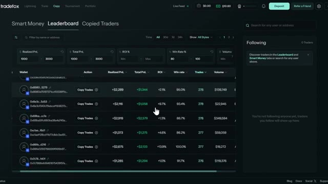
*⏱️ 00:07:13 — Capture d'écran de l'interface de la plateforme Tradefox affichant le classement (Leaderboard) des traders avec leurs performances détaillées.*

---

### ⏱️ `[00:07:37 - 00:08:06]` | Segment #19

**🔊 Audio (Transcription Intégrale Mot pour Mot en Français) :**
> gagner de l'argent sur Polymarket en ce moment. Et soit dit en passant, si vous ne vous êtes pas encore inscrit sur Polymarket, utilisez le lien dans la description. Il y a des récompenses de primes disponibles, y compris des paliers de 1 000 dollars au fur et à mesure que vous générez du volume. Ça vaut le coup d'œil. Je vais publier d'autres vidéos sur les marchés de prédiction, des stratégies avancées, plus de portefeuilles, plus d'exemples en direct. Assurez-vous donc de vous abonner et de cliquer sur l'icône de cloche pour ne pas les rater. Si vous avez trouvé cette vidéo utile, laissez un pouce bleu ci-dessous.

**👁️ Analyse Visuelle d'Écran (gemini-3.5-flash-lite) :**
**Interface & Outils** : Plateforme Polymarket et interface Tradefox (copie de trading/suivi de portefeuilles).

**Contenu textuel & Code** : Menus de connexion, liste des marchés de prédiction en cours, et classements de traders avec volumes et rendements (30D Return).

**Action / Démonstration** : Navigation sur la plateforme de marchés prédictifs Polymarket et présentation des outils de suivi des traders à fort volume.

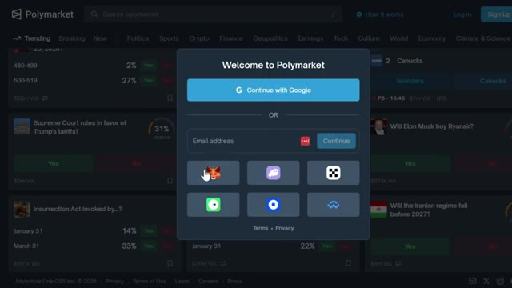
*⏱️ 00:07:45 — Fenêtre contextuelle "Welcome to Polymarket" superposée sur la plateforme avec des options de connexion (Google, email, portefeuilles crypto).*

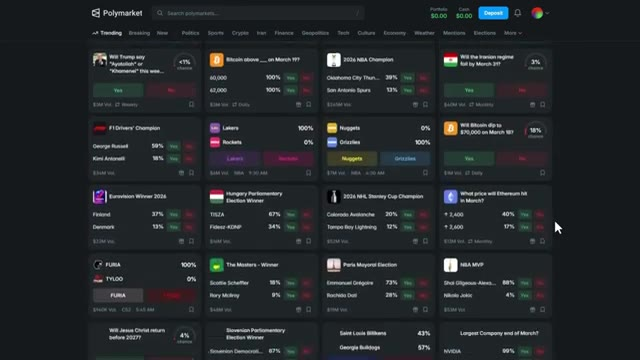
*⏱️ 00:07:52 — Vue d'ensemble de la page d'accueil Polymarket présentant de nombreux marchés de prédiction classés par catégories (Trending, Breaking, etc.).*

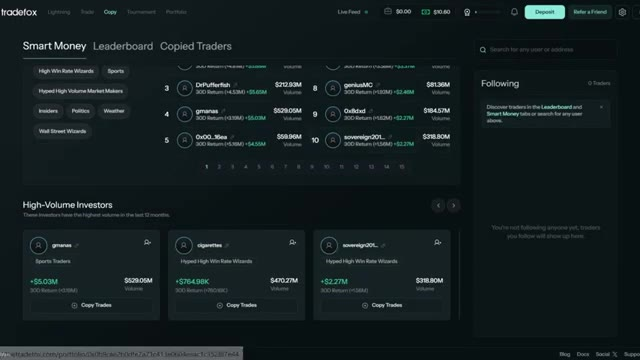
*⏱️ 00:07:59 — Interface de la plateforme Tradefox affichant le classement des "Smart Money" et des investisseurs à fort volume avec leurs performances sur 30 jours.*

---

### ⏱️ `[00:08:06 - 00:08:26]` | Segment #20

**🔊 Audio (Transcription Intégrale Mot pour Mot en Français) :**
> Si vous avez des questions, déposez-les dans les commentaires et je répondrai à chacune d'entre elles. Et si vous voulez une présentation complète du fonctionnement de Polymarket ou un tutoriel approfondi sur le fonctionnement du copy trading de Trade Fox, regardez la vidéo qui apparaît à l'écran dès maintenant. Merci d'avoir regardé et je vous vois dans la prochaine.

**👁️ Analyse Visuelle d'Écran (gemini-3.5-flash-lite) :**
**Interface & Outils** : Polymarket et Trade Fox (plateformes web).

**Contenu textuel & Code** : Cotes de paris sportifs, données de PnL (réalisé et total), ROI et taux de réussite des traders.

**Action / Démonstration** : Navigation et présentation des interfaces de Polymarket et de Trade Fox.

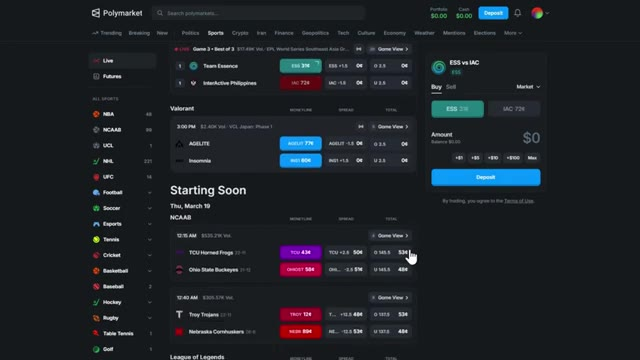
*⏱️ 00:08:11 — Interface de la plateforme de prédiction Polymarket affichant les marchés sportifs en direct et à venir.*

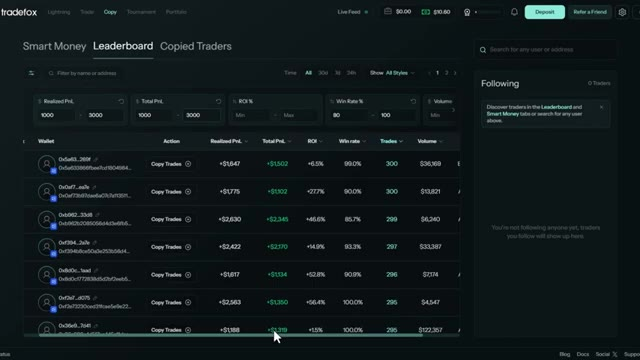
*⏱️ 00:08:16 — Tableau de classement (Leaderboard) de la plateforme de copy trading Trade Fox montrant les performances des traders.*

---

