# 🎬 I Made A Profitable Trading Strategy Using Claude Code

> **Chaîne** : [Alex Carter](https://www.youtube.com/@AlexCarterTrading)  
> **Lien YouTube** : [https://www.youtube.com/watch?v=AVf6FOAj15M](https://www.youtube.com/watch?v=AVf6FOAj15M)  
> **Date de publication** : 20260512  
> **Durée** : 00:09:25  
> **Identifiant vidéo** : `AVf6FOAj15M`  
> **Transcription & Analyse** : `whisper-v3-large-turbo+gemini-3.5-flash-lite`  

---

## 📌 Synthèse Exécutive & Outils

### 💡 Résumé

Cette vidéo présentée par la chaîne Alex Carter explore l'intersection de l'intelligence artificielle générative et du trading quantitatif à travers la création automatisée d'une stratégie de scalping sur TradingView. L'approche repose sur l'utilisation combinée de deux indicateurs techniques classiques : les bandes de Bollinger (configurées sur une longueur de 30 avec un écart-type de 2) et le RSI (paramétré sur les seuils 30/70). L'objectif est d'identifier non seulement les conditions de surachat et de survente, mais surtout d'éliminer les faux signaux inhérents aux marchés en consolidation grâce à l'analyse contextuelle et à la détection de divergences de momentum.

Au cœur de la démonstration, l'intervenant démontre comment s'affranchir des compétences en programmation informatique en déléguant l'intégralité du codage du script Pine Script à l'assistant IA Claude Code. À partir d'un prompt textuel décrivant précisément les conditions d'entrée, de sortie et de détection des divergences haussières et baissières, l'IA génère en quelques secondes un code source complet, prêt à être compilé et exécuté sur la plateforme TradingView. Cette automatisation permet de transformer une stratégie discrétionnaire manuelle en un système algorithmique capable d'émettre des alertes en temps réel et d'interfacer des webhooks pour des prises de position automatisées.

Enfin, la vidéo aborde l'aspect opérationnel de l'exécution sur les marchés des crypto-monnaies en suggérant des plateformes de produits dérivés comme Bybit ou Blofin (cette dernière étant mise en avant pour son absence de KYC obligatoire sur le trading de base). L'écosystème présenté s'adresse aux traders cherchant à industrialiser leurs processus via des outils d'IA de pointe, tout en soulignant l'importance critique de filtrer les marchés évoluant en range pour préserver le capital et optimiser le taux de réussite global de la stratégie.

### 🛠️ Outils, Modèles & Logiciels Présentés

* **Claude Code** : Assistant de développement par IA conversationnelle utilisé pour générer instantanément et sans effort de programmation le code Pine Script de la stratégie.
* **Pine Script** : Langage de programmation propriétaire de TradingView dédié à la création d'indicateurs techniques sur mesure et de stratégies de backtesting et d'alertes automatisées.
* **TradingView** : Plateforme graphique de référence mondiale pour l'analyse technique multi-marchés, la compilation de scripts Pine et la configuration d'alertes en temps réel.
* **Bybit** : Échange centralisé de premier plan spécialisé dans le trading de contrats à terme (futures) et de produits dérivés crypto, assorti de bonus de bienvenue pour les utilisateurs.
* **Blofin** : Plateforme d'échange alternative de cryptomonnaies ne requérant pas de vérification KYC obligatoire pour le trading basique de futures.
* **Grok Bots** : Outils d'automatisation et de bots conversationnels/analytiques évoqués dans le cadre de l'écosystème d'automatisation des flux de trading.
* **Hyperliquid** : Protocole de finance décentralisée (DeFi) et exchange perpétuel utilisé pour la recherche on-chain et le suivi des mouvements de gros porteurs (baleines).

### 🔑 Points Clés & Enseignements Stratégiques

* **Paramétrage spécifique des bandes de Bollinger** : Modification de la configuration par défaut en ajustant la longueur à 30 périodes tout en maintenant l'écart-type à 2 pour lisser les fluctuations sur le graphique du Bitcoin.
* **Calibrage strict du RSI** : Utilisation de l'indice de force relative avec des bornes fixées à 70 pour la zone de surachat et 30 pour la zone de survente afin de filtrer la direction du momentum.
* **Filtrage des faux signaux de breakout** : Interdiction formelle d'entrer en position dès le simple franchissement des bandes de Bollinger, une configuration générant de lourdes pertes en l'absence de confirmation par le RSI.
* **Détection des phases de marché inadaptées** : Identification des périodes de consolidation latérale (caractérisées par des bandes de Bollinger resserrées et un RSI oscillant de manière neutre) comme des zones de danger absolu où le trade doit être évité.
* **Exploitation des divergences de momentum** : Focalisation sur la configuration reine de la stratégie, à savoir la divergence haussière (creux de prix plus bas associés à des creux de RSI plus hauts) et la divergence baissière (sommets de prix plus hauts associés à des sommets de RSI plus bas).
* **Génération de code assistée par IA** : Rédaction d'un prompt concis et structuré transmis à Claude Code pour obtenir un script Pine Script complet sans nécessiter la moindre ligne de code écrite manuellement par le trader.
* **Déploiement et compilation sur TradingView** : Processus d'intégration consistant à vider l'éditeur Pine, y coller le code fourni par l'IA, puis compiler et ajouter instantanément le script au graphique pour tracer automatiquement les flèches d'achat et de vente.
* **Automatisation des alertes opérationnelles** : Configuration de conditions d'alertes natives sur TradingView basées sur les signaux émis par le script personnalisé pour recevoir des notifications instantanées sur smartphone.
* **Gestion du risque et sélection des exchanges** : Utilisation de plateformes offrant des effets de levier adaptés et des conditions incitatives (bonus de dépôt, absence de KYC pour Blofin) tout en intégrant implicitement une gestion rigoureuse du capital par trade.
* **Industrialisation et écosystème communautaire payant** : Vision quantitative axée sur l'élimination de la surveillance manuelle des graphiques au profit d'infrastructures automatisées connectant les signaux d'IA à des flux d'exécution en temps réel.

---

## ⏱️ Chronologie & Transcription Complète Audio & Visuelle (Mot pour Mot)

### ⏱️ `[00:00:00 - 00:00:34]` | Segment #01

**🔊 Audio (Transcription Intégrale Mot pour Mot en Français) :**
> Et si vous pouviez prendre n'importe quelle stratégie de trading trouvée en ligne, la donner à Claude, et lui faire automatiquement coder un script PineScript fonctionnel, sans aucune compétence en programmation. Dans cette vidéo, je vais vous montrer exactement comment j'ai fait cela avec une stratégie simple basée sur les bandes de Bollinger et le RSI. Je vais vous montrer comment fonctionne la stratégie, comment j'ai rédigé le prompt pour Claude, et comment importer le PineScript terminé directement dans TradingView. Assurez-vous de regarder jusqu'à la fin car je vais également vous montrer comment obtenir l'accès à tous mes prompts, stratégies et configurations. Passons aux choses sérieuses. Très bien, les gars, étape numéro un,

**👁️ Analyse Visuelle d'Écran (gemini-3.5-flash-lite) :**
**Interface & Outils** : TradingView (Pine Editor et Graphique de prix)

**Contenu textuel & Code** : Code source en Pine Script (gestion des signaux d'achat/vente, entrées de stratégie) et graphique de prix avec indicateurs de type bandes ou moyennes mobiles et oscillateur en sous-fenêtre.

**Action / Démonstration** : Présentation simultanée du code de script de trading et de son application visuelle sur un graphique de prix pour illustrer la création automatisée d'une stratégie.

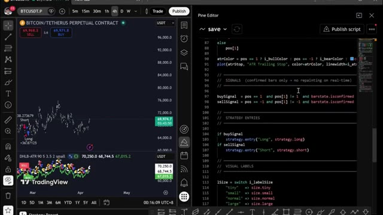
*⏱️ 00:00:08 — Interface de TradingView affichant un graphique de prix Bitcoin sur le panneau de gauche et l'éditeur Pine Editor avec du code source Pine Script sur le panneau de droite.*

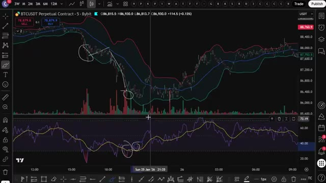
*⏱️ 00:00:17 — Graphique TradingView en plein écran sur BTCUSDT montrant des indicateurs techniques avec des zones cerclées pour illustrer une stratégie de trading.*

---

### ⏱️ `[00:00:34 - 00:01:08]` | Segment #02

**🔊 Audio (Transcription Intégrale Mot pour Mot en Français) :**
> inscrivez-vous sur un échange. Pour cette stratégie, nous allons utiliser 2Bit. C'est l'un de mes meilleurs échanges pour le trading de futures, et ils ont de solides bonus pour les débutants, comme un bonus futures de 30 USDT plus le niveau VIP un pendant un mois. Si 2Bit ne vous convient pas, vous pouvez utiliser Blofen comme alternative. Blofin ne nécessite pas de vérification KYC obligatoire pour le trading de base, ce qui signifie que vous pouvez commencer à trader immédiatement. De plus, les nouveaux utilisateurs peuvent gagner jusqu'à 5 000 USDT grâce aux bonus de dépôt et de volume de trading. Je vais mettre les deux en lien

**👁️ Analyse Visuelle d'Écran (gemini-3.5-flash-lite) :**
**Interface & Outils** : Interfaces de sites web de courtiers/échanges crypto (Toobit et BloFin).

**Contenu textuel & Code** : Offres de bonus d'inscription, montants de bonus (30 USDT, 5000 $), et caractéristiques clés de plateformes (effet de levier jusqu'à 150x, frais de trading).

**Action / Démonstration** : Navigation et présentation des plateformes de trading recommandées pour l'inscription.

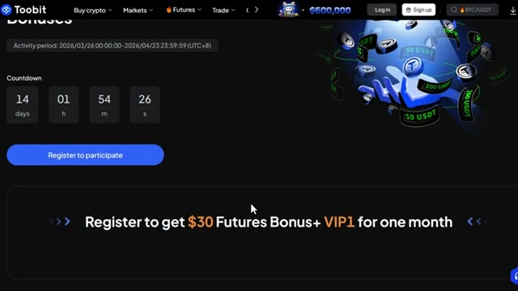
*⏱️ 00:00:42 — Page web de la plateforme Toobit montrant les bonus d'inscription avec un compte à rebours et l'offre de 30 USDT de bonus futures.*

*⏱️ 00:00:51 — Page d'inscription de l'échange de cryptomonnaies BloFin en collaboration avec Mister Crypto, affichant un bonus de bienvenue pouvant aller jusqu'à 5 000 $.*

*⏱️ 00:00:59 — Page récapitulative de BloFin affichant les points clés ("Key Takeaways") de la plateforme, incluant l'absence de KYC requis et le support de plus de 440 contrats futures.*

---

### ⏱️ `[00:01:08 - 00:01:41]` | Segment #03

**🔊 Audio (Transcription Intégrale Mot pour Mot en Français) :**
> en bas. Très bien, maintenant pour la stratégie elle-même, nous allons utiliser Trading View. J'ai un lien en bas vers mon lien Trading View. Si vous l'utilisez, vous obtiendrez une petite réduction lorsque vous achèterez la version pro. Je vais utiliser le graphique du Bitcoin. La première chose à faire est de configurer les bandes de Bollinger sur votre Trading View. Allez maintenant dans les indicateurs, tapez Bandes de Bollinger, et cliquez sur celui-ci. Ensuite, vous devrez modifier le paramètre par défaut juste ici pour cette stratégie de trading spécifique. Allez dans la section de la longueur, définissez-la à 30, et gardez l'écart type à 2. Si vous voulez personnaliser votre

**👁️ Analyse Visuelle d'Écran (gemini-3.5-flash-lite) :**
**Interface & Outils** : TradingView, graphique de prix en chandeliers japonais avec volume en bas.

**Contenu textuel & Code** : Paire BTCUSDT Perpetual Contract, unité de temps 5m, échange Bybit, données de prix actuelles et indicateur de volume.

**Action / Démonstration** : Présentation du graphique Bitcoin sur TradingView pour la mise en place de la stratégie de trading.

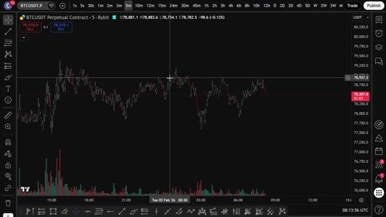
*⏱️ 00:01:16 — Capture d'écran montrant le graphique de TradingView sur une période de 5 minutes pour le contrat perpétuel BTCUSDT sur Bybit.*

---

### ⏱️ `[00:01:41 - 00:02:03]` | Segment #04

**🔊 Audio (Transcription Intégrale Mot pour Mot en Français) :**
> choix, n'oubliez pas que la ligne centrale représente la moyenne mobile basée sur la valeur de longueur et que les lignes inférieure et supérieure sont des lignes d'écart type. Maintenant que vous avez configuré les bandes de Bollinger, il est temps d'ajouter le RSI, l'indice de force relative. Pour cela, retournez dans les indicateurs et tapez RSI. Cliquez sur le premier résultat, qui devrait être l'indice de force relative.

**👁️ Analyse Visuelle d'Écran (gemini-3.5-flash-lite) :**
**Interface & Outils** : TradingView

**Contenu textuel & Code** : Paramètres des bandes de Bollinger : Basis (bleu), Upper (rouge), Lower (vert), Background, avec options de précision et cases à cocher pour l'affichage sur l'échelle de prix.

**Action / Démonstration** : Configuration des options de style des bandes de Bollinger sur le graphique.

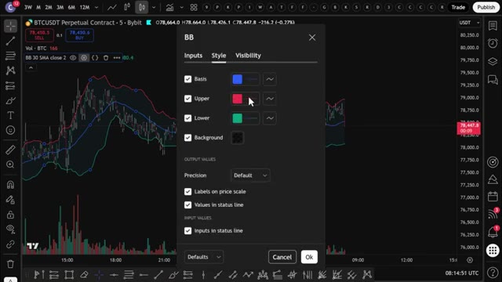
*⏱️ 00:01:46 — Fenêtre de configuration du style des bandes de Bollinger ouverte sur un graphique de trading.*

---

### ⏱️ `[00:02:03 - 00:02:25]` | Segment #05

**🔊 Audio (Transcription Intégrale Mot pour Mot en Français) :**
> Maintenant, vous devez vous assurer que la bande supérieure est sur le chiffre 70 et que la bande inférieure est sur 30. Le RSI est un outil très utile pour déterminer si une cryptomonnaie est surachetée ou survendue. S'il est au-dessus de 70, cela signifie qu'elle est surachetée. S'il est en dessous de 30, elle est survendue. Maintenant, comparons ces deux indicateurs pour trouver des transactions potentiellement rentables.

**👁️ Analyse Visuelle d'Écran (gemini-3.5-flash-lite) :**
**Interface & Outils** : Graphique TradingView (BTCUSDT Perpetual Contract sur Bybit).

**Contenu textuel & Code** : Paramètres du RSI (Style) avec les valeurs des bandes configurées : RSI Upper Band à 70, RSI Middle Band à 50, et RSI Lower Band à 30.

**Action / Démonstration** : Configuration des niveaux des bandes supérieure (70) et inférieure (30) de l'indicateur RSI.

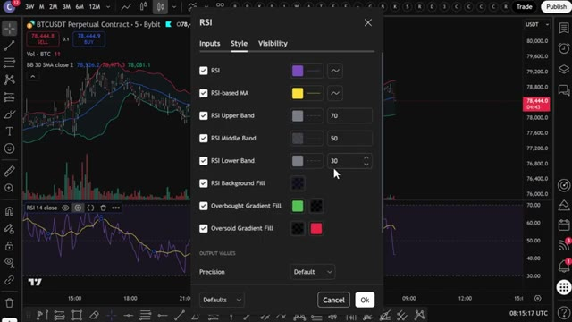
*⏱️ 00:02:09 — Fenêtre de configuration des paramètres de style de l'indicateur RSI affichée par-dessus un graphique de trading de Bitcoin.*

---

### ⏱️ `[00:02:26 - 00:02:45]` | Segment #06

**🔊 Audio (Transcription Intégrale Mot pour Mot en Français) :**
> Si le prix dépasse la bande de Bollinger supérieure, vous pouvez entrer en position courte. Mais si le prix passe sous la bande de Bollinger inférieure, vous pouvez entrer en position longue. Parfois, le prix peut traverser ces bandes à plusieurs reprises, et vous pouvez voir beaucoup de faux signaux juste ici. En fait, si vous agissiez sur chaque signal, vous perdriez probablement beaucoup d'argent.

**👁️ Analyse Visuelle d'Écran (gemini-3.5-flash-lite) :**
**Interface & Outils** : TradingView

**Contenu textuel & Code** : BTCUSDT Perpetual Contract, Bandes de Bollinger (BB 30 SMA close 2), Volume, RSI (14 close)

**Action / Démonstration** : Analyse graphique montrant un faux signal où le prix dépasse la bande de Bollinger supérieure.

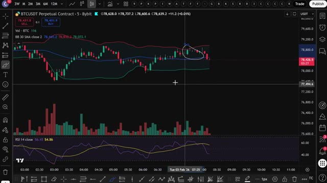
*⏱️ 00:02:31 — Graphique en chandelier de BTCUSDT sur un intervalle de 5 minutes avec les Bandes de Bollinger et le RSI. Le curseur entoure une zone où le prix dépasse la bande supérieure.*

---

### ⏱️ `[00:02:45 - 00:03:09]` | Segment #07

**🔊 Audio (Transcription Intégrale Mot pour Mot en Français) :**
> donc nous ne pouvons pas faire cela à coup sûr dans O. Pour résoudre ce problème, vous allez ajouter notre deuxième indicateur, le RSI. Si le prix est tombé sous la bande de Bollinger inférieure et que le RSI chute au niveau inférieur autour de 30, vous ouvrirez une position acheteuse. Mais si le prix dépasse la bande de Bollinger supérieure et que le RSI atteint le niveau d'environ 70, il est temps d'ouvrir une position vendeuse. Laissez-moi vous donner quelques exemples ici.

**👁️ Analyse Visuelle d'Écran (gemini-3.5-flash-lite) :**
**Interface & Outils** : TradingView

**Contenu textuel & Code** : BTCUSDT Perpetual Contract - 5m - Bybit, Bandes de Bollinger (BB 30 SMA close 2), et indicateur RSI (RSI 14 close).

**Action / Démonstration** : Analyse technique combinant les bandes de Bollinger et le RSI pour identifier des opportunités d'achat.

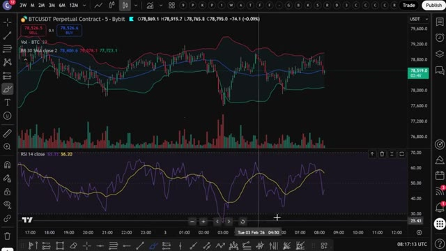
*⏱️ 00:02:51 — Graphique de TradingView affichant le cours de BTCUSDT en chandeliers japonais avec les bandes de Bollinger et le RSI en bas.*

---

### ⏱️ `[00:03:09 - 00:03:32]` | Segment #08

**🔊 Audio (Transcription Intégrale Mot pour Mot en Français) :**
> Si le prix commence à tomber en dessous de la bande de Bollinger inférieure, comme vous pouvez le voir ici, mais que le RSI n'est pas encore tout à fait à son niveau idéal, cela montre qu'il est survendu. Vous pouvez patienter jusqu'à ce que le RSI chute au niveau de 30, ce qu'il finira par atteindre comme vous pouvez le voir ici. Juste au moment où le RSI tombe au niveau de 30 ou en dessous, vous verrez que le prix du Bitcoin se trouve sur la bande de Bollinger inférieure ou en dessous.

**👁️ Analyse Visuelle d'Écran (gemini-3.5-flash-lite) :**
**Interface & Outils** : TradingView

**Contenu textuel & Code** : Graphique de prix BTCUSDT (contrat perpétuel sur Bybit) en unité de temps de 5 minutes, bandes de Bollinger (lignes rouge, bleue, verte), histogramme de volume et indicateur RSI (lignes violette et jaune) oscillant sous le graphique principal.

**Action / Démonstration** : Analyse technique combinant les bandes de Bollinger et le RSI pour identifier des conditions de survente et planifier un point d'entrée.

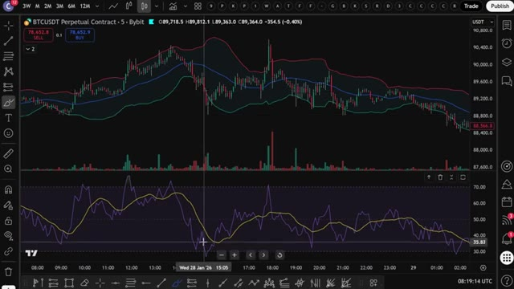
*⏱️ 00:03:15 — Graphique en chandeliers japonais illustrant le cours du BTCUSDT avec des bandes de Bollinger et un indicateur RSI sous le graphique principal.*

---

### ⏱️ `[00:03:33 - 00:03:56]` | Segment #09

**🔊 Audio (Transcription Intégrale Mot pour Mot en Français) :**
> Ensuite, vous pouvez prendre une position longue sur Bybit ou Bitunix. Comme vous pouvez le voir, après avoir ouvert votre position longue, le prix rebondit à la hausse comme prévu. Si vous aimez ouvrir des positions courtes, la stratégie est la même. Ouvrez simplement une position courte si le prix du bitcoin atteint la bande de Bollinger supérieure et, en même temps, atteint la zone de surachat sur le RSI, le niveau 70 ou au-dessus.

**👁️ Analyse Visuelle d'Écran (gemini-3.5-flash-lite) :**
**Interface & Outils** : TradingView

**Contenu textuel & Code** : Graphique de prix BTCUSDT (Timeframe 5m), indicateur de type canaux/moyennes mobiles (lignes rouge, bleue, verte), indicateur de volume, oscillateur en bas (RSI ou stochastique), et un outil de position longue (zone verte/rouge) mis en évidence sur le graphique.

**Action / Démonstration** : Démonstration de l'ouverture d'une position longue suite au signal sur l'indicateur, illustrant le rebond du prix à la hausse.

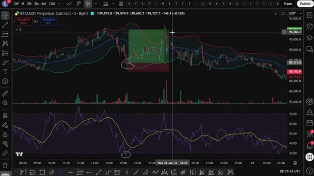
*⏱️ 00:03:39 — Un graphique TradingView en chandeliers japonais pour le contrat perpétuel BTCUSDT sur Bybit en unité de temps 5 minutes, affichant un outil de position longue validé par un rebond de prix.*

---

### ⏱️ `[00:03:56 - 00:04:34]` | Segment #10

**🔊 Audio (Transcription Intégrale Mot pour Mot en Français) :**
> Une chose à noter est que si le marché évolue de manière latérale, cette stratégie n'est pas la meilleure. La plupart des stratégies de trading ont du mal à prédire les mouvements du marché dans ces conditions. Mais revenant au graphique, vous pouvez voir ici que le prix du Bitcoin chute en dessous des bandes de Bollinger alors que le RSI est dans la zone de survente. Mais le problème est que le prix continue de s'effondrer encore plus. Si vous étiez entré dans le trade juste ici, vous auriez subi une perte massive. Pour éviter cette perte d'argent, vous devez prêter attention à la détection des premiers signes de grands mouvements de prix avant même qu'ils ne se produisent. Regardez comment les bandes de Bollinger sont fines maintenant et proches l'une de l'autre. Vous pouvez voir le

**👁️ Analyse Visuelle d'Écran (gemini-3.5-flash-lite) :**
**Interface & Outils** : TradingView (Graphique de trading en ligne)

**Contenu textuel & Code** : Paire BTCUSDT Perpetual Contract, bougies en 5 minutes, bandes de Bollinger (lignes rouge, bleue et verte), indicateur RSI (lignes violette et jaune) dans le panneau inférieur, et volumes de transactions.

**Action / Démonstration** : Analyse technique du cours du Bitcoin en temps réel, observation de la volatilité et des indicateurs de momentum.

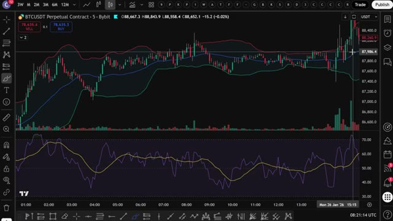
*⏱️ 00:04:06 — Graphique en chandeliers japonais du contrat perpétuel BTCUSDT en unité de temps 5 minutes sur TradingView, affichant les bandes de Bollinger et un indicateur RSI dans le sous-panneau inférieur.*

---

### ⏱️ `[00:04:34 - 00:05:08]` | Segment #11

**🔊 Audio (Transcription Intégrale Mot pour Mot en Français) :**
> Le marché évolue de manière latérale, ce qui n'est pas bon. De plus, le RSI évolue également entre les lignes inférieure et supérieure et ne dépasse pas ou ne descend pas en dessous des points majeurs de surachat et de survente. Tout cela est un très très grand signal d'alarme. Nous ne voulons pas entrer ici. Dans ces cas-là, évitez simplement le trade. Mais laissez-moi vous montrer l'exemple parfait pour ouvrir le trade parfait qui vous donnera ce taux de réussite attendu de 92 %. Ici, le prix tombe en dessous de la bande de Bollinger inférieure, puis repasse au-dessus. Mais ensuite, le prix commence à redescendre en formant un nouveau plus bas par rapport au plus bas précédent.

**👁️ Analyse Visuelle d'Écran (gemini-3.5-flash-lite) :**
**Interface & Outils** : TradingView (interface graphique de trading)

**Contenu textuel & Code** : Graphique de chandeliers japonais pour BTCUSDT, bandes de Bollinger (lignes rouge, bleue, verte), indicateur RSI en bas avec des zones encadrées montrant l'absence de cassure des niveaux de surachat et de survente.

**Action / Démonstration** : Analyse technique du marché montrant la consolidation latérale des prix et le comportement du RSI sans tendance claire.

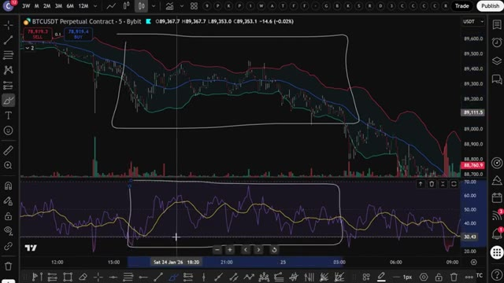
*⏱️ 00:04:42 — Graphique TradingView en unités de 5 minutes pour le contrat perpétuel BTCUSDT sur Bybit, montrant les prix évoluant latéralement entre les bandes de Bollinger et le RSI oscillant au centre.*

---

### ⏱️ `[00:05:09 - 00:05:32]` | Segment #12

**🔊 Audio (Transcription Intégrale Mot pour Mot en Français) :**
> Mais si vous jetez un œil au RSI, vous pouvez voir que le RSI vient de faire un creux plus haut. C'est une divergence haussière. La divergence haussière se caractérise par la formation de creux progressivement plus bas par les bougies de prix. En même temps, le RSI forme des creux progressivement plus hauts. C'est l'une de vos meilleures chances d'ouvrir une position acheteuse parce que vous aurez de fortes chances de faire du profit.

**👁️ Analyse Visuelle d'Écran (gemini-3.5-flash-lite) :**
**Interface & Outils** : TradingView

**Contenu textuel & Code** : Graphique BTCUSDT (Bybit), bandes de Bollinger, volumes et indicateur RSI en bas avec des annotations de creux.

**Action / Démonstration** : Analyse de la divergence haussière entre le prix du Bitcoin et le RSI.

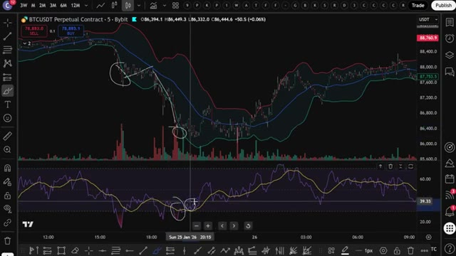
*⏱️ 00:05:15 — Graphique de prix et indicateurs techniques montrant une divergence haussière sur le RSI.*

---

### ⏱️ `[00:05:32 - 00:06:07]` | Segment #13

**🔊 Audio (Transcription Intégrale Mot pour Mot en Français) :**
> D'un autre côté, si le prix s'envole vers la bande de Bollinger supérieure puis redescend, ensuite le prix se remet à monter, en faisant un nouveau plus haut supérieur au plus haut précédent. Mais si vous jetez un œil au RSI, vous pouvez voir que le RSI vient de faire un nouveau plus haut inférieur. C'est une divergence baissière. L'opportunité parfaite pour ouvrir une position short. Utiliser les bandes de Bollinger et le RSI en même temps, c'est une stratégie vraiment, vraiment, vraiment très bonne. Et j'ai eu tellement de succès avec ça, comme vous pouvez clairement le voir ici. Donc maintenant vous comprenez exactement comment cette stratégie

**👁️ Analyse Visuelle d'Écran (gemini-3.5-flash-lite) :**
**Interface & Outils** : TradingView

**Contenu textuel & Code** : Paire BTCUSDT Perpetual (Bybit), bandes de Bollinger, indicateur RSI en sous-fenêtre avec deux courbes.

**Action / Démonstration** : Analyse technique mettant en évidence un nouveau plus haut sur le prix accompagné d'un plus haut inférieur sur le RSI (divergence baissière).

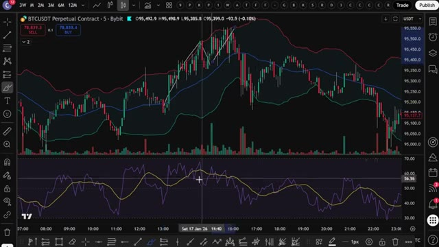
*⏱️ 00:05:40 — Graphique en chandeliers japonais illustrant une divergence baissière entre le cours du BTCUSDT et l'indicateur RSI.*

---

### ⏱️ `[00:06:07 - 00:06:39]` | Segment #14

**🔊 Audio (Transcription Intégrale Mot pour Mot en Français) :**
> fonctionne manuellement. Mais c'est là que ça devient vraiment intéressant. Au lieu de surveiller des graphiques toute la journée et de faire cela manuellement, j'ai donné cette stratégie exacte à Claude et je lui ai demandé de m'écrire un Pine Script complet. Pour que TradingView puisse détecter automatiquement ces signaux pour moi. Et voici le prompt que j'ai utilisé. Je vais l'afficher à l'écran dès maintenant pour que vous puissiez le copier exactement. C'est tout. C'est le prompt complet. Vous le collez dans Claude. J'utilise Claude Code ici et en quelques secondes, il crache un Pine Script entièrement fonctionnel dans un bloc-notes. Ouvrez ce fichier, appuyez sur Ctrl+A pour

**👁️ Analyse Visuelle d'Écran (gemini-3.5-flash-lite) :**
**Interface & Outils** : Windows PowerShell, terminal Claude Code, éditeur de texte.

**Contenu textuel & Code** : Invite textuelle (prompt) demandant à Claude d'écrire un script Pine Script pour TradingView utilisant les Bandes de Bollinger (longueur 30, écart-type 2) et le RSI (longueur 14), avec gestion des divergences haussières et baissières, des conditions d'entrée/sortie, des signaux visuels et des alertes.

**Action / Démonstration** : Saisie et envoi d'un prompt détaillé à l'assistant IA Claude Code pour générer automatiquement le code Pine Script de la stratégie de trading.

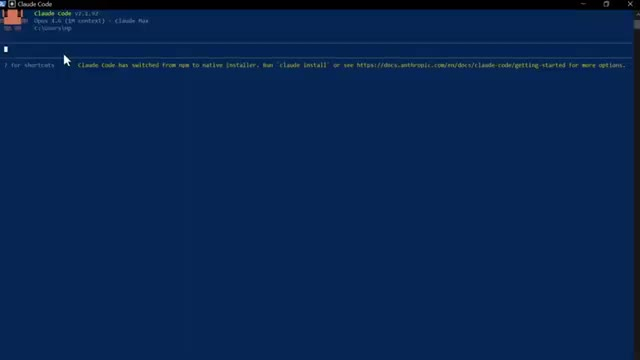
*⏱️ 00:06:15 — Interface du terminal Claude Code sous Windows PowerShell montrant le prompt actif.*

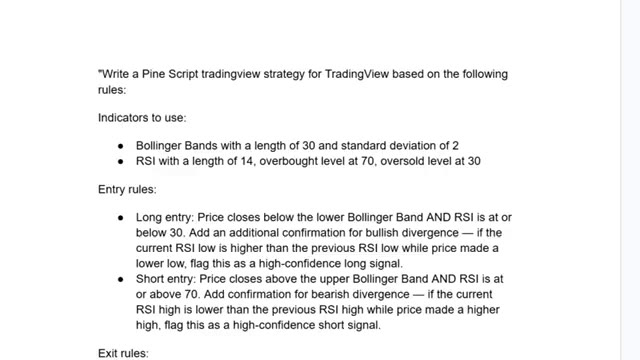
*⏱️ 00:06:23 — Document texte affichant les règles détaillées d'une stratégie de trading basée sur les Bandes de Bollinger et le RSI.*

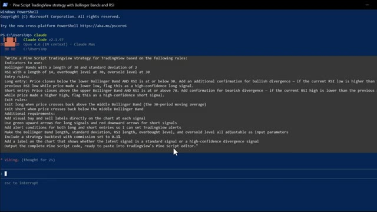
*⏱️ 00:06:31 — Invite de commande Claude Code affichant le prompt complet de génération d'un script Pine Script avec des règles d'entrée, de sortie et de divergence.*

---

### ⏱️ `[00:06:39 - 00:07:14]` | Segment #15

**🔊 Audio (Transcription Intégrale Mot pour Mot en Français) :**
> sélectionnez tout le code, puis faites contrôle plus c pour le copier. C'est tout ce dont vous avez besoin. Maintenant, mettons-le dans TradingView. Ouvrez TradingView et allez sur n'importe quel graphique. Je vais utiliser le Bitcoin à nouveau. En bas à droite de l'écran, cliquez sur l'onglet de l'éditeur PineScript, celui qui ressemble à un pin. Une fois l'éditeur ouvert, vous y verrez du code par défaut. Sélectionnez-le entièrement et supprimez-le. Ensuite, collez le code que Claude vient de vous donner. Cliquez maintenant sur Ajouter au graphique. C'est le bouton en haut à droite de l'éditeur PineScript. TradingView va compiler le script et l'appliquer directement sur votre graphique. Et voilà. Vous pouvez voir le

**👁️ Analyse Visuelle d'Écran (gemini-3.5-flash-lite) :**
**Interface & Outils** : TradingView

**Contenu textuel & Code** : Paire BTCUSDT Perpetual Contract sur l'échange Bybit, unité de temps 5m, affichant les bougies de prix et l'histogramme des volumes.

**Action / Démonstration** : Visualisation du graphique du Bitcoin sur TradingView avant l'intégration du code Pine Script.

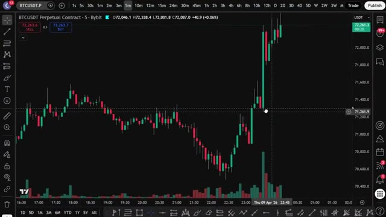
*⏱️ 00:06:47 — Un graphique en chandeliers japonais de Bitcoin (BTCUSDT Perpetual Contract sur Bybit en unité de temps 5 minutes) avec un volume de trading en bas et des outils de dessin sur le côté et en bas.*

---

### ⏱️ `[00:07:14 - 00:07:47]` | Segment #16

**🔊 Audio (Transcription Intégrale Mot pour Mot en Français) :**
> Les bandes de Bollinger sur le graphique, le panneau RSI en dessous, et les signaux d'achat et de vente tracés automatiquement. Des flèches vertes pour les achats, des flèches rouges pour les ventes. Les signaux de divergence à haute confiance sont étiquetés séparément pour que vous sachiez quelles configurations sont les plus solides. Pour configurer des alertes, cliquez sur l'icône de réveil en haut de TradingView, sélectionnez créer une alerte et dans le menu déroulant des conditions, vous verrez les conditions d'alerte que Claude a ajoutées, signal d'achat et signal de vente. Configurez-les et TradingView vous avertira dès qu'un signal se déclenche. Donc maintenant, au lieu de

**👁️ Analyse Visuelle d'Écran (gemini-3.5-flash-lite) :**
**Interface & Outils** : TradingView (intégrée à Bybit)

**Contenu textuel & Code** : Graphique BTCUSDT Perpetual Contract en unité 5 minutes, Bandes de Bollinger, indicateur RSI avec moyennes mobiles, signaux 'Long' (flèches vertes), 'Sell' / 'Short' (flèches rouges) et volumes.

**Action / Démonstration** : Analyse technique automatisée de la stratégie de trading basée sur les bandes de Bollinger et le RSI avec affichage des signaux d'entrée et de sortie.

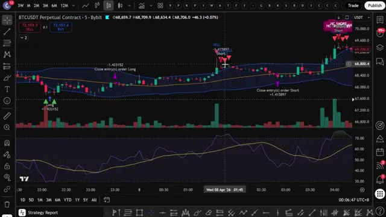
*⏱️ 00:07:22 — Un graphique de trading affichant les bandes de Bollinger, des signaux d'achat et de vente automatiques avec des flèches, ainsi qu'un panneau RSI en bas.*

---

### ⏱️ `[00:07:47 - 00:08:24]` | Segment #17

**🔊 Audio (Transcription Intégrale Mot pour Mot en Français) :**
> en surveillant le graphique manuellement, TradingView fait tout le travail à votre place. Dès que les conditions des bandes de Bollinger et du RSI s'alignent, en particulier sur une divergence, vous recevez une alerte directement sur votre téléphone. Maintenant, si vous voulez aller encore plus loin et faire en sorte que cela ouvre des trades automatiquement sur votre exchange dès qu'un signal se déclenche, j'ai ce qu'il vous faut. J'ai créé un groupe privé où je partage tous mes cas d'utilisation pour Claude Code, qu'il s'agisse de l'intégrer avec Telegram, TradingView, ou de rechercher des baleines sur Hyperliquid. Tout cela de manière automatique. Tout ce que je vous ai montré aujourd'hui se trouve entièrement dans le groupe. Et j'ajoute constamment de nouvelles choses, de nouvelles stratégies, de nouveaux prompts,

**👁️ Analyse Visuelle d'Écran (gemini-3.5-flash-lite) :**
**Interface & Outils** : TradingView, interface de courtage/échange avec carnet d'ordres et Hyperliquid Leaderboard.

**Contenu textuel & Code** : Graphiques en chandeliers, indicateurs techniques (RSI, bandes de Bollinger, volumes), carnets d'ordres, informations de positions ouvertes (ETH/USDT, effet de levier 5x, prix d'entrée, PnL) et tableau de classement des traders.
[DESC_IMAGE_3] Visualisation des performances et des classements des traders sur une plateforme de finance décentralisée pour illustrer des stratégies avancées.

**Action / Démonstration** : Explications face caméra et analyse conceptuelle des marchés.

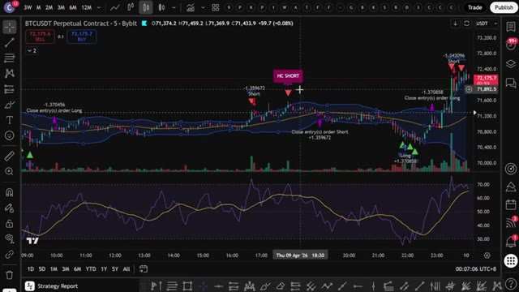
*⏱️ 00:07:56 — Graphique TradingView affichant le contrat perpétuel BTCUSDT sur un intervalle de 5 minutes avec des indicateurs techniques et des signaux d'achat/vente.*

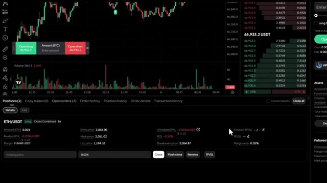
*⏱️ 00:08:05 — Interface de trading avec un carnet d'ordres, un graphique de prix et un panneau de suivi de position ouverte sur ETH/USDT.*

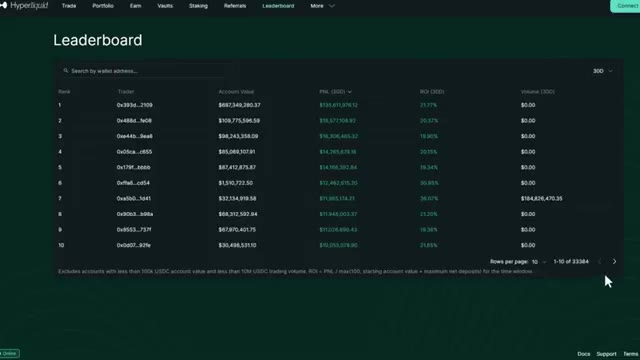
*⏱️ 00:08:14 — Page de classement (Leaderboard) de la plateforme de trading décentralisée Hyperliquid montrant les comptes d'utilisateurs les plus performants.*

---

### ⏱️ `[00:08:24 - 00:08:42]` | Segment #18

**🔊 Audio (Transcription Intégrale Mot pour Mot en Français) :**
> de nouvelles intégrations. Chaque fois que je construis quelque chose de nouveau, ça va directement là-dedans. Le prix est de 79,99 $ par mois. Et honnêtement, quand on y pense, ce que c'est vraiment, la configuration de trading par IA la plus avancée disponible pour les traders particuliers en ce moment, constamment mise à jour avec tout inclus.

**👁️ Analyse Visuelle d'Écran (gemini-3.5-flash-lite) :**
**Interface & Outils** : Plateforme e-commerce Whop et interface web de cours ou documentation d'Alex Carter.

**Contenu textuel & Code** : Tarification d'abonnement (79,99 $/mois), sections de fonctionnalités pour le contrôle des graphiques, lecture de données OHLCV, et intégration avec TradingView.

**Action / Démonstration** : Présentation commerciale de l'offre d'abonnement et de ses fonctionnalités techniques.

*⏱️ 00:08:28 — Page Whop d'Alex Carter présentant le produit "AI Trade Edge" à 79,99 $ par mois.*

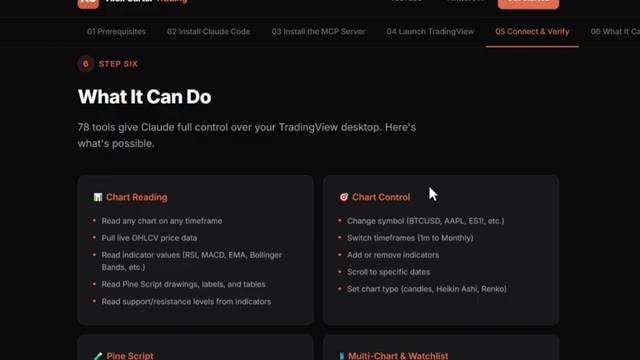
*⏱️ 00:08:37 — Documentation ou guide de l'utilisateur listant les fonctionnalités des 78 outils connectant Claude à TradingView.*

---

### ⏱️ `[00:08:43 - 00:09:15]` | Segment #19

**🔊 Audio (Transcription Intégrale Mot pour Mot en Français) :**
> Ce n'est pas beaucoup d'argent. Un seul bon trade suffit à couvrir ça. Mais les 100 premiers membres bloquent ce tarif de façon permanente. Après cela, le prix augmente. Donc, plus vous entrez tôt, meilleure est l'offre. Le lien est dans la description. Inscrivez-vous dès maintenant avant que le prix n'augmente. Vous ne pouvez vraiment pas vous permettre de rater ça. Et c'est tout les gars. C'est comme ça qu'on prend une stratégie d'Internet, qu'on la donne à Claude et qu'on obtient un script Pine fonctionnel sur TradingView. Pas de code, pas de surveillance manuelle des graphiques. Si vous voulez voir une démonstration complète de la façon dont je trade en utilisant seulement mon Telegram et la démonstration complète de tous les cas d'utilisation sur

**👁️ Analyse Visuelle d'Écran (gemini-3.5-flash-lite) :**
**Interface & Outils** : Whop (plateforme e-commerce) et TradingView (graphique de trading).

**Contenu textuel & Code** : Tarification d'abonnement (79,99 $/mois au lieu de 99,99 $), graphique de prix Bitcoin (BTCUSDT), indicateurs de moyenne mobile/bandes, indicateur de momentum/RSI en sous-fenêtre et outil de ratio Risque/Rendement (RR 2.1).

**Action / Démonstration** : Présentation de l'offre commerciale du groupe de trading et démonstration d'analyse technique avec position de trading simulée sur graphique.

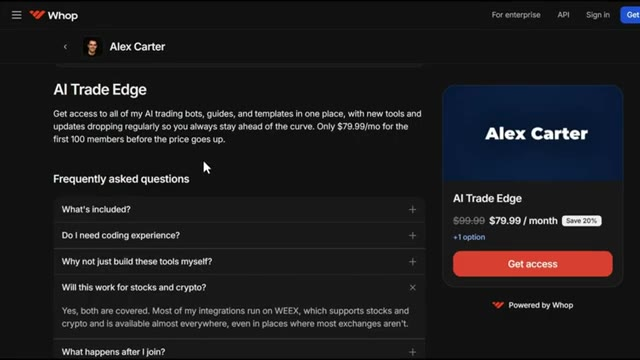
*⏱️ 00:08:51 — Page de vente de la plateforme Whop montrant l'offre "AI Trade Edge" d'Alex Carter à 79,99 $/mois pour les 100 premiers membres avec FAQ visible.*

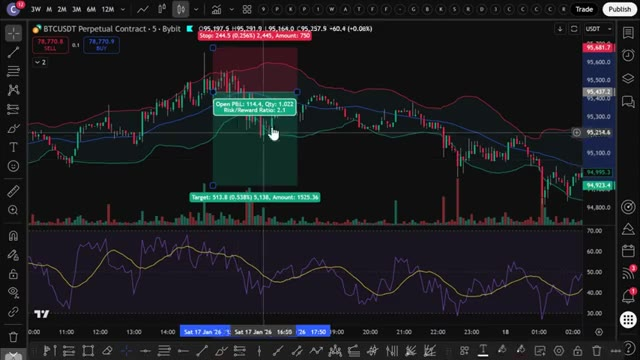
*⏱️ 00:08:59 — Graphique TradingView affichant le contrat perpétuel BTCUSDT sur Bybit en unité de temps 5 minutes avec un outil de position Long et un indicateur technique en bas.*

---

### ⏱️ `[00:09:15 - 00:09:25]` | Segment #20

**🔊 Audio (Transcription Intégrale Mot pour Mot en Français) :**
> TradingView, clique sur la vidéo qui apparaît à l'écran en ce moment même. Si tu as trouvé cela utile, laisse un pouce bleu. Cela aide vraiment la chaîne. Abonne-toi si ce n'est pas déjà fait, et je te vois dans la prochaine.

**👁️ Analyse Visuelle d'Écran (gemini-3.5-flash-lite) :**
**Interface & Outils** : Aucune interface visible

**Contenu textuel & Code** : Aucun contenu visible

**Action / Démonstration** : Aucune action visible

---

