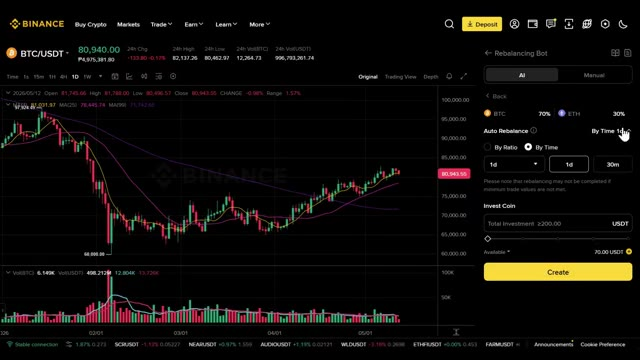
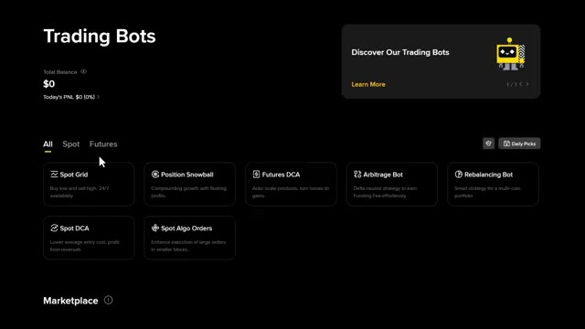
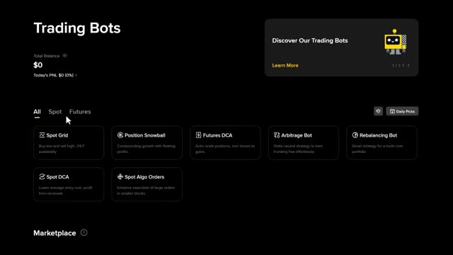

# 🎬 How to Trade 24/7 with Binance Trading Bots  (Step-by-Step Guide)

> **Chaîne** : [Alex Carter](https://www.youtube.com/@AlexCarterTrading)  
> **Lien YouTube** : [https://www.youtube.com/watch?v=GMyRcmC9Of0](https://www.youtube.com/watch?v=GMyRcmC9Of0)  
> **Date de publication** : 20260513  
> **Durée** : 00:16:20  
> **Identifiant vidéo** : `GMyRcmC9Of0`  
> **Transcription & Analyse** : `whisper-v3-large-turbo+gemini-3.5-flash-lite`  

---

## 📌 Synthèse Exécutive & Outils

### 💡 Résumé
Dans cette vidéo intitulée **How to Trade 24/7 with Binance Trading Bots  (Step-by-Step Guide)**, Alex Carter détaille une approche stratégique et pratique du trading et de l'automatisation par agents IA.

### 🛠️ Outils, Modèles & Logiciels Présentés
- **TradingView & Claude Code** : Analyse technique avancée et automatisation algorithmique.

### 🔑 Points Clés & Enseignements Stratégiques
- Respect rigoureux du ratio risque/rendement et du money management.
- Automatisation méthodique des déclencheurs d'ordres via des agents intelligents.

---

## ⏱️ Chronologie & Transcription Complète Audio & Visuelle (Mot pour Mot)

### ⏱️ `[00:00:00 - 00:00:18]` | Segment #01

**🔊 Audio (Transcription Intégrale Mot pour Mot en Français) :**
> Les bots de trading peuvent exécuter l'ensemble de votre stratégie crypto pendant que vous dormez. Acheter bas, vendre haut, faire du dollar-cost averaging, rééquilibrer votre portefeuille 24 h/24 et 7 j/7 sans que vous n'ayez à lever le petit doigt. Dans cette vidéo, je vais vous montrer exactement comment configurer et utiliser chacun des bots de trading sur Binance, étape par étape.

**👁️ Analyse Visuelle d'Écran (gemini-3.5-flash-lite) :**
**Interface & Outils** : Présentation ou face-caméra explicatif du trader sans interface logicielle partagée.

**Contenu textuel & Code** : Explications orales des stratégies et mise en contexte méthodologique du marché.

**Action / Démonstration** : Explications face caméra et analyse conceptuelle des marchés.

---

### ⏱️ `[00:00:19 - 00:00:38]` | Segment #02

**🔊 Audio (Transcription Intégrale Mot pour Mot en Français) :**
> Que vous souhaitiez profiter des marchés latéraux, composer vos gains automatiquement ou simplement accumuler vos cryptos préférées en pilotage automatique, j'ai ce qu'il vous faut. À la fin de cette vidéo, vous saurez exactement quel bot utiliser et comment le lancer en moins de quelques minutes. Tout d'abord, vous avez besoin d'un compte Binance. Si vous n'en avez pas encore, cliquez sur le lien dans la description.

**👁️ Analyse Visuelle d'Écran (gemini-3.5-flash-lite) :**
**Interface & Outils** : Binance (Exchange crypto, module Trading Bots et interface graphique de trading)

**Contenu textuel & Code** : Graphique en chandeliers BTC/USDT (cours à ~80 940 $), moyennes mobiles, paramètres d'allocation du Rebalancing Bot (BTC 70%, ETH 30%, fréquence 1 jour), options de bots Spot/Futures.

**Action / Démonstration** : Navigation dans le catalogue des robots de trading automatisés et paramétrage d'un bot de rééquilibrage automatique de portefeuille crypto.

*⏱️ 00:00:23 — Interface Binance affichant le graphique journalier BTC/USDT et le panneau latéral de configuration d'un Rebalancing Bot (70% BTC / 30% ETH).*

*⏱️ 00:00:28 — Page d'accueil de la section Trading Bots de Binance présentant le catalogue des stratégies automatisées (Spot Grid, DCA, Arbitrage, Rebalancing Bot).*

---

### ⏱️ `[00:00:39 - 00:01:14]` | Segment #03

**🔊 Audio (Transcription Intégrale Mot pour Mot en Français) :**
> Avec mon lien exclusif, vous débloquez jusqu'à 100 dollars de récompenses d'inscription, ainsi que des bons pour des jetons WCT et H-U-M-A qui vous attendent dans le centre de récompenses. Je vous montrerai exactement où les trouver dans un instant. La configuration de votre compte est simple. Vous pouvez vous inscrire en utilisant votre e-mail ou votre numéro de téléphone, ou vous inscrire instantanément avec Google, Apple ou Telegram. Cela prend moins d'une minute. Une fois connecté, assurez-vous d'avoir des fonds sur votre compte. Si vous devez faire un dépôt, cliquez sur dépôt, puis choisissez déposer des cryptos. Ensuite, sélectionnez USDT, choisissez votre réseau et envoyez vos fonds. Ils arriveront en quelques minutes et vouserez

**👁️ Analyse Visuelle d'Écran (gemini-3.5-flash-lite) :**
**Interface & Outils** : Présentation ou face-caméra explicatif du trader sans interface logicielle partagée.

**Contenu textuel & Code** : Explications orales des stratégies et mise en contexte méthodologique du marché.

**Action / Démonstration** : Explications face caméra et analyse conceptuelle des marchés.

---

### ⏱️ `[00:01:14 - 00:01:46]` | Segment #04

**🔊 Audio (Transcription Intégrale Mot pour Mot en Français) :**
> prêt à démarrer. Maintenant, passons aux bots. Allez dans la barre de navigation supérieure, cliquez sur Trade, puis sélectionnez les bots de trading. Cela vous amène sur la page des bots de trading. En haut, vous pouvez voir votre solde total et le P&L du jour, pour que vous sachiez toujours exactement en un coup d'œil comment vos bots performent. Faites défiler un peu vers le bas, et vous verrez tous les bots disponibles disposés en colonnes, répartis entre spot et futures. Nous allons passer en revue chacun d'entre eux en détail, mais d'abord, laissez-moi vous montrer quelques éléments sur cette page qui sont vraiment utiles. Vous verrez la section Daily Pick, cliquez dessus,

**👁️ Analyse Visuelle d'Écran (gemini-3.5-flash-lite) :**
**Interface & Outils** : Présentation ou face-caméra explicatif du trader sans interface logicielle partagée.

**Contenu textuel & Code** : Explications orales des stratégies et mise en contexte méthodologique du marché.

**Action / Démonstration** : Explications face caméra et analyse conceptuelle des marchés.

---

### ⏱️ `[00:01:46 - 00:02:22]` | Segment #05

**🔊 Audio (Transcription Intégrale Mot pour Mot en Français) :**
> and you'll find Binance's own curated bot picks. You can copy these directly. For each one, You can see the trading pair, the ROI, the P&L in USD, the runtime, and the minimum investment required. This list is updated hourly, so it's worth checking back regularly. Scroll down a little more and you'll reach the marketplace. Here you can browse bots across SpotGrid, Futures DCA, and Arbitrage. You can filter and sort by market, direction for futures, runtime, ROI, leverage, and MDD, which stands for maximum drawdown. Basically,

**👁️ Analyse Visuelle d'Écran (gemini-3.5-flash-lite) :**
**Interface & Outils** : Présentation ou face-caméra explicatif du trader sans interface logicielle partagée.

**Contenu textuel & Code** : Explications orales des stratégies et mise en contexte méthodologique du marché.

**Action / Démonstration** : Explications face caméra et analyse conceptuelle des marchés.

---

### ⏱️ `[00:02:22 - 00:02:45]` | Segment #06

**🔊 Audio (Transcription Intégrale Mot pour Mot en Français) :**
> the worst case loss the bot has experienced. For arbitrage specifically, you can also filter buy zone, normal margin, which is USD-M, and inverse margin, which is coin-M, and by direction. Keep scrolling and you'll hit the hot coin leaderboard. This shows you the top 10 trending markets and the top 10 most volatile pairs right now. Great for spotting opportunities.

**👁️ Analyse Visuelle d'Écran (gemini-3.5-flash-lite) :**
**Interface & Outils** : Présentation ou face-caméra explicatif du trader sans interface logicielle partagée.

**Contenu textuel & Code** : Explications orales des stratégies et mise en contexte méthodologique du marché.

**Action / Démonstration** : Explications face caméra et analyse conceptuelle des marchés.

---

### ⏱️ `[00:02:46 - 00:03:20]` | Segment #07

**🔊 Audio (Transcription Intégrale Mot pour Mot en Français) :**
> and at the very bottom there's the bots academy if you want to go deeper and study at your own pace everything is here from spot grid basics all the way through to algo orders now let's actually go through each bot one by one the first bot we'll cover is the spot grid bot click on it and it'll bring you to the interface if you've done any manual trading before this will feel very familiar you've got the price chart in the middle the positions panel at the bottom and the coin selector in the upper left on the right side you'll see three tabs ai popular and manual

**👁️ Analyse Visuelle d'Écran (gemini-3.5-flash-lite) :**
**Interface & Outils** : Présentation ou face-caméra explicatif du trader sans interface logicielle partagée.

**Contenu textuel & Code** : Explications orales des stratégies et mise en contexte méthodologique du marché.

**Action / Démonstration** : Explications face caméra et analyse conceptuelle des marchés.

---

### ⏱️ `[00:03:20 - 00:03:55]` | Segment #08

**🔊 Audio (Transcription Intégrale Mot pour Mot en Français) :**
> starting with ai this is where binance's ai has already built bots for you for each one you can see the bot type the runtime the price range the number of grids and the profit per grid with fees already deducted the price range is the zone the bot trades within the number of grids is how many buy and sell orders in places inside that range. More grids means more frequent trades but smaller profit per trade. To copy one, just hit the copy button in the upper right of that bot card, enter your investment amount, and click create. Your bot is live. If you want more control,

**👁️ Analyse Visuelle d'Écran (gemini-3.5-flash-lite) :**
**Interface & Outils** : Présentation ou face-caméra explicatif du trader sans interface logicielle partagée.

**Contenu textuel & Code** : Explications orales des stratégies et mise en contexte méthodologique du marché.

**Action / Démonstration** : Explications face caméra et analyse conceptuelle des marchés.

---

### ⏱️ `[00:03:56 - 00:04:24]` | Segment #09

**🔊 Audio (Transcription Intégrale Mot pour Mot en Français) :**
> go back and click customize parameters on any bot. This switches you into manual mode. Here, you can define your own price range, set the number of grids yourself, and choose between arithmetic and geometric mode. Arithmetic spaces the grids evenly by price. Geometric spaces them evenly by percentage, which tends to work better in trending markets since the gaps scale with price movement. You can also set your investment amount in either USDT or USDT plus BTC.

**👁️ Analyse Visuelle d'Écran (gemini-3.5-flash-lite) :**
**Interface & Outils** : Présentation ou face-caméra explicatif du trader sans interface logicielle partagée.

**Contenu textuel & Code** : Explications orales des stratégies et mise en contexte méthodologique du marché.

**Action / Démonstration** : Explications face caméra et analyse conceptuelle des marchés.

---

### ⏱️ `[00:04:24 - 00:04:51]` | Segment #10

**🔊 Audio (Transcription Intégrale Mot pour Mot en Français) :**
> Faites défiler un peu vers le bas et vous trouverez les paramètres optionnels. Trailing up, qui permet au bot de suivre le prix vers le hausse automatiquement. Grid trigger, qui définit une condition de prix avant que le bot ne s'active, et take profit et stop loss pour protéger votre position. Vous pouvez également activer vendre tout le BTC à l'arrêt. Lorsque cette option est activée, tout votre BTC est vendu au prix du marché lorsque le bot s'arrête. Lorsqu'elle est désactivée, votre BTC est simplement transféré vers votre portefeuille au comptant. Une fois que tout est défini, cliquez sur créer.

**👁️ Analyse Visuelle d'Écran (gemini-3.5-flash-lite) :**
**Interface & Outils** : Présentation ou face-caméra explicatif du trader sans interface logicielle partagée.

**Contenu textuel & Code** : Explications orales des stratégies et mise en contexte méthodologique du marché.

**Action / Démonstration** : Explications face caméra et analyse conceptuelle des marchés.

---

### ⏱️ `[00:04:52 - 00:05:25]` | Segment #11

**🔊 Audio (Transcription Intégrale Mot pour Mot en Français) :**
> Now switching to the popular tab, here you can see the top performing pairs right now. You can sort by top ROI, top PNL, top copied and most matched. For each bot, you'll see the pair how many traders are copying it, the P&L and US dollars, the equity curve ROI runtime, minimum investment match trades, which shows how well the bot's historical settings align with current market conditions, and the max drawdown. Find one you like, click copy, confirm the details, and hit create. You can also click the advanced options button to fine-tune the settings before

**👁️ Analyse Visuelle d'Écran (gemini-3.5-flash-lite) :**
**Interface & Outils** : Présentation ou face-caméra explicatif du trader sans interface logicielle partagée.

**Contenu textuel & Code** : Explications orales des stratégies et mise en contexte méthodologique du marché.

**Action / Démonstration** : Explications face caméra et analyse conceptuelle des marchés.

---

### ⏱️ `[00:05:25 - 00:05:59]` | Segment #12

**🔊 Audio (Transcription Intégrale Mot pour Mot en Français) :**
> going live. Next up is the position snowball bot. This one is built for compounding growth using floating profits. Essentially, as your position gains unrealized profit, the bot uses that profit to add to your position, snowballing your exposure over time without you needing to add more capital manually. Click on it, and you'll have two options, buy or sell, meaning long or short direction. You can set the bot to add to your order and price increase by a certain percentage, so every time the price moves up by that amount, the bot compounds in. Then you input your

**👁️ Analyse Visuelle d'Écran (gemini-3.5-flash-lite) :**
**Interface & Outils** : Présentation ou face-caméra explicatif du trader sans interface logicielle partagée.

**Contenu textuel & Code** : Explications orales des stratégies et mise en contexte méthodologique du marché.

**Action / Démonstration** : Explications face caméra et analyse conceptuelle des marchés.

---

### ⏱️ `[00:05:59 - 00:06:34]` | Segment #13

**🔊 Audio (Transcription Intégrale Mot pour Mot en Français) :**
> investment amount and set your leverage. You can go up to 150 times here, but I'd strongly suggest keeping it at five times maximum. Leverage amplifies both gains and losses. If you don't have solid risk management, it can wipe you out fast. Click on advance optional and you'll see more settings. Profit-based order ratio. This sets what percentage of your floating profit gets used to add to the position. A trigger price, the price at which the bot activates, additional order slippage, the maximum price deviation you'll accept when adding orders. And take profit and stop loss to

**👁️ Analyse Visuelle d'Écran (gemini-3.5-flash-lite) :**
**Interface & Outils** : Présentation ou face-caméra explicatif du trader sans interface logicielle partagée.

**Contenu textuel & Code** : Explications orales des stratégies et mise en contexte méthodologique du marché.

**Action / Démonstration** : Explications face caméra et analyse conceptuelle des marchés.

---

### ⏱️ `[00:06:34 - 00:07:10]` | Segment #14

**🔊 Audio (Transcription Intégrale Mot pour Mot en Français) :**
> manage your downside. Once everything is set, hit create. Next is the Futures DCA bot. DCA stands for dollar cost averaging, and the idea is very simple. Instead of trying to time the market perfectly, the bot buys at multiple price levels as the market moves, averaging your entry price down. The difference with the futures version is that it uses leverage and can go both long and short. Just like SpotGrid, you can browse the popular bots here. This time, each one will show the trading pair, direction, and leverage being used, along with how many people are copying it,

**👁️ Analyse Visuelle d'Écran (gemini-3.5-flash-lite) :**
**Interface & Outils** : Présentation ou face-caméra explicatif du trader sans interface logicielle partagée.

**Contenu textuel & Code** : Explications orales des stratégies et mise en contexte méthodologique du marché.

**Action / Démonstration** : Explications face caméra et analyse conceptuelle des marchés.

---

### ⏱️ `[00:07:10 - 00:07:29]` | Segment #15

**🔊 Audio (Transcription Intégrale Mot pour Mot en Français) :**
> the PNL equity curve ROI runtime and max drawdown. You can sort by ROI, PNL, or top copied, and filter by symbol. Click copy on one you like and you'll see the basic setups, the orders plotted on the chart, and all you need to do is enter your investment amount and set your leverage.

**👁️ Analyse Visuelle d'Écran (gemini-3.5-flash-lite) :**
**Interface & Outils** : Présentation ou face-caméra explicatif du trader sans interface logicielle partagée.

**Contenu textuel & Code** : Explications orales des stratégies et mise en contexte méthodologique du marché.

**Action / Démonstration** : Explications face caméra et analyse conceptuelle des marchés.

---

### ⏱️ `[00:07:29 - 00:08:05]` | Segment #16

**🔊 Audio (Transcription Intégrale Mot pour Mot en Français) :**
> You can also enable auto-add margin. This automatically transfers funds from your wallet to prevent force liquidation when your margin reaches a high risk threshold. Useful safety net. In the advanced settings, you'll find the DCA order details. Price deviation multiplier controls how much wider each subsequent DCA order space compared to the previous one. DCA order size multiplier controls how much larger each additional order is. You can also set a start condition, a stop condition, and a stop loss. If you want full control, click customize parameters to go manual.

**👁️ Analyse Visuelle d'Écran (gemini-3.5-flash-lite) :**
**Interface & Outils** : Présentation ou face-caméra explicatif du trader sans interface logicielle partagée.

**Contenu textuel & Code** : Explications orales des stratégies et mise en contexte méthodologique du marché.

**Action / Démonstration** : Explications face caméra et analyse conceptuelle des marchés.

---

### ⏱️ `[00:08:05 - 00:08:40]` | Segment #17

**🔊 Audio (Transcription Intégrale Mot pour Mot en Français) :**
> Here you can choose between long and short. You can set the price deviation, how far the price needs to move before the bot places the next DCA order. Take profit per round, the profit target before the bot closes and restarts, and your investment split across base order margin, DCA order margin, and max DCA orders, which caps how many times the bot can average down. Same advanced settings apply. Once you're happy with everything, preview it and click create. Next is the arbitrage This uses a delta neutral strategy to earn from funding fees effortlessly.

**👁️ Analyse Visuelle d'Écran (gemini-3.5-flash-lite) :**
**Interface & Outils** : Présentation ou face-caméra explicatif du trader sans interface logicielle partagée.

**Contenu textuel & Code** : Explications orales des stratégies et mise en contexte méthodologique du marché.

**Action / Démonstration** : Explications face caméra et analyse conceptuelle des marchés.

---

### ⏱️ `[00:08:41 - 00:09:03]` | Segment #18

**🔊 Audio (Transcription Intégrale Mot pour Mot en Français) :**
> The idea is that you hold an equal long spot position and a short futures position on the same asset. Because the positions cancel each other out, you're not exposed to price movement. Instead, you're just collecting the funding fee that futures traders pay. It's one of the lower risk ways to generate yield in crypto. Because of this, you'll notice there are two charts on the right instead of one.

**👁️ Analyse Visuelle d'Écran (gemini-3.5-flash-lite) :**
**Interface & Outils** : Présentation ou face-caméra explicatif du trader sans interface logicielle partagée.

**Contenu textuel & Code** : Explications orales des stratégies et mise en contexte méthodologique du marché.

**Action / Démonstration** : Explications face caméra et analyse conceptuelle des marchés.

---

### ⏱️ `[00:09:03 - 00:09:41]` | Segment #19

**🔊 Audio (Transcription Intégrale Mot pour Mot en Français) :**
> one for the spot side and one for the futures side of the position. In the order panel, you'll see the portfolio section. This shows the direction of the arbitrage portfolio based on the three-day cumulative funding rate, so you can see which direction is currently more profitable. You'll also see the 3DAPR, 7DAPR, and 30DAPR. These are the annualized return rates based on the last three, 7, and 30 days of funding fees, useful for comparing opportunities. Enter your investment amount in USDT, and you can also set your entry spread. This is the minimum difference between the

**👁️ Analyse Visuelle d'Écran (gemini-3.5-flash-lite) :**
**Interface & Outils** : Présentation ou face-caméra explicatif du trader sans interface logicielle partagée.

**Contenu textuel & Code** : Explications orales des stratégies et mise en contexte méthodologique du marché.

**Action / Démonstration** : Explications face caméra et analyse conceptuelle des marchés.

---

### ⏱️ `[00:09:41 - 00:10:13]` | Segment #20

**🔊 Audio (Transcription Intégrale Mot pour Mot en Français) :**
> spot and futures price you're willing to accept when entering the position. The current entry spread is shown just below that field so you can compare. Once you're done, click create. Next is the rebalancing bot, a smart strategy for managing a multi-coin portfolio. The idea is simple. You choose a set of coins and a target allocation ratio. The bot then automatically buys and sells to maintain that ratio over time, buying when a coin drops below its target weight and selling when it rises above. It's a systematic way to buy low and sell high across your whole

**👁️ Analyse Visuelle d'Écran (gemini-3.5-flash-lite) :**
**Interface & Outils** : Présentation ou face-caméra explicatif du trader sans interface logicielle partagée.

**Contenu textuel & Code** : Explications orales des stratégies et mise en contexte méthodologique du marché.

**Action / Démonstration** : Explications face caméra et analyse conceptuelle des marchés.

---

### ⏱️ `[00:10:13 - 00:10:50]` | Segment #21

**🔊 Audio (Transcription Intégrale Mot pour Mot en Français) :**
> portfolio. You can include up to 10 coins and set the ratio however you like. Then you choose when the bot rebalances, either by time or by coin ratio. Auto rebalance by time checks at a fixed interval and rebalances if the threshold has been met at that point. Auto rebalance by coin ratio only triggers a rebalance when any coin's actual allocation drifts beyond a set percentage from its target. This is more reactive to market moves. One thing to note, if you enable sell all coins on stop, all your coins get sold at market price when the bot stops. If you leave it off, everything

**👁️ Analyse Visuelle d'Écran (gemini-3.5-flash-lite) :**
**Interface & Outils** : Présentation ou face-caméra explicatif du trader sans interface logicielle partagée.

**Contenu textuel & Code** : Explications orales des stratégies et mise en contexte méthodologique du marché.

**Action / Démonstration** : Explications face caméra et analyse conceptuelle des marchés.

---

### ⏱️ `[00:10:50 - 00:11:24]` | Segment #22

**🔊 Audio (Transcription Intégrale Mot pour Mot en Français) :**
> transfers back to your spot account. In AI mode, you can see pre-built portfolios with their type description 7 dpnl 30 dpnl and 180 dpnl click copy on one you like review the coins included and their bounce ratios set your auto rebounds preference enter your investment amount in usdt and click create for more control switch to manual mode here you can invest in usdt or usdc add up to 10 coins yourself and choose your allocation method equal which splits evenly across

**👁️ Analyse Visuelle d'Écran (gemini-3.5-flash-lite) :**
**Interface & Outils** : Présentation ou face-caméra explicatif du trader sans interface logicielle partagée.

**Contenu textuel & Code** : Explications orales des stratégies et mise en contexte méthodologique du marché.

**Action / Démonstration** : Explications face caméra et analyse conceptuelle des marchés.

---

### ⏱️ `[00:11:24 - 00:12:01]` | Segment #23

**🔊 Audio (Transcription Intégrale Mot pour Mot en Français) :**
> all coins or by market cap which allocates based on each coin's current market cap. Same rebound settings apply plus advanced options like trigger price, a stop price, and sell all coins on stop. Once you're set, click create. Next is the Spot DCA bot. This is essentially the same as the Futures DCA bot but with no leverage it's the cleanest simplest way to accumulate a position over time without any liquidation risk. You can set your price deviation, how far the price drops before the next DCA order fires, your take profit percentage, with the option to use a fixed target

**👁️ Analyse Visuelle d'Écran (gemini-3.5-flash-lite) :**
**Interface & Outils** : Présentation ou face-caméra explicatif du trader sans interface logicielle partagée.

**Contenu textuel & Code** : Explications orales des stratégies et mise en contexte méthodologique du marché.

**Action / Démonstration** : Explications face caméra et analyse conceptuelle des marchés.

---

### ⏱️ `[00:12:01 - 00:12:37]` | Segment #24

**🔊 Audio (Transcription Intégrale Mot pour Mot en Français) :**
> or a trailing take profit that follows the price up before locking in gains, then your base order size, DCA order size, and max DCA orders, same logic as before. In the advanced options, you can can set a trigger price to delay the bot start. A price deviation multipliers to widen the spacing between DCA orders as they go deeper. A DCA order size multiplier to increase order sizes as the price drops and a cool down period. This is the waiting time between the bot completing one cycle and starting the next. Useful for avoiding over trading in choppy conditions.

**👁️ Analyse Visuelle d'Écran (gemini-3.5-flash-lite) :**
**Interface & Outils** : Présentation ou face-caméra explicatif du trader sans interface logicielle partagée.

**Contenu textuel & Code** : Explications orales des stratégies et mise en contexte méthodologique du marché.

**Action / Démonstration** : Explications face caméra et analyse conceptuelle des marchés.

---

### ⏱️ `[00:12:38 - 00:13:12]` | Segment #25

**🔊 Audio (Transcription Intégrale Mot pour Mot en Français) :**
> You can also set a price range to restrict where the bot buys and a stop loss percentage to cap your downside. Once everything is configured, click create. The last spot is spot algo orders. This one is a bit different from the rest. It's designed to help you execute large orders more efficiently by breaking them up into smaller blocks over time. Instead of dumping a big buy or sell into the market all at once and moving the price against yourself, the algo splits it up and executes gradually. This is the kind of tool institutional traders use. The interface here looks

**👁️ Analyse Visuelle d'Écran (gemini-3.5-flash-lite) :**
**Interface & Outils** : Présentation ou face-caméra explicatif du trader sans interface logicielle partagée.

**Contenu textuel & Code** : Explications orales des stratégies et mise en contexte méthodologique du marché.

**Action / Démonstration** : Explications face caméra et analyse conceptuelle des marchés.

---

### ⏱️ `[00:13:12 - 00:13:48]` | Segment #26

**🔊 Audio (Transcription Intégrale Mot pour Mot en Français) :**
> different from the other bots. You select your trading pair at the top and choose between buy or sell. You'll see a line chart on the right side. Set your total amount in your preferred coin. In this example, Bitcoin. Then choose between two execution methods. First is TWAP or the time weighted average price. This splits your order evenly across a set time period. You can choose from the suggested durations or set your own custom time frame. In the optional parameters, you can add a delay start time. Useful if you want the execution to begin at a specific moment

**👁️ Analyse Visuelle d'Écran (gemini-3.5-flash-lite) :**
**Interface & Outils** : Présentation ou face-caméra explicatif du trader sans interface logicielle partagée.

**Contenu textuel & Code** : Explications orales des stratégies et mise en contexte méthodologique du marché.

**Action / Démonstration** : Explications face caméra et analyse conceptuelle des marchés.

---

### ⏱️ `[00:13:48 - 00:14:22]` | Segment #27

**🔊 Audio (Transcription Intégrale Mot pour Mot en Français) :**
> and a limit price, which caps the price you're willing to buy or sell at. Once configured, click place order. Next is POV or percentage of volume. This one is different. Instead of a fixed time, the bot executes your order as a percentage of the market's trading volume in real time. You set the urgency level from low to urgent, which controls how aggressively the bot participates in volume. You also set an order expiry time, which is the deadline by which the full order must be completed if the market doesn't provide enough volume before then, the remaining portion

**👁️ Analyse Visuelle d'Écran (gemini-3.5-flash-lite) :**
**Interface & Outils** : Présentation ou face-caméra explicatif du trader sans interface logicielle partagée.

**Contenu textuel & Code** : Explications orales des stratégies et mise en contexte méthodologique du marché.

**Action / Démonstration** : Explications face caméra et analyse conceptuelle des marchés.

---

### ⏱️ `[00:14:22 - 00:14:57]` | Segment #28

**🔊 Audio (Transcription Intégrale Mot pour Mot en Français) :**
> gets canceled. Same optional parameters as TWAP apply. Once done, click place order. Now, a quick thought before we wrap up. Over the next few years, two kinds of traders will exist. One who uses AI to make their life simpler and one who doesn't and still does everything manually same market very different outcome here's how you get on the right side of that i'm launching the ai trade edge community every single prompt bot agent template and step-by-step guide that i personally use all in one place and everything i build going forward gets added straight into the group every

**👁️ Analyse Visuelle d'Écran (gemini-3.5-flash-lite) :**
**Interface & Outils** : Présentation ou face-caméra explicatif du trader sans interface logicielle partagée.

**Contenu textuel & Code** : Explications orales des stratégies et mise en contexte méthodologique du marché.

**Action / Démonstration** : Explications face caméra et analyse conceptuelle des marchés.

---

### ⏱️ `[00:14:57 - 00:15:27]` | Segment #29

**🔊 Audio (Transcription Intégrale Mot pour Mot en Français) :**
> new integration every new strategy every new prompt every update we're talking trading view integration, telegram trading alerts, hyper liquid whale tracking, it's already inside. And the moment you join, you get it all. The price is $79.99 a month. And honestly, when you think about what this actually is, the most cutting edge AI trading setup available to retail traders right now, constantly updated with everything included, that is not a lot of money. One good trade covers it.

**👁️ Analyse Visuelle d'Écran (gemini-3.5-flash-lite) :**
**Interface & Outils** : Présentation ou face-caméra explicatif du trader sans interface logicielle partagée.

**Contenu textuel & Code** : Explications orales des stratégies et mise en contexte méthodologique du marché.

**Action / Démonstration** : Explications face caméra et analyse conceptuelle des marchés.

---

### ⏱️ `[00:15:27 - 00:16:04]` | Segment #30

**🔊 Audio (Transcription Intégrale Mot pour Mot en Français) :**
> but the first 100 members lock in that rate permanently. After that, the price goes up. So the earlier you get in, the better the deal. The link is in the description. Get in now before the price goes up. You genuinely cannot afford to miss this. And that is it. Every single trading bot on Binance broken down step by step. If you haven't signed up yet, the link is in the description. Use it and you unlock up to $100 in sign-up rewards, plus WCT and HUMA token vouchers waiting for you in the rewards hub completely free just for signing up. If you want to go even deeper

**👁️ Analyse Visuelle d'Écran (gemini-3.5-flash-lite) :**
**Interface & Outils** : Binance, Whop

**Contenu textuel & Code** : Types de bots de trading (Spot Grid, Position Snowball, Futures DCA, Arbitrage Bot, Rebalancing Bot) et interface d'inscription Binance avec mention des récompenses de bienvenue.
[DESC_IMAGE_1] [Pas retenue]
[DESC_IMAGE_2] Navigation dans la liste des bots de trading disponibles sur la plateforme d'échange.
[DESC_IMAGE_3] Présentation de la page d'inscription de Binance correspondante aux instructions audio de fin de vidéo.

**Action / Démonstration** : Navigation et présentation des outils de trading automatisés et de la plateforme d'échange.

*⏱️ 00:15:45 — Interface de la plateforme montrant les différents types de Trading Bots disponibles (Spot Grid, Position Snowball, Futures DCA, etc.).*

*⏱️ 00:15:55 — Page d'inscription officielle de Binance avec offre de bonus de bienvenue et options de connexion.*

---

### ⏱️ `[00:16:04 - 00:16:20]` | Segment #31

**🔊 Audio (Transcription Intégrale Mot pour Mot en Français) :**
> and see the full walkthrough of how to trade on Binance, deposits, futures, the full platform, check the video popping up on screen right now. If you found this useful, leave a like. It really does help the channel. Subscribe if you haven't already and I will see you in the next one.

**👁️ Analyse Visuelle d'Écran (gemini-3.5-flash-lite) :**
**Interface & Outils** : Présentation ou face-caméra explicatif du trader sans interface logicielle partagée.

**Contenu textuel & Code** : Explications orales des stratégies et mise en contexte méthodologique du marché.

**Action / Démonstration** : Explications face caméra et analyse conceptuelle des marchés.

---

