# 🎬 4 Easy Polymarket Strategies To Use As A Complete Beginner

> **Chaîne** : [Alex Carter](https://www.youtube.com/@AlexCarterTrading)  
> **Lien YouTube** : [https://www.youtube.com/watch?v=YCA_qvrJhp8](https://www.youtube.com/watch?v=YCA_qvrJhp8)  
> **Date de publication** : 20260523  
> **Durée** : 00:11:20  
> **Identifiant vidéo** : `YCA_qvrJhp8`  
> **Transcription & Analyse** : `whisper-v3-large-turbo+gemini-3.5-flash-lite`  

---

## 📌 Synthèse Exécutive & Outils

### 💡 Résumé
Dans cette vidéo intitulée **4 stratégies Polymarket simples pour débutants complets**, Alex Carter détaille une approche stratégique et pratique du trading et de l'automatisation par agents IA.

### 🛠️ Outils, Modèles & Logiciels Présentés
- **TradingView & Claude Code** : Analyse technique avancée et automatisation algorithmique.

### 🔑 Points Clés & Enseignements Stratégiques
- Respect rigoureux du ratio risque/rendement et du money management.
- Automatisation méthodique des déclencheurs d'ordres via des agents intelligents.

---

## ⏱️ Chronologie & Transcription Complète Audio & Visuelle (Mot pour Mot)

### ⏱️ `[00:00:00 - 00:00:27]` | Segment #01

**🔊 Audio (Transcription Intégrale Mot pour Mot en Français) :**
> La plupart des gens sur Polymarket font simplement des paris. Ils voient un titre, ils achètent dans la panique, et ils perdent de l'argent. Mais il y a un petit groupe de traders qui font quelque chose de complètement différent. Et ils gagnent presque à chaque fois. Dans cette vidéo, je vais vous montrer les stratégies exactes qu'ils utilisent. Nous allons voir comment configurer votre compte, comment lire les marchés de la bonne manière, et ensuite je vais vous présenter quatre stratégies qui fonctionnent en ce moment avec de vrais exemples en direct.

**👁️ Analyse Visuelle d'Écran (gemini-3.5-flash-lite) :**
**Interface & Outils** : Tradefox (outil de copy trading Polymarket), Polymarket (plateforme de marchés prédictifs)

**Contenu textuel & Code** : Classement PnL des traders (notamment Theo4 à +$22 053 934 de gains), volumes échangés, cotes d'achat Yes/No (4,7¢ / 99,5¢) et panneau de passage d'ordre

**Action / Démonstration** : Exploration des profils de traders rentables à copier et consultation des cotes sur un marché prédictif Polymarket

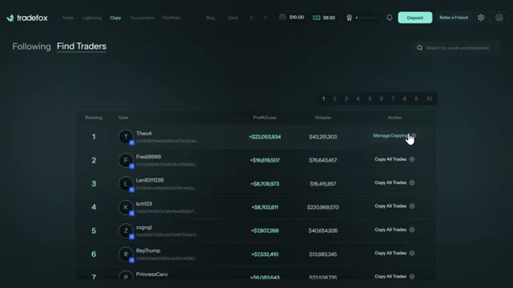
*⏱️ 00:00:07 — Tableau de bord de la plateforme Tradefox listant les meilleurs traders Polymarket, leurs profits/pertes et les boutons de copy trading.*

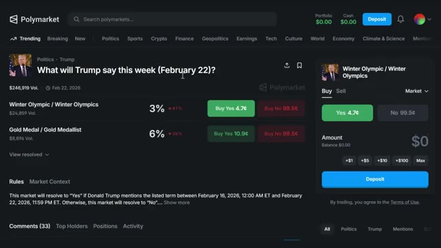
*⏱️ 00:00:21 — Interface de trading Polymarket présentant le marché de prédiction sur les discours de Donald Trump avec carnet d'ordres d'achat/vente.*

---

### ⏱️ `[00:00:27 - 00:00:46]` | Segment #02

**🔊 Audio (Transcription Intégrale Mot pour Mot en Français) :**
> Restez bien jusqu'à la fin car je vais vous montrer comment trouver ces opportunités vous-même afin que vous puissiez commencer à les exploiter dès aujourd'hui. Entrons dans le vif du sujet. Mais d'abord, préparons votre inscription sur Polymarket. Cela prend moins de deux minutes, mais il y a une étape cruciale que la plupart des débutants ratent et qui peut vous coûter de l'argent. Je vais vous montrer exactement comment éviter cela.

**👁️ Analyse Visuelle d'Écran (gemini-3.5-flash-lite) :**
**Interface & Outils** : Site web de Polymarket (plateforme de marchés de prédiction décentralisée).

**Contenu textuel & Code** : Listes de marchés de prédiction avec cotes, pourcentages "Yes/No", volumes de transactions, et catégories (Tech, Trending, Politique, etc.).

**Action / Démonstration** : Navigation et présentation de l'interface utilisateur de la plateforme de prédiction Polymarket.

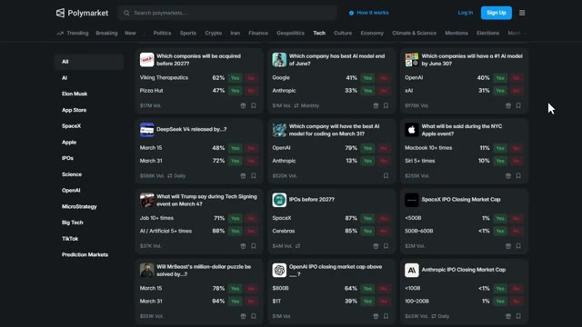
*⏱️ 00:00:32 — Capture d'écran de l'interface du site Polymarket affichant divers marchés de prédiction technologiques (Tech) avec les pourcentages de probabilité.*

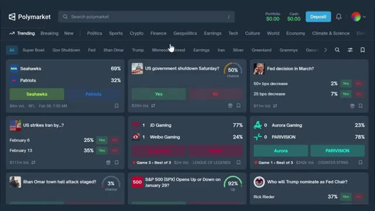
*⏱️ 00:00:37 — Capture d'écran de l'interface Polymarket sur l'onglet principal des marchés tendances (Trending) avec différentes catégories de paris (sport, politique, économie, etc.).*

---

### ⏱️ `[00:00:47 - 00:01:11]` | Segment #03

**🔊 Audio (Transcription Intégrale Mot pour Mot en Français) :**
> Très bien, allons configurer votre compte sur Polymarket. D'abord, cliquez sur le lien dans la description ci-dessous. Cela vous mènera directement à la page d'inscription de Polymarket. Vous verrez que vous pouvez continuer en utilisant votre compte Google ou en utilisant une autre adresse e-mail. Vous verrez également l'option de connecter votre portefeuille. Polymarket est une plateforme décentralisée, vous aurez donc besoin d'un portefeuille Web3 comme Metamask, Phantom, OKEx Wallet, Coinbase Wallet ou Wallet Connect.

**👁️ Analyse Visuelle d'Écran (gemini-3.5-flash-lite) :**
**Interface & Outils** : Site web Polymarket (marché de prédictions décentralisé).

**Contenu textuel & Code** : Options d'inscription ("Continue with Google", champ Email, logos de portefeuilles Web3), marchés de prédiction généraux avec pourcentages de cotes et volumes.

**Action / Démonstration** : Clic sur le bouton d'inscription pour afficher la fenêtre modale de création de compte Polymarket.

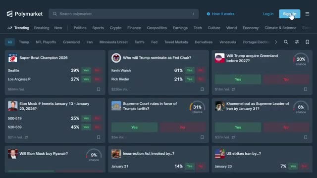
*⏱️ 00:00:53 — Page d'accueil de la plateforme Polymarket avec le curseur orienté sur le bouton "Sign Up" en haut à droite.*

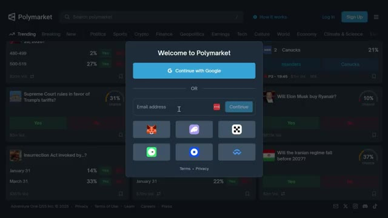
*⏱️ 00:00:59 — Fenêtre modale "Welcome to Polymarket" présentant les options d'inscription via Google, adresse e-mail et portefeuilles Web3.*

---

### ⏱️ `[00:01:12 - 00:01:46]` | Segment #04

**🔊 Audio (Transcription Intégrale Mot pour Mot en Français) :**
> Pour ce tutoriel, je m'inscris en utilisant mon compte Google parce que c'est le moyen le plus rapide. Après cela, vous serez redirigé vers le tableau de bord de Polymarket. Maintenant que vous êtes connecté, vous devez déposer des fonds. En haut à droite, cliquez sur Déposer. Polymarket fonctionne sur le réseau Polygon et utilise l'USDC comme monnaie principale. Vous avez quatre options ici. Transférer des cryptos, déposer par carte, connecter un échange et déposer avec PayPal. Si vous avez déjà des cryptos dans un autre portefeuille ou un autre échange, vous pouvez les transférer directement ou les transférer depuis une autre chaîne. Commencez par sélectionner votre jeton.

**👁️ Analyse Visuelle d'Écran (gemini-3.5-flash-lite) :**
**Interface & Outils** : Plateforme web de marchés de prédictions Polymarket.

**Contenu textuel & Code** : Tableau de bord Polymarket, solde de compte ($0.00), bouton « Deposit », options de rechargement (Transfer Crypto, Deposit with Card, Connect Exchange, Deposit with PayPal) et cartes d'événements de marchés de prédiction.

**Action / Démonstration** : Navigation sur l'interface de Polymarket et ouverture de la fenêtre modale de dépôt de fonds.

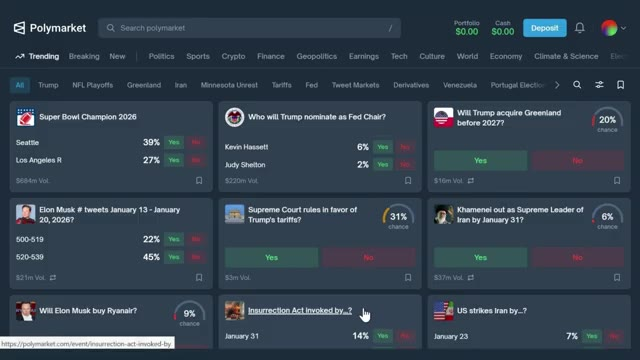
*⏱️ 00:01:20 — Vue du tableau de bord principal de Polymarket affichant divers marchés de prédiction et l'option de dépôt en haut à droite.*

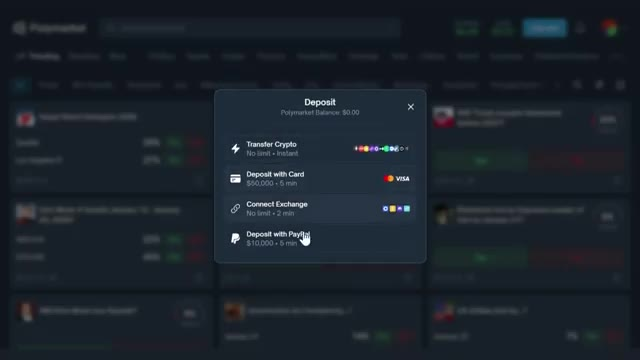
*⏱️ 00:01:29 — Fenêtre contextuelle « Deposit » sur Polymarket proposant les options de dépôt via crypto, carte bancaire, connexion d'exchange ou PayPal.*

---

### ⏱️ `[00:01:46 - 00:02:06]` | Segment #05

**🔊 Audio (Transcription Intégrale Mot pour Mot en Français) :**
> Vous verrez des jetons pris en charge tels que USDC, ARB, BNB, BTCB, Binance, USD, et plus encore. Ensuite, choisissez le réseau. Les réseaux disponibles incluent Ethereum, Solana, BSC, Base, Polygon, et d'autres. C'est essentiel. Assurez-vous que le réseau que vous sélectionnez correspond au réseau à partir duquel vous envoyez.

**👁️ Analyse Visuelle d'Écran (gemini-3.5-flash-lite) :**
**Interface & Outils** : Polymarket (plateforme web de marché de prédiction / transfert crypto)

**Contenu textuel & Code** : Menu déroulant "Supported token" listant divers jetons (USDC, USDC.e, ARB, BNB, BTCB, BUSD, CBBTC, DAI, ETH, HYPE, MATIC), sélection du réseau "Ethereum", code QR et adresse de dépôt.

**Action / Démonstration** : Démonstration de la sélection du jeton et du réseau (blockchain) approprié pour effectuer un transfert de cryptomonnaies vers Polymarket.

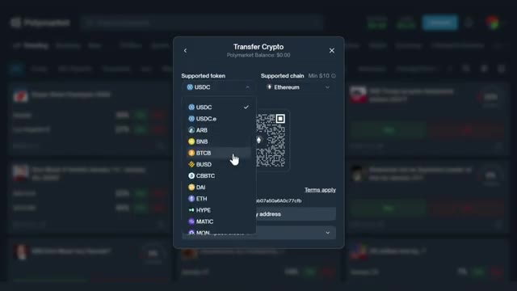
*⏱️ 00:01:51 — Fenêtre modale "Transfer Crypto" sur la plateforme Polymarket, affichant le menu déroulant de sélection des jetons supportés (USDC, ARB, BNB, BTCB, etc.) et le choix du réseau.*

---

### ⏱️ `[00:02:07 - 00:02:26]` | Segment #06

**🔊 Audio (Transcription Intégrale Mot pour Mot en Français) :**
> Si vous envoyez des USDC sur Ethereum mais que vous sélectionnez Polygon, vos fonds seront perdus pour toujours. Une fois sélectionné, scannez le code QR ou copiez l'adresse du portefeuille à l'aide du bouton de copie pour éviter les erreurs, puis collez-la dans votre portefeuille ou votre plateforme d'échange. Les fonds arrivent généralement en quelques minutes. Maintenant, voici où la plupart des gens perdent de l'argent sur Polymarket.

**👁️ Analyse Visuelle d'Écran (gemini-3.5-flash-lite) :**
**Interface & Outils** : Polymarket et Bitunix

**Contenu textuel & Code** : Paramètres de dépôt et de retrait de cryptomonnaies incluant la sélection du réseau (Solana), l'adresse de dépôt, le montant reçu (24,9588 USDC) et les frais de réseau (0,8 USDC).

**Action / Démonstration** : Sélection d'un réseau blockchain pour un transfert d'USDC et confirmation de l'ordre de retrait.

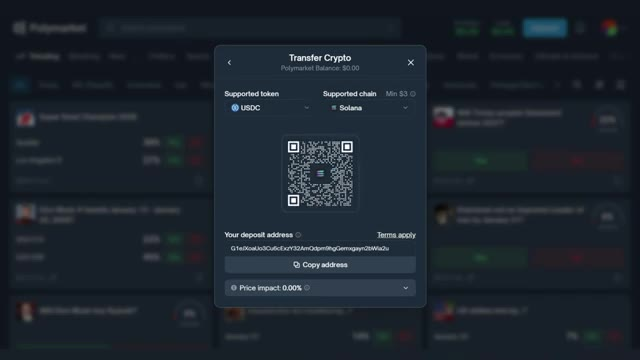
*⏱️ 00:02:12 — Interface de dépôt Polymarket affichant les détails de transfert de crypto pour l'USDC sur la blockchain Solana, avec un code QR et une adresse de portefeuille.*

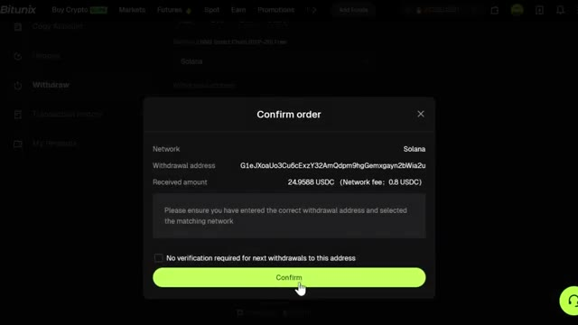
*⏱️ 00:02:21 — Fenêtre de confirmation d'ordre de retrait sur la plateforme Bitunix, montrant le réseau Solana, l'adresse de retrait et les frais de réseau.*

---

### ⏱️ `[00:02:26 - 00:02:49]` | Segment #07

**🔊 Audio (Transcription Intégrale Mot pour Mot en Français) :**
> Ils ne comprennent pas comment lire les marchés. Laissez-moi vous montrer la seule chose qui sépare les gagnants des perdants. Décomposons la façon de vraiment lire un marché Polymarket. En haut, vous verrez la question du marché. En dessous de cela, vous verrez les cotes actuelles. Disons d'ici le 31 décembre 2026. Le « Oui » s'échange à 0,20 $ et le « Non » s'échange à 0,81 $.

**👁️ Analyse Visuelle d'Écran (gemini-3.5-flash-lite) :**
**Interface & Outils** : Site web / plateforme de marché de prédiction Polymarket

**Contenu textuel & Code** : Question du marché ("When will Bitcoin hit $150k?"), échéances ("by March 31, 2026", "by June 30, 2026"), probabilités (4%, 10%, 20%), prix d'achat Yes/No (5.0c, 11c, 20c), volumes ($2,973,122) et formulaire d'ordre d'achat.

**Action / Démonstration** : Navigation sur la plateforme Polymarket et explication visuelle de la structure d'un marché de prédiction (question, cotes, boutons d'exécution).

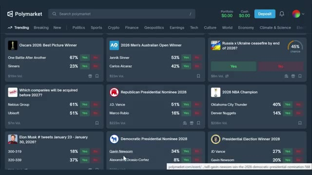
*⏱️ 00:02:32 — Page d'accueil de la plateforme Polymarket affichant une grille de divers marchés de prédiction tendance avec leurs cotes et volumes.*

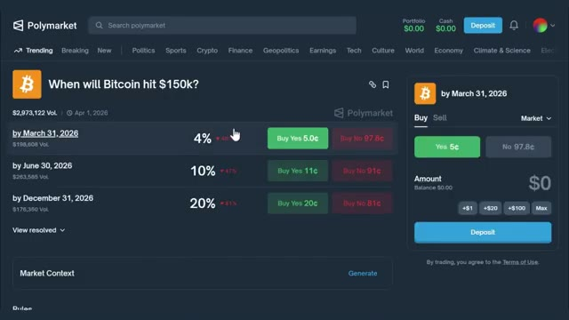
*⏱️ 00:02:37 — Interface détaillée d'un marché Polymarket "When will Bitcoin hit $150k?" montrant la question principale, les différentes échéances temporelles, les probabilités et le carnet/panneau d'achat.*

---

### ⏱️ `[00:02:49 - 00:03:10]` | Segment #08

**🔊 Audio (Transcription Intégrale Mot pour Mot en Français) :**
> Cela signifie que le marché estime qu'il y a 20 % de chances que le Bitcoin atteigne 150 000 $ et 81 % de chances qu'il ne l'atteigne pas. Ces probabilités changent en temps réel en fonction de ce que les traders achètent et vendent. Si plus de personnes achètent « oui », le prix augmente. Si plus de personnes achètent « non », le prix baisse. Maintenant, voici la partie la plus importante que la plupart des débutants ignorent.

**👁️ Analyse Visuelle d'Écran (gemini-3.5-flash-lite) :**
**Interface & Outils** : Présentation ou face-caméra explicatif du trader sans interface logicielle partagée.

**Contenu textuel & Code** : Explications orales des stratégies et mise en contexte méthodologique du marché.

**Action / Démonstration** : Explications face caméra et analyse conceptuelle des marchés.

---

### ⏱️ `[00:03:10 - 00:03:30]` | Segment #09

**🔊 Audio (Transcription Intégrale Mot pour Mot en Français) :**
> Vous devez lire les règles. Chaque marché dispose d'une section de critères de résolution qui explique exactement comment le marché sera résolu. C'est là que vous trouvez des gains garantis. Par exemple, examinons un marché simple pour comprendre comment cela fonctionne. Les règles peuvent dire quelque chose de très précis sur ce qui est admissible et ce qui ne l'est pas.

**👁️ Analyse Visuelle d'Écran (gemini-3.5-flash-lite) :**
**Interface & Outils** : Site web Polymarket (plateforme de prédictions décentralisée).

**Contenu textuel & Code** : Intitulé du marché ("When will Bitcoin hit $150k? by March 31, 2026"), section "Rules" spécifiant la source de résolution (bougies 1m BTC/USDT sur Binance), cotes d'achat/vente (Yes 5¢ / No 97.8¢), bouton "Deposit".

**Action / Démonstration** : Analyse visuelle des règles spécifiques de résolution d'un contrat de prédiction pour repérer d'éventuelles failles ou opportunités de gains.

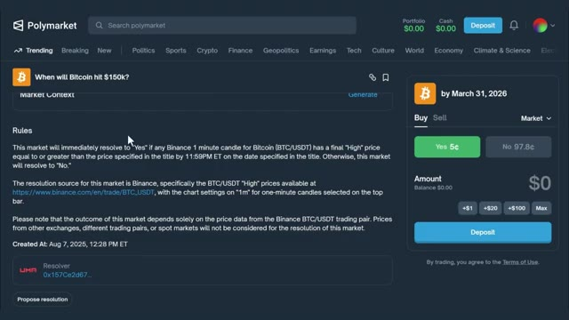
*⏱️ 00:03:15 — Page du marché de prédiction Polymarket affichant les règles de résolution détaillées pour la prédiction "When will Bitcoin hit $150k? by March 31, 2026".*

---

### ⏱️ `[00:03:30 - 00:04:02]` | Segment #10

**🔊 Audio (Transcription Intégrale Mot pour Mot en Français) :**
> Les dates, les sources, les définitions exactes, tout cela a de l'importance. Remarquez à quel point les règles sont précises ? C'est là qu'intervient l'avantage. Les traders ne lisent pas les règles. Ils voient un titre sur Twitter, ils achètent en panique ou vendent en panique, et ils perdent de l'argent. Mais si vous lisez les règles, vous pouvez trouver des opportunités où le marché est mal évalué parce que les gens réagissent aux émotions plutôt qu'aux faits. C'est exactement comme ça que j'ai pu trouver des gains garantis sur Polymarket. Je ne suis pas plus intelligent que n'importe qui d'autre. Je lis simplement les règles. Stratégie

**👁️ Analyse Visuelle d'Écran (gemini-3.5-flash-lite) :**
**Interface & Outils** : Présentation ou face-caméra explicatif du trader sans interface logicielle partagée.

**Contenu textuel & Code** : Explications orales des stratégies et mise en contexte méthodologique du marché.

**Action / Démonstration** : Explications face caméra et analyse conceptuelle des marchés.

---

### ⏱️ `[00:04:02 - 00:04:34]` | Segment #11

**🔊 Audio (Transcription Intégrale Mot pour Mot en Français) :**
> number one is news scalping, or what I like to call buy the headline, sell the rip. This is for traders who are chronically online. When breaking news hits, momentum explodes before anyone understands what's happening. If you're fast, you ride the first wave. If you're late, you become food for the whales. Here's the move you can actually make. As soon as a high-impact headline drops such as Trump announcement, Fed decision, ceasefire, new tariffs, breaking political scandal, you then buy the side that spikes. You don't have to overthink it. Momentum beats logic.

**👁️ Analyse Visuelle d'Écran (gemini-3.5-flash-lite) :**
**Interface & Outils** : Présentation ou face-caméra explicatif du trader sans interface logicielle partagée.

**Contenu textuel & Code** : Explications orales des stratégies et mise en contexte méthodologique du marché.

**Action / Démonstration** : Explications face caméra et analyse conceptuelle des marchés.

---

### ⏱️ `[00:04:35 - 00:04:53]` | Segment #12

**🔊 Audio (Transcription Intégrale Mot pour Mot en Français) :**
> Ensuite, vous vendez aux acheteurs paniqués en quelques minutes. Cette stratégie repose sur la vitesse pure. Les 30 premières secondes comptent. Si vous êtes en retard, ne courez pas après. Vous vendez avant que le carnet d'ordres ne s'amenuise. L'argent se fait avant que les particuliers n'arrivent. Regardez ça. Le marché a bondi de 77 % dès la première minute, puis a lentement reflué.

**👁️ Analyse Visuelle d'Écran (gemini-3.5-flash-lite) :**
**Interface & Outils** : Présentation ou face-caméra explicatif du trader sans interface logicielle partagée.

**Contenu textuel & Code** : Explications orales des stratégies et mise en contexte méthodologique du marché.

**Action / Démonstration** : Explications face caméra et analyse conceptuelle des marchés.

---

### ⏱️ `[00:04:54 - 00:05:32]` | Segment #13

**🔊 Audio (Transcription Intégrale Mot pour Mot en Français) :**
> If you bought the spike and sold 5 minutes later, you made 70-75% in minutes. It's the closest thing to day trading adrenaline you'll find on chain. strategy number two is personality driven mention trading some people talk too much some politicians give hour-long monologues and repeat phrases six times other politicians give 12-minute statements with teleprompters and zero surprises this predictability is edge here's the strategy bet yes on predictable mentions during long speeches or bet no when the speaker is controlled scripted or unlikely to go off book you're trading human behavior not politics events with long

**👁️ Analyse Visuelle d'Écran (gemini-3.5-flash-lite) :**
**Interface & Outils** : Présentation ou face-caméra explicatif du trader sans interface logicielle partagée.

**Contenu textuel & Code** : Explications orales des stratégies et mise en contexte méthodologique du marché.

**Action / Démonstration** : Explications face caméra et analyse conceptuelle des marchés.

---

### ⏱️ `[00:05:32 - 00:05:53]` | Segment #14

**🔊 Audio (Transcription Intégrale Mot pour Mot en Français) :**
> scheduled durations and high emotional stakes are gold mines because people forget the speaker patterns and bet emotionally instead of statistically. For example, U.S. President's Donald Trump speech had a mention market. What will Trump say at the Energy and Innovation Summit on July 15th? Yes, for saying millions, billion, or trillion was trading at 30.5 cents.

**👁️ Analyse Visuelle d'Écran (gemini-3.5-flash-lite) :**
**Interface & Outils** : Présentation ou face-caméra explicatif du trader sans interface logicielle partagée.

**Contenu textuel & Code** : Explications orales des stratégies et mise en contexte méthodologique du marché.

**Action / Démonstration** : Explications face caméra et analyse conceptuelle des marchés.

---

### ⏱️ `[00:05:54 - 00:06:16]` | Segment #15

**🔊 Audio (Transcription Intégrale Mot pour Mot en Français) :**
> The speech ran for more than two hours, and he mentioned it 15 times. Yes, resolved, giving almost 70% profit. You're not predicting politics. You're predicting personality. Strategy number three is all about breaking media narratives and trading reality. In geopolitics and elections, the biggest edge comes from seeing reality earlier and more accurately than the crowd.

**👁️ Analyse Visuelle d'Écran (gemini-3.5-flash-lite) :**
**Interface & Outils** : Présentation ou face-caméra explicatif du trader sans interface logicielle partagée.

**Contenu textuel & Code** : Explications orales des stratégies et mise en contexte méthodologique du marché.

**Action / Démonstration** : Explications face caméra et analyse conceptuelle des marchés.

---

### ⏱️ `[00:06:16 - 00:06:36]` | Segment #16

**🔊 Audio (Transcription Intégrale Mot pour Mot en Français) :**
> Western media either misreads or pushes certain narratives that don't match what's actually happening on the ground, creating massive mispricings on Polymarket. Here's how this works. if you speak the local language, follow regional influencers, or understand cultural sentiment, you immediately see when global traders are betting on the wrong narrative.

**👁️ Analyse Visuelle d'Écran (gemini-3.5-flash-lite) :**
**Interface & Outils** : Présentation ou face-caméra explicatif du trader sans interface logicielle partagée.

**Contenu textuel & Code** : Explications orales des stratégies et mise en contexte méthodologique du marché.

**Action / Démonstration** : Explications face caméra et analyse conceptuelle des marchés.

---

### ⏱️ `[00:06:36 - 00:06:56]` | Segment #17

**🔊 Audio (Transcription Intégrale Mot pour Mot en Français) :**
> That alone becomes a repeatable edge, but you can take it even further with ground-up fundamental analysis. Instead of trusting headlines, you rebuild the situation from verified facts, troop locations, frontline maps, satellite imagery, local leaks, historical patterns. For example, with the Russia-Ukraine conflict.

**👁️ Analyse Visuelle d'Écran (gemini-3.5-flash-lite) :**
**Interface & Outils** : Présentation ou face-caméra explicatif du trader sans interface logicielle partagée.

**Contenu textuel & Code** : Explications orales des stratégies et mise en contexte méthodologique du marché.

**Action / Démonstration** : Explications face caméra et analyse conceptuelle des marchés.

---

### ⏱️ `[00:06:56 - 00:07:15]` | Segment #18

**🔊 Audio (Transcription Intégrale Mot pour Mot en Français) :**
> That often means monitoring independent telegram channels that publish real movements and footage long before major outlets adjust their story. Once you have the facts, you model the next few months. When markets spike on hype, a speech, a rumor, a vague, sources say update, but nothing changes on the ground or in local sentiment.

**👁️ Analyse Visuelle d'Écran (gemini-3.5-flash-lite) :**
**Interface & Outils** : Présentation ou face-caméra explicatif du trader sans interface logicielle partagée.

**Contenu textuel & Code** : Explications orales des stratégies et mise en contexte méthodologique du marché.

**Action / Démonstration** : Explications face caméra et analyse conceptuelle des marchés.

---

### ⏱️ `[00:07:15 - 00:07:34]` | Segment #19

**🔊 Audio (Transcription Intégrale Mot pour Mot en Français) :**
> You fade it. You're not trading narratives. You're trading reality, while everyone else reacts to noise. Let me show you an example. Let's say there's a market asking, will Russia capture a specific city by a specific date? Western media might be hyping up Russian advances, causing yes to spike to 66%.

**👁️ Analyse Visuelle d'Écran (gemini-3.5-flash-lite) :**
**Interface & Outils** : Présentation ou face-caméra explicatif du trader sans interface logicielle partagée.

**Contenu textuel & Code** : Explications orales des stratégies et mise en contexte méthodologique du marché.

**Action / Démonstration** : Explications face caméra et analyse conceptuelle des marchés.

---

### ⏱️ `[00:07:34 - 00:07:54]` | Segment #20

**🔊 Audio (Transcription Intégrale Mot pour Mot en Français) :**
> But if you're following local telegram channels and satellite imagery, and you see that Russian forces are actually stalled 50 kilometers away with no supply lines, you buy no at 51 cents and wait for the market to realize the media narrative was wrong. When the deadline passes and the city hasn't been captured, you claim your profit.

**👁️ Analyse Visuelle d'Écran (gemini-3.5-flash-lite) :**
**Interface & Outils** : Présentation ou face-caméra explicatif du trader sans interface logicielle partagée.

**Contenu textuel & Code** : Explications orales des stratégies et mise en contexte méthodologique du marché.

**Action / Démonstration** : Explications face caméra et analyse conceptuelle des marchés.

---

### ⏱️ `[00:07:55 - 00:08:14]` | Segment #21

**🔊 Audio (Transcription Intégrale Mot pour Mot en Français) :**
> This strategy requires more work, but the edge is massive because most traders just read headlines and panic trade. By the way, if you haven't signed up on Polymarket yet, the link is down below. You can get started with as little as $10 and all of these strategies work at any size. Just keep that in mind. Strategy number four is copy trade in profitable whales.

**👁️ Analyse Visuelle d'Écran (gemini-3.5-flash-lite) :**
**Interface & Outils** : Présentation ou face-caméra explicatif du trader sans interface logicielle partagée.

**Contenu textuel & Code** : Explications orales des stratégies et mise en contexte méthodologique du marché.

**Action / Démonstration** : Explications face caméra et analyse conceptuelle des marchés.

---

### ⏱️ `[00:08:15 - 00:08:50]` | Segment #22

**🔊 Audio (Transcription Intégrale Mot pour Mot en Français) :**
> And for this, you need TradeFox. Some wallets are monsters, consistent seven-digit returns. They're not guessing. They have systems, arbitrage, delta-neutral pairs, data feeds, sometimes actual insiders. With these factors in place, you can't beat these traders, but you can copy them. TradeFox is the only tool you need for this. It's a professional prediction market aggregator and copy trading platform specifically built for Polymarket. Here's what makes TradeFox powerful. You can automatically mirror trades from top performing traders with customizable settings. You can set fixed amounts per trade or use

**👁️ Analyse Visuelle d'Écran (gemini-3.5-flash-lite) :**
**Interface & Outils** : Présentation ou face-caméra explicatif du trader sans interface logicielle partagée.

**Contenu textuel & Code** : Explications orales des stratégies et mise en contexte méthodologique du marché.

**Action / Démonstration** : Explications face caméra et analyse conceptuelle des marchés.

---

### ⏱️ `[00:08:50 - 00:09:08]` | Segment #23

**🔊 Audio (Transcription Intégrale Mot pour Mot en Français) :**
> percentages. For example, if a whale bets $500, you can automatically bet 10% of that, which is $50. You can set take profits, stop losses, and even trailing stops to protect your capital. Tradefox tracks trader performance in real time. Some of these whales have gains up to 8,000%.

**👁️ Analyse Visuelle d'Écran (gemini-3.5-flash-lite) :**
**Interface & Outils** : Présentation ou face-caméra explicatif du trader sans interface logicielle partagée.

**Contenu textuel & Code** : Explications orales des stratégies et mise en contexte méthodologique du marché.

**Action / Démonstration** : Explications face caméra et analyse conceptuelle des marchés.

---

### ⏱️ `[00:09:08 - 00:09:38]` | Segment #24

**🔊 Audio (Transcription Intégrale Mot pour Mot en Français) :**
> You can also manually paste wallet addresses if you find a whale you want to copy outside the platform. Here's how to do this properly. No all-ins. Only allow 1 to 2% allocations per whale. You want 5 whales max. Copy too many and you become an index fund. Your job is to ride behind them without getting greedy. Have a solid risk management. Never copy 100%. Keep 60 to 70% of your bankroll for your own trades. Stop copying any whale after two consecutive minus 20% weeks.

**👁️ Analyse Visuelle d'Écran (gemini-3.5-flash-lite) :**
**Interface & Outils** : Présentation ou face-caméra explicatif du trader sans interface logicielle partagée.

**Contenu textuel & Code** : Explications orales des stratégies et mise en contexte méthodologique du marché.

**Action / Démonstration** : Explications face caméra et analyse conceptuelle des marchés.

---

### ⏱️ `[00:09:38 - 00:10:08]` | Segment #25

**🔊 Audio (Transcription Intégrale Mot pour Mot en Français) :**
> As you can see, these wallets are printing consistent returns. You're not trying to be smarter than them. You're just following the smart money. TradeFox makes this completely automated. You set it up once and it runs in the background. You can check out TradeFox from the link down below. All right, let's talk about risk management because this is where most beginners blow up their accounts. Tip number one, always read the rules. I can't stress this enough. The rules are everything. If you don't read the rules, you're gambling. If you do read the rules, you're trading.

**👁️ Analyse Visuelle d'Écran (gemini-3.5-flash-lite) :**
**Interface & Outils** : Présentation ou face-caméra explicatif du trader sans interface logicielle partagée.

**Contenu textuel & Code** : Explications orales des stratégies et mise en contexte méthodologique du marché.

**Action / Démonstration** : Explications face caméra et analyse conceptuelle des marchés.

---

### ⏱️ `[00:10:08 - 00:10:30]` | Segment #26

**🔊 Audio (Transcription Intégrale Mot pour Mot en Français) :**
> Tip number two, start small. Don't go all in on your first trade. Start with $10 to $20 and get a feel for how the platform works. Once you're comfortable, you can scale up. Tip number three, diversify your trades. Don't put all your money into one market. Spread it across multiple guaranteed win opportunities. This way, even if one trade goes wrong, you're still profitable overall.

**👁️ Analyse Visuelle d'Écran (gemini-3.5-flash-lite) :**
**Interface & Outils** : Présentation ou face-caméra explicatif du trader sans interface logicielle partagée.

**Contenu textuel & Code** : Explications orales des stratégies et mise en contexte méthodologique du marché.

**Action / Démonstration** : Explications face caméra et analyse conceptuelle des marchés.

---

### ⏱️ `[00:10:30 - 00:11:04]` | Segment #27

**🔊 Audio (Transcription Intégrale Mot pour Mot en Français) :**
> Tip number four, track your trades. Keep a simple spreadsheet of every trade you make. write down the market the odds you bought at the rules and the outcome this will help you identify patterns and improve over time i'm also going to be releasing more trading and prediction market videos on advanced polymarket strategies so make sure you subscribe and hit the bell icon so you don't miss those and if you want to automate your copy trading and follow the whales check out trade box it's the only tool i use for copy trading on polymarket link is in the description if you found

**👁️ Analyse Visuelle d'Écran (gemini-3.5-flash-lite) :**
**Interface & Outils** : Présentation ou face-caméra explicatif du trader sans interface logicielle partagée.

**Contenu textuel & Code** : Explications orales des stratégies et mise en contexte méthodologique du marché.

**Action / Démonstration** : Explications face caméra et analyse conceptuelle des marchés.

---

### ⏱️ `[00:11:04 - 00:11:21]` | Segment #28

**🔊 Audio (Transcription Intégrale Mot pour Mot en Français) :**
> this video helpful leave a like below. If you have any questions drop them in the comments and I'll answer every single one. And if you want a full walkthrough on how the Polymarket platform works check the video popping on screen right now. Thanks for watching and I'll see you in the next one.

**👁️ Analyse Visuelle d'Écran (gemini-3.5-flash-lite) :**
**Interface & Outils** : Présentation ou face-caméra explicatif du trader sans interface logicielle partagée.

**Contenu textuel & Code** : Explications orales des stratégies et mise en contexte méthodologique du marché.

**Action / Démonstration** : Explications face caméra et analyse conceptuelle des marchés.

---

