# 🎬 Claude Code + Trading Tools = $10,000/Month

> **Chaîne** : [Alex Carter](https://www.youtube.com/@AlexCarterTrading)  
> **Lien YouTube** : [https://www.youtube.com/watch?v=D8eIukpQ6HA](https://www.youtube.com/watch?v=D8eIukpQ6HA)  
> **Date de publication** : 20260605  
> **Durée** : 00:13:00  
> **Identifiant vidéo** : `D8eIukpQ6HA`  
> **Transcription & Analyse** : `whisper-v3-large-turbo+gemini-3.5-flash-lite`  

---

## 📌 Synthèse Exécutive & Outils

### 💡 Résumé
Dans cette vidéo intitulée **Claude Code + Outils de Trading = 10 000 $/Mois**, Alex Carter détaille une approche stratégique et pratique du trading et de l'automatisation par agents IA.

### 🛠️ Outils, Modèles & Logiciels Présentés
- **TradingView & Claude Code** : Analyse technique avancée et automatisation algorithmique.

### 🔑 Points Clés & Enseignements Stratégiques
- Respect rigoureux du ratio risque/rendement et du money management.
- Automatisation méthodique des déclencheurs d'ordres via des agents intelligents.

---

## ⏱️ Chronologie & Transcription Complète Audio & Visuelle (Mot pour Mot)

### ⏱️ `[00:00:00 - 00:00:37]` | Segment #01

**🔊 Audio (Transcription Intégrale Mot pour Mot en Français) :**
> La plupart des traders n'ont aucune idée de ce que Claude peut réellement faire dans votre trading, et ceux qui le savent n'en parlent pas. Vous pouvez regarder cent vidéos sur YouTube à propos de l'IA et du trading, et la plupart d'entre elles sont plutôt bonnes jusqu'au moment qui compte vraiment, et là, elles sautent cette partie. Ils vous montrent le résultat, ils vous montrent le point fort, et ils omettent chaque étape qui les a menés là. Donc dans cette vidéo, je vais vous montrer exactement ce que Claude peut faire et quels outils de trading vous pouvez intégrer avec pour rendre votre trading dix fois plus facile. Je vais vous guider à travers les démos, vous montrer exactement ce que chaque outil fait et ce qui est réellement possible dès maintenant.

**👁️ Analyse Visuelle d'Écran (gemini-3.5-flash-lite) :**
**Interface & Outils** : YouTube, HyperDash

**Contenu textuel & Code** : Résultats de recherche YouTube sur "claude trader", et sur l'image 2 des métriques de trading, listes de portefeuilles, graphiques de PnL et heatmaps de positionnement de marché.

**Action / Démonstration** : Navigation et présentation visuelle des recherches sur l'IA et de tableaux de bord financiers.

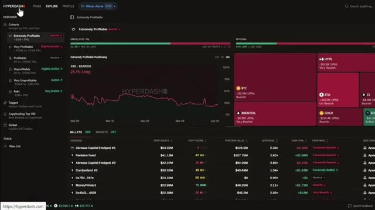
*⏱️ 00:00:18 — Interface de la plateforme HyperDash montrant des tableaux de bord analytiques, des graphiques de performance et des données sur les portefeuilles de traders.*

---

### ⏱️ `[00:00:37 - 00:01:12]` | Segment #02

**🔊 Audio (Transcription Intégrale Mot pour Mot en Français) :**
> Pas de code, pas de logiciel coûteux, pas d'équipe. Et si, d'ici la fin de cette vidéo, vous voulez obtenir la configuration complète, chaque prompt, chaque outil, chaque étape, je vous montrerai exactement où l'obtenir aussi. Donc, si vous voulez voir ce qui est réellement possible, entrons dans le vif du sujet. Avant de passer aux démonstrations, je veux expliquer rapidement pourquoi c'est important. Parce que je pense que la plupart des gens sous-estiment gravement l'ampleur de ce changement. Le marché mondial du trading algorithmique pèse plus de 21 milliards de dollars. Et d'ici 2030, il devrait atteindre 43 milliards de dollars. C'est le monde contre lequel vous concourez

**👁️ Analyse Visuelle d'Écran (gemini-3.5-flash-lite) :**
**Interface & Outils** : Terminal CLI / Claude Code (MCP TradingView).

**Contenu textuel & Code** : Rapport d'audit de code Pine Script répertoriant 9 erreurs (repainting, syntaxe, fonctions obsolètes).

**Action / Démonstration** : Analyse automatique de code Pine Script et détection des bugs par un agent IA.

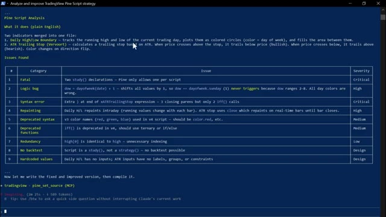
*⏱️ 00:00:55 — Terminal CLI exécutant une analyse IA de code Pine Script avec un tableau d'erreurs.*

---

### ⏱️ `[00:01:12 - 00:01:33]` | Segment #03

**🔊 Audio (Transcription Intégrale Mot pour Mot en Français) :**
> chaque fois que vous ouvrez un trade manuellement. Pendant des décennies, l'avantage en trading appartenait aux institutions, aux fonds spéculatifs, aux entreprises quantitatives. Et voici le chiffre qui remet les choses en perspective. Plus de 70 % de tout le volume des transactions sur les marchés boursiers américains est déjà algorithmique. Sur les plateformes de cryptomonnaies, ce chiffre est encore plus élevé.

**👁️ Analyse Visuelle d'Écran (gemini-3.5-flash-lite) :**
**Interface & Outils** : Navigateur web (pages d'articles financiers sur Quantified Strategies et Allied Market Research).

**Contenu textuel & Code** : Chiffres clés et statistiques du marché : 60 à 75 % du volume de trading est algorithmique aux États-Unis, en Europe et en Asie ; croissance du marché global de 11,1 milliards $ (2019) à 18,8 milliards $ (2024) ; répartition par actifs (Actions, Futures, Forex 20-30 %, Commodities 35-50 %, Options 40 %).

**Action / Démonstration** : Présentation de données et d'études de marché illustrant la domination du trading algorithmique et institutionnel face au trading manuel.

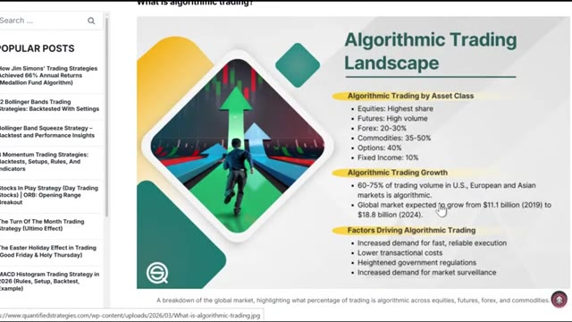
*⏱️ 00:01:18 — Infographie "Algorithmic Trading Landscape" sur le site Quantified Strategies détaillant la répartition et la croissance du trading algorithmique par classe d'actifs.*

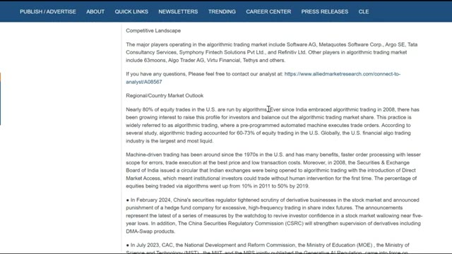
*⏱️ 00:01:23 — Article web et rapport d'analyse indiquant que près de 80 % des transactions d'actions aux États-Unis sont exécutées par des algorithmes.*

---

### ⏱️ `[00:01:34 - 00:01:52]` | Segment #04

**🔊 Audio (Transcription Intégrale Mot pour Mot en Français) :**
> Certaines estimations l'évaluent à plus de 80 %. Vous, qui tradez manuellement, analysez les graphiques et passez des ordres à la main, vous avez combattu contre cela pendant tout ce temps. Ce qui a changé, c'est que des modèles d'IA comme Claude sont devenus suffisamment puissants pour qu'une seule personne puisse désormais commencer à combler cet écart.

**👁️ Analyse Visuelle d'Écran (gemini-3.5-flash-lite) :**
**Interface & Outils** : TradingView (Binance), tableau de bord analytique de benchmark d'IA, terminal de commande Claude Code (CLI).

**Contenu textuel & Code** : - Graphique TradingView : Bitcoin / TetherUS Perpetual Contract (1 minute), indicateur MACD (12, 26, 9), volumes, position acheteuse avec Target +254.0 (0.272%), Stop -87.1 (0.093%), Open P&L +192.5, Risk/Reward Ratio: 2.92.
- Tableau comparatif d'IA : Classement par rendement (% Return, Total P&L, Win Rate, Sharpe) montrant Qwen3 Max en tête (+61.88% / $16,188), DeepSeek Chat V3.1 (+31.7% / $13,170), suivi de Claude Sonnet 4.5, Grok 4, Gemini 2.5 Pro et GPT 5.
- Terminal : Claude Code v2.1.92 (Opus 4.6 1M context - Claude Max).

**Action / Démonstration** : Illustration du trading manuel par analyse technique sur Bitcoin, puis transition vers la comparaison des performances de trading automatisé par différents modèles LLM et lancement du terminal Claude Code.

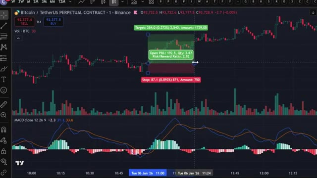
*⏱️ 00:01:38 — Graphique TradingView de la paire BTC/USDT Perpetual (1m) montrant la configuration d'une position acheteuse (Long) avec un ratio risque/récompense de 2.92 et l'indicateur MACD.*

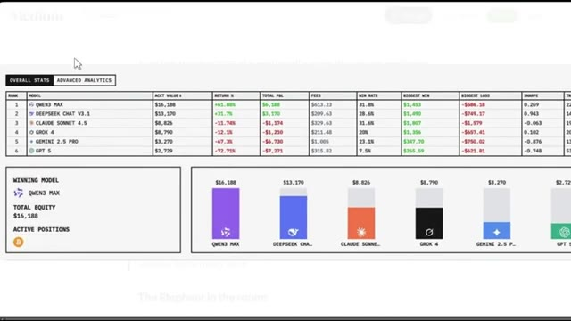
*⏱️ 00:01:43 — Tableau comparatif de performances ("Overall Stats") évaluant différents modèles d'IA (Qwen3 Max, DeepSeek Chat V3.1, Claude Sonnet 4.5, Grok 4, Gemini 2.5 Pro, GPT 5) avec leurs métriques et graphiques en barres.*

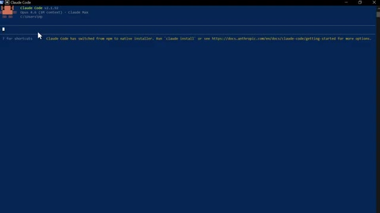
*⏱️ 00:01:47 — Interface de terminal en ligne de commande Claude Code (v2.1.92, modèle Opus 4.6) prête pour la saisie de scripts/prompts.*

---

### ⏱️ `[00:01:52 - 00:02:13]` | Segment #05

**🔊 Audio (Transcription Intégrale Mot pour Mot en Français) :**
> Un rapport de JP Morgan de 2023 a révélé que les outils de trading alimentés par l'IA réduisent les coûts d'exécution jusqu'à 30 % pour les desks institutionnels. Ces mêmes outils sont désormais accessibles aux traders particuliers pour 20 dollars par mois. Vous pouvez désormais disposer d'un système qui surveille vos positions pendant que vous dormez, et qui exécute un trade en plusieurs étapes à partir d'une seule phrase.

**👁️ Analyse Visuelle d'Écran (gemini-3.5-flash-lite) :**
**Interface & Outils** : J.P. Morgan rapport financier et interface de trading WEEX Portfolio Dashboard.

**Contenu textuel & Code** : Graphiques de performance des modèles d'IA au fil du temps (2019-2026), taux d'hallucination, répartition de la marge en pourcentage (47,8 % ETH/USDT, 52,2 % disponible), et tableau des taux de financement avec paires crypto (UNI/USDT, SEI/USDT, BCH/USDT, etc.), taux (8H), APR annualisé et directions (LONG/SHORT).

**Action / Démonstration** : Affichage des données d'un rapport financier institutionnel suivi de la présentation d'un tableau de bord de courtier crypto avec des métriques de portefeuille et des opportunités de trading.

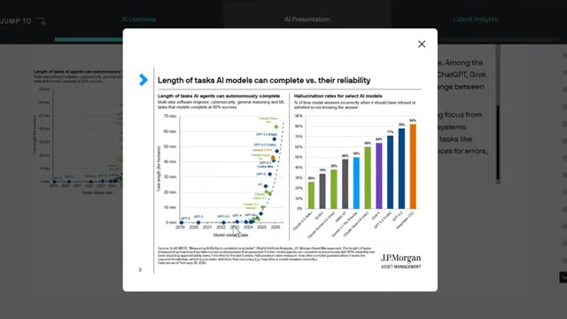
*⏱️ 00:01:57 — Un rapport de J.P. Morgan Asset Management illustrant la longueur des tâches que les modèles d'IA peuvent accomplir et leurs taux d'hallucination.*

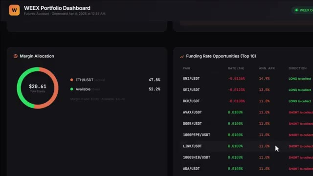
*⏱️ 00:02:08 — Le tableau de bord du portefeuille WEEX montrant l'allocation de marge (ETH/USDT) et les opportunités de taux de financement (Funding Rate Opportunities).*

---

### ⏱️ `[00:02:13 - 00:02:38]` | Segment #06

**🔊 Audio (Transcription Intégrale Mot pour Mot en Français) :**
> Cela analyse des milliers de portefeuilles et vous dit ce que l'argent intelligent fait en ce moment. Cela génère un rapport complet sur les risques de portefeuille en quelques secondes. Les grandes entreprises ont eu ce genre d'avantage pendant des années. Maintenant, vous pouvez l'avoir aussi. Et je veux être clair, je ne dis pas que vous allez immédiatement rivaliser avec des fonds de plusieurs milliards de dollars. Mais les outils pour penser et trader de manière plus systématique sont désormais accessibles à quiconque souhaite réellement y consacrer du temps et en apprendre les concepts.

**👁️ Analyse Visuelle d'Écran (gemini-3.5-flash-lite) :**
**Interface & Outils** : WEEX Portfolio Dashboard, Claude Code (terminal de commandes)

**Contenu textuel & Code** : Métriques de trading (Equity, Unrealized PNL, Win Rate, Total Trades), graphiques de performance, rapport de confluence multi-timeframe incluant les indicateurs EMA Trend, RSI(14), MACD Hist, niveaux de support/résistance et recommandations d'entrée/stop-loss/take-profit.

**Action / Démonstration** : Présentation du tableau de bord de portefeuille et affichage du rapport automatisé sur les risques et les configurations de trade multi-timeframe.

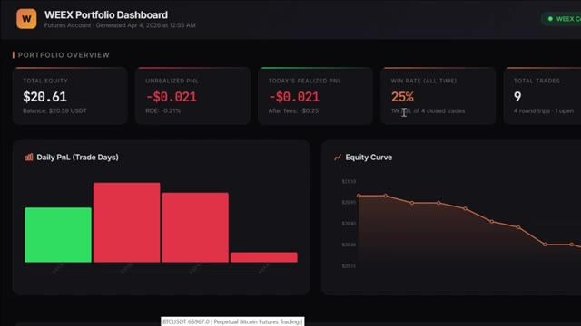
*⏱️ 00:02:20 — Capture d'écran du tableau de bord WEEX Portfolio Dashboard affichant les métriques de portefeuille (Equity de 20,61 $, PnL, Win Rate à 25%) avec des graphiques de PnL journalier et de courbe d'équité.*

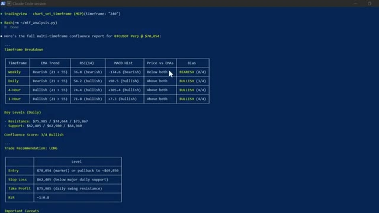
*⏱️ 00:02:26 — Capture d'écran d'une session Claude Code présentant un rapport complet d'analyse multi-timeframe pour BTCUSDT Perp avec un tableau de ventilation par unité de temps, niveaux clés et recommandations de trade.*

---

### ⏱️ `[00:02:39 - 00:03:14]` | Segment #07

**🔊 Audio (Transcription Intégrale Mot pour Mot en Français) :**
> Laissez-moi donc vous montrer exactement à quoi cela ressemble. La première chose que je veux vous montrer, et c'est celle qui m'a vraiment bluffé la première fois que je l'ai vue. Claude lit l'historique des prix, identifie les niveaux les plus significatifs, les trace directement sur votre graphique et vous dit lesquels importent le plus en ce moment. Regardez le graphique. Lignes vertes pour le support, lignes rouges pour la résistance, étiquettes de prix. Nombre de fois où chaque niveau a été testé, tout est tracé automatiquement. Et ensuite, il vous dit exactement où le prix se situe en ce moment même par rapport à ces niveaux et vous donne un biais directionnel basé sur

**👁️ Analyse Visuelle d'Écran (gemini-3.5-flash-lite) :**
**Interface & Outils** : Terminal CLI (Claude Code v2.1.92)

**Contenu textuel & Code** : Modèle Opus 4.5 (1M context), répertoire C:\users\hp, notification d'installation native de Claude Code.

**Action / Démonstration** : Initialisation de l'outil Claude Code en ligne de commande avant le lancement des scripts d'analyse graphique.

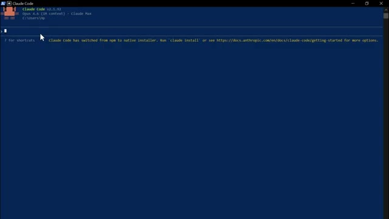
*⏱️ 00:02:48 — Interface du terminal de commande Claude Code prêt à être utilisé.*

---

### ⏱️ `[00:03:14 - 00:03:48]` | Segment #08

**🔊 Audio (Transcription Intégrale Mot pour Mot en Français) :**
> l'historique de la façon dont le prix a réagi à chacun d'entre eux. Avant, cela me prenait 20 minutes à tracer manuellement sur chaque graphique. Claude le fait en quelques secondes. Et ce n'est que le point de départ. Vous pouvez aussi demander à Claude de rédiger des stratégies PineScript complètes à partir du langage naturel, de déboguer vos indicateurs existants, d'exécuter une analyse de confluence multi-unités de temps complète sur l'hebdomadaire, le journalier, le quatre heures et le une heure simultanément, et d'obtenir une recommandation de trade spécifique avec point d'entrée, stop loss et take profit, le tout à partir d'un seul prompt. Mais c'est ici que cela devient entièrement mains libres. Vous pouvez connecter n'importe quel

**👁️ Analyse Visuelle d'Écran (gemini-3.5-flash-lite) :**
**Interface & Outils** : TradingView (graphique et Pine Editor), terminal Claude Code (session CLI).

**Contenu textuel & Code** : - Image 1 : Niveaux S1 (69,460), S2 (69,530), S3 (69,290), S4 (69,040 - strongest support), S5 (68,770), résistances à 69,902 et 70,250.
- Image 2 : Code Pine Script avec fonctions `ta.atr`, calcul de stop loss suiveur `atrStop` (ATR Trailing Stop) et signaux `buySignal` / `sellSignal`.
- Image 3 : Analyse multi-timeframe (Weekly, Daily, 4-Hour, 1-Hour), EMA Trend, RSI(14), MACD Hist, score de confluence 3/4 Bullish, plan de trade (Entry $70,054, Stop Loss $62,405, TP $75,985).

**Action / Démonstration** : Démonstration des capacités de Claude pour tracer automatiquement les niveaux clés de prix, générer des stratégies complètes en Pine Script et produire des analyses multi-timeframes via le terminal.

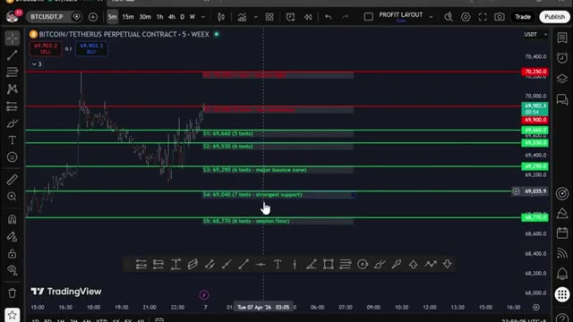
*⏱️ 00:03:22 — Graphique TradingView 5m de BTCUSDT (WEEX) affichant des niveaux de supports horizontaux automatiques verts (S1 à S5 avec nombre de tests) et des résistances rouges.*

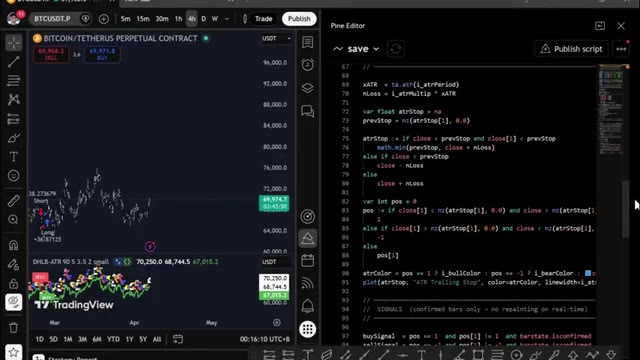
*⏱️ 00:03:31 — Interface scindée de TradingView montrant le graphique BTCUSDT en 4h avec signaux Long/Short et à droite l'éditeur Pine Editor avec du code de calcul ATR Trailing Stop.*

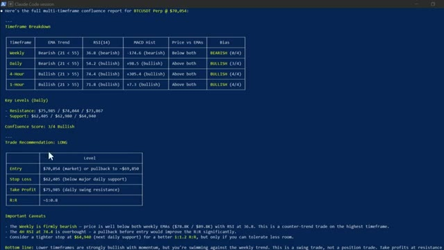
*⏱️ 00:03:39 — Terminal de session Claude Code affichant un rapport de confluence multi-timeframe pour BTCUSDT Perp (tableaux EMA, RSI, MACD, niveaux clés et recommandation de trade LONG).*

---

### ⏱️ `[00:03:48 - 00:04:21]` | Segment #09

**🔊 Audio (Transcription Intégrale Mot pour Mot en Français) :**
> ces stratégies directement sur votre exchange via un webhook TradingView. Quand votre stratégie déclenche un signal sur TradingView, Claude le reçoit instantanément via le webhook et exécute le trade automatiquement sur votre exchange. Entrée, stop loss, take profit. Tout est fait. Sans que vous ne touchiez à rien, le signal est arrivé. Claude l'a traité. Trade ouvert. Confirmation en retour avec chaque détail. Vous créez la stratégie une fois. Et à partir de là, elle tourne toute seule. Maintenant, la suivante, c'est celle qui a complètement changé ma routine quotidienne. J'ai créé mon propre assistant de trading IA en utilisant Claude et Telegram,

**👁️ Analyse Visuelle d'Écran (gemini-3.5-flash-lite) :**
**Interface & Outils** : Terminal CLI (Claude Code session avec protocole MCP TradingView), plateforme TradingView, éditeur Pine Editor, flux de cotation WEEX.

**Contenu textuel & Code** : Paire BTCUSDT Perpetual (autour de 69 500 $ - 70 054 $), code Pine Script version 5 ("Daily H/L + ATR Trailing Stop Strategy"), commandes CLI `chart_manage_indicator` (EMA 21/55, RSI, MACD), signaux d'exécution de trade.

**Action / Démonstration** : Automatisation et interaction entre un terminal d'agent IA (Claude Code) et la plateforme TradingView pour coder, configurer des indicateurs et exécuter des stratégies via webhook.

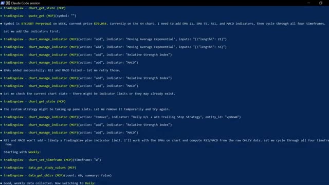
*⏱️ 00:03:56 — Fenêtre de terminal Claude Code Session exécutant des commandes MCP pour manipuler des indicateurs et récupérer des données sur TradingView.*

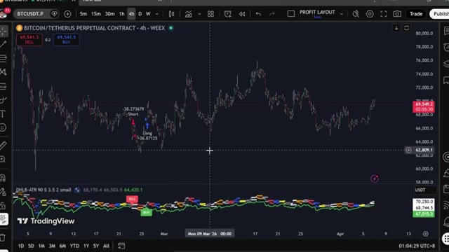
*⏱️ 00:04:04 — Graphique TradingView en unité 4h pour BTCUSDT sur WEEX affichant les signaux d'entrée Long/Short et un oscillateur personnalisé en bas.*

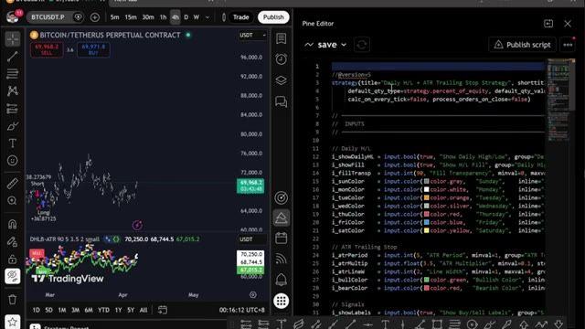
*⏱️ 00:04:13 — Vue partagée TradingView avec graphique BTCUSDT à gauche et l'éditeur Pine Script ouvert à droite affichant le script de la stratégie ATR Trailing Stop.*

---

### ⏱️ `[00:04:21 - 00:04:48]` | Segment #10

**🔊 Audio (Transcription Intégrale Mot pour Mot en Français) :**
> et il trouve des trades rentables pour moi en utilisant l'IA la plus puissante disponible actuellement, plus intelligente que n'importe quel humain ne pourrait l'être. Il exécute des trades, gère mes positions, m'envoie des alertes en temps réel et génère des rapports de portefeuille complets, le tout à partir d'un simple message sur mon téléphone. Ce matin, j'ai placé un trade depuis mon lit, pris mes profits depuis la salle de sport, sans toucher à un seul graphique. C'est Claude qui tourne sur mon ordinateur. Ça a l'air simple. Juste une interface textuelle. Mais regardez ce qu'il peut faire.

**👁️ Analyse Visuelle d'Écran (gemini-3.5-flash-lite) :**
**Interface & Outils** : Présentation ou face-caméra explicatif du trader sans interface logicielle partagée.

**Contenu textuel & Code** : Explications orales des stratégies et mise en contexte méthodologique du marché.

**Action / Démonstration** : Explications face caméra et analyse conceptuelle des marchés.

---

### ⏱️ `[00:04:49 - 00:05:13]` | Segment #11

**🔊 Audio (Transcription Intégrale Mot pour Mot en Français) :**
> En gros, vous pouvez ouvrir une position de trading avec une simple phrase. Ouvre un long levier 5 sur ETH avec 10 $. Place un stop loss à moins 3 % et un take profit à plus 8 %. Regardez-le réfléchir. Et voilà. Position ouverte, stop loss configuré, take profit configuré, confirmation avec le moindre détail, une phrase, et c'est fait. Maintenant, laissez-moi vous montrer quelque chose qui m'a véritablement bluffé la première fois que j'ai lancé ça.

**👁️ Analyse Visuelle d'Écran (gemini-3.5-flash-lite) :**
**Interface & Outils** : Terminal Claude Code v2.1.91 (Opus 4.6), Plateforme de trading WEEX Futures

**Contenu textuel & Code** : Prompt : "Open a 5x long on ETH with $10, set stop loss at minus 3% and take profit at plus 8%", position ETH/USDT Long Cross 5x de montant 0.024 ETH, marge 9.8448 USDT, prix d'entrée 2,062.00, carnet d'ordres.

**Action / Démonstration** : Exécution automatisée d'un ordre de trading de cryptomonnaie par invite de commande textuelle via Claude Code connecté au compte exchange.

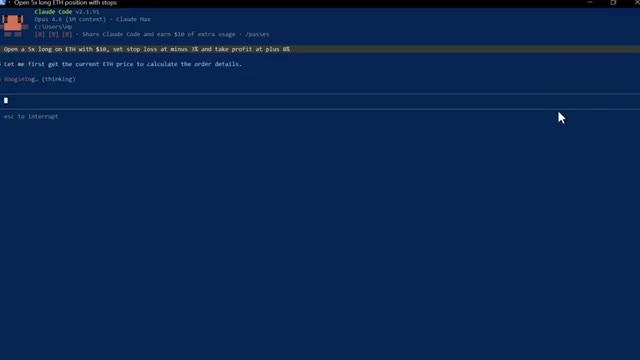
*⏱️ 00:04:55 — Interface du terminal Claude Code affichant l'exécution d'un prompt en langage naturel pour ouvrir une position long avec levier 5x, stop loss et take profit sur ETH.*

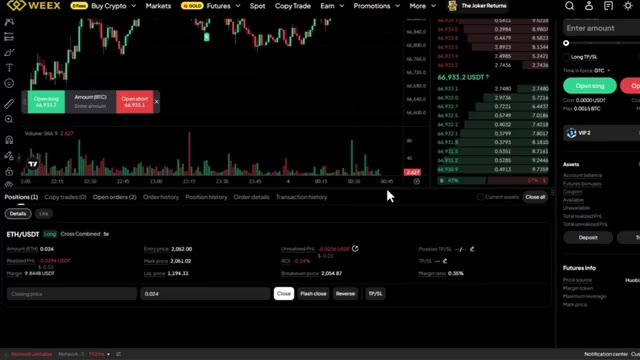
*⏱️ 00:05:01 — Interface de trading de la plateforme WEEX montrant une position ouverte sur ETH/USDT en levier 5x avec le carnet d'ordres et le graphique en chandeliers.*

---

### ⏱️ `[00:05:13 - 00:05:44]` | Segment #12

**🔊 Audio (Transcription Intégrale Mot pour Mot en Français) :**
> Donne-moi un tableau de bord complet de mon portefeuille, toutes mes positions, le PnL, les frais de financement, la courbe de capital, sous forme de rapport visuel. Regardez-le à l'œuvre. Il extrait chaque donnée de mon compte en ce moment même. Et voici ce qu'il génère. Un tableau de bord complet en thème sombre. Courbe de capital. Taux de réussite. Revenus de financement détaillés par crypto. Chaque position ouverte avec la distance de liquidation mise en évidence. C'est le genre de rapport qu'un desk de trading professionnel produirait. Je l'ai obtenu en quelques secondes à partir d'un seul prompt.

**👁️ Analyse Visuelle d'Écran (gemini-3.5-flash-lite) :**
**Interface & Outils** : Présentation ou face-caméra explicatif du trader sans interface logicielle partagée.

**Contenu textuel & Code** : Explications orales des stratégies et mise en contexte méthodologique du marché.

**Action / Démonstration** : Explications face caméra et analyse conceptuelle des marchés.

---

### ⏱️ `[00:05:45 - 00:06:05]` | Segment #13

**🔊 Audio (Transcription Intégrale Mot pour Mot en Français) :**
> Et d'ailleurs, si vous trouvez cela utile jusqu'ici, restez jusqu'à la fin car je vais vous montrer comment configurer tout cela vous-même. Continuez à regarder. Très bien, laissez-moi vous en montrer plus. Vous pouvez aussi connecter ceci à votre Telegram pour envoyer des commandes directement depuis votre téléphone. Vous pouvez taper scanner toutes les paires de contrats futures et trouver les taux de financement les plus élevés dès maintenant.

**👁️ Analyse Visuelle d'Écran (gemini-3.5-flash-lite) :**
**Interface & Outils** : Présentation ou face-caméra explicatif du trader sans interface logicielle partagée.

**Contenu textuel & Code** : Explications orales des stratégies et mise en contexte méthodologique du marché.

**Action / Démonstration** : Explications face caméra et analyse conceptuelle des marchés.

---

### ⏱️ `[00:06:05 - 00:06:25]` | Segment #14

**🔊 Audio (Transcription Intégrale Mot pour Mot en Français) :**
> It scanned every single pair, ranked them by funding rate, calculated the annualized yield, and told me exactly which direction to position to collect that funding instantly. Now, if you do not know what funding rates are, this is essentially free money that the exchange pays out every eight hours to traders who are positioned on the right side of the market.

**👁️ Analyse Visuelle d'Écran (gemini-3.5-flash-lite) :**
**Interface & Outils** : Présentation ou face-caméra explicatif du trader sans interface logicielle partagée.

**Contenu textuel & Code** : Explications orales des stratégies et mise en contexte méthodologique du marché.

**Action / Démonstration** : Explications face caméra et analyse conceptuelle des marchés.

---

### ⏱️ `[00:06:25 - 00:06:55]` | Segment #15

**🔊 Audio (Transcription Intégrale Mot pour Mot en Français) :**
> When funding is positive, longs pay shorts. When funding is negative, shorts pay longs. And some of these rates are extremely high. What this scanner does is find the pairs where that rate is most elevated, calculate what that works out to annually, sometimes 50%, 100%, even higher, and tell you exactly which direction to open a position to sit and collect that payment every eight hours. You're not even trying to predict price direction. You're just farming the rate.

**👁️ Analyse Visuelle d'Écran (gemini-3.5-flash-lite) :**
**Interface & Outils** : Présentation ou face-caméra explicatif du trader sans interface logicielle partagée.

**Contenu textuel & Code** : Explications orales des stratégies et mise en contexte méthodologique du marché.

**Action / Démonstration** : Explications face caméra et analyse conceptuelle des marchés.

---

### ⏱️ `[00:06:55 - 00:07:17]` | Segment #16

**🔊 Audio (Transcription Intégrale Mot pour Mot en Français) :**
> And now instead of manually checking every single pair yourself, which nobody does, Claude does it in seconds and hands you the opportunity on a plate. Now this next section, this is where it gets really interesting. And honestly, this is one of my favorite things I have built with Claude. What if you could scan 33,000 wallets on Hyperliquid? Find the top 20 most profitable traders.

**👁️ Analyse Visuelle d'Écran (gemini-3.5-flash-lite) :**
**Interface & Outils** : Présentation ou face-caméra explicatif du trader sans interface logicielle partagée.

**Contenu textuel & Code** : Explications orales des stratégies et mise en contexte méthodologique du marché.

**Action / Démonstration** : Explications face caméra et analyse conceptuelle des marchés.

---

### ⏱️ `[00:07:17 - 00:07:53]` | Segment #17

**🔊 Audio (Transcription Intégrale Mot pour Mot en Français) :**
> see exactly what they're buying right now their entry prices their leverage their unrealized P&L and get a complete trade plan based on all of it no API keys needed no coding no manual research now hyper liquid very quickly it's a decentralized perpetual exchange running on its own blockchain no KYC no middleman and because it's fully on chain every single trade every position every wallet, it's all public. That's what makes this possible. All right, let me open Claude Code and show you this live. Here's the first thing I want to show you. Claude scans the top 20 most

**👁️ Analyse Visuelle d'Écran (gemini-3.5-flash-lite) :**
**Interface & Outils** : Présentation ou face-caméra explicatif du trader sans interface logicielle partagée.

**Contenu textuel & Code** : Explications orales des stratégies et mise en contexte méthodologique du marché.

**Action / Démonstration** : Explications face caméra et analyse conceptuelle des marchés.

---

### ⏱️ `[00:07:53 - 00:08:15]` | Segment #18

**🔊 Audio (Transcription Intégrale Mot pour Mot en Français) :**
> profitable wallets on Hyperliquid right now, pulls every open position, and ranks them by total profitability. All in one shot. Watch what happens. Claude hits Hyperliquid's public endpoints, starts pulling wallet data across 33,000 addresses, ranks them by profitability, and starts building the report. You can see it working through the wallets in real time.

**👁️ Analyse Visuelle d'Écran (gemini-3.5-flash-lite) :**
**Interface & Outils** : Présentation ou face-caméra explicatif du trader sans interface logicielle partagée.

**Contenu textuel & Code** : Explications orales des stratégies et mise en contexte méthodologique du marché.

**Action / Démonstration** : Explications face caméra et analyse conceptuelle des marchés.

---

### ⏱️ `[00:08:15 - 00:08:35]` | Segment #19

**🔊 Audio (Transcription Intégrale Mot pour Mot en Français) :**
> Entry prices, leverage, unrealized P&L, all coming through live. And here's the output. Top 20 whales ranked, every open position listed. And at the bottom, the overall sentiment summary. Right now, smart money is net long on Bitcoin and net short on almost everything else, especially Ethereum.

**👁️ Analyse Visuelle d'Écran (gemini-3.5-flash-lite) :**
**Interface & Outils** : Présentation ou face-caméra explicatif du trader sans interface logicielle partagée.

**Contenu textuel & Code** : Explications orales des stratégies et mise en contexte méthodologique du marché.

**Action / Démonstration** : Explications face caméra et analyse conceptuelle des marchés.

---

### ⏱️ `[00:08:36 - 00:08:54]` | Segment #20

**🔊 Audio (Transcription Intégrale Mot pour Mot en Français) :**
> That's the kind of signal that used to take hours to piece together manually. Claude does it in under a minute. Now this one is where it gets really interesting. This prompt compares the top 20 most profitable wallets against the top 20 most losing wallets and finds every token where they're on opposite sides of the trade.

**👁️ Analyse Visuelle d'Écran (gemini-3.5-flash-lite) :**
**Interface & Outils** : Présentation ou face-caméra explicatif du trader sans interface logicielle partagée.

**Contenu textuel & Code** : Explications orales des stratégies et mise en contexte méthodologique du marché.

**Action / Démonstration** : Explications face caméra et analyse conceptuelle des marchés.

---

### ⏱️ `[00:08:55 - 00:09:21]` | Segment #21

**🔊 Audio (Transcription Intégrale Mot pour Mot en Français) :**
> Watch it pull both groups simultaneously. Profitable wallets on one side, losing wallets on the other, and then it starts cross-referencing the positions. Here's the output. You can see where both groups agree. They're both long suey. So that's a crowded trade. But look at this. Smart money is heavily long on XMR, TRX, Pendle, and Farcoin, while rec traders are short on these coins. That divergence right there, that's the signal.

**👁️ Analyse Visuelle d'Écran (gemini-3.5-flash-lite) :**
**Interface & Outils** : Présentation ou face-caméra explicatif du trader sans interface logicielle partagée.

**Contenu textuel & Code** : Explications orales des stratégies et mise en contexte méthodologique du marché.

**Action / Démonstration** : Explications face caméra et analyse conceptuelle des marchés.

---

### ⏱️ `[00:09:21 - 00:09:55]` | Segment #22

**🔊 Audio (Transcription Intégrale Mot pour Mot en Français) :**
> This is the kind of analysis that hedge funds pay for. You're getting it from a $20 AI tool and a free public API. And if you want the full hyperliquid setup, the skill code, every prompt, the full whale tracking system. I will tell you exactly how to get all of that in just a moment. Keep watching. Now, if you're ready to take this even further, you can use Claude code to build a fully automated trading bot from start to finish for crypto, stocks, or whatever market you are trading. And honestly, this is how Claude will be changing how we trade forever. And we already

**👁️ Analyse Visuelle d'Écran (gemini-3.5-flash-lite) :**
**Interface & Outils** : Présentation ou face-caméra explicatif du trader sans interface logicielle partagée.

**Contenu textuel & Code** : Explications orales des stratégies et mise en contexte méthodologique du marché.

**Action / Démonstration** : Explications face caméra et analyse conceptuelle des marchés.

---

### ⏱️ `[00:09:55 - 00:10:27]` | Segment #23

**🔊 Audio (Transcription Intégrale Mot pour Mot en Français) :**
> have done this before. Let me show you what the end result actually looks like. This is the dashboard, one URL, every position, your equity curve, your bot status, your whale data, all live, all in one place. No more multiple browser tabs. No more second-guessing entries. And every morning before you even open your laptop, this daily alpha brief is already in your inbox, every day on time and ready to read. It has already scanned the whales, read the charts, checked your account, and handed you the single highest conviction setup for the day,

**👁️ Analyse Visuelle d'Écran (gemini-3.5-flash-lite) :**
**Interface & Outils** : Présentation ou face-caméra explicatif du trader sans interface logicielle partagée.

**Contenu textuel & Code** : Explications orales des stratégies et mise en contexte méthodologique du marché.

**Action / Démonstration** : Explications face caméra et analyse conceptuelle des marchés.

---

### ⏱️ `[00:10:28 - 00:10:48]` | Segment #24

**🔊 Audio (Transcription Intégrale Mot pour Mot en Français) :**
> size to your exact risk. One prompt. The whole stack. And the bot itself is not sitting on your laptop. It is running 24-7 on a cloud server. If it crashes, it restarts itself. If your Wi-Fi drops, it keeps going. Your laptop is just the remote control. Now, the math barrier to building all of this is basically gone.

**👁️ Analyse Visuelle d'Écran (gemini-3.5-flash-lite) :**
**Interface & Outils** : Présentation ou face-caméra explicatif du trader sans interface logicielle partagée.

**Contenu textuel & Code** : Explications orales des stratégies et mise en contexte méthodologique du marché.

**Action / Démonstration** : Explications face caméra et analyse conceptuelle des marchés.

---

### ⏱️ `[00:10:49 - 00:11:09]` | Segment #25

**🔊 Audio (Transcription Intégrale Mot pour Mot en Français) :**
> Before capable models like Cloud Code, this would have taken weeks, if not months, to put together. Now you can go from idea to a working system in an afternoon. And that matters because most strategies do not work. The edge is not in having one perfect strategy. It is in being able to test enough ideas fast enough to find the ones that actually do.

**👁️ Analyse Visuelle d'Écran (gemini-3.5-flash-lite) :**
**Interface & Outils** : Présentation ou face-caméra explicatif du trader sans interface logicielle partagée.

**Contenu textuel & Code** : Explications orales des stratégies et mise en contexte méthodologique du marché.

**Action / Démonstration** : Explications face caméra et analyse conceptuelle des marchés.

---

### ⏱️ `[00:11:10 - 00:11:34]` | Segment #26

**🔊 Audio (Transcription Intégrale Mot pour Mot en Français) :**
> All right. And look, for the next few years, two kinds of traders will exist. The ones using AI and the ones still doing everything manually. Same market. Very different outcomes. Here is how you get on the right side of that. I have put together everything inside the AI Trade Edge community. Every prompt, every bot, every template, every step-by-step guide I personally use, all in one place.

**👁️ Analyse Visuelle d'Écran (gemini-3.5-flash-lite) :**
**Interface & Outils** : Présentation ou face-caméra explicatif du trader sans interface logicielle partagée.

**Contenu textuel & Code** : Explications orales des stratégies et mise en contexte méthodologique du marché.

**Action / Démonstration** : Explications face caméra et analyse conceptuelle des marchés.

---

### ⏱️ `[00:11:34 - 00:12:11]` | Segment #27

**🔊 Audio (Transcription Intégrale Mot pour Mot en Français) :**
> And everything I build going forward gets added straight into the group the moment it drops. We are also testing strategies from all over the internet, automating them using PineScript, running them live, and sharing exactly what works and what does not. So you are not just getting tools. you are getting a live research operation inside there is also a full agentic trading course 2.5 hours beginner to expert no coding background needed by the end of it you will have your own AI trading system running live something most retail traders do not even know is possible right now $79 and

**👁️ Analyse Visuelle d'Écran (gemini-3.5-flash-lite) :**
**Interface & Outils** : Présentation ou face-caméra explicatif du trader sans interface logicielle partagée.

**Contenu textuel & Code** : Explications orales des stratégies et mise en contexte méthodologique du marché.

**Action / Démonstration** : Explications face caméra et analyse conceptuelle des marchés.

---

### ⏱️ `[00:12:11 - 00:12:42]` | Segment #28

**🔊 Audio (Transcription Intégrale Mot pour Mot en Français) :**
> 99 cents a month one good trade covers it and the first 100 members lock in that rate permanently. After that, the price goes up. The link is in the description. You genuinely cannot afford to miss this. And that is it. That is how Claude is changing trading forever and how you can be part of it. If you want to go deep on any of these individually, the full trading view, telegram walkthrough, and in hyper liquid whale tracking, those videos are all popping up on screen right now. Go and check those out at your own pace.

**👁️ Analyse Visuelle d'Écran (gemini-3.5-flash-lite) :**
**Interface & Outils** : Présentation ou face-caméra explicatif du trader sans interface logicielle partagée.

**Contenu textuel & Code** : Explications orales des stratégies et mise en contexte méthodologique du marché.

**Action / Démonstration** : Explications face caméra et analyse conceptuelle des marchés.

---

### ⏱️ `[00:12:42 - 00:12:59]` | Segment #29

**🔊 Audio (Transcription Intégrale Mot pour Mot en Français) :**
> and if you want the full step-by-step guide on how to build your own agentic trading system using Claude, that video is popping up on screen as well. Go and check that out next. If you found this useful, leave a like. It really does help the channel. Subscribe if you have not already and I will see you in the next one.

**👁️ Analyse Visuelle d'Écran (gemini-3.5-flash-lite) :**
**Interface & Outils** : Présentation ou face-caméra explicatif du trader sans interface logicielle partagée.

**Contenu textuel & Code** : Explications orales des stratégies et mise en contexte méthodologique du marché.

**Action / Démonstration** : Explications face caméra et analyse conceptuelle des marchés.

---

