# 🎬 How to Trade Crypto and TradFi on YUBIT (Full Beginner Tutorial)

> **Chaîne** : [Alex Carter](https://www.youtube.com/@AlexCarterTrading)  
> **Lien YouTube** : [https://www.youtube.com/watch?v=etoHR6hLmzc](https://www.youtube.com/watch?v=etoHR6hLmzc)  
> **Date de publication** : 20260618  
> **Durée** : 00:14:49  
> **Identifiant vidéo** : `etoHR6hLmzc`  
> **Transcription & Analyse** : `whisper-v3-large-turbo+gemini-3.5-flash-lite`  

---

## 📌 Synthèse Exécutive & Outils

### 💡 Résumé
Dans cette vidéo intitulée **Comment trader la crypto et la TradFi sur YUBIT (Tutoriel complet pour débutants)**, Alex Carter détaille une approche stratégique et pratique du trading et de l'automatisation par agents IA.

### 🛠️ Outils, Modèles & Logiciels Présentés
- **TradingView & Claude Code** : Analyse technique avancée et automatisation algorithmique.

### 🔑 Points Clés & Enseignements Stratégiques
- Respect rigoureux du ratio risque/rendement et du money management.
- Automatisation méthodique des déclencheurs d'ordres via des agents intelligents.

---

## ⏱️ Chronologie & Transcription Complète Audio & Visuelle (Mot pour Mot)

### ⏱️ `[00:00:00 - 00:00:22]` | Segment #01

**🔊 Audio (Transcription Intégrale Mot pour Mot en Français) :**
> La plupart des tutoriels de trading ont tendance à tout surcompliquer, mais trader sur UBIT est en réalité très simple. C'est l'une des rares plateformes axées sur la crypto où je peux trader du bitcoin et de l'or sur le même compte. Et dans cette vidéo, je vais vous accompagner pour passer de débutant complet à placer en toute confiance votre tout premier trade sur UBIT. Aucune étape sautée, aucune supposition faite.

**👁️ Analyse Visuelle d'Écran (gemini-3.5-flash-lite) :**
**Interface & Outils** : Plateforme de trading en ligne YUBIT (interface futures et gestion de portefeuille)

**Contenu textuel & Code** : Graphique de prix BTCUSDT, carnet d'ordres, panneau de passage d'ordres (Open Long / Open Short) et soldes de compte en USDT.

**Action / Démonstration** : Navigation dans l'interface de trading futures et présentation des différents comptes d'actifs de la plateforme.

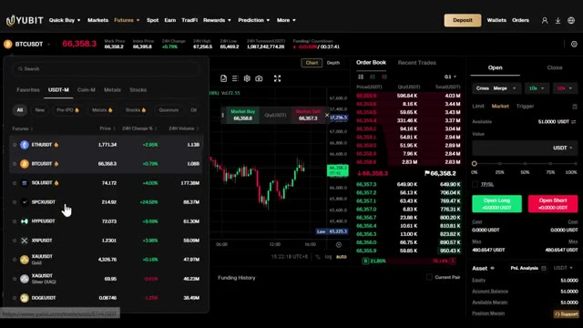
*⏱️ 00:00:11 — Interface de trading futures de la plateforme YUBIT avec le graphique du Bitcoin et le carnet d'ordres.*

*⏱️ 00:00:17 — Vue d'ensemble du portefeuille utilisateur (Assets) sur la plateforme YUBIT avec les différents comptes (Funding, Futures, Spot, TradFi).*

---

### ⏱️ `[00:00:23 - 00:00:43]` | Segment #02

**🔊 Audio (Transcription Intégrale Mot pour Mot en Français) :**
> Et avec mon lien exclusif ci-dessous, vous débloquez jusqu'à 50 000 dollars de bonus de bienvenue, quelque chose que je vais vous expliquer en détail pour que vous ne manquiez pas un seul dollar. À la fin de cette vidéo, vous saurez exactement comment utiliser UBIT et comment réclamer chaque bonus à votre disposition. Alors, commençons. Maintenant, avant de plonger dans le vif du sujet, laissez-moi vous dire rapidement pourquoi je recommande UBIT.

**👁️ Analyse Visuelle d'Écran (gemini-3.5-flash-lite) :**
**Interface & Outils** : Site web de la plateforme d'échange de crypto-monnaies UBIT.

**Contenu textuel & Code** : Paliers de bonus de bienvenue, sections de trading de futures, offres de boîtes mystères (de 50 USDT à 15 000 USDT) et exigences de volume de trading.

**Action / Démonstration** : Présentation des avantages et des bonus d'inscription exclusifs liés à la plateforme UBIT.

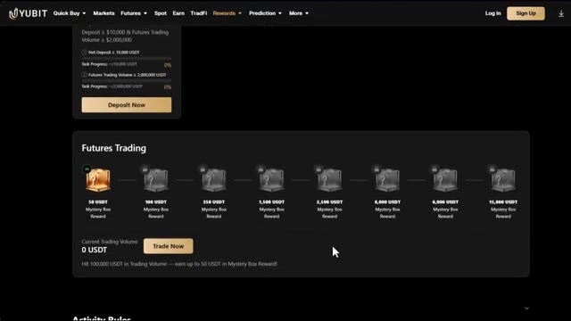
*⏱️ 00:00:28 — Capture d'écran de la page des récompenses de la plateforme UBIT, montrant les paliers de bonus pour le trading de futures et les boîtes mystères.*

*⏱️ 00:00:33 — Page d'accueil de la plateforme UBIT présentant l'échange pour les cryptos, l'or et les actions avec le bouton pour réclamer le bonus de 50 000 USDT.*

---

### ⏱️ `[00:00:44 - 00:01:04]` | Segment #03

**🔊 Audio (Transcription Intégrale Mot pour Mot en Français) :**
> Parce qu'il y a beaucoup d'échanges sur le marché et que celui-ci est vraiment différent. UBIT est un échange centralisé mondial fondé en août 2020. Il propose du trading au comptant, du trading de futures, du copy trading, du staking et des outils de gestion de portefeuille. C'est donc un écosystème complet, pas seulement un échange de base. Mais voici ce qui fait sort Ubit du lot par rapport à presque toutes les autres plateformes.

**👁️ Analyse Visuelle d'Écran (gemini-3.5-flash-lite) :**
**Interface & Outils** : CoinMarketCap et interface de l'exchange YUBIT

**Contenu textuel & Code** : Informations sur l'échange YUBIT (volume de trading, actifs totaux, graphique BTCUSDT, carnet d'ordres)

**Action / Démonstration** : Présentation générale des fonctionnalités, de l'interface de trading et des données de marché de l'exchange YUBIT

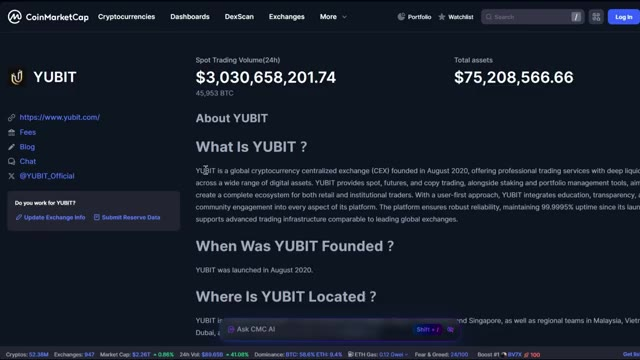
*⏱️ 00:00:49 — Page CoinMarketCap consacrée à l'échange YUBIT affichant le volume spot, les actifs totaux et la description de la plateforme.*

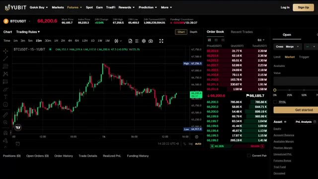
*⏱️ 00:00:54 — Interface de trading de futures de la plateforme YUBIT avec un graphique en chandeliers BTCUSDT et le carnet d'ordres en direct.*

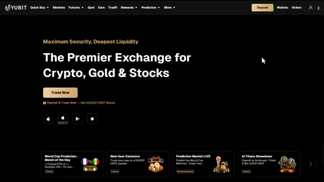
*⏱️ 00:00:59 — Page d'accueil de la plateforme YUBIT présentant les services de trading pour les cryptomonnaies, l'or et les actions.*

---

### ⏱️ `[00:01:05 - 00:01:27]` | Segment #04

**🔊 Audio (Transcription Intégrale Mot pour Mot en Français) :**
> Vous pouvez trader à la fois des contrats à terme sur cryptomonnaies et des actifs financiers traditionnels. Des choses comme l'or, les actions, le pétrole et le forex, le tout dans un seul compte. C'est très rare. La plupart des plateformes vous obligent à gérer plusieurs comptes sur plusieurs plateformes. Sur Ubit, tout est regroupé au même endroit. En plus de cela, Ubit a maintenu une disponibilité de 99,9995 % depuis son lancement.

**👁️ Analyse Visuelle d'Écran (gemini-3.5-flash-lite) :**
**Interface & Outils** : Interface de la plateforme de trading Yubit montrant des graphiques de prix, des carnets d'ordres et des listes d'actifs TradFi et actions.

**Contenu textuel & Code** : Liste des actifs TradFi (XAUUSD, GAUCNH, XAGUSD) et d'actions (INTCUSDT, TSLAUSDT, MSTRUSDT) avec leurs prix et variations sur 24 heures.

**Action / Démonstration** : Navigation dans les menus de la plateforme pour afficher les différents marchés traditionnels et actions disponibles au trading.

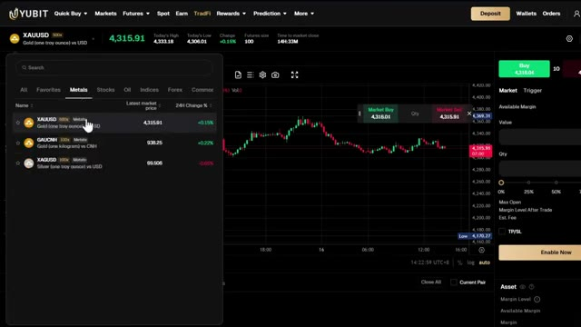
*⏱️ 00:01:10 — Capture d'écran montrant l'interface de trading avec la section "TradFi" et la liste des métaux précieux (XAUUSD) sélectionnés.*

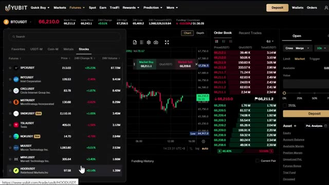
*⏱️ 00:01:21 — Capture d'écran montrant l'interface de trading de la plateforme avec l'onglet "Stocks" affichant divers contrats d'actions (Intel, Tesla, MicroStrategy).*

---

### ⏱️ `[00:01:27 - 00:01:46]` | Segment #05

**🔊 Audio (Transcription Intégrale Mot pour Mot en Français) :**
> C'est une fiabilité de niveau institutionnel. Ils ont également un fonds de protection de 20 000 ETH, ce qui représente plus de 40 millions de USDT, et un système strict de preuve de réserve un pour un, ce qui signifie que chaque actif d'utilisateur est entièrement adossé, transparent et vérifiable sur CoinMarketCap. Vous pouvez aller vérifier cela vous-même.

**👁️ Analyse Visuelle d'Écran (gemini-3.5-flash-lite) :**
**Interface & Outils** : Site web de la plateforme d'échange de cryptomonnaies YUBIT (page Proof of Reserves).

**Contenu textuel & Code** : Ratios de réserve (USDT à 160 %, ETH à 125 %), fonds de protection de 20 000 ETH et 40 000 029,50 USDT, certification CoinMarketCap et explication du mécanisme de réserve 1:1.

**Action / Démonstration** : Présentation visuelle et vérification des données de réserve et de transparence de la plateforme YUBIT.

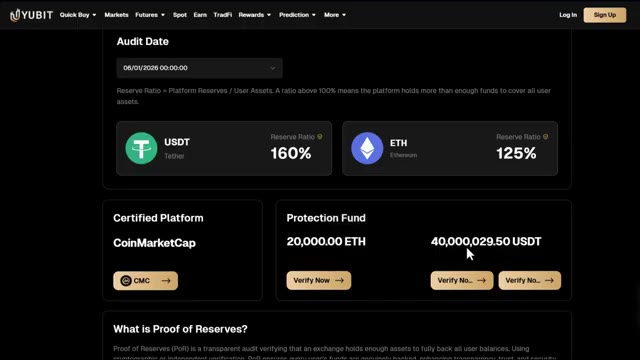
*⏱️ 00:01:32 — Capture d'écran montrant les détails de la preuve de réserve de la plateforme YUBIT avec les ratios pour l'USDT (160 %) et l'ETH (125 %), ainsi que le fonds de protection de 20 000 ETH et 40 000 029,50 USDT.*

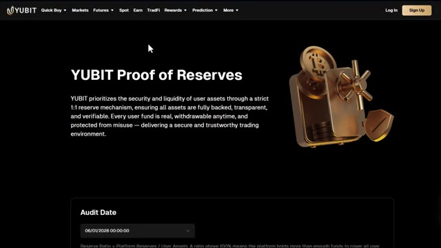
*⏱️ 00:01:36 — Capture d'écran montrant l'en-tête de la page "YUBIT Proof of Reserves" expliquant le mécanisme de réserve strict de 1:1.*

---

### ⏱️ `[00:01:46 - 00:02:23]` | Segment #06

**🔊 Audio (Transcription Intégrale Mot pour Mot en Français) :**
> Et avec mon lien dans la description, vous débloquez le pack de bonus de bienvenue complet, jusqu'à 50 000 USDT de récompenses. Je vais vous montrer exactement comment tout réclamer, alors assurez-vous d'utiliser le lien ci-dessous. Très bien, entrons dans le vif du sujet. Première chose, cliquez sur le lien dans la description. C'est important, utiliser mon lien est ce qui débloque le pack de bonus complet, sans lui vous obtiendrez une offre complètement différente. Une fois que vous êtes sur la page d'Ubit, vous pouvez vous inscrire avec votre adresse e-mail, votre numéro de téléphone ou vous connecter via Google ou Apple ID. Pour ce tutoriel, j'utiliserai l'e-mail, entrez simplement vos coordonnées, créez un mot de passe fort

**👁️ Analyse Visuelle d'Écran (gemini-3.5-flash-lite) :**
**Interface & Outils** : Interface web de la plateforme d'échange YUBIT (pages de récompenses et d'inscription).

**Contenu textuel & Code** : Offres de bonus de bienvenue : "10,000 USDT Position Voucher", paliers de "Futures Trading" avec des boîtes mystères de 50 à 15 000 USDT, et code de parrainage "ALEX".

**Action / Démonstration** : Navigation sur la page des récompenses de la plateforme et présentation de la page d'inscription avec le lien d'affiliation.

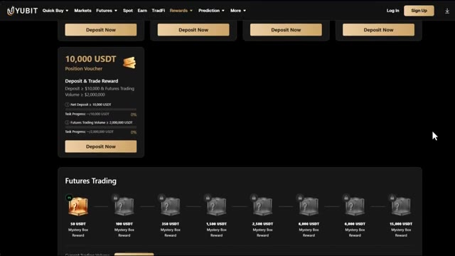
*⏱️ 00:01:55 — Page des récompenses et des bonus de dépôt sur la plateforme YUBIT montrant les différents paliers de bonus en USDT.*

*⏱️ 00:02:04 — Page d'inscription de la plateforme YUBIT avec un visuel de boîte cadeau remplie de pièces d'or et le code de parrainage "ALEX" pré-rempli.*

---

### ⏱️ `[00:02:23 - 00:02:54]` | Segment #07

**🔊 Audio (Transcription Intégrale Mot pour Mot en Français) :**
> mot de passe, accepter les conditions d'utilisation, et cliquer sur s'inscrire. Entrez le code de vérification par e-mail et votre compte est prêt. Tout le processus prend moins de 30 secondes. Et gardez à l'esprit, UBIT est une plateforme sans KYC. Vous n'avez pas besoin de compléter de vérification d'identité pour commencer à trader. Cela la rend accessible même dans les régions restreintes, et cela signifie que vous pouvez commencer à trader presque instantanément après vous être inscrit. Maintenant, avant de déposer quoi que ce soit, laissez-moi vous expliquer rapidement comment UBIT organise vos fonds.

**👁️ Analyse Visuelle d'Écran (gemini-3.5-flash-lite) :**
**Interface & Outils** : Site web de la plateforme YUBIT.

**Contenu textuel & Code** : Texte sur l'absence de KYC ("YUBIT does not request KYC for users to access the TradFi feature").

**Action / Démonstration** : Présentation de l'interface utilisateur et de la politique de non-KYC de la plateforme YUBIT.

*⏱️ 00:02:31 — Page d'accueil de la plateforme YUBIT mettant en avant les cryptos, l'or et les actions.*

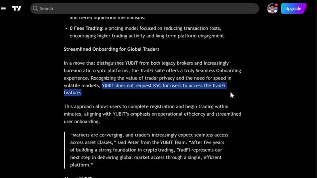
*⏱️ 00:02:38 — Texte explicatif de YUBIT sur l'absence de vérification KYC pour les utilisateurs de TradFi.*

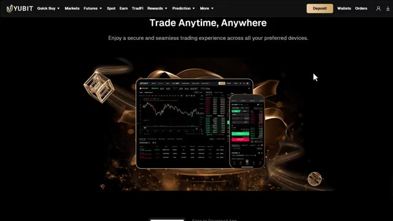
*⏱️ 00:02:46 — Section de la plateforme YUBIT illustrant l'expérience de trading multi-appareils.*

---

### ⏱️ `[00:02:55 - 00:03:27]` | Segment #08

**🔊 Audio (Transcription Intégrale Mot pour Mot en Français) :**
> Parce que c'est un sujet qui embrouille beaucoup de débutants. UBIT sépare vos fonds dans différents portefeuilles selon ce que vous voulez faire. D'abord, vous avez votre compte de financement. C'est là qu'atterrissent vos dépôts en premier. Chaque fois que vous déposez des cryptos, elles vont directement ici. Considérez-le comme le point d'entrée principal pour votre argent. Ensuite, vous avez votre portefeuille spot. C'est là que vous détenez des actifs et que vous tradez aux prix du marché sans effet de levier. Vient ensuite votre portefeuille futures. Vous devez y transférer des fonds avant de pouvoir ouvrir des positions futures avec effet de levier. Ensuite, il y a votre

**👁️ Analyse Visuelle d'Écran (gemini-3.5-flash-lite) :**
**Interface & Outils** : Interface web de l'échange de cryptomonnaies YUBIT (section Assets / Overview).

**Contenu textuel & Code** : Soldes à 0 pour chaque portefeuille (Funding Account, Futures Account, Spot Account, TradFi Account, Earn Account, etc.) et options de dépôt, retrait, transfert et trade.

**Action / Démonstration** : Navigation et présentation des différents comptes et portefeuilles disponibles sur la plateforme YUBIT.

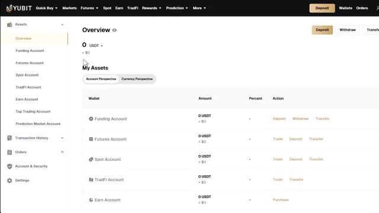
*⏱️ 00:03:03 — Vue d'ensemble des portefeuilles et des comptes sur la plateforme d'échange YUBIT, montrant la liste des différents types de comptes (Funding, Futures, Spot, TradFi, Earn).*

---

### ⏱️ `[00:03:27 - 00:03:46]` | Segment #09

**🔊 Audio (Transcription Intégrale Mot pour Mot en Français) :**
> Portefeuille TradFi. C'est spécifiquement pour négocier des actifs financiers traditionnels comme l'or, les actions, le pétrole et le forex. Vous avez également votre compte d'épargne. C'est là vont vos fonds lorsque vous générez des revenus passifs grâce aux plans d'épargne flexibles et fixes d'Ubit. Ensuite, il y a le compte de trading TAP.

**👁️ Analyse Visuelle d'Écran (gemini-3.5-flash-lite) :**
**Interface & Outils** : Interface web de la plateforme d'échange Yubit (section TradFi Account).

**Contenu textuel & Code** : Affichage du solde total des actifs à 0 OUSDdu ($0) et du PnL non réalisé à 0 OUSDdu, ainsi que le tableau des détails des actifs (Asset, Balance, Occupied margin, Available margin, Margin Level, Action).

**Action / Démonstration** : Navigation dans le menu latéral pour afficher la section TradFi Account de la plateforme.

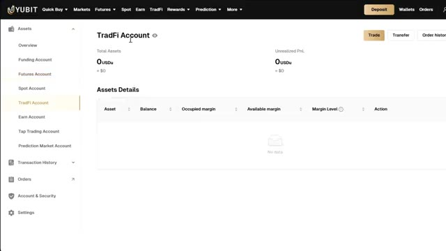
*⏱️ 00:03:32 — Vue d'ensemble du compte TradFi sur la plateforme Yubit montrant le solde total des actifs et les détails des actifs.*

---

### ⏱️ `[00:03:46 - 00:04:22]` | Segment #10

**🔊 Audio (Transcription Intégrale Mot pour Mot en Français) :**
> Voici l'expérience de trading crypto ludifiée d'Ubit, où vous pouvez obtenir des rendements allant jusqu'à 33 fois. C'est une façon complètement différente d'interagir avec le marché et honnêtement l'une des fonctionnalités les plus uniques de la plateforme. Et enfin, le compte de marché de prédiction. C'est pour les fonctionnalités de marché de prédiction d'Ubit, où vous pouvez prendre des positions sur les résultats du marché. La chose clé à retenir est que chaque dépôt va directement dans votre compte de financement d'abord et à partir de là, vous transférez vers le portefeuille dont vous avez besoin selon ce que vous voulez faire, je vais vous montrer exactement comment faire cela étape par étape très bien, allons-y

**👁️ Analyse Visuelle d'Écran (gemini-3.5-flash-lite) :**
**Interface & Outils** : Interface web de la plateforme d'échange Ubit (sections Tap Trading, Prediction Market, Funding Account).

**Contenu textuel & Code** : Multiplicateurs de rendement (jusqu'à 33x), soldes de comptes en USDT, graphiques de prix en direct et détails des actifs.

**Action / Démonstration** : Navigation à travers les différentes fonctionnalités de trading et de gestion de compte de la plateforme Ubit.

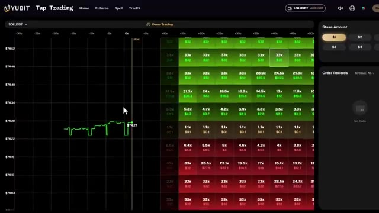
*⏱️ 00:03:55 — Interface de l'expérience de trading ludifiée 'Tap Trading' sur la plateforme Ubit avec des multiplicateurs de rendement.*

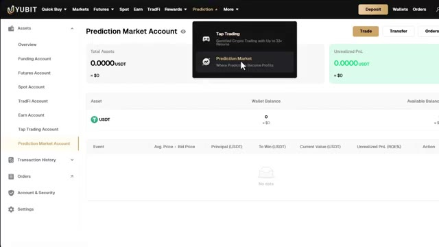
*⏱️ 00:04:04 — Vue du compte de marché de prédiction (Prediction Market Account) sur l'interface de la plateforme Ubit.*

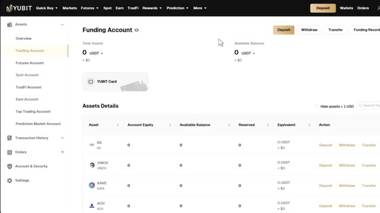
*⏱️ 00:04:13 — Vue du compte de financement (Funding Account) et du détail des actifs de la plateforme Ubit.*

---

### ⏱️ `[00:04:22 - 00:04:41]` | Segment #11

**🔊 Audio (Transcription Intégrale Mot pour Mot en Français) :**
> de l'argent sur votre compte et commencez à débloquer ces bonus, allez dans votre portefeuille et cliquez sur dépôt, sélectionnez la cryptomonnaie que vous voulez déposer, l'USDT est idéal pour le trading, puis sélectionnez votre réseau de dépôt, je recommande le TRC20, c'est rapide et les frais sont très bas. Vous verrez alors votre adresse de dépôt personnelle.

**👁️ Analyse Visuelle d'Écran (gemini-3.5-flash-lite) :**
**Interface & Outils** : Présentation ou face-caméra explicatif du trader sans interface logicielle partagée.

**Contenu textuel & Code** : Explications orales des stratégies et mise en contexte méthodologique du marché.

**Action / Démonstration** : Explications face caméra et analyse conceptuelle des marchés.

---

### ⏱️ `[00:04:42 - 00:05:02]` | Segment #12

**🔊 Audio (Transcription Intégrale Mot pour Mot en Français) :**
> Copiez-la attentivement. Allez sur votre échange ou portefeuille actuel. Collez l'adresse et envoyez vos fonds. Envoyez toujours d'abord un petit montant de test, peut-être 10 à 20 dollars, juste pour confirmer que tout arrive correctement avant d'envoyer le montant total. C'est très important. Envoyer sur le mauvais réseau peut signifier la perte de vos fonds. C'est maintenant que les bonus entrent en jeu.

**👁️ Analyse Visuelle d'Écran (gemini-3.5-flash-lite) :**
**Interface & Outils** : Interface web d'un échange de cryptomonnaies (Yubit / plateforme d'échange).

**Contenu textuel & Code** : Formulaires de dépôt et de retrait avec sélection de réseau (TRON TRC20), montants en USDT et frais de transaction.

**Action / Démonstration** : Validation d'une transaction de retrait et configuration d'un dépôt de cryptomonnaies.

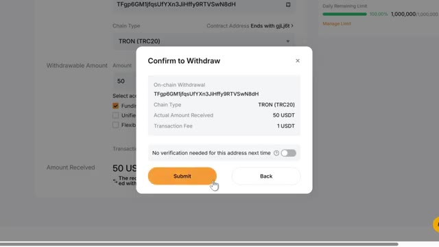
*⏱️ 00:04:47 — Fenêtre contextuelle de confirmation de retrait d'USDT sur un échange.*

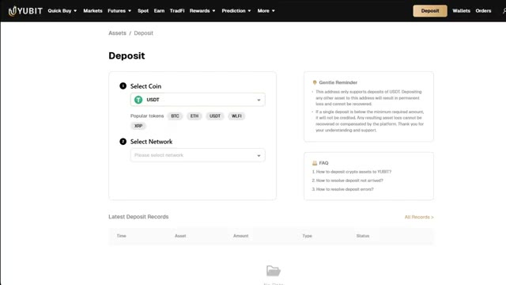
*⏱️ 00:04:52 — Page de dépôt de cryptomonnaies sur l'interface d'un échange (Yubit).*

---

### ⏱️ `[00:05:03 - 00:05:30]` | Segment #13

**🔊 Audio (Transcription Intégrale Mot pour Mot en Français) :**
> Et celui-ci est important. Avec mon lien, vous débloquez jusqu'à 50 000 USDT de bonus de bienvenue. Voici comment cela se décompose. Si vous déposez au moins 100 $ et atteignez 10 000 $ de volume de trading, vous obtenez un bon de position de 1 000 $. Cela monte progressivement jusqu'à un bon de position de 10 000 $ si vous déposez 10 000 $ et atteignez 2 millions de dollars de volume de trading. En plus de cela, il y a des récompenses de boîtes mystères pour le trading de contrats futures.

**👁️ Analyse Visuelle d'Écran (gemini-3.5-flash-lite) :**
**Interface & Outils** : Interface web de la plateforme d'échange de cryptomonnaies Yubit (section Rewards).

**Contenu textuel & Code** : Tableau des récompenses de dépôt et de trading affichant des bons de position de 1 000 USDT, 1 500 USDT, 3 000 USDT, 5 000 USDT et 10 000 USDT, avec les conditions de dépôt minimum et de volume de trading futures requis pour chaque niveau.

**Action / Démonstration** : Présentation visuelle et explication des différents paliers de bonus de bienvenue et des conditions d'obtention associées sur la plateforme.

*⏱️ 00:05:09 — Capture d'écran de l'interface de la plateforme Yubit montrant les différents paliers de bonus de bienvenue et de bons de position, du premier palier à 1 000 USDT.*

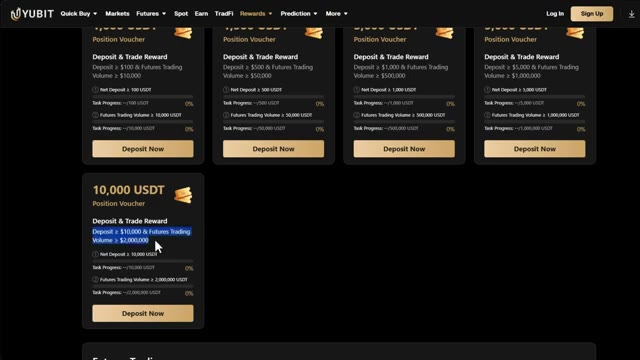
*⏱️ 00:05:23 — Vue de l'interface de Yubit montrant le palier supérieur des bonus de bienvenue, avec un bon de position de 10 000 USDT nécessitant un dépôt et un volume de trading plus élevés.*

---

### ⏱️ `[00:05:30 - 00:05:50]` | Segment #14

**🔊 Audio (Transcription Intégrale Mot pour Mot en Français) :**
> atteignez 100 000 dollars de volume de trading, et vous obtenez une boîte mystère d'une valeur d'au moins 50 USDT, et cela va jusqu'à 50 millions de dollars de volume de trading. Et vous visez une boîte mystère de 15 000 USDT. Tout cela se cumule. Donc, plus vous déposez et tradez, plus vous débloquez.

**👁️ Analyse Visuelle d'Écran (gemini-3.5-flash-lite) :**
**Interface & Outils** : Présentation ou face-caméra explicatif du trader sans interface logicielle partagée.

**Contenu textuel & Code** : Explications orales des stratégies et mise en contexte méthodologique du marché.

**Action / Démonstration** : Explications face caméra et analyse conceptuelle des marchés.

---

### ⏱️ `[00:05:51 - 00:06:25]` | Segment #15

**🔊 Audio (Transcription Intégrale Mot pour Mot en Français) :**
> Make sure you use my link down below to get access to all of this. If you don't have crypto yet, and want to buy directly on UBIT. That's also possible. But for this, you will need to complete KYC first. Go to your profile icon on the homepage and click KYC. Click verify now. Provide your email, your personal information, your verification documents, and a selfie. Once that's approved, you can use the quick buy option on UBIT to purchase crypto directly with fiat currency using a credit or debit card. If you already have crypto on another exchange or wallet,

**👁️ Analyse Visuelle d'Écran (gemini-3.5-flash-lite) :**
**Interface & Outils** : Présentation ou face-caméra explicatif du trader sans interface logicielle partagée.

**Contenu textuel & Code** : Explications orales des stratégies et mise en contexte méthodologique du marché.

**Action / Démonstration** : Explications face caméra et analyse conceptuelle des marchés.

---

### ⏱️ `[00:06:25 - 00:06:58]` | Segment #16

**🔊 Audio (Transcription Intégrale Mot pour Mot en Français) :**
> you can skip KYC entirely and just deposit directly, which is the faster option for most people. All right, now that you have funds in your funding wallet, let's move them over to your futures wallet so you can start trading. Click on wallets, then overview. Click transfer. Make sure you're sending funds from your funding wallet to your futures wallet. Enter the amount you want to transfer or click max to transfer everything. Review the details and click confirm. Now your futures wallet is funded and you're ready to trade. Click on futures in the top navigation bar and click

**👁️ Analyse Visuelle d'Écran (gemini-3.5-flash-lite) :**
**Interface & Outils** : Présentation ou face-caméra explicatif du trader sans interface logicielle partagée.

**Contenu textuel & Code** : Explications orales des stratégies et mise en contexte méthodologique du marché.

**Action / Démonstration** : Explications face caméra et analyse conceptuelle des marchés.

---

### ⏱️ `[00:06:58 - 00:07:35]` | Segment #17

**🔊 Audio (Transcription Intégrale Mot pour Mot en Français) :**
> on USDT-M. This will bring you to the UBIT futures trading interface. Now it might look a little overwhelming at first but I'll break down every section so it makes perfect sense. In the top left you have the trading pair selector. This is where you choose which asset to trade. UBIT has over 500 trading pairs from Bitcoin and Ethereum all the way to meme coins and major altcoins. You can select between USDT margin perpetuals and coin margin perpetuals, which are trades settled in your own crypto instead of USDT. In the center is the price chart powered by TradingView with all the

**👁️ Analyse Visuelle d'Écran (gemini-3.5-flash-lite) :**
**Interface & Outils** : Plateforme d'échange de cryptomonnaies YUBIT (interface de trading Futures USDT-M)

**Contenu textuel & Code** : Graphique en chandeliers (Timeframe 15m) pour BTCUSDT, prix actuel autour de 66 358.6 USDT, carnet d'ordres (Order Book) en temps réel, panneau de gestion des ordres (Market, Limit, Trigger) avec effet de levier (10x), et détails du solde du compte (51.0000 USDT).

**Action / Démonstration** : Présentation générale de l'interface de trading futures de la plateforme YUBIT et explication des différentes sections (sélecteur de paire, graphique, carnet d'ordres, panneau d'ordres).

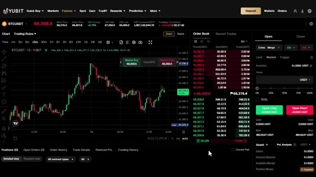
*⏱️ 00:07:07 — Interface de trading de contrats futures USDT-M de la plateforme YUBIT affichant la paire BTCUSDT en unités 15 minutes, avec le graphique des prix à gauche, le carnet d'ordres au centre et le panneau de passage d'ordres à droite.*

---

### ⏱️ `[00:07:35 - 00:07:53]` | Segment #18

**🔊 Audio (Transcription Intégrale Mot pour Mot en Français) :**
> drawing tools and technical indicators you need for analysis. On the right side is the order book, showing all live buy and sell orders in the market. And at the bottom is your order management panel. This is where you track your open positions, open orders, and trade history. Everything you need is right here on one screen.

**👁️ Analyse Visuelle d'Écran (gemini-3.5-flash-lite) :**
**Interface & Outils** : Présentation ou face-caméra explicatif du trader sans interface logicielle partagée.

**Contenu textuel & Code** : Explications orales des stratégies et mise en contexte méthodologique du marché.

**Action / Démonstration** : Explications face caméra et analyse conceptuelle des marchés.

---

### ⏱️ `[00:07:54 - 00:08:13]` | Segment #19

**🔊 Audio (Transcription Intégrale Mot pour Mot en Français) :**
> Before placing any trade, you need to configure two very important settings. First, margin mode. At the top of the order panel, you'll see options for cross, isolated, merge, and split. I strongly recommend using isolated as a beginner. This means if the trade goes wrong, you only lose the margin you put into that specific position.

**👁️ Analyse Visuelle d'Écran (gemini-3.5-flash-lite) :**
**Interface & Outils** : Interface de l'échange de cryptomonnaies Yubit (panneau de trading Futures).

**Contenu textuel & Code** : Fenêtre modale "Adjust Trading Mode" montrant les options Cross, Isolated, Merge et Split, ainsi qu'une description textuelle du Cross Margin Mode et Merge Mode. Graphique BTCUSDT en arrière-plan.

**Action / Démonstration** : Configuration et explication des différents modes de marge (cross, isolated, merge, split) sur le panneau d'ordres.

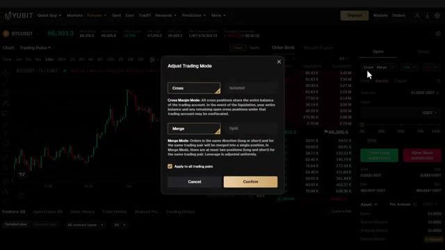
*⏱️ 00:07:59 — Capture d'écran de l'interface de l'échange Yubit affichant une fenêtre modale pour ajuster le mode de trading et les options de marge.*

---

### ⏱️ `[00:08:13 - 00:08:33]` | Segment #20

**🔊 Audio (Transcription Intégrale Mot pour Mot en Français) :**
> The rest of your account is completely safe. Crossmargin uses your entire futures balance as collateral, which is much riskier. Second, leverage. UBIT supports up to 200 times leverage on crypto futures. But do not use high leverage as a beginner. Stick to 5 times maximum when you're just starting out.

**👁️ Analyse Visuelle d'Écran (gemini-3.5-flash-lite) :**
**Interface & Outils** : Interface web de l'échange de cryptomonnaies YUBIT (Futures Trading).

**Contenu textuel & Code** : Fenêtre pop-up "Adjust Trading Mode" affichant les options "Cross" et "Isolated", avec la description explicative du Cross Margin Mode et une option "Apply to all trading pairs". Le graphique BTCUSDT et le carnet d'ordres sont visibles en arrière-plan.

**Action / Démonstration** : Le curseur clique sur le mode "Cross" pour configurer le type de marge des contrats futures.

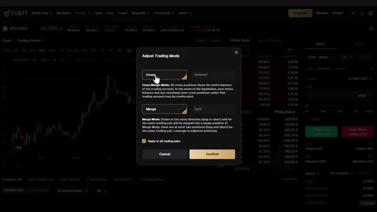
*⏱️ 00:08:18 — Capture d'écran de l'interface de la plateforme YUBIT montrant la fenêtre modale de sélection du mode de marge (Cross/Isolated).*

---

### ⏱️ `[00:08:34 - 00:08:56]` | Segment #21

**🔊 Audio (Transcription Intégrale Mot pour Mot en Français) :**
> Here's how leverage works. If you have $100 and you use 5 times leverage, you now control a $500 position. That means profits are amplified, but so are losses. So keep it low, keep it safe, and build from there. Also keep in mind, UBIT has position tiers that determine your maximum open leverage based on your current positions and pending orders.

**👁️ Analyse Visuelle d'Écran (gemini-3.5-flash-lite) :**
**Interface & Outils** : Échange de cryptomonnaies YUBIT

**Contenu textuel & Code** : Fenêtre de réglage du levier (réglé sur 5x) et tableau des "Position Tiers" avec les paliers de levier et de marge.

**Action / Démonstration** : Ajustement du levier de trading à 5x et consultation des paliers de position (Position Tiers).

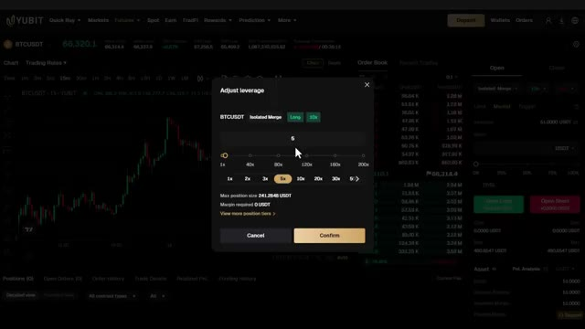
*⏱️ 00:08:39 — Interface de trading montrant une fenêtre contextuelle pour ajuster le levier à 5x sur la paire BTCUSDT.*

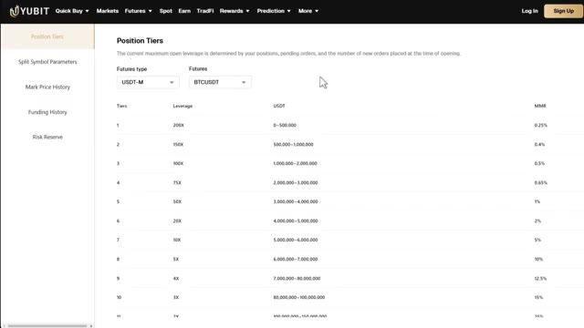
*⏱️ 00:08:50 — Page Web affichant les différents niveaux de position (Position Tiers) et les leviers maximums associés pour les futures USDT-M de BTCUSDT.*

---

### ⏱️ `[00:08:56 - 00:09:14]` | Segment #22

**🔊 Audio (Transcription Intégrale Mot pour Mot en Français) :**
> Donc, à mesure que la taille de votre position augmente, le levier maximal disponible s'ajuste en conséquence. Pour ce tutoriel, j'utiliserai un effet de levier de 5x sur marge isolée. Très bien, plaçons un ordre d'achat, ce qui signifie que nous parions que le Bitcoin va monter. Dans le panneau des ordres, je vais sélectionner un ordre au marché pour qu'il s'exécute immédiatement au prix actuel.

**👁️ Analyse Visuelle d'Écran (gemini-3.5-flash-lite) :**
**Interface & Outils** : Présentation ou face-caméra explicatif du trader sans interface logicielle partagée.

**Contenu textuel & Code** : Explications orales des stratégies et mise en contexte méthodologique du marché.

**Action / Démonstration** : Explications face caméra et analyse conceptuelle des marchés.

---

### ⏱️ `[00:09:15 - 00:09:45]` | Segment #23

**🔊 Audio (Transcription Intégrale Mot pour Mot en Français) :**
> Maintenant, définissez votre quantité d'ordre. Je recommande de cliquer sur "commander par valeur USDT" afin que vous puissiez simplement saisir le montant que vous souhaitez échanger. Disons une position de 100 dollars. Avec un effet de levier de 5 fois, cela signifie que vous n'utilisez que 20 dollars de votre propre capital comme marge. Maintenant, et c'est très important, définissez toujours un take profit et un stop loss avant d'ouvrir le trade. Cliquez sur l'onglet TP barre oblique SL et ajoutez vos prix de take profit et de stop loss. Vous pouvez également utiliser les paramètres avancés pour affiner ces niveaux.

**👁️ Analyse Visuelle d'Écran (gemini-3.5-flash-lite) :**
**Interface & Outils** : Interface de l'échange de cryptomonnaies YUBIT (section Futures).

**Contenu textuel & Code** : Graphique en chandeliers japonais de la paire BTCUSDT en unité de temps 15m, carnet d'ordres en temps réel, panneau de passage d'ordre avec sélection de l'effet de levier (isolé 5x) et saisie de la valeur de position à 100 USDT.

**Action / Démonstration** : Saisie du montant de la position en USDT (100) et configuration de l'effet de levier pour un ordre sur le marché des futures Bitcoin.

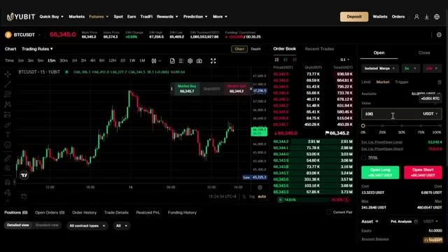
*⏱️ 00:09:22 — Interface de trading de contrats futures sur la plateforme YUBIT affichant le graphique du BTCUSDT avec un carnet d'ordres et le panneau de saisie d'ordre à droite.*

---

### ⏱️ `[00:09:45 - 00:10:10]` | Segment #24

**🔊 Audio (Transcription Intégrale Mot pour Mot en Français) :**
> C'est non négociable. N'ouvrez jamais un trade sans stop loss. Une fois que tout est configuré, cliquez sur "ouvrir long" si vous pensez que le prix va monter ou sur "ouvrir short" si vous pensez qu'il va baisser. Votre trade est maintenant actif. Vous le verrez apparaître dans le panneau des positions en bas. Votre prix d'entrée, vos profits et pertes actuels, votre prix de liquidation, ainsi que vos niveaux de stop loss et de take profit sont tous visibles directement là.

**👁️ Analyse Visuelle d'Écran (gemini-3.5-flash-lite) :**
**Interface & Outils** : Interface web d'échange de cryptomonnaies / courtier en ligne (section Futures).

**Contenu textuel & Code** : Graphique de prix (bougies japonaises vertes et rouges), carnet d'ordres (order book) en temps réel, champs de saisie pour le montant, le Take Profit (72 500) et le Stop Loss (64 300), ainsi que les boutons d'exécution "Open Long" et "Open Short".

**Action / Démonstration** : Le curseur de la souris clique sur le bouton vert "Open Long" pour exécuter un ordre d'achat à terme.

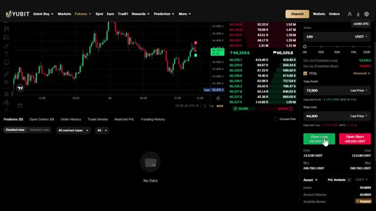
*⏱️ 00:09:52 — Interface de trading affichant un graphique des prix en chandelier, un carnet d'ordres et le panneau de passage d'ordre avec les boutons d'achat/vente (Open Long / Open Short).*

---

### ⏱️ `[00:10:11 - 00:10:45]` | Segment #25

**🔊 Audio (Transcription Intégrale Mot pour Mot en Français) :**
> To close your position, you can either let your take profit or stop loss close it automatically, or you can click close in the positions panel and choose how much of the position you want to close, whether that's 25%, 50%, or the full 100%. Before we continue, just a reminder that if you use my link below to register on UBIT, you can claim up to 50,000 USDT in bonuses. It's a great way to support the channel and help me continue making videos like this completely for free. Now here's one of the most unique things

**👁️ Analyse Visuelle d'Écran (gemini-3.5-flash-lite) :**
**Interface & Outils** : Interface de la plateforme de trading crypto Yubit (section Futures, page d'inscription et page des récompenses).

**Contenu textuel & Code** : Positions ouvertes BTCUSDT, prix d'entrée, marge, PnL non réalisé, formulaires d'inscription avec code promo et paliers de récompenses de dépôt (1000 USDT à 10000 USDT).

**Action / Démonstration** : Présentation de la gestion des positions sur Yubit, promotion de l'affiliation et affichage des bonus de dépôt.

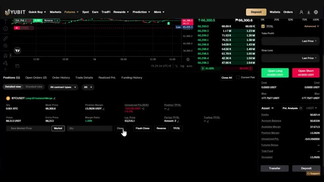
*⏱️ 00:10:19 — Interface de trading Yubit montrant le panneau des positions ouvertes pour BTCUSDT avec les options de clôture.*

*⏱️ 00:10:28 — Page d'inscription de la plateforme Yubit avec un code de parrainage affilié pré-rempli.*

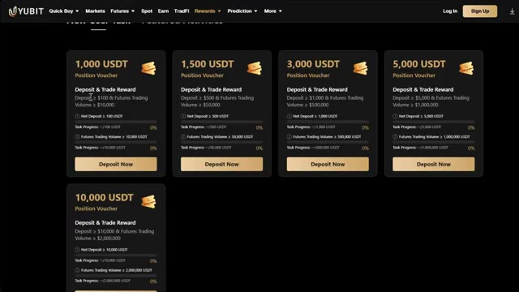
*⏱️ 00:10:36 — Page des récompenses et bonus de dépôt de la plateforme Yubit affichant différents paliers de bons de position.*

---

### ⏱️ `[00:10:45 - 00:11:17]` | Segment #26

**🔊 Audio (Transcription Intégrale Mot pour Mot en Français) :**
> à propos d'UBIT et de quelque chose que presque aucun autre échange ne propose. UBIT vous donne accès aux actifs de la finance traditionnelle, les marchés financiers traditionnels directement depuis le même compte. Nous parlons d'or, d'argent, de pétrole, du S&P 500, du NASDAQ, du Dow Jones, et d'actions individuelles comme NVIDIA, Tesla, et Amazon. Le tout au même endroit, aucun compte séparé n'est nécessaire. Et en ce moment, UBIT propose des frais de négociation nuls sur les produits traditionnels, ce qui représente un avantage massif, en particulier pour les traders actifs et les scalpeurs. La plupart des plateformes facturent encore

**👁️ Analyse Visuelle d'Écran (gemini-3.5-flash-lite) :**
**Interface & Outils** : Interface web de la plateforme de trading YUBIT et documentation associée.

**Contenu textuel & Code** : Graphique en chandeliers japonais de l'actif XAUUSD avec unités de temps (15m), prix actuel à 4328.56, options de levier (500x) et carnet de positions en bas de page.

**Action / Démonstration** : Navigation sur l'interface de trading YUBIT pour présenter l'accès aux actifs de la finance traditionnelle (TradFi).

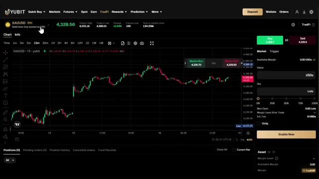
*⏱️ 00:10:53 — Interface de trading de la plateforme YUBIT affichant le graphique de l'actif TradFi XAUUSD (or contre USD) avec les indicateurs de prix et le panneau de passage d'ordres à droite.*

---

### ⏱️ `[00:11:17 - 00:11:40]` | Segment #27

**🔊 Audio (Transcription Intégrale Mot pour Mot en Français) :**
> frais sur ces marchés. Sur UBIT, vous conservez une plus grande partie de vos profits. De plus, vous pouvez négocier des actifs TradFi avec un effet de levier allant jusqu'à 500 fois, l'une des offres d'effet de levier les plus élevées disponibles sur le marché. Pour commencer, cliquez sur TradFi dans la barre de menu. Cliquez sur Activer maintenant, acceptez les termes et conditions, et votre portefeuille TradFi sera créé. Ensuite, dans la fenêtre pop-up, cliquez sur Transférer.

**👁️ Analyse Visuelle d'Écran (gemini-3.5-flash-lite) :**
**Interface & Outils** : Plateforme de trading YUBIT et documentation web YUBIT TradFi.

**Contenu textuel & Code** : Graphique de prix XAUUSD, options de levier 500x, carnets d'ordres et conditions d'utilisation du service.

**Action / Démonstration** : Navigation sur la plateforme YUBIT, présentation des fonctionnalités de levier et affichage des conditions d'activation TradFi.

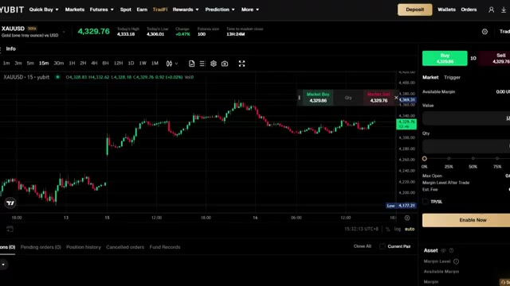
*⏱️ 00:11:23 — Interface de trading YUBIT affichant le graphique du XAUSD avec un effet de levier de 500x.*

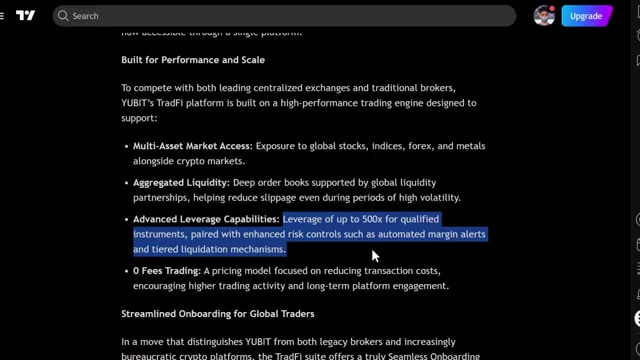
*⏱️ 00:11:29 — Documentation de la plateforme YUBIT TradFi détaillant les fonctionnalités de performance et l'effet de levier jusqu'à 500x.*

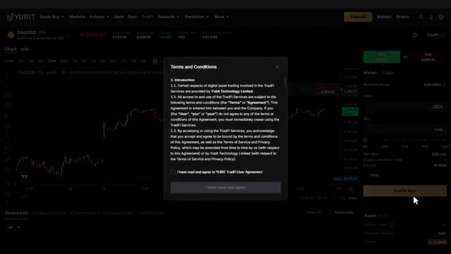
*⏱️ 00:11:34 — Fenêtre de conditions générales (Terms and Conditions) sur la plateforme YUBIT lors de l'activation du service TradFi.*

---

### ⏱️ `[00:11:41 - 00:12:17]` | Segment #28

**🔊 Audio (Transcription Intégrale Mot pour Mot en Français) :**
> Entrez le montant de USDT que vous souhaitez transférer dans votre portefeuille TradFi et confirmez. Une fois votre portefeuille TradFi approvisionné, cliquez sur l'actif que vous souhaitez négocier. Par exemple, l'or, XAUSD, ou le S&P 500. Vous verrez le graphique de trading avec tous les outils dont vous avez besoin. Dans le panneau d'ordres sur la droite, sélectionnez votre direction, achetez ou vendez, choisissez votre type d'ordre, entrez le montant de votre ordre et ajoutez votre take profit et stop loss. Ensuite, cliquez pour passer l'ordre. Vous pouvez voir toutes vos positions Trad 5 ouvertes sous l'onglet des positions au bas de l'écran. Maintenant, au-delà du trading, UBIT a une fonctionnalité

**👁️ Analyse Visuelle d'Écran (gemini-3.5-flash-lite) :**
**Interface & Outils** : Interface web de courtage/trading YUBIT (section TradFi).

**Contenu textuel & Code** : Graphiques de prix en chandelier, liste des actifs (XAUUSD, USDJPY, US30, SP500, etc.), panneau d'ordre d'achat/vente avec gestion des lots et de la marge, paramètres de Take-Profit et Stop-Loss.

**Action / Démonstration** : Sélection d'un actif dans la liste déroulante et configuration des options de gestion du risque (TP/SL) pour un trade.

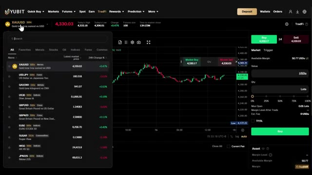
*⏱️ 00:11:50 — Interface de trading TradFi montrant le graphique de l'or (XAUUSD) avec un menu déroulant affichant divers actifs disponibles (Forex, indices, métaux).*

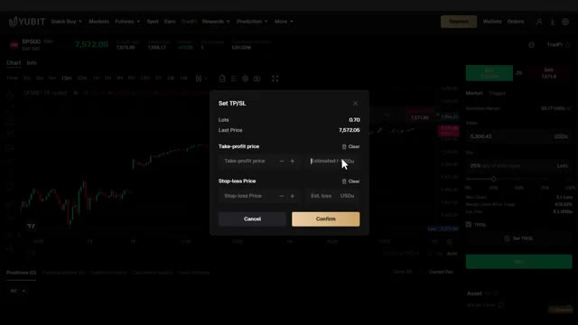
*⏱️ 00:12:08 — Interface de la plateforme affichant une fenêtre modale pour configurer les niveaux de Take-Profit (TP) et Stop-Loss (SL) sur l'actif S&P 500 (SP500).*

---

### ⏱️ `[00:12:17 - 00:12:53]` | Segment #29

**🔊 Audio (Transcription Intégrale Mot pour Mot en Français) :**
> that I think is genuinely useful, the UBIT card. Click on quick buy and select the UBIT card tab in the drop down. With this card, you can spend your USDT worldwide instantly. So instead of having to off-ramp your profits to a bank first, you can just use your trading profits directly in real life. That makes crypto a lot more practical for everyday use. Right now, UBIT offers a virtual card and the physical card is coming soon. To apply, click apply now. Complete your application and once your card is ready, you can start using it immediately. And if you're not actively trading,

**👁️ Analyse Visuelle d'Écran (gemini-3.5-flash-lite) :**
**Interface & Outils** : Présentation ou face-caméra explicatif du trader sans interface logicielle partagée.

**Contenu textuel & Code** : Explications orales des stratégies et mise en contexte méthodologique du marché.

**Action / Démonstration** : Explications face caméra et analyse conceptuelle des marchés.

---

### ⏱️ `[00:12:53 - 00:13:30]` | Segment #30

**🔊 Audio (Transcription Intégrale Mot pour Mot en Français) :**
> Vous n'êtes pas obligé de laisser vos fonds inactifs. Avec Ubit Earn, vous pouvez générer un revenu passif sur vos avoirs en cryptomonnaies. Ubit offre de 12 % à 120 % de taux annuel effectif global grâce à des options flexibles, fixes et de placement automatique. Cliquez sur « Earn » dans la barre de menu. Vous verrez plusieurs plans vedettes avec leurs taux annuels affichés. Sélectionnez le plan qui vous convient. Entrez le montant que vous souhaitez investir, acceptez l'accord d'utilisation et cliquez sur « S'abonner maintenant ». C'est tout. Vos fonds travaillent désormais pour vous, même lorsque vous ne tradez pas. Avant de conclure, voici les règles essentielles que vous devez suivre lors du trading, en particulier

**👁️ Analyse Visuelle d'Écran (gemini-3.5-flash-lite) :**
**Interface & Outils** : Interface web de la plateforme d'échange de cryptomonnaies Ubit (section Earn).

**Contenu textuel & Code** : Options de staking/placement pour l'USDT affichant des taux d'intérêt annualisés (APR) de 2% à 15% en flexible et des durées fixes de 7, 30 ou 90 jours avec des taux de 3.6% à 5%.

**Action / Démonstration** : Navigation et survol des différentes options de placement (flexible et fixe) sur la plateforme Ubit Earn.

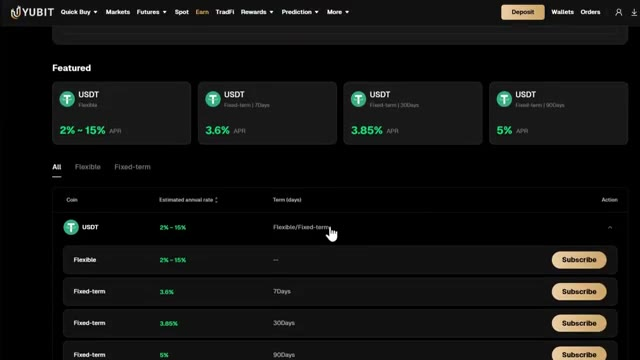
*⏱️ 00:13:02 — Capture d'écran de l'interface Ubit Earn montrant les options de placement en USDT avec des taux variables et fixes, et un curseur de souris survolant l'option Flexible/Fixed-term.*

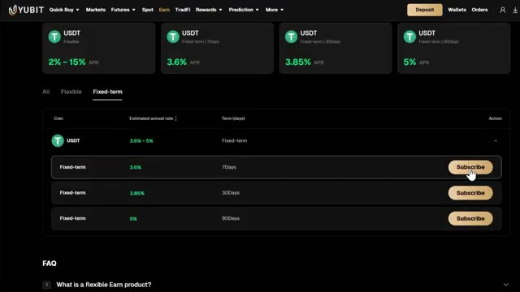
*⏱️ 00:13:11 — Capture d'écran montrant l'onglet 'Fixed-term' sélectionné sur la plateforme Ubit Earn avec les différentes durées (7, 30, 90 jours) et taux associés pour l'USDT.*

---

### ⏱️ `[00:13:30 - 00:13:54]` | Segment #31

**🔊 Audio (Transcription Intégrale Mot pour Mot en Français) :**
> en tant que débutant. Commencez avec de petites tailles de position. Ne risquez pas plus de deux à cinq pour cent de votre compte sur un seul trade. Utilisez toujours un stop loss. C' n'est pas négociable. N'ouvrez jamais un trade sans un. Gardez un effet de levier bas. Commencez à cinq fois maximum. Un effet de levier élevé, c'est comme ça que les débutants font sauter leurs comptes rapidement. Tenez un journal de trading. Notez chaque trade. Votre entrée, votre sortie, votre raisonnement.

**👁️ Analyse Visuelle d'Écran (gemini-3.5-flash-lite) :**
**Interface & Outils** : Interface de l'échange de cryptomonnaies Yubit (section Futures).

**Contenu textuel & Code** : Graphique en chandeliers japonais BTCUSDT (15m), carnet d'ordres en temps réel, curseur d'effet de levier configuré à 5x, et options de configuration de Stop Loss et Take Profit.

**Action / Démonstration** : Démonstration du placement d'ordres et configuration des paramètres de gestion des risques (effet de levier 5x, Stop Loss) sur une plateforme d'échange.

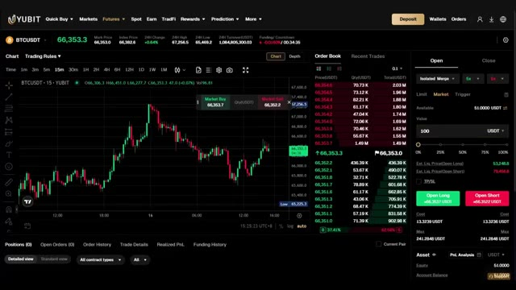
*⏱️ 00:13:36 — Interface principale de trading futures sur Yubit affichant le graphique du BTC/USDT en 15 minutes, le carnet d'ordres et le panneau de passage d'ordres.*

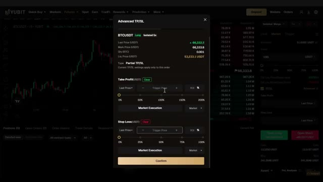
*⏱️ 00:13:42 — Fenêtre contextuelle "Advanced TP/SL" (Take Profit / Stop Loss) sur la plateforme Yubit permettant de configurer les niveaux de sortie.*

---

### ⏱️ `[00:13:55 - 00:14:23]` | Segment #32

**🔊 Audio (Transcription Intégrale Mot pour Mot en Français) :**
> C'est ainsi que vous vous améliorez réellement au fil du temps et que vous ne risquez jamais plus que ce que vous pouvez vous permettre de perdre. Le trading est une compétence. Cela demande du temps, de la répétition et de la discipline. Commencez doucement, restez constant, et les résultats viendront. Très bien, c'est tout ce que vous devez savoir pour commencer sur UBIT. Vous savez maintenant comment créer votre compte, effectuer un dépôt, naviguer sur l'interface des contrats à terme, placer votre premier trade, accéder aux actifs TradFi, utiliser la carte UBIT et gagner un revenu passif avec UBIT Earn.

**👁️ Analyse Visuelle d'Écran (gemini-3.5-flash-lite) :**
**Interface & Outils** : Interface web de la plateforme de courtage et d'échange YUBIT (section Futures et page d'accueil).

**Contenu textuel & Code** : Graphique en chandeliers japonais de la paire BTCUSDT, carnet d'ordres en temps réel, carnets de prix, boutons d'exécution Open Long / Open Short et options de levier.
[DESC_IMAGE_1] Navigation sur l'interface de trading de la plateforme YUBIT avec visualisation du graphique des prix et des carnets d'ordres.

**Action / Démonstration** : Explications face caméra et analyse conceptuelle des marchés.

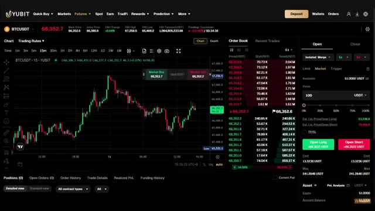
*⏱️ 00:14:02 — Interface de trading futures de la plateforme YUBIT affichant le graphique du BTCUSDT en unités 15 minutes avec le carnet d'ordres et les options d'ordre d'achat/vente.*

---

### ⏱️ `[00:14:23 - 00:14:43]` | Segment #33

**🔊 Audio (Transcription Intégrale Mot pour Mot en Français) :**
> Si vous êtes prêt à commencer, utilisez le lien dans la description. Il active votre pack de bonus de bienvenue complet d'une valeur pouvant aller jusqu'à 50 000 USDT de récompenses. Ceux-ci sont uniquement disponibles via mon lien, alors assurez-vous de l'utiliser. Je mettrai également en ligne d'autres tutoriels UBIT couvrant le copy trading, les configurations de contrats à terme avancés et les stratégies TradFi.

**👁️ Analyse Visuelle d'Écran (gemini-3.5-flash-lite) :**
**Interface & Outils** : Présentation ou face-caméra explicatif du trader sans interface logicielle partagée.

**Contenu textuel & Code** : Explications orales des stratégies et mise en contexte méthodologique du marché.

**Action / Démonstration** : Explications face caméra et analyse conceptuelle des marchés.

---

### ⏱️ `[00:14:43 - 00:14:49]` | Segment #34

**🔊 Audio (Transcription Intégrale Mot pour Mot en Français) :**
> So make sure you subscribe and hit the notification bell so you don't miss those. I'll see you in the next one.

**👁️ Analyse Visuelle d'Écran (gemini-3.5-flash-lite) :**
**Interface & Outils** : Présentation ou face-caméra explicatif du trader sans interface logicielle partagée.

**Contenu textuel & Code** : Explications orales des stratégies et mise en contexte méthodologique du marché.

**Action / Démonstration** : Explications face caméra et analyse conceptuelle des marchés.

---

