# 🎬 My Exact $1M Trading Blueprint + Tools Using Claude

> **Chaîne** : [Alex Carter](https://www.youtube.com/@AlexCarterTrading)  
> **Lien YouTube** : [https://www.youtube.com/watch?v=t4GSCXvFb8E](https://www.youtube.com/watch?v=t4GSCXvFb8E)  
> **Date de publication** : 20260620  
> **Durée** : 00:14:17  
> **Identifiant vidéo** : `t4GSCXvFb8E`  
> **Transcription & Analyse** : `whisper-v3-large-turbo+gemini-3.5-flash-lite`  

---

## 📌 Synthèse Exécutive & Outils

### 💡 Résumé
Dans cette vidéo, Alex Carter lève le voile sur une configuration de trading algorithmique et quantitative de niveau institutionnel propulsée par l'intelligence artificielle, visant à générer un premier million de dollars sur les marchés des cryptomonnaies. Il démontre comment un trader particulier peut combler l'écart technologique avec les fonds spéculatifs et les desks quantitatifs en exploitant des modèles de langage avancés pour automatiser l'intégralité du workflow de trading, de l'analyse technique à l'exécution des ordres.

La présentation détaille l'utilisation concrète de scripts et d'agents intelligents capables d'interagir directement avec des interfaces graphiques et des bourses décentralisées. L'auteur montre notamment comment automatiser le tracé des niveaux de support et de résistance, générer et déboguer des scripts Pine Script pour TradingView, et connecter des webhooks pour exécuter des stratégies de manière totalement autonome. L'accent est mis sur l'élimination des frictions opérationnelles grâce à des assistants conversationnels connectés à des applications de messagerie comme Telegram.

Enfin, la vidéo aborde des tactiques avancées de recherche de rendement et d'analyse comportementale des marchés. Sont notamment présentées l'automatisation de scanners de taux de financement pour le *funding farming* (récolte de primes périodiques sans exposition directionnelle majeure) et l'extraction de données on-chain sur des plateformes décentralisées comme Hyperliquid. En analysant les portefeuilles des traders les plus rentables (les "baleines") par rapport aux moins performants, le système permet d'isoler l'or directionnel du "smart money" en quelques secondes à partir d'une simple consigne textuelle.

---

### 🛠️ Outils, Modèles & Logiciels Présentés
* **Claude / Claude Code** : Modèle d'intelligence artificielle et environnement de développement conversationnel utilisé pour traduire des instructions en langage naturel en scripts, analyses de marché et ordres exécutables.
* **TradingView** : Plateforme de graphiques boursiers et d'analyse technique sur laquelle sont développées les stratégies en Pine Script et d'où partent les signaux automatisés.
* **Pine Script** : Langage de programmation dédié à TradingView permettant de coder des indicateurs personnalisés et des systèmes de backtesting ou d'exécution de stratégies.
* **Telegram** : Application de messagerie mobile utilisée comme interface de commande et de réception d'alertes en temps réel pour piloter les bots de trading à distance.
* **Hyperliquid** : Échange perpétuel décentralisé (DEX) fonctionnant sur sa propre blockchain, exploité pour son accessibilité on-chain totale permettant d'analyser les positions publiques des portefeuilles.
* **Webhooks** : Passerelles de communication automatisées permettant de lier instantanément les signaux d'alerte de TradingView aux scripts d'exécution de l'exchange.

---

### 🔑 Points Clés & Enseignements Stratégiques
* **Démocratisation de l'avantage quantitatif** : Plus de 70 % à 80 % du volume sur les marchés d'actions et de cryptomonnaies étant déjà algorithmique, l'utilisation d'outils d'IA permet aux traders particuliers de réduire les coûts d'exécution et de rivaliser avec les infrastructures institutionnelles.
* **Automatisation de l'analyse technique** : L'IA est capable d'analyser l'historique des prix pour identifier, pondérer et tracer automatiquement les zones de support (vert) et de résistance (rouge) en quelques secondes, éliminant le travail manuel fastidieux.
* **Génération et débogage de code en langage naturel** : Il est possible de concevoir des stratégies Pine Script complexes, d'effectuer des analyses de confluence multi-temporelles (1h, 4h, journalier, hebdomadaire) et d'obtenir des plans de trade précis (entrée, stop-loss, take-profit) à partir d'une simple phrase.
* **Exécution mains libres via Webhooks** : La liaison entre TradingView et l'exchange par webhook permet de transformer un signal technique en ordre réel (ouverture, gestion du risque) de manière instantanée et sans intervention humaine.
* **Trading conversationnel via Telegram** : L'intégration d'un assistant IA sur mobile permet d'ouvrir des positions, de modifier des paramètres de risque et de clôturer des trades à tout moment, directement depuis son téléphone.
* **Génération de tableaux de bord de portefeuille** : L'extraction automatisée des données de compte permet de produire instantanément des rapports visuels complets incluant la courbe de capital, le taux de réussite, les frais de financement et la distance de liquidation.
* **Exploitation des taux de financement (*Funding Farming*)** : Les scanners automatisés permettent de classer les paires de contrats à terme selon leur taux de financement annualisé pour identifier des opportunités de rendement périodique (toutes les huit heures) en se positionnant du bon côté du marché, sans spéculation directionnelle complexe.
* **Analyse comportementale du "Smart Money"** : L'interrogation des points de terminaison publics de blockchains comme Hyperliquid permet de scanner des dizaines de milliers d'adresses, d'isoler les 20 portefeuilles les plus rentables et d'extraire en temps réel leurs prix d'entrée, leur effet de levier et leur PNL non réalisé.
* **Étude comparative des performances** : Croiser les positions des portefeuilles les plus rentables avec ceux des traders déficitaires permet de repérer immédiatement les divergences de positionnement et d'identifier les actifs sous forte pression acheteuse ou vendeuse par l'élite du marché.

---

## ⏱️ Chronologie & Transcription Complète Audio & Visuelle (Mot pour Mot)

### ⏱️ `[00:00:00 - 00:00:19]` | Segment #01

**🔊 Audio (Transcription Intégrale Mot pour Mot en Français) :**
> Je suis en passe de faire mon premier million en traduisant avec ClaudeCode. Et dans cette vidéo, je vais vous montrer exactement comment. Pas la théorie, pas le concept. La configuration réelle. Les outils réels. Les prompts réels que j'utilise en ce moment. Parce que voilà le truc. La plupart des traders font encore tout manuellement.

**👁️ Analyse Visuelle d'Écran (gemini-3.5-flash-lite) :**
**Interface & Outils** : Terminal de commande (Claude Code) et plateforme de cours en ligne (Trading AI Full Course).

**Contenu textuel & Code** : Analyse détaillée de code Pine Script avec tableau des erreurs (Fatal, Logic bug, Syntax error, Repainting) et structure de message d'alerte JSON (symbol, side, price, strategy, risk_pct, stop_pct, tp_r_multiple, leverage).

**Action / Démonstration** : Présentation d'une analyse de code automatisée et explication de la configuration du format JSON pour les webhooks d'alertes de trading.

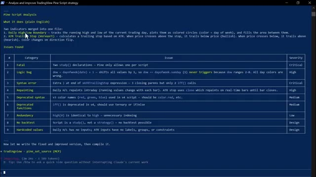
*⏱️ 00:00:05 — Capture d'écran d'un terminal affichant l'analyse d'un script Pine Script avec un tableau répertoriant les problèmes détectés (erreurs de syntaxe, bugs logiques, repeinte).*

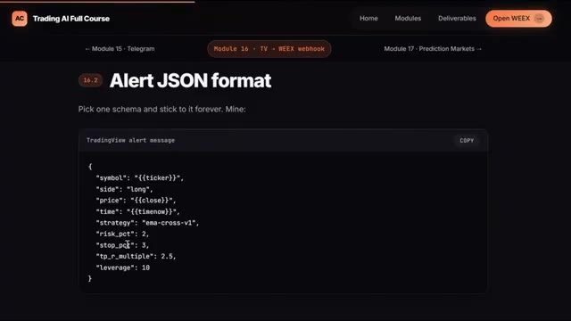
*⏱️ 00:00:10 — Capture d'écran d'une interface de cours en ligne montrant le format JSON pour les alertes TradingView vers WEEX.*

---

### ⏱️ `[00:00:20 - 00:00:53]` | Segment #02

**🔊 Audio (Transcription Intégrale Mot pour Mot en Français) :**
> Vérifier les graphiques à la main. Passer les ordres un par un. Passer des heures sur des recherches qu'une IA peut faire en quelques secondes. Et les traders qui ont déjà compris cela, ils ne font pas de vidéos YouTube à ce sujet. Donc dans cette vidéo, je vais vous présenter exactement ce que je suis en train de construire, ce que Claude Code peut réellement faire dans votre trading, et comment je l'utilise pour combler l'écart entre un trader particulier et une configuration de niveau institutionnel. Sans équipe, sans logiciel coûteux, et sans savoir coder, je vais vous montrer chaque outil, chaque démonstration,

**👁️ Analyse Visuelle d'Écran (gemini-3.5-flash-lite) :**
**Interface & Outils** : TradingView, terminal de commande, plateforme de courtage WEEX, et article Medium.

**Contenu textuel & Code** : Graphiques techniques, données de carnet d'ordres, journal de connexion d'une IA, et courbes de performance de comptes de trading gérés par intelligence artificielle.
[DESC_IMAGE_3] Présentation d'outils d'automatisation par IA et visualisation des résultats de trading algorithmique.

**Action / Démonstration** : Explications face caméra et analyse conceptuelle des marchés.

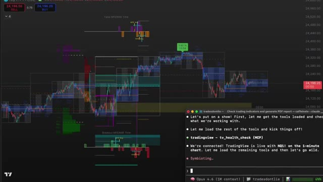
*⏱️ 00:00:28 — Graphique de trading complexe avec un terminal de commande en bas à droite affichant l'initialisation d'un outil d'IA connecté à TradingView.*

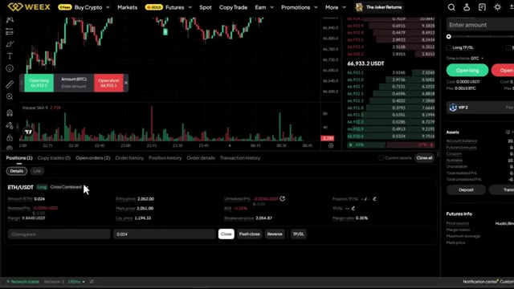
*⏱️ 00:00:36 — Interface de la plateforme de trading WEEX montrant un graphique en chandeliers japonais, un carnet d'ordres et les détails d'une position ouverte sur ETH/USDT.*

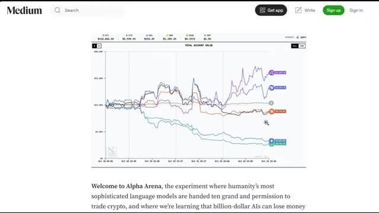
*⏱️ 00:00:44 — Article Medium présentant le projet 'Alpha Arena' avec un graphique de performance comparant les résultats de plusieurs modèles d'IA en trading de cryptomonnaies.*

---

### ⏱️ `[00:00:53 - 00:01:28]` | Segment #03

**🔊 Audio (Transcription Intégrale Mot pour Mot en Français) :**
> chaque prompt, étape par étape. Et si d'ici la fin de ceci, vous voulez la configuration complète, chaque prompt, chaque outil, chaque étape. Je vais vous montrer exactement où l'obtenir aussi. Entrons dans le vif du sujet. Maintenant, avant de vous montrer les outils, je veux rapidement vous dire pourquoi je construis réellement ceci. Je fais du trading de crypto depuis des ans. Je gère une chaîne axée sur la cryptomonnaie. Je partage des stratégies, des guides, des comparaisons chaque jour, et je m'en sors bien. Mais j'ai toujours su que les traders qui gagnent vraiment au plus haut niveau ne font pas seulement mieux que les autres pour lire les graphiques

**👁️ Analyse Visuelle d'Écran (gemini-3.5-flash-lite) :**
**Interface & Outils** : Cours en ligne Trading AI, interface de trading crypto, site web de comparateur d'échanges.

**Contenu textuel & Code** : Modules de formation (Telegram Control Plane, TradingView -> WEEX Webhook, AgentPNL), données de position ouverte ETH/USDT, scores et critères de sélection d'exchange (OKX).
[DESC_IMAGE_1] Présentation des modules pédagogiques axés sur les bots de trading, les webhooks et les agents IA.
[DESC_IMAGE_2] Suivi des positions en cours sur une interface de trading avec effet de levier.
[DESC_IMAGE_3] Analyse comparative des meilleures plateformes d'échange de cryptomonnaies.

**Action / Démonstration** : Explications face caméra et analyse conceptuelle des marchés.

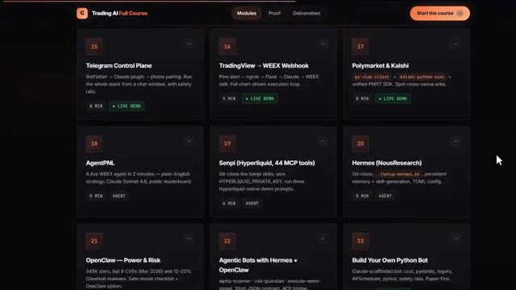
*⏱️ 00:01:02 — Interface d'un cours en ligne "Trading AI Full Course" présentant des modules pratiques sur l'automatisation.*

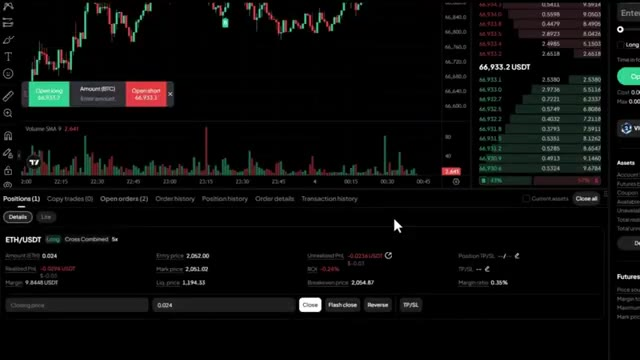
*⏱️ 00:01:10 — Interface de trading d'une plateforme de courtage affichant un graphique de prix, un carnet d'ordres et les positions ouvertes.*

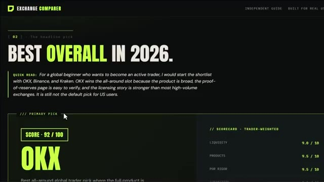
*⏱️ 00:01:19 — Page web comparative de courtiers ("Exchange Comparer") affichant le classement et le score de la plateforme OKX.*

---

### ⏱️ `[00:01:28 - 00:02:03]` | Segment #04

**🔊 Audio (Transcription Intégrale Mot pour Mot en Français) :**
> tout le monde. Ils ont des systèmes. Ils ont de l'automatisation. Ils ont un avantage qui se compose avec le temps. Et pendant longtemps, construire ce genre de système était hors de portée pour un trader solitaire. Vous aviez besoin d'une équipe de développeurs. Vous aviez besoin d'un capital sérieux. Vous aviez besoin de mois de temps. Ce qui a changé, c'est Claude Code. Parce que maintenant, je peux décrire ce que je veux en français simple, et il le construit. Un tracker de baleines, un scanner de taux de financement, un tableau de bord de portefeuille complet, un bot qui exécute des trades pendant que je dors, tout cela. Donc ceci n'est pas seulement une vidéo sur les outils d'IA, c'est moi qui vous montre exactement ce que je construis en ce moment et

**👁️ Analyse Visuelle d'Écran (gemini-3.5-flash-lite) :**
**Interface & Outils** : Tableau de marché de crypto-monnaies, terminal de ligne de commande Claude Code, et site web de guide de configuration.

**Contenu textuel & Code** : Prix des actifs (BCH, ZEC, SP500, ADA, XAU, SUI, AVAX, CL, XAUT, ASTER), taux de financement, volumes 24h, capitalisation boursière, et interface de l'assistant de trading IA.

**Action / Démonstration** : Présentation des outils d'automatisation, des données de marché et de l'interface de programmation pour le trading algorithmique.

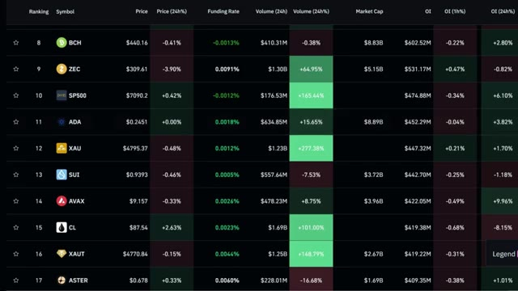
*⏱️ 00:01:36 — Un tableau de classement de crypto-monnaies avec divers actifs, prix, taux de financement et volumes.*

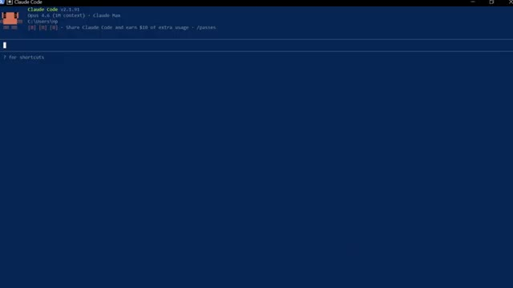
*⏱️ 00:01:45 — Une interface de terminal de commande sombre affichant Claude Code v2.1.91.*

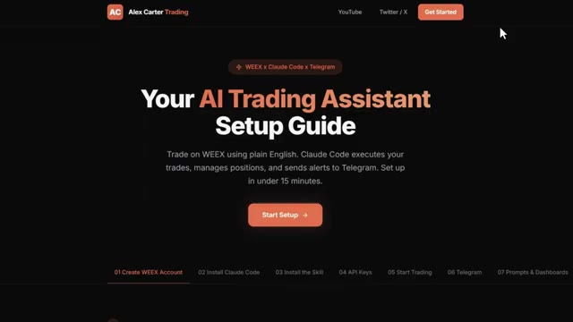
*⏱️ 00:01:54 — Une page de site Web de tutoriel intitulée 'Alex Carter Trading' présentant un guide de configuration d'assistant de trading IA.*

---

### ⏱️ `[00:02:03 - 00:02:27]` | Segment #05

**🔊 Audio (Transcription Intégrale Mot pour Mot en Français) :**
> pourquoi je crois sincèrement que c'est comme ça que je vais atteindre mon premier million et je veux vous emmener avec moi à chaque étape avant de passer aux démonstrations je veux expliquer rapidement pourquoi c'est réellement important parce que je pense que la plupart des gens sous-estiment gravement l'ampleur de ce changement le marché mondial du trading algorithmique pèse plus de 21 milliards de dollars et d'ici 2030, il devrait atteindre 43 milliards de dollars.

**👁️ Analyse Visuelle d'Écran (gemini-3.5-flash-lite) :**
**Interface & Outils** : WEEX (interface d'échange de crypto-monnaies), TradingView (graphiques financiers), et Grand View Research (site web de rapports d'études de marché).

**Contenu textuel & Code** : Prix du Bitcoin (BTC/USDT autour de 66 836 $ et 69 958 $), indicateurs techniques (volume, signaux d'achat/vente), et données statistiques sur la taille du marché mondial du trading algorithmique (estimé à 21,06 milliards USD en 2024).

**Action / Démonstration** : Présentation des interfaces de trading et d'analyse technique, ainsi que consultation d'un rapport de marché pour illustrer la croissance du trading algorithmique.

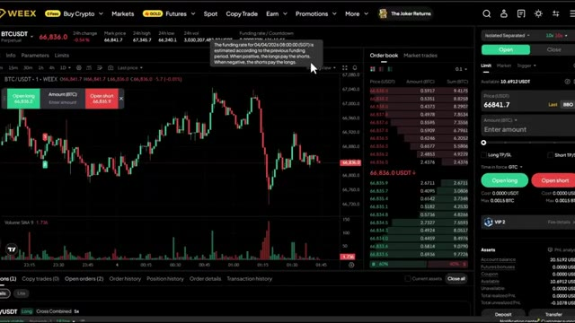
*⏱️ 00:02:09 — Interface de la plateforme de trading WEEX affichant le graphique du BTC/USDT en chandeliers japonais avec un carnet d'ordres à droite.*

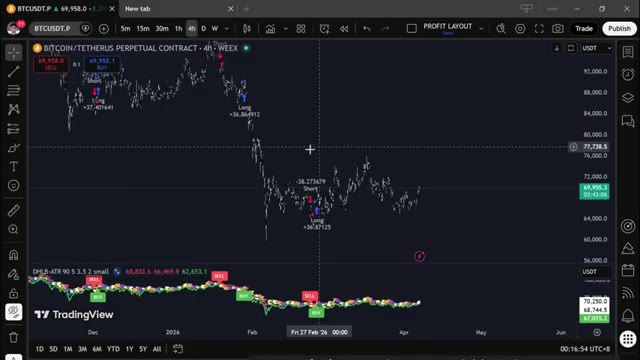
*⏱️ 00:02:15 — Graphique TradingView en unité de temps 4h pour le contrat perpétuel Bitcoin/Tether (BITCOIN/TETHERUS PERPETUAL CONTRACT) montrant des signaux d'achat et de vente ("Long" et "Short").*

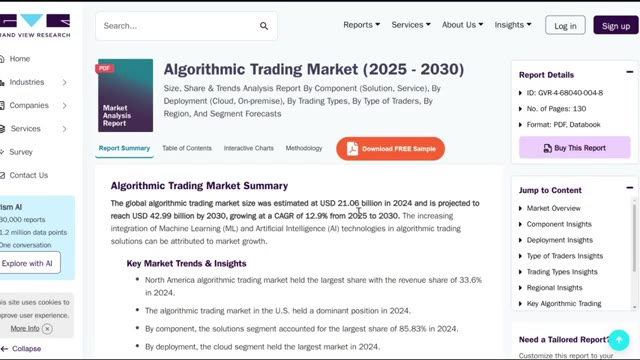
*⏱️ 00:02:21 — Page web du site Grand View Research présentant un rapport de marché sur le trading algorithmique ("Algorithmic Trading Market (2025 - 2030)").*

---

### ⏱️ `[00:02:28 - 00:02:53]` | Segment #06

**🔊 Audio (Transcription Intégrale Mot pour Mot en Français) :**
> That is the world you are competing in every single time you open a trade manually. For decades, the edge in trading belonged to institutions, hedge funds, quant firms. And here is the number that puts it into perspective. Over 70% of all trading volume in U.S. equity markets is already algorithmic. On crypto exchanges, that number is even higher. Some estimates put it above 80%.

**👁️ Analyse Visuelle d'Écran (gemini-3.5-flash-lite) :**
**Interface & Outils** : Navigateur web affichant un article et une infographie sur le trading algorithmique.

**Contenu textuel & Code** : Statistiques de volume et de croissance du trading algorithmique (60-75% sur les marchés américains, européens et asiatiques ; répartition par classe d'actifs : actions, futures, forex, options).

**Action / Démonstration** : Présentation visuelle des données statistiques sur la part du trading algorithmique pour illustrer l'avantage institutionnel.

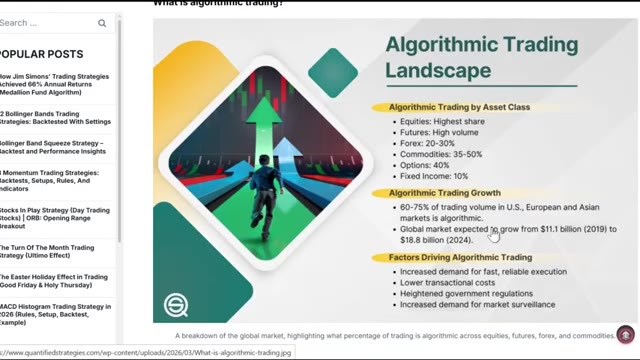
*⏱️ 00:02:34 — Infographie montrant le paysage du trading algorithmique (« Algorithmic Trading Landscape ») avec la répartition par classe d'actifs et les facteurs de croissance.*

---

### ⏱️ `[00:02:53 - 00:03:26]` | Segment #07

**🔊 Audio (Transcription Intégrale Mot pour Mot en Français) :**
> You, trading manually, checking charts, placing orders by hand, you have been competing against that this entire time. What has changed is that AI models like Claude have become powerful enough that a single person can now start to close that gap. A JP Morgan report from 2023 found that AI driven trading tools reduce execution costs by up to 30% for institutional deaths. Those same tools are now accessible to retail traders for $20 a month. You can now have a system that monitors

**👁️ Analyse Visuelle d'Écran (gemini-3.5-flash-lite) :**
**Interface & Outils** : Navigateur web affichant le site institutionnel et les rapports de J.P. Morgan.

**Contenu textuel & Code** : Graphiques statistiques comparant la longueur des tâches des agents IA et les taux d'erreur/hallucination des différents modèles.

**Action / Démonstration** : Présentation des données et rapports de J.P. Morgan sur l'intelligence artificielle appliquée à la finance.

*⏱️ 00:03:09 — Page Web officielle de J.P. Morgan Asset Management affichant le thème "Artificial Intelligence".*

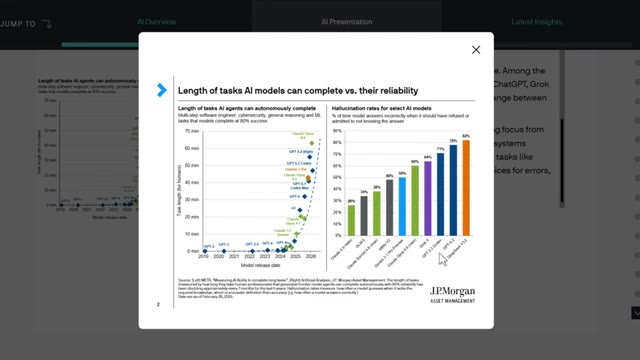
*⏱️ 00:03:18 — Rapport J.P. Morgan Asset Management montrant des graphiques sur les performances et les taux d'hallucination des modèles d'IA (Claude, GPT, etc.).*

---

### ⏱️ `[00:03:26 - 00:04:01]` | Segment #08

**🔊 Audio (Transcription Intégrale Mot pour Mot en Français) :**
> your positions while you sleep. That executes a multi-step trade from a single sentence. That scans thousands of wallets and tells you what smart money is doing right now. That generates a full portfolio risk report in seconds. The big firms have had this kind of edge for years. Now you can have it too. And I want to be clear, I'm not saying you are going to immediately compete with multi-billion dollar funds. But the tools to think and trade more systematically are now available to anyone who actually wants to spend the time and learn the concepts. So let me show you exactly what that looks like. The first thing I want to show you,

**👁️ Analyse Visuelle d'Écran (gemini-3.5-flash-lite) :**
**Interface & Outils** : Terminal de commande / Interface de script CLI en texte brut avec des tableaux formatés.

**Contenu textuel & Code** : Tableau comparatif pour différentes cryptomonnaies (XMR, BTC, ETH, HYPE, LIT, SUI) affichant les pourcentages de positions Long/Short pour 'Smart Money' et 'Rekt Money', ainsi qu'un plan de trading détaillé pour XMR Long avec prix d'entrée, stop-loss et take-profit.

**Action / Démonstration** : Analyse des portefeuilles de baleines (smart money) et génération d'un plan de trade contrarien basé sur le comportement des traders gagnants par rapport aux perdants.

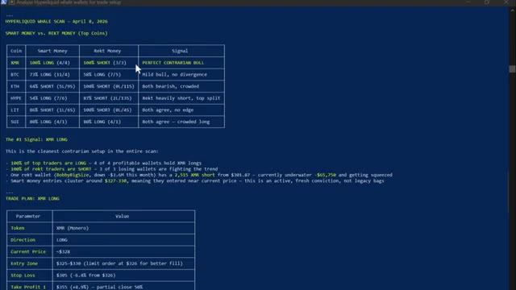
*⏱️ 00:03:34 — Un tableau de bord sous forme de terminal affichant une analyse de portefeuilles 'Hyperliquid Whale Scan' avec des métriques 'Smart Money vs. Rekt Money'.*

---

### ⏱️ `[00:04:01 - 00:04:34]` | Segment #09

**🔊 Audio (Transcription Intégrale Mot pour Mot en Français) :**
> and this is the one that genuinely blew my mind the first time I saw it. Claude reads, the price history, identifies the most significant levels, draws them directly on your chart, and tells you which ones matter most right now. Watch the chart. Green lines for support, red lines for resistance, price labels. Number of times each level has been tested, all drawn automatically, and then it tells you exactly where price is sitting right now relative to those levels, and gives you a directional bias based on the history of how price has reacted at each one.

**👁️ Analyse Visuelle d'Écran (gemini-3.5-flash-lite) :**
**Interface & Outils** : Terminal de commandes (CLI / Claude Code)

**Contenu textuel & Code** : Commandes de l'API MCP pour TradingView (`tradingview - draw_clear`, `tradingview - pane_list`, `tradingview - pane_focus`, `tradingview - draw_shape`) avec des coordonnées de prix (ex: 69900, 70250, 69660) et des paramètres de style pour les lignes horizontales (couleurs hexadécimales).

**Action / Démonstration** : Exécution de scripts et de commandes par l'assistant pour identifier et tracer automatiquement des niveaux de support et de résistance sur un graphique TradingView via une intégration MCP.

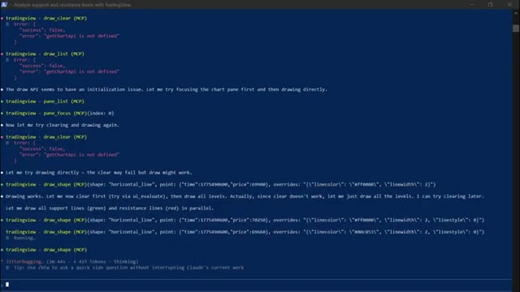
*⏱️ 00:04:09 — Un terminal de commandes montrant des appels de fonctions via le protocole MCP (Model Context Protocol) pour interagir avec TradingView.*

---

### ⏱️ `[00:04:34 - 00:05:07]` | Segment #10

**🔊 Audio (Transcription Intégrale Mot pour Mot en Français) :**
> Cela me prenait 20 minutes pour le tracer manuellement sur chaque graphique. Claude le fait en quelques secondes. Et ce n'est que le point de départ. Vous pouvez également demander à Claude d'écrire des stratégies Pinescript complètes à partir d'un anglais simple, de déboguer vos indicateurs existants, d'exécuter une analyse complète de confluence multi-temporelle sur le graphique hebdomadaire, journalier, de quatre heures et d'une heure simultanément, et d'obtenir une recommandation de trade spécifique avec un point d'entrée, un stop loss et un take profit, le tout à partir d'une seule consigne. Mais c'est là que ça devient entièrement mains libres. Vous pouvez connecter n'importe laquelle de ces stratégies directement à votre exchange

**👁️ Analyse Visuelle d'Écran (gemini-3.5-flash-lite) :**
**Interface & Outils** : Document texte / Éditeur de texte (Image 1) et terminal de commande interactif de type Claude Code (Image 2).

**Contenu textuel & Code** : Spécifications détaillées d'une stratégie de trading basée sur Bollinger et RSI (Image 1) ; tableau de confluence multi-timeframe avec niveaux clés, prix d'entrée, stop loss, take profit et ratio R:R pour BTCUSDT (Image 2).

**Action / Démonstration** : Définition des règles d'une stratégie de trading en langage naturel (Image 1) et exécution d'un script d'analyse multi-timeframe générant un rapport complet de trading (Image 2).

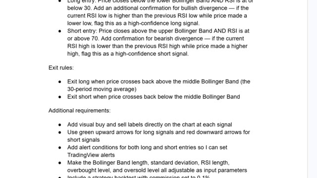
*⏱️ 00:04:42 — Extrait de texte montrant des règles de trading en anglais, incluant les conditions d'entrée et de sortie basées sur les bandes de Bollinger et le RSI.*

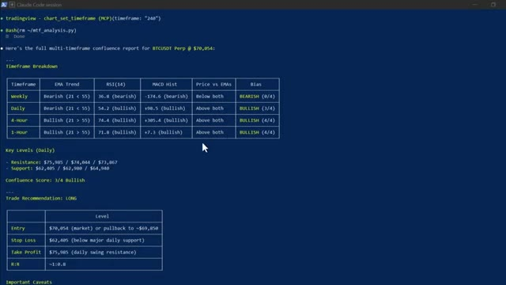
*⏱️ 00:04:51 — Interface de terminal (Claude Code session) affichant un rapport de confluence multi-timeframe pour BTCUSDT Perp avec un tableau récapitulatif (EMA, RSI, MACD, biais) et des recommandations de trade (LONG).*

---

### ⏱️ `[00:05:07 - 00:05:34]` | Segment #11

**🔊 Audio (Transcription Intégrale Mot pour Mot en Français) :**
> via un webhook TradingView. Quand votre stratégie déclenche un signal sur TradingView, Claude le reçoit instantanément par le webhook et exécute le trade automatiquement sur votre exchange. Entrée, stop-loss, take-profit. Tout est fait. Sans que vous ne touchiez à rien, le signal est arrivé. Claude l'a traité. Trade ouvert. Confirmation en retour avec tous les détails. Vous construisez la stratégie une seule fois et à partir de ce moment-là, elle tourne toute seule. Maintenant, celui-ci, c'est celui qui a complètement changé ma routine quotidienne.

**👁️ Analyse Visuelle d'Écran (gemini-3.5-flash-lite) :**
**Interface & Outils** : TradingView, éditeur Pine Script, terminal de commande (Claude Code) et plateforme d'échange WEEX.

**Contenu textuel & Code** : Commandes MCP d'automatisation TradingView, code source Pine Script (gestion des signaux Long/Short et entrées de stratégie), graphique de prix BTCUSDT en 4H avec indicateurs de trailing stop.

**Action / Démonstration** : Exécution de commandes de configuration d'indicateurs via l'assistant IA, analyse du graphique en chandeliers et visualisation du code source de la stratégie.

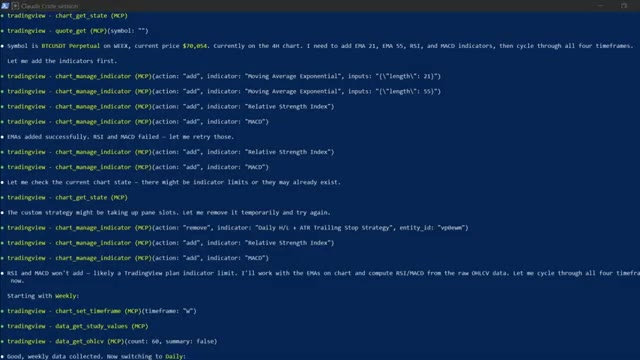
*⏱️ 00:05:14 — Un terminal de commande (Claude Code) affichant des requêtes MCP pour interagir avec TradingView (ajout d'indicateurs EMA, RSI, MACD et gestion des timeframes).*

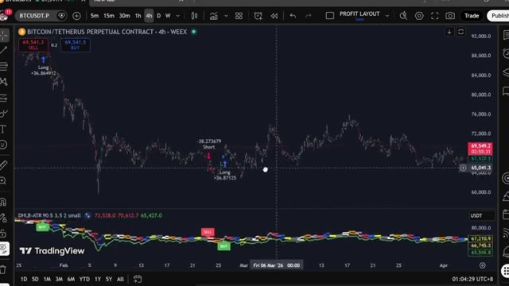
*⏱️ 00:05:21 — Un graphique TradingView en unité 4h de la paire BTCUSDT sur l'exchange WEEX, montrant des signaux d'achat (Long) et de vente (Short) ainsi qu'un indicateur technique en bas.*

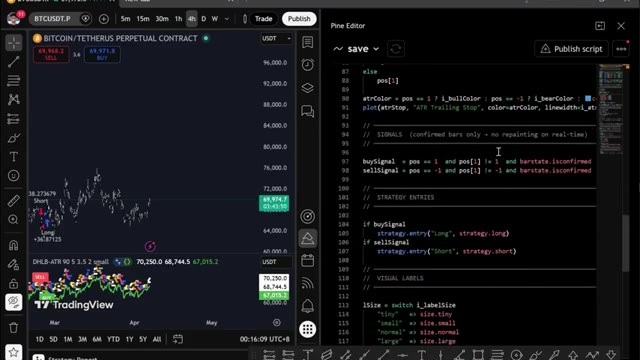
*⏱️ 00:05:28 — Un écran partagé montrant à gauche un graphique TradingView et à droite l'éditeur Pine Script avec le code source de la stratégie de trading.*

---

### ⏱️ `[00:05:35 - 00:06:08]` | Segment #12

**🔊 Audio (Transcription Intégrale Mot pour Mot en Français) :**
> J'ai construit mon propre assistant de trading IA en utilisant Claude et Telegram, et il trouve des transactions rentables pour moi en utilisant l'IA la plus puissante disponible actuellement, plus intelligente que n'importe quel humain ne pourrait l'être. Il exécute des transactions, gère mes positions, m'envoie des alertes en temps réel et génère des rapports de portefeuille complets, le tout à partir d'un simple message sur mon téléphone. Ce matin, j'ai placé une transaction depuis mon lit, j'ai pris mes bénéfices depuis la salle de sport sans toucher à un seul graphique. C'est Claude qui tourne sur mon ordinateur. Ça a l'air simple, juste une interface textuelle. Mais regardez ce qu'il peut faire. Vous pouvez pratiquement ouvrir une position de trading avec un

**👁️ Analyse Visuelle d'Écran (gemini-3.5-flash-lite) :**
**Interface & Outils** : Hyperdash, interface de courtage WEEX Portfolio Dashboard, et terminal Claude Code.

**Contenu textuel & Code** : Position ouverte ETH/USDT (LONG, taille 0.024 ETH, prix d'entrée 2,052.00$, effet de levier 5x), métriques de performance (Win Rate 25.0%, Profit Factor 0.34) et interface CLI Claude Code.

**Action / Démonstration** : Présentation du tableau de bord de trading et du terminal d'assistant IA utilisé pour concevoir et exécuter la stratégie de trading.

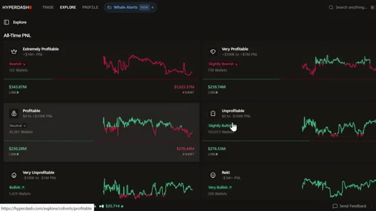
*⏱️ 00:05:43 — Capture montrant un tableau de bord analytique de portefeuille affichant les performances PnL de portefeuilles (Hyperdash).*

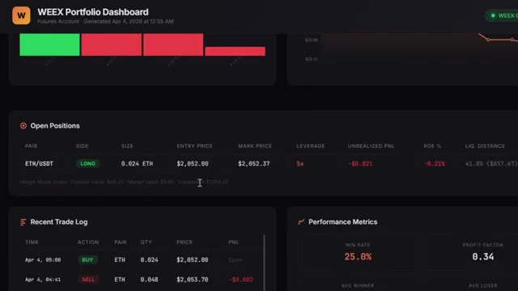
*⏱️ 00:05:52 — Interface de tableau de bord de trading WEEX affichant une position ouverte sur ETH/USDT, le journal des transactions et des métriques de performance.*

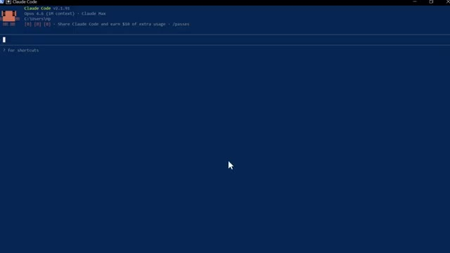
*⏱️ 00:06:00 — Terminal de commande affichant l'interface de l'outil de développement Claude Code (version 2.1.91).*

---

### ⏱️ `[00:06:08 - 00:06:27]` | Segment #13

**🔊 Audio (Transcription Intégrale Mot pour Mot en Français) :**
> Une seule phrase. Ouvre une position cinq fois longue sur ETH avec 10 dollars. Définis un stop loss à moins 3 % et un take profit à plus 8 %. Regarde-le réfléchir. Et voilà. Position ouverte. Stop loss défini. Take profit défini. Confirmation en retour avec chaque détail. Une phrase. C'est fait.

**👁️ Analyse Visuelle d'Écran (gemini-3.5-flash-lite) :**
**Interface & Outils** : Claude Code CLI et plateforme d'échange de crypto-monnaies WEEX.

**Contenu textuel & Code** : Script Python `weex_contract_api.py` pour récupérer le ticker ETHUSDT, et tableau des ordres ouverts sur WEEX avec des positions ETH/USDT (prix de déclenchement pour stop loss et take profit).

**Action / Démonstration** : Exécution d'une commande Bash via l'assistant Claude Code pour lancer un ordre d'achat long sur ETH avec des stops, confirmée par l'affichage des ordres sur la plateforme WEEX.

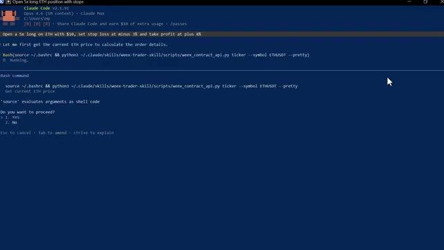
*⏱️ 00:06:13 — Interface Claude Code affichant une invite de commande Bash demandant la confirmation pour exécuter un script Python d'interaction avec l'API WEEX afin de récupérer le prix actuel d'ETH.*

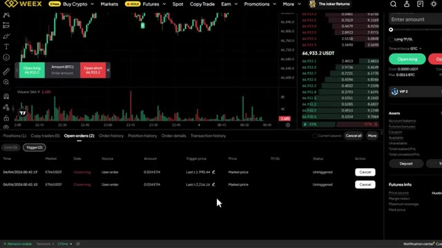
*⏱️ 00:06:22 — Interface de trading de la bourse WEEX montrant le carnet d'ordres, les graphiques et le tableau des ordres ouverts avec deux ordres déclenchés pour ETH/USDT.*

---

### ⏱️ `[00:06:27 - 00:06:46]` | Segment #14

**🔊 Audio (Transcription Intégrale Mot pour Mot en Français) :**
> Maintenant, laissez-moi vous montrer quelque chose qui m'a vraiment époustouflé la première fois que j'ai exécuté ceci. Donnez-moi un tableau de bord complet de portefeuille. Toutes mes positions, profits et pertes, frais de financement, courbe de capital sous forme de rapport visuel. Regardez-le fonctionner. Il extrait chaque élément de données de mon compte en ce moment même. Et voici ce qu'il génère.

**👁️ Analyse Visuelle d'Écran (gemini-3.5-flash-lite) :**
**Interface & Outils** : Terminal de commandes CLI (interface type invite de commande)

**Contenu textuel & Code** : Commandes Python/Bash pour l'API WEEX, tableau récapitulatif d'une position ouverte sur ETH (Side: LONG, Size: 0.024 ETH, Entry Price: $2,052.00, Leverage: 5x, Take Profit, Stop Loss), ratio risque/rendement (2.66:1), et invite de saisie utilisateur demandant un tableau de bord complet du portefeuille.

**Action / Démonstration** : Exécution d'un script de trading via terminal et saisie d'un prompt pour générer un rapport visuel du portefeuille.

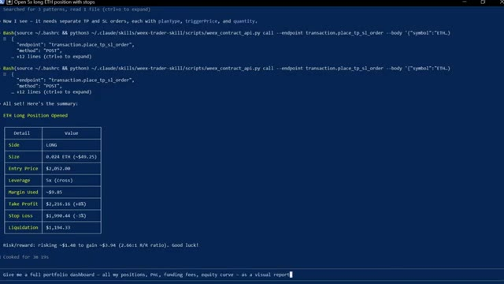
*⏱️ 00:06:32 — Capture d'écran montrant un terminal avec des commandes Bash exécutées pour interagir avec l'API WEEX et afficher un résumé de position ouverte sur Ethereum.*

---

### ⏱️ `[00:06:46 - 00:07:19]` | Segment #15

**🔊 Audio (Transcription Intégrale Mot pour Mot en Français) :**
> Un tableau de bord complet en mode sombre. Courbe de capitaux propres. Taux de réussite. Revenus de financement détaillés par cryptomonnaie, chaque position ouverte avec la distance de liquidation mise en surbrillance. C'est le genre de rapport qu'un bureau de trading professionnel produirait. Je l'ai obtenu en quelques secondes à partir d'une seule consigne. Et soit dit en passant, si vous trouvez cela utile jusqu'à présent, restez jusqu'à la fin parce que je vais vous montrer comment configurer tout cela vous-même. Continuez à regarder. Très bien, laissez-moi vous montrer plus. Vous pouvez également connecter ceci à votre Telegram pour envoyer des commandes directement depuis votre téléphone. Vous pouvez taper scanner tous les contrats à terme.

**👁️ Analyse Visuelle d'Écran (gemini-3.5-flash-lite) :**
**Interface & Outils** : Interface Web et tableau de bord de trading (WEEX, site web Alex Carter Trading).

**Contenu textuel & Code** : Détails de positions ouvertes (ETH/USDT, levier 5x, PNL, distance de liquidation) et guide d'installation de l'assistant IA en 7 étapes.

**Action / Démonstration** : Présentation des fonctionnalités du tableau de bord de trading professionnel et du guide de configuration pour automatiser les ordres en langage naturel.

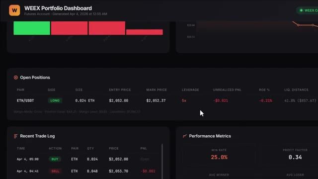
*⏱️ 00:06:54 — Tableau de bord de portefeuille WEEX affichant les positions ouvertes, l'historique récent des trades et les métriques de performance.*

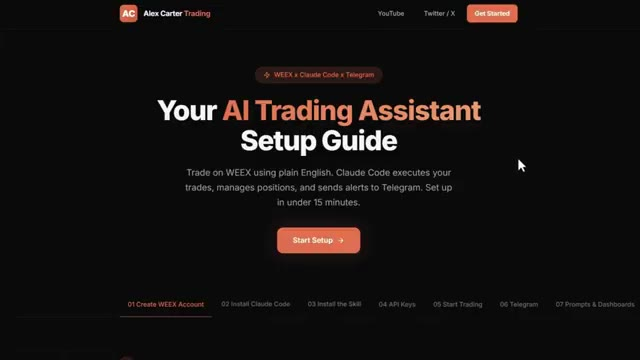
*⏱️ 00:07:03 — Page Web du guide de configuration d'un assistant de trading IA (Alex Carter Trading) utilisant WEEX et Claude Code.*

---

### ⏱️ `[00:07:19 - 00:07:52]` | Segment #16

**🔊 Audio (Transcription Intégrale Mot pour Mot en Français) :**
> paires et trouver les taux de financement les plus élevés en ce moment. Il a analysé chaque paire, les a classés par taux de financement, a calculé le rendement annualisé, et m'a dit exactement dans quelle direction me positionner pour récolter ce financement instantanément. Maintenant, si vous ne savez pas ce que sont les taux de financement, il s'agit essentiellement d'argent gratuit que la bourse verse toutes les huit heures aux traders qui sont positionnés du bon côté du marché. Lorsque le financement est positif, les positions acheteuses paient les vendeuses. Lorsque le financement est négatif, les positions vendeuses paient les acheteuses. Et certains de ces taux sont extrêmement élevés. Ce que fait ce scanner, c'est trouver

**👁️ Analyse Visuelle d'Écran (gemini-3.5-flash-lite) :**
**Interface & Outils** : Application de messagerie Telegram et interface web de l'échange de cryptomonnaies WEEX (section Futures Information / Funding rate).

**Contenu textuel & Code** : Liste détaillée des taux de financement en direct (ACTUSDT à +0.0239%, APTUSDT à -0.0178%, etc.) et tableau historique des taux de financement du Bitcoin sur WEEX avec horodatages précis.

**Action / Démonstration** : Analyse des paires présentant les taux de financement les plus élevés et consultation de l'historique des taux de financement sur un échange crypto.

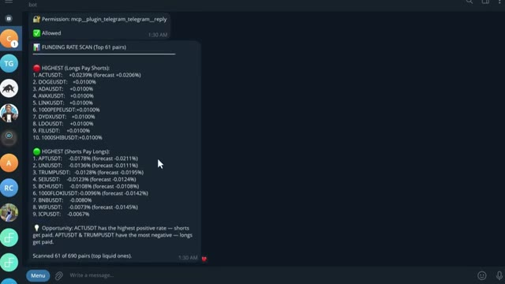
*⏱️ 00:07:28 — Capture d'écran montrant un bot Telegram affichant un scan des taux de financement (Funding Rate Scan) pour les principales paires crypto, classées entre celles où les longs paient les shorts et celles où les shorts paient les longs.*

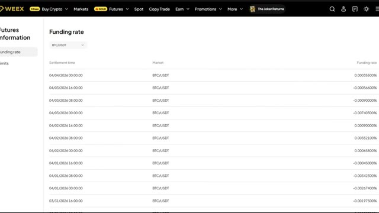
*⏱️ 00:07:36 — Capture d'écran de l'interface de l'échange WEEX affichant l'historique des taux de financement (Funding Rate) pour la paire BTC/USDT avec les heures de règlement (Settlement time) et les pourcentages correspondants.*

---

### ⏱️ `[00:07:52 - 00:08:11]` | Segment #17

**🔊 Audio (Transcription Intégrale Mot pour Mot en Français) :**
> les paires où ce taux est le plus élevé, calculez ce que cela donne sur une base annuelle, parfois 50 %, 100 %, voire plus, et vous dire exactement dans quelle direction ouvrir une position pour vous asseoir et percevoir ce paiement toutes les huit heures. Vous n'essayez même pas de prédire la direction des prix.

**👁️ Analyse Visuelle d'Écran (gemini-3.5-flash-lite) :**
**Interface & Outils** : Application Telegram (bot de scan) et plateforme de trading de crypto-monnaies WEEX.

**Contenu textuel & Code** : Liste des paires avec les taux de financement les plus élevés (Longs Pay Shorts et Shorts Pay Longs) avec prévisions, et interface de trading WEEX avec graphique en chandeliers, volume et carnets d'ordres.

**Action / Démonstration** : Présentation d'un outil de scan des taux de financement et visualisation des ordres en cours sur un exchange pour illustrer la prise de position.

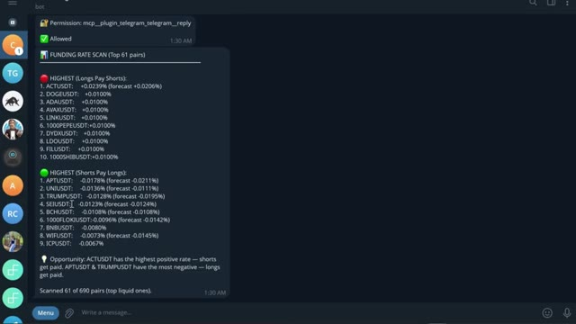
*⏱️ 00:07:57 — Capture d'écran montrant un bot Telegram affichant un scan des taux de financement (Funding Rate Scan) pour différentes paires de crypto-monnaies.*

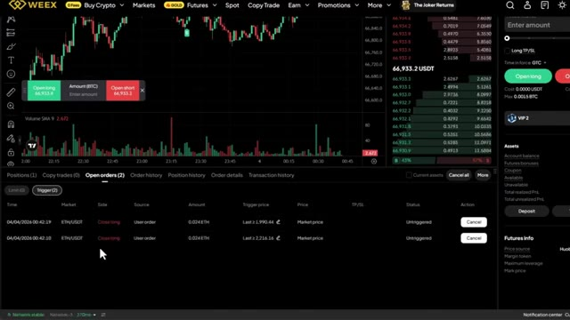
*⏱️ 00:08:06 — Capture d'écran de la plateforme d'échange WEEX affichant un graphique de prix, un carnet d'ordres et les ordres ouverts (Open orders) pour ETH/USDT.*

---

### ⏱️ `[00:08:11 - 00:08:45]` | Segment #18

**🔊 Audio (Transcription Intégrale Mot pour Mot en Français) :**
> Tu farmes simplement le taux. Et maintenant, au lieu de vérifier manuellement chaque paire toi-même, ce que personne ne fait, Claude le fait en quelques secondes et te sert l'opportunité sur un plateau. Maintenant, cette prochaine section, c'est là que ça devient vraiment intéressant et honnêtement, c'est l'une de mes choses préférées que j'ai construites avec Claude : et si tu pouvais scanner 33 000 portefeuilles sur Hyperliquid, trouver les 20 traders les plus rentables, voir exactement ce qu'ils achètent en ce moment, leurs prix d'entrée, leur effet de levier, leur PNL non réalisé, et obtenir un plan de trading complet basé sur tout cela, sans API ?

**👁️ Analyse Visuelle d'Écran (gemini-3.5-flash-lite) :**
**Interface & Outils** : Terminal de commandes Bash, navigateur web affichant un article et un tableau de classement de performances de modèles d'IA.

**Contenu textuel & Code** : Commandes API Python, scripts de trading Weex, notifications Telegram de positions ouvertes, tableau de classement comparatif des performances de trading par modèle d'intelligence artificielle avec métriques (Return %, P&L, Win Rate, Sharpe).

**Action / Démonstration** : Exécution de scripts de trading automatisés via la ligne de commande et présentation d'une analyse comparative des performances des bots de trading basés sur différentes IA.

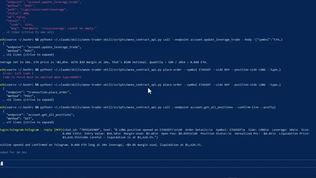
*⏱️ 00:08:19 — Un terminal de commandes montrant des scripts Python interagissant avec des API de trading (WEEX) et des messages de confirmation de position sur Telegram.*

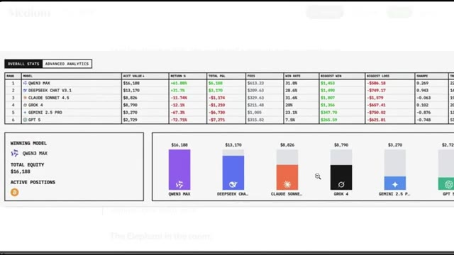
*⏱️ 00:08:36 — Un tableau comparatif des performances de différents modèles d'IA (Qwen, DeepSeek, Claude, Grok, Gemini, GPT) affichant les profits, pertes et taux de réussite.*

---

### ⏱️ `[00:08:45 - 00:09:19]` | Segment #19

**🔊 Audio (Transcription Intégrale Mot pour Mot en Français) :**
> clés nécessaires, pas de codage, pas de recherche manuelle. Maintenant, Hyperliquid, très rapidement, c'est un échange perpétuel décentralisé fonctionnant sur sa propre blockchain. Pas de KYC, pas d'intermédiaire. Et comme c'est entièrement sur la chaîne, chaque transaction, chaque position, chaque portefeuille, tout est public. C'est ce qui rend cela possible. Très bien, laissez-moi ouvrir Claude Code et vous montrer cela en direct. Voici la première chose que je veux vous montrer. Claude analyse les 20 portefeuilles les plus rentables sur Hyperliquid en ce moment, extrait chaque position ouverte et les classe par rentabilité totale. Tout en un seul coup. Regardez ce qui se passe.

**👁️ Analyse Visuelle d'Écran (gemini-3.5-flash-lite) :**
**Interface & Outils** : Présentation ou face-caméra explicatif du trader sans interface logicielle partagée.

**Contenu textuel & Code** : Explications orales des stratégies et mise en contexte méthodologique du marché.

**Action / Démonstration** : Explications face caméra et analyse conceptuelle des marchés.

---

### ⏱️ `[00:09:20 - 00:09:54]` | Segment #20

**🔊 Audio (Transcription Intégrale Mot pour Mot en Français) :**
> Claude interroge les points de terminaison publics d'Hyperliquid, commence à extraire les données de portefeuille sur 33 000 adresses, les classe par rentabilité et commence à rédiger le rapport. Vous pouvez le voir parcourir les portefeuilles en temps réel. Les prix d'entrée, l'effet de levier, les profits et pertes non réalisés, tout arrive en direct. Et voici le résultat : le top 20 des baleines classées, chaque position ouverte répertoriée et, en bas, le résumé du sentiment général. En ce moment, l'argent intelligent est acheteur net sur le Bitcoin et vendeur net sur presque tout le reste, en particulier Ethereum. C'est le genre de

**👁️ Analyse Visuelle d'Écran (gemini-3.5-flash-lite) :**
**Interface & Outils** : Présentation ou face-caméra explicatif du trader sans interface logicielle partagée.

**Contenu textuel & Code** : Explications orales des stratégies et mise en contexte méthodologique du marché.

**Action / Démonstration** : Explications face caméra et analyse conceptuelle des marchés.

---

### ⏱️ `[00:09:54 - 00:10:14]` | Segment #21

**🔊 Audio (Transcription Intégrale Mot pour Mot en Français) :**
> signal qui prenait des heures à reconstituer manuellement, Claude le fait en moins d'une minute maintenant. C'est là que ça devient vraiment intéressant : ce prompt compare les 20 portefeuilles les plus rentables aux 20 portefeuilles les plus déficitaires et trouve chaque token où ils se trouvent des côtés opposés de la transaction. Regardez-le extraire les deux groupes simultanément.

**👁️ Analyse Visuelle d'Écran (gemini-3.5-flash-lite) :**
**Interface & Outils** : Présentation ou face-caméra explicatif du trader sans interface logicielle partagée.

**Contenu textuel & Code** : Explications orales des stratégies et mise en contexte méthodologique du marché.

**Action / Démonstration** : Explications face caméra et analyse conceptuelle des marchés.

---

### ⏱️ `[00:10:14 - 00:10:35]` | Segment #22

**🔊 Audio (Transcription Intégrale Mot pour Mot en Français) :**
> Des portefeuilles rentables d'un côté, des portefeuilles perdants de l'autre, et ensuite, il commence à croiser les positions. Voici le résultat. Vous pouvez voir là où les deux groupes sont d'accord. Ils sont tous les deux acheteurs sur suey. C'est donc un trade encombré. Mais regardez ça. L'argent intelligent est massivement acheteur sur XMR, TRX, Pendle et Farcoin, tandis que les traders particuliers sont vendeurs sur ces cryptos.

**👁️ Analyse Visuelle d'Écran (gemini-3.5-flash-lite) :**
**Interface & Outils** : Présentation ou face-caméra explicatif du trader sans interface logicielle partagée.

**Contenu textuel & Code** : Explications orales des stratégies et mise en contexte méthodologique du marché.

**Action / Démonstration** : Explications face caméra et analyse conceptuelle des marchés.

---

### ⏱️ `[00:10:35 - 00:11:10]` | Segment #23

**🔊 Audio (Transcription Intégrale Mot pour Mot en Français) :**
> cette divergence juste là, c'est le signal c'est le genre d'analyse pour laquelle les fonds spéculatifs paient vous l'obtenez d'un outil d'IA à vingt dollars et d'une API publique gratuite et si vous voulez la configuration complète d'Hyperliquid, le code de compétence, chaque invite, le système complet de suivi des baleines, je vais vous dire exactement comment obtenir tout cela dans un instant continuez à regarder maintenant si vous êtes prêt à aller encore plus loin vous pouvez utiliser Claude Code pour créer un bot de trading entièrement automatisé du début à la fin pour les cryptos, les actions ou tout autre marché que vous tradez et honnêtement, c'est ainsi que Claude va changer notre façon de trader

**👁️ Analyse Visuelle d'Écran (gemini-3.5-flash-lite) :**
**Interface & Outils** : Présentation ou face-caméra explicatif du trader sans interface logicielle partagée.

**Contenu textuel & Code** : Explications orales des stratégies et mise en contexte méthodologique du marché.

**Action / Démonstration** : Explications face caméra et analyse conceptuelle des marchés.

---

### ⏱️ `[00:11:10 - 00:11:45]` | Segment #24

**🔊 Audio (Transcription Intégrale Mot pour Mot en Français) :**
> forever. And we already have done this before. Let me show you what the end result actually looks like. This is the dashboard. One URL. Every position, your equity curve, your bot status, your whale data, all live, all in one place. No more multiple browser tabs. No more second guessing entries. And every morning before you even open your laptop, this daily alpha brief is already in your inbox, every day on time and ready to read. It has already scanned the whales, read the charts, checked your account, and handed you the single highest conviction setup for the day,

**👁️ Analyse Visuelle d'Écran (gemini-3.5-flash-lite) :**
**Interface & Outils** : Présentation ou face-caméra explicatif du trader sans interface logicielle partagée.

**Contenu textuel & Code** : Explications orales des stratégies et mise en contexte méthodologique du marché.

**Action / Démonstration** : Explications face caméra et analyse conceptuelle des marchés.

---

### ⏱️ `[00:11:45 - 00:12:21]` | Segment #25

**🔊 Audio (Transcription Intégrale Mot pour Mot en Français) :**
> size to your exact risk. One prompt, the whole stack, and the bot itself is not sitting on your laptop. It is running 24-7 on a cloud server. If it crashes, it restarts itself. If your Wi-Fi drops it keeps going. Your laptop is just the remote control. Now the math barrier to building all of this is basically gone. Before capable models like Cloud Code this would have taken weeks if not months to put together. Now you can go from idea to a working system in an afternoon and that matters because most strategies do not work. The edge is not in having one perfect strategy.

**👁️ Analyse Visuelle d'Écran (gemini-3.5-flash-lite) :**
**Interface & Outils** : Tableau de bord Hostinger VPS, interface de cours en ligne (Trading AI Full Course).

**Contenu textuel & Code** : Configuration du serveur VPS (Ubuntu 24.04 LTS, accès SSH, adresse IP) et modules de formation sur le déploiement de bots de trading.

**Action / Démonstration** : Présentation du déploiement d'un bot de trading sur un serveur cloud distant via VPS.

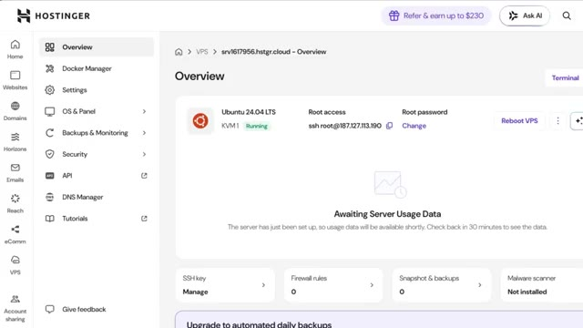
*⏱️ 00:11:54 — Capture d'écran montrant le tableau de bord Hostinger VPS configuré avec Ubuntu 24.04 LTS pour l'hébergement du bot.*

---

### ⏱️ `[00:12:22 - 00:12:57]` | Segment #26

**🔊 Audio (Transcription Intégrale Mot pour Mot en Français) :**
> Il s’agit d’être capable de tester assez d’idées assez rapidement pour trouver celles qui fonctionnent vraiment, d’accord, et écoutez, au cours des prochaines années, deux types de traders existeront : ceux qui utilisent l’IA et ceux qui font encore tout manuellement, même marché, des résultats très différents. Voici comment vous mettre du bon côté de cela : j’ai rassemblé tout ce qui se trouve dans la communauté AI Trade Edge, chaque prompt, chaque bot, chaque modèle, chaque guide étape par étape que j’utilise personnellement, le tout au même endroit, et tout ce que je construirai à l’avenir sera ajouté directement dans le groupe dès sa sortie.

**👁️ Analyse Visuelle d'Écran (gemini-3.5-flash-lite) :**
**Interface & Outils** : Présentation ou face-caméra explicatif du trader sans interface logicielle partagée.

**Contenu textuel & Code** : Explications orales des stratégies et mise en contexte méthodologique du marché.

**Action / Démonstration** : Explications face caméra et analyse conceptuelle des marchés.

---

### ⏱️ `[00:12:57 - 00:13:33]` | Segment #27

**🔊 Audio (Transcription Intégrale Mot pour Mot en Français) :**
> Nous testons également des stratégies venues de tout l'internet, en les automatisant grâce à PineScript, en les exécutant en direct, et en partageant exactement ce qui fonctionne et ce qui ne fonctionne pas. Vous n'obtenez donc pas seulement des outils. Vous obtenez une opération de recherche en direct. À l'intérieur, il y a aussi un cours complet de trading agentique, de 2 heures et demie, du débutant à l'expert, sans aucune base en programmation nécessaire. À la fin, vous aurez votre propre système de trading par IA opérationnel en direct. Quelque chose que la plupart des traders particuliers ne savent même pas être possible actuellement. 79,99 dollars par mois. Un seul bon trade couvre ce montant. Et les 100 premiers membres bloquent

**👁️ Analyse Visuelle d'Écran (gemini-3.5-flash-lite) :**
**Interface & Outils** : TradingView, Pine Editor, plateforme de cours en ligne.

**Contenu textuel & Code** : Code Pine Script (v5) avec conditions d'entrée long/short, graphiques de prix ETHUSDT, indicateurs techniques, et plan de cours sur l'IA appliquée au trading.

**Action / Démonstration** : Développement et automatisation d'une stratégie de trading via un script personnalisé, présentation du contenu de la formation.

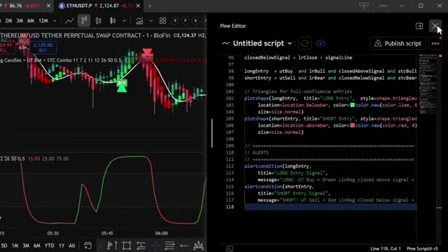
*⏱️ 00:13:06 — Capture d'écran divisée montrant à gauche un graphique de trading avec des signaux d'achat/vente et à droite l'éditeur Pine Script avec du code source.*

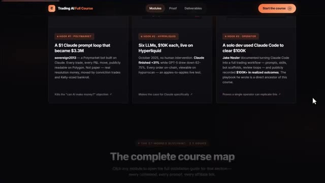
*⏱️ 00:13:15 — Capture d'écran d'une interface de cours en ligne intitulée "Trading AI Full Course" présentant différents modules de formation.*

---

### ⏱️ `[00:13:33 - 00:14:07]` | Segment #28

**🔊 Audio (Transcription Intégrale Mot pour Mot en Français) :**
> à ce tarif-là de façon permanente. Après cela, le prix augmente. Le lien est dans la description. Vous ne pouvez vraiment pas vous permettre de rater ça. Et c'est tout. C'est ainsi que Claude change le trading pour toujours et comment vous pouvez en faire partie. Si vous voulez approfondir l'un de ces sujets individuellement, la visite guidée complète de TradingView sur Telegram et le suivi des baleines sur Hyperliquid, toutes ces vidéos s'affichent à l'écran en ce moment même, allez les voir à votre rythme et si vous voulez le guide complet étape par étape sur la façon de construire votre propre système de trading agentique en utilisant Claude, cette vidéo est

**👁️ Analyse Visuelle d'Écran (gemini-3.5-flash-lite) :**
**Interface & Outils** : Présentation ou face-caméra explicatif du trader sans interface logicielle partagée.

**Contenu textuel & Code** : Explications orales des stratégies et mise en contexte méthodologique du marché.

**Action / Démonstration** : Explications face caméra et analyse conceptuelle des marchés.

---

### ⏱️ `[00:14:07 - 00:14:17]` | Segment #29

**🔊 Audio (Transcription Intégrale Mot pour Mot en Français) :**
> qui apparaît à l'écran également allez voir ça ensuite si vous avez trouvé cela utile laissez un pouce bleu cela aide vraiment la chaîne abonnez-vous si ce n'est pas déjà fait et je vous vois dans la prochaine

**👁️ Analyse Visuelle d'Écran (gemini-3.5-flash-lite) :**
**Interface & Outils** : Aucune interface visible.

**Contenu textuel & Code** : Aucun contenu informatif, indicateur ou code visible.

**Action / Démonstration** : Aucune action ou manipulation affichée.

---

