# 🎬 How To Copytrade on BingX 2026 (Step-By-Step)

> **Chaîne** : [Alex Carter](https://www.youtube.com/@AlexCarterTrading)  
> **Lien YouTube** : [https://www.youtube.com/watch?v=PagjxZXBt98](https://www.youtube.com/watch?v=PagjxZXBt98)  
> **Date de publication** : 20260622  
> **Durée** : 00:16:40  
> **Identifiant vidéo** : `PagjxZXBt98`  
> **Transcription & Analyse** : `whisper-v3-large-turbo+gemini-3.5-flash-lite`  

---

## 📌 Synthèse Exécutive & Outils

### 💡 Résumé
Dans cette vidéo orientée vers l'optimisation des performances sur les marchés dérivés et au comptant, la chaîne Alex Carter propose un guide analytique et rigoureux consacré au copy trading sur BingX. L'approche démontrée ne se limite pas à une simple présentation ergonomique de la plateforme, mais pose les bases d'une véritable ingénierie de sélection des "Lead Traders". L'intervenant décortique méthodiquement la structure des tableaux de bord, en insistant sur l'importance cruciale de disséquer les métriques de performance historique plutôt que de céder à l'illusion d'un rendement brut (ROI) élevé mais éphémère.

L'analyse technique et quantitative couvre à la fois les marchés de contrats à terme (Futures), caractérisés par l'usage d'un effet de levier amplificateur de volatilité, et les marchés au comptant (Spot), préconisés pour l'apprentissage sans risque de liquidation. La démonstration guide l'utilisateur à travers les subtilités du tri multicritère — du ratio de Sharpe aux actifs sous gestion (AUM) en passant par le prélèvement maximal (max drawdown) — afin d'aligner rigoureusement sa propre tolérance au risque avec le profil comportemental et la fréquence de trading du trader copié.

Enfin, la vidéo met en lumière les pièges psychologiques et opérationnels classiques des débutants, tels que le choix d'altcoins à faible capitalisation trop volatils ou l'ignorance des profits réels des abonnés (copieur PnL). En combinant une gestion stricte du risque et une configuration minutieuse des paramètres de suivi, la stratégie présentée vise à transformer le copy trading en un outil d'investissement passif structuré, sécurisé et pérenne.

### 🛠️ Outils, Modèles & Logiciels Présentés
* **BingX** : Plateforme centrale d'échange de cryptomonnaies et de contrats dérivés, offrant des interfaces dédiées au copy trading Spot et Futures ainsi qu'un classement intelligent.
* **Classement Intelligent BingX** : Outil algorithmique de catégorisation des traders en fonction de dynamiques spécifiques (retour sur investissement fulgurant, tendance, conservateurs et étoiles montantes).
* **Tableau de bord de Copy Trading** : Interface analytique permettant le suivi des capitaux propres, des positions ouvertes, du P&L et des métriques de risque des Lead Traders.
* **Centre des Récompenses BingX** : Espace dédié à la réclamation des bonus de bienvenue exclusifs, des récompenses d'inscription, de vérification d'identité et de dépôt.

### 🔑 Points Clés & Enseignements Stratégiques
* **Dichotomie Spot vs Futures** : Le copy trading Spot s'affranchit de l'effet de levier et élimine le risque de liquidation, constituant l'environnement idéal pour les débutants, tandis que les Futures exigent une maîtrise avancée de la volatilité et des marges.
* **Sélection axée sur la régularité** : Privilégier systématiquement une courbe de croissance ascendante et régulière sur 30 jours plutôt qu'un pic de rentabilité unique et non reproductible.
* **Analyse du Ratio de Sharpe** : Utiliser le ratio de Sharpe comme étalon fondamental des rendements ajustés au risque, en ciblant des valeurs supérieures à 1,0 (bon), 2,0 (très bon) ou 3,0 (excellent).
* **Surveillance du prélèvement maximal (Max Drawdown)** : Évaluer la plus forte baisse subie par le capital du trader depuis son sommet afin de mesurer sa résistance en période de turbulences de marché.
* **Vérification de la rentabilité des abonnés (Copier PnL)** : Analyser impérativement les gains réels des suiveurs actuels ; un PnL négatif ou nul chez les copieurs constitue un signal d'alarme rédhibitoire, quel que soit le prestige affiché du trader.
* **Attention portée aux actifs sous-jacents** : Préférer les Lead Traders se concentrant sur les crypto-monnaies majeures et liquides (Bitcoin, Ethereum) pour limiter l'exposition erratique aux altcoins à faible capitalisation.
* **Ratio de gains et asymétrie des profits** : Rechercher un taux de réussite (win rate) compris idéalement entre 50 % et 60 %, tout en s'assurant que le profit moyen dépasse significativement la perte moyenne, traduisant une bonne politique de coupe des pertes.
* **Utilisation des catégories du Classement Intelligent** : S'orienter vers la section des "traders conservateurs" en cas d'aversion marquée au risque, ces derniers privilégiant la préservation du capital et une croissance organique à faible exposition.
* **Compréhension du partage des profits (Profit Sharing)** : Intégrer le modèle économique du copy trading où le trader perçoit une commission de 10 % à 20 % sur les profits nets générés pour ses abonnés.
* **Sécurité des accès et parrainage** : Utiliser exclusivement des liens de parrainage officiels et vérifiés pour contrer les sites de phishing, sécuriser les fonds et débloquer l'intégralité des bonus de bienvenue négociés.

---

## ⏱️ Chronologie & Transcription Complète Audio & Visuelle (Mot pour Mot)

### ⏱️ `[00:00:00 - 00:00:19]` | Segment #01

**🔊 Audio (Transcription Intégrale Mot pour Mot en Français) :**
> Dans cette vidéo, je vais vous montrer exactement comment faire du copy trading sur BingX, tutoriel complet pour débutants, étape par étape. En plus de cela, je vais également vous montrer comment choisir les bons traders à copier, comment éviter les plus grosses erreurs que font les débutants et qui leur coûtent de l'argent, et comment gérer correctement votre copy trading afin de ne pas vous faire liquider.

**👁️ Analyse Visuelle d'Écran (gemini-3.5-flash-lite) :**
**Interface & Outils** : Interface web de l'échange de cryptomonnaies BingX (section Copy Trading).

**Contenu textuel & Code** : Profil du trader "golden faucet", graphiques de performance du ROI et du PnL cumulé sur 30 jours, indicateur de répartition des paires tradées (100% XRP), et boutons d'action "Follow" et "Copy".

**Action / Démonstration** : Navigation et présentation du profil d'un trader pour le tutoriel de copy trading.

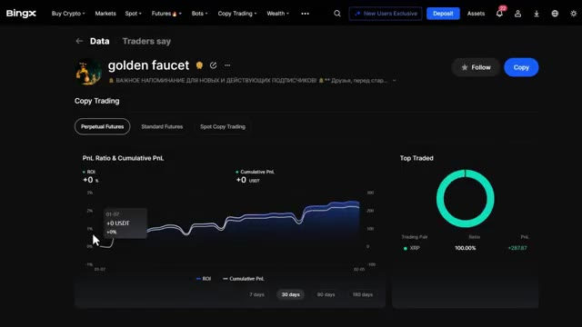
*⏱️ 00:00:05 — Capture d'écran de l'interface de copy trading sur la plateforme BingX montrant le profil d'un trader nommé "golden faucet" avec ses statistiques de performance (graphique PnL et répartition des actifs tradés).*

---

### ⏱️ `[00:00:20 - 00:00:52]` | Segment #02

**🔊 Audio (Transcription Intégrale Mot pour Mot en Français) :**
> De plus, si vous utilisez mon lien dans la description, vous pouvez réclamer d'immenses bonus exclusifs, y compris jusqu'à 9 800 USDT de récompenses totales. Commençons donc. Première chose à faire, vous avez besoin d'un compte BingX. Si vous n'en avez pas encore, cliquez sur le lien dans la description ci-dessous. Cela vous mènera directement vers la page de bonus de bienvenue exclusive. Ce n'est qu'en utilisant mon lien que vous débloquerez le pack complet de bonus pour nouveaux utilisateurs que j'ai négocié spécifiquement pour ma communauté. Nous expliquerons en détail comment réclamer ces bonus correctement un peu plus tard. Pour

**👁️ Analyse Visuelle d'Écran (gemini-3.5-flash-lite) :**
**Interface & Outils** : Interface web de l'échange de cryptomonnaies BingX.

**Contenu textuel & Code** : Offres promotionnelles, montants de bonus (9,800 USDT, 30 USDT, 500 USDT) et formulaire de création de compte.

**Action / Démonstration** : Présentation de la plateforme BingX et des bonus exclusifs disponibles via le lien de parrainage.

*⏱️ 00:00:28 — Page de la "New User Zone" sur BingX affichant le bonus de bienvenue "Win Up to 9,800+ USDT".*

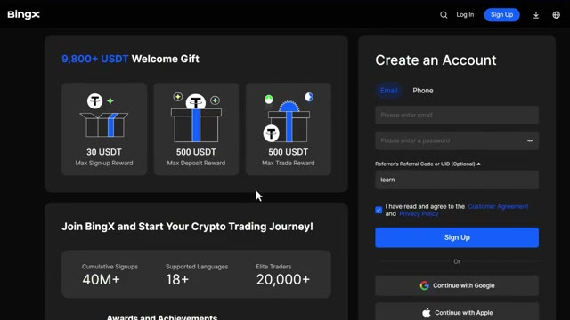
*⏱️ 00:00:36 — Formulaire d'inscription de la plateforme BingX avec les détails des récompenses de bienvenue.*

---

### ⏱️ `[00:00:52 - 00:01:25]` | Segment #03

**🔊 Audio (Transcription Intégrale Mot pour Mot en Français) :**
> Maintenant, concentrons-nous sur la configuration de tout de la bonne manière afin de ne rater aucune récompense. Très bien, une fois connecté à votre compte BingX, voici ce que vous devez faire. Allez dans la barre de navigation supérieure et passez votre curseur sur le copy trading. Comme vous pouvez le voir ici, BingX propose deux types de copy trading : le copy trading de futures et le copy trading de spot. Maintenant, la principale différence est simple. Le copy trading de futures utilise un effet de levier, ce qui signifie que vous pouvez amplifier vos gains, mais aussi vos pertes. Le copy trading de spot n'utilise pas d'effet de levier, il est donc plus sûr, mais les rendements sont généralement plus faibles.

**👁️ Analyse Visuelle d'Écran (gemini-3.5-flash-lite) :**
**Interface & Outils** : Interface web de l'échangeur de cryptomonnaies BingX (page d'accueil et section Copy Trading / Leaderboard).

**Contenu textuel & Code** : Bannières promotionnelles de BingX, tickers de prix des cryptomonnaies en bas de page, et tableaux de classement des traders avec leurs statistiques de performance (ROI, PnL sur 30 jours, ratio de Sharpe, etc.).

**Action / Démonstration** : Navigation sur la plateforme BingX pour accéder aux fonctionnalités de copy trading et consulter le classement des meilleurs traders.

*⏱️ 00:01:00 — Page d'accueil de la plateforme d'échange BingX, mettant en avant le partenariat avec le club de football Chelsea FC.*

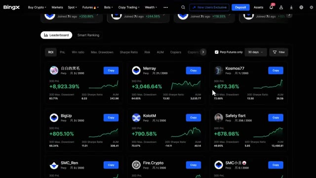
*⏱️ 00:01:17 — Page du classement du copy trading sur BingX affichant les performances de différents traders (ROI, PnL, etc.).*

---

### ⏱️ `[00:01:25 - 00:01:43]` | Segment #04

**🔊 Audio (Transcription Intégrale Mot pour Mot en Français) :**
> Pour les débutants, je recommande en fait de commencer par le copy trading au comptant pour vous familiariser avec le fonctionnement du système avant de passer aux contrats à terme à effet de levier. Pour ce tutoriel, je vais vous montrer les deux en commençant par le copy trading de contrats à terme puisque c'est là que se déroule l'essentiel de l'action. Cliquez sur le copy trading de contrats à terme pour accéder au tableau de bord.

**👁️ Analyse Visuelle d'Écran (gemini-3.5-flash-lite) :**
**Interface & Outils** : BingX (Plateforme d'échange crypto - Copy Trading Plaza)

**Contenu textuel & Code** : Menu de navigation supérieur (Buy Crypto, Markets, Spot, Futures, Bots, Copy Trading, Wealth), sections 'Elite Traders x AI Strategy Masters' (2 000 ways to trade), 'Futures Listing' (99 trading pairs), et sélecteurs de filtres 'Futures' / 'Spot'.

**Action / Démonstration** : Le curseur de la souris clique sur l'onglet 'Spot' du copy trading pour basculer de l'affichage des contrats à terme vers le marché au comptant.

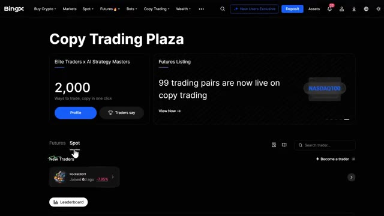
*⏱️ 00:01:30 — Capture d'écran de l'interface de la plateforme d'échange BingX, montrant la page du 'Copy Trading Plaza' avec les onglets 'Futures' et 'Spot'.*

---

### ⏱️ `[00:01:44 - 00:02:08]` | Segment #05

**🔊 Audio (Transcription Intégrale Mot pour Mot en Français) :**
> Une fois que vous êtes dans le tableau de bord du copy trading de contrats à terme, vous verrez plusieurs sections. Maintenant, écoutez, cela peut sembler un peu impressionnant au début, mais je vais décortiquer tout ce que vous devez savoir. En haut, vous pouvez voir la section de votre profil, qui montre vos performances actuelles en copy trading, vos capitaux propres et vos profits réalisés. En dessous, vous avez la section des nouveaux traders, qui met en avant les traders qui ont récemment rejoint la plateforme et qui affichent de solides performances initiales.

**👁️ Analyse Visuelle d'Écran (gemini-3.5-flash-lite) :**
**Interface & Outils** : Plateforme d'échange de cryptomonnaies BingX (section Copy Trading).

**Contenu textuel & Code** : Statistiques de traders incluant les pourcentages de PnL sur 30 jours (+590.03%, +532.42%, etc.), les graphiques de performance miniatures, et les boutons de copie.

**Action / Démonstration** : Navigation et présentation des différents profils de traders disponibles pour le copy trading de futures.

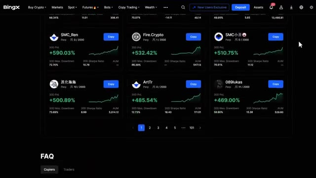
*⏱️ 00:01:50 — Capture d'écran de l'interface de copy trading de la plateforme BingX montrant une grille de traders de contrats à terme avec leurs performances (PnL sur 30 jours, drawdown, ratio de Sharpe).*

---

### ⏱️ `[00:02:09 - 00:02:30]` | Segment #06

**🔊 Audio (Transcription Intégrale Mot pour Mot en Français) :**
> Ensuite, vous avez le classement, qui est l'endroit où vous passerez le plus clair de votre temps. C'est ici que vous pouvez voir tous les traders les plus performants classés selon différents indicateurs. Et enfin, vous avez le Classement Intelligent, qui utilise l'algorithme de BingX pour catégoriser les traders en fonction de schémas de performance spécifiques. Plongeons d'abord dans le classement, car c'est là que vous trouverez les traders que vous voulez copier.

**👁️ Analyse Visuelle d'Écran (gemini-3.5-flash-lite) :**
**Interface & Outils** : Site web / Plateforme d'échange de cryptomonnaies BingX (Section Copy Trading / Classement).

**Contenu textuel & Code** : Cartes de traders affichant divers indicateurs de performance sur 30 jours : ROI, PnL (ex: +8,923.39%, +3,046.64%), ratio de Sharpe, Max Drawdown et AUM. Filtres par ROI, PnL, Win ratio, etc., et options de tri (Perp Futures only, 30 days).

**Action / Démonstration** : Présentation et exploration de la page de classement des traders du copy trading sur BingX pour évaluer leurs performances.

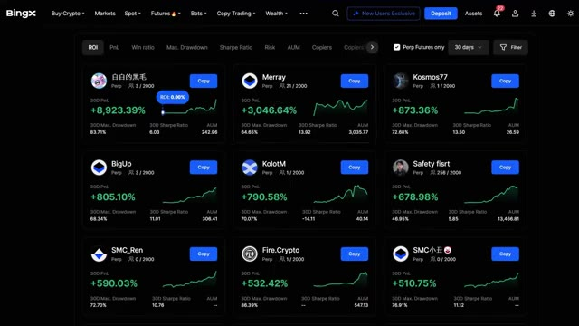
*⏱️ 00:02:14 — Capture d'écran de l'interface de copy trading de BingX montrant le classement des meilleurs traders avec leurs performances et métriques.*

---

### ⏱️ `[00:02:30 - 00:03:04]` | Segment #07

**🔊 Audio (Transcription Intégrale Mot pour Mot en Français) :**
> Sous le classement, vous pouvez voir le profil de chaque trader avec des informations clés, leur nom, le type de marchés qu'ils tradent, le nombre de followers qu'ils ont, leur P&L sur 30 jours, c'est-à-dire le profit et la perte, leur prélèvement maximal sur 30 jours, qui montre la plus grande perte qu'ils ont enregistrée, leur ratio de Sharpe, qui mesure les rendements ajustés au risque, et leur AUM, qui signifie actifs sous gestion, en gros, la quantité d'argent que les gens leur confient. Maintenant, c'est là que ça devient puissant. Vous pouvez trier ces traders selon plusieurs métriques. Vous pouvez trier par P&L pour voir qui gagne

**👁️ Analyse Visuelle d'Écran (gemini-3.5-flash-lite) :**
**Interface & Outils** : Interface de la plateforme d'échange BingX (section Copy Trading / Leaderboard).

**Contenu textuel & Code** : Cartes de profils de traders avec métriques de performance sur 30 jours (ex: P&L en pourcentage, graphiques de performance miniatures, Max. Drawdown, Sharpe Ratio, AUM, nombre de abonnés/copieurs) et boutons "Copy".

**Action / Démonstration** : Présentation des profils de traders et des indicateurs de performance clés visibles sous le classement de la plateforme.

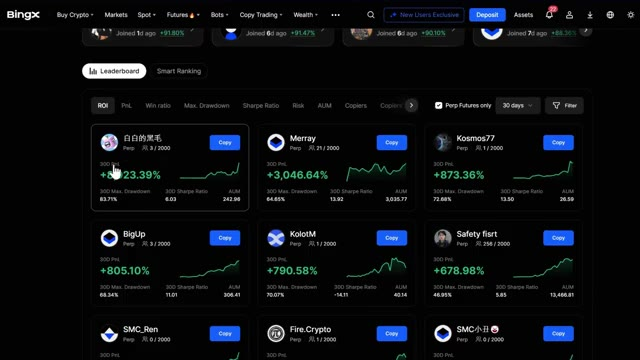
*⏱️ 00:02:39 — Capture d'écran de l'interface de copy trading de BingX montrant le classement (Leaderboard) avec des cartes de profil de traders affichant leurs performances sur 30 jours (ROI, P&L, Max. Drawdown, Sharpe Ratio, AUM et nombre de copieurs).*

---

### ⏱️ `[00:03:04 - 00:03:38]` | Segment #08

**🔊 Audio (Transcription Intégrale Mot pour Mot en Français) :**
> le plus d'argent, le ratio de gains pour voir qui a le pourcentage le plus élevé de transactions gagnantes, le prélèvement pour trouver les traders avec le plus faible risque, le ratio Sharpe pour trouver les meilleurs rendements ajustés au risque, au niveau de risque AUM pour voir qui gère le plus de capital, les copieurs pour voir qui sont les copieurs les plus populaires, les gains pour voir combien d'argent leurs abonnés gagnent réellement, le capital propre qui est le capital du trader et les abonnés, vous pouvez également filtrer pour afficher uniquement les traders de contrats futures perpétuels si c'est ce qui vous intéresse, maintenant BingX a une fonctionnalité vraiment utile appelée le classement intelligent qui

**👁️ Analyse Visuelle d'Écran (gemini-3.5-flash-lite) :**
**Interface & Outils** : Interface web de l'échange de cryptomonnaies BingX (section Copy Trading).

**Contenu textuel & Code** : Tableau de bord du copy trading affichant les performances des traders (PnL sur 30 jours, ratio de Sharpe, drawdown maximum, AUM). Le curseur clique sur l'onglet de tri "Sharpe Ratio".

**Action / Démonstration** : Navigation et tri des meilleurs traders selon le ratio de Sharpe pour évaluer les rendements ajustés au risque.

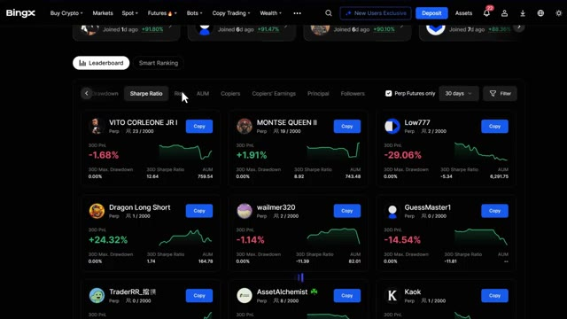
*⏱️ 00:03:12 — Capture d'écran montrant le classement (leaderboard) de copy trading de la plateforme BingX, avec les profils de différents traders et leurs métriques sur 30 jours.*

---

### ⏱️ `[00:03:38 - 00:04:01]` | Segment #09

**🔊 Audio (Transcription Intégrale Mot pour Mot en Français) :**
> catégorise les traders en quatre groupes : un retour sur investissement fulgurant qui montre des traders avec des rendements en augmentation rapide, les traders tendance qui gagnent en popularité rapidement, les traders conservateurs qui se concentrent sur des gains constants à faible risque, et les étoiles montantes qui sont plus récents mais affichent un fort potentiel. C'est super utile parce que cela vous permet de trouver rapidement des traders qui correspondent à votre tolérance au risque et à vos objectifs d'investissement.

**👁️ Analyse Visuelle d'Écran (gemini-3.5-flash-lite) :**
**Interface & Outils** : Présentation ou face-caméra explicatif du trader sans interface logicielle partagée.

**Contenu textuel & Code** : Explications orales des stratégies et mise en contexte méthodologique du marché.

**Action / Démonstration** : Explications face caméra et analyse conceptuelle des marchés.

---

### ⏱️ `[00:04:02 - 00:04:31]` | Segment #10

**🔊 Audio (Transcription Intégrale Mot pour Mot en Français) :**
> Si vous êtes frileux face au risque ou que vous débutez, je vous recommande vivement de consulter la section des traders conservateurs. Ces traders privilégient la préservation du capital et une croissance régulière plutôt que des gains massifs, ce qui signifie un risque de liquidation plus faible. Examinons maintenant rapidement le copy trading au comptant. Cliquez sur la section au comptant dans le menu de copy trading. Vous y verrez des traders qui négocient sans effet de levier, ce qui signifie qu'ils achètent et détiennent des cryptomonnaies sans emprunter de fonds. C'est beaucoup plus sûr que le trading de futures parce que vous ne pouvez pas être liquidé.

**👁️ Analyse Visuelle d'Écran (gemini-3.5-flash-lite) :**
**Interface & Outils** : Site web / Plateforme de courtage crypto BingX (section Copy Trading / Conservative Traders)

**Contenu textuel & Code** : Métriques de performance de traders conservateurs : PnL sur 30 jours (ex: +39.46%, +35.24%, +11.65%, etc.), Max Drawdown, Ratio de Sharpe, AUM (actifs sous gestion), et courbes de rendement.

**Action / Démonstration** : Navigation et présentation de la liste des traders conservateurs pour le copy trading sur BingX.

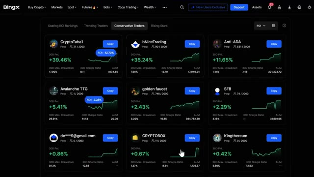
*⏱️ 00:04:09 — Capture d'écran de l'interface de copy trading de la plateforme BingX montrant la section des 'Conservative Traders' avec divers profils de traders, leurs performances sur 30 jours (PnL, Max Drawdown, Ratio de Sharpe, AUM) et des boutons de copie.*

---

### ⏱️ `[00:04:31 - 00:05:05]` | Segment #11

**🔊 Audio (Transcription Intégrale Mot pour Mot en Français) :**
> Le pire qui puisse arriver est que la valeur de votre portefeuille diminue si les prix baissent. Dans le classement au comptant, vous verrez les abonnés. Cela montre combien de personnes copient ce trader, le profit et la perte, ce sont leurs gains ou pertes totaux, le taux de réussite indique le pourcentage de transactions rentables, le PnL cumulé est leur profit total au fil du temps, et les jours de copy trading, cela montre depuis combien de temps ils sont actifs, c'est un excellent point de départ si vous voulez copier des traders sans le risque de l'effet de levier, vous pouvez apprendre comment fonctionne le copy trading et voir différentes stratégies.

**👁️ Analyse Visuelle d'Écran (gemini-3.5-flash-lite) :**
**Interface & Outils** : Échange de cryptomonnaies BingX (section Copy Trading).

**Contenu textuel & Code** : Cartes de profil de traders avec le nombre d'abonnés (ex: 1000/1000), le profit et la perte en pourcentage (ex: +49.47%, -9.86%, +32.03%), le taux de réussite (Win Ratio), le PnL cumulé et le nombre de jours de copy trading.

**Action / Démonstration** : Navigation et présentation des différents traders disponibles dans le classement au comptant (Spot) pour le copy trading.

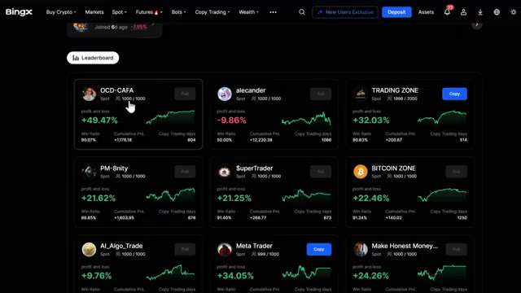
*⏱️ 00:04:40 — Capture d'écran de l'interface de copy trading de la plateforme BingX montrant le classement des traders (Leaderboard) avec leurs statistiques de performance.*

---

### ⏱️ `[00:05:05 - 00:05:31]` | Segment #12

**🔊 Audio (Transcription Intégrale Mot pour Mot en Français) :**
> s'entraîner et gagner en confiance avant de passer aux contrats à terme, mais avant de continuer, assurez-vous d'utiliser le lien ci-dessous lors de votre inscription. De faux sites d'arnaque sont partout en ligne. Mon lien ci-dessous vous garantit d'être sur la vraie plateforme BingX, assure la sécurité de vos fonds, vous permet de débloquer le pack de bonus de bienvenue et aide à soutenir la chaîne sans aucun coût supplémentaire pour vous. Très bien, disons donc que vous avez trouvé un trader qui vous intéresse. Cliquez sur son profil et vous verrez une tonne d'informations détaillées.

**👁️ Analyse Visuelle d'Écran (gemini-3.5-flash-lite) :**
**Interface & Outils** : Site web de l'échange de cryptomonnaies BingX

**Contenu textuel & Code** : Formulaire d'inscription, statistiques de la plateforme (40M+ utilisateurs, langues supportées, etc.) et section des tâches pour nouveaux utilisateurs avec récompenses en USDT.

**Action / Démonstration** : Présentation de la plateforme d'échange BingX et des étapes d'inscription pour les nouveaux utilisateurs.

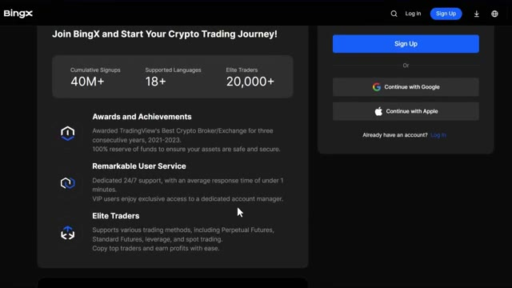
*⏱️ 00:05:11 — Page d'inscription de la plateforme BingX mettant en avant les fonctionnalités, les statistiques d'utilisateurs et les options de connexion.*

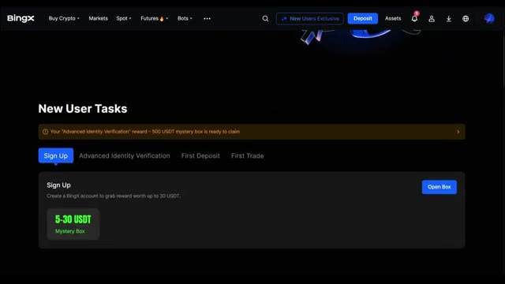
*⏱️ 00:05:25 — Interface utilisateur de BingX affichant les tâches pour les nouveaux utilisateurs et les récompenses associées.*

---

### ⏱️ `[00:05:31 - 00:05:57]` | Segment #13

**🔊 Audio (Transcription Intégrale Mot pour Mot en Français) :**
> Let me break down what actually matters. First, you'll see their PNL ratio and top traded coins. This shows you which cryptocurrencies they focus on. I personally prefer traders who stick to major coins like Bitcoin and Ethereum because they're less volatile and less risky than low-cap altcoins. Under the Overview tab, you can see the Trader Profitability section, which shows their ROI and profit for the last 30 days.

**👁️ Analyse Visuelle d'Écran (gemini-3.5-flash-lite) :**
**Interface & Outils** : Plateforme d'échange de cryptomonnaies BingX (interface de Copy Trading).

**Contenu textuel & Code** : Graphique de PnL Ratio & Cumulative PnL affichant un ROI de +2,43 % et un PnL cumulé de +215,37 USDT, ainsi qu'un graphique en camembert montrant 100 % de XRP dans la section Top Traded.

**Action / Démonstration** : Présentation et analyse des métriques de performance d'un trader (ratio PnL et cryptomonnaies principales).

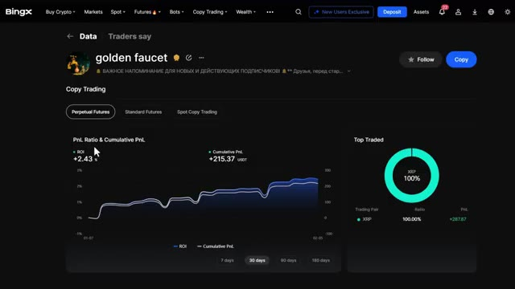
*⏱️ 00:05:38 — Profil de copy trading sur la plateforme BingX montrant le ratio PnL, le PnL cumulé et les cryptomonnaies les plus tradées (Top Traded).*

---

### ⏱️ `[00:05:58 - 00:06:25]` | Segment #14

**🔊 Audio (Transcription Intégrale Mot pour Mot en Français) :**
> Cherchez une croissance constante, pas seulement un énorme pic unique. Une courbe ascendante régulière est bien meilleure que des variations sauvages. Ensuite, vous verrez leur ratio de gains, qui est le pourcentage de transactions qui ont gagné de l'argent. Au moins 50 % à 60 % est l'idéal. Tout ce qui est en dessous de 40 % est assez risqué. Vous verrez également leur capital, qui est leur propre capital, le total des positions, les positions gagnantes, les positions perdantes, le profit moyen, la perte moyenne et le ratio PNL.

**👁️ Analyse Visuelle d'Écran (gemini-3.5-flash-lite) :**
**Interface & Outils** : Interface web de l'exchange de cryptomonnaies BingX (section Copier Trading / Overview).

**Contenu textuel & Code** : Métriques de performance de trading : 30D win ratio (100%), 3D Profit (+215.37 USDT), Principal, Total positions (3902), Win positions (3901), Loss positions (1), Average profit, Average loss, PnL ratio, Trader Activities, Copier Performance & Scale (+15,873.53 de gains pour les copieurs, AUM 364,782.30 USDT), et Trader Risk (30D max drawdown 3.20%, Sharpe ratio 10.65). Une infobulle explicative s'affiche sur le ratio de gains 30D.

**Action / Démonstration** : Consultation et survol des métriques de rentabilité et du ratio de gains d'un trader sur la plateforme BingX.

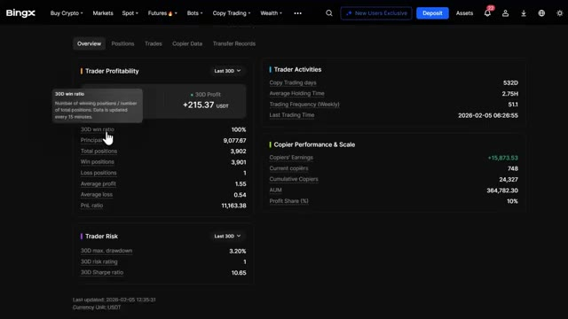
*⏱️ 00:06:04 — Capture d'écran du tableau de bord de rentabilité et des statistiques d'un trader sur l'exchange de cryptomonnaies BingX, montrant notamment le ratio de gains sur 30 jours (3D win ratio) et les performances de copy trading.*

---

### ⏱️ `[00:06:25 - 00:06:45]` | Segment #15

**🔊 Audio (Transcription Intégrale Mot pour Mot en Français) :**
> Voici ce que cela signifie. La position totale montre combien de trades ils ont ouverts. Les positions gagnantes et perdantes détaillent combien étaient rentables par rapport à celles qui ne l'étaient pas. Le profit moyen et la perte moyenne vous montrent la taille typique de leurs gains et de leurs pertes. Si leur profit moyen est nettement supérieur à leur perte moyenne, c'est un bon signe.

**👁️ Analyse Visuelle d'Écran (gemini-3.5-flash-lite) :**
**Interface & Outils** : Interface web de l'échange de cryptomonnaies BingX (section Copy Trading).

**Contenu textuel & Code** : Métriques affichées : ROI 30D (+2.43 %), Profit 30D (+215.37 USDT), taux de réussite 30D (100 %), Principal (9,077.67), positions totales (3,902), positions gagnantes (3,901), positions perdantes (1), profit moyen (1.55), perte moyenne (0.54), ratio PnL (11,163.38), jours de copy trading (532D), temps de détention moyen (2.75H), fréquence de trading hebdomadaire (51.1), gains des copieurs (+15,873.53), copieurs actuels (748), AUM (364,782.30), part des profits (10 %), drawdown max 30D (3.20%), ratio de Sharpe 30D (10.65).

**Action / Démonstration** : Présentation et explication détaillée des métriques de performance et de risque d'un trader sur une plateforme de copy trading.

*⏱️ 00:06:30 — Capture d'écran du tableau de bord de Copy Trading sur la plateforme BingX montrant les statistiques de rentabilité, d'activité et de risque d'un trader.*

---

### ⏱️ `[00:06:45 - 00:07:17]` | Segment #16

**🔊 Audio (Transcription Intégrale Mot pour Mot en Français) :**
> Cela signifie qu'ils réduisent leurs pertes rapidement et laissent courir leurs gains. Vous pouvez également voir l'activité des traders, qui montre leurs statistiques de trading, telles que le nombre de jours depuis qu'ils ont commencé le copy trading, le temps de détention moyen d'un trade, la fréquence des trades par semaine, et leurs derniers trades. Maintenant, sous le risque du trader, vous verrez trois métriques essentielles : le prélèvement maximal, l'évaluation du risque et le ratio de Sharpe. Le prélèvement maximal montre la plus grande perte subie par le trader depuis son capital maximum. L'évaluation du risque est l'évaluation globale par BingX du niveau de risque du trader. Le niveau de risque de 1 à 9 est

**👁️ Analyse Visuelle d'Écran (gemini-3.5-flash-lite) :**
**Interface & Outils** : Plateforme d'échange de cryptomonnaies BingX (Interface de Copy Trading)

**Contenu textuel & Code** : Statistiques de trading : Trader Profitability (30D ROI +2.43%, 30D Profit +215.37 USDT, 30D win ratio 100%, PnL ratio 11,163.38), Copy Trading days (532D), Average Holding Time (2.75H), Trading Frequency (51.1), Copier Performance & Scale (AUM 364,782.30 USDT, 748 current copiers), Trader Risk (30D max. drawdown 3.20%, 30D Sharpe ratio 10.65).

**Action / Démonstration** : Consultation et survol des métriques de performance et de risque d'un trader professionnel sur BingX.

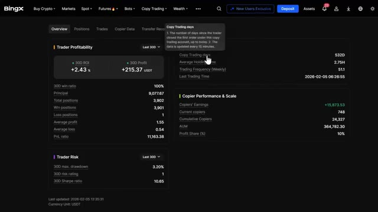
*⏱️ 00:06:53 — Interface de copy trading de la plateforme BingX montrant les statistiques de performance d'un trader, avec un curseur survolant la métrique 'Copy Trading days' et une infobulle explicative.*

---

### ⏱️ `[00:07:17 - 00:07:40]` | Segment #17

**🔊 Audio (Transcription Intégrale Mot pour Mot en Français) :**
> classé selon la perte pendant la période statistique. Plus le chiffre est élevé, plus le risque est élevé. Et ces données sont mises à jour toutes les 30 minutes. Ensuite, vous avez le ratio de Sharpe, qui est une mesure de performance clé pour évaluer les rendements ajustés au risque. En gros, un ratio de Sharpe plus élevé signifie que le trader gagne un rendement excédentaire plus important par unité de volatilité ou de risque qu'il prend.

**👁️ Analyse Visuelle d'Écran (gemini-3.5-flash-lite) :**
**Interface & Outils** : Interface web de l'exchange BingX (section Copy Trading / Overview).

**Contenu textuel & Code** : Statistiques de trading sur 30 jours (ROI +2.43%, Profit +215.37 USDT, win ratio 100%, 3D risk rating 1, 3D Sharpe ratio 10.65) et encadré explicatif du niveau de risque.

**Action / Démonstration** : Le présentateur survole ou pointe la section des métriques de risque pour expliquer le mode de calcul et la mise à jour des données.

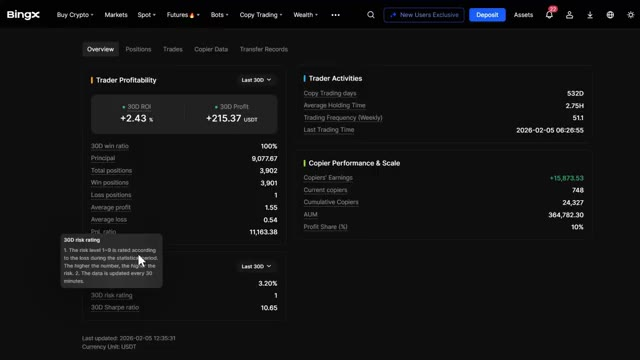
*⏱️ 00:07:23 — Vue d'ensemble du profil d'un trader sur l'exchange BingX avec une info-bulle affichant la définition du '3D risk rating'.*

---

### ⏱️ `[00:07:40 - 00:08:02]` | Segment #18

**🔊 Audio (Transcription Intégrale Mot pour Mot en Français) :**
> Un ratio de Sharpe supérieur à 1,0 est considéré comme bon, supérieur à 2,0 comme très bon, et supérieur à 3,0 comme excellent. Cela vous indique si les rendements du trader valent le risque qu'il prend, et pas seulement le montant des bénéfices qu'il réalise. Sur le côté droit, vous verrez la performance et l'échelle du copieur. En dessous, vous pouvez voir les gains du copieur, ce qui est absolument crucial.

**👁️ Analyse Visuelle d'Écran (gemini-3.5-flash-lite) :**
**Interface & Outils** : Interface web de l'échange de cryptomonnaies BingX (section Copy Trading / Overview).

**Contenu textuel & Code** : Métriques de trading sur 30 jours : Trader Profitability (3D ROI de +2,43 %, 3D Profit de +215,37 USDT, ratio de gain de 100 %, 3 902 positions totales, 3 901 positions gagnantes, 1 position perdante), Trader Risk (3D max. drawdown de 3,20 %, 3D risk rating de 1, 3D Sharpe ratio de 10,35), Trader Activities et Copier Performance & Scale (Copiers' Earnings de +15 873,53, 748 copieurs actuels, AUM de 364 782,30 USDT).

**Action / Démonstration** : Analyse et présentation des métriques de performance et de risque d'un trader sur BingX, illustrant notamment le ratio de Sharpe.

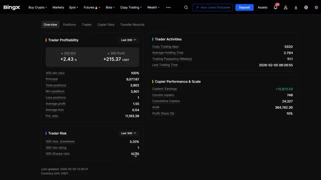
*⏱️ 00:07:46 — Capture d'écran du tableau de bord de la plateforme d'échange BingX montrant les statistiques détaillées de rentabilité, de risque et de performance de copie d'un trader.*

---

### ⏱️ `[00:08:02 - 00:08:30]` | Segment #19

**🔊 Audio (Transcription Intégrale Mot pour Mot en Français) :**
> Cela montre combien d'argent leurs copieurs actuels rapportent réellement. Si ce nombre est négatif ou à peine positif, c'est un énorme signal d'alarme. Évitez-les immédiatement. Vous pouvez également voir les copieurs actuels, les copieurs cumulés et les actifs sous gestion, ou AUM, avec le ratio de partage des profits. Le ratio de partage des profits se situe généralement entre 10 et 20 pour cent, ce qui signifie que si vous réalisez 100 $ de profit, le trader garde 10 $ à 20 $ et vous gardez le reste.

**👁️ Analyse Visuelle d'Écran (gemini-3.5-flash-lite) :**
**Interface & Outils** : Interface web de la plateforme de trading BingX (section Copy Trading).

**Contenu textuel & Code** : Métriques de copy trading : 30D ROI (+2.43 %), 30D Profit (+215.37 USDT), Copiers' Earnings (+15,873.53), Current copiers (748), Cumulative Copiers (24,327), AUM (364,782.30), Profit Share (10%), et score de risque.

**Action / Démonstration** : Analyse des statistiques de performance et des indicateurs de rentabilité des copieurs sur la plateforme.

*⏱️ 00:08:09 — Capture d'écran de l'interface de la plateforme BingX montrant les statistiques de copy trading, avec un focus sur les performances du trader, le ratio de profit et les gains des copieurs.*

---

### ⏱️ `[00:08:30 - 00:09:07]` | Segment #20

**🔊 Audio (Transcription Intégrale Mot pour Mot en Français) :**
> Sous les positions actives, vous pouvez voir leurs transactions ouvertes actuelles. Sous les données des copieurs, vous pouvez voir les noms des personnes qui les copient, depuis combien de jours elles copient, le montant de leurs actifs copiés, et leur P&L. Cela vous donne une vraie preuve sociale indiquant si ce trader fait réellement gagner de l'argent à ses abonnés. Maintenant, regardez, c'est presque la même chose avec le copy trading au comptant, mais pour le comptant, vous verrez principalement le ROI, le PNL cumulé, le taux de réussite, le total des transactions et les actifs du compte. Vous pouvez également voir leur fréquence de trading et leurs jours de trading, ce qui vous indique à quel point ils sont actifs. Prenez votre temps ici. Ne choisissez pas seulement le trader avec le

**👁️ Analyse Visuelle d'Écran (gemini-3.5-flash-lite) :**
**Interface & Outils** : Plateforme d'échange de cryptomonnaies BingX (interface web de Copy Trading).

**Contenu textuel & Code** : Tableau des données des copieurs affichant les colonnes Copiers (noms/emails masqués), Copy Days (nombre de jours de copie), Copy Assets (en USDT) et P&L (en USDT).

**Action / Démonstration** : Présentation et explication de la liste des investisseurs qui copient les trades et de leurs performances financières.

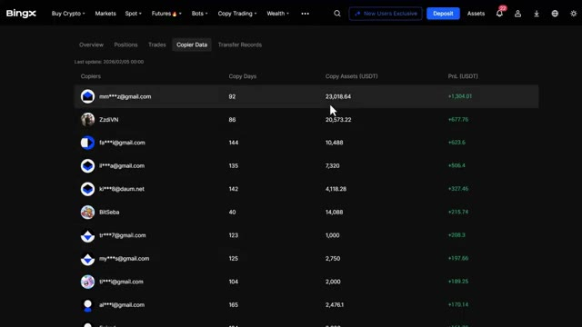
*⏱️ 00:08:39 — Capture d'écran de l'interface de la plateforme BingX montrant l'onglet des données de copy trading avec la liste des copieurs.*

---

### ⏱️ `[00:09:07 - 00:09:42]` | Segment #21

**🔊 Audio (Transcription Intégrale Mot pour Mot en Français) :**
> le meilleur retour sur investissement. Vous voulez de la régularité, un bon ratio de gagnants, des gains positifs pour les copieurs et une stratégie qui correspond à votre tolérance au risque. Maintenant, avant de continuer, assurez-vous de consulter le centre des récompenses après vous être inscrit en utilisant mon lien dans la description. Ici, vous pouvez réclamer mon pack de bonus de bienvenue exclusif mentionné plus tôt, incluant une récompense maximale d'inscription de 30 USDT, jusqu'à 500 USDT pour la vérification d'identité avancée, une récompense maximale de dépôt de 500 USDT, une récompense maximale de trading de 500 USDT, et du trading exclusif.

**👁️ Analyse Visuelle d'Écran (gemini-3.5-flash-lite) :**
**Interface & Outils** : Échange de cryptomonnaies BingX (sections Copy Trading et Rewards Center).

**Contenu textuel & Code** : Graphique de ROI (+32.03%), onglets de performance (7 jours, 30 jours, 90 jours), bons de position (50 USDT, 100 USDT, 200 USDT) et tâches de vérification d'identité.

**Action / Démonstration** : Navigation sur la plateforme BingX pour montrer les performances de copy trading et les récompenses disponibles pour les nouveaux utilisateurs.

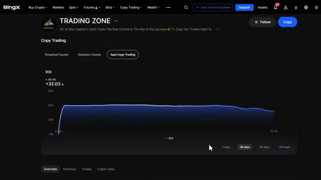
*⏱️ 00:09:16 — Interface de copy trading sur l'échange BingX montrant le profil Trading Zone avec un graphique de ROI à +32.03 %.*

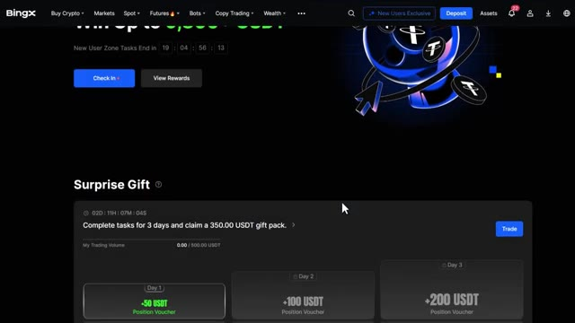
*⏱️ 00:09:24 — Centre des récompenses BingX affichant les tâches pour nouveaux utilisateurs et des cadeaux surprise avec des bons de position en USDT.*

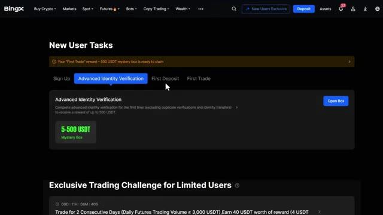
*⏱️ 00:09:33 — Section des tâches pour nouveaux utilisateurs sur BingX incluant la vérification d'identité, le premier dépôt et le premier trade.*

---

### ⏱️ `[00:09:42 - 00:10:16]` | Segment #22

**🔊 Audio (Transcription Intégrale Mot pour Mot en Français) :**
> des défis permettant de gagner de 5 USDT pour 5 000 de volume de trading jusqu'à 6 000 USDT pour 70 millions de volume de trading sur les contrats futures. Cela représente jusqu'à 9 800 USDT de récompenses totales, disponibles uniquement via mon lien. Donc, ne manquez surtout pas ça. Très bien, une fois que vous avez trouvé un trader qui vous plaît, cliquez sur le bouton de copie sur son profil. BingX propose deux modes de copie : le mode à ratio fixe et le mode à montant fixe. Le premier est le mode à ratio fixe. C'est lorsque vous copiez un pourcentage de votre portefeuille qui correspond à celui du trader principal.

**👁️ Analyse Visuelle d'Écran (gemini-3.5-flash-lite) :**
**Interface & Outils** : Échange de cryptomonnaies BingX (interface web).

**Contenu textuel & Code** : Paliers de volume futures, récompenses en bons bonus USDT, statistiques de copy trading, ROI, répartition des actifs tradés.

**Action / Démonstration** : Navigation sur la plateforme BingX entre les pages de tâches futures, le classement des copy traders et la configuration d'un investissement de copy trading.

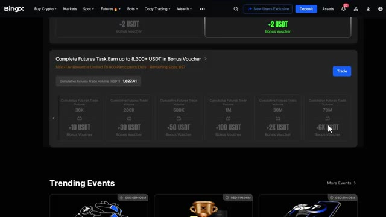
*⏱️ 00:09:51 — Interface BingX affichant les défis de trading futures avec des paliers de volume cumulé et des récompenses en bons bonus (de 30K à 70M).*

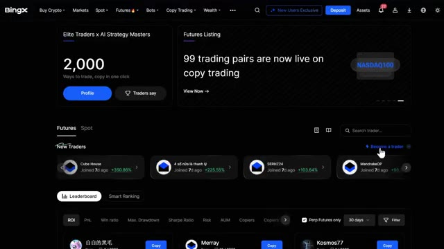
*⏱️ 00:09:59 — Interface BingX sur la section copy trading montrant le classement des nouveaux traders et les paires de trading disponibles.*

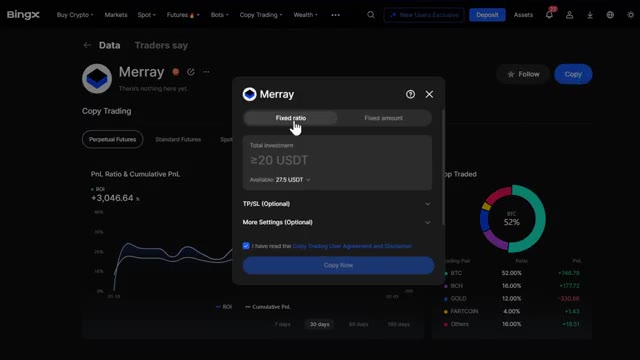
*⏱️ 00:10:07 — Fenêtre de configuration du copy trading pour le trader "Merray" sur BingX, avec les options d'investissement, le ratio fixe et le graphique de performance ROI.*

---

### ⏱️ `[00:10:16 - 00:10:50]` | Segment #23

**🔊 Audio (Transcription Intégrale Mot pour Mot en Français) :**
> allocation. Donc s'ils utilisent 5% de leur capital sur un trade, vous utilisez 5% du vôtre. Ce mode est idéal si vous souhaitez reproduire exactement la stratégie et le profil de risque du trader. Le deuxième est le mode montant fixe. C'est là que vous copiez un montant fixe en dollars par trade. Par exemple, si vous définissez 10 $ pour chaque trade que le trader principal ouvre, vous ouvrez avec 10 $. Cela vous donne plus de contrôle sur le montant que vous risquez par trade, peu importe ce que le trader utilise. C'est préférable si vous souhaitez limiter votre exposition par trade. Pour ce tutoriel, je vais

**👁️ Analyse Visuelle d'Écran (gemini-3.5-flash-lite) :**
**Interface & Outils** : Échange de cryptomonnaies BingX (Interface Web - Copy Trading)

**Contenu textuel & Code** : Fenêtre de paramétrage du copy trading avec les options "Fixed ratio" et "Fixed amount", un champ d'investissement total (minimum 20 USDT, solde disponible de 27,5 USDT), des options de Take Profit / Stop Loss optionnelles, ainsi que des graphiques de performance (ROI de +3,046.4% et répartition des actifs tradés).

**Action / Démonstration** : Configuration et sélection des modes de répartition de capital (ratio fixe vs montant fixe) pour copier un trader sur BingX.

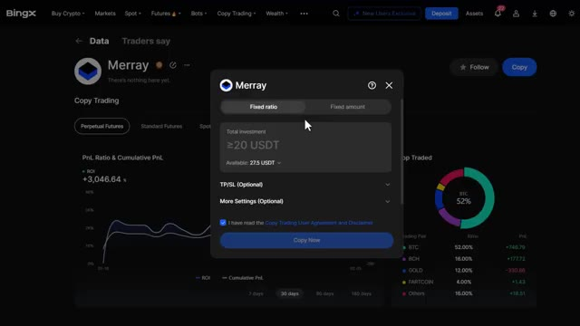
*⏱️ 00:10:24 — Interface de copy trading de la plateforme BingX montrant le profil d'un trader (Merray) avec une fenêtre modale de configuration des paramètres d'investissement.*

---

### ⏱️ `[00:10:50 - 00:11:10]` | Segment #24

**🔊 Audio (Transcription Intégrale Mot pour Mot en Français) :**
> utilisez le mode montant fixe puisque c'est plus simple et que cela vous donne plus de contrôle. Maintenant, dans cette section, vous pouvez définir vos paramètres de copy trading. Le premier est la marge par ordre. C'est le montant que vous investirez dans chaque trade individuel. Par exemple, si vous définissez 20 dollars, chaque fois que le trader ouvre une position, vous en ouvrirez une avec 20 dollars. Le suivant est l'investissement total.

**👁️ Analyse Visuelle d'Écran (gemini-3.5-flash-lite) :**
**Interface & Outils** : BingX (Plateforme d'échange de cryptomonnaies)

**Contenu textuel & Code** : Paramètres de copy trading avec les options "Fixed ratio" et "Fixed amount", champs "Margin per order" (≥5 USDT), "Total investment" (≥20 USDT), solde disponible de 27.5 USDT, options TP/SL et bouton "Copy Now".

**Action / Démonstration** : Configuration des paramètres de copy trading en mode montant fixe.

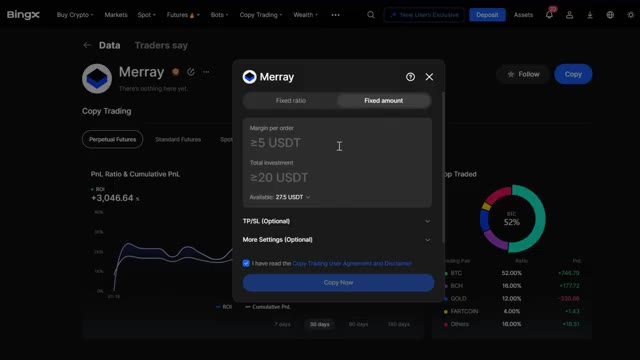
*⏱️ 00:10:55 — Interface de copy trading de la plateforme BingX affichant les paramètres de configuration du trader "Mray", avec l'onglet "Fixed amount" sélectionné et les champs pour la marge par ordre et l'investissement total.*

---

### ⏱️ `[00:11:11 - 00:11:32]` | Segment #25

**🔊 Audio (Transcription Intégrale Mot pour Mot en Français) :**
> Il s'agit du montant maximum que vous êtes prêt à allouer pour copier ce trader. Par exemple, si vous définissez 500 $, une fois que vos positions actives auront atteint 500 $, aucun nouveau trade ne sera copié jusqu'à ce que certains se ferment. Ne placez pas tous vos fonds sur un seul trader. La diversification est essentielle. Je recommande de répartir votre capital entre deux ou trois traders ayant des stratégies différentes.

**👁️ Analyse Visuelle d'Écran (gemini-3.5-flash-lite) :**
**Interface & Outils** : Plateforme d'échange de cryptomonnaies BingX (section Copy Trading).

**Contenu textuel & Code** : Paramètres de configuration : mode 'Fixed amount', 'Margin per order' (20 USDT), 'Total investment' (27,5 USDT), options 'TP/SL' et 'More Settings', ainsi qu'une case à cocher pour l'accord d'utilisation.

**Action / Démonstration** : Configuration des paramètres de gestion du risque et du montant d'investissement pour copier automatiquement le trader.

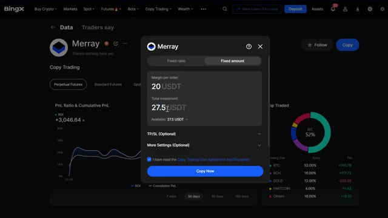
*⏱️ 00:11:16 — Interface de copy trading sur la plateforme BingX montrant une fenêtre modale de configuration des paramètres d'allocation de fonds pour un trader nommé 'Merray'.*

---

### ⏱️ `[00:11:33 - 00:11:51]` | Segment #26

**🔊 Audio (Transcription Intégrale Mot pour Mot en Français) :**
> Ensuite, vous pouvez activer le take profit et le stop loss pour vos copies de trades. Vous pouvez définir un take profit dans lequel vous définirez un pourcentage ou un montant en dollars où votre position se fermera automatiquement pour verrouiller les gains. Par exemple, si vous définissez un take profit de 20 % et que votre trade monte de 20 %, il se fermera automatiquement.

**👁️ Analyse Visuelle d'Écran (gemini-3.5-flash-lite) :**
**Interface & Outils** : Interface de l'échange de cryptomonnaies BingX (section Copy Trading).

**Contenu textuel & Code** : Paramètres de Take Profit (TP/SL) avec champs de saisie pour définir un pourcentage ou un montant en USDT, options "Continue copying after taking profit", et bouton de confirmation "Copy Now".

**Action / Démonstration** : Configuration des paramètres de gestion des risques (Take Profit et Stop Loss) pour copier un trader (Merray).

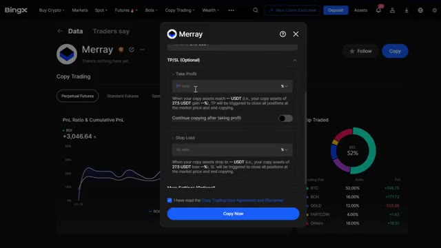
*⏱️ 00:11:37 — Fenêtre modale de configuration du Take Profit (TP) et Stop Loss (SL) pour le copy trading sur la plateforme BingX.*

---

### ⏱️ `[00:11:51 - 00:12:12]` | Segment #27

**🔊 Audio (Transcription Intégrale Mot pour Mot en Français) :**
> Vous pouvez également activer la copie continue après avoir pris des bénéfices. Lorsque le prix ou le ratio de déclenchement du take profit est atteint, le système fermera toutes vos positions et transférera automatiquement les bénéfices sur votre compte de contrats futures perpétuels. Vos fonds restants continueront d'être utilisés pour copier le trader, à moins qu'au cas où ils ne tombent en dessous du seuil de copie minimal, la copie sera alors annulée.

**👁️ Analyse Visuelle d'Écran (gemini-3.5-flash-lite) :**
**Interface & Outils** : Échange de crypto-monnaies BingX (interface web).

**Contenu textuel & Code** : Fenêtre modale de paramétrage du "Copy Trading" avec les champs "Take Profit" (réglé sur 20%), le bouton bascule pour "Continue copying after taking profit", et un message d'erreur en haut ("Failed to enable. Set profit must exceed 10 USDT").

**Action / Démonstration** : Configuration des options de Take Profit et de copie continue pour un trader ("Merray") sur BingX.

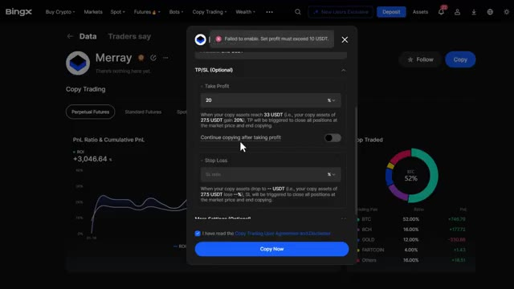
*⏱️ 00:11:56 — Interface de la plateforme d'échange BingX montrant le menu de configuration du copy trading avec les options de Take Profit et l'option "Continue copying after taking profit".*

---

### ⏱️ `[00:12:13 - 00:12:33]` | Segment #28

**🔊 Audio (Transcription Intégrale Mot pour Mot en Français) :**
> Vient ensuite le stop loss. C'est ici que vous pouvez définir un pourcentage ou un montant en dollars où votre position se fermera automatiquement pour limiter les pertes. Par exemple, si vous définissez un stop loss de 10 % et que votre trade chute de 10 %, il se fermera automatiquement pour protéger votre capital. Je recommande vivement de définir un stop loss. C'est votre filet de sécurité contre les pertes majeures.

**👁️ Analyse Visuelle d'Écran (gemini-3.5-flash-lite) :**
**Interface & Outils** : Plateforme de trading BingX (section Copy Trading).

**Contenu textuel & Code** : Paramètres TP/SL (Take Profit réglé à 20 %, champ de Stop Loss vide avec l'option SL ratio en pourcentage).

**Action / Démonstration** : Configuration des options de gestion des risques (Take Profit et Stop Loss) pour le copy trading d'un trader (Merray).

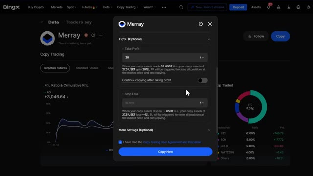
*⏱️ 00:12:18 — Interface de la plateforme d'échange BingX affichant les paramètres de Copy Trading avec une fenêtre modale pour configurer le Take Profit (TP) et le Stop Loss (SL).*

---

### ⏱️ `[00:12:34 - 00:13:08]` | Segment #29

**🔊 Audio (Transcription Intégrale Mot pour Mot en Français) :**
> Cliquez sur plus de paramètres pour accéder aux options avancées. Ici, vous pouvez voir le mode de copie pour les positions existantes. Vous y verrez trois options. Copier toutes les positions. Cela signifie que vous copierez immédiatement toutes les positions actuellement ouvertes du trader au prix du marché. Ne pas copier les positions existantes. Cela signifie que vous ne copierez que les nouveaux trades que le trader ouvre après avoir commencé à le suivre. Personnaliser les positions à copier. C'est ici que vous pouvez sélectionner manuellement lesquelles de leurs positions actuelles vous voulez copier. Si vous débutez, je vous recommande de ne pas copier

**👁️ Analyse Visuelle d'Écran (gemini-3.5-flash-lite) :**
**Interface & Outils** : Interface de la plateforme de courtage et copy trading BingX.

**Contenu textuel & Code** : Menu contextuel « Copy Mode for Existing Positions » avec trois options : « Copy all positions », « Don't copy existing positions », « Customize positions to copy », ainsi que les boutons d'annulation et de validation (OK).

**Action / Démonstration** : Le curseur survole l'option « Copy all positions » pour configurer les paramètres de copie des positions existantes d'un trader.

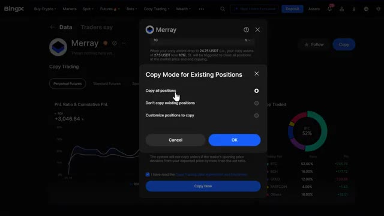
*⏱️ 00:12:42 — Fenêtre modale des options de copy trading sur la plateforme BingX montrant le mode de copie pour les positions existantes.*

---

### ⏱️ `[00:13:08 - 00:13:42]` | Segment #30

**🔊 Audio (Transcription Intégrale Mot pour Mot en Français) :**
> positions existantes afin que vous puissiez voir comment le trader opère avant de vous engager dans ses trades actuels. Tolérance au slippage. Ceci contrôle quelle différence de prix vous acceptez entre le prix d'entrée du trader et le vôtre. Vous pouvez la régler de zéro slippage, prix exact, mais avec plus de chance d'échec de l'ordre, jusqu'au slippage maximum, plus flexible, mais vous pourriez obtenir un pire prix d'entrée. Je recommande de la régler entre 1 et 2 % pour un bon équilibre entre l'exécution et la précision du prix. Ensuite, il y a le réglage de votre effet de levier. Ici, vous pouvez choisir d'utiliser le même effet de levier que le trader pour correspondre exactement à son effet de levier.

**👁️ Analyse Visuelle d'Écran (gemini-3.5-flash-lite) :**
**Interface & Outils** : Échange de cryptomonnaies BingX (interface de Copy Trading).

**Contenu textuel & Code** : Fenêtre modale de paramétrage de copy trading ("More Settings"), affichant les options de gestion des positions existantes ("Don't copy existing positions"), les réglages de tolérance au slippage réglés sur un pourcentage maximal (1 %), ainsi que la case de validation des conditions d'utilisation et le bouton d'exécution ("Copy Now").

**Action / Démonstration** : Configuration des options avancées de copy trading et de la tolérance au slippage avant de valider l'engagement sur le trader.

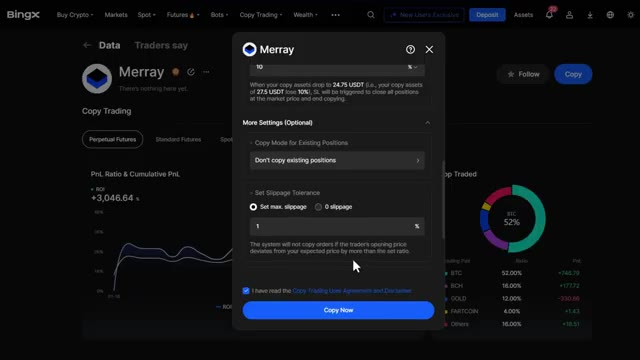
*⏱️ 00:13:17 — Interface de configuration du copy trading sur l'échange BingX, mettant en avant les paramètres avancés incluant le mode pour les positions existantes et la tolérance au slippage.*

---

### ⏱️ `[00:13:42 - 00:14:02]` | Segment #31

**🔊 Audio (Transcription Intégrale Mot pour Mot en Français) :**
> ou définissez votre propre effet de levier en utilisant un montant de levier personnalisé. Si le trader utilise un effet de levier de 20 fois, mais que ce risque ne vous met pas à l'aise, vous pouvez définir le vôtre à 5 fois ou 10 fois. Cela réduit votre profit potentiel, mais réduit également votre risque de liquidation. Sur les paires de trading, vous pouvez choisir de copier toutes les paires de trading.

**👁️ Analyse Visuelle d'Écran (gemini-3.5-flash-lite) :**
**Interface & Outils** : Interface de l'échange de cryptomonnaies BingX (section Copy Trading).

**Contenu textuel & Code** : Paramètres de levier : option "Same as the trader" et option personnalisée ("Customize leverage") réglée sur un effet de levier de 10x avec un curseur allant de 1x à 150x.

**Action / Démonstration** : Configuration manuelle et personnalisation du niveau de levier pour le copy trading afin de limiter les risques.

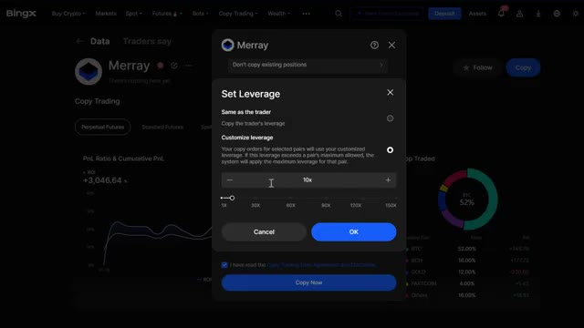
*⏱️ 00:13:47 — Fenêtre modale de configuration du levier ("Set Leverage") sur la plateforme de copy trading BingX, montrant l'option de personnalisation à 10x.*

---

### ⏱️ `[00:14:02 - 00:14:21]` | Segment #32

**🔊 Audio (Transcription Intégrale Mot pour Mot en Français) :**
> Cela suit chaque trade que le trader effectue sur toutes les cryptomonnaies. Vous pouvez également sélectionner uniquement des paires spécifiques, où vous ne copiez les trades que sur vos paires sélectionnées. Je recommande de commencer uniquement avec les paires majeures comme le BTC et l'ETH jusqu'à ce que vous soyez à l'aise avec le fonctionnement du copy trading. Si vous voulez copier des traders sur le marché au comptant, le processus est plus simple.

**👁️ Analyse Visuelle d'Écran (gemini-3.5-flash-lite) :**
**Interface & Outils** : Plateforme d'échange de cryptomonnaies BingX (interface de Copy Trading).

**Contenu textuel & Code** : Options de configuration des paires de trading : "Same as the trader" (sélectionné par défaut) et "Customize trading pairs" pour filtrer manuellement les cryptomonnaies copiées.

**Action / Démonstration** : Sélection des paramètres de paires de trading pour le copy trading d'un trader spécifique ("Marray").

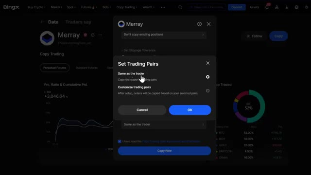
*⏱️ 00:14:07 — Interface de copy trading sur la plateforme BingX montrant une fenêtre modale pour configurer les paires de trading ("Set Trading Pairs") avec les options "Same as the trader" et "Customize trading pairs".*

---

### ⏱️ `[00:14:21 - 00:14:40]` | Segment #33

**🔊 Audio (Transcription Intégrale Mot pour Mot en Français) :**
> Vous pouvez seulement copier par ordre, où vous définissez votre marge par ordre, le montant fixe que vous investirez dans chaque transaction effectuée par le trader. Par exemple, si vous définissez 50 dollars par ordre, chaque fois que le trader achète une cryptomonnaie, vous achèterez également pour 50 dollars de cette même pièce. Étant donné que le trading au comptant n'utilise pas d'effet de levier, il n'y a aucun risque de liquidation.

**👁️ Analyse Visuelle d'Écran (gemini-3.5-flash-lite) :**
**Interface & Outils** : Interface de la plateforme d'échange de cryptomonnaies BingX (section Copy Trading).

**Contenu textuel & Code** : Paramètre de copie "Per Order", champ de saisie de la marge fixé à 5 USDT, solde disponible du compte (9.8778 USDT), et bouton de validation "Copy Now".

**Action / Démonstration** : Configuration et illustration de la méthode de copie par ordre avec définition du montant de marge fixe investi par transaction.

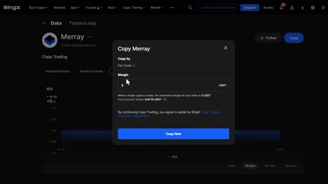
*⏱️ 00:14:26 — Fenêtre modale de configuration du Copy Trading sur BingX, illustrant le paramétrage de la marge fixe par ordre.*

---

### ⏱️ `[00:14:40 - 00:15:15]` | Segment #34

**🔊 Audio (Transcription Intégrale Mot pour Mot en Français) :**
> ce qui le rend beaucoup plus sûr pour les débutants. Une fois que tout est configuré, vérifiez tous vos paramètres une dernière fois. Cochez le formulaire d'accord et acceptez les conditions. Cliquez sur copier maintenant. Confirmez votre copy trading et boum, votre copy trading est désormais actif. Vous commencerez à copier automatiquement les positions de ce trader en fonction des paramètres que vous avez configurés. Maintenant écoutez, le copy trading n'est pas complètement passif. Vous devez surveiller vos positions régulièrement. Allez sur le tableau de bord du copy trading et cliquez sur votre profil pour tout gérer. Ici, vous pouvez voir tous vos copy trades actifs. Cela montre quels traders vous

**👁️ Analyse Visuelle d'Écran (gemini-3.5-flash-lite) :**
**Interface & Outils** : Plateforme d'échange de cryptomonnaies BingX (section Copy Trading).

**Contenu textuel & Code** : Paramètres de configuration du copy trading (tolérance de slippage, effet de levier 1X, paires de trading, montant de 20.00 USDT).

**Action / Démonstration** : Finalisation de la configuration et activation du copy trading sur un trader sélectionné.

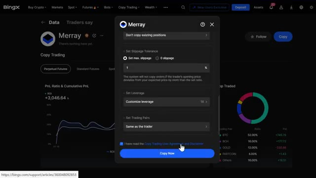
*⏱️ 00:14:49 — Interface BingX affichant les paramètres de copy trading du trader Merray, avec case d'accord cochée et bouton 'Copy Now' cliqué.*

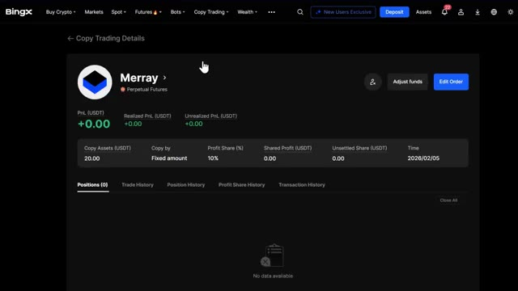
*⏱️ 00:14:58 — Tableau de bord 'Copy Trading Details' sur BingX montrant l'actif copié (Merray), 20.00 USDT investis et un PnL de +0.00.*

---

### ⏱️ `[00:15:15 - 00:15:52]` | Segment #35

**🔊 Audio (Transcription Intégrale Mot pour Mot en Français) :**
> copie, en quelque sorte mode copie, partage des profits, positions, PNL réalisé. Ce sont les profits ou pertes des trades clôturés et le PNL non réalisé dans lequel vos profits ou pertes sont basés sur une position ouverte. Sur l'onglet du trader, vous pouvez modifier l'ordre en ajustant votre montant d'investissement, le stop loss ou le take profit à tout moment. Ajustez les fonds en ajoutant ou en réduisant la marge, et vous pouvez également ne plus suivre un trader dans tous ses trades si ses performances baissent. Je recommande de vérifier vos trades copiés au moins une fois par jour, surtout dans des conditions de marché volatiles. Si vous voyez la stratégie d'un trader

**👁️ Analyse Visuelle d'Écran (gemini-3.5-flash-lite) :**
**Interface & Outils** : Exchange de cryptomonnaies BingX (section Copy Trading Details)

**Contenu textuel & Code** : PnL total (+0.00 USDT), Realized PnL (+0.00), Unrealized PnL (+0.00), Copy Assets (20.00 USDT), Copy by (Fixed amount), Profit Share (10%), Shared Profit (0.00), Time (2026/02/05), onglets Positions (0), Trade History, Position History, Profit Share History, Transaction History.

**Action / Démonstration** : Présentation et explication des paramètres de copy trading, du PnL réalisé et non réalisé, ainsi que des options de modification des ordres et d'ajustement des fonds.

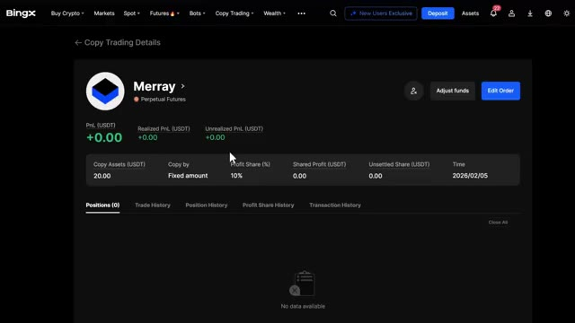
*⏱️ 00:15:24 — Capture d'écran de l'interface de copy trading de BingX montrant les détails d'un trader nommé Merray avec ses métriques de PnL et de partage des profits.*

---

### ⏱️ `[00:15:52 - 00:16:26]` | Segment #36

**🔊 Audio (Transcription Intégrale Mot pour Mot en Français) :**
> en train de changer, que leur prélèvement augmente de manière significative ou que les gains de leur copieur deviennent négatifs, n'ayez pas peur d'arrêter de les copier et de trouver quelqu'un d'autre. Très bien, voilà donc l'analyse complète du copy trading sur BingX. Le copy trading est un excellent moyen de se lancer dans la crypto sans être un expert des graphiques. Mais ce n'est certainement pas un revenu passif. Vous devez surveiller vos traders, gérer vos risques et ne jamais investir plus que ce que vous pouvez vous permettre de perdre. Avant de partir, n'oubliez pas d'utiliser mon lien dans la description pour réclamer mon pack de bonus de bienvenue exclusif sur BingX. Si vous avez des

**👁️ Analyse Visuelle d'Écran (gemini-3.5-flash-lite) :**
**Interface & Outils** : Interface web de l'échange de cryptomonnaies BingX (section Copy Trading).

**Contenu textuel & Code** : Liste de traders affichant des statistiques de performance telles que le PnL sur 30 jours (ex: +805.10%, +790.58%, +590.03%), le ratio de Sharpe, le drawdown maximum et des graphiques de tendance de profit.

**Action / Démonstration** : Présentation et analyse visuelle des différents traders à copier sur la plateforme.

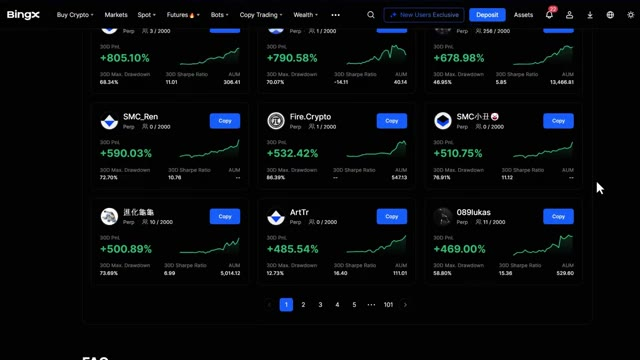
*⏱️ 00:16:00 — Capture d'écran de la plateforme BingX montrant une grille de profils de traders disponibles pour le copy trading, avec leurs performances sur 30 jours (PnL, Drawdown, Sharpe Ratio et AUM).*

---

### ⏱️ `[00:16:26 - 00:16:39]` | Segment #37

**🔊 Audio (Transcription Intégrale Mot pour Mot en Français) :**
> questions, posez-les dans les commentaires ci-dessous. Si cette vidéo vous a aidé, n'oubliez pas de l'aimer et de vous abonner pour plus de tutoriels sur la crypto. Pour une visite guidée plus détaillée de la plateforme Bing X, consultez la vidéo qui apparaît sur votre écran maintenant, et je vous vois dans la prochaine.

**👁️ Analyse Visuelle d'Écran (gemini-3.5-flash-lite) :**
**Interface & Outils** : Plateforme d'échange de cryptomonnaies BingX (section Copy Trading).

**Contenu textuel & Code** : Liste de profils de traders affichant divers indicateurs de performance : taux de réussite (Win Ratio), PnL cumulé (Cumulative PnL), pourcentage de profit et nombre de jours de copy trading.

**Action / Démonstration** : Navigation et présentation des différents traders disponibles pour le copy trading sur la plateforme BingX.

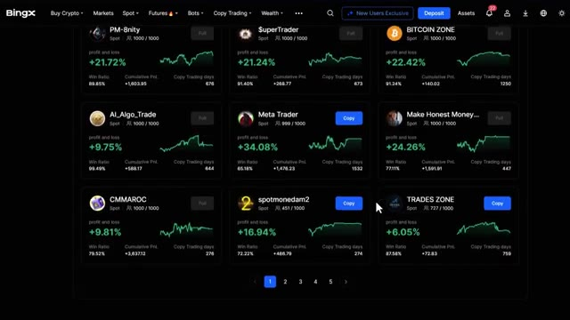
*⏱️ 00:16:29 — Capture d'écran de l'interface de copy trading de la plateforme BingX montrant une grille de traders avec leurs performances de profit et perte (PnL).*

---

