# 🎬 How To Copy Pro Crypto Traders on YUBIT (Step-By-Step Guide)

> **Chaîne** : [Alex Carter](https://www.youtube.com/@AlexCarterTrading)  
> **Lien YouTube** : [https://www.youtube.com/watch?v=nKAfxpjlwE4](https://www.youtube.com/watch?v=nKAfxpjlwE4)  
> **Date de publication** : 20260624  
> **Durée** : 00:10:48  
> **Identifiant vidéo** : `nKAfxpjlwE4`  
> **Transcription & Analyse** : `whisper-v3-large-turbo+gemini-3.5-flash-lite`  

---

## 📌 Synthèse Exécutive & Outils

### 💡 Résumé

Cette vidéo présentée par la chaîne Alex Carter propose un guide étape par étape pour maîtriser le copy trading sur la plateforme UBIT, une solution d'automatisation conçue pour les traders débutants ou ceux cherchant à déléguer l'analyse technique. L'intervenant met en garde contre l'erreur classique des investisseurs débutants qui consiste à sélectionner aveuglément les traders affichant les taux de réussite les plus élevés sans analyser les risques sous-jacents, avant de démontrer l'intégralité du parcours utilisateur, de l'inscription à la gestion des positions.

L'analyse technique et opérationnelle détaillée couvre l'architecture des comptes UBIT, en insistant sur le transfert indispensable des fonds vers le sous-compte *futures* pour alimenter la marge des ordres copiés. Sont également décortiquées les nuances subtiles entre le *Smart Copy Trading* (paramètres automatisés basés sur les choix du leader) et le *Custom Copy Trading* (gestion granulaire des leviers et des types de marges). L'accent est mis en permanence sur l'optimisation du capital, l'utilisation de bonus de bienvenue progressifs allant jusqu'à 50 000 USDT et, surtout, l'implémentation rigoureuse de barrières de sécurité indispensables.

Enfin, la méthodologie de sélection des *lead traders* est passée au crible à travers l'étude de métriques avancées telles que le P&L à 30 jours, la courbe d'équité, le ratio de partage des profits et la fréquence de trading. L'analyste conclut sur l'importance cruciale de la gestion dynamique du portefeuille (ajustement des paires, plafonnement du montant maximal de copie et paramétrage des *stop-loss* de compte) afin d'éviter la liquidation prématurée en cas de divergence de marge croisée avec le trader principal.

### 🛠️ Outils, Modèles & Logiciels Présentés

* **UBIT** : Plateforme d'échange de cryptomonnaies centralisée proposant un écosystème complet de produits dérivés, de contrats à terme et un module natif de copy trading.
* **Smart Copy Trading** : Mode de copie automatisé qui réplique fidèlement et en temps réel la configuration, l'effet de levier et le mode de marge choisis par le *lead trader*.
* **Custom Copy Trading** : Mode de réplication avancé offrant un contrôle total sur les paramètres d'allocation de capital, les types de montants et les plafonds de levier personnalisés.
* **Compte Futures UBIT** : Sous-compte dédié aux produits dérivés et au levier, servant de vivier de liquidité obligatoire pour exécuter et garantir les positions copiées.
* **Bonus de Bienvenue UBIT** : Programme incitatif échelonné basé sur le volume de trading cumulé et les dépôts initiaux, offrant des bons de position jusqu'à 50 000 USDT et des boîtes mystères.

### 🔑 Points Clés & Enseignements Stratégiques

* **Erreur critique du débutant** : Éviter de sélectionner un trader uniquement sur son taux de réussite brut, un indicateur souvent trompeur s'il est combiné à une absence de gestion rigoureuse du risque.
* **Architecture des flux de capitaux** : Obligation absolue de transférer les fonds depuis le compte spot ou de financement vers le compte *futures* avant d'initier toute relation de copy trading.
* **Optimisation des bonus de parrainage** : Utilisation du lien exclusif pour débloquer un système de paliers progressifs (dépôt minimum de 100 $ et volume de 10 000 $ pour un bon de 1 000 $, allant jusqu'à 2 millions de volume pour le palier supérieur).
* **Analyse des métriques des *lead traders*** : Évaluation minutieuse du P&L à 30 jours (en pourcentage et en USDT), de la courbe d'équité, de la taille des actifs des abonnés et du ratio de partage des profits.
* **Gestion du statut "Complet"** : Surveillance des places disponibles chez les meilleurs traders ; si le quota maximal de copieurs est atteint, l'algorithme impose de réorienter sa stratégie vers un autre profil performant.
* **Modes de marge disponibles** : Choix entre la marge *Croisée* (mutualisation de tout le capital disponible), la marge *Isolée* (risque strictement limité au capital alloué au trade) et l'option *Copier le leader*.
* **Typologie des montants de copie personnalisée** : Arbitrage entre le *Montant fixe* (valeur en USDT constante par ordre), le *Ratio fixe* (multiplicateur de la marge du leader) et le *Ratio de position* (proportionnel au solde disponible).
* **Maîtrise de l'effet de levier** : Recommandation stricte pour les débutants de limiter le levier personnalisé entre 5x et 10x maximum, bien que la plateforme autorise des pointes jusqu'à 150x.
* **Filtrage granulaire des paires** : Possibilité de restreindre le copy trading à des actifs spécifiques (comme Bitcoin et Ethereum) pour éviter l'exposition non désirée à des altcoins volatils.
* **Paramétrage du Stop-Loss de compte** : Implantation impérative d'un seuil de perte cumulative au-delà duquel la relation de suivi est automatiquement rompue et les positions liquidées au prix du marché.
* **Risque inhérent à la marge croisée** : Vigilance accrue face au risque de sur-liquidation en mode croisé si le trader principal réinjecte des fonds sur son propre compte *futures*, créant un décalage de levier effectif.
* **Gestion post-copie et arbitrage de sortie** : Choix stratégique lors de l'arrêt de la copie : clôture immédiate de toutes les positions ouvertes au prix du marché ou conservation passive des trades en cours sans nouvelle prise de position.

---

## ⏱️ Chronologie & Transcription Complète Audio & Visuelle (Mot pour Mot)

### ⏱️ `[00:00:00 - 00:00:36]` | Segment #01

**🔊 Audio (Transcription Intégrale Mot pour Mot en Français) :**
> Le copy trading sur UBIT est honnêtement l'un des moyens les plus simples de se lancer dans la crypto, même si vous n'avez aucune expérience dans la lecture de graphiques. Vous laissez littéralement un trader rentable faire tout le travail, et votre compte suit ses trades automatiquement. Mais voilà le problème, la plupart des gens configurent cela complètement de travers. Ils choisissent simplement le trader avec le taux de réussite le plus élevé, le copient aveuglément, et se demandent ensuite pourquoi ils perdent de l'argent. Dans cette vidéo, je vais vous montrer exactement comment configurer le copy trading sur UBIT de la bonne manière, étape par étape, de l'inscription à la recherche du bon trader en passant par la réclamation de tous les bonus qui vous sont disponibles. Et si vous utilisez mon lien exclusif ci-dessous pour vous inscrire,

**👁️ Analyse Visuelle d'Écran (gemini-3.5-flash-lite) :**
**Interface & Outils** : Plateforme de trading UBIT (section Copy Trading et Top Traders)

**Contenu textuel & Code** : Statistiques de traders (PNL à 30 jours, taux de réussite, actifs des abonnés, ROI, nombre de trades) et paramètres de configuration de copie (Smart Copy Trading, mode de marge, effet de levier).

**Action / Démonstration** : Navigation et présentation des fonctionnalités de copy trading sur la plateforme UBIT, incluant le choix d'un trader et le paramétrage des options de copie.

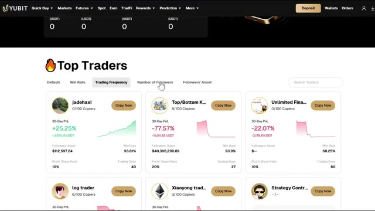
*⏱️ 00:00:09 — Interface de la plateforme UBIT affichant la liste des "Top Traders" avec leurs performances sur 30 jours, le nombre de copieurs et les boutons de copie rapide.*

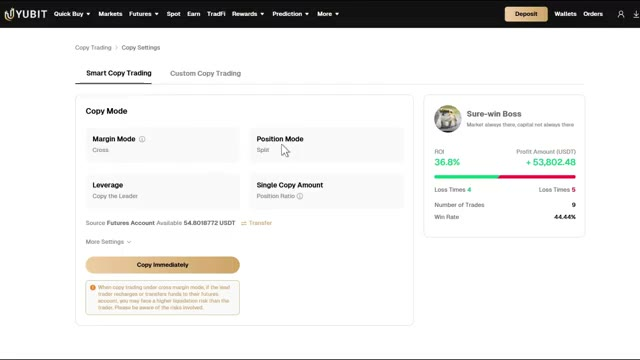
*⏱️ 00:00:18 — Page de configuration du copy trading sur UBIT montrant les paramètres de mode de marge, de levier et le récapitulatif des performances d'un trader (ROI, taux de réussite).*

---

### ⏱️ `[00:00:36 - 00:01:13]` | Segment #02

**🔊 Audio (Transcription Intégrale Mot pour Mot en Français) :**
> vous débloquerez jusqu'à 50 000 USDT de bonus de bienvenue. Je vais vous montrer exactement comment tout réclamer également. Alors commençons. Maintenant, avant de plonger dans le vif du sujet, laissez-moi vous détailler rapidement les bonus que vous obtenez avec mon lien, car ils sont vraiment très intéressants. Avec mon lien, vous débloquez jusqu'à 50 000 USDT de bonus de bienvenue. Voici comment cela se décompose. Si vous déposez au moins 100 dollars et atteignez 10 000 dollars de volume de trading, vous obtenez un bon de position de 1 000 dollars. Cela va crescendo jusqu'à un bon de position de 10 000 dollars si vous déposez 10 000 dollars et atteignez 2 millions de dollars de volume de trading. En plus de cela,

**👁️ Analyse Visuelle d'Écran (gemini-3.5-flash-lite) :**
**Interface & Outils** : Interface web de l'échange de cryptomonnaies YUBIT (sections Copy Trading et Rewards).

**Contenu textuel & Code** : Tableaux de bord de copy trading avec statistiques (Today's Profit, Current Copy Margin) et paliers de récompenses de dépôt et de trading (1 000 USDT, 1 500 USDT, 3 000 USDT, 5 000 USDT, 10 000 USDT).

**Action / Démonstration** : Navigation et présentation des fonctionnalités de copy trading et des bonus de dépôt de la plateforme par le présentateur.

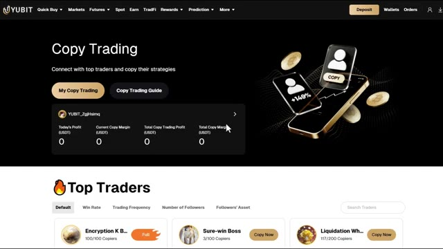
*⏱️ 00:00:45 — Interface de la plateforme de copy trading de l'échange YUBIT affichant les performances personnelles et la liste des meilleurs traders.*

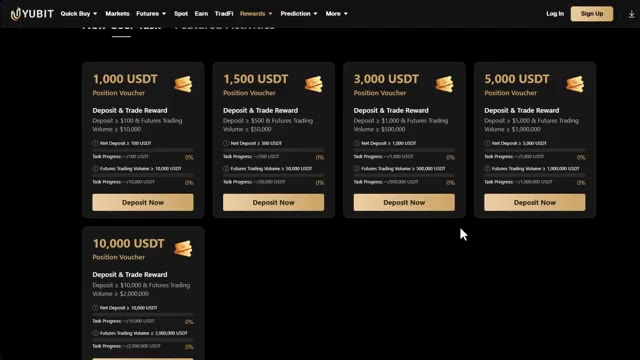
*⏱️ 00:00:54 — Page des récompenses et bonus de bienvenue de l'échange YUBIT montrant différents paliers de coupons de position allant de 1 000 à 10 000 USDT.*

---

### ⏱️ `[00:01:13 - 00:01:46]` | Segment #03

**🔊 Audio (Transcription Intégrale Mot pour Mot en Français) :**
> il y a des récompenses de contrats à terme et de boîtes mystères. Atteignez 100 000 dollars de volume de trading et vous obtenez une boîte mystère d'une valeur d'au moins 50 USDT. Passez à 50 millions de dollars de volume de trading et vous visez une boîte mystère de 15 000 USDT. Maintenant, tout cela se cumule. Donc, plus vous déposez et tradez, plus vous débloquez. Assurez-vous d'utiliser mon lien ci-dessous. Si vous utilisez un autre lien, vous n'obtiendrez pas le bonus complet. Alors assurez-vous vraiment d'utiliser le mien. Première chose, vous avez besoin d'un compte UBIT. Si vous en avez déjà un, vous pouvez passer directement à la suite.

**👁️ Analyse Visuelle d'Écran (gemini-3.5-flash-lite) :**
**Interface & Outils** : Interface web de la plateforme d'échange cryptographique YUBIT (section Rewards et page d'inscription).

**Contenu textuel & Code** : Paliers de volume de trading pour les contrats à terme (ex: 100 000 USD pour 50 USDT, jusqu'à 50 millions pour 15 000 USDT) et formulaire d'inscription avec le code de parrainage ALEX.

**Action / Démonstration** : Présentation des récompenses et des paliers de volume de trading associés aux boîtes mystères sur l'échange YUBIT.

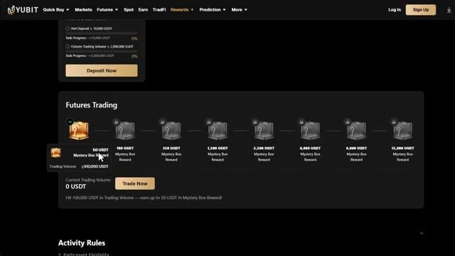
*⏱️ 00:01:21 — Capture d'écran de l'interface des récompenses de trading de contrats à terme sur YUBIT, affichant les différents paliers de boîtes mystères basés sur le volume de trading, allant de 50 USDT à 15 000 USDT.*

*⏱️ 00:01:38 — Page d'inscription de la plateforme YUBIT avec un visuel de boîte mystère remplie de pièces et une illustration de coupe, mettant en avant le code de parrainage 'ALEX'.*

---

### ⏱️ `[00:01:46 - 00:02:16]` | Segment #04

**🔊 Audio (Transcription Intégrale Mot pour Mot en Français) :**
> étape. Si vous n'en avez pas encore, cliquez sur le lien dans la description ci-dessous. Ce lien vous mènera directement à la page d'inscription UBIT, et il s'assurera que vous obtenez le pack de bonus de bienvenue exclusif complet allant jusqu'à 50 000 USDT de récompenses. Cliquez simplement sur s'inscrire, entrez votre e-mail, créez un mot de passe fort, et vous y êtes. Tout le processus prend moins d'une minute. Une fois connecté, vous arriverez sur le tableau de bord principal d'UBIT. Maintenant, mettons vos fonds au bon endroit avant de faire quoi que ce soit d'autre.

**👁️ Analyse Visuelle d'Écran (gemini-3.5-flash-lite) :**
**Interface & Outils** : Site web de la plateforme d'échange YUBIT (Yubit)

**Contenu textuel & Code** : Formulaire d'inscription par email/mobile, code de parrainage "ALEX", boutons de téléchargement d'applications et sections de marché.

**Action / Démonstration** : Présentation du processus d'inscription sur la plateforme YUBIT et mise en avant des bonus de bienvenue.

*⏱️ 00:01:53 — Page d'inscription de la plateforme YUBIT montrant un formulaire d'enregistrement avec un visuel de récompenses en bonus.*

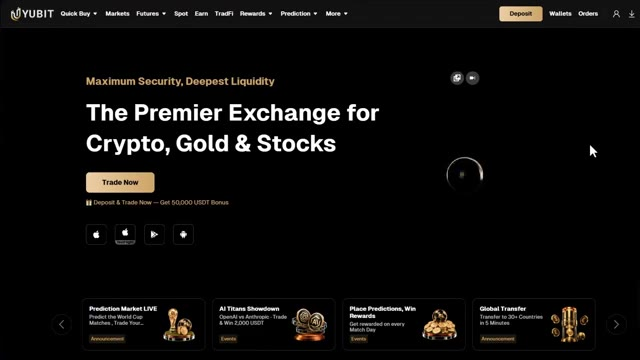
*⏱️ 00:02:09 — Page d'accueil principale de la plateforme YUBIT affichant le slogan "The Premier Exchange for Crypto, Gold & Stocks".*

---

### ⏱️ `[00:02:16 - 00:02:49]` | Segment #05

**🔊 Audio (Transcription Intégrale Mot pour Mot en Français) :**
> Avant de pouvoir commencer le copy trading, vous devez vous assurer que vos fonds sont dans votre compte futures, car c'est de là que UBIT prélève le capital lorsque vous configurez un copy trade. Maintenant, UBIT a en fait rendu cela très facile. Cliquez simplement sur transfert, puis transférez des fonds de votre compte de financement ou spot vers votre compte futures. Sélectionnez l'actif. Vous voulez de l'USDT, choisissez le montant, puis cliquez sur transfert. C'est aussi simple que ça. Si vos fonds y sont déjà, c'est parfait. Vous êtes prêt. Passons à la configuration du copy trading proprement dite. Maintenant, survolez futures dans la barre de navigation supérieure et cliquez sur

**👁️ Analyse Visuelle d'Écran (gemini-3.5-flash-lite) :**
**Interface & Outils** : Plateforme d'échange crypto YUBIT (Interface Web / Gestion des actifs et transferts)

**Contenu textuel & Code** : Solde de 51 USDT dans les actifs globaux, détails des comptes (Funding Account, Futures Account, Spot Account), champs de transfert (From Funding Account to Futures Account).

**Action / Démonstration** : Navigation dans le tableau de bord des actifs, ouverture du module de transfert et validation d'un transfert de fonds internes vers le compte futures.

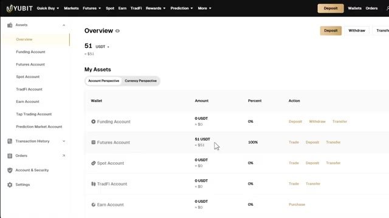
*⏱️ 00:02:25 — Vue d'ensemble des actifs sur la plateforme YUBIT montrant les différents comptes (Funding, Futures, Spot).*

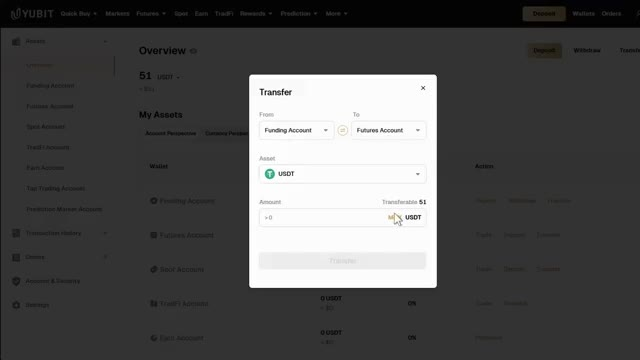
*⏱️ 00:02:33 — Fenêtre modale de transfert de fonds entre le compte de financement et le compte futures sur YUBIT.*

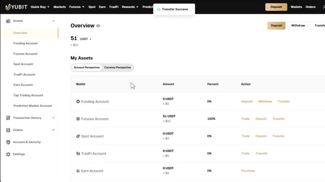
*⏱️ 00:02:41 — Notification de succès confirmant le transfert de fonds sur l'interface YUBIT.*

---

### ⏱️ `[00:02:49 - 00:03:22]` | Segment #06

**🔊 Audio (Transcription Intégrale Mot pour Mot en Français) :**
> copie de trading. Ici, vous pouvez voir un aperçu complet de votre compte de copie de trading, allant du profit d'aujourd'hui à votre marge de copie actuelle, jusqu'à votre profit total de copie de trading et votre marge de copie totale. C'est votre tableau de bord pour tout ce qui concerne la copie de trading. Maintenant, si vous voulez lire le guide de copie de trading directement depuis UBIT, vous pouvez cliquer dessus juste ici à côté de copie de trading. Leurs documents couvrent l'introduction à la copie de trading, la vue d'ensemble des fonctionnalités, et un tutoriel complet sur la copie de trading, qui vaut une lecture rapide si vous voulez aller plus loin. En retournant dans le menu de copie de trading, une fois que vous faites défiler

**👁️ Analyse Visuelle d'Écran (gemini-3.5-flash-lite) :**
**Interface & Outils** : Interface web de la plateforme d'échange YUBIT (section Copy Trading et page d'aide GitBook).

**Contenu textuel & Code** : Tableaux de bord de copy trading affichant les profits du jour (Today's Profit), la marge actuelle (Current Copy Margin), le profit total et la marge totale en USDT, ainsi qu'une liste de traders populaires (Top Traders).

**Action / Démonstration** : Navigation sur la plateforme YUBIT pour présenter l'aperçu du compte de copy trading et les statistiques du tableau de bord.

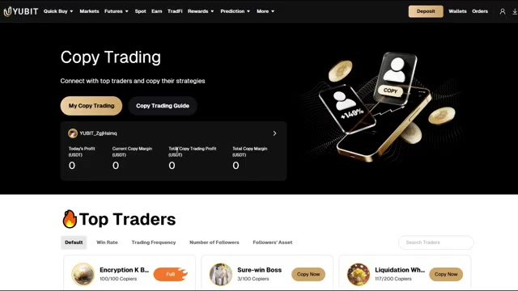
*⏱️ 00:02:57 — Capture d'écran de l'interface de copy trading de la plateforme YUBIT montrant le tableau de bord avec les métriques des profits et la liste des meilleurs traders.*

---

### ⏱️ `[00:03:22 - 00:03:46]` | Segment #07

**🔊 Audio (Transcription Intégrale Mot pour Mot en Français) :**
> En bas, vous pouvez voir les meilleurs traders selon les classements par défaut d'UBIT. Ils font un tri selon quelques critères différents. Le taux de réussite. Il s'agit du pourcentage de transactions qu'un trader clôture avec un bénéfice. La fréquence de trading. C'est la fréquence à laquelle ils placent activement des transactions. Le nombre de abonnés, cela montre combien de personnes les copient actuellement. Les actifs des abonnés. Il s'agit du capital total que les abonnés ont attribué pour copier ce trader.

**👁️ Analyse Visuelle d'Écran (gemini-3.5-flash-lite) :**
**Interface & Outils** : Interface web de la plateforme de trading UBIT.

**Contenu textuel & Code** : Liste des meilleurs traders avec leurs métriques (PnL sur 30 jours, taux de réussite à 100%, nombre de copieurs et jours de trading).

**Action / Démonstration** : Navigation et présentation des critères de classement des meilleurs traders sur la plateforme UBIT.

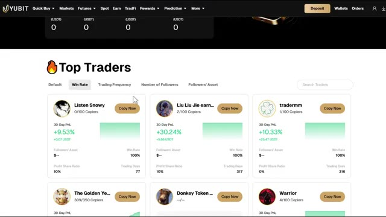
*⏱️ 00:03:28 — Capture d'écran de l'interface de la plateforme UBIT montrant la section "Top Traders" avec les options de tri par taux de réussite (Win Rate) et fréquence de trading (Trading Frequency).*

---

### ⏱️ `[00:03:46 - 00:04:07]` | Segment #08

**🔊 Audio (Transcription Intégrale Mot pour Mot en Français) :**
> Pour chaque trader de cette liste, vous pouvez voir des statistiques clés en un coup d'œil. Leur nom, leur nombre de copieurs, leur P&L sur 30 jours en pourcentage et en USDT, leur courbe d'équité, les actifs des abonnés, leur taux de réussite, leur ratio de partage des profits et leurs jours de trading. Maintenant, notez bien que certains traders que vous verrez ici sont déjà complets.

**👁️ Analyse Visuelle d'Écran (gemini-3.5-flash-lite) :**
**Interface & Outils** : Interface web de la plateforme d'échange Yubit (section Copy Trading / Top Traders).

**Contenu textuel & Code** : Statistiques des traders : noms (Encryption K B..., Sure-win Boss, Liquidation Wh...), nombre de copieurs (ex: 100/100, 3/100), P&L sur 30 jours en pourcentage et USDT (ex: +7,818.18% / +158,350.32 USDT), courbes d'équité, actifs des abonnés, taux de réussite (ex: 100%, 44.44%, 90.32%), ratio de partage des profits (10%) et jours de trading (ex: 518, 223, 262).

**Action / Démonstration** : Présentation et survol des profils des meilleurs traders de la plateforme avec leurs performances en direct.

*⏱️ 00:03:51 — Capture d'écran de l'interface de copy trading présentant une liste de "Top Traders" avec leurs statistiques clés (nom, copieurs, P&L à 30 jours, courbe d'équité, taux de réussite, ratio de partage des profits et jours de trading).*

---

### ⏱️ `[00:04:07 - 00:04:28]` | Segment #09

**🔊 Audio (Transcription Intégrale Mot pour Mot en Français) :**
> Cela signifie qu'ils ont atteint leur nombre maximum de copieurs et que vous ne pouvez plus les copier. Donc, si vous voyez cela, passez simplement à autre siècle et trouvez un autre trader. Vous pouvez également rechercher un trader spécifique en utilisant la barre de recherche en haut à gauche si vous avez déjà quelqu'un en tête. Une fois que vous avez trouvé un trader qui vous convient, cliquez sur le bouton "Copier maintenant" en haut à droite de son profil.

**👁️ Analyse Visuelle d'Écran (gemini-3.5-flash-lite) :**
**Interface & Outils** : Interface web de copy trading Yubit (Top Traders)

**Contenu textuel & Code** : Statistiques de trading : PnL sur 30 jours (ex: +7818.18%, +36.8%), taux de réussite (Win Rate), nombre de copieurs (ex: 100/100 'Full'), jours de trading et barre de recherche de traders.

**Action / Démonstration** : Navigation et présentation de la liste des traders à copier, mise en évidence des traders dont le nombre maximum de copieurs est atteint ('Full').

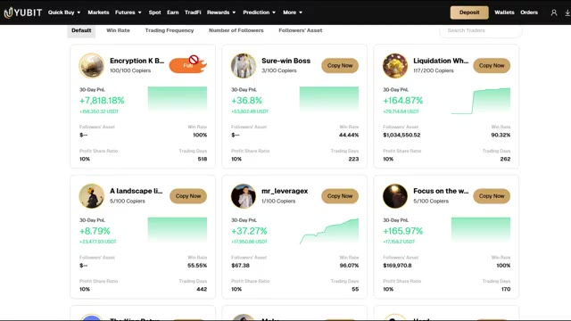
*⏱️ 00:04:12 — Interface de copy trading affichant les profils de différents traders avec leurs performances sur 30 jours, le nombre de copieurs et un bouton de copie.*

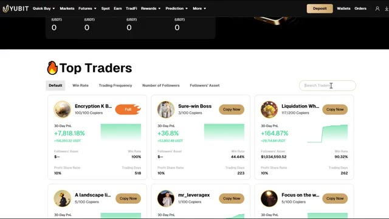
*⏱️ 00:04:18 — Interface de recherche de traders montrant la barre de recherche en haut à droite et la liste des meilleurs traders disponibles.*

---

### ⏱️ `[00:04:28 - 00:04:49]` | Segment #10

**🔊 Audio (Transcription Intégrale Mot pour Mot en Français) :**
> Ici, vous verrez deux modes, le Smart Copy Trading et le Custom Copy Trading. Commençons par le Smart Copy Trading. Le Smart Copy Trading utilise des paramètres prédéfinis qui ont été définis par les traders eux-mêmes, vous suivez donc essentiellement leur configuration exacte sans changer grand-chose. Sous le mode de copie, vous pouvez voir le mode de marge, le mode de position, l'effet de levier et le montant de copie unique.

**👁️ Analyse Visuelle d'Écran (gemini-3.5-flash-lite) :**
**Interface & Outils** : Plateforme d'échange crypto YUBIT (module Copy Trading).

**Contenu textuel & Code** : Paramètres du mode Smart Copy Trading (Margin Mode: Cross, Leverage: Copy the Leader, Position Mode: Split), solde Futures disponible (54.80 USDT), statistiques du lead trader (ROI 36.8 %, Profit Amount +53,802.48 USDT, Win Rate 44.44 %, 9 trades).

**Action / Démonstration** : Sélection et présentation de l'onglet « Smart Copy Trading » pour copier automatiquement les paramètres et positions d'un trader.

*⏱️ 00:04:33 — Interface de configuration du Copy Trading sur la plateforme YUBIT, onglet « Smart Copy Trading » avec les métriques de performance du trader « Sure-win Boss ».*

---

### ⏱️ `[00:04:49 - 00:05:11]` | Segment #11

**🔊 Audio (Transcription Intégrale Mot pour Mot en Français) :**
> Sur le mode de marge, vous avez trois options ici. La première est Cross. Ce mode utilise toute la marge disponible sur votre compte comme garantie. La deuxième est Isolé. Cela alloue de la marge pour chaque position séparément, de sorte que votre risque est limité à ce que vous mettez dans ce trade spécifique. La troisième est copier le leader. Ce mode utilise exactement le même mode de marge que le trader que vous copiez.

**👁️ Analyse Visuelle d'Écran (gemini-3.5-flash-lite) :**
**Interface & Outils** : Interface web de la plateforme d'échange Yubit (section Copy Trading / Smart Copy Trading).

**Contenu textuel & Code** : Paramètres de trading : Margin Mode (réglé sur Cross), Position Mode (Split), Leverage, Single Copy Amount, et des statistiques de trader (« Sure-win Boss » avec un ROI de 36,8% et un profit de +53 802,48 USDT). Une infobulle explicative détaille les modes Cross, Isolated et Follow the Leader.

**Action / Démonstration** : Survol et explication des différents modes de marge disponibles pour le copy trading sur la plateforme.

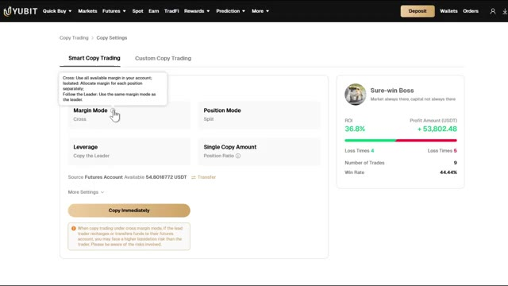
*⏱️ 00:04:55 — Capture d'écran de l'interface de copy trading montrant les options de configuration de marge avec un curseur survolant le mode Cross et une infobulle explicative.*

---

### ⏱️ `[00:05:11 - 00:05:36]` | Segment #12

**🔊 Audio (Transcription Intégrale Mot pour Mot en Français) :**
> Ensuite, c'est le mode de position. Ici, vous pouvez voir qu'il est par défaut en mode fractionné. Le mode fractionné conserve chaque trade copié en tant que position distincte. Effet de levier. En copy trading intelligent, il est généralement configuré pour copier le leader, ce qui signifie que votre effet de levier s'ajustera automatiquement sur celui qu'utilise le trader. Montant de copie unique. Si le leader a choisi le ratio de position, cela signifie que la marge de votre ordre de copie est basée sur la taille de la position et le solde du trader.

**👁️ Analyse Visuelle d'Écran (gemini-3.5-flash-lite) :**
**Interface & Outils** : YUBIT (plateforme de trading crypto), section Copy Trading > Copy Settings.

**Contenu textuel & Code** : Paramètres du mode de copie : Margin Mode (Cross), Position Mode (Split), Leverage (Copy the Leader), Single Copy Amount (Position Ratio). Solde disponible Futures : 54.8018772 USDT. Profil du trader « Sure-win Boss » (ROI 36.8 %, Profit +53 802.48 USDT, Win Rate 44.44 %).

**Action / Démonstration** : Revue et explication des paramètres de gestion de position (mode Split vs mode fusionné) et de levier avant l'activation du copy trading.

*⏱️ 00:05:17 — Interface de configuration Smart Copy Trading sur la plateforme YUBIT affichant les paramètres de position (Split), de marge (Cross), d'effet de levier et les statistiques du trader copié.*

---

### ⏱️ `[00:05:36 - 00:05:54]` | Segment #13

**🔊 Audio (Transcription Intégrale Mot pour Mot en Français) :**
> Pour chaque ordre, votre marge est égale à votre solde disponible multiplié par le ratio de marge du trader. La marge minimale par ordre est de 10 USDT, alors gardez cela à l'esprit. Maintenant, rappelez-vous que votre compte de copy trading doit être financé afin de copier les lead traders. Pour ce faire, cliquez simplement sur Transférer.

**👁️ Analyse Visuelle d'Écran (gemini-3.5-flash-lite) :**
**Interface & Outils** : Plateforme de trading crypto YUBIT (section Copy Trading > Copy Settings).

**Contenu textuel & Code** : Formule affichée dans l'infobulle : "Margin = Your available balance * Trader's margin ratio", seuil minimum de 10 USDT par ordre, solde disponible du compte Futures (54.8018772 USDT), statistiques du lead trader "Sure-win Boss" (ROI +36.8%, PnL +53 802,48 USDT, Win Rate 44.44%).

**Action / Démonstration** : Survol du curseur sur l'icône d'information de l'option « Position Ratio » pour afficher les règles de calcul de la marge avant validation de la copie.

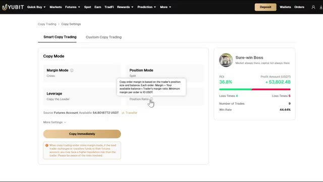
*⏱️ 00:05:40 — Interface de configuration du Smart Copy Trading sur YUBIT avec une infobulle détaillant la formule de calcul du ratio de marge par ordre.*

---

### ⏱️ `[00:05:54 - 00:06:29]` | Segment #14

**🔊 Audio (Transcription Intégrale Mot pour Mot en Français) :**
> Transférez des fonds de votre compte spot vers votre compte futures. L'actif, choisissez le montant et cliquez sur transférer. Très simple. Si vous cliquez sur plus de paramètres, vous pouvez sélectionner les paires de trading spécifiques que vous souhaitez copier. Cliquez sur modifier et sélectionnez les paires de copy trading que vous voulez. Par exemple, si vous voulez seulement copier les trades sur Bitcoin et Ethereum, vous pouvez choisir juste ces deux-là, et cela n'ouvrira automatiquement que ces paires spécifiques et pas les autres. C'est défini sur tout par défaut. Donc, si vous voulez copier tout ce que le leader trade, laissez simplement tel quel. Ensuite, cliquez sur terminer. En faisant défiler vers le bas, vous verrez le montant maximum de copie. C'est le

**👁️ Analyse Visuelle d'Écran (gemini-3.5-flash-lite) :**
**Interface & Outils** : Interface de la plateforme d'échange Yubit (section Copy Trading / Copy Settings).

**Contenu textuel & Code** : Paramètres de copy trading incluant le mode de marge (Cross), l'effet de levier, le solde du compte Futures (54.80 USDT), et la liste des paires de trading disponibles.

**Action / Démonstration** : Configuration des paramètres de copy trading et sélection des paires de trading spécifiques à copier.

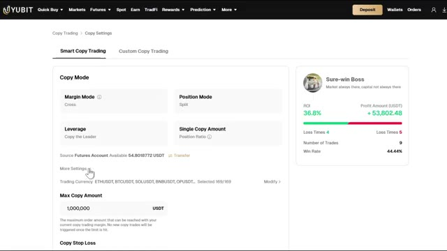
*⏱️ 00:06:03 — Interface de copy trading montrant les paramètres de configuration, le mode de marge, l'effet de levier et les options de sélection des paires.*

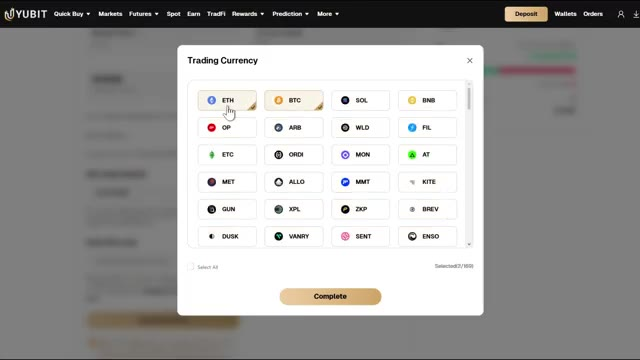
*⏱️ 00:06:12 — Fenêtre modale superposée permettant de sélectionner les paires de devises ou cryptomonnaies spécifiques pour le copy trading.*

---

### ⏱️ `[00:06:29 - 00:07:07]` | Segment #15

**🔊 Audio (Transcription Intégrale Mot pour Mot en Français) :**
> montant maximal de commande qui peut être atteint avec votre marge de copy trading actuelle. Aucun nouveau copy trade ne sera déclenché une fois cette limite atteinte. Vient ensuite le stop loss de copie. Lorsque la perte cumulative de votre compte de suivi atteint le montant que vous avez défini, la relation de suivi sera automatiquement levée et les positions restantes seront clôturées immédiatement au prix du marché. C'est un outil de gestion des risques très important, je vous recommande donc de le configurer. Une fois que tout est prêt, vous verrez le bouton Copier immédiatement. Notez bien que lors du copy trading en mode de marge croisée, si le trader principal recharge ou transfère des fonds sur son compte de contrats futures, vous pourriez faire face à une plus haute

**👁️ Analyse Visuelle d'Écran (gemini-3.5-flash-lite) :**
**Interface & Outils** : Plateforme d'échange crypto YUBIT (interface de Copy Trading).

**Contenu textuel & Code** : Champs Max Copy Amount (1 000 000 USDT), Copy Stop Loss, solde disponible (54.80 USDT), statistiques de performance (ROI 36.8%, Profit 53 802.48 USDT, Win Rate 44.44%).

**Action / Démonstration** : Définition des paramètres de gestion des pertes maximales et validation du pop-up de confirmation des risques de glissement de prix (slippage).

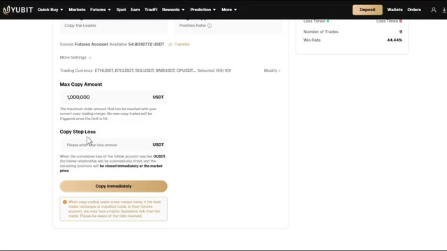
*⏱️ 00:06:39 — Interface de paramétrage du copy trading sur YUBIT affichant les options Max Copy Amount et Copy Stop Loss.*

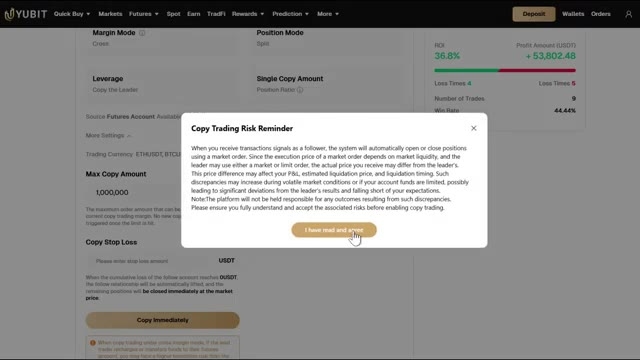
*⏱️ 00:06:58 — Fenêtre contextuelle d'avertissement des risques liés au copy trading (Copy Trading Risk Reminder) avec bouton d'acceptation.*

---

### ⏱️ `[00:07:07 - 00:07:42]` | Segment #16

**🔊 Audio (Transcription Intégrale Mot pour Mot en Français) :**
> risque de liquidation que le trader. Veuillez donc être conscient des risques encourus. Maintenant, si vous voulez plus de contrôle sur vos paramètres, cliquez sur Copie de trading personnalisée. Sous Montant de copie unique, vous avez trois types au choix. Montant fixe. Votre marge pour chaque ordre est un montant fixe en USDT que vous définissez vous-même, indépendamment de ce que fait le trader. Ratio fixe. Votre marge pour chaque ordre est un multiple fixe de la marge du trader. Par exemple, si vous définissez 1,5 fois, chaque ordre sera suivi selon 1,5 fois la marge du trader. Ratio de position. Votre marge d'ordre de copie est

**👁️ Analyse Visuelle d'Écran (gemini-3.5-flash-lite) :**
**Interface & Outils** : Interface de la plateforme d'échange YUBIT (section Copy Trading / Custom Copy Trading).

**Contenu textuel & Code** : Paramètres de copie (Single Copy Amount, Margin Mode : Cross, Leverage : Copy the Leader), informations sur le trader copié ("Sure-win Boss" avec un ROI de 36.8% et un profit de +53,802.48 USDT) et avertissement sur les risques de liquidation.

**Action / Démonstration** : Configuration des paramètres de copy trading personnalisé sur la plateforme YUBIT.

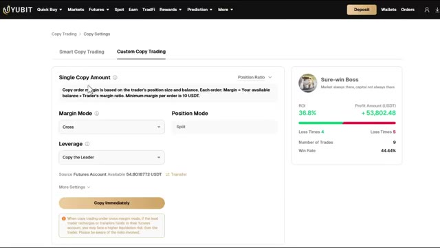
*⏱️ 00:07:16 — Interface de copy trading montrant les paramètres personnalisés avec les options de montant de copie unique et le mode de marge.*

---

### ⏱️ `[00:07:42 - 00:08:19]` | Segment #17

**🔊 Audio (Transcription Intégrale Mot pour Mot en Français) :**
> basé sur la taille de position du trader et son solde. Chaque ordre, votre marge est égale à votre solde disponible multiplié par le ratio de marge du trader. La marge minimum par ordre est de 10 USDT. En mode de marge, vous pouvez choisir entre croisée, isolée, ou copier le leader, comme avant. Sur le levier, vous pouvez soit copier le leader, soit définir un levier personnalisé jusqu'à 150 fois. Si vous débutez, je vous recommanderais de le garder bas, 5 fois à 10 fois maximum. Les paramètres pour la devise de trading, le montant maximal de copie et le stop-loss de copie sont les mêmes que dans le smart copy trading. Sur le côté droit de la

**👁️ Analyse Visuelle d'Écran (gemini-3.5-flash-lite) :**
**Interface & Outils** : Interface web de la plateforme d'échange de cryptomonnaies Yubit (section Copy Trading / Custom Copy Trading).

**Contenu textuel & Code** : Texte explicatif sur le calcul de la marge (Single Copy Amount), modes de marge (Cross), options de levier (Copy the Leader), solde disponible du compte Futures (54,8018772 USDT), et métriques du trader (ROI 36,8 %, Profit +53 802,48 USDT, Win Rate 44,44 %).

**Action / Démonstration** : Configuration des paramètres de copie personnalisés pour un trader leader sur la plateforme Yubit.

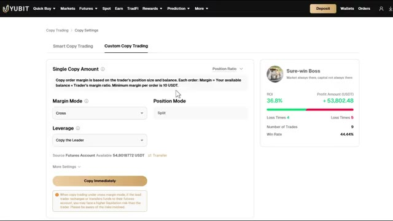
*⏱️ 00:07:52 — Paramètres de configuration du Copy Trading sur la plateforme Yubit montrant les options de ratio de position, de mode de marge (Cross), de levier et les statistiques du trader copié 'Sure-win Boss'.*

---

### ⏱️ `[00:08:19 - 00:08:54]` | Segment #18

**🔊 Audio (Transcription Intégrale Mot pour Mot en Français) :**
> l'écran, vous pouvez voir le nom du trader, sa description, le pourcentage de ROI, le montant des profits en USDT, le nombre de pertes, le nombre de traders et le taux de réussite, vous pouvez donc faire une dernière vérification avant de vous engager. Une fois que tout est prêt pour vous, cliquez sur copier immédiatement, puis cliquez sur J'ai lu et j'accepte. Vous serez maintenant redirigé vers la section Mon Copy, où vous pouvez gérer tout ce qui concerne votre copy trading. En haut, vous pouvez voir les profits d'aujourd'hui, votre marge de copie actuelle, le profit total du copy trading et la marge totale de copie. Sur la partie inférieure, vous pouvez voir votre onglet de copie, ordre de copie

**👁️ Analyse Visuelle d'Écran (gemini-3.5-flash-lite) :**
**Interface & Outils** : Plateforme d'échange crypto YUBIT (section Copy Trading).

**Contenu textuel & Code** : Paramètres de copie (Mode de marge : Copy the Leader, Effet de levier : 10x, Montant max : 1 000 000 USDT) et statistiques du trader (ROI : 36.8 %, Profit : +53 802,48 USDT, Win Rate : 44.44 %, 9 trades).

**Action / Démonstration** : Vérification finale des métriques de performance du trader avant confirmation de la copie, puis affichage du tableau de bord de suivi actif.

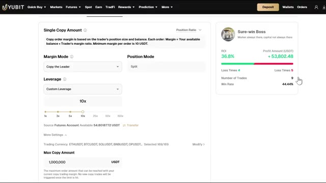
*⏱️ 00:08:28 — Page de configuration du copy trading sur YUBIT avec les statistiques du trader sélectionné (Sure-win Boss) et les paramètres de levier.*

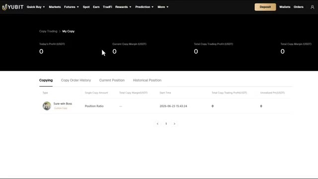
*⏱️ 00:08:45 — Tableau de bord « My Copy » sur YUBIT affichant la liste des traders actuellement suivis et les métriques de performance globales.*

---

### ⏱️ `[00:08:54 - 00:09:31]` | Segment #19

**🔊 Audio (Transcription Intégrale Mot pour Mot en Français) :**
> historique, positions actuelles et positions historiques. En faisant défiler un peu plus bas, vous pouvez voir vos copies de transactions actuelles, le type, le montant de copie unique, la marge totale de copie, l'heure de début, le profit total du copy trading et le PnL non réalisé. Pour modifier vos paramètres, il vous suffit de cliquer sur la transaction et une fenêtre apparaîtra, cliquez sur modifier la copie et vous serez ramassé à l'écran de placement d'ordre de copie où vous pourrez ajuster tout ce dont vous avez besoin. Maintenant, si vous voulez arrêter de copier un trader, cliquez sur arrêter de copier, vous aurez deux options : fermer toutes les positions de copie au prix du marché immédiatement toutes les copies

**👁️ Analyse Visuelle d'Écran (gemini-3.5-flash-lite) :**
**Interface & Outils** : Interface web de la plateforme de trading YUBIT (section Copy Trading).

**Contenu textuel & Code** : Tableaux récapitulatifs des copies, soldes en USDT, métriques de traders (ROI 36.8%, profit de 53,802.48 USDT, taux de réussite de 44.44%) et options de configuration de levier.

**Action / Démonstration** : Navigation dans l'interface de copy trading pour consulter les positions actives et modifier les paramètres de configuration.

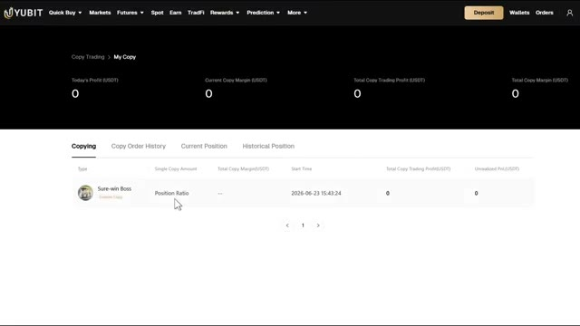
*⏱️ 00:09:03 — Interface de copy trading montrant les copies de transactions en cours, le type, le montant de copie unique et le PnL non réalisé.*

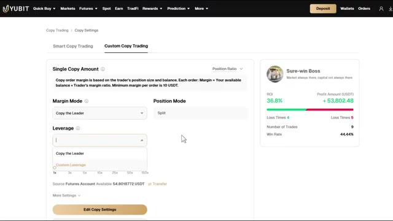
*⏱️ 00:09:22 — Paramètres personnalisés de copy trading avec la configuration du montant de copie, du mode de marge et du levier.*

---

### ⏱️ `[00:09:31 - 00:10:04]` | Segment #20

**🔊 Audio (Transcription Intégrale Mot pour Mot en Français) :**
> les positions de ce trader seront fermées au prix du marché immédiatement, conservez les positions et copiez immédiatement. Vos positions existantes restent ouvertes, mais aucun nouveau trade ne sera copié. Après une fermeture manuelle, le partage des profits s'applique toujours. Choisissez l'option qui a du sens pour votre situation, puis cliquez sur arrêter la copie pour confirmer. Très bien, voilà donc l'analyse complète étape par étape de la configuration du copy trading sur UBIT. Le copy trading est un excellent moyen de se lancer dans la crypto sans avoir besoin d'être un expert en graphiques, mais gardez à l'esprit que ce n'est pas totalement passif. Vous devez toujours surveiller vos

**👁️ Analyse Visuelle d'Écran (gemini-3.5-flash-lite) :**
**Interface & Outils** : Interface de la plateforme de trading YUBIT (Copy Trading).

**Contenu textuel & Code** : Options "Close all copy positions at market price immediately" et "Keep positions, end copy immediately" avec les paramètres associés.

**Action / Démonstration** : Sélection de l'option de gestion des positions lors de l'arrêt du copy trading.

*⏱️ 00:09:39 — Interface de copy trading montrant une fenêtre contextuelle avec les options de fermeture des positions après l'arrêt du copy trading.*

---

### ⏱️ `[00:10:04 - 00:10:37]` | Segment #21

**🔊 Audio (Transcription Intégrale Mot pour Mot en Français) :**
> les traders, vérifient leurs performances régulièrement, et n'ayez pas peur d'arrêter de copier quelqu'un si sa stratégie commence à changer ou si son prélèvement commence à augmenter. N'investissez jamais plus que ce que vous pouvez vous permettre de perdre et pensez toujours à vous diversifier auprès de quelques traders plutôt que de tout miser sur un seul. Utilisez mon lien dans la description pour vous inscrire sur UBIT et réclamer l'ensemble du package de bonus de bienvenue, jusqu'à 50 000 USDT de récompenses. Tous les détails sont ci-dessous. Si vous avez des questions, déposez-les dans les commentaires. Je les lis. Si cette vidéo vous a aidé, assurez-vous de laisser un pouce bleu et

**👁️ Analyse Visuelle d'Écran (gemini-3.5-flash-lite) :**
**Interface & Outils** : Interface de la plateforme d'échange Yubit (section Copy Trading et Rewards).

**Contenu textuel & Code** : Statistiques de traders (Truth, Kongming ETH, Eagle Hunt II), taux de réussite (54.43%, 84.21%), PnL sur 30 jours, et options de clôture de positions.

**Action / Démonstration** : Navigation et démonstration des paramètres de gestion et d'arrêt du copy trading sur la plateforme Yubit.

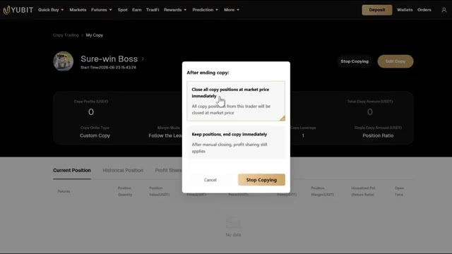
*⏱️ 00:10:13 — Interface de copy trading montrant les options de fin de copie, avec un menu contextuel pour fermer ou conserver les positions ouvertes.*

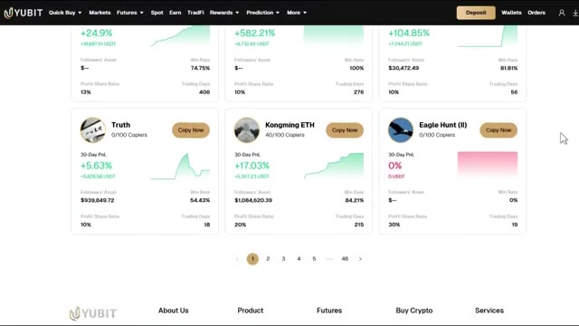
*⏱️ 00:10:21 — Page de sélection des traders à copier affichant différentes cartes de performance avec taux de réussite et PnL sur 30 jours.*

---

### ⏱️ `[00:10:37 - 00:10:47]` | Segment #22

**🔊 Audio (Transcription Intégrale Mot pour Mot en Français) :**
> abonnez-vous pour plus de tutoriels crypto comme celui-ci. Et pour une présentation plus détaillée de la plateforme UBIT elle-même, regardez la vidéo qui s'affiche sur votre écran en ce moment même. Je vous retrouve dans la prochaine.

**👁️ Analyse Visuelle d'Écran (gemini-3.5-flash-lite) :**
**Interface & Outils** : Plateforme d'échange crypto UBIT (section Copy Trading).

**Contenu textuel & Code** : Statistiques de trading (P&L sur 30 jours, taux de réussite, nombre de copieurs et actifs sous gestion).

**Action / Démonstration** : Présentation et navigation dans l'interface de copy trading de la plateforme UBIT.

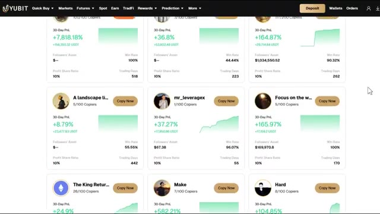
*⏱️ 00:10:39 — Liste détaillée des traders disponibles pour le copy trading sur la plateforme UBIT, affichant leurs performances sur 30 jours et taux de réussite.*

*⏱️ 00:10:42 — Page d'accueil de la section Copy Trading de la plateforme UBIT avec la liste des "Top Traders" et leurs statistiques.*

---

