# 🎬 How I Trade Like a Quant Using Toobit Synapse

> **Chaîne** : [Alex Carter](https://www.youtube.com/@AlexCarterTrading)  
> **Lien YouTube** : [https://www.youtube.com/watch?v=3aXoNsyr_sA](https://www.youtube.com/watch?v=3aXoNsyr_sA)  
> **Date de publication** : 20260625  
> **Durée** : 00:08:57  
> **Identifiant vidéo** : `3aXoNsyr_sA`  
> **Transcription & Analyse** : `whisper-v3-large-turbo+gemini-3.5-flash-lite`  

---

## 📌 Synthèse Exécutive & Outils

### 💡 Résumé
Dans cette vidéo, Alex Carter explore l'intégration des outils d'intelligence artificielle de niveau institutionnel appliqués au trading de cryptomonnaies, en se concentrant particulièrement sur l'outil *Synapse* de la plateforme Toobit. L'analyste met en lumière la mutation radicale du paysage du trading particulier, où l'accès en temps réel à des données complexes, autrefois réservé aux détenteurs de terminaux professionnels ou de desks quantitatifs, est désormais démocratisé grâce à des assistants conversationnels avancés. La démonstration détaille comment exploiter l'IA pour s'affranchir du bruit des graphiques, automatiser la recherche de marché et structurer instantanément des analyses multi-dimensionnelles intégrant l'action des prix, le volume et le sentiment social.

Au-delà de la simple présentation d'un outil de chat, la stratégie démontrée repose sur une approche systématique et augmentée du trading. Carter aborde la transition inévitable entre les méthodes manuelles traditionnelles et le trading agentique, illustrant comment des technologies de pointe comme le protocole MCP (*Model Context Protocol*) permettent à une IA d'interagir directement avec les flux de marché en direct. Sont également passés en revue les concepts d'automatisation avancée, l'utilisation de scripts sur mesure pour coder des logiques de décision, ainsi que la structuration d'une démarche rigoureuse de gestion des risques pour transformer des données brutes en opportunités exploitables.

Enfin, la vidéo positionne ces innovations technologiques au sein d'un écosystème d'apprentissage communautaire et pratique, à travers des structures telles que *AI TradeEdge*. L'objectif affiché est de fournir aux traders particuliers les clés méthodologiques — allant du codage de stratégies algorithmiques via *Pine Script* et *Claude Code* jusqu'à l'utilisation de bots de surveillance — pour rivaliser à armes égales avec les acteurs institutionnels. L'intervention se conclut par une invitation pragmatique à structurer ses processus de décision et à capitaliser sur l'automatisation pour éliminer les biais émotionnels inhérents au trading discrétionnaire.

### 🛠️ Outils, Modèles & Logiciels Présentés
* **Toobit Synapse** : Assistant d'analyse de marché propulsé par l'IA et intégré directement à la plateforme Toobit, offrant un accès direct aux données en temps réel pour générer des rapports de niveau institutionnel.
* **Protocole MCP (Model Context Protocol)** : Technologie sous-jacente permettant aux modèles d'IA de se connecter dynamiquement aux flux de données de marché en temps réel et aux serveurs externes sans recourir à de simples estimations statiques.
* **Claude** : Modèle de langage de grande taille de pointe développé par Anthropic, servant de moteur d'intelligence artificielle pour interpréter les signaux de marché et structurer les rapports.
* **TradingView / Pine Script** : Environnement de graphitage et langage de programmation propriétaire utilisé pour concevoir, backtester et automatiser des stratégies de scalping et de swing trading.
* **Claude Code** : Outil de développement assisté par IA employé pour concevoir, prototyper et structurer des systèmes de trading algorithmique et des scripts d'automatisation complexes.
* **Grok Bots** : Outils d'automatisation et de surveillance automatisée utilisés pour scanner les marchés en continu et relayer des alertes opportunes aux traders.
* **AI TradeEdge** : Communauté de trading quantitative et opération de recherche en direct centralisant des invites, des bots, des modèles et un cursus complet de formation au trading agentique.

### 🔑 Points Clés & Enseignements Stratégiques
* **Démocratisation de l'analyse institutionnelle** : L'utilisation d'assistants connectés en temps réel permet aux traders particuliers de s'affranchir des limites des graphiques manuels pour obtenir instantanément des synthèses comparables aux prestations de terminaux professionnels.
* **Élimination du bruit informationnel** : Les outils d'IA agissent comme un filtre structurel, transformant une masse brute de données de prix et de volumes en signaux clairs, exploitables et contextualisés.
* **Intégration du sentiment de marché** : La puissance du protocole MCP réside dans sa capacité à croiser instantanément l'action des prix et des volumes avec des données exogènes issues des flux d'actualités et des réseaux sociaux.
* **Architecture des rapports structurés** : Un processus d'analyse rigoureux doit obligatoirement disséquer le résumé exécutif, l'action des prix, les schémas techniques, l'analyse du volume, l'évaluation du sentiment et l'identification précise des zones de support et de résistance.
* **Nécessité absolue du Risk Management** : Indépendamment de la sophistication des modèles prédictifs ou des analyses générées par l'IA, chaque position doit intégrer une gestion stricte du risque pour faire face à la volatilité intrinsèque des cryptomonnaies.
* **Transition vers le trading agentique** : L'avenir de la rentabilité repose sur l'adoption de systèmes autonomes ou semi-autonomes capables de surveiller le marché 24h/24 et 7j/7 sans subir de frictions émotionnelles.
* **Automatisation des stratégies par le code** : Le passage d'une idée discrétionnaire à un système algorithmique fonctionnel s'appuie sur la traduction de règles logiques via des environnements de script et des assistants de codage avancés.
* **Suppression des biais émotionnels** : L'automatisation et l'assistance algorithmique permettent d'éliminer la peur, l'euphorie et le FOMO, garantissant une exécution froide et disciplinée des plans de trading.
* **Approche empirique et communautaire** : Le succès en trading quantitatif nécessite un processus itératif de test en conditions réelles, de partage des stratégies fonctionnelles et d'élimination rapide des approches inopérantes au sein de groupes de recherche spécialisés.
* **Évolution de la valeur du temps pour le trader** : Déléguer l'analyse lourde et la surveillance continue à l'intelligence artificielle libère un temps précieux, recentrant l'intervention humaine sur la validation des risques et l'ajustement macro-stratégique.

---

## ⏱️ Chronologie & Transcription Complète Audio & Visuelle (Mot pour Mot)

### ⏱️ `[00:00:00 - 00:00:33]` | Segment #01

**🔊 Audio (Transcription Intégrale Mot pour Mot en Français) :**
> Tubit vient de lancer un outil d'analyse par IA de niveau institutionnel avec un accès direct au marché disponible pour absolument tous les traders sur la plateforme, et la plupart d'entre nous ignorent même son existence. Il s'appelle Synapse. Propulsé par le protocole MCP, il vous permet de discuter avec une IA pour analyser le marché, élaborer des stratégies et prendre des décisions de trading, tout en un seul endroit, en quelques secondes. Maintenant, je fais du trading de crypto depuis des ans, et je peux vous dire le temps que j'ai perdu à fixer des graphiques, à traverser ce brouhaha en essayant de comprendre ce que le marché fait réellement

**👁️ Analyse Visuelle d'Écran (gemini-3.5-flash-lite) :**
**Interface & Outils** : Site web Toobit, graphique TradingView (WEEX).

**Contenu textuel & Code** : Contrat perpétuel Bitcoin/Tether (BTCUSDT), indicateur technique inférieur (DHLB-ATR), signaux d'achat (Long) et de vente (Short), prix actuels et échelles temporelles (4h).

**Action / Démonstration** : Analyse technique d'un graphique de prix et visualisation de signaux de trading sur un graphique en chandeliers.

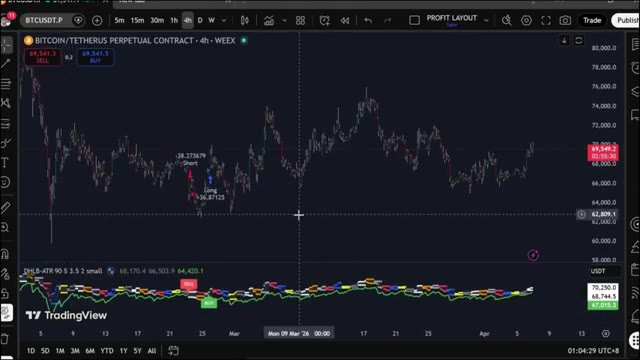
*⏱️ 00:00:25 — Graphique TradingView sur 4 heures de la paire Bitcoin/Tether (BTCUSDT) sur la plateforme WEEX montrant des signaux de trading Long/Short et un indicateur technique inférieur.*

---

### ⏱️ `[00:00:33 - 00:01:09]` | Segment #02

**🔊 Audio (Transcription Intégrale Mot pour Mot en Français) :**
> s'accumule et Synapse est fondamentalement la réponse à tout cela donc dans cette vidéo je vais vous montrer exactement ce qu'est Read Synapse, comment le trouver, comment l'utiliser étape par étape et ce qui arrive ensuite, allons-y mais avant d'entrer dans le vif du sujet si vous ne vous êtes pas encore inscrit sur Bybit c'est le meilleur moment pour le faire en utilisant le lien dans la description vous pouvez obtenir jusqu'à 8810 dollars de récompenses plus des bonus VIP exclusifs disponibles uniquement via mon lien. Rien qu'en vous inscrivant, vous obtenez un bonus futures de 30 dollars et le niveau VIP 1 pendant un mois. En plus de cela, il y a un palier de dépôt

**👁️ Analyse Visuelle d'Écran (gemini-3.5-flash-lite) :**
**Interface & Outils** : Interface web de la bourse de cryptomonnaies Toobit.

**Contenu textuel & Code** : Textes publicitaires, fonctionnalités IA de Toobit Synapse, période d'activité promotionnelle, et offres de bonus (30 $ Futures Bonus + VIP1).
[DESC_IMAGE_1] Présentation des fonctionnalités clés de Toobit Synapse (All-in-One Trading Hub, 24/7 Market Watchdog, Perfect Discipline).
[DESC_IMAGE_2] Affichage de l'offre promotionnelle Toobit x Mister Crypto avec un compte à rebours et des graphiques de récompenses en USDT.
[DESC_IMAGE_3] Détails des conditions d'inscription pour obtenir un bonus de 30 $ sur les Futures et le statut VIP1.

**Action / Démonstration** : Navigation et défilement sur les pages web promotionnelles de la plateforme Toobit.

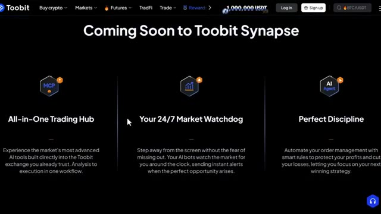
*⏱️ 00:00:42 — Page de présentation de "Toobit Synapse" mettant en avant trois fonctionnalités clés : All-in-One Trading Hub, Your 24/7 Market Watchdog et Perfect Discipline.*

*⏱️ 00:00:51 — Page promotionnelle de partenariat entre Toobit et Mister Crypto offrant 8 810 $ de récompenses et des bonus VIP exclusifs.*

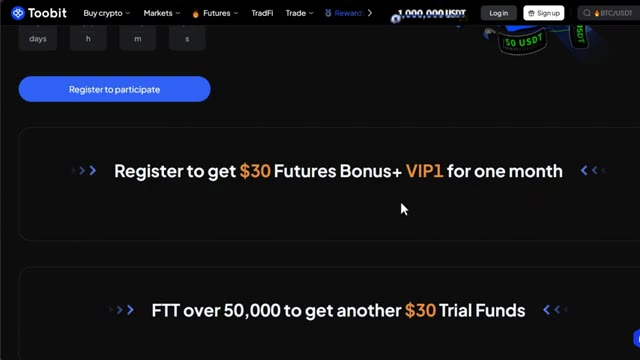
*⏱️ 00:01:00 — Suite de la page promotionnelle de Toobit détaillant l'offre d'inscription incluant 30 $ de bonus Futures et le statut VIP1 pendant un mois.*

---

### ⏱️ `[00:01:09 - 00:01:32]` | Segment #03

**🔊 Audio (Transcription Intégrale Mot pour Mot en Français) :**
> défi où vous pouvez débloquer jusqu'à 750 USDT et un défi de trading d'une valeur allant jusqu'à 150 USDT. Tout cela se cumule. Le lien est dans la description. Cliquez dessus, inscrivez-vous, et entrons dans Synapse. Alors d'abord, qu'est-ce que c'est réellement, Synapse ? 2-bit Synapse est un assistant propulsé par l'IA conçu pour être votre co-pilote personnel sur le marché de la crypto.

**👁️ Analyse Visuelle d'Écran (gemini-3.5-flash-lite) :**
**Interface & Outils** : Site web de l'échange de cryptomonnaies Toobit.

**Contenu textuel & Code** : Détails des récompenses du défi de trading (150 USDT, paliers de volume), description de l'outil IA Synapse et de son intégration avec Claude et le Model Context Protocol (MCP).

**Action / Démonstration** : Présentation des conditions de participation aux défis de trading et explication des fonctionnalités de Synapse sur la plateforme Toobit.

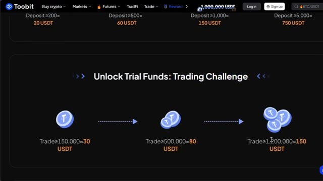
*⏱️ 00:01:15 — Interface de Toobit montrant les détails du défi de trading avec des paliers de gains en USDT basés sur le volume de trades.*

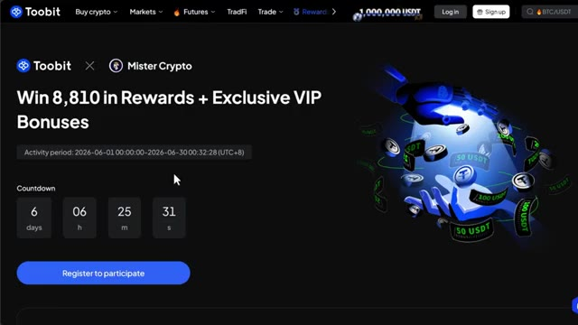
*⏱️ 00:01:20 — Page d'accueil de l'événement promotionnel Toobit x Mister Crypto avec un compte à rebours et un bouton d'inscription.*

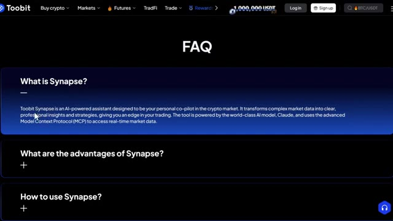
*⏱️ 00:01:26 — Section FAQ du site Toobit expliquant ce qu'est Synapse, un assistant IA propulsé par Claude.*

---

### ⏱️ `[00:01:32 - 00:01:53]` | Segment #04

**🔊 Audio (Transcription Intégrale Mot pour Mot en Français) :**
> Pensez-y comme à un analyste professionnel assis à côté de vous vingt-quatre heures sur vingt-quatre et sept jours sur sept, à la différence qu'il ne dort jamais, ne devient jamais émetionnel, et traite les données beaucoup plus rapidement que n'importe quel humain ne pourrait jamais le faire. Il est propulsé par Claude, l'un des modèles d'IA les plus avancés au monde, et il utilise quelque chose appelé le Protocole de Contexte de Modèle, ou MCP, pour intégrer des données de marché en temps réel.

**👁️ Analyse Visuelle d'Écran (gemini-3.5-flash-lite) :**
**Interface & Outils** : Plateforme de trading crypto Toobit (pages d'analyse Synapse et FAQ).

**Contenu textuel & Code** : Analyses techniques détaillées (rupture de support, phase d'accélération, profil de volume, facteurs baissiers/haussiers) et description de l'outil IA Synapse.

**Action / Démonstration** : Navigation et lecture de l'analyse automatisée du marché et de la FAQ de l'assistant IA.

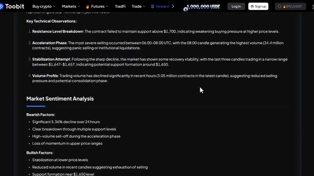
*⏱️ 00:01:37 — Interface web de Toobit affichant les observations techniques clés et l'analyse du sentiment de marché générées par l'IA.*

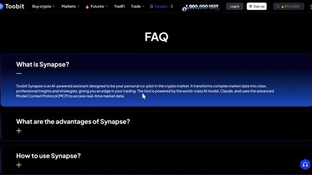
*⏱️ 00:01:43 — Section FAQ de Toobit Synapse expliquant ce qu'est l'assistant IA basé sur Claude et le protocole MCP.*

---

### ⏱️ `[00:01:53 - 00:02:12]` | Segment #05

**🔊 Audio (Transcription Intégrale Mot pour Mot en Français) :**
> C'est ce qui le différencie du simple fait de poser des questions à ChatGPT sur Bitcoin. Synapse a un accès direct au marché en temps réel. Il ne devine pas. Il lit le marché en ce moment même. Et voici ce qu'il fait réellement pour vous. Il automatise des recherches de marché complexes et génère des stratégies. Ainsi, vous pouvez prendre des décisions plus rapides et plus éclairées sans passer des heures à faire l'analyse vous-même.

**👁️ Analyse Visuelle d'Écran (gemini-3.5-flash-lite) :**
**Interface & Outils** : Interface web de la plateforme d'échange de cryptomonnaies Toobit, comprenant l'interface de trading Spot/Futures et les pages d'information de l'outil Synapse.

**Contenu textuel & Code** : Graphique de prix BTCUSDT à 62,345.0, carnet d'ordres en temps réel, effet de levier 20x, et texte descriptif sur les avantages de Synapse (automatisation de la recherche de marché, analyse du sentiment, Model Context Protocol).

**Action / Démonstration** : Navigation sur la plateforme Toobit montrant à la fois l'interface de trading en temps réel et la documentation explicative de l'assistant IA Synapse.

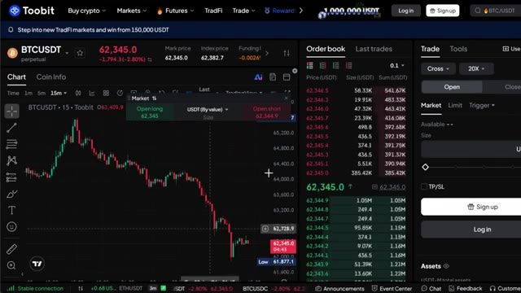
*⏱️ 00:01:58 — Interface de trading de la plateforme Toobit montrant un graphique des prix BTCUSDT en unités de 15 minutes, un carnet d'ordres et les options de passage d'ordres d'achat/vente (long/short).*

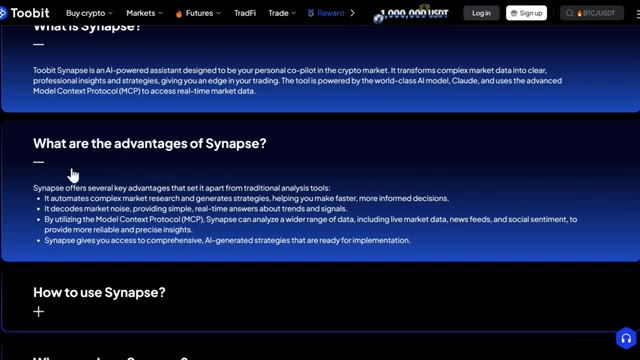
*⏱️ 00:02:03 — Page Web de présentation de "Toobit Synapse", détaillant les fonctionnalités et les avantages de cet assistant IA propulsé par Claude et utilisant le Model Context Protocol (MCP).*

---

### ⏱️ `[00:02:13 - 00:02:31]` | Segment #06

**🔊 Audio (Transcription Intégrale Mot pour Mot en Français) :**
> Il décode le bruit du marché. Au lieu de vous noyer dans les données, vous obtenez des réponses simples et en temps réel sur les tendances et les signaux. Ce qui se passe, pourquoi cela se passe, et quoi faire à ce sujet. De plus, il vous donne accès à des stratégies complètes générées par l'IA qui sont prêtes à être mises en œuvre. Vous n'avez pas besoin d'une équipe de quants pour trader comme eux.

**👁️ Analyse Visuelle d'Écran (gemini-3.5-flash-lite) :**
**Interface & Outils** : Interface web de la plateforme Toobit affichant des rapports de trading détaillés.

**Contenu textuel & Code** : Analyses textuelles structurées comprenant des facteurs haussiers/baissiers, des implications de trading pour différents types de traders, et des observations techniques sur les niveaux de prix (Ethereum).

**Action / Démonstration** : Consultation et lecture d'un rapport d'analyse de marché généré ou hébergé sur une plateforme d'échange de cryptomonnaies.

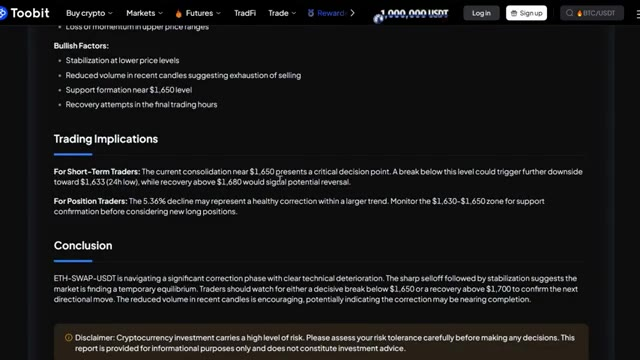
*⏱️ 00:02:17 — L'image 1 présente les implications de trading et la conclusion d'un rapport d'analyse de marché sur la plateforme Toobit.*

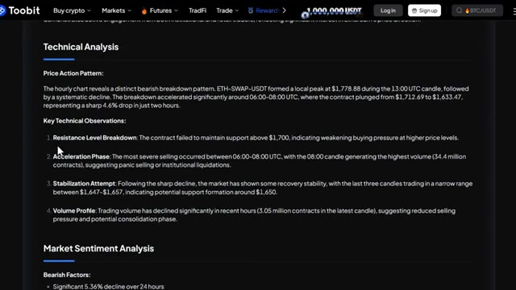
*⏱️ 00:02:26 — L'image 2 affiche l'analyse technique et l'analyse du sentiment de marché pour le contrat ETH-SWAP-USDT sur la plateforme Toobit.*

---

### ⏱️ `[00:02:31 - 00:02:50]` | Segment #07

**🔊 Audio (Transcription Intégrale Mot pour Mot en Français) :**
> Un clic et vous avez une analyse complète. Maintenant, gardez à l'esprit qu'il y a aussi une prochaine phase qui arrive. Des fonctionnalités telles qu'un chien de garde du marché par IA 24h/24 et 7j/7 qui surveille le marché pour vous en permanence et envoie des alertes instantanées lorsque la bonne opportunité se présente. Et une gestion automatisée des ordres avec des règles intelligentes pour protéger vos profits et limiter vos pertes.

**👁️ Analyse Visuelle d'Écran (gemini-3.5-flash-lite) :**
**Interface & Outils** : Site web / Plateforme d'échange crypto Toobit Synapse.

**Contenu textuel & Code** : Présentation de trois fonctionnalités : 'All-in-One Trading Hub', 'Your 24/7 Market Watchdog' et 'Perfect Discipline'.

**Action / Démonstration** : Affichage des fonctionnalités à venir pour illustrer le discours sur la surveillance du marché par IA 24h/24 et 7j/7.

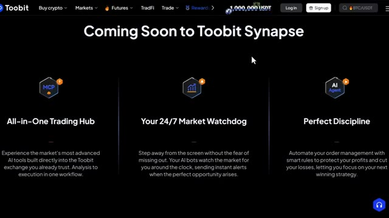
*⏱️ 00:02:36 — Capture d'écran de la plateforme Toobit Synapse présentant les fonctionnalités à venir, notamment 'Your 24/7 Market Watchdog'.*

---

### ⏱️ `[00:02:50 - 00:03:27]` | Segment #08

**🔊 Audio (Transcription Intégrale Mot pour Mot en Français) :**
> Tout cela arrive bientôt. Mais ce qui est disponible dès maintenant est déjà incroyablement puissant. Alors entrons dans le vif du sujet. Et soit dit en passant, je vais vous montrer quelque chose à la fin de cette vidéo qui, je pense, va complètement changer votre façon d'aborder le trading avec l'IA. Alors restez avec moi jusqu'à la fin. Très bien. Alors trouvons réellement Synapse sur la plateforme. C'est très simple. Une fois que vous êtes connecté à votre compte 2-bit, allez dans la barre de navigation supérieure, cliquez sur trade. Et dans le menu déroulant, vous verrez 2-bit Synapse. Il suffit de cliquer dessus. Vous arriverez sur la page de Synapse. Et tout de suite, vous pouvez voir exactement ce qu'il fait. Trois choses. Il agit comme votre analyste personnel. Plus besoin

**👁️ Analyse Visuelle d'Écran (gemini-3.5-flash-lite) :**
**Interface & Outils** : Navigateur web, plateforme éducative Trading AI, site web de l'échange de cryptomonnaies Toobit.

**Contenu textuel & Code** : Mentions de performances de bots IA (Claude, DeepSeek, Grok, GPT-5) et présentation de l'outil 'Toobit Synapse'.

**Action / Démonstration** : Navigation et présentation visuelle des outils et fonctionnalités de trading assistés par IA.

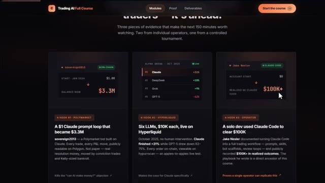
*⏱️ 00:03:00 — Capture d'écran montrant une page de cours intitulée 'Trading AI Full Course' présentant différents cas d'utilisation de bots propulsés par l'intelligence artificielle.*

*⏱️ 00:03:09 — Page d'accueil de la plateforme d'échange de cryptomonnaies Toobit avec un arrière-plan montrant un stade de football.*

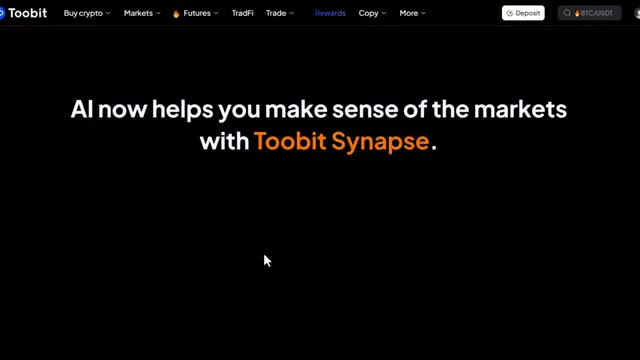
*⏱️ 00:03:18 — Écran de présentation de Toobit affichant le texte 'AI now helps you make sense of the markets with Toobit Synapse'.*

---

### ⏱️ `[00:03:27 - 00:04:04]` | Segment #09

**🔊 Audio (Transcription Intégrale Mot pour Mot en Français) :**
> de longues heures avec des graphiques sans fin. Synapse automatise l'analyse et génère des stratégies pour vous. Ensuite, il interprète les signaux. Au lieu de vous noyer dans les données, vous obtenez des réponses simples en temps réel sur les tendances du marché. Le bruit se transforme en informations exploitables, et il vous donne accès aux meilleures stratégies. Vous n'avez pas besoin d'une équipe de quants pour trader comme eux. Des stratégies complètes générées par IA prêtes en un seul clic. Et dès maintenant, vous pouvez obtenir une analyse par IA de niveau institutionnel pour les principales cryptos. Bitcoin, Ethereum, Solana et Doge. Très bien, allons l'utiliser pour de vrai.

**👁️ Analyse Visuelle d'Écran (gemini-3.5-flash-lite) :**
**Interface & Outils** : Site web / Plateforme Toobit

**Contenu textuel & Code** : Cartes d'information décrivant les fonctionnalités "Your Personal Analyst", "Speak to the Signals" et "Access Top Strategies" d'analyse automatisée par IA.

**Action / Démonstration** : Démonstration et présentation des modules de l'outil Synapse AI sur la plateforme Toobit.

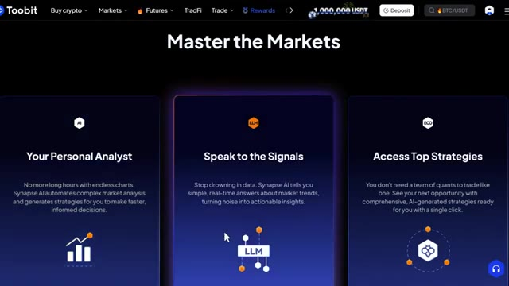
*⏱️ 00:03:37 — Présentation des fonctionnalités de Synapse AI sur le site Toobit sous la bannière "Master the Markets".*

---

### ⏱️ `[00:04:04 - 00:04:24]` | Segment #10

**🔊 Audio (Transcription Intégrale Mot pour Mot en Français) :**
> Étape par étape. Première étape, sélectionnez la cryptomonnaie que vous voulez analyser. Vous verrez les options juste là. Bitcoin, ETH, Solana, Doge. Cliquez simplement sur la paire pour laquelle vous souhaitez obtenir une analyse. Deuxième étape, une fois que vous avez sélectionné votre paire, cliquez sur Try 2-Bit Synapse. Et ensuite, c'est là que ça devient intéressant.

**👁️ Analyse Visuelle d'Écran (gemini-3.5-flash-lite) :**
**Interface & Outils** : Site web / Plateforme Toobit

**Contenu textuel & Code** : Boutons de sélection de paires de cryptomonnaies : BTC (sélectionné), ETH, SOL, DOGE, ainsi qu'un bouton d'action "Try Toobit Synapse" et un texte descriptif sur l'analyse par IA.

**Action / Démonstration** : Sélection de la cryptomonnaie BTC (Bitcoin) sur l'interface pour lancer l'analyse.

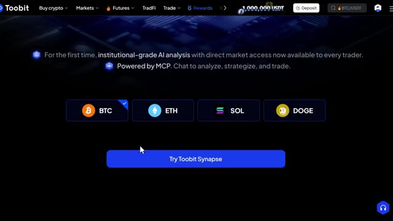
*⏱️ 00:04:09 — Interface Web de la plateforme Toobit montrant les options de cryptomonnaies (BTC, ETH, SOL, DOGE) pour l'analyse par IA.*

---

### ⏱️ `[00:04:24 - 00:04:47]` | Segment #11

**🔊 Audio (Transcription Intégrale Mot pour Mot en Français) :**
> Une fenêtre de discussion va apparaître. Elle se connecte aux serveurs MCP, et en quelques secondes, vous obtiendrez un aperçu d'analyse IA détaillé généré par Synapse. Maintenant, il ne s'agit pas d'une simple réponse de chatbot. C'est un rapport structuré, de niveau professionnel. Laissez-moi vous guider à travers ce que vous regardez réellement. Vous avez le résumé exécutif tout en haut, un aperçu clair de la situation actuelle de l'actif.

**👁️ Analyse Visuelle d'Écran (gemini-3.5-flash-lite) :**
**Interface & Outils** : Plateforme d'échange de cryptomonnaies Toobit avec assistant d'analyse IA intégré.

**Contenu textuel & Code** : Rapport textuel structuré, prix du Bitcoin à $62,430.50, plus haut sur 24h à $65,595.70, plus bas à $61,877.10, variation de -2,76% et volume de 116,6 millions de contrats.

**Action / Démonstration** : Génération et affichage d'un rapport d'analyse technique automatisé pour les contrats futures Bitcoin.

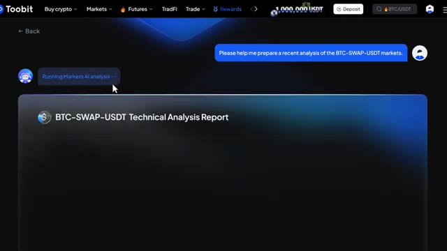
*⏱️ 00:04:30 — Interface Toobit affichant la génération en cours d'un rapport d'analyse technique IA sur BTC-SWAP-USDT suite à une requête utilisateur.*

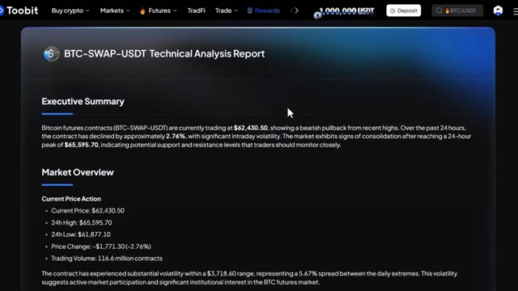
*⏱️ 00:04:36 — Rapport structuré complet généré par l'IA sur Toobit montrant le résumé exécutif et l'aperçu du marché pour les contrats BTC-SWAP-USDT.*

---

### ⏱️ `[00:04:48 - 00:05:07]` | Segment #12

**🔊 Audio (Transcription Intégrale Mot pour Mot en Français) :**
> Ensuite, l'aperçu de l'action des prix, ce que les prix ont fait, les mouvements clés et le contexte. Ensuite, les schémas d'analyse technique, c'est là que ça devient approfondi. Synapse identifie les configurations graphiques, les structures de tendance et les signaux qui vous prendraient normalement beaucoup de temps à tracer manuellement. Ensuite, l'analyse du volume, car le prix sans le volume est incomplet.

**👁️ Analyse Visuelle d'Écran (gemini-3.5-flash-lite) :**
**Interface & Outils** : Plateforme de trading et d'échange de cryptomonnaies Toobit.

**Contenu textuel & Code** : Aperçu du marché (Current Price Action) avec le prix actuel à 62 430,50 $, le plus haut sur 24h à 65 595,70 $, le plus bas sur 24h à 61 877,10 $, une variation de prix de -1 771,30 $ (-2,76 %) et un volume de trading de 116,6 millions de contrats, ainsi qu'une section d'analyse technique (Hourly Trend Breakdown).

**Action / Démonstration** : Présentation textuelle et chiffrée de l'action des prix et du rapport d'analyse de marché sur la plateforme Toobit.

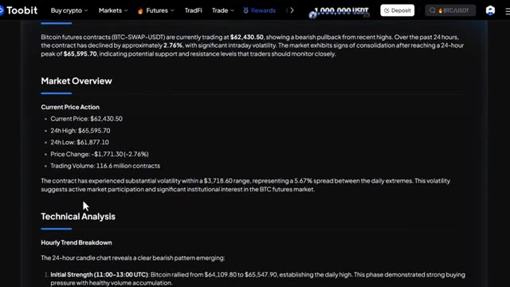
*⏱️ 00:04:53 — Capture d'écran de l'interface de la plateforme Toobit affichant un rapport d'analyse de marché détaillé pour les contrats futures Bitcoin (BTC-SWAP-USDT).*

---

### ⏱️ `[00:05:08 - 00:05:28]` | Segment #13

**🔊 Audio (Transcription Intégrale Mot pour Mot en Français) :**
> Synapse lit les deux. Ensuite, l'évaluation du sentiment du marché. C'est là que le MCP brille vraiment. Il intègre non seulement les données de prix, mais aussi des signaux de sentiment provenant de flux d'actualités et de données sociales. Ensuite, les niveaux clés, vos zones de support et de résistance clairement définies. Et enfin, la conclusion, un résumé clair et exploitable de ce que tout cela signifie pour votre trade.

**👁️ Analyse Visuelle d'Écran (gemini-3.5-flash-lite) :**
**Interface & Outils** : Plateforme Web / Interface de type Toobit

**Contenu textuel & Code** : Niveaux de résistance (Immediate : 62,555 $, Primary : 64,000 $, Strong : 65,595 $), Niveaux de support (Immediate : 62,309 $, Primary : 61,877 $, Secondary : 61,500 $), et une section "Market Sentiment Assessment" indiquant un sentiment baissier à neutre (bearish-to-neutral).

**Action / Démonstration** : Analyse textuelle des données de marché et affichage des niveaux clés de support et de résistance par le modèle MCP.

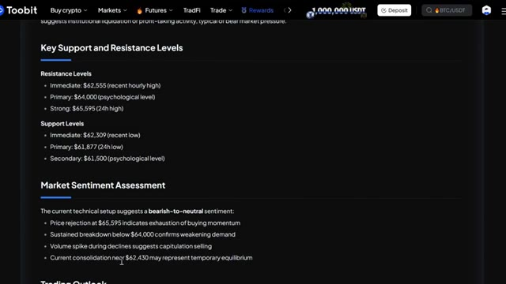
*⏱️ 00:05:13 — Capture d'écran montrant une interface sombre affichant des niveaux de support et de résistance ainsi qu'une évaluation du sentiment du marché générée par le MCP.*

---

### ⏱️ `[00:05:28 - 00:05:59]` | Segment #14

**🔊 Audio (Transcription Intégrale Mot pour Mot en Français) :**
> Tout cela, sur une seule page simple, en quelques secondes. Et une fois que vous avez le rapport, vous pouvez le copier ou le partager directement, depuis la fenêtre de chat. Maintenant, juste en toute franchise ici. L'analyse par IA est fournie à titre de référence uniquement et ne constitue pas un conseil en investissement. Les investissements en cryptomonnaies comportent des risques très élevés. Veuillez investir avec prudence et gérer vos risques de manière appropriée. Écoutez, je veux prendre un moment ici parce que je pense qu'il est facile de faire défiler rapidement ce genre de chose et de ne pas vraiment apprécier ce que c'est.

**👁️ Analyse Visuelle d'Écran (gemini-3.5-flash-lite) :**
**Interface & Outils** : Plateforme d'échange de cryptomonnaies Toobit (interface web).

**Contenu textuel & Code** : Texte de conclusion sur BTC-SWAP-USDT, avertissement sur les risques (Disclaimer / Risk Warning), boutons "Copy" et "Share", horodatage de la dernière mise à jour.

**Action / Démonstration** : Survol du curseur de la souris sur le bouton "Share" pour partager le rapport d'analyse.

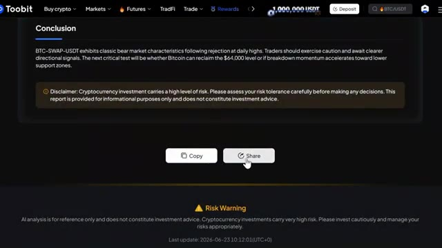
*⏱️ 00:05:36 — Capture d'écran de l'interface de la plateforme Toobit affichant la section de conclusion d'un rapport d'analyse cryptographique avec des boutons de partage et de copie.*

---

### ⏱️ `[00:05:59 - 00:06:24]` | Segment #15

**🔊 Audio (Transcription Intégrale Mot pour Mot en Français) :**
> La plupart des traders particuliers prennent des décisions basées sur des informations incomplètes, des réactions émotionnelles, ou simplement en copiant ce que quelqu'un d'autre a dit sur Twitter. Et les traders qui sont constamment rentables, ils ont des systèmes, ils ont des données, ils ont des analyses. Synapse donne fondamentalement à chaque trader sur 2Bit accès à ce même niveau d'analyse, le genre qui nécessitait auparavant soit un terminal Bloomberg, soit une équipe d'analystes.

**👁️ Analyse Visuelle d'Écran (gemini-3.5-flash-lite) :**
**Interface & Outils** : Plateforme de trading et d'analyse Toobit (tableaux de données de marché, rapports d'analyse textuelle et interface Web).

**Contenu textuel & Code** : Données de marché en temps réel, taux de financement, volumes sur 24h, capitalisation boursière, et rapports d'analyse technique automatisés sur les contrats Bitcoin (prix actuel à 62,430.50 $, plus/moins hauts sur 24h).
[DESC_IMAGE_3] Navigation sur la plateforme Toobit et consultation des données de marché et d'analyses automatisées.

**Action / Démonstration** : Explications face caméra et analyse conceptuelle des marchés.

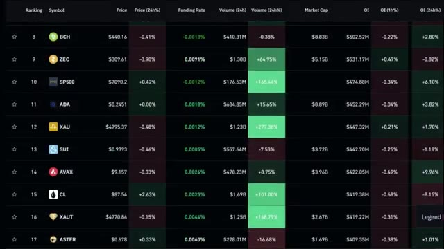
*⏱️ 00:06:06 — Image #1 @ 00:06:06 : Un tableau de classement des marchés affichant divers actifs (BCH, ZEC, SP500, ADA, XAU, etc.) avec leurs prix, taux de financement, volumes et capitalisation boursière.*

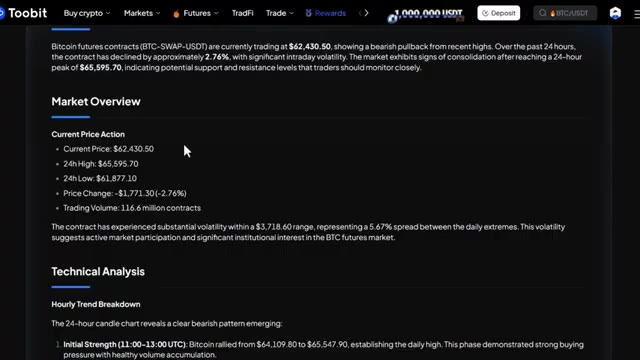
*⏱️ 00:06:12 — Image #2 @ 00:06:12 : Une page de rapports de marché de la plateforme Toobit détaillant l'action des prix des contrats à terme Bitcoin (BTC-SWAP-USDT) et une analyse technique horaire.*

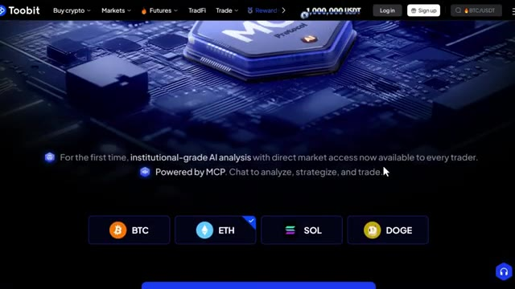
*⏱️ 00:06:18 — Image #3 @ 00:06:18 : La page d'accueil de la plateforme Toobit mettant en avant une analyse IA de niveau institutionnel propulsée par le protocole MCP, avec des sélecteurs de cryptomonnaies (BTC, ETH, SOL, DOGE).*

---

### ⏱️ `[00:06:25 - 00:06:44]` | Segment #16

**🔊 Audio (Transcription Intégrale Mot pour Mot en Français) :**
> Et c'est intégré directement dans la bourse que vous utilisez déjà. En plus de ça, comme c'est alimenté par MCP et Claude, ça ne se contente pas de récupérer des données statiques. Ça lit le marché en temps réel. C'est un très gros avantage. Donc si vous n'utilisez pas ça, vous laissez passer une opportunité en or. C'est aussi simple que ça. Très bien. Et écoutez, pendant les quelques années à venir, deux types de traders vont exister.

**👁️ Analyse Visuelle d'Écran (gemini-3.5-flash-lite) :**
**Interface & Outils** : Bourse crypto Toobit, graphique TradingView intégré et interface de chat IA (Toobit Synapse / MCP).

**Contenu textuel & Code** : Graphique de prix baissier du Bitcoin (BTC), carnet d'ordres (order book), et rapport d'analyse technique détaillé basé sur l'IA (Executive Summary, Market Overview).

**Action / Démonstration** : Navigation sur la plateforme d'échange Toobit, visualisation d'un carnet d'ordres et génération d'un rapport d'analyse de marché en temps réel par l'intelligence artificielle.

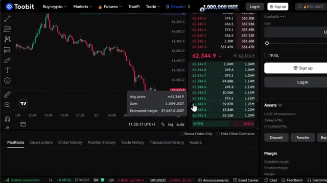
*⏱️ 00:06:35 — Interface de trading de la bourse Toobit montrant un graphique de prix en chandeliers et un carnet d'ordres en temps réel.*

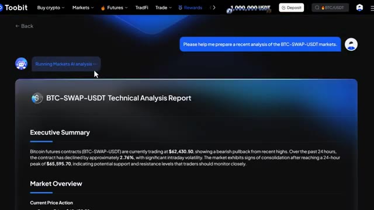
*⏱️ 00:06:39 — Interface de l'assistant IA de Toobit affichant un rapport d'analyse technique automatisé pour le marché BTC-SWAP-USDT.*

---

### ⏱️ `[00:06:45 - 00:07:22]` | Segment #17

**🔊 Audio (Transcription Intégrale Mot pour Mot en Français) :**
> Ceux qui utilisent l'IA et ceux qui font encore tout manuellement. Même marché, des résultats très différents. Voici comment vous mettre du bon côté de la barrière. J'ai regroupé tout cela au sein de la communauté AI TradeEdge. Chaque invite, chaque bot, chaque modèle, chaque guide étape par étape que j'utilise personnellement, le tout au même endroit, et tout ce que je construirai à l'avenir sera ajouté directement dans le groupe dès sa sortie. Nous testons également des stratégies provenant de tout Internet, en les automatisant à l'aide de PineScript, en les exécutant en direct et en partageant exactement ce qui fonctionne et ce qui ne fonctionne pas. Ainsi, vous n'êtes pas seulement

**👁️ Analyse Visuelle d'Écran (gemini-3.5-flash-lite) :**
**Interface & Outils** : Navigateur web, plateforme Whop (page de vente et interface de cours).

**Contenu textuel & Code** : Présentation des fonctionnalités de la communauté AI TradeEdge : scan de portefeuilles de baleines, analyse de sentiment, idées de trade, recherche de portefeuilles Hyperliquid, et données en temps réel.

**Action / Démonstration** : Navigation sur la page de présentation et les modules de la formation/communauté AI TradeEdge.

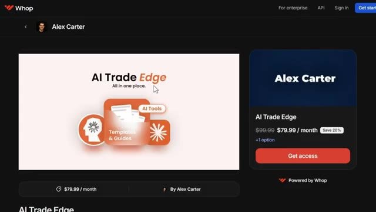
*⏱️ 00:06:54 — Page de vente de la communauté "AI TradeEdge" hébergée sur la plateforme Whop, présentée par Alex Carter, avec affichage du prix (79.99$/mois) et d'un bouton d'accès.*

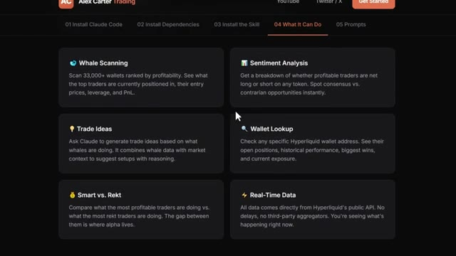
*⏱️ 00:07:03 — Interface de la section "What It Can Do" présentant les fonctionnalités de l'outil d'IA (Whale Scanning, Sentiment Analysis, Trade Ideas, Wallet Lookup, Smart vs. Rekt, Real-Time Data).*

---

### ⏱️ `[00:07:22 - 00:07:52]` | Segment #18

**🔊 Audio (Transcription Intégrale Mot pour Mot en Français) :**
> obtenir des outils. Vous obtenez une opération de recherche en direct. À l'intérieur, il y a aussi un cours complet de trading agentique. 2,5 heures. Du débutant à l'expert. Aucune base en programmation n'est nécessaire. À la fin, vous aurez votre propre système de trading IA fonctionnant en direct. Quelque chose que la plupart des traders particuliers ne savent même pas être possible actuellement. 79,99 $ par mois. Un seul bon trade couvre ce montant. Et les 100 premiers membres bloquent ce tarif définitivement. Après cela, le prix augmente. Le lien est dans la description.

**👁️ Analyse Visuelle d'Écran (gemini-3.5-flash-lite) :**
**Interface & Outils** : Navigateur web affichant une plateforme de cours en ligne et le portail de vente Whop.

**Contenu textuel & Code** : "The complete course map" avec les modules de formation, et l'offre d'abonnement "AI Trade Edge" à 79.99$ / mois.

**Action / Démonstration** : Présentation des modules et de la plateforme d'accès aux outils de trading par Alex Carter.

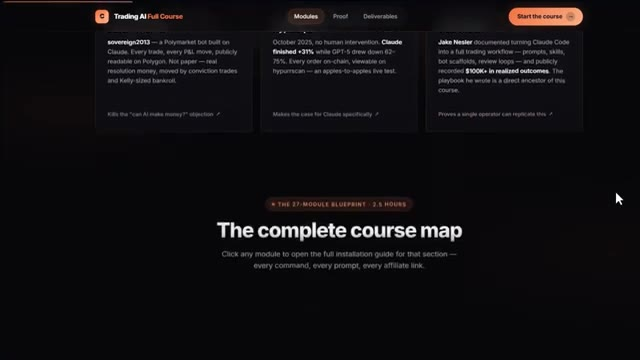
*⏱️ 00:07:29 — Capture d'écran du site web montrant la carte du cours complet de trading IA en 27 modules.*

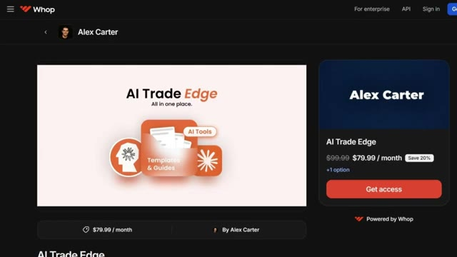
*⏱️ 00:07:44 — Page de vente de la plateforme Whop pour le programme "AI Trade Edge" d'Alex Carter affichée à l'écran.*

---

### ⏱️ `[00:07:52 - 00:08:10]` | Segment #19

**🔊 Audio (Transcription Intégrale Mot pour Mot en Français) :**
> Vous ne pouvez sincèrement pas vous permettre de rater ça. Et c'est tout. Une excellente analyse institutionnelle est désormais accessible au bout de vos doigts. Et écoutez, si vous n'êtes pas encore sur 2Bit, vous laissez sincèrement de l'argent gratuit sur la table en ce moment même. Le lien est dans la description. 8 810 dollars de récompenses potentielles.

**👁️ Analyse Visuelle d'Écran (gemini-3.5-flash-lite) :**
**Interface & Outils** : Plateforme d'échange de cryptomonnaies Toobit (site web)

**Contenu textuel & Code** : Présentation d'une analyse IA de niveau institutionnel avec accès direct au marché (Toobit Synapse) et offre promotionnelle de 8 810 de récompenses avec un compte à rebours.

**Action / Démonstration** : Présentation de la plateforme Toobit et de ses fonctionnalités de trading assistées par IA ainsi que des bonus promotionnels.

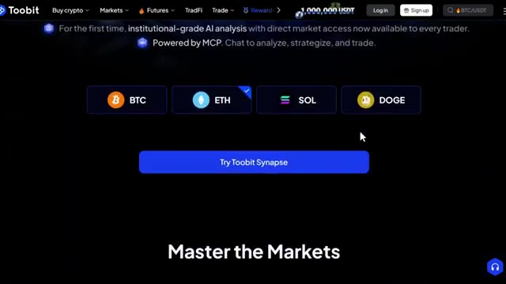
*⏱️ 00:07:56 — Capture d'écran de l'interface de la plateforme Toobit montrant la présentation de 'Toobit Synapse' avec des boutons de sélection pour BTC, ETH, SOL et DOGE.*

*⏱️ 00:08:01 — Capture d'écran d'une page promotionnelle de Toobit en partenariat avec Mister Crypto, affichant des récompenses et un compte à rebours.*

---

### ⏱️ `[00:08:10 - 00:08:34]` | Segment #20

**🔊 Audio (Transcription Intégrale Mot pour Mot en Français) :**
> 30 dollars juste pour l'inscription. Un statut VIP 1 pendant un mois. Des bonus sur les dépôts, des bonus de trading, tout se cumule. L'inscription prend deux minutes et ça en vaut déjà la peine avant même de placer le moindre trade. Si vous voulez aller encore plus loin et voir comment trader réellement sur Tubit, pour les dépôts, les contrats futures, avec la présentation complète de la plateforme, j'ai aussi une vidéo pour ça. Regardez-la à l'écran dès maintenant.

**👁️ Analyse Visuelle d'Écran (gemini-3.5-flash-lite) :**
**Interface & Outils** : Toobit (plateforme d'échange crypto / broker), section

**Contenu textuel & Code** : Explications orales des stratégies et mise en contexte méthodologique du marché.

**Action / Démonstration** : Explications face caméra et analyse conceptuelle des marchés.

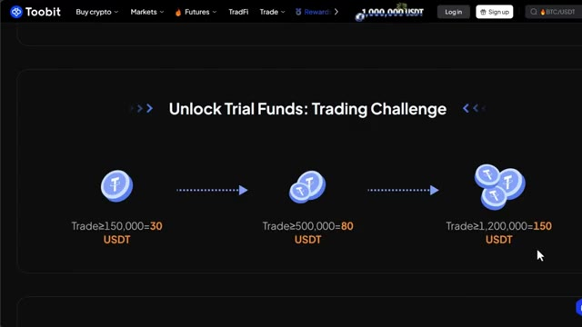
*⏱️ 00:08:16 — Page des récompenses et challenges Toobit ("Unlock Trial Funds") affichant les paliers de bonus en USDT selon le volume de trading.*

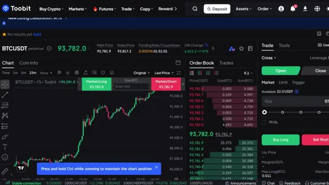
*⏱️ 00:08:22 — Terminal de trading Futures sur Toobit affichant le graphique en bougies 15m de BTCUSDT, le carnet d'ordres et le panneau d'exécution d'ordres.*

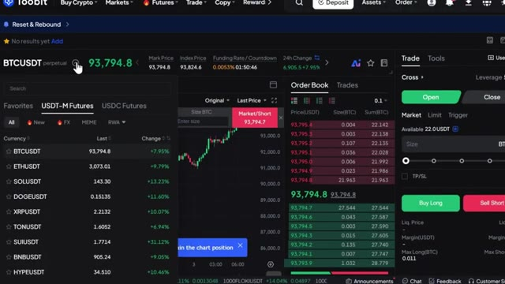
*⏱️ 00:08:28 — Terminal de trading Toobit Futures avec le menu déroulant des contrats USDT-M ouvert (BTC, ETH, SOL, DOGE, XRP, SUI, BNB).*

---

### ⏱️ `[00:08:35 - 00:08:59]` | Segment #21

**🔊 Audio (Transcription Intégrale Mot pour Mot en Français) :**
> Et si vous voulez le guide complet étape par étape sur la façon de construire votre propre système de trading algorithmique en utilisant Claude, cette vidéo apparaît également à l'écran. Allez la voir ensuite. Si cette vidéo a été utile, laissez un pouce bleu, ça aide vraiment la chaîne, abonnez-vous si vous voulez d'autres tutoriels comme celui-ci, je vais couvrir chaque nouvelle fonctionnalité que Bittensor déploie dès sa sortie et je vous vois dans la prochaine.

**👁️ Analyse Visuelle d'Écran (gemini-3.5-flash-lite) :**
**Interface & Outils** : Aucun

**Contenu textuel & Code** : Aucun

**Action / Démonstration** : Aucune

---

