# 🎬 How to Trade 24/7 with Bitget Trading Bots  (Step-by-Step Guide)

> **Chaîne** : [Alex Carter](https://www.youtube.com/@AlexCarterTrading)  
> **Lien YouTube** : [https://www.youtube.com/watch?v=W3E-H8l2HuA](https://www.youtube.com/watch?v=W3E-H8l2HuA)  
> **Date de publication** : 20260626  
> **Durée** : 00:18:00  
> **Identifiant vidéo** : `W3E-H8l2HuA`  
> **Transcription & Analyse** : `whisper-v3-large-turbo+gemini-3.5-flash-lite`  

---

## 📌 Synthèse Exécutive & Outils

### 💡 Résumé
La présente intervention, orchestrée par l'analyste de la chaîne Alex Carter, lève le voile sur l'automatisation complète des stratégies de trading crypto 24h/24 et 7j/7 grâce à l'écosystème de bots de la plateforme Bitget. L'exposé commence par un comparatif pragmatique entre le trader manuel dépendant de ses graphiques et les investisseurs institutionnels ("smart money") qui misent sur l'efficacité algorithmique pour éliminer l'émotion humaine de l'équation. S'adressant aussi bien aux débutants qu'aux opérateurs chevronnés, la vidéo détaille le processus d'onboarding, l'optimisation des bonus de bienvenue (jusqu'à 6 200 USDT) et la sécurisation des dépôts en USDT.

Le cœur de la démonstration repose sur une revue systématique et chirurgicale des différents types de bots disponibles, classés en deux grandes catégories : **Spot** (sans effet de levier) et **Futures** (avec effet de levier). L'analyste décortique les mécanismes fondamentaux des outils phares tels que le *Spot Grid* (idéal pour les marchés en *range*), le *Spot Auto Invest* (DCA passif et multi-actifs), le *Spot Martingale* (lissage du prix d'entrée par paliers de baisse), ainsi que le *Spot Trend Following* (basé sur des indicateurs techniques comme le MACD, le RSI ou les bandes de Bollinger). Chaque configuration est passée au crible — modes manuel vs IA, paramètres arithmétiques vs géométriques, conditions de déclenchement, *take profit*, *stop loss* et options de conservation des actifs.

Enfin, la vidéo met en lumière des fonctionnalités avancées d'optimisation du capital, telles que le transfert automatique des bénéfices, le mode de réinvestissement des grilles, et l'utilisation des portefeuilles intelligents. L'objectif est clairement affiché : fournir un guide étape par étape actionnable pour configurer des stratégies algorithmiques robustes, adaptées à chaque profil de risque et à chaque régime de marché, qu'il soit haussier, baissier ou strictement stagnant.

### 🛠️ Outils, Modèles & Logiciels Présentés
- **Bitget Bots** : Plateforme centralisant plus de 10 types de bots de trading automatisés (Spot et Futures) incluant grilles, DCA, Martingale et suivi de tendance.
- **Spot Grid** : Bot algorithmique plaçant un maillage d'ordres d'achat et de vente dans une fourchette de prix prédéfinie pour capitaliser sur la volatilité latérale.
- **Spot Auto Invest** : Outil de DCA automatisé permettant l'accumulation périodique (horaire, quotidienne, hebdomadaire, mensuelle) de portefeuilles multi-actifs personnalisables.
- **Spot Martingale** : Stratégie de récupération de baisse qui renforce l'exposition par paliers lorsque le prix chute, abaissant le point d'entrée moyen avant de clôturer en bénéfice.
- **Spot Trend Following** : Bot directionnel automatisant l'exécution des ordres en se basant sur des indicateurs techniques majeurs (MACD, RSI, Bandes de Bollinger, Moyennes Mobiles).
- **Grok Bots** : Assistant d'intelligence artificielle intégré (mentionné dans l'introduction globale de la chaîne) pour assister dans la sélection et la conception des stratégies de trading.
- **Claude Code** : Environnement et assistant de code (évoqué dans les compétences de la chaîne) utilisé pour le prototypage ou l'automatisation avancée de scripts de trading.
- **TradingView** : Plateforme de graphisme et d'analyse technique de référence (mentionnée dans l'écosystème global) pour le design et le backtesting de stratégies Pine Script.

### 🔑 Points Clés & Enseignements Stratégiques
- **Dichotomie Spot vs Futures** : Le choix entre les bots Spot (sans effet de levier, axés sur l'accumulation et le risque modéré) et Futures (avec effet de levier, nécessitant une gestion stricte de la volatilité et du risque de liquidation) doit correspondre au profil de risque de l'opérateur.
- **Sécurisation des flux de capitaux** : Lors des transferts de fonds (USDT), la stricte correspondance des réseaux des deux côtés (envoi et réception) est impérative pour éviter la perte définitive des actifs.
- **Exploitation des marchés en range avec le Spot Grid** : Le bot de grille est mathématiquement taillé pour les marchés stagnants ou oscillants, achetant automatiquement bas et revendant haut sans intervention humaine.
- **Arbitrage des modes de grille (Arithmétique vs Géométrique)** : L'espacement arithmétique (intervalles de prix égaux) est idéal pour les plages de prix stables, tandis que l'espacement géométrique (intervalles en pourcentage) s'adapte mieux aux actifs connaissant de fortes variations relatives.
- **Stratégie de sortie et conservation des actifs** : Le choix entre le mode "Vendre tout à la résiliation" (conversion en USDT) et le mode "Conservation" (réinvestissement des profits de grille directement dans l'actif sous-jacent) dépend de l'horizon haussier à long terme de l'utilisateur.
- **Lissage du risque par la Martingale** : Le bot *Spot Martingale* gère les replis de marché en augmentant la taille des ordres de sécurité par paliers de baisse définis, abaissant ainsi le prix d'entrée moyen avant de déclencher un *take profit* en cycle unique.
- **Diversification intelligente avec l'Auto Invest** : Le DCA automatisé permet de sranchiriser le timing de marché en répartissant le capital sur un panier de 10 cryptomonnaies maximum, avec des fréquences paramétrables allant de l'horaire au mensuel.
- **Automatisation technique par le Trend Following** : Déléguer l'exécution à des indicateurs techniques reconnus (MACD, RSI, Bandes de Bollinger, Moyennes Mobiles) permet d'éliminer les biais psychologiques liés à la prise de position manuelle en rupture de tendance.
- **Optimisation des flux de trésorerie** : L'activation de la fonction de transfert automatique des bénéfices permet d'extraire les gains d'arbitrage générés vers le compte principal sans perturber le fonctionnement en cours du bot.
- **Gestion des paramètres avancés** : L'utilisation rigoureuse des conditions de déclenchement, des seuils de *Take Profit* (TP) et de *Stop Loss* (SL), ainsi que du glissement limité (*slippage*), constitue la pierre angulaire d'un bon *Risk Management* algorithmique.

---

## ⏱️ Chronologie & Transcription Complète Audio & Visuelle (Mot pour Mot)

### ⏱️ `[00:00:00 - 00:00:36]` | Segment #01

**🔊 Audio (Transcription Intégrale Mot pour Mot en Français) :**
> La plupart des traders sont encore assis devant leurs écrans, à observer les bougies, en attendant le point d'entrée parfait. Pendant ce temps, les "smart money" ont configuré un bot il y a trois semaines et n'y ont plus touché depuis. BitGet propose plus de 10 bots de trading différents, et dans cette vidéo, je vais vous les présenter un par un, étape par étape, afin que vous puissiez choisir le bon et le lancer en quelques minutes. Que vous souhaitiez exploiter des marchés stagnants avec un bot de grille, faire du DCA automatiquement, ou laisser l'IA choisir la stratégie à votre place. Tout est là. Entrons dans le vif du sujet. Avant de plonger dans le vif du sujet, si vous n'avez pas encore de compte BitGet, cliquez sur le lien dans la description ci-dessous. Et je tiens à être très clair ici.

**👁️ Analyse Visuelle d'Écran (gemini-3.5-flash-lite) :**
**Interface & Outils** : Interface web de la plateforme d'échange de cryptomonnaies BitGet (section bots de trading).

**Contenu textuel & Code** : Graphique de prix, statistiques de performance de bots (ROI jusqu'à +22599.94%, APY backtestés, max drawdown, durée d'exécution) et options de configuration de bots (Spot, Futures, IA).

**Action / Démonstration** : Navigation et présentation des différents types de bots de trading automatisés disponibles sur la plateforme BitGet, avec sélection et tri des performances.

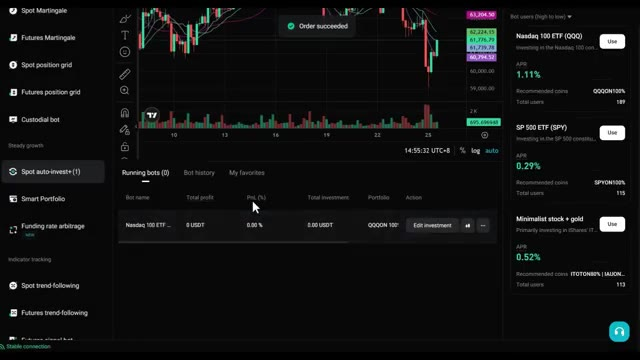
*⏱️ 00:00:09 — Interface de la plateforme BitGet affichant un graphique de bougies japonaises en haut et les options de bots de trading spot sur le panneau de gauche.*

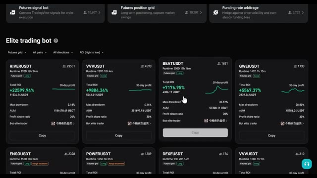
*⏱️ 00:00:18 — Section "Elite trading bot" montrant plusieurs cartes de bots avec leurs performances de rendement (ROI), de durée d'exécution et de drawdown.*

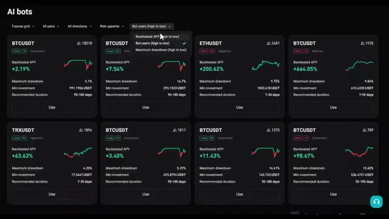
*⏱️ 00:00:27 — Section "AI bots" présentant une grille de bots de trading propulsés par l'IA avec leurs APY backtestés et un menu déroulant de tri.*

---

### ⏱️ `[00:00:36 - 00:01:15]` | Segment #02

**🔊 Audio (Transcription Intégrale Mot pour Mot en Français) :**
> Il y a beaucoup de sites frauduleux qui se font passer pour BitGit. Mon lien ci-dessous, assurez-vous d'atterrir sur le vrai. Maintenant, les nouveaux utilisateurs qui s'inscrivent via mon lien peuvent obtenir jusqu'à 6 200 USDT de bonus. Et voici exactement à quoi cela ressemble. Vous obtenez un bon de boost de position de contrats à terme Bitcoin de 200 USDT rien qu'en vous connectant pendant trois jours consécutifs durant votre période de débutant. C'est fondamentalement de l'argent gratuit juste pour vous être connecté. Ensuite, il y a un défi de dépôt et de trading. En commençant à partir de seulement 50 USDT, vous pouvez gagner jusqu'à 6 000 USDT en atteignant des objectifs de dépôt net, de volume de trading au comptant,

**👁️ Analyse Visuelle d'Écran (gemini-3.5-flash-lite) :**
**Interface & Outils** : Site web de l'échange de cryptomonnaies Bitget (Rewards Center).

**Contenu textuel & Code** : Texte promotionnel indiquant 'Get up to 6,200 USDT in new user rewards', ainsi que les tâches de dépôt et de volume de trading (Net deposit, Spot trading volume, Futures trading volume).

**Action / Démonstration** : Navigation et présentation des pages de bonus et de récompenses pour nouveaux utilisateurs sur Bitget.

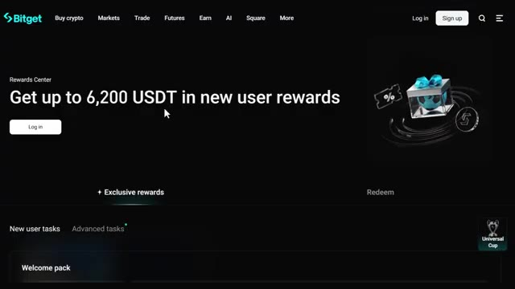
*⏱️ 00:00:46 — Capture d'écran du site Bitget montrant le centre de récompenses pour les nouveaux utilisateurs avec une offre de bonus de 6 200 USDT.*

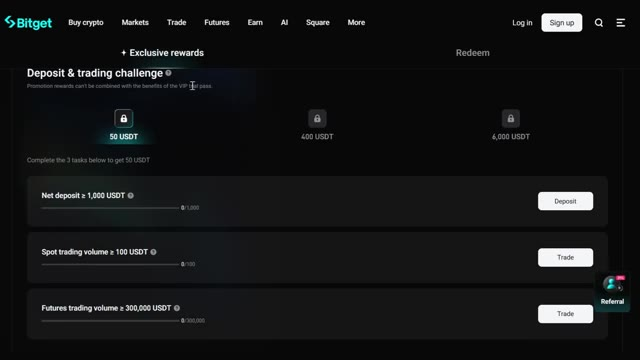
*⏱️ 00:01:05 — Capture d'écran du site Bitget détaillant le défi de dépôt et de trading avec différentes tâches et paliers de récompense en USDT.*

---

### ⏱️ `[00:01:15 - 00:01:51]` | Segment #03

**🔊 Audio (Transcription Intégrale Mot pour Mot en Français) :**
> et des jalons de volume de trading sur les contrats à terme. Et en plus de cela, vous pouvez gagner jusqu'à 120 % de taux annuel effectif global pendant trois jours si vous investissez jusqu'à 1 000 USDT. Tout cela vous appartient, mais seulement si vous vous inscrivez en utilisant mon lien ci-dessous. Je vous montrerai exactement comment réclamer ces avantages à la fin de la vidéo. Une fois que vous êtes connecté, assurez-vous d'avoir des fonds sur votre compte. Survolez simplement l'icône de votre profil, cliquez sur dépôt, sélectionnez USDT, choisissez votre réseau et envoyez vos fonds, assurez-vous que le réseau correspond des deux côtés, à l'envoi et à la réception, c'est important, si vous vous trompez là-dessus, vous pourriez perdre vos fonds, vos fonds.

**👁️ Analyse Visuelle d'Écran (gemini-3.5-flash-lite) :**
**Interface & Outils** : Bitget (échange de cryptomonnaies)

**Contenu textuel & Code** : Offres promotionnelles "Earn" (120 % 3-day APR), bonus de bienvenue de 6 200 USDT, options de dépôt de cryptomonnaies (USDT, réseau TRC20).

**Action / Démonstration** : Navigation sur l'interface d'inscription et de dépôt de la bourse Bitget.

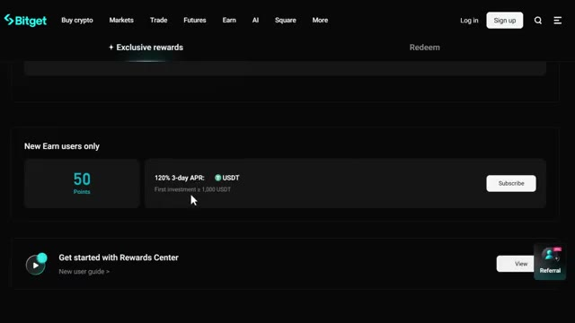
*⏱️ 00:01:24 — Interface Bitget montrant les récompenses "New Earn users only" avec une offre de 120 % d'APR sur 3 jours pour les nouveaux utilisateurs investissant jusqu'à 1 000 USDT.*

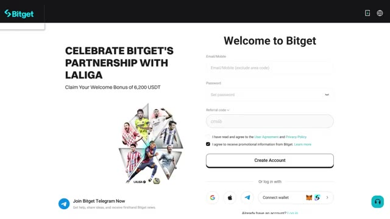
*⏱️ 00:01:33 — Page d'inscription de Bitget mettant en avant le partenariat avec la Liga et un bonus de bienvenue de 6 200 USDT avec un champ pour code de parrainage.*

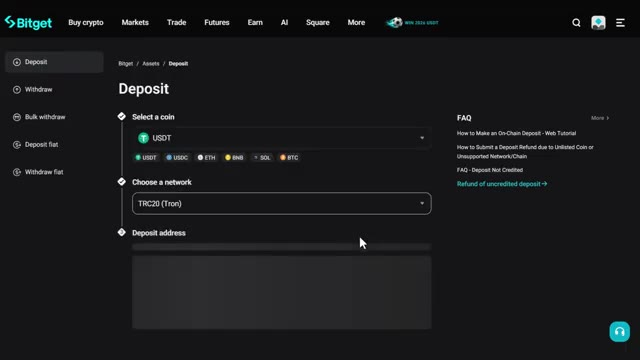
*⏱️ 00:01:42 — Interface de dépôt de la plateforme Bitget permettant de sélectionner une cryptomonnaie (USDT, USDC, ETH, etc.) et un réseau blockchain (TRC20).*

---

### ⏱️ `[00:01:51 - 00:02:26]` | Segment #04

**🔊 Audio (Transcription Intégrale Mot pour Mot en Français) :**
> généralement arriver en quelques minutes et ensuite nous pouvons commencer à automatiser dirigez-vous vers trade sur la barre de navigation supérieure faites défiler un peu vers le bas sur le menu déroulant et sélectionnez bots juste ici vous pouvez voir deux catégories principales spot et futures spot signifie que vous faites tourner un bot sans effet de levier futures signifie que vous avez un effet de levier disponible et vous pouvez choisir avec lequel vous voulez travailler juste ici sous spot vous trouverez spot grid spot martingale spot auto invest spot trend following et smart portfolio sous futures vous trouverez futures grid futures martingale futures trend following funding rate arbitrage

**👁️ Analyse Visuelle d'Écran (gemini-3.5-flash-lite) :**
**Interface & Outils** : Site web de l'échange de cryptomonnaies Bitget

**Contenu textuel & Code** : Menu de navigation affichant les options Spot, Margin, Onchain, Convert, Launchhub, Copy et Bots, ainsi qu'un sous-menu pour les bots de trading (Spot et Futures).

**Action / Démonstration** : Le curseur de la souris survole l'option 'Bots' dans le menu déroulant de la section Trade.

*⏱️ 00:02:00 — Capture d'écran de l'interface de la plateforme Bitget montrant le menu déroulant de l'onglet Trade avec l'option 'Bots' sélectionnée.*

---

### ⏱️ `[00:02:26 - 00:03:01]` | Segment #05

**🔊 Audio (Transcription Intégrale Mot pour Mot en Français) :**
> bot de signal de futures et grille de position de futures avant d'entrer dans chaque bot cliquez sur aperçu en haut cela vous donne une vue d'ensemble de tout en haut vous pouvez voir vos actifs totaux le PNL d'aujourd'hui et combien de bots en cours d'exécution vous avez actuellement faites défiler un peu vers le bas et vous verrez la section des bots recommandés juste à côté c'est là que vous trouverez tous les bots au comptant et de futures répertoriés nous couvrirons chacun d'eux dans un instant faites défiler un peu plus vers le bas et vous verrez les bots de trading d'élite ce sont les bots les plus performants de la plateforme mis à jour toutes les heures avec de très

**👁️ Analyse Visuelle d'Écran (gemini-3.5-flash-lite) :**
**Interface & Outils** : Plateforme d'échange de crypto-monnaies Bitget (section Trading Bots).

**Contenu textuel & Code** : Actifs totaux (0.0000 USDT), PNL du jour (-0.0107 USDT), bots en cours (0), options de bots (Spot grid, Futures trend-following, Spot Martingale, Futures grid) et classement des bots élites.

**Action / Démonstration** : Navigation et défilement sur la page de présentation des bots de trading automatisés.

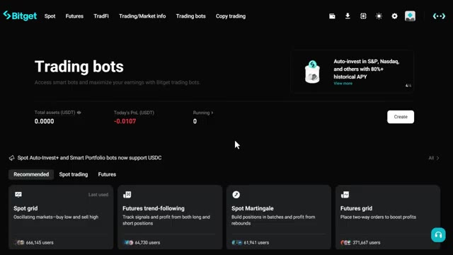
*⏱️ 00:02:35 — Interface Bitget affichant la section 'Trading bots' avec un aperçu des actifs totaux, du PNL et des catégories de bots recommandés.*

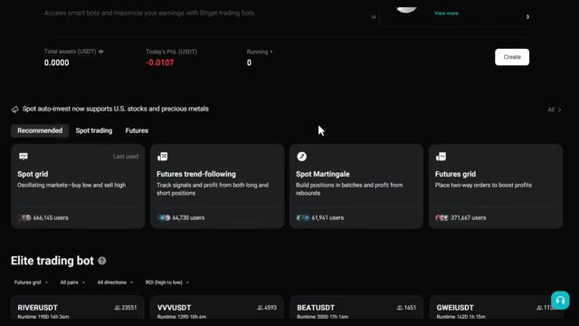
*⏱️ 00:02:44 — Défilement de l'interface Bitget révélant la section 'Elite trading bot' avec des exemples de performances par paires de crypto-monnaies.*

---

### ⏱️ `[00:03:01 - 00:03:37]` | Segment #06

**🔊 Audio (Transcription Intégrale Mot pour Mot en Français) :**
> des critères stricts définis par BitGit. Vous pouvez basculer et trier ceux-ci par type, paire, direction, ROI, PNL, nombre de copieurs et prélèvement. Vous pouvez voir la paire, le type de bot, la direction, le temps d'exécution, le ROI en pourcentage et en USDT, la courbe d'équité, le prélèvement maximum, l'AUM, le ratio de partage des profits et le trader derrière celui-ci. Faites défiler un peu plus bas et vous verrez la section des bots IA. Les mêmes options de tri ici, plus deux supplémentaires : l'appétit pour le risque et les utilisateurs du bot. Vous pouvez également voir l'APY testé rétrospectivement, le prélèvement maximum,

**👁️ Analyse Visuelle d'Écran (gemini-3.5-flash-lite) :**
**Interface & Outils** : Interface web de l'échange BitGit (section Elite trading bot)

**Contenu textuel & Code** : Menus de tri (ROI, PNL, Copieurs, Drawdown), paires affichées (RIVERUSDT, BEATUSDT, GWEIUSDT), pourcentages de ROI, montants en USDT, temps d'exécution (Runtime) et courbes d'équité.

**Action / Démonstration** : Sélection et affichage du menu déroulant pour trier les bots de trading selon différents critères de performance.

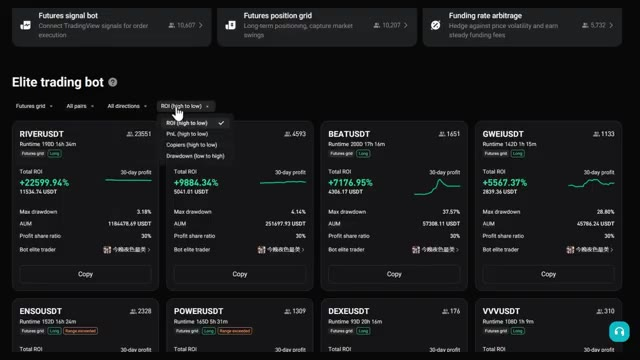
*⏱️ 00:03:10 — Capture d'écran montrant l'interface des bots de trading élite de BitGit avec les options de tri et les performances des différents bots.*

---

### ⏱️ `[00:03:38 - 00:03:59]` | Segment #07

**🔊 Audio (Transcription Intégrale Mot pour Mot en Français) :**
> investissement minimum requis pour copier le bot, et la durée recommandée. Et tout en bas, Bitget propose un cours accéléré sur tous les bots. Idéal pour une lecture rapide si vous voulez approfondir l'un d'entre eux. Passons maintenant à chaque bot un par un. Retournez en haut de la page et cliquez sur Spot Trading. Le bot Spot Grid est l'un des bots les plus populaires de la plateforme. Le principe est simple.

**👁️ Analyse Visuelle d'Écran (gemini-3.5-flash-lite) :**
**Interface & Outils** : Plateforme d'échange de cryptomonnaies Bitget (section Trading Bots / Academy).

**Contenu textuel & Code** : Statistiques de bots de trading (ROI > 3000%, runtimes en jours, AUM, max drawdown).

**Action / Démonstration** : Navigation dans l'interface de sélection des bots et consultation des tutoriels de la plateforme.

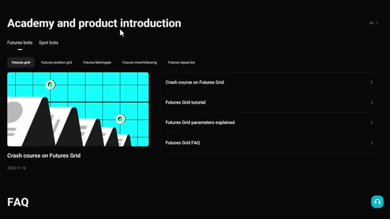
*⏱️ 00:03:43 — Interface de la section Académie et introduction aux produits avec un tutoriel sur les Futures Grid.*

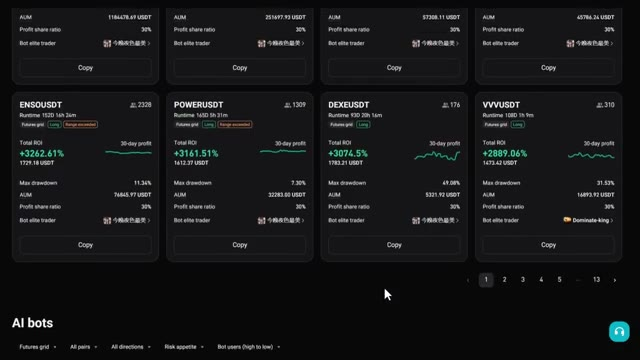
*⏱️ 00:03:48 — Liste de bots de trading (AI bots) affichant les performances ROI et la durée d'exécution (runtime).*

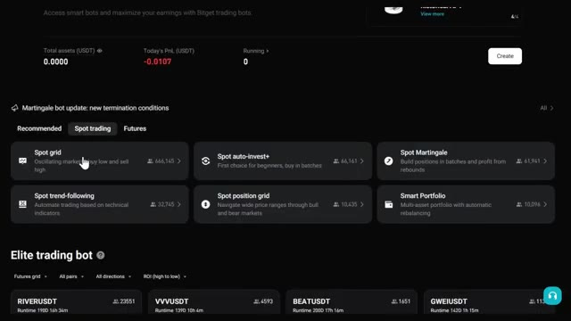
*⏱️ 00:03:54 — Tableau de bord Bitget présentant les différentes catégories de bots de trading Spot et Futures.*

---

### ⏱️ `[00:03:59 - 00:04:24]` | Segment #08

**🔊 Audio (Transcription Intégrale Mot pour Mot en Français) :**
> Il place une série d'ordres d'achat et de vente dans une fourchette de prix. Il achète bas et vend haut automatiquement à mesure que le prix monte et descend. Cela fonctionne mieux sur les marchés stagnants ou en range, où le prix ne cesse de rebondir entre les niveaux. Cliquez sur Spot Grid. Vous verrez une interface de trading avec le graphique au milieu, les bots listés à gauche, un sélecteur de paires en haut à gauche, et les options de mode IA et manuel à droite.

**👁️ Analyse Visuelle d'Écran (gemini-3.5-flash-lite) :**
**Interface & Outils** : Interface de la plateforme d'échange Bitget (section Trading Bots / Spot grid).

**Contenu textuel & Code** : Options de bots de trading (Spot grid, Spot auto-invest+, Spot Martingale, Spot trend-following), graphique des prix Bitcoin (BTC/USDT) en unités 4H, et performances de stratégies de bots (APY backtesté, drawdown maximum).

**Action / Démonstration** : Sélection de la fonctionnalité 'Spot grid' puis navigation vers l'interface de configuration du bot pour BTC/USDT.

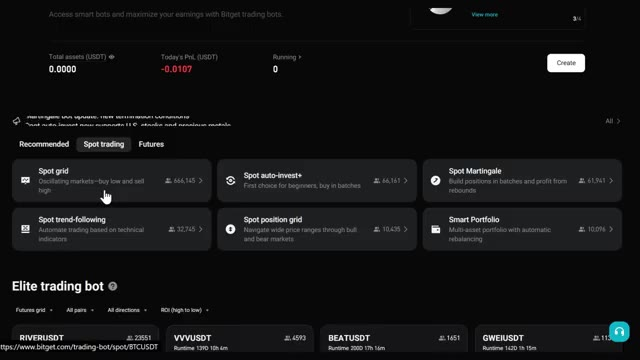
*⏱️ 00:04:05 — Interface Bitget affichant les différents types de bots de trading spot, avec le curseur sur 'Spot grid'.*

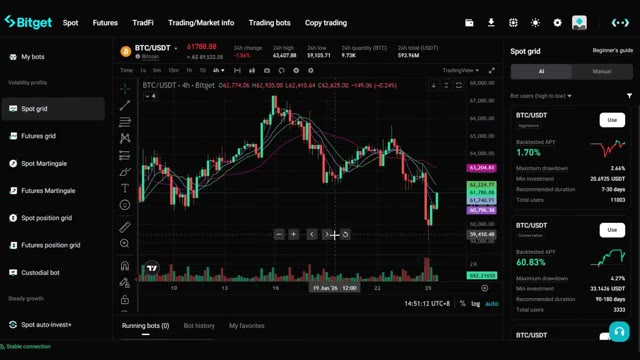
*⏱️ 00:04:18 — Interface de configuration du 'Spot grid' sur Bitget montrant un graphique des prix BTC/USDT en arrière-plan avec des options de stratégie IA ou manuelle.*

---

### ⏱️ `[00:04:24 - 00:04:56]` | Segment #09

**🔊 Audio (Transcription Intégrale Mot pour Mot en Français) :**
> Vos bots de course apparaissent en bas. À la fois les bots créés par vous-même et les bots de copy trading. Les bots IA que vous avez vus sur la page de vue d'ensemble sont ici aussi avec toutes les mêmes statistiques. Si vous voulez en utiliser un, cliquez simplement sur utiliser en haut à droite de n'importe quel bot IA. Il vous montrera la grille, tous les niveaux de prix où le bot placera des ordres d'achat et de vente. Tout ce que vous avez à faire est de définir votre montant d'investissement et vous avez terminé. Vous verrez également deux options ici. Vendre tout à la résiliation, ce qui signifie que lorsque vous arrêtez le bot, il vendra tous vos avoirs.

**👁️ Analyse Visuelle d'Écran (gemini-3.5-flash-lite) :**
**Interface & Outils** : Bitget (Trading bots / Spot grid)

**Contenu textuel & Code** : Graphique BTC/USDT en timeframe 4h, liste des configurations de bots spot grid avec métriques (Backtested APY de 1.70% et 60.83%, drawdowns, investissement min).

**Action / Démonstration** : Navigation et présentation des bots de trading automatisés et des stratégies IA sur Bitget.

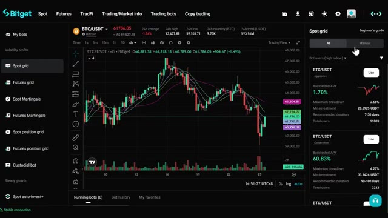
*⏱️ 00:04:32 — Interface de la plateforme Bitget montrant la section des bots de trading avec les options de grille Spot et les performances des bots AI.*

---

### ⏱️ `[00:04:56 - 00:05:31]` | Segment #10

**🔊 Audio (Transcription Intégrale Mot pour Mot en Français) :**
> de retour en mode USDT et conservation, qui s'utilise lorsque vous êtes haussier sur la cryptomonnaie à long terme. En mode conservation, les profits de la grille sont utilisés pour acheter davantage de l'actif au prix du marché au lieu d'être convertis en USDT. C'est idéal si vous souhaitez accumuler pendant que le bot fonctionne. Une fois que vous avez défini votre montant d'investissement, cliquez sur créer et confirmez. Vous pouvez le voir s'exécuter dans votre section de bots en cours. Si vous préférez une approche plus manuelle, vous pouvez définir votre propre plage de prix, le nombre de grilles, et choisir entre le type de grille arithmétique ou géométrique. L'arithmétique espace les grilles de manière égale en prix. C'est bien pour les plages stables.

**👁️ Analyse Visuelle d'Écran (gemini-3.5-flash-lite) :**
**Interface & Outils** : Bitget (Trading Bots, Spot Grid)

**Contenu textuel & Code** : Paire BTC/USDT, fourchette de prix 53684.17 - 68315.83, 26 grilles arithmétiques, mode HODL activable.

**Action / Démonstration** : Configuration et lancement d'un bot de trading sur grille avec explication du mode de conservation (HODL).

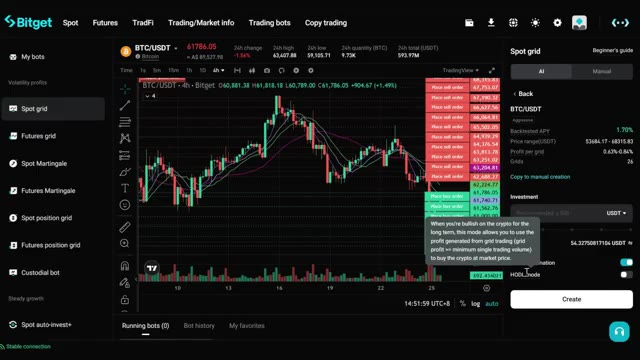
*⏱️ 00:05:05 — Interface Bitget montrant la configuration d'un bot Spot Grid pour BTC/USDT avec une info-bulle explicative sur le mode HODL.*

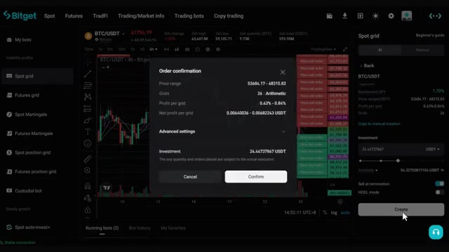
*⏱️ 00:05:14 — Fenêtre modale de confirmation d'ordre sur Bitget affichant les paramètres du bot Grid avant le lancement.*

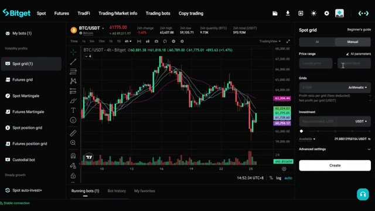
*⏱️ 00:05:23 — Interface de création manuelle d'un bot Spot Grid sur Bitget avec les champs de prix et de grilles vides.*

---

### ⏱️ `[00:05:32 - 00:05:52]` | Segment #11

**🔊 Audio (Transcription Intégrale Mot pour Mot en Français) :**
> Les espaces géométriques les répartissent par pourcentage. C'est mieux pour les actifs qui connaissent des variations en pourcentage plus importantes. Saisissez votre montant d'investissement et cliquez sur créer. Vous pouvez également consulter les paramètres avancés. Des éléments tels que la condition de départ, la condition de fin, le take profit et le stop loss, le slippage, la grille suiveuse, ainsi que les mêmes options de vente à la fin et de mode de conservation.

**👁️ Analyse Visuelle d'Écran (gemini-3.5-flash-lite) :**
**Interface & Outils** : Interface de l'échange de cryptomonnaies Bitget (Spot Grid Bot).

**Contenu textuel & Code** : Configuration de bot Spot Grid (types de grille arithmétique ou géométrique, investissement en USDT, paramètres avancés : conditions de déclenchement, TP/SL, trailing grid) et graphique de prix BTC/USDT en unités 4h.

**Action / Démonstration** : Sélection du type de grille géométrique dans le panneau de configuration puis visualisation des paramètres avancés et des bots en cours d'exécution.

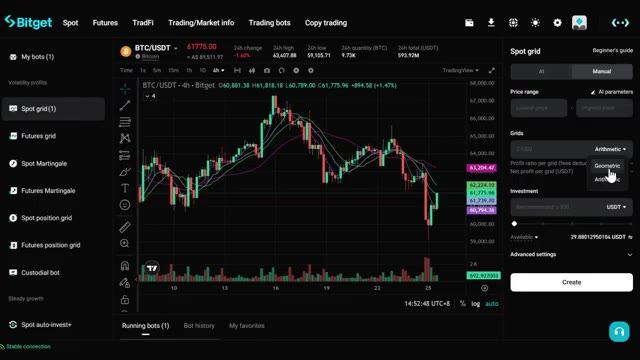
*⏱️ 00:05:37 — Interface de la plateforme Bitget montrant la configuration d'un bot de trading Spot Grid avec le menu déroulant du type de grille ouvert.*

*⏱️ 00:05:47 — Interface Bitget montrant les paramètres avancés de création d'un bot de grille et le panneau inférieur des bots en cours d'exécution.*

---

### ⏱️ `[00:05:53 - 00:06:14]` | Segment #12

**🔊 Audio (Transcription Intégrale Mot pour Mot en Français) :**
> Il y a aussi le transfert automatique des bénéfices. Une fois activé, chaque profit d'arbitrage généré est automatiquement transféré sur votre compte principal. Aucun retrait manuel n'est nécessaire, et les bénéfices ne seront pas réinvestis. Spot Auto Invest est un excellent choix pour les débutants. Au lieu d'essayer de chronométrer le marché, vous achetez par lots automatiquement, ce que l'on appelle aussi la moyenne d'achat en dollars.

**👁️ Analyse Visuelle d'Écran (gemini-3.5-flash-lite) :**
**Interface & Outils** : Interface web de la plateforme de trading Bitget (section Bots de trading).

**Contenu textuel & Code** : Paramètres avancés du bot incluant les options de déclenchement, Take Profit / Stop Loss, et transfert automatique des bénéfices.

**Action / Démonstration** : Navigation et configuration des paramètres d'un bot de trading Spot Auto Invest.

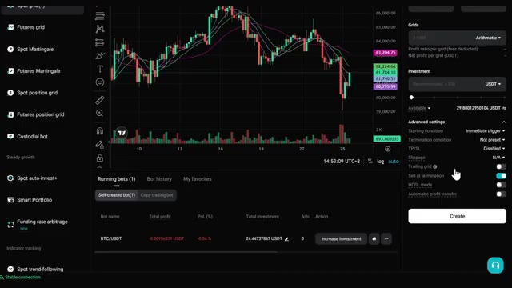
*⏱️ 00:05:58 — Interface de configuration d'un bot de trading avec panneau de graphiques au centre et options avancées sur le panneau latéral droit.*

---

### ⏱️ `[00:06:14 - 00:06:34]` | Segment #13

**🔊 Audio (Transcription Intégrale Mot pour Mot en Français) :**
> Vous le configurez, vous l'oubliez et vous accumulez au fil du temps. Ici, vous pouvez voir des portefeuilles recommandés, allant de ceux inspirés du NASDAQ au S&P 500, jusqu'à un mélange minimaliste d'actions et d'or. Vous pouvez voir le taux annuel en pourcentage (APR), les cryptomonnaies recommandées et le nombre total d'utilisations pour chacun d'eux. Cliquez sur « Utiliser » sur l'un d'eux et cela vous amène à la configuration manuelle. Vous pouvez voir la paire et la répartition.

**👁️ Analyse Visuelle d'Écran (gemini-3.5-flash-lite) :**
**Interface & Outils** : Interface de la plateforme d'échange Bitget, section des bots de trading (Spot auto-invest+).

**Contenu textuel & Code** : Portefeuilles recommandés (Nasdaq 100 ETF avec 1.11% APR, S&P 500 ETF avec 0.29% APR, et Minimalist stock + gold avec 0.52% APR).

**Action / Démonstration** : Navigation et présentation des différents portefeuilles d'investissement automatique et de leurs taux de rendement (APR) sur Bitget.

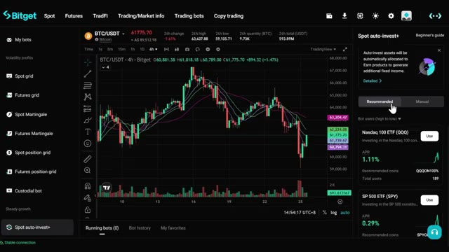
*⏱️ 00:06:19 — Interface Bitget affichant le menu Spot auto-invest+ avec les options de portefeuilles recommandés comme le Nasdaq 100 ETF (QQQ) et le SP 500 ETF (SPY) ainsi que leurs APR respectifs.*

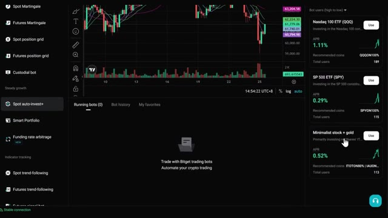
*⏱️ 00:06:24 — Suite du panneau latéral sur Bitget montrant les options de portefeuilles d'investissement automatique, incluant le portefeuille Minimalist stock + gold et ses détails.*

---

### ⏱️ `[00:06:34 - 00:06:55]` | Segment #14

**🔊 Audio (Transcription Intégrale Mot pour Mot en Français) :**
> Vous pouvez ajouter jusqu'à 10 pièces en cliquant sur le bouton Ajouter en haut à droite. Le ratio restant vous montre comment la répartition est divisée. Il doit toujours être égal à 100 %. Ensuite, définissez votre investissement par transaction, puis définissez votre fréquence d'investissement. Mensuelle, hebdomadaire, quotidienne ou horaire. Vous pouvez également définir l'heure locale à laquelle l'achat s'exécute.

**👁️ Analyse Visuelle d'Écran (gemini-3.5-flash-lite) :**
**Interface & Outils** : Interface de l'échange de cryptomonnaies Bitget (Spot auto-invest+ / Trading bots).

**Contenu textuel & Code** : Allocation de crypto à 100% (QQQON), ratio restant à 0%, montant d'investissement par transaction en USDT, et sélecteur de fréquence d'investissement (Monthly, Weekly, Daily, Hourly).

**Action / Démonstration** : Configuration des paramètres de l'investissement automatique (Auto-invest) en sélectionnant la fréquence et le montant des transactions.

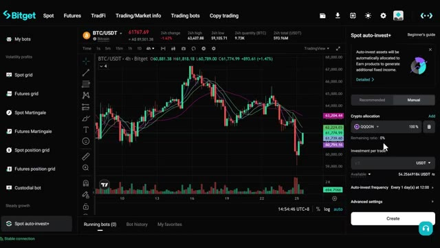
*⏱️ 00:06:39 — Interface de la plateforme Bitget montrant le menu 'Spot auto-invest+' avec le graphique du Bitcoin en arrière-plan et les paramètres d'allocation de crypto.*

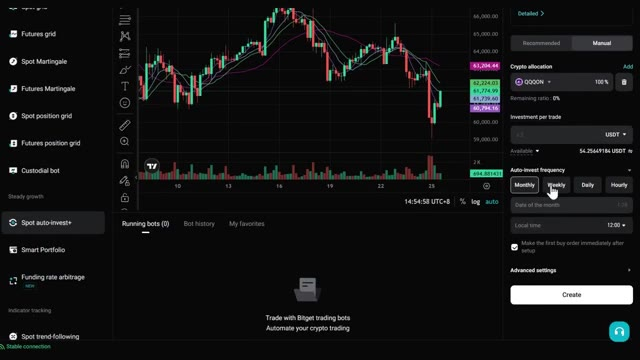
*⏱️ 00:06:50 — Gros plan sur les paramètres de l'outil 'Spot auto-invest+' sur Bitget, mettant en évidence les options de configuration de la fréquence d'investissement (mensuelle, hebdomadaire, quotidienne, horaire).*

---

### ⏱️ `[00:06:55 - 00:07:17]` | Segment #15

**🔊 Audio (Transcription Intégrale Mot pour Mot en Français) :**
> Il y a une option pour passer le premier ordre d'achat immédiatement après la configuration si vous voulez commencer tout de suite. Dans les paramètres avancés, vous pouvez modifier le nom du plan d'investissement et définir une fourchette de prix pour l'exécution des achats. Une fois que c'est fait, cliquez sur Créer. Le Spot Martingale est un bot qui achète automatiquement plus d'un actif à mesure que le prix baisse, ce qui réduit votre prix d'entrée moyen, puis prend ses bénéfices lorsque le prix se redresse.

**👁️ Analyse Visuelle d'Écran (gemini-3.5-flash-lite) :**
**Interface & Outils** : Interface de la plateforme d'échange de crypto-monnaies Bitget (section Bots de trading).

**Contenu textuel & Code** : Paramètres de configuration du bot Spot auto-invest+, allocation d'actifs, fréquence d'investissement, fourchette de prix et options avancées.
[HON] Configuration et paramétrage d'un plan d'investissement automatisé (DCA) avec définition d'une fourchette de prix et d'un premier ordre immédiat.

**Action / Démonstration** : Explications face caméra et analyse conceptuelle des marchés.

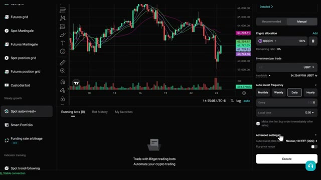
*⏱️ 00:07:00 — Interface Bitget montrant les paramètres avancés de Spot auto-invest avec l'option de premier ordre d'achat immédiat cochée.*

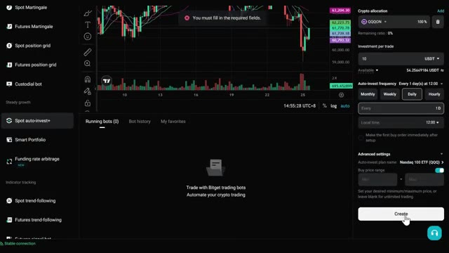
*⏱️ 00:07:06 — Interface Bitget avec les paramètres avancés développés affichant le nom du plan et la fourchette de prix d'achat.*

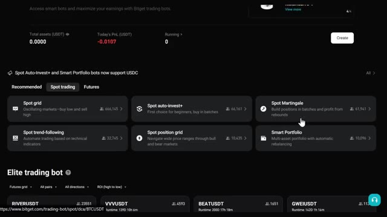
*⏱️ 00:07:11 — Vue d'ensemble de la page d'accueil des bots de trading de Bitget listant les différentes stratégies disponibles.*

---

### ⏱️ `[00:07:17 - 00:07:52]` | Segment #16

**🔊 Audio (Transcription Intégrale Mot pour Mot en Français) :**
> Il est conçu pour récupérer des baisses automatiquement. Tout comme SpotGrid, vous pouvez utiliser les bots IA ou passer directement au manuel. En manuel, vous avez deux options, normal et inversé. Le mode normal achète davantage à mesure que le prix baisse et prend des bénéfices à la hausse. Le mode inversé fait le contraire. Il vend davantage à mesure que le prix monte et rachète à la baisse, ce qui est utile pour les configurations baissières. Vous avez une condition de déclenchement basée sur des paliers de baisse de prix, cela définit de combien le prix doit baisser avant que le bot n'ajoute à votre position. L'objectif de take profit en cycle unique est le

**👁️ Analyse Visuelle d'Écran (gemini-3.5-flash-lite) :**
**Interface & Outils** : Bitget (Trading bots - Spot Martingale)

**Contenu textuel & Code** : Graphique en chandeliers BTC/USDT en unité 4h, options de configuration manuelle ("Normal" / "Reverse"), paramètres de déclenchement (Price drop steps, TP target) et de taille d'investissement (Base order size, Safety order size).

**Action / Démonstration** : Sélection du mode manuel pour le bot Spot Martingale sur la plateforme Bitget.

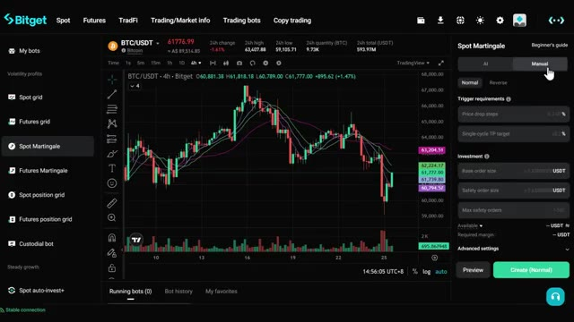
*⏱️ 00:07:26 — Capture d'écran de l'interface de l'échangeur Bitget montrant la configuration d'un bot Spot Martingale pour la paire BTC/USDT.*

---

### ⏱️ `[00:07:52 - 00:08:10]` | Segment #17

**🔊 Audio (Transcription Intégrale Mot pour Mot en Français) :**
> pourcentage de profit auquel le bot clôture le cycle et prend ses bénéfices sous l'investissement vous avez trois paramètres clés la taille de l'ordre de base le montant de l'achat initial lorsque le bot démarre la taille de l'ordre de sécurité la quantité que le bot ajoute chaque fois que le prix baisse d'un palier, le nombre maximal d'ordres de sécurité, le nombre maximal de fois que le bot ajoutera à la position.

**👁️ Analyse Visuelle d'Écran (gemini-3.5-flash-lite) :**
**Interface & Outils** : Plateforme d'échange Bitget (Trading bots - Spot Martingale)

**Contenu textuel & Code** : Graphique TradingView BTC/USDT en unités 4h, paramètres de configuration du bot incluant "Base order quantity" et "Safety order quantity".

**Action / Démonstration** : Présentation et explication des paramètres clés du bot Spot Martingale (taille de l'ordre de base, ordre de sécurité, TP target).

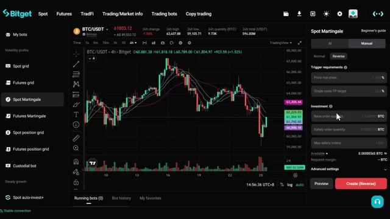
*⏱️ 00:07:57 — Interface de configuration du bot de trading Spot Martingale sur la plateforme Bitget montrant les paramètres de base, d'ordres de sécurité et de prise de bénéfices.*

---

### ⏱️ `[00:08:12 - 00:08:40]` | Segment #18

**🔊 Audio (Transcription Intégrale Mot pour Mot en Français) :**
> Dans les paramètres avancés, vous pouvez configurer la méthode de calcul du take-profit, le nombre de cycles, la condition de démarrage, les paramètres de sécurité incluant le levier, la condition de fin, la condition de stop-loss, la vente de tout à la fin, et le renouvellement automatique avec les profits, ce qui redémarre automatiquement le bot en utilisant les profits du cycle précédent. Une fois que c'est fait, cliquez sur créer et il apparaîtra dans vos bots en cours. Spot Trend Following vous permet d'automatiser le trading sur la base d'indicateurs techniques.

**👁️ Analyse Visuelle d'Écran (gemini-3.5-flash-lite) :**
**Interface & Outils** : Bitget (Trading bot interface - Spot Martingale)

**Contenu textuel & Code** : Paramètres avancés de trading : calcul du take-profit, nombre de cycles (infini), conditions de démarrage, paramètres de sécurité, stop-loss, et récapitulatif d'investissement (2.03 USDT).

**Action / Démonstration** : Configuration des paramètres avancés du bot de trading Martingale et clic sur le bouton de création/confirmation.

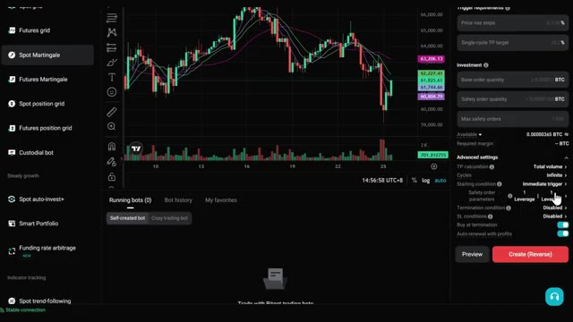
*⏱️ 00:08:19 — Interface Bitget affichant les paramètres avancés de configuration d'un bot Spot Martingale (TP calculation, cycles, safety order parameters, SL conditions, etc.) avec un graphique de prix en arrière-plan.*

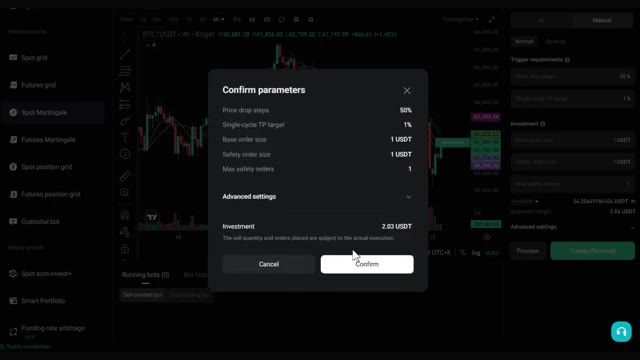
*⏱️ 00:08:33 — Fenêtre modale de confirmation des paramètres du bot (Price drop steps, Single-cycle TP target, Base order size, Investment total de 2.03 USDT).*

---

### ⏱️ `[00:08:40 - 00:09:17]` | Segment #19

**🔊 Audio (Transcription Intégrale Mot pour Mot en Français) :**
> Donc, au lieu de surveiller les graphiques vous-même, le bot lit les signaux et les exécute pour vous. Sur le côté droit, vous pouvez voir les meilleurs bots et quel indicateur technique ils utilisent. Vous pouvez choisir entre le MACD, les bandes de Bollinger, la moyenne mobile et le RSI. Cliquez sur Utiliser sur le bot de votre choix et cela vous amène au formulaire de placement d'ordre. Vous pouvez voir toutes les informations détaillées. Le rendement annuel en pourcentage (APY) testé rétrospectivement, l'horizon temporel, le prélèvement maximal, le nombre de transactions et le taux de réussite. Saisissez votre montant d'investissement et cliquez sur créer. Dans les paramètres avancés, vous pouvez définir la prise de profit et le stop-loss avec l'option de vendre.

**👁️ Analyse Visuelle d'Écran (gemini-3.5-flash-lite) :**
**Interface & Outils** : Plateforme d'échange de cryptomonnaies Bitget (section Trading bots / Spot trend-following)

**Contenu textuel & Code** : Graphique de prix BTC/USDT (61746.00$), indicateur Bollinger Bands (BOLL 20,2), indicateur MACD (12,26,9), et panneau latéral affichant les meilleurs bots classés (MACD-4H) avec leurs performances de backtest (59.00% APY, 43.80% APY) et boutons d'utilisation ("Use").

**Action / Démonstration** : Sélection ou survol d'un bot de trading automatisé basé sur l'indicateur MACD sur le panneau de droite de la plateforme Bitget.

*⏱️ 00:08:49 — Interface de trading de la plateforme Bitget montrant un graphique des prix de la paire BTC/USDT en unités de 4 heures avec les indicateurs techniques des bandes de Bollinger et du MACD, ainsi que le panneau latéral des bots de trading de suivi de tendance.*

---

### ⏱️ `[00:09:17 - 00:09:54]` | Segment #20

**🔊 Audio (Transcription Intégrale Mot pour Mot en Français) :**
> à la clôture à nouveau. La grille de position au comptant est similaire à la grille au comptant mais conçue pour la constitution de positions. Elle vous aide à accumuler une position progressivement sur une fourchette de prix plutôt que de simplement trader en entrées et sorties. Au moment de ce enregistrement, il n'y a pas de bots en direct disponibles à copier pour celui-ci, mais la configuration est la même que pour la grille au comptant. Vous définissez une fourchette de prix, un nombre de grilles, un montant d'investissement, et le bot s'occupe du reste. Les indicateurs clés à examiner lors de l'évaluation de l'un d'eux sont le rendement annuel sur 30 jours, le profit par grille, la période recommandée et le nombre de grilles. Smart Portfolio est un bot de portefeuille multi-actifs avec

**👁️ Analyse Visuelle d'Écran (gemini-3.5-flash-lite) :**
**Interface & Outils** : Plateforme d'échange de cryptomonnaies Bitget (interface de trading et pages de documentation/bots).

**Contenu textuel & Code** : Paires de trading BTC/USDT, graphiques en chandeliers, paramètres de grille (APY sur 30 jours, fourchette de prix, profit par grille), et guides de configuration de bot.

**Action / Démonstration** : Présentation des fonctionnalités de la grille de position au comptant (Spot Position Grid) et de ses paramètres de configuration sur Bitget.

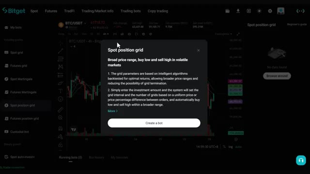
*⏱️ 00:09:26 — Interface Bitget affichant une pop-up d'explication sur la grille de position au comptant ("Spot position grid").*

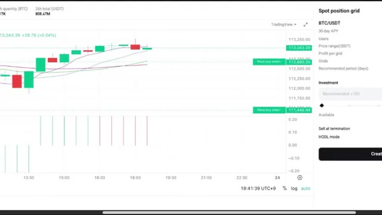
*⏱️ 00:09:35 — Graphique de prix BTC/USDT sur l'interface de trading Bitget avec le panneau de configuration du bot de grille de position.*

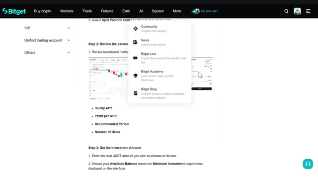
*⏱️ 00:09:45 — Page web de documentation Bitget montrant les étapes de configuration d'un bot de trading avec des menus déroulants.*

---

### ⏱️ `[00:09:54 - 00:10:21]` | Segment #21

**🔊 Audio (Transcription Intégrale Mot pour Mot en Français) :**
> rééquilibrage automatique. Au lieu de gérer des pièces individuelles, vous configurez un panier d'actifs et le bot les maintient équilibrés pour vous. Ici, vous pouvez voir tous les portefeuilles recommandés. Des choses comme un tracker inspiré de Mag7, un tracker inspiré d'OzShares, un Bitcoin Plus, Gold Hedge, et plus encore. Cliquez sur Utiliser sur l'un d'eux et vous verrez l'allocation cryptographique complète, tout comme l'investissement automatique au comptant. Vous pouvez ajouter jusqu'à 10 pièces et BitGit pré-remplit l'allocation pour vous.

**👁️ Analyse Visuelle d'Écran (gemini-3.5-flash-lite) :**
**Interface & Outils** : Interface de la plateforme d'échange Bitget (Trading Bots - Smart Portfolio).

**Contenu textuel & Code** : Panneau latéral droit affichant les portefeuilles "Mag 7" (APR 128,97 %) et "iShares-inspired tracker" (APR 128,78 %), ainsi qu'un graphique en chandeliers BTC/USDT en arrière-plan.

**Action / Démonstration** : Présentation et sélection des portefeuilles recommandés pour le rééquilibrage automatique.

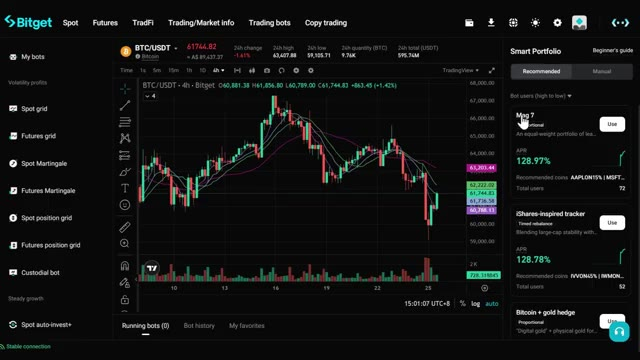
*⏱️ 00:10:01 — Capture d'écran de l'interface Bitget montrant les portefeuilles intelligents recommandés et un graphique de prix BTC/USDT.*

---

### ⏱️ `[00:10:21 - 00:10:40]` | Segment #22

**🔊 Audio (Transcription Intégrale Mot pour Mot en Français) :**
> Tout ce que vous avez à faire est de définir le mode de rééquilibrage. Le premier mode est proportionnel. Cela rééquilibre en fonction du ratio de la valeur de chaque actif. Le deuxième est le rééquilibrage temporel. Cela rééquilibre à des intervalles de temps définis, indépendamment des mouvements de prix. Le troisième est le déséquilibre. Cela ne rééquilibre que lorsque le portefeuille s'écarte au-delà d'un seuil défini.

**👁️ Analyse Visuelle d'Écran (gemini-3.5-flash-lite) :**
**Interface & Outils** : Interface de bot de trading Bitget (Smart Portfolio)

**Contenu textuel & Code** : Menu de sélection du mode de rééquilibrage affichant 'Proportional', 'Timed rebalance' et 'Unbalanced', avec la liste des actifs du portefeuille (AMZNON, GOOGLON, METAON, NVDAON, TSLAON) configurés chacun à 14%.

**Action / Démonstration** : Sélection ou survol du paramètre 'Rebalance mode' pour choisir entre le rééquilibrage proportionnel et le rééquilibrage temporel.

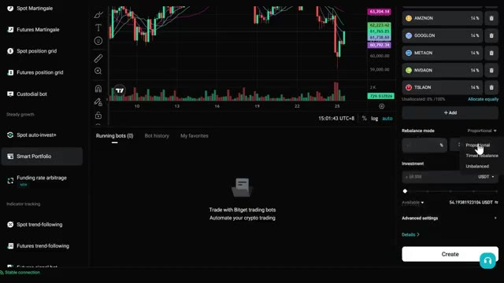
*⏱️ 00:10:26 — Interface de configuration du Smart Portfolio montrant le menu déroulant du mode de rééquilibrage avec les options Proportional, Timed rebalance et Unbalanced.*

---

### ⏱️ `[00:10:40 - 00:11:19]` | Segment #23

**🔊 Audio (Transcription Intégrale Mot pour Mot en Français) :**
> Dans les paramètres avancés, vous pouvez activer la vente totale à la clôture et le transfert d'actifs. Une fois fait, cliquez sur créer et vous pouvez voir le bot fonctionner. Au fait, si vous ne vous êtes pas encore inscrit sur Bitget, c'est le moment idéal pour le faire. Le lien est dans la description ci-dessous. N'oubliez pas, seul mon lien vous donne droit au pack de bonus complet de 6 200 USDT. N'utilisez aucun autre lien. Il y a beaucoup de faux sites Bitget et mon lien vous garantit d'être sur le vrai. Passons maintenant aux contrats à terme. Les mêmes bots, mais avec un effet de levier, ce qui signifie des gains potentiels plus importants mais aussi des pertes potentielles plus importantes. Commencez avec un faible effet de levier jusqu'à ce que vous sachiez que le bot fonctionne

**👁️ Analyse Visuelle d'Écran (gemini-3.5-flash-lite) :**
**Interface & Outils** : Interface de la plateforme d'échange cryptographique Bitget (site web).

**Contenu textuel & Code** : Formulaire d'inscription, bonus de bienvenue de 6 200 USDT, et sélection de bots de trading de contrats futures (Futures grid, Martingale, etc.).
[DESC_IMAGE_3] Navigation dans les différentes options de bots de trading automatisé sur Bitget (Futures).

**Action / Démonstration** : Explications face caméra et analyse conceptuelle des marchés.

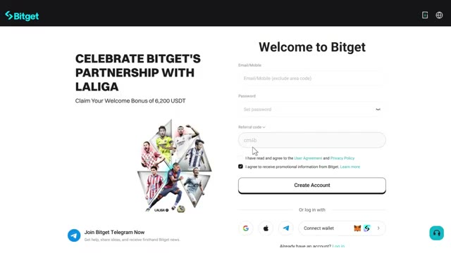
*⏱️ 00:10:50 — Page d'inscription de Bitget avec une promotion La Liga et un champ de code de parrainage.*

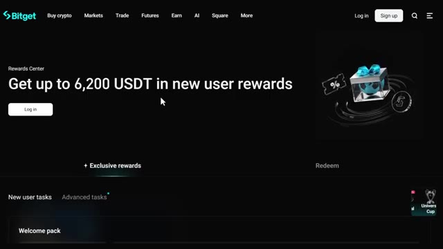
*⏱️ 00:11:00 — Centre de récompenses de Bitget affichant les bonus pour les nouveaux utilisateurs.*

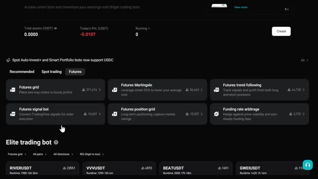
*⏱️ 00:11:09 — Tableau de bord des bots de trading Bitget avec les options de bots Futures (Futures grid, Martingale, Signal bot, etc.).*

---

### ⏱️ `[00:11:19 - 00:11:52]` | Segment #24

**🔊 Audio (Transcription Intégrale Mot pour Mot en Français) :**
> la première est la grille de contrats à terme, c'est la même chose que la grille au comptant mais avec un effet de levier, vous pouvez amplifier vos gains ou pertes potentiels selon les mouvements du marché, vous pouvez voir les recommandations de l'IA avec toutes les informations dont vous avez besoin, la direction, l'utilisation de l'effet de levier, l'APY testé rétrospectivement, le prélèvement maximal, l'investissement minimum, la durée recommandée et le total des utilisateurs. Cliquez sur utiliser sur n'importe quel bot. Vous verrez la grille. Tout ce que vous avez à faire est d'entrer votre marge. Vous pouvez également ajuster l'effet de levier ici jusqu'à 150 fois,

**👁️ Analyse Visuelle d'Écran (gemini-3.5-flash-lite) :**
**Interface & Outils** : Interface web de l'échange de cryptomonnaies Bitget (section Trading bots > Futures grid).

**Contenu textuel & Code** : Graphique de prix BTCUSDT en unités 4h avec barres de volume, prix actuel autour de 61697.4 USD, et panneaux latéraux affichant les performances de stratégies de grilles de contrats à terme (rendements APY, drawdowns, investissement minium).

**Action / Démonstration** : Présentation et explication des fonctionnalités des bots de grille de contrats à terme et des recommandations de l'IA sur Bitget.

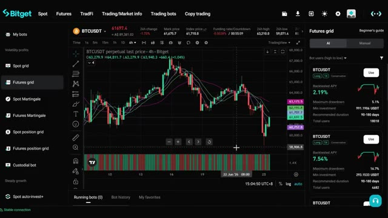
*⏱️ 00:11:27 — Capture d'écran de l'interface de trading Bitget montrant la section des bots de grille de contrats à terme (Futures grid) avec un graphique en chandeliers BTCUSDT et des recommandations de stratégies basées sur l'IA.*

---

### ⏱️ `[00:11:52 - 00:12:24]` | Segment #25

**🔊 Audio (Transcription Intégrale Mot pour Mot en Français) :**
> mais je recommanderais fortement de rester bas, peut-être cinq à dix fois, jusqu'à ce que vous ayez confirmé que le bot fonctionne bien. Vous pouvez également voir le prix de liquidation estimé ici, qui est le niveau de prix auquel votre position serait automatiquement fermée et votre marge perdue. Gardez un œil sur ceci. Pour une approche manuelle, cliquez sur Manuel. Vous verrez trois options de direction, Long, Short et Neutre. Long signifie que le bot réalise des bénéfices lorsque le prix monte, short lorsqu'il descend, et neutre réalise des bénéfices grâce aux mouvements de prix dans les deux directions dans la plage.

**👁️ Analyse Visuelle d'Écran (gemini-3.5-flash-lite) :**
**Interface & Outils** : Interface de l'exchange Bitget (Trading bots - Futures grid)

**Contenu textuel & Code** : Graphique de prix BTCUSDT en unités de 4h, carnet d'ordres de la grille, paramètres du bot (effet de levier 1X, marge disponible 54.19 USDT, prix de liquidation estimé)

**Action / Démonstration** : Présentation de la configuration d'un bot de trading de type Futures Grid et pointage vers le bouton de création de position longue.

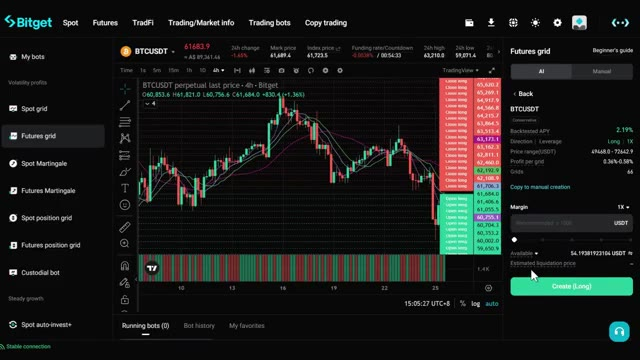
*⏱️ 00:12:00 — Capture d'écran de l'interface de l'exchange Bitget montrant le panneau de configuration d'un bot 'Futures grid' pour BTCUSDT avec un graphique en chandeliers en arrière-plan et le curseur sur le bouton 'Create (Long)'.*

---

### ⏱️ `[00:12:25 - 00:13:00]` | Segment #26

**🔊 Audio (Transcription Intégrale Mot pour Mot en Français) :**
> Définissez votre fourchette de prix, le nombre de grilles, le type de grille et la marge. Les paramètres avancés sont les mêmes que pour la grille au comptant. Une fois terminé, cliquez sur Créer. Le Martingale sur Futures repose sur le même concept que le Martingale au comptant, mais vous disposez désormais de trois options : IA, En vedette et Manuel. Et vous pouvez vous positionner à l'achat ou à la vente. Vous pouvez voir la direction et effet de levier sur les bots IA et En vedette. Cliquez sur Utiliser et vous verrez la grille, la saisie de la marge et le sélecteur d'effet de levier. Pour le mode manuel, vous pouvez soit cliquer sur Copier vers la création manuelle pour reproduire les paramètres du bot actuel comme point de départ, soit recommencer à zéro. Mêmes paramètres et paramètres avancés.

**👁️ Analyse Visuelle d'Écran (gemini-3.5-flash-lite) :**
**Interface & Outils** : Bitget (plateforme d'échange de cryptomonnaies et interface de bots de trading)

**Contenu textuel & Code** : Options de bots de trading (Futures Grid, Futures Martingale), graphiques de prix en chandeliers japonais (BTCUSDT), métriques de performance (APY backtesté, drawdown).
[COMPTE] Navigation dans les options de bots de trading de la plateforme Bitget et sélection de la stratégie de Martingale sur Futures.

**Action / Démonstration** : Explications face caméra et analyse conceptuelle des marchés.

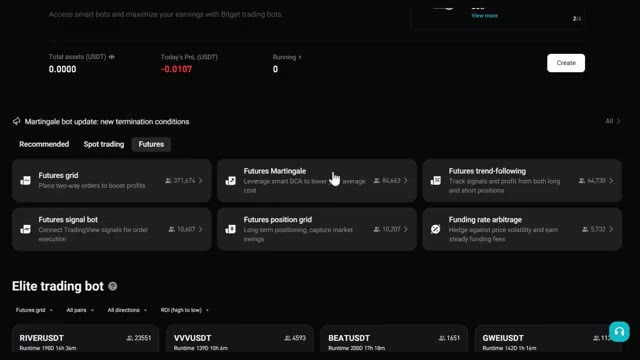
*⏱️ 00:12:34 — Image #1 : Vue d'ensemble de la section des bots de trading de Bitget, montrant divers types de bots disponibles comme la grille Futures et le Martingale Futures.*

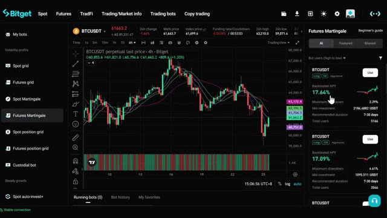
*⏱️ 00:12:42 — Image #2 : Interface détaillée du bot Martingale Futures sur Bitget avec un graphique de prix BTCUSDT en arrière-plan et des options de configuration pour l'intelligence artificielle et les stratégies manuelles.*

---

### ⏱️ `[00:13:00 - 00:13:20]` | Segment #27

**🔊 Audio (Transcription Intégrale Mot pour Mot en Français) :**
> comme le Spot Martingale, mais avec l'option supplémentaire d'aller long ou short. Une fois que vous avez tout configuré, cliquez sur aperçu pour voir la grille avant de vous engager ou sur créer pour lancer le bot immédiatement. Le suivi de tendance Futures, c'est la même chose que le suivi de tendance spot, mais vous avez maintenant l'option d'aller long ou short et vous pouvez ajouter du levier. Tout le reste fonctionne de la même manière que la version spot.

**👁️ Analyse Visuelle d'Écran (gemini-3.5-flash-lite) :**
**Interface & Outils** : Échange de cryptomonnaies Bitget (section Trading Bots / Futures Martingale).

**Contenu textuel & Code** : Configuration d'un bot Futures Martingale : options Long/Short, levier (5x), pas de baisse de prix, cible de TP par cycle, marges et nombre max d'ordres de sécurité.

**Action / Démonstration** : Configuration et validation des paramètres d'un bot de trading automatisé de type Martingale sur les Futures.

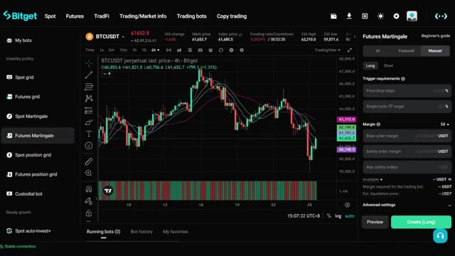
*⏱️ 00:13:05 — Interface Bitget affichant l'outil Futures Martingale avec le graphique du BTCUSDT en arrière-plan et le panneau de configuration du bot à droite.*

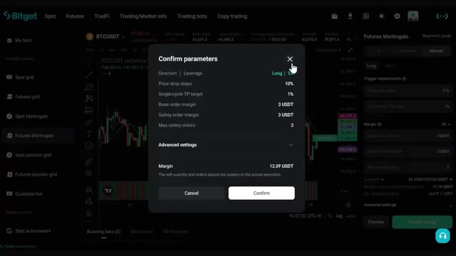
*⏱️ 00:13:10 — Pop-up de confirmation des paramètres du bot Futures Martingale sur Bitget (Direction Long, Levier 5x, marge, etc.).*

---

### ⏱️ `[00:13:20 - 00:13:53]` | Segment #28

**🔊 Audio (Transcription Intégrale Mot pour Mot en Français) :**
> Le bot de signaux futures est destiné aux utilisateurs plus avancés qui souhaitent connecter des signaux externes, comme ceux de TradingView, directement à un bot de trading en direct sur Bitget. Vous verrez deux onglets, mes signaux et créer un signal. Dans mes signaux, vous pouvez voir tous les signaux que vous avez déjà créés et leurs performances. Pour créer un signal, voici comment cela fonctionne étape par étape. Étape 1 : donnez un nom à votre signal, quelque chose comme tendance haussière BTC, et une description optionnelle de la stratégie. Étape 2 : ouvrez TradingView et allez sur la stratégie ou l'indicateur que vous souhaitez connecter.

**👁️ Analyse Visuelle d'Écran (gemini-3.5-flash-lite) :**
**Interface & Outils** : TradingView, Plateforme de trading Bitget (Trading Bots)

**Contenu textuel & Code** : Graphiques de prix (AEROUSDT, BTCUSDT), indicateurs techniques (BB + RSI Divergence Strategy), panneau latéral de configuration de bot de signaux futures.
[DESC_IMAGE_2] Navigation dans l'interface du bot de signaux futures pour connecter des signaux externes (TradingView) à un bot de trading en direct sur Bitget.

**Action / Démonstration** : Explications face caméra et analyse conceptuelle des marchés.

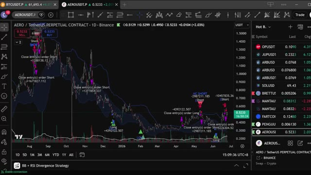
*⏱️ 00:13:28 — Graphique TradingView affichant la paire AERO/USDT en unité journalière avec des indicateurs techniques et des signaux d'achat/vente.*

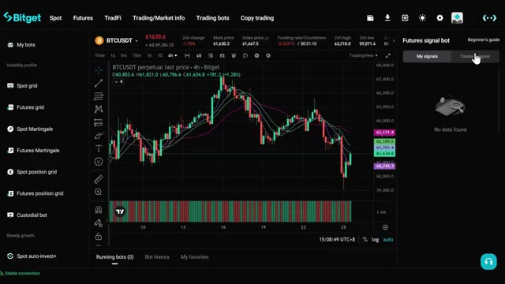
*⏱️ 00:13:36 — Interface de la plateforme Bitget montrant le "Futures signal bot" avec les onglets "My signals" et "Create signal" ainsi qu'un graphique BTCUSDT.*

---

### ⏱️ `[00:13:53 - 00:14:14]` | Segment #29

**🔊 Audio (Transcription Intégrale Mot pour Mot en Français) :**
> Configurez votre script d'alerte avec les conditions qui déclencheront le signal. Étape trois, copiez l'URL du webhook fournie par Bitget et collez-la dans votre configuration d'alerte TradingView. Important, chaque webhook ne doit être connecté qu'à une seule alerte TradingView pour éviter les erreurs d'exécution. Ensuite, ajoutez le script de message fourni par Bitget dans le champ du message d'alerte.

**👁️ Analyse Visuelle d'Écran (gemini-3.5-flash-lite) :**
**Interface & Outils** : Bitget (interface de trading et bots), TradingView (interface de graphique et configuration d'alertes)

**Contenu textuel & Code** : URL de webhook Bitget (`api.bitget.com/...`), paramètres de notification TradingView (Webhook URL, Notify in app, Play sound)

**Action / Démonstration** : Copie de l'URL du webhook depuis l'interface Bitget et collage de cette URL dans le champ Webhook URL de TradingView.

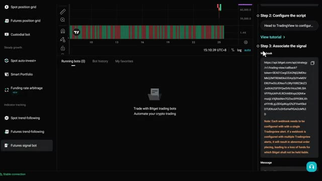
*⏱️ 00:13:59 — Interface Bitget affichant les étapes de configuration du bot de signaux (Futures signal bot), incluant l'URL du webhook à copier.*

*⏱️ 00:14:04 — Interface TradingView montrant la fenêtre de configuration des alertes (« Notifications ») avec l'option Webhook URL cochée et l'URL collée.*

*⏱️ 00:14:09 — Interface Bitget similaire à la première image, montrant l'étape 3 d'association du signal avec l'avertissement concernant l'unicité du webhook.*

---

### ⏱️ `[00:14:14 - 00:14:34]` | Segment #30

**🔊 Audio (Transcription Intégrale Mot pour Mot en Français) :**
> Étape quatre, retournez sur Bitget, cliquez sur créer un signal pour activer le robot et suivre les performances dans l'onglet Mes Signaux. Étape cinq, si vous voulez l'arrêter, allez dans Robots en cours, sélectionnez le robot, cliquez sur Mettre fin et confirmez. Toutes les positions ouvertes seront fermées au prix du marché et vos fonds retourneront sur votre compte. L'arrêt est définitif et stoppe tout trading immédiatement.

**👁️ Analyse Visuelle d'Écran (gemini-3.5-flash-lite) :**
**Interface & Outils** : Interface de la plateforme d'échange Bitget (Trading Bots / Futures signal bot).

**Contenu textuel & Code** : Graphique TradingView BTCUSDT (4h), tableau de bord des robots en cours (Running bots), métriques de PnL et de marge.

**Action / Démonstration** : Activation d'un signal/robot sur Bitget, puis navigation vers l'onglet des robots en cours pour sélectionner l'option de terminaison du robot.

*⏱️ 00:14:19 — Interface Bitget affichant le graphique BTCUSDT en 4h avec le panneau "Futures signal bot" et l'onglet "My signals".*

*⏱️ 00:14:24 — Interface Bitget montrant l'onglet "Running bots" avec un robot actif ("BTC LONG TREND") et un menu contextuel ouvert pour y mettre fin ("Terminate").*

---

### ⏱️ `[00:14:35 - 00:14:55]` | Segment #31

**🔊 Audio (Transcription Intégrale Mot pour Mot en Français) :**
> La grille de position futures repose sur le même concept que la grille de position spot, conçue pour construire progressivement une position à effet de levier à travers la fourchette de prix. La configuration reflète celle de la grille de position spot, avec l'ajout de l'effet de levier et des options de direction long et short. Au moment de cet enregistrement, il n'y a pas de futures disponibles. La grille de position est la même que la grille de position spot.

**👁️ Analyse Visuelle d'Écran (gemini-3.5-flash-lite) :**
**Interface & Outils** : Interface web de l'échange de cryptomonnaies Bitget (Trading Bots, Futures position grid)

**Contenu textuel & Code** : Graphique de prix BTCUSDT en unité de temps 4h, paires de trading, indicateurs de prix (61753.4), et menu de configuration de bot 'Futures position grid' affichant un onglet vide 'No data found' sur le volet droit.

**Action / Démonstration** : Navigation dans l'interface de Bitget pour sélectionner le bot de type 'Futures position grid' afin de configurer une grille de position à effet de levier.

*⏱️ 00:14:40 — Interface de la plateforme Bitget montrant la section des bots de trading, plus particulièrement le menu 'Futures position grid' sélectionné dans le panneau latéral gauche, avec un graphique en chandeliers du BTCUSDT en arrière-plan.*

---

### ⏱️ `[00:14:55 - 00:15:28]` | Segment #32

**🔊 Audio (Transcription Intégrale Mot pour Mot en Français) :**
> Le dernier emplacement est l'arbitrage des taux de financement. L'arbitrage des taux de financement est l'un des bots les plus intéressants de la plateforme et l'un de ceux que la plupart des gens négligent. Voici comment cela fonctionne. Sur les marchés à terme, les traders paient ou reçoivent un taux de financement toutes les quelques heures selon que le marché penche vers l'achat ou la vente. Ce bot prend une position sur le marché au comptant et une position opposée sur les contrats à terme, il est donc neutre par rapport au marché. Il se fiche de la direction dans laquelle le prix évolue. Il se contente de percevoir le taux de financement comme un revenu passif. Ici, vous pouvez voir la paire au comptant et la paire de contrats à terme côte à côte.

**👁️ Analyse Visuelle d'Écran (gemini-3.5-flash-lite) :**
**Interface & Outils** : Plateforme d'échange de cryptomonnaies Bitget (interface de trading de bots).

**Contenu textuel & Code** : Paire USDCUSDT perpetual (chandelier en unité 4h), rendement historique affiché (+6.61% sur 30 jours, +0.6% sur 30 jours, +0.97% sur 90 jours), taux de financement actuel (+0.0036% / 00:44:20), paramètres de configuration de l'investissement (barre de curseur avec 34.14 USDT) et options de paramètres avancés.

**Action / Démonstration** : Navigation et présentation de la section de configuration d'un bot d'arbitrage de taux de financement sur l'échange Bitget.

*⏱️ 00:15:03 — Interface de la plateforme Bitget montrant le panneau de configuration pour un bot d'arbitrage des taux de financement (Funding rate arbitrage) avec un graphique des prix en chandeliers japonais pour la paire USDCUSDT en arrière-plan.*

---

### ⏱️ `[00:15:29 - 00:16:03]` | Segment #33

**🔊 Audio (Transcription Intégrale Mot pour Mot en Français) :**
> Utilisez le sélecteur de paires en haut à gauche du graphique pour choisir votre paire et voir l'APR sur trois jours, l'APR sur 30 jours et l'APR sur 90 jours. Cela vous indique combien vous pourriez gagner en taux annualisé. Vous pouvez également voir le taux de financement actuel, le compte à rebours jusqu'au prochain paiement de financement, et le taux de base, qui est la différence entre le prix au comptant et le prix des contrats à terme. Saisissez le montant de votre investissement. Dans les paramètres avancés, vous pouvez définir le montant par base d'entrée par lot, ce qui vous permet d'entrer uniquement lorsque le taux de financement est supérieur à un certain seuil, et de vendre à

**👁️ Analyse Visuelle d'Écran (gemini-3.5-flash-lite) :**
**Interface & Outils** : Interface Web de l'échange de cryptomonnaies Bitget (Trading bot - Funding rate arbitrage).

**Contenu textuel & Code** : Graphique TradingView pour la paire USDCUSDT en timeframe 4h, affichage des taux d'APR sur 3, 30 et 90 jours, taux de financement actuel (+0.0036% / 00:43:51), paramètres d'investissement et bouton de création de bot.

**Action / Démonstration** : Navigation et présentation de l'interface de configuration pour l'arbitrage des taux de financement sur Bitget.

*⏱️ 00:15:37 — Capture d'écran de l'interface de la plateforme Bitget montrant la section d'arbitrage de taux de financement avec un graphique en chandeliers et le panneau de configuration à droite.*

---

### ⏱️ `[00:16:03 - 00:16:38]` | Segment #34

**🔊 Audio (Transcription Intégrale Mot pour Mot en Français) :**
> résiliation. Une fois fait, cliquez sur créer et vous pouvez voir le bot fonctionner. Très bien, et regardez, pour les prochaines années, deux types de traders existeront. Ceux qui utilisent l'IA et ceux qui font encore tout manuellement, même marché, très résultats différents, voici comment vous mettez du bon côté de cela, j'ai rassemblé tout à l'intérieur de la communauté AI Trade Edge, chaque prompt, chaque bot, chaque modèle, chaque guide étape par étape que j'utilise personnellement, tout en un seul endroit, et tout ce que je construirai à l'avenir sera ajouté directement dans le groupe dès sa sortie, nous testons également

**👁️ Analyse Visuelle d'Écran (gemini-3.5-flash-lite) :**
**Interface & Outils** : Navigateur web affichant Twitter/X, Whop et une interface de documentation sur l'IA.

**Contenu textuel & Code** : Texte promotionnel comparant le trading manuel et l'IA, tarifs d'abonnement et fonctionnalités de suivi des portefeuilles rentables sur Hyperliquid.

**Action / Démonstration** : Navigation sur les pages de présentation et de vente du programme de trading automatisé par IA.

*⏱️ 00:16:21 — Page de vente de la plateforme Whop montrant l'offre "AI Trade Edge" d'Alex Carter à 79,99$/mois.*

*⏱️ 00:16:29 — Interface de documentation "What It Can Do" listant les fonctionnalités de suivi des baleines, analyse de sentiment et idées de trade.*

---

### ⏱️ `[00:16:38 - 00:17:07]` | Segment #35

**🔊 Audio (Transcription Intégrale Mot pour Mot en Français) :**
> des stratégies provenant de tout l'internet, en les automatisant grâce à Pine Script, en les exécutant en direct et en partageant exactement ce qui fonctionne et ce qui ne fonctionne pas, de sorte que vous n'obtenez pas seulement des outils, vous obtenez une opération de recherche en direct. À l'intérieur, il y a aussi un cours complet de trading agentique de 2,5 heures, du débutant à l'expert, aucune compétence en programmation n'est nécessaire. À la fin, vous aurez votre propre système de trading IA en cours d'exécution en direct, quelque chose que la plupart des traders particuliers ne savent même pas être possible en ce moment.

**👁️ Analyse Visuelle d'Écran (gemini-3.5-flash-lite) :**
**Interface & Outils** : TradingView, éditeur Pine Script, plateforme de cours en ligne.

**Contenu textuel & Code** : Code source Pine Script (fonctions plotshape, alertcondition pour long et shortEntry), graphique en chandeliers japonais ETH/USD.
[DESC_IMAGE_3] Analyse visuelle du code Pine Script et des graphiques de prix en temps réel pour configurer des alertes de trading automatisées.

**Action / Démonstration** : Explications face caméra et analyse conceptuelle des marchés.

*⏱️ 00:16:45 — Un graphique TradingView à gauche affichant l'actif ETHEREUM/USD sur un échange BloFin, et un éditeur Pine Script à droite montrant du code pour des conditions d'entrée long/short et des alertes.*

---

### ⏱️ `[00:17:07 - 00:17:44]` | Segment #36

**🔊 Audio (Transcription Intégrale Mot pour Mot en Français) :**
> 79,99 $ par mois. Un seul bon trade suffit pour le rembourser. Et les 100 premiers membres bloquent ce tarif définitivement. Après cela, le prix augmentera. Le lien est dans la description. Vous ne pouvez vraiment pas vous permettre de rater ça. Et voilà. Chaque bot BitGet a été couvert étape par étape. Si vous voulez une présentation plus détaillée de toute la plateforme BitGet, y compris la façon de trader les contrats futures manuellement et d'utiliser le copy trading, cliquez sur la vidéo qui apparaît sur votre écran en ce moment même. Elle vous guidera à travers tout le reste que vous devez savoir. Et si vous voulez le guide complet étape par étape sur la façon de construire votre propre système de trading agentique

**👁️ Analyse Visuelle d'Écran (gemini-3.5-flash-lite) :**
**Interface & Outils** : Whop, Plateforme d'échange de cryptomonnaies BitGet

**Contenu textuel & Code** : Tarification d'abonnement (79,99 $/mois), options de bots de trading BitGet (Spot, Futures Grid, Martingale, Trend-following, Funding rate arbitrage)

**Action / Démonstration** : Navigation dans le menu des bots de trading sur BitGet et présentation de l'offre d'abonnement sur Whop.

*⏱️ 00:17:26 — Interface de la plateforme BitGet montrant le menu des bots de trading (Spots, Futures grid, Martingale, etc.).*

---

### ⏱️ `[00:17:44 - 00:18:00]` | Segment #37

**🔊 Audio (Transcription Intégrale Mot pour Mot en Français) :**
> En utilisant Claude, cette vidéo apparaît à l'écran également. Allez voir ça ensuite. Si vous avez trouvé cela utile, laissez un pouce bleu, ça aide vraiment la chaîne. Abonnez-vous si vous voulez plus de contenu comme celui-ci, et laissez un commentaire en bas pour me dire quel bot vous allez essayer en premier. Je vous vois dans la prochaine !

**👁️ Analyse Visuelle d'Écran (gemini-3.5-flash-lite) :**
**Interface & Outils** : Aucune interface visible.

**Contenu textuel & Code** : Aucun contenu informatif ou technique affiché.

**Action / Démonstration** : Aucune action ou manipulation en cours.

---

