# 🎬 If I Will Start AI Trading This Is What I Exactly I Would Build

> **Chaîne** : [Alex Carter](https://www.youtube.com/@AlexCarterTrading)  
> **Lien YouTube** : [https://www.youtube.com/watch?v=z-aTHSrq1p4](https://www.youtube.com/watch?v=z-aTHSrq1p4)  
> **Date de publication** : 20260627  
> **Durée** : 00:14:30  
> **Identifiant vidéo** : `z-aTHSrq1p4`  
> **Transcription & Analyse** : `whisper-v3-large-turbo+gemini-3.5-flash-lite`  

---

## 📌 Synthèse Exécutive & Outils

### 💡 Résumé

Le paysage du trading moderne connaît une mutation structurelle profonde, scindant les acteurs du marché en deux catégories distinctes : les opérateurs manuels subissant l'asymétrie informationnelle et temporelle, et les traders augmentés par l'intelligence artificielle qui automatisent l'intégralité de leurs processus décisionnels et opérationnels. L'ère où l'avantage algorithmique était l'exclusivité des fonds quantitatifs et des institutions dotées de millions de dollars de capital est révolue. Aujourd'hui, grâce aux progrès fulgurants des grands modèles de langage comme Claude et à l'émergence d'outils no-code ou de développement assisté, un trader particulier peut concevoir, backtester et déployer des architectures de trading automatisées de niveau institutionnel pour un coût marginal dérisoire. 

La vidéo démontre avec une précision chirurgicale comment transformer des prompts en langage naturel en véritables lignes de code Pine Script exécutables sur TradingView, ou en scripts autonomes capables d'interagir directement avec des exchanges décentralisés (DEX). L'analyse technique n'est plus une corvée chronophage de vingt minutes par graphique : l'IA interprète instantanément l'historique des prix, trace les zones institutionnelles de support et de résistance, calcule des scores de confluence multi-périodes et génère des plans de trade complets comprenant des points d'entrée, des stops-loss et des take-profits millimétrés. 

Au-delà de la simple exécution de graphiques, la véritable révolution réside dans l'automatisation totale du cycle de vie du capital (gestion des risques, dimensionnement des positions, scalping des taux de financement et « smart money tracking » on-chain). En connectant des assistants IA à des applications de messagerie comme Telegram et à des webhooks d'exchanges, le trader s'affranchit des contraintes physiques du bureau. Il pilote son portefeuille en temps réel depuis n'importe quel terminal, exploitant des inefficiences de marché complexes — telles que le farming de taux de financement ou le copy-trading comportemental de portefeuilles baleines sur Hyperliquid — tout en dormant, transformant ainsi le trading en un système mécanique à avantage composé.

### 🛠️ Outils, Modèles & Logiciels Présentés

* **Claude Code** : Le moteur central de développement et d'automatisation, permettant de traduire des consignes textuelles en scripts complexes, scrapers on-chain et agents de trading autonomes sans nécessiter d'équipe de développeurs.
* **TradingView** : La plateforme de référence pour l'analyse technique et le graphisme, connectée aux stratégies automatisées via des webhooks pour exécuter instantanément les ordres sur les bourses.
* **Pine Script** : Le langage de programmation propriétaire de TradingView utilisé pour concevoir, coder et déboguer des indicateurs et des stratégies de trading sur mesure à partir de simples descriptions textuelles.
* **Grok Bots** : Des solutions de bots conversationnels et d'automatisation mentionnées pour leur agilité dans l'interfaçage et l'analyse rapide des flux de données de marché.
* **Telegram** : L'interface de communication mobile utilisée comme tableau de bord distant et canal de commande sécurisé pour ouvrir des positions, recevoir des alertes de risque en temps réel et piloter les bots depuis un smartphone.
* **Hyperliquid** : Un échange perpétuel décentralisé (DEX) fonctionnant sur sa propre blockchain, hautement transparent, permettant l'analyse on-chain de milliers de portefeuilles et le tracking des traders les plus rentables sans nécessiter de clés API.
* **Webhooks** : Le protocole de communication instantanée qui transmet les signaux de TradingView directement vers l'exchange ou l'agent d'IA pour une exécution ultra-rapide des ordres d'achat et de vente.

### 🔑 Points Clés & Enseignements Stratégiques

* **Démocratisation du Quantitatif** : Plus de 70 % du volume boursier traditionnel et plus de 80 % du volume crypto étant pilotés par des algorithmes, l'utilisation d'assistants IA comme Claude permet aux traders particuliers de combler enfin l'écart technologique avec les desks institutionnels.
* **Analyse Graphique Instantanée par IA** : Capacité pour un modèle d'IA de scanner un graphique, d'identifier et tracer automatiquement les lignes de support (vertes) et de résistance (rouges) selon leur nombre de tests historiques, et de fournir un biais directionnel en quelques secondes.
* **Génération et Débogage de Code Pine Script** : Élimination de la barrière de la programmation en concevant, optimisant et corrigeant des stratégies de trading complexes sur TradingView par le simple biais de prompts en langage naturel.
* **Automatisation End-to-End via Webhooks** : Liaison directe entre la génération de signaux graphiques et l'exécution sur l'exchange, permettant au système d'ouvrir, gérer et clôturer des trades (avec stop-loss et take-profit) de manière totalement autonome 24h/24.
* **Pilotage Nomade par Messagerie (Telegram)** : Transformation d'une interface textuelle mobile en un terminal de trading complet autorisant l'ouverture de positions à effet de levier (ex: long x5 sur ETH) d'une seule phrase, sans jamais ouvrir de graphique.
* **Génération de Tableaux de Bord de Portefeuille** : Extraction automatisée et instantanée des données de compte sous forme de rapports visuels en mode sombre incluant la courbe de capital, le PNL, le taux de réussite et la distance de liquidation des positions ouvertes.
* **Scalping et Farming des Taux de Financement** : Automatisation de la recherche des paires présentant les taux de financement les plus élevés sur les marchés perpétuels pour percevoir des rendements annualisés attractifs sans avoir à spéculer sur la direction pure des prix.
* **Analyse Comportementale et Suivi de la « Smart Money » (Whale Tracking)** : Capacité à analyser des dizaines de milliers de portefeuilles décentralisés (notamment sur Hyperliquid) pour isoler les 20 traders les plus performants, décortiquer leurs positions en temps réels et copier leurs matrices de risque.
* **Réduction Drastique des Coûts d'Exécution** : Application des technologies d'IA générative aux processus de trading pour réduire les frictions, optimiser les points d'entrée et abaisser les coûts opérationnels de transaction de l'ordre de 30 %, à l'instar des standards bancaires.
* **Gestion Rigoureuse du Risk Management Automatisé** : Intégration systématique des paramètres de contrôle du risque (pourcentages de stop-loss stricts, plafonnement du levier, take-profits dynamiques) dans chaque prompt de génération d'ordre pour préserver le capital sur le long terme.

---

## ⏱️ Chronologie & Transcription Complète Audio & Visuelle (Mot pour Mot)

### ⏱️ `[00:00:00 - 00:00:19]` | Segment #01

**🔊 Audio (Transcription Intégrale Mot pour Mot en Français) :**
> Si je débutais dans le trading par IA aujourd'hui, c'est exactement ce que je construirais. Pas de la théorie, pas des concepts. Les vrais outils, la vraie automatisation, les vrais prompts qui transforment une configuration de trading manuelle en quelque chose qui fonctionne pendant que vous dormez. Parce qu'en ce moment, il y a deux types de traders. Celui qui fait encore tout à la main.

**👁️ Analyse Visuelle d'Écran (gemini-3.5-flash-lite) :**
**Interface & Outils** : Terminal de ligne de commande et graphique TradingView intégré (WEEX).

**Contenu textuel & Code** : Tableau d'analyse de code Pine Script (erreurs, bugs de logique, syntaxe, repeinture) et graphique de prix crypto avec niveaux de support (S1 à S5) et de résistance.
[DESC_ACTION] Analyse automatisée du code d'un indicateur de trading via l'IA et visualisation graphique des niveaux techniques sur un contrat perpétuel Bitcoin.

**Action / Démonstration** : Explications face caméra et analyse conceptuelle des marchés.

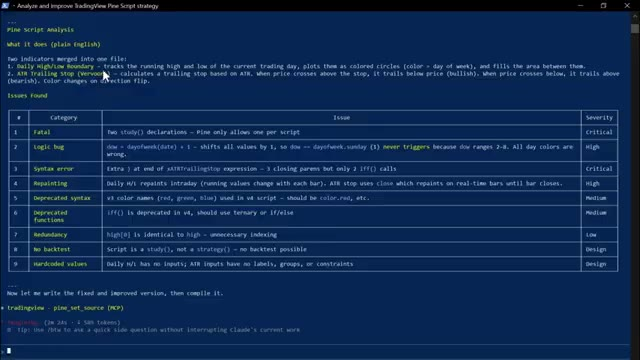
*⏱️ 00:00:05 — Un terminal de commandes affichant une analyse détaillée d'un script Pine Script avec un tableau répertoriant les erreurs (fatales, bugs de logique, erreurs de syntaxe, repeintures, etc.).*

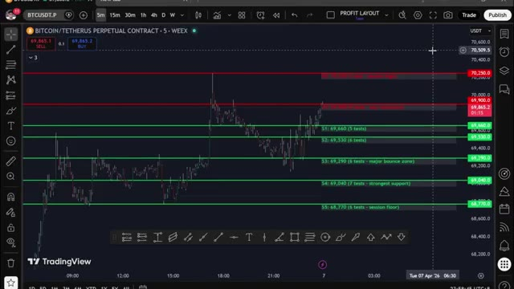
*⏱️ 00:00:14 — Un graphique TradingView de la paire BTCUSDT sur l'exchange WEEX en unité de temps 5 minutes, affichant des lignes de support et résistance horizontales vertes et rouges.*

---

### ⏱️ `[00:00:19 - 00:00:41]` | Segment #02

**🔊 Audio (Transcription Intégrale Mot pour Mot en Français) :**
> Vérifier des graphiques, passer des ordres un par un, passer des heures sur des recherches. Et ceux qui ont confié tout cela à l'IA. L'fossé entre ces deux groupes ne va faire que se creuser à partir de maintenant. Je trade des cryptos depuis très longtemps. Et la seule chose sur laquelle je n'arrêtais pas de tomber, c'était ça. Les traders qui opèrent au plus haut niveau ne sont pas seulement meilleurs pour lire les graphiques.

**👁️ Analyse Visuelle d'Écran (gemini-3.5-flash-lite) :**
**Interface & Outils** : Plateforme de suivi de performance et de backtest (Medium / Hyperdash).

**Contenu textuel & Code** : Valeur totale des comptes, rendement en pourcentage, PnL total, frais, taux de réussite, plus gros gains/pertes, et ratios de Sharpe pour différents modèles d'IA (Qwen3 Max, DeepSeek Chat, Claude Sonnet, Grok, Gemini, GPT).

**Action / Démonstration** : Comparaison des performances de trading entre plusieurs intelligences artificielles et analyse des portefeuilles de baleines/traders rentables.

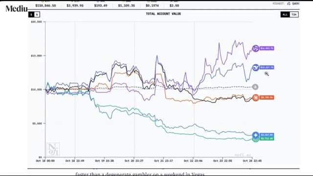
*⏱️ 00:00:24 — Graphique montrant la valeur totale de plusieurs comptes de trading gérés par différentes IA au fil du temps.*

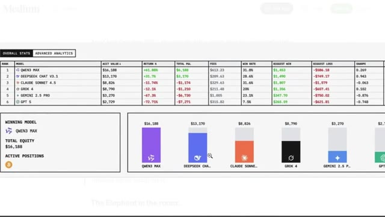
*⏱️ 00:00:30 — Tableau de classement et graphiques en barres comparant les performances financières des différents modèles d'IA.*

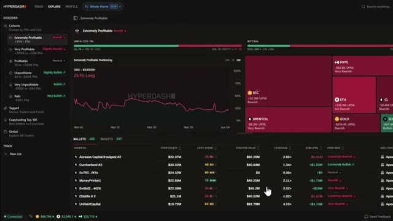
*⏱️ 00:00:35 — Interface de la plateforme Hyperdash affichant des analyses de marché, des positions et des portefeuilles de traders.*

---

### ⏱️ `[00:00:41 - 00:01:00]` | Segment #03

**🔊 Audio (Transcription Intégrale Mot pour Mot en Français) :**
> Ils ont des systèmes. Ils ont de l'automatisation. Ils ont un avantage qui tourne 24 heures sur 24 sans qu'ils touchent à rien. Construire ce genre d'installation nécessitait autrefois une équipe de développeurs et de sérieux capitaux institutionnels. Et avec la technologie actuelle et les progrès de l'IA, je peux affirmer avec certitude que ce n'est plus vrai.

**👁️ Analyse Visuelle d'Écran (gemini-3.5-flash-lite) :**
**Interface & Outils** : WEEX (bourse crypto) et site web financier (Mondrian Delta).

**Contenu textuel & Code** : Graphique de prix BTC/USDT à 66 841.7 USDT, carnet d'ordres, texte sur l'intégration de l'IA (génération de signaux, adaptation de modèles, diversification, optimisation) et graphique statistique de croissance des données de 2010 à 2024.

**Action / Démonstration** : Visualisation des marchés de crypto-monnaies en temps réel et présentation de données statistiques et textuelles sur l'investissement systématique et l'IA.

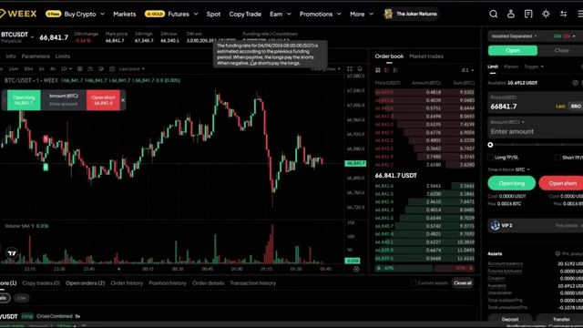
*⏱️ 00:00:46 — Interface de la plateforme de trading WEEX affichant le graphique BTC/USDT en bougies japonaises avec le carnet d'ordres.*

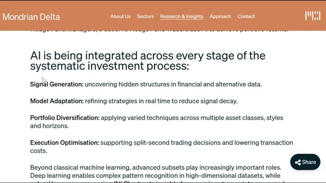
*⏱️ 00:00:50 — Page web du site "Mondrian Delta" détaillant l'intégration de l'intelligence artificielle dans le processus d'investissement systématique.*

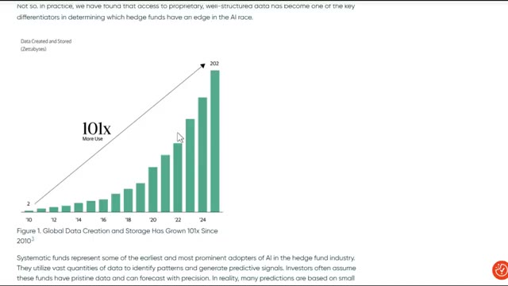
*⏱️ 00:00:55 — Graphique en barres verticales illustrant la croissance mondiale de la création et du stockage de données avec la mention "101x More Use".*

---

### ⏱️ `[00:01:00 - 00:01:23]` | Segment #04

**🔊 Audio (Transcription Intégrale Mot pour Mot en Français) :**
> Donc, dans cette vidéo, je vais vous montrer chaque outil que j'utiliserais, chaque démo, chaque invite, si je mettais en place un système de trading par IA à partir de zéro en partant d'aujourd'hui. Et si d'ici la fin, vous voulez la configuration complète pour vous-même, je vous montrerai exactement où l'obtenir. Entrons dans le vif du sujet. Maintenant, avant de vous montrer les outils, je veux rapidement vous dire pourquoi je construis réellement ceci.

**👁️ Analyse Visuelle d'Écran (gemini-3.5-flash-lite) :**
**Interface & Outils** : Tableau de données de marché et interface Web personnalisée (Alex Carter Trading).

**Contenu textuel & Code** : Classement de tokens (BCH, ZEC, SP500, ADA, XAU, SUI, AVAX, CL, XAUT, ASTER), prix, variation 24h, taux de financement, volume, capitalisation boursière, et menus de configuration du système d'IA (installation, dépendances, compétences, fonctionnalités, invites).

**Action / Démonstration** : Navigation et présentation des fonctionnalités clés du système de trading par IA, montrant les capacités d'analyse de données et de suivi des baleines.

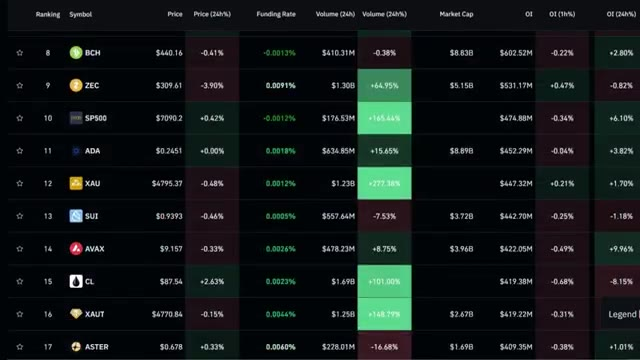
*⏱️ 00:01:06 — Tableau de classement de cryptomonnaies et d'actifs avec des métriques de prix, de taux de financement, de volume et d'intérêt ouvert (OI).*

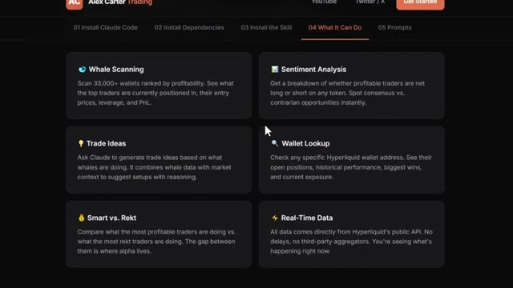
*⏱️ 00:01:11 — Interface Web d'Alex Carter Trading présentant les fonctionnalités du système : Whale Scanning, Sentiment Analysis, Trade Ideas, Wallet Lookup, Smart vs. Rekt et Real-Time Data.*

---

### ⏱️ `[00:01:23 - 00:01:51]` | Segment #05

**🔊 Audio (Transcription Intégrale Mot pour Mot en Français) :**
> Je fais du trading de crypto-monnaies depuis des années. Je gère une chaîne axée sur les crypto-monnaies. Je partage des stratégies, des guides, des comparatifs chaque jour. Et je m'en sors bien. Mais j'ai toujours su que les traders qui gagnent vraiment au plus haut niveau ne font pas seulement mieux que tout le monde en lisant les graphiques. Ils ont des systèmes. Ils ont de l'automatisation. Ils ont un avantage qui se compose au fil du temps. Et pendant longtemps, construire ce genre de système était hors de portée pour un trader solitaire.

**👁️ Analyse Visuelle d'Écran (gemini-3.5-flash-lite) :**
**Interface & Outils** : Hyperdash (plateforme d'analyse de portefeuille) et tableau de classement des performances de modèles d'IA sur Medium.

**Contenu textuel & Code** : Métriques de portefeuilles, scores de copie, valeurs de position, leviers, rendements en pourcentage et PNL total par modèle d'IA.

**Action / Démonstration** : Analyse des performances de portefeuilles de baleines et comparaison des résultats de trading automatisés par des modèles d'IA.

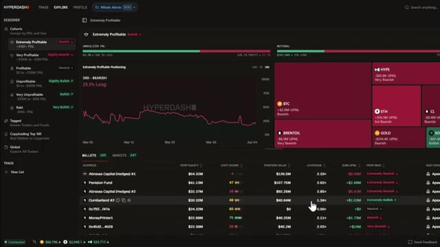
*⏱️ 00:01:37 — Tableau de bord d'analyse de données de trading 'Hyperdash' montrant le positionnement des portefeuilles et l'historique de PNL.*

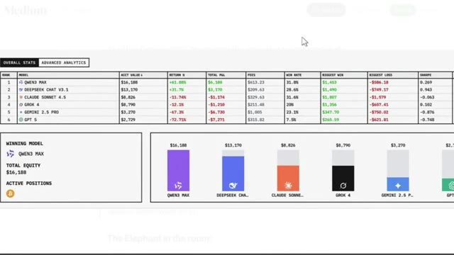
*⏱️ 00:01:44 — Tableau comparatif des performances de différents modèles d'IA en trading (Qwen3 Max, DeepSeek Chat, Claude Sonnet, etc.).*

---

### ⏱️ `[00:01:51 - 00:02:25]` | Segment #06

**🔊 Audio (Transcription Intégrale Mot pour Mot en Français) :**
> Tu avais besoin d'une équipe de développeurs. Tu avais besoin d'un capital sérieux. Tu avais besoin de mois de temps. Ce qui a changé, c'est Claude Code. Parce qu'maintenant, je peux décrire ce que je veux en anglais simple et il le construit. Un traqueur de baleines, un scanner de taux de financement, un tableau de bord complet de portefeuille, un bot qui exécute des trades pendant que je dors. Tout ça. Donc ce n'est pas seulement une vidéo sur les outils d'IA. C'est moi qui vous montre exactement ce que je construis en ce moment et pourquoi je crois sincèrement que c'est comme ça que j'atteindrai mon premier million. Et je veux vous emmener avec moi à chaque étape. Avant d'entrer dans les démos, je veux

**👁️ Analyse Visuelle d'Écran (gemini-3.5-flash-lite) :**
**Interface & Outils** : Terminal de commandes Claude Code et interface web personnalisée Alex Carter Trading.

**Contenu textuel & Code** : Lignes de commande du terminal et guide en sept étapes pour configurer et utiliser le bot de trading.

**Action / Démonstration** : Présentation de l'outil de développement Claude Code puis du guide d'intégration web pour le trading.

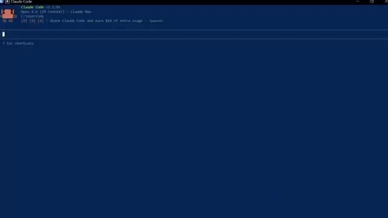
*⏱️ 00:02:00 — Capture d'écran montrant l'interface sombre du terminal Claude Code (version 2.1.91).*

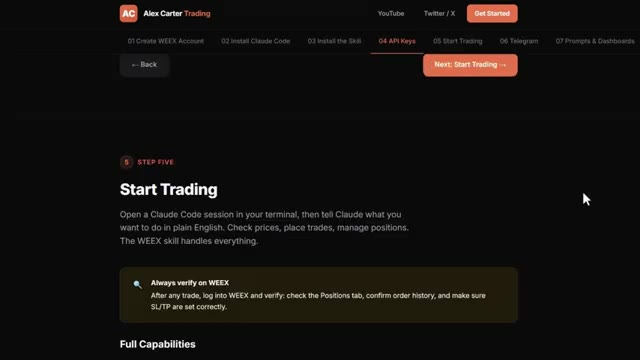
*⏱️ 00:02:08 — Capture d'écran montrant le tableau de bord web d'Alex Carter Trading avec des instructions pour démarrer le trading.*

---

### ⏱️ `[00:02:25 - 00:02:49]` | Segment #07

**🔊 Audio (Transcription Intégrale Mot pour Mot en Français) :**
> pour expliquer rapidement pourquoi cela a réellement de l'importance. Parce que je pense que la plupart des gens sous-estiment gravement l'ampleur de ce changement. Le marché mondial du trading algorithmique pèse plus de 21 milliards de dollars. Et d'ici 2030, il devrait atteindre 43 milliards de dollars. C'est le monde dans lequel vous concourez chaque fois que vous ouvrez un trade manuellement. Pendant des décennies, l'avantage en matière de trading a appartenu aux institutions.

**👁️ Analyse Visuelle d'Écran (gemini-3.5-flash-lite) :**
**Interface & Outils** : TradingView et navigateur Web affichant le site Grand View Research.

**Contenu textuel & Code** : Graphique de trading Bitcoin/TetherUS (WEEX), rapport de stratégie avec P&L cumulé (378,078.80 USDT), et résumé du marché mondial du trading algorithmique (21,06 milliards USD en 2024, 42,99 milliards USD en 2030, TCAC de 12,9 %).

**Action / Démonstration** : Présentation des données du marché du trading algorithmique et analyse des performances d'une stratégie sur TradingView.

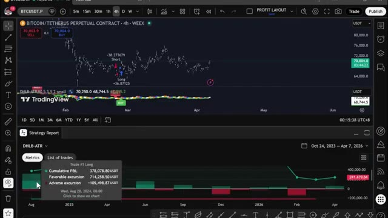
*⏱️ 00:02:31 — Capture d'écran de TradingView montrant un graphique de prix Bitcoin avec un rapport de stratégie (Strategy Report) et des métriques de performance.*

*⏱️ 00:02:37 — Capture d'écran du site Web Grand View Research affichant le rapport de marché sur le trading algorithmique (Algorithmic Trading Market 2025 - 2030) avec des données chiffrées.*

---

### ⏱️ `[00:02:49 - 00:03:22]` | Segment #08

**🔊 Audio (Transcription Intégrale Mot pour Mot en Français) :**
> fonds spéculatifs, sociétés quantitatives. Et voici le chiffre qui remet les choses en perspective. Plus de 70 % de tout le volume des transactions sur les marchés boursiers américains est déjà algorithmique. Sur les bourses de cryptomonnaies, ce chiffre est encore plus élevé. Certaines estimations le situent au-dessus de 80 %. Vous, qui tradez manuellement, consultez les graphiques, passez des ordres à la main, vous êtes en train de rivaliser contre cela depuis tout ce temps. Ce qui a changé, c'est que les modèles d'IA comme Claude sont devenus suffisamment puissants pour qu'une seule personne puisse désormais commencer à combler cet écart.

**👁️ Analyse Visuelle d'Écran (gemini-3.5-flash-lite) :**
**Interface & Outils** : Navigateur web, articles de recherche/actualités financières, tableau de classement des performances de bots IA.

**Contenu textuel & Code** : Statistiques sur le trading algorithmique (60-73% du volume US), tableau comparatif avec colonnes « Acct Value », « Return % », « Total PnL », « Win Rate », « Sharpe Ratio ».

**Action / Démonstration** : Présentation de données statistiques sur la part du trading algorithmique et comparaison des performances de trading pilotées par différentes IA.

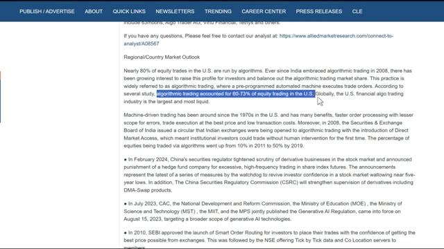
*⏱️ 00:02:57 — Capture d'écran d'un article en ligne sur le trading algorithmique, soulignant les statistiques de volume aux États-Unis.*

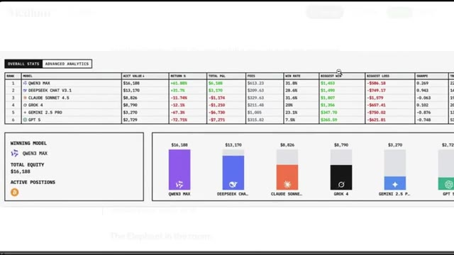
*⏱️ 00:03:14 — Tableau comparatif de performances de différents modèles d'IA (LLM) en trading (Qwen3 Max, DeepSeek, Claude Sonnet, etc.).*

---

### ⏱️ `[00:03:22 - 00:03:56]` | Segment #09

**🔊 Audio (Transcription Intégrale Mot pour Mot en Français) :**
> écart. Un rapport de JP Morgan de 2023 a révélé que les outils de trading pilotés par l'IA réduisent les coûts d'exécution jusqu'à 30 % pour les desks institutionnels. Ces mêmes outils sont désormais accessibles aux traders particuliers pour 20 dollars par mois. Vous pouvez désormais disposer d'un système qui surveille vos positions pendant que vous dormez. Qui exécute un trade en plusieurs étapes à partir d'une seule phrase. Qui scanne des milliers de portefeuilles et vous dit ce que fait l'argent intelligent en ce moment même. Qui génère un rapport complet sur le risque de portefeuille en quelques secondes. Les grandes entreprises ont eu ce genre d'avantage pendant des années. Maintenant, vous pouvez l'avoir aussi. Et je tiens à être clair,

**👁️ Analyse Visuelle d'Écran (gemini-3.5-flash-lite) :**
**Interface & Outils** : Rapport JP Morgan, plateforme de courtage WEEX, et terminal de script d'analyse crypto.

**Contenu textuel & Code** : Graphiques de performance d'IA, taux d'hallucination, métriques de portefeuille, paires crypto (BTC, AVAX, DOGE) et plan de trade pour XMR.

**Action / Démonstration** : Présentation de statistiques institutionnelles, visualisation du tableau de bord de trading et analyse des positions de baleines crypto.

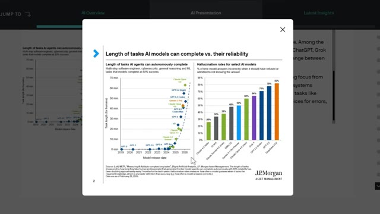
*⏱️ 00:03:31 — Un rapport financier de JP Morgan affichant des graphiques sur les performances et les taux d'hallucination des modèles d'IA.*

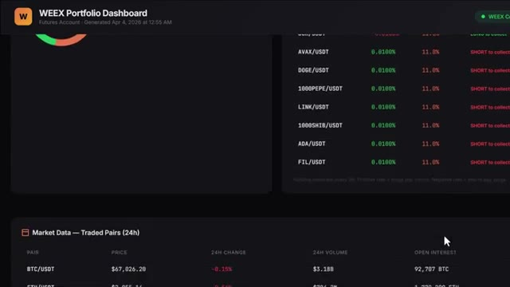
*⏱️ 00:03:39 — Le tableau de bord du portefeuille WEEX affichant les données de marché et les paires tradées en temps réel.*

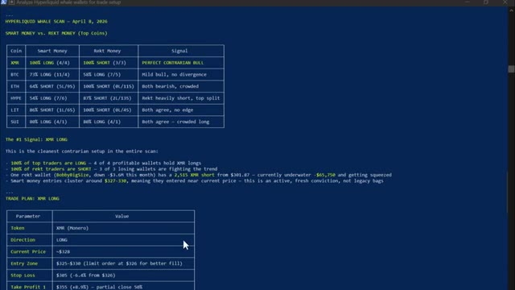
*⏱️ 00:03:48 — Un terminal de commande affichant une analyse de scan des portefeuilles "Smart Money vs Rekt Money" sur Hyperliquid.*

---

### ⏱️ `[00:03:57 - 00:04:27]` | Segment #10

**🔊 Audio (Transcription Intégrale Mot pour Mot en Français) :**
> Je ne dis pas que vous allez immédiatement rivaliser avec des fonds de plusieurs milliards de dollars. Mais les outils pour penser et trader de manière plus systématique sont désormais accessibles à quiconque souhaite réellement y consacrer du temps et en apprendre les concepts. Laissez-moi donc vous montrer exactement à quoi cela ressemble. La première chose que je veux vous montrer, et c'est celle qui m'a véritablement époustouflé la première fois que je l'ai vue. Claude lit l'historique des prix, identifie les niveaux les plus importants, les trace directement sur votre graphique et vous indique ceux qui comptent le plus en ce moment même.

**👁️ Analyse Visuelle d'Écran (gemini-3.5-flash-lite) :**
**Interface & Outils** : Hyperdash et TradingView.

**Contenu textuel & Code** : Métriques de PNL par cohorte de portefeuilles (Extremely Profitable, Profitable, Unprofitable, Rekt) sur Hyperdash, et graphique en chandeliers japonais avec volumes et outils de dessin sur TradingView.

**Action / Démonstration** : Navigation et analyse des performances des portefeuilles de traders sur Hyperdash, puis observation de l'évolution des cours du Bitcoin sur un graphique technique.

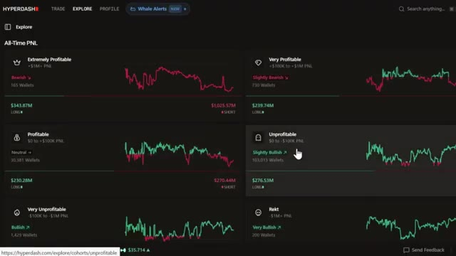
*⏱️ 00:04:04 — Capture d'écran montrant le tableau de bord de la plateforme Hyperdash classant les portefeuilles par niveau de rentabilité (All-Time PNL).*

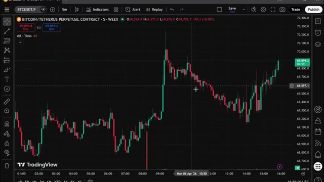
*⏱️ 00:04:19 — Capture d'écran montrant un graphique de trading TradingView pour le contrat perpétuel Bitcoin/Tether (BTCUSDT.P) en unités de 5 minutes.*

---

### ⏱️ `[00:04:27 - 00:04:52]` | Segment #11

**🔊 Audio (Transcription Intégrale Mot pour Mot en Français) :**
> Regardez le graphique. Lignes vertes pour le support, lignes rouges pour la résistance, étiquettes de prix. Le nombre de fois que chaque niveau a été testé, tout est tracé automatiquement, et ensuite, cela vous indique exactement où se trouve le prix en ce moment par rapport à ces niveaux et vous donne un biais directionnel basé sur l'historique de la façon dont le prix a réagi à chacun d'eux. Cela me prenait 20 minutes à tracer manuellement sur chaque graphique.

**👁️ Analyse Visuelle d'Écran (gemini-3.5-flash-lite) :**
**Interface & Outils** : TradingView et terminal de commande / interface d'analyse textuelle.

**Contenu textuel & Code** : Niveaux de prix (supports S1 à S5 et résistances R1, R2), nombre de tests par niveau, prix actuel (69 891), et analyse du biais de marché (Cautiously Bearish).

**Action / Démonstration** : Présentation visuelle des niveaux automatiques de support et de résistance sur le graphique du Bitcoin, suivie d'une analyse textuelle de la configuration de prix actuelle.

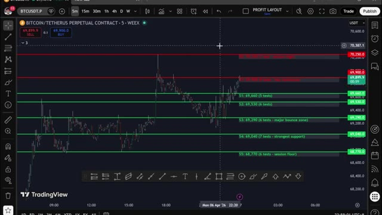
*⏱️ 00:04:33 — Graphique TradingView affichant le cours du Bitcoin (BTCUSDT.P) avec des lignes de support vertes et de résistance rouges annotées.*

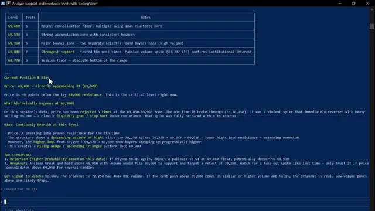
*⏱️ 00:04:39 — Interface de terminal affichant une analyse textuelle détaillée des niveaux de support et de résistance, ainsi que la position actuelle et les scénarios de trading.*

---

### ⏱️ `[00:04:52 - 00:05:25]` | Segment #12

**🔊 Audio (Transcription Intégrale Mot pour Mot en Français) :**
> Claude le fait en quelques secondes. Et ce n'est que le point de départ. Vous pouvez également demander à Claude d'écrire des stratégies Pinescript complètes à partir d'un anglais simple, de déboguer vos indicateurs existants, d'exécuter une analyse de confluence multi-périodes complète sur les graphiques hebdomadaire, journalier, de quatre heures et d'une heure simultanément, et d'obtenir une recommandation de trade spécifique avec un point d'entrée, un stop-loss et un take-profit, le tout à partir d'une seule invite. Mais voici où cela devient entièrement mains libres. Vous pouvez connecter n'interrompt pas... n'importe laquelle de ces stratégies directement à votre exchange via un webhook TradingView. Lorsque votre stratégie déclenche un signal sur

**👁️ Analyse Visuelle d'Écran (gemini-3.5-flash-lite) :**
**Interface & Outils** : TradingView, Pine Editor, Terminal de commande (Claude Code session).

**Contenu textuel & Code** : Code source Pine Script (stratégie ATR Trailing Stop, signaux d'achat/vente), tableau de décomposition par unité de temps (Weekly, Daily, 4-Hour, 1-Hour avec EMA, RSI, MACD), niveaux clés (Support/Résistance), score de confluence (3/4 Bullish), recommandations de trade (Entry, Stop Loss, Take Profit, R:R).

**Action / Démonstration** : Présentation simultanée d'un script de stratégie de trading et d'une analyse automatisée multi-périodes générée par l'intelligence artificielle.

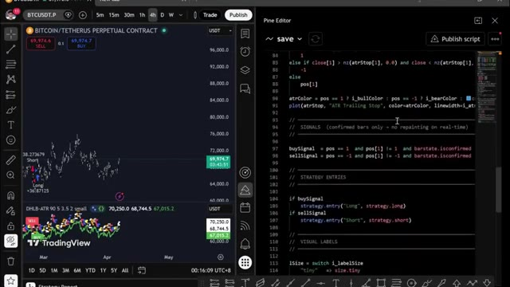
*⏱️ 00:05:00 — Interface TradingView avec un graphique de prix BTCUSDT à gauche et l'éditeur de code Pine Script à droite.*

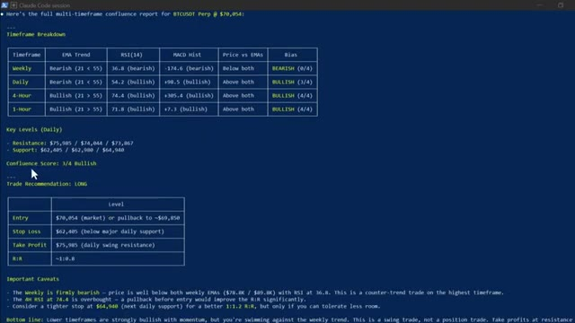
*⏱️ 00:05:08 — Fenêtre de terminal affichant un rapport complet d'analyse de confluence multi-périodes généré par Claude Code pour BTCUSDT.*

---

### ⏱️ `[00:05:25 - 00:05:44]` | Segment #13

**🔊 Audio (Transcription Intégrale Mot pour Mot en Français) :**
> TradingView, Claude le reçoit instantanément via le webhook et exécute le trade automatiquement sur votre exchange. Entrée, stop-loss, take-profit. Tout est fait. Sans que vous ne touchiez à rien, le signal est arrivé. Claude l'a traité. Trade ouvert. Confirmation en retour avec chaque détail. Vous construisez la stratégie une seule fois, et à partir de ce moment-là, elle tourne toute seule.

**👁️ Analyse Visuelle d'Écran (gemini-3.5-flash-lite) :**
**Interface & Outils** : TradingView, interface de l'exchange WEEX et terminal de commandes (CLI / Claude Code).

**Contenu textuel & Code** : Graphiques de prix (BTC/USDT, ETH/USDT), commandes d'API REST pour l'exécution d'ordres, récapitulatif détaillé d'un trade (Side: LONG, Size: 0.024 ETH, Entry Price: $2,052.00, Leverage: 5x, Take Profit: $2,216.16, Stop Loss: $1,990.44).

**Action / Démonstration** : Exécution automatisée d'un trade via webhook et script Python, affichage des ordres en cours et visualisation sur le terminal des métriques de risque/rendement (R/R ratio).

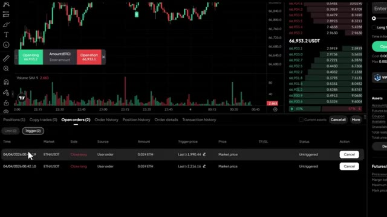
*⏱️ 00:05:29 — Image #1 montre l'interface de l'exchange (WEEX) avec un tableau des ordres ouverts affichant des transactions ETH/USDT.*

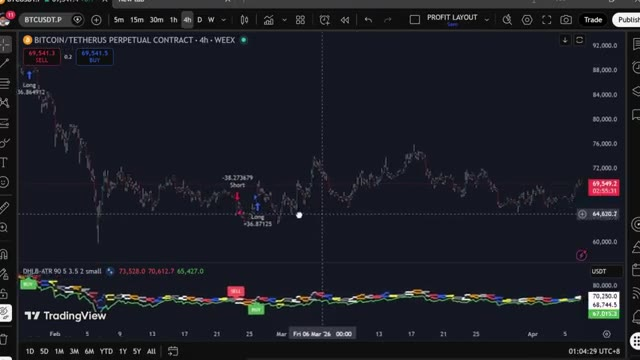
*⏱️ 00:05:34 — Image #2 présente un graphique TradingView en timeframe 4h pour la paire Bitcoin / Tether (BTCUSDT.P) avec des indicateurs techniques et des signaux d'achat/vente.*

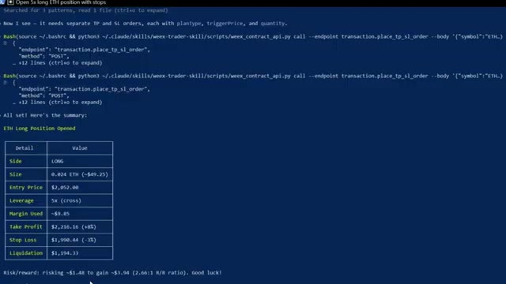
*⏱️ 00:05:39 — Image #3 affiche un terminal de commandes avec des scripts Python exécutés par Claude, confirmant l'ouverture d'une position LONG sur Ethereum avec les détails d'entrée, de take-profit, de stop-loss et de levier.*

---

### ⏱️ `[00:05:44 - 00:06:07]` | Segment #14

**🔊 Audio (Transcription Intégrale Mot pour Mot en Français) :**
> Maintenant, celui-ci, c'est celui qui a complètement changé ma routine quotidienne. J'ai construit mon propre assistant de trading IA en utilisant Claude et Telegram, et il trouve des transactions rentables pour moi en utilisant l'IA la plus puissante disponible en ce moment, plus intelligente que n'importe quel humain ne pourrait l'être. Il exécute des transactions, gère mes positions, m'envoie des alertes en temps réel et génère des rapports de portefeuille complets, le tout à partir d'un simple message sur mon téléphone.

**👁️ Analyse Visuelle d'Écran (gemini-3.5-flash-lite) :**
**Interface & Outils** : Telegram, Hyperdash (Hyperliquid), Assistant IA Claude.

**Contenu textuel & Code** : Analyses de portefeuilles de traders rentables, PnL historique, scan de taux de financement (funding rates) sur 690 paires futures, métriques de positions Long/Short.

**Action / Démonstration** : Interaction avec un bot Telegram pour scanner les taux de financement et analyser les positions des meilleurs traders via l'IA.

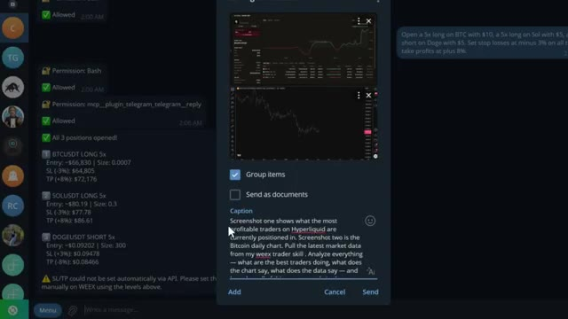
*⏱️ 00:05:50 — Interface Telegram affichant un bot de trading avec des aperçus de graphiques et un message décrivant l'analyse des traders rentables sur Hyperliquid.*

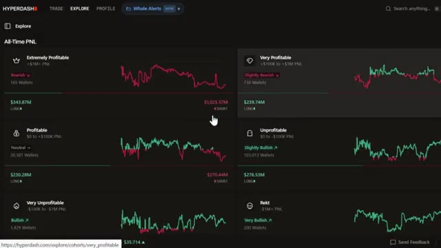
*⏱️ 00:05:56 — Interface Hyperdash affichant le PnL global et le comportement des portefeuilles (All-Time PNL) classés par niveau de rentabilité.*

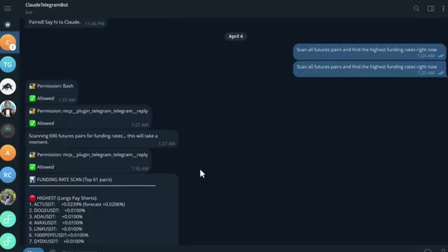
*⏱️ 00:06:01 — Interface de discussion Telegram montrant un bot piloté par Claude effectuant un scan des taux de financement sur les paires futures.*

---

### ⏱️ `[00:06:08 - 00:06:29]` | Segment #15

**🔊 Audio (Transcription Intégrale Mot pour Mot en Français) :**
> Ce matin, j'ai placé un trade depuis mon lit, j'ai pris mes profits depuis la salle de sport, sans toucher à un seul graphique. C'est Claude qui tourne sur mon ordinateur. Ça a l'air simple. Juste une interface textuelle. Mais regardez ce qu'il peut faire. Vous pouvez pratiquement ouvrir une position de trading avec une seule phrase. Ouvre un long x5 sur l'ETH avec 10 dollars. Définis un stop loss à moins 3 % et un take profit à plus 8 %.

**👁️ Analyse Visuelle d'Écran (gemini-3.5-flash-lite) :**
**Interface & Outils** : Terminal de commandes (Claude Code)

**Contenu textuel & Code** : Interface textuelle affichant la version Claude Code v2.1.91, le modèle Opus 4.6 (1M context), Claude Max et le répertoire courant C:\Users\mp.

**Action / Démonstration** : Le terminal est ouvert et prêt à recevoir des commandes textuelles pour exécuter des scripts de trading ou interagir avec l'assistant.

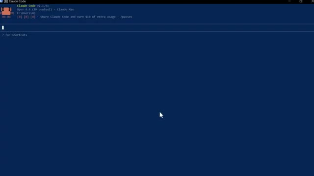
*⏱️ 00:06:13 — Capture d'écran montrant l'interface en ligne de commande de l'outil Claude Code.*

---

### ⏱️ `[00:06:30 - 00:06:53]` | Segment #16

**🔊 Audio (Transcription Intégrale Mot pour Mot en Français) :**
> Regarde-le réfléchir. Et voilà. Position ouverte. Stop loss défini. Take profit défini. Confirmation en retour avec chaque détail. Une phrase. C'est fait. Maintenant, laisse-moi te montrer quelque chose qui m'a vraiment scotché la première fois que j'ai lancé ça. Donne-moi un tableau de bord complet de mon portefeuille. Toutes mes positions, mes PNL, mes frais de financement, ma courbe de capital sous forme de rapport visuel.

**👁️ Analyse Visuelle d'Écran (gemini-3.5-flash-lite) :**
**Interface & Outils** : WEEX (bourse crypto) et terminal de commandes (Claude Code).

**Contenu textuel & Code** : Ordres ouverts sur ETH/USD, tableau récapitulatif des détails de la position (Side: LONG, Size: 0.024 ETH, Entry Price: $2,052.00, Leverage: 5x, Take Profit: $2,216.16, Stop Loss: $1,990.44), ratio R/R de 2.66:1.

**Action / Démonstration** : Exécution d'un ordre long avec configuration automatique des niveaux de stop loss et de take profit via un script automatisé.

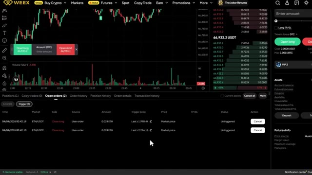
*⏱️ 00:06:35 — Interface de trading de la plateforme WEEX affichant le graphique des prix, le carnet d'ordres et les ordres ouverts en bas.*

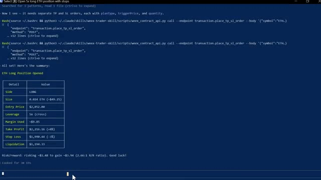
*⏱️ 00:06:41 — Terminal de commande (Claude Code) affichant un résumé détaillé de la position ouverte avec les paramètres de take profit, stop loss et ratio risque/rendement.*

---

### ⏱️ `[00:06:53 - 00:07:27]` | Segment #17

**🔊 Audio (Transcription Intégrale Mot pour Mot en Français) :**
> Regardez-le fonctionner. Il extrait toutes les données de mon compte en ce moment même. Et voici ce qu'il génère. Un tableau de bord complet en mode sombre. Une courbe de capital. Un taux de réussite. Un revenu de financement ventilé par crypto-monnaie. Chaque position ouverte avec la distance de liquidation mise en surbrillance. C'est le genre de rapport qu'un desk de trading professionnel produirait. Je l'ai obtenu en quelques secondes à partir d'une seule consigne. Et soit dit en passant, si vous trouvez cela utile jusqu'à présent, restez jusqu'à la fin parce que je vais vous montrer comment configurer tout cela vous-même. Continuez à regarder. Très bien, laissez-moi vous montrer plus. Vous pouvez aussi

**👁️ Analyse Visuelle d'Écran (gemini-3.5-flash-lite) :**
**Interface & Outils** : Tableau de bord WEEX Portfolio en mode sombre.

**Contenu textuel & Code** : Équité totale ($20.61), PnL non réalisé, taux de réussite à 25%, courbe de capital, graphiques journaliers, et tableau des taux de financement (UNI/USDT, SEI/USDT, BCH/USDT, etc.).

**Action / Démonstration** : Présentation des données extraites du compte de trading en temps réel via le tableau de bord.

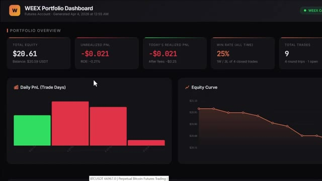
*⏱️ 00:07:02 — Vue d'ensemble du tableau de bord WEEX Portfolio montrant les métriques principales (équité, PnL) et des graphiques de performance.*

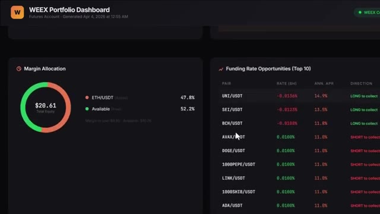
*⏱️ 00:07:10 — Suite du tableau de bord WEEX Portfolio affichant l'allocation de marge et les opportunités de taux de financement par crypto-monnaie.*

---

### ⏱️ `[00:07:27 - 00:08:05]` | Segment #18

**🔊 Audio (Transcription Intégrale Mot pour Mot en Français) :**
> connecte ceci à ton télégramme pour envoyer des commandes directement depuis ton téléphone. Tu peux taper scanner toutes les paires futures et trouver les taux de financement les plus élevés en ce moment. Il a scanné chaque paire, les a classées par taux de financement, a calculé le rendement annualisé, et m'a dit exactement dans quelle direction me positionner pour percevoir ce financement instantanément. Maintenant, si tu ne sais pas ce que sont les taux de financement, c'est essentiellement de l'argent gratuit que l'échange verse toutes les huit heures aux traders qui sont positionnés du bon côté du marché. Quand le financement est positif, les acheteurs paient les vendeurs. Quand le financement est négatif, les vendeurs paient les acheteurs. Et certains de ces taux sont extrêmement élevés. Ce que fait ce scanner

**👁️ Analyse Visuelle d'Écran (gemini-3.5-flash-lite) :**
**Interface & Outils** : Application Telegram et plateforme d'échange WEEX.

**Contenu textuel & Code** : Liste des taux de financement les plus élevés et les plus bas pour différentes paires de cryptomonnaies sur Telegram, ainsi que le tableau des règlements de taux de financement pour BTC/USDT sur WEEX.

**Action / Démonstration** : Consultation des résultats d'un scan automatisé de taux de financement et visualisation de l'historique des taux sur un échange.

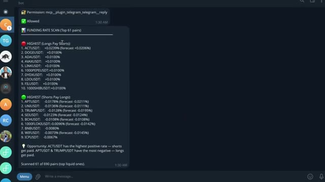
*⏱️ 00:07:37 — Interface Telegram montrant les résultats d'un scan de taux de financement des paires futures.*

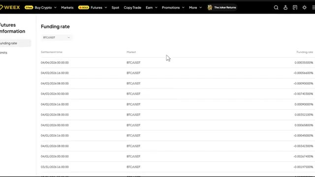
*⏱️ 00:07:55 — Interface de la plateforme d'échange WEEX affichant l'historique des taux de financement (Funding rate) pour Bitcoin.*

---

### ⏱️ `[00:08:05 - 00:08:24]` | Segment #19

**🔊 Audio (Transcription Intégrale Mot pour Mot en Français) :**
> est de trouver les paires où ce taux est le plus élevé, de calculer ce que cela donne sur une base annuelle, parfois 50 %, 100 %, voire plus, et de vous dire exactement dans quelle direction ouvrir une position pour vous asseoir et percevoir ce paiement toutes les huit heures. Vous n'essayez même pas de prédire la direction des prix.

**👁️ Analyse Visuelle d'Écran (gemini-3.5-flash-lite) :**
**Interface & Outils** : Application Telegram et interface de l'échange de cryptomonnaies WEEX.

**Contenu textuel & Code** : Liste des taux de financement classés par paires (ACTUSDT, DOGEUSDT, APTUSDT, etc.) avec leurs prévisions, et interface de trading WEEX avec graphique en chandelier et carnet d'ordres.

**Action / Démonstration** : Analyse des taux de financement les plus élevés sur le bot Telegram pour identifier les opportunités de positionnement, puis visualisation de l'interface de trading WEEX.

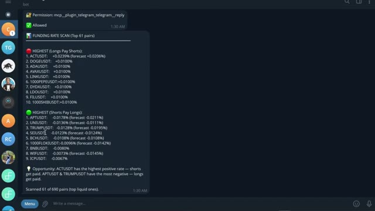
*⏱️ 00:08:10 — Capture d'écran d'un bot Telegram affichant un scan des taux de financement (Funding Rate Scan) pour différentes paires de cryptomonnaies.*

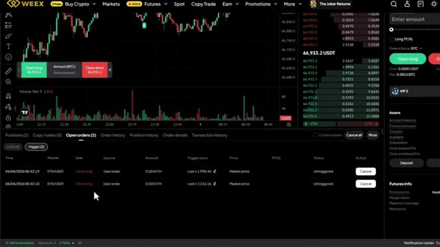
*⏱️ 00:08:19 — Interface de la plateforme d'échange WEEX affichant un graphique de trading de cryptomonnaies et des ordres ouverts en bas.*

---

### ⏱️ `[00:08:24 - 00:08:44]` | Segment #20

**🔊 Audio (Transcription Intégrale Mot pour Mot en Français) :**
> Tu étais simplement en train de farmer le taux. Et maintenant, au lieu de vérifier manuellement chaque paire toi-même, ce que personne ne fait, Claude le fait en quelques secondes et t'apporte l'opportunité sur un plateau. Maintenant, cette prochaine section, c'est là que ça devient vraiment intéressant. Et honnêtement, c'est l'une de mes choses préférées que j'ai construites avec Claude. Et si tu pouvais analyser 33 000 portefeuilles sur Hyperliquid ?

**👁️ Analyse Visuelle d'Écran (gemini-3.5-flash-lite) :**
**Interface & Outils** : Interface de l'exchange WEEX et application de messagerie (Telegram Bot).

**Contenu textuel & Code** : Liste de paires de trading (SOLUSDT, LINKUSDT, ADAUSDT, etc.), graphiques en chandeliers japonais, carnet d'ordres et résultats d'un scan des taux de financement (HIGHEST Longs Pay Shorts et Shorts Pay Longs).

**Action / Démonstration** : Navigation et affichage des paires de cryptomonnaies sur un exchange, puis présentation des résultats d'un scan automatisé des taux de financement par un bot.

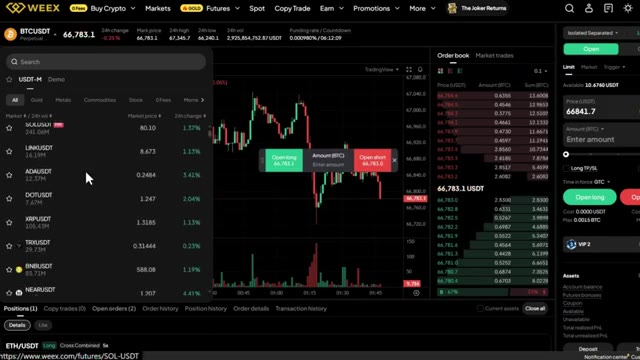
*⏱️ 00:08:29 — Interface de la plateforme d'échange WEEX affichant le graphique du cours BTC/USDT et une liste de paires de cryptomonnaies.*

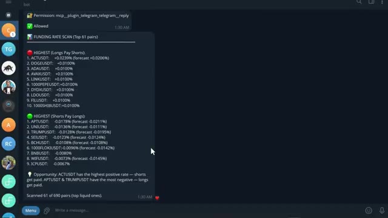
*⏱️ 00:08:34 — Interface d'une application de messagerie (Telegram) montrant un rapport de scan automatisé des taux de financement (funding rates) pour différentes paires de cryptomonnaies.*

---

### ⏱️ `[00:08:45 - 00:09:07]` | Segment #21

**🔊 Audio (Transcription Intégrale Mot pour Mot en Français) :**
> Trouvez les 20 meilleurs traders les plus rentables. Voyez exactement ce qu'ils achètent en ce moment. Leurs prix d'entrée, leur effet de levier, leur P&L non réalisé, et obtenez un plan de trading complet basé sur tout cela. Aucune clé API nécessaire, aucun code, aucune recherche manuelle. Maintenant, Hyperliquid, très rapidement, c'est un échange perpétuel décentralisé qui fonctionne sur sa propre blockchain.

**👁️ Analyse Visuelle d'Écran (gemini-3.5-flash-lite) :**
**Interface & Outils** : Terminal de commandes CLI (Image 1) et documentation Web Hyperliquid Docs / GitBook (Image 2).

**Contenu textuel & Code** : Tableau comparatif Smart Money vs Rekt Money (XMR, BTC, ETH, HYPE, LIT, SUI), signaux de trading contrariens, et plan de trading complet pour XMR (Token, Direction, Prix actuel, Zone d'entrée, Stop Loss, Take Profit).

**Action / Démonstration** : Analyse des portefeuilles de baleines (Whale wallets) et génération automatique d'un plan de trading basé sur les positions des traders les plus rentables.

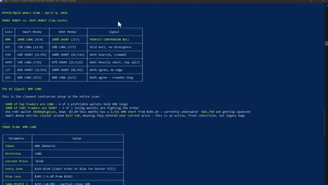
*⏱️ 00:08:50 — Un terminal de commandes affichant un tableau d'analyse "Hyperliquid Whale Scan" comparant les positions des smart money et rekt money sur différentes cryptomonnaies, incluant un plan de trading détaillé pour XMR.*

---

### ⏱️ `[00:09:07 - 00:09:43]` | Segment #22

**🔊 Audio (Transcription Intégrale Mot pour Mot en Français) :**
> Pas de KYC, pas d'intermédiaire. Et comme c'est entièrement sur la chaîne, chaque transaction, chaque position, chaque portefeuille, tout est public. C'est ce qui rend cela possible. Très bien, laissez-moi ouvrir Claude Code et vous montrer cela en direct. Voici la première chose que je veux vous montrer. Claude analyse les 20 portefeuilles les plus rentables sur Hyperliquid en ce moment, extrait toutes les positions ouvertes et les classe par rentabilité totale. En une seule fois. Regardez ce qui se passe. Claude accède aux points de terminaison publics d'Hyperliquid, commence à extraire les données des portefeuilles sur 33 000 adresses, les classe par rentabilité et commence à rédiger le rapport. Vous pouvez le voir

**👁️ Analyse Visuelle d'Écran (gemini-3.5-flash-lite) :**
**Interface & Outils** : Explorateur blockchain Hyperliquid (Interface Web).

**Contenu textuel & Code** : Tableau des transactions d'une adresse de portefeuille (0x393d...2109) incluant les colonnes Hash, Action (TokenDelegate, CDeposit, SystemSpotSendAction), Block, Time et User.

**Action / Démonstration** : Consultation des transactions publiques on-chain d'un portefeuille sur Hyperliquid.

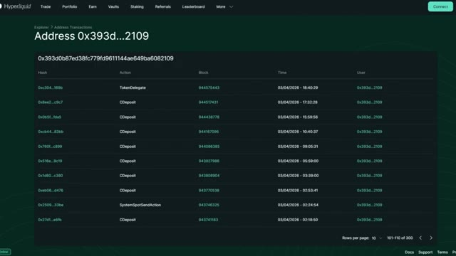
*⏱️ 00:09:16 — Capture d'écran de l'explorateur de la plateforme Hyperliquid affichant les transactions publiques d'une adresse de portefeuille spécifique.*

---

### ⏱️ `[00:09:43 - 00:10:20]` | Segment #23

**🔊 Audio (Transcription Intégrale Mot pour Mot en Français) :**
> qui analyse les portefeuilles en temps réel. Prix d'entrée, effet de levier, P&L non réalisé, tout arrive en direct. Et voici le résultat. Les 20 principales baleines classées, chaque position ouverte répertoriée. Et en bas, le résumé du sentiment global. En ce moment, l'argent intelligent est net acheteur sur le Bitcoin et net vendeur sur presque tout le reste, en particulier Ethereum. C'est le genre de signal qui prenait des heures à reconstituer manuellement. Claude le fait en moins d'une minute. Et c'est là que ça devient vraiment intéressant. Ce prompt compare les 20 portefeuilles les plus rentables aux 20 plus

**👁️ Analyse Visuelle d'Écran (gemini-3.5-flash-lite) :**
**Interface & Outils** : Terminal en ligne de commande (CLI)

**Contenu textuel & Code** : Rapport du trader #1 (adresse 0xecb6...2b00) avec PnL global de +$204,4M (202% ROI), PnL mensuel de +$5,28M, valeur du compte de 71,8M$, et un tableau des positions clés (BTC, ETH, SOL, ENA, LINK, FARTCOIN, WLD, AAVE, HYPE, MON, DOGE, PUMP) avec direction, taille, prix d'entrée, effet de levier et uPnL.

**Action / Démonstration** : Affichage des données en direct des portefeuilles des plus grands traders et analyse de leurs positions ouvertes.

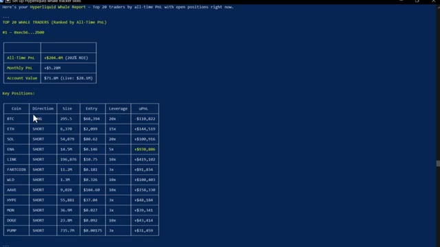
*⏱️ 00:09:52 — Un rapport de suivi des baleines Hyperliquid affiché dans un terminal en ligne de commande, détaillant les performances et les positions ouvertes des meilleurs traders.*

---

### ⏱️ `[00:10:20 - 00:10:55]` | Segment #24

**🔊 Audio (Transcription Intégrale Mot pour Mot en Français) :**
> les portefeuilles perdants et trouve chaque jeton où ils sont sur des côtés opposés du trade. Regardez-le attirer les deux groupes simultanément. Des portefeuilles rentables d'un côté, des portefeuilles perdants de l'autre, et ensuite il commence à croiser les positions. Voici le résultat. Vous pouvez voir là où les deux groupes sont d'accord. Ils sont tous les deux acheteurs sur suey. C'est donc un trade encombré. Mais regardez ça. L'argent intelligent est massivement acheteur sur XMR, TRX, Pendle et Farcoin, tandis que les traders de détail sont vendeurs sur ces pièces. Cette divergence juste là, c'est le signal. C'est le genre d'analyse pour laquelle les hedge funds payent. Vous obtenez

**👁️ Analyse Visuelle d'Écran (gemini-3.5-flash-lite) :**
**Interface & Outils** : Terminal de commandes / Claude Code / CLI Python.

**Contenu textuel & Code** : Commandes Bash, affichage de code JSON, gestion de listes en Python avec des messages d'erreur (AttributeError), analyses de portefeuilles Hyperliquid.

**Action / Démonstration** : Exécution et débogage de scripts Python en ligne de commande pour scanner des portefeuilles et analyser des positions de trading.

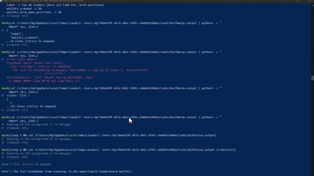
*⏱️ 00:10:29 — Un terminal de commandes affichant l'exécution de scripts Python et l'analyse de données de portefeuilles via Claude Code.*

---

### ⏱️ `[00:10:55 - 00:11:28]` | Segment #25

**🔊 Audio (Transcription Intégrale Mot pour Mot en Français) :**
> obtenu grâce à un outil d'IA à 20 dollars et une API publique gratuite. Et si vous voulez la configuration complète d'Hyperliquid, le code de compétence, chaque invite, le système complet de suivi des baleines, je vous dirai exactement comment obtenir tout cela dans un instant, continuez à regarder. Maintenant, si vous êtes prêt à aller encore plus loin, vous pouvez utiliser Claude Code pour créer un bot de trading entièrement automatisé du début à la fin pour les cryptos, les actions ou quel que soit le marché que vous tradez, et honnêtement, c'est ainsi que Claude va changer notre façon de trader pour toujours, et nous l'avons déjà fait auparavant, laissez-moi vous montrer quel est le résultat final

**👁️ Analyse Visuelle d'Écran (gemini-3.5-flash-lite) :**
**Interface & Outils** : Interface web personnalisée, Terminal de commande (Claude Code), et plateforme de courtage Interactive Brokers.

**Contenu textuel & Code** : Fonctionnalités de suivi de portefeuilles de baleines, analyses de sentiment, carnets d'ordres et graphiques financiers.

**Action / Démonstration** : Présentation des outils logiciels, du terminal de développement et des plateformes de trading pour l'analyse des marchés.

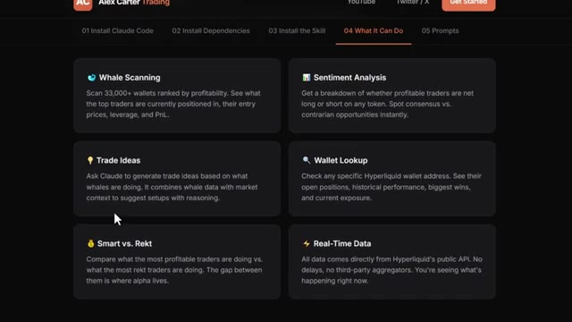
*⏱️ 00:11:03 — Interface web sombre présentant les fonctionnalités du système Alex Carter Trading, incluant le balayage des baleines (Whale Scanning), l'analyse de sentiment et les idées de trade.*

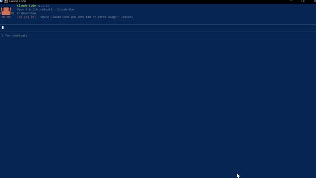
*⏱️ 00:11:12 — Interface de terminal de commande 'Claude Code v2.1.91' affichant le profil Opus 4.6 sur fond bleu sombre.*

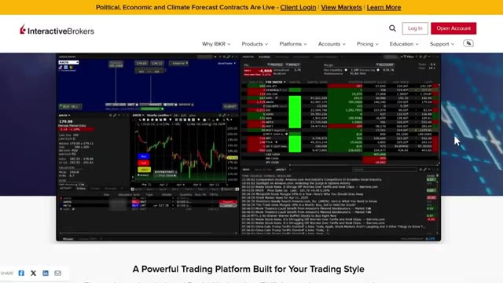
*⏱️ 00:11:20 — Page web du courtier Interactive Brokers montrant une plateforme de trading avancée intégrée avec des graphiques et des carnets d'ordres.*

---

### ⏱️ `[00:11:28 - 00:12:04]` | Segment #26

**🔊 Audio (Transcription Intégrale Mot pour Mot en Français) :**
> à quoi ça ressemble. C'est le tableau de bord, une URL, chaque position, votre courbe de capitaux propres, l'état de votre bot, vos données de baleines, le tout en direct, le tout au même endroit. Fini les onglets de navigateur multiples, fini les doutes sur les entrées. Et chaque matin, avant même d'ouvrir votre ordinateur portable, ce briefing alpha quotidien est déjà dans votre boîte de réception chaque jour à l'heure et prêt à être lu. Il a déjà analysé les baleines, lu les graphiques, vérifié votre compte et vous a remis la configuration avec la plus forte conviction pour la journée. Dimensionné selon votre risque exact. Une consigne. Toute la pile. Et le bot lui-même ne reste pas assis

**👁️ Analyse Visuelle d'Écran (gemini-3.5-flash-lite) :**
**Interface & Outils** : Tableau de bord WEEX Dashboard (Interface web de trading).

**Contenu textuel & Code** : Métriques du compte (Equity: 19.78, Available: 19.78, Margin Used: 0.00, Unrealized PNL: 0.00), PNL fermé, courbe de capitaux propres (Equity Curve) sur 90 jours avec message de collecte de données, positions ouvertes (0 open) et signaux récents.

**Action / Démonstration** : Présentation et visualisation en direct du tableau de bord centralisé regroupant l'ensemble des données de trading et l'état du bot.

*⏱️ 00:11:37 — Capture d'écran montrant le tableau de bord global de la plateforme WEEX avec les détails du compte et l'état des positions.*

---

### ⏱️ `[00:12:04 - 00:12:39]` | Segment #27

**🔊 Audio (Transcription Intégrale Mot pour Mot en Français) :**
> sur votre ordinateur portable. Il tourne 24 heures sur 24 et 7 jours sur 7 sur un serveur cloud. S'il plante, il redémarre tout seul. Si votre Wi-Fi se coupe, il continue. Votre ordinateur portable n'est que la télécommande. Désormais, la barrière mathématique pour construire tout cela a pour ainsi dire disparu. Avant des modèles performants comme CloudCode, cela aurait pris des semaines, voire des mois à assembler. Maintenant, vous pouvez passer d'une idée à un système opérationnel en un après-midi, et c'est important parce que la plupart des stratégies ne fonctionnent pas. L'avantage concurrentiel ne consiste pas à avoir une stratégie parfaite. Il réside dans la capacité à tester suffisamment d'idées assez rapidement pour trouver celles qui fonctionnent vraiment.

**👁️ Analyse Visuelle d'Écran (gemini-3.5-flash-lite) :**
**Interface & Outils** : Éditeur de texte nano dans un terminal Linux, interface de cours en ligne, et plateforme TradingView.

**Contenu textuel & Code** : Paramètres de configuration SSH (/etc/ssh/sshd_config), plan de cours de trading, et graphique technique BTCUSDT avec indicateurs (BB 30, RSI 14).

**Action / Démonstration** : Configuration du serveur distant, présentation du contenu pédagogique et analyse technique des prix du Bitcoin.

*⏱️ 00:12:13 — Éditeur de configuration SSH (GNU nano) affichant les paramètres de connexion et de sécurité du serveur distant.*

*⏱️ 00:12:30 — Graphique de trading TradingView pour la paire BTCUSDT Perpetual Contract sur Bybit, avec bandes de Bollinger, volumes et indicateur RSI.*

---

### ⏱️ `[00:12:41 - 00:13:16]` | Segment #28

**🔊 Audio (Transcription Intégrale Mot pour Mot en Français) :**
> Très bien et écoutez, pendant les prochaines années, deux sortes de traders existeront. Ceux qui utilisent l'IA et ceux qui font encore tout manuellement. Même marché. Résultats très différents. Voici comment vous mettez du bon côté de cela, j'ai rassemblé tout à l'intérieur de la communauté AI Trade Edge, chaque prompt, chaque bot, chaque modèle, chaque guide étape par étape que j'utilise personnellement, tout au même endroit, et tout ce que je construis à l'avenir est ajouté directement dans le groupe dès sa sortie, nous testons également des stratégies provenant de tout Internet, en les automatisant grâce à Pine Script, en les exécutant

**👁️ Analyse Visuelle d'Écran (gemini-3.5-flash-lite) :**
**Interface & Outils** : Interface du réseau social X et interface Web de la plateforme Alex Carter Trading (section "What It Can Do").

**Contenu textuel & Code** : Texte de publication sur X argumentant pourquoi l'IA surpasse l'humain en trading ; liste des 78 outils permettant à Claude de contrôler TradingView (lecture de graphiques, données OHLCV, indicateurs techniques, etc.).

**Action / Démonstration** : Navigation et présentation des avantages du trading algorithmique et des capacités de contrôle des outils d'IA sur les graphiques de trading.

*⏱️ 00:12:50 — Capture d'écran du réseau social X montrant une publication d'Alex Carter listant les avantages du trading par IA par rapport au trading manuel.*

*⏱️ 00:12:59 — Capture d'écran de la plateforme d'Alex Carter Trading montrant la section des étapes de configuration et les fonctionnalités de contrôle des graphiques par l'IA.*

---

### ⏱️ `[00:13:16 - 00:13:52]` | Segment #29

**🔊 Audio (Transcription Intégrale Mot pour Mot en Français) :**
> en direct et en partageant exactement ce qui fonctionne et ce qui ne fonctionne pas, donc vous n'obtenez pas seulement des outils, vous obtenez une opération de recherche en direct à l'intérieur, il y a aussi un cours complet de trading agentique de 2,5 heures, du débutant à l'expert, sans aucune base en programmation nécessaire, à la fin, vous aurez votre propre système de trading par IA fonctionnant en direct, quelque chose que la plupart des traders particuliers ne savent même pas être possible en ce moment, 79 dollars et 99 cents par mois, un seul bon trade couvre ce montant et les 100 premiers membres bloquent ce tarif de façon permanente. Après cela, le prix augmente. Le lien est dans la description. Vous vraiment

**👁️ Analyse Visuelle d'Écran (gemini-3.5-flash-lite) :**
**Interface & Outils** : Interface Web de cours en ligne et plateforme de paiement Whop.

**Contenu textuel & Code** : Titres de modules de cours (OpenClaw, Agentic Bots, Build Your Own Python Bot, Deploy to Hostinger VPS) et tarifs d'abonnement.

**Action / Démonstration** : Navigation à travers les modules du cours de trading agentique et présentation de l'offre d'abonnement payante.

---

### ⏱️ `[00:13:52 - 00:14:12]` | Segment #30

**🔊 Audio (Transcription Intégrale Mot pour Mot en Français) :**
> on ne peut pas se permettre de rater ça. Et c'est tout. C'est ainsi que Claude change le trading pour toujours et comment vous pouvez en faire partie. Si vous voulez approfondir chacun de ces sujets individuellement, la vue complète du trading, la visite guidée de Telegram, et le suivi des baleines sur Hyperliquid, toutes ces vidéos s'affichent à l'écran en ce moment même. Allez les voir à votre rythme.

**👁️ Analyse Visuelle d'Écran (gemini-3.5-flash-lite) :**
**Interface & Outils** : Terminal de commande (Claude Code) et plateformes web (Grand View Research, Hyperliquid Leaderboard).

**Contenu textuel & Code** : L'interface de Claude Code, les prévisions du marché du trading algorithmique (taille du marché estimée à 21,06 milliards USD en 2024), et les données de performance du leaderboard Hyperliquid.
[DESC_IMAGE_1] Présentation des outils de développement IA et des statistiques du marché.

**Action / Démonstration** : Explications face caméra et analyse conceptuelle des marchés.

*⏱️ 00:13:57 — Interface de terminal Claude Code affichée à l'écran.*

*⏱️ 00:14:02 — Rapport de recherche de marché sur le trading algorithmique (2025-2030) provenant de Grand View Research.*

*⏱️ 00:14:07 — Tableau de classement (Leaderboard) de la plateforme de trading Hyperliquid affichant les portefeuilles et PnL.*

---

### ⏱️ `[00:14:12 - 00:14:30]` | Segment #31

**🔊 Audio (Transcription Intégrale Mot pour Mot en Français) :**
> Et si vous voulez le guide complet étape par étape sur la façon de construire votre propre système de trading agentique en utilisant Claude, cette vidéo s'affiche également à l'écran. Allez la voir ensuite. Si vous avez trouvé cela utile, laissez un pouce bleu. Cela aide vraiment la chaîne. Abonnez-vous si ce n'est pas déjà fait et je vous vois dans la prochaine.

**👁️ Analyse Visuelle d'Écran (gemini-3.5-flash-lite) :**
**Interface & Outils** : Aucune interface visible

**Contenu textuel & Code** : Aucun contenu technique, code ou graphique affiché

**Action / Démonstration** : Aucune action ou démonstration en cours

---

