# 🎬 How I Automate A RSI and Bollinger Band Strategy Using Claude Code

> **Chaîne** : [Alex Carter](https://www.youtube.com/@AlexCarterTrading)  
> **Lien YouTube** : [https://www.youtube.com/watch?v=W0lQevqJK50](https://www.youtube.com/watch?v=W0lQevqJK50)  
> **Date de publication** : 20260628  
> **Durée** : 00:12:49  
> **Identifiant vidéo** : `W0lQevqJK50`  
> **Transcription & Analyse** : `whisper-v3-large-turbo+gemini-3.5-flash-lite`  

---

## 📌 Synthèse Exécutive & Outils

### 💡 Résumé

Cette vidéo présentée par l'analyste de la chaîne Alex Carter propose une immersion pratique au cœur du trading quantitatif moderne, combinant l'intelligence artificielle générative et l'analyse technique traditionnelle. L'objectif principal est de démontrer comment s'affranchir de la courbe d'apprentissage ardue de Pine Script en exploitant l'assistant IA Claude (notamment via Claude Code) pour générer en quelques secondes un script de trading entièrement fonctionnel et automatisable sur TradingView.

La stratégie de trading décortiquée repose sur le croisement de deux indicateurs incontournables : les Bandes de Bollinger (réglées sur une longueur de 30 avec un écart-type de 2) et le RSI (paramétré avec des seuils de surachat à 70 et de survente à 30). L'intervenant démontre pas à pas comment filtrer les faux signaux inhérents aux marchés en range en combinant les dépassements des bandes de Bollinger avec les zones extrêmes du RSI. Plus encore, il met en lumière l'utilisation des divergences haussières et baissières — caractérisées par des sommets ou des creux inversés entre le prix et le RSI — pour maximiser la précision des entrées, revendiquant un taux de réussite potentiel très élevé.

Enfin, la vidéo aborde l'aspect opérationnel de l'automatisation en guidant le spectateur à travers les étapes d'inscription et de dépôt sur des exchanges de contrats à terme (tels que Bybit ou des alternatives sans KYC comme Blofen), pour finir par l'intégration de la stratégie sur TradingView en vue d'une exécution automatisée par webhooks. L'approche démontre l'efficacité d'un workflow agentique où l'IA fait office de pont direct entre une idée de stratégie discrétionnaire et son implémentation algorithmique instantanée.

### 🛠️ Outils, Modèles & Logiciels Présentés

* **Claude / Claude Code** : Assistant conversationnel et environnement de développement propulsé par l'IA, utilisé ici pour traduire instantanément une stratégie de trading en un code Pine Script complet et exécutable sans erreur.
* **TradingView** : Plateforme graphique de référence mondiale servant à l'analyse technique, au paramétrage des indicateurs (Bandes de Bollinger, RSI) et à l'hébergement des scripts automatisés.
* **Bybit** : Échange centralisé de premier plan pour le trading de contrats à terme (futures USDT-M), offrant des bonus de bienvenue substantiels et des options d'achat fiat après vérification KYC.
* **Blofen** : Échange alternatif de contrats à terme ne requérant pas de vérification KYC obligatoire pour le trading de base, permettant une accessibilité et une mise en route immédiates.
* **Pine Script** : Langage de programmation propriétaire de TradingView utilisé pour concevoir des indicateurs personnalisés et des stratégies de trading automatisées.
* **Grok Bots** : Outils de bot de trading mentionnés dans l'écosystème global de l'auteur pour étendre l'automatisation agentique à plusieurs classes d'actifs (crypto, actions, indices).

### 🔑 Points Clés & Enseignements Stratégiques

* **Élimination de la barrière du code** : Il n'est plus nécessaire de passer des semaines à apprendre la syntaxe de Pine Script ; confier une stratégie claire à une IA permet d'obtenir un script opérationnel en moins de dix minutes.
* **Paramétrage spécifique des Bandes de Bollinger** : Pour cette stratégie, la longueur de la moyenne mobile centrale est configurée à 30 périodes, associée à un écart-type réglé à 2 pour calibrer la volatilité.
* **Seuils standardisés du RSI** : L'Indice de Force Relative (RSI) est couplé aux bandes en fixant la bande supérieure à 70 (zone de surachat) et la bande inférieure à 30 (zone de survente).
* **Filtrage des faux signaux par la double confirmation** : Agir mécaniquement dès que le prix franchit une bande de Bollinger génère de nombreuses pertes ; l'exigence d'une coïncidence temporelle avec les seuils extrêmes du RSI agit comme un filtre de robustesse indispensable.
* **Gestion des marchés en range (latéraux)** : Lorsque les Bandes de Bollinger se resserrent fortement et que le RSI oscille de manière neutre au milieu de ses bandes, le marché est en phase de consolidation latérale : la stratégie doit impérativement être mise en pause pour éviter le "whipsaw".
* **Exploitation des divergences haussières et baissières** : La configuration optimale (visant un taux de réussite élevé) repose sur la divergence : un prix formant un nouveau plus bas tandis que le RSI forme un creux plus haut (divergence haussière pour un achat long), ou l'inverse pour une position courte.
* **Précautions de sécurité pour les transferts de fonds** : Lors de l'alimentation des comptes d'échange en cryptomonnaies (notamment via le réseau TRC20 pour l'USDT en raison de sa rapidité et de ses faibles frais), il est impératif d'effectuer un transfert de test préalable de 10 à 20 dollars afin d'éviter toute perte définitive de capitaux liée à une erreur de réseau.
* **Flexibilité des plateformes d'échange** : L'utilisation d'alternatives sans KYC comme Blofen permet de contourner les restrictions géographiques et d'accéder au trading de futures quasi instantanément, tandis que Bybit offre un cadre plus traditionnel avec des avantages de bonus liés au volume.
* **Workflow d'automatisation par webhooks** : Une fois le script Pine généré par Claude et importé dans TradingView, la stratégie peut être connectée à des alertes automatisées couplées à des webhooks pour exécuter les ordres en temps réel sur l'exchange sans intervention humaine.
* **Gestion du risque (Risk Management)** : Bien que l'automatisation supprime l'émotion humaine à l'entrée du trade, la mise en place de stops de protection et d'une allocation rigoureuse du capital reste la pierre angulaire de toute stratégie quantitative viable à long terme.

---

## ⏱️ Chronologie & Transcription Complète Audio & Visuelle (Mot pour Mot)

### ⏱️ `[00:00:00 - 00:00:20]` | Segment #01

**🔊 Audio (Transcription Intégrale Mot pour Mot en Français) :**
> La plupart des traders passent des semaines à essayer d'apprendre PineScript sur TradingView, mais pas moi. Je l'ai fait en moins de 10 minutes en utilisant Claude. Dans cette vidéo, je vais vous montrer exactement comment j'ai pris une stratégie de bandes de Bollinger et de RSI que j'ai trouvée sur Internet, je l'ai confiée à Claude, et j'ai récupéré un script PineScript entièrement fonctionnel, prêt à être inséré directement dans TradingView.

**👁️ Analyse Visuelle d'Écran (gemini-3.5-flash-lite) :**
**Interface & Outils** : Claude Code (PowerShell) et interface de graphique de trading (TradingView / Bybit).

**Contenu textuel & Code** : Prompt complet détaillant les règles d'entrée/sortie (Bollinger longueur 30, écart-type 2, RSI longueur 14, surachat à 70, survente à 30, divergences haussières et baissières) et graphique de prix avec indicateurs.

**Action / Démonstration** : Rédaction d'un prompt textuel pour générer du code de trading algorithmique et analyse visuelle d'un graphique de prix avec des indicateurs de momentum.

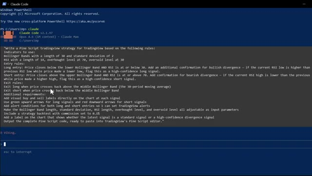
*⏱️ 00:00:05 — Interface de terminal Claude Code affichant un prompt détaillé pour générer une stratégie Pine Script basée sur les bandes de Bollinger et le RSI.*

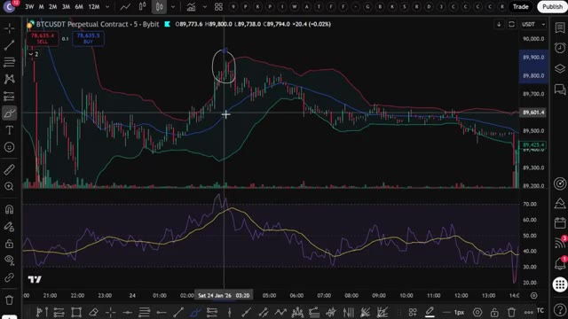
*⏱️ 00:00:10 — Graphique de trading en chandeliers (BTCUSDT Perpetual Contract sur Bybit) avec des indicateurs techniques de bandes de Bollinger et de RSI.*

---

### ⏱️ `[00:00:20 - 00:00:42]` | Segment #02

**🔊 Audio (Transcription Intégrale Mot pour Mot en Français) :**
> Pas de code, pas de devinettes, pas de temps perdu. Je vais vous expliquer la stratégie, le prompt exact que j'utilise, comment l'importer en quelques secondes, et automatiser le processus de trading à l'aide de webhooks. Et restez jusqu'à la fin parce que je vais vous montrer comment obtenir tous mes prompts, stratégies et configurations. Et comment construire votre propre bot de trading agentique avec Claude qui peut trader des cryptos, des actions, des indices, et plus encore.

**👁️ Analyse Visuelle d'Écran (gemini-3.5-flash-lite) :**
**Interface & Outils** : TradingView, éditeur de texte, et interface web de configuration d'API.

**Contenu textuel & Code** : Stratégie basée sur les bandes de Bollinger (longueur 30, écart-type 2) et le RSI (longueur 14), règles d'entrées/sorties avec détection de divergences, et panneau d'alertes Webhook.

**Action / Démonstration** : Présentation de la formulation du prompt de stratégie, visualisation des signaux de trading sur graphique et configuration des clés API pour l'automatisation.

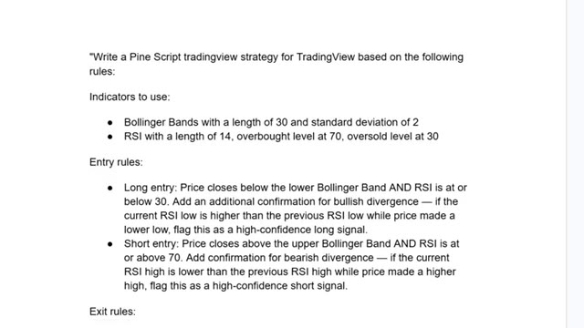
*⏱️ 00:00:25 — Capture montrant le texte détaillé du prompt Pine Script avec les règles d'utilisation des bandes de Bollinger et du RSI pour générer des signaux de trading.*

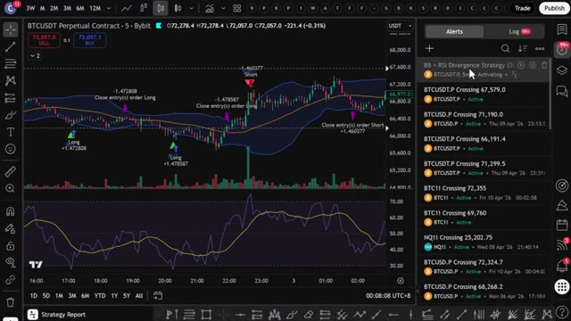
*⏱️ 00:00:31 — Graphique TradingView affichant les bandes de Bollinger et le RSI sur BTCUSDT avec le panneau des alertes configuré.*

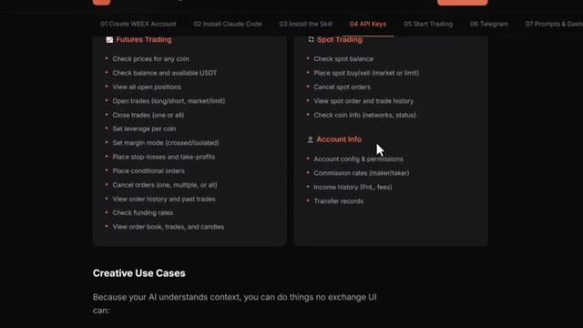
*⏱️ 00:00:36 — Interface Web présentant la documentation des clés API et les fonctionnalités d'automatisation des ordres de trading.*

---

### ⏱️ `[00:00:42 - 00:01:03]` | Segment #03

**🔊 Audio (Transcription Intégrale Mot pour Mot en Français) :**
> Alors, entrons dans le vif du sujet. Très les gars, première étape, inscrivez-vous sur un échange. Pour cette stratégie, nous allons utiliser UBIT. C'est l'un de mes échanges préférés pour le trading de contrats à terme en ce moment. Et ils ont de sérieux bonus pour les nouveaux utilisateurs. Jusqu'à 50 000 dollars de bonus rien qu'en vous inscrivant et en tradant en utilisant mon lien ci-dessous.

**👁️ Analyse Visuelle d'Écran (gemini-3.5-flash-lite) :**
**Interface & Outils** : Site web de la plateforme d'échange YBIT.

**Contenu textuel & Code** : Formulaire d'inscription, bonus de bienvenue de 50 000 USDT, et paliers de récompenses "Futures Trading" (Mystery Box).

**Action / Démonstration** : Présentation de la plateforme d'échange YBIT et de ses bonus pour inciter l'inscription des nouveaux utilisateurs.

*⏱️ 00:00:48 — Page d'inscription de la plateforme YBIT avec formulaire par e-mail et code de parrainage.*

*⏱️ 00:00:53 — Page d'accueil de la plateforme YBIT mettant en avant le trading de crypto, d'or et d'actions.*

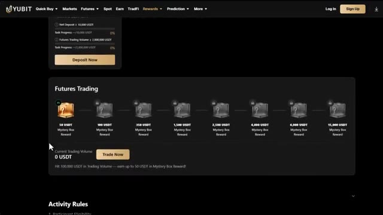
*⏱️ 00:00:58 — Section des récompenses et bonus de trading de contrats à terme sur la plateforme YBIT.*

---

### ⏱️ `[00:01:04 - 00:01:22]` | Segment #04

**🔊 Audio (Transcription Intégrale Mot pour Mot en Français) :**
> Si UBIT ne vous convient pas, vous pouvez utiliser Blofen comme alternative. Blofen ne requiert pas de vérification KYC obligatoire pour le trading de base, ce qui signifie que vous pouvez commencer à trader immédiatement. De plus, les nouveaux utilisateurs peuvent gagner jusqu'à 5 000 USDT grâce à des bonus sur les dépôts et le volume de trading. Je mettrai les liens en description ci-dessous.

**👁️ Analyse Visuelle d'Écran (gemini-3.5-flash-lite) :**
**Interface & Outils** : Site web de l'échange de cryptomonnaies BloFin

**Contenu textuel & Code** : Mention « No KYC required », disponibilité dans plus de 150 pays, frais de trading, et offre promotionnelle de 5 000 USDT pour les nouveaux utilisateurs.

**Action / Démonstration** : Navigation sur le site web de BloFin pour présenter les fonctionnalités de la plateforme et ses offres de bienvenue.

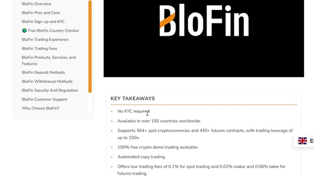
*⏱️ 00:01:08 — Page de présentation du courtier BloFin avec la liste des points clés mettant en avant l'absence de KYC obligatoire et les fonctionnalités principales.*

*⏱️ 00:01:18 — Interface de la page des récompenses pour les nouveaux utilisateurs de BloFin, affichant la promotion "Earn up to 5,000 USDT".*

---

### ⏱️ `[00:01:23 - 00:01:56]` | Segment #05

**🔊 Audio (Transcription Intégrale Mot pour Mot en Français) :**
> Une fois que vous êtes sur la page d'UBIT, vous pouvez vous inscrire avec votre adresse e-mail, votre numéro de téléphone, ou vous connecter via Google ou un identifiant Apple. Pour ce tutoriel, j'utiliserai l'e-mail. Entrez simplement vos informations, créez un mot de passe fort, acceptez les conditions d'utilisation et cliquez sur s'inscrire. Entrez le code de vérification par e-mail et votre compte est prêt. Tout le processo prend moins de 30 secondes. Et gardez à l'esprit qu'UBIT est une plateforme sans KYC. Vous n'avez pas besoin de compléter de vérification d'identité pour commencer à trader. Cela la rend accessible même dans les régions restreintes,

**👁️ Analyse Visuelle d'Écran (gemini-3.5-flash-lite) :**
**Interface & Outils** : Site Web de la plateforme d'échange YUBIT

**Contenu textuel & Code** : Formulaire d'inscription par e-mail et mobile, code de parrainage (ALEX), et conditions d'utilisation.

**Action / Démonstration** : Saisie des informations d'identification et inscription sur la plateforme YUBIT.

*⏱️ 00:01:31 — Page d'inscription de la plateforme YUBIT avec un champ pour l'adresse e-mail, le mot de passe et un graphique promotionnel en 3D.*

---

### ⏱️ `[00:01:57 - 00:02:33]` | Segment #06

**🔊 Audio (Transcription Intégrale Mot pour Mot en Français) :**
> et cela signifie que vous pouvez commencer à trader presque instantanément après vous être inscrit. Allez dans votre portefeuille et cliquez sur dépôt. Sélectionnez la cryptomonnaie que vous souhaitez déposer. L'USDT est idéal pour le trading. Ensuite, sélectionnez votre réseau de dépôt. Je recommande le TRC20. C'est rapide et les frais sont très bas. Vous verrez alors votre adresse de dépôt personnelle. Copiez-la avec soin. Allez sur votre échange ou portefeuille actuel. Collez l'adresse et envoyez vos fonds. Envoyez toujours un petit montant de test d'abord, peut-être 10 à 20 dollars, juste pour confirmer que tout arrive correctement avant d'envoyer le montant total. C'est très important. L'envoi sur

**👁️ Analyse Visuelle d'Écran (gemini-3.5-flash-lite) :**
**Interface & Outils** : Interface web de l'échange de cryptomonnaies Yubit (pages de dépôt et de retrait).

**Contenu textuel & Code** : Paramètres de dépôt (sélection du jeton USDT, choix du réseau, historique des dépôts) et fenêtre modale de confirmation de retrait (adresse, type de chaîne, montant reçu, frais de transaction).

**Action / Démonstration** : Manipulation de l'interface pour effectuer un dépôt en USDT et confirmation d'un retrait sur la plateforme.

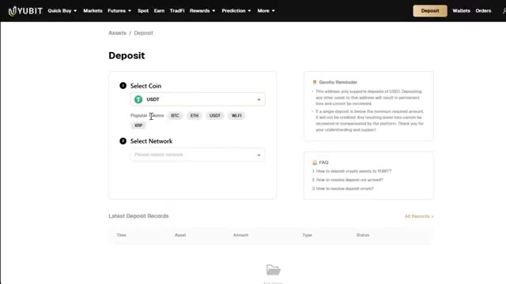
*⏱️ 00:02:06 — Interface de dépôt de la plateforme Yubit montrant la sélection de la cryptomonnaie USDT.*

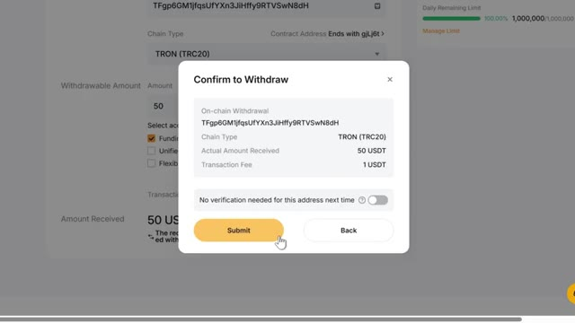
*⏱️ 00:02:24 — Fenêtre de confirmation de retrait sur la plateforme Yubit avec les détails de la transaction (TRON TRC20, frais de 1 USDT).*

---

### ⏱️ `[00:02:33 - 00:03:08]` | Segment #07

**🔊 Audio (Transcription Intégrale Mot pour Mot en Français) :**
> le mauvais réseau peut signifier la perte de vos fonds. Si vous n'avez pas encore de crypto et que vous souhaitez en acheter directement sur UBIT, c'est également possible. Mais pour cela, vous devrez d'abord compléter la procédure KYC. Allez sur l'icône de votre profil sur la page d'accueil et cliquez sur KYC. Cliquez sur vérifier maintenant. Fournissez votre e-mail, vos informations personnelles, vos documents de vérification et un selfie. Une fois que c'approuvé, vous pouvez utiliser l'option d'achat rapide sur UBIT pour acheter de la crypto directement avec de la monnaie fiat en utilisant une carte de crédit ou de débit. Si vous avez déjà des cryptos sur un autre échange ou portefeuille, vous pouvez entièrement sauter le KYC et simplement déposer

**👁️ Analyse Visuelle d'Écran (gemini-3.5-flash-lite) :**
**Interface & Outils** : Site web de la plateforme d'échange de cryptomonnaies UBIT, interface d'achat rapide et module de vérification KYC Sumsub.

**Contenu textuel & Code** : Formulaire de liaison d'e-mail, étapes de vérification d'identité (KYC), calcul de conversion de devise (15 USD vers USDT) et sélection du mode de paiement Alchemy Pay.

**Action / Démonstration** : Navigation dans le processus de vérification KYC et démonstration de l'achat direct de cryptomonnaies sur la plateforme UBIT.

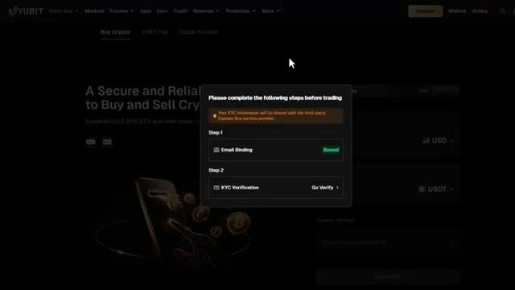
*⏱️ 00:02:42 — Fenêtre contextuelle affichant les étapes requises avant le trading, notamment la liaison d'e-mail et la vérification KYC sur la plateforme UBIT.*

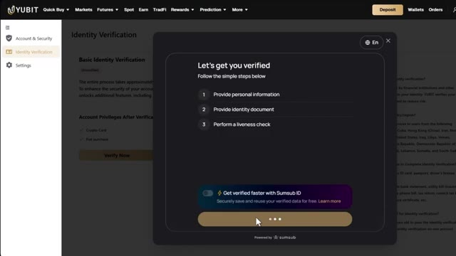
*⏱️ 00:02:51 — Écran de vérification d'identité (KYC) détaillant les étapes (informations personnelles, document d'identité, contrôle de vivacité) avec Sumsub ID.*

*⏱️ 00:03:00 — Interface principale d'achat de crypto-monnaie sur UBIT, permettant d'échanger des USD contre des USDT via Alchemy Pay (15 USD pour 12,96 USDT).*

---

### ⏱️ `[00:03:08 - 00:03:43]` | Segment #08

**🔊 Audio (Transcription Intégrale Mot pour Mot en Français) :**
> directement, ce qui est l'option la plus rapide pour la plupart des gens. Cliquez sur futures dans la barre de navigation supérieure et cliquez sur USDT-M. Cela vous amènera à l'interface de trading UBIT Futures. Maintenant, cela peut sembler un peu impressionnant au début, mais je vais détailler chaque section pour que tout soit parfaitement clair. En haut à gauche, vous avez le sélecteur de paires de trading. C'est ici que vous choisissez quel actif trader. UBIT propose plus de 500 paires de trading, du Bitcoin et de l'Ethereum jusqu'aux meme coins et aux altcoins majeurs. Vous pouvez choisir entre les perpétuels sur marge USDT et les perpétuels sur marge coin,

**👁️ Analyse Visuelle d'Écran (gemini-3.5-flash-lite) :**
**Interface & Outils** : Interface de trading de la plateforme YUBIT Futures.

**Contenu textuel & Code** : Graphique des prix BTCUSDT (unité 15m), prix actuel à 66,376.4 USDT, variation sur 24h (+0.81%), carnet d'ordres en temps réel, panneau de passage d'ordres (Market/Limit) avec effet de levier réglé sur 10x, et soldes du compte.

**Action / Démonstration** : Navigation et présentation de l'interface de trading des contrats futures de la plateforme YUBIT.

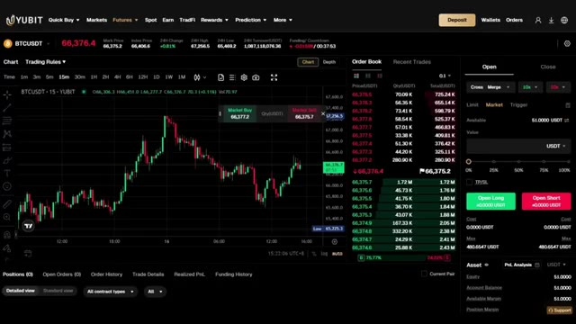
*⏱️ 00:03:17 — Interface de trading YUBIT Futures affichant le graphique de la paire BTCUSDT en unités de 15 minutes, avec le carnet d'ordres à droite.*

---

### ⏱️ `[00:03:43 - 00:04:02]` | Segment #09

**🔊 Audio (Transcription Intégrale Mot pour Mot en Français) :**
> qui sont des transactions réglées dans votre propre crypto au lieu de l'USDT. Au centre se trouve le graphique des prix, propulsé par TradingView, avec tous les outils de dessin et indicateurs techniques dont vous avez besoin pour l'analyse. Sur le côté droit se trouve le carnet d'ordres, montrant tous les ordres d'achat et de vente en direct sur le marché. Et en bas se trouve votre panneau de gestion des ordres.

**👁️ Analyse Visuelle d'Écran (gemini-3.5-flash-lite) :**
**Interface & Outils** : Interface web de courtier/échange (YUBIT Futures) intégrant un graphique TradingView au centre, un carnet d'ordres (Order Book) à droite et un panneau de gestion des ordres.

**Contenu textuel & Code** : Graphique BTC/USDT (prix actuel autour de 66 342,8 USDT), carnet d'ordres dynamique avec prix d'achat et de vente, tableau de bord du compte affichant le solde disponible (51 USDT) et options de levier (10x).

**Action / Démonstration** : Présentation de l'interface de trading futures de la plateforme, mise en valeur du carnet d'ordres et du graphique des prix pour l'analyse technique.

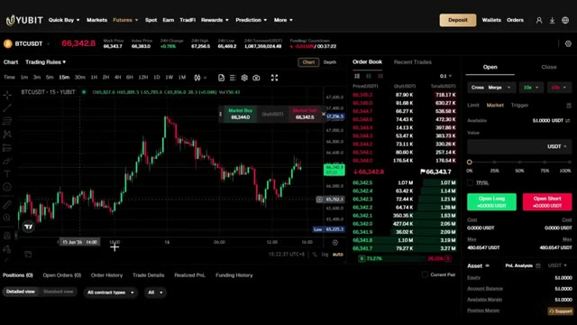
*⏱️ 00:03:48 — Interface de trading de contrats futures sur la plateforme YUBIT affichant un graphique en chandeliers japonais BTC/USDT en unité de temps 15 minutes, un carnet d'ordres en temps réel et le panneau de passage d'ordres.*

---

### ⏱️ `[00:04:03 - 00:04:23]` | Segment #10

**🔊 Audio (Transcription Intégrale Mot pour Mot en Français) :**
> C'est ici que vous suivez vos positions ouvertes, vos ordres ouverts et votre historique de trading. Tout ce dont vous avez besoin est juste ici sur un seul écran. Très bien, maintenant pour la stratégie elle-même, nous allons utiliser TradingView. J'ai un lien en bas vers mon lien TradingView. Si vous l'utilisez, vous obtiendrez une petite réduction lorsque vous achèterez la version Pro. Je vais utiliser le graphique du Bitcoin.

**👁️ Analyse Visuelle d'Écran (gemini-3.5-flash-lite) :**
**Interface & Outils** : Plateforme de trading YUBIT et graphique de prix TradingView.

**Contenu textuel & Code** : Graphique de prix BTCUSDT (Timeframe 15m et 5m), carnet d'ordres, panneaux d'ordres (Open, Close, Market/Limit), et indicateur de volume.

**Action / Démonstration** : Présentation de l'interface de trading et transition vers le graphique de prix sur TradingView pour l'explication de la stratégie.

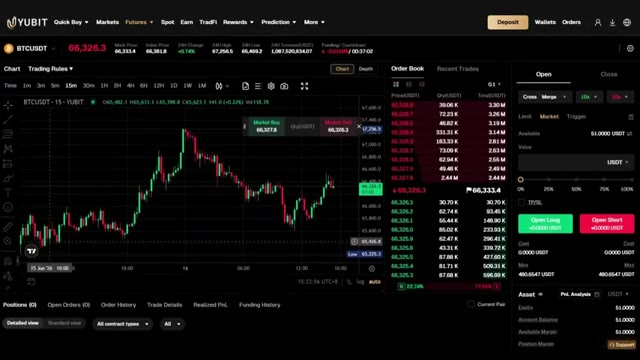
*⏱️ 00:04:08 — Interface de trading de la plateforme YUBIT montrant un graphique BTCUSDT en unités de 15 minutes, un carnet d'ordres, et le panneau de gestion des positions.*

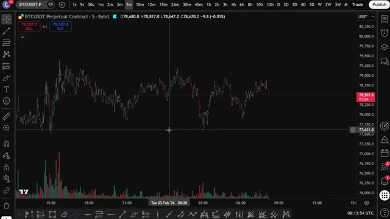
*⏱️ 00:04:13 — Graphique TradingView en bougies japonaises montrant le contrat perpétuel BTCUSDT sur un intervalle de 5 minutes avec les volumes en bas de page.*

---

### ⏱️ `[00:04:23 - 00:04:41]` | Segment #11

**🔊 Audio (Transcription Intégrale Mot pour Mot en Français) :**
> La première chose que vous devez faire est de configurer les bandes de Bollinger sur votre TradingView. Allez maintenant dans les indicateurs, tapez Bandes de Bollinger, et cliquez sur celui-ci. Ensuite, vous devrez modifier le paramètre par défaut juste ici pour cette stratégie de trading spécifique. Allez dans la section de la longueur, définissez-la à 30, et gardez l'écart type à 2.

**👁️ Analyse Visuelle d'Écran (gemini-3.5-flash-lite) :**
**Interface & Outils** : TradingView / Bybit

**Contenu textuel & Code** : Graphique en chandeliers japonais du BTCUSDT avec l'histogramme des volumes en bas, barre d'outils supérieure et latérale.

**Action / Démonstration** : Préparation de l'ajout et de la configuration des indicateurs techniques sur TradingView.

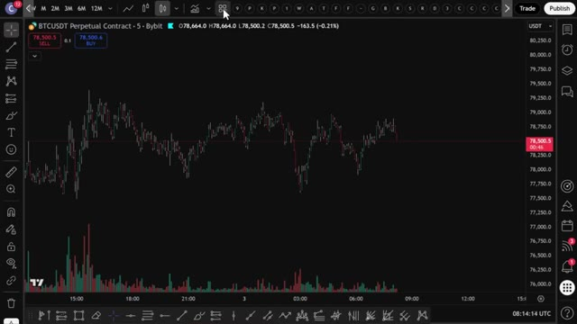
*⏱️ 00:04:27 — Capture d'écran montrant l'interface du graphique TradingView pour le contrat perpétuel BTCUSDT sur Bybit en unité de temps 5 minutes.*

---

### ⏱️ `[00:04:41 - 00:05:01]` | Segment #12

**🔊 Audio (Transcription Intégrale Mot pour Mot en Français) :**
> Si vous voulez personnaliser votre choix, n'oubliez pas que la ligne centrale représente la moyenne mobile basée sur la valeur de longueur et que les lignes inférieure et supérieure sont des lignes d'écart-type. Maintenant que vous avez configuré la bande de Bollinger, il est temps d'ajouter le RSI, l'indice de force relative. Pour cela, retournez dans Indicateurs et tapez RSI.

**👁️ Analyse Visuelle d'Écran (gemini-3.5-flash-lite) :**
**Interface & Outils** : Graphique TradingView (interface Bybit)

**Contenu textuel & Code** : Paramètres de style des bandes de Bollinger (Basis, Upper, Lower, Background) avec options de couleurs (bleu, rouge, vert).

**Action / Démonstration** : Configuration et personnalisation de l'affichage visuel des lignes composant l'indicateur des bandes de Bollinger.

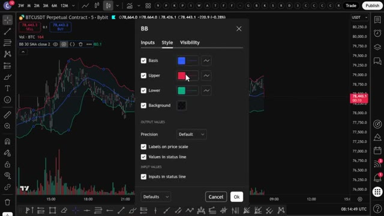
*⏱️ 00:04:46 — Fenêtre de configuration du style des bandes de Bollinger ouverte sur le graphique TradingView de BTCUSDT.*

---

### ⏱️ `[00:05:01 - 00:05:21]` | Segment #13

**🔊 Audio (Transcription Intégrale Mot pour Mot en Français) :**
> Cliquez sur le premier résultat, qui devrait être le Relative Strength Index. Maintenant, vous devez vous assurer que la bande supérieure est sur le chiffre 70 et que la bande inférieure est sur 30. Le RSI est un outil très utile pour déterminer si une cryptomonnaie est surachetée ou survendue. S'il est au-dessus de 70, cela signifie qu'elle est surachetée. S'il est en dessous de 30, elle est survendue.

**👁️ Analyse Visuelle d'Écran (gemini-3.5-flash-lite) :**
**Interface & Outils** : Graphique TradingView sur l'échange Bybit (BTCUSDT).

**Contenu textuel & Code** : Paramètres de style du RSI avec les bandes configurées (RSI Upper Band à 70, RSI Middle Band à 50, RSI Lower Band à 30).

**Action / Démonstration** : Modification ou vérification des paramètres des bandes supérieure et inférieure du RSI.

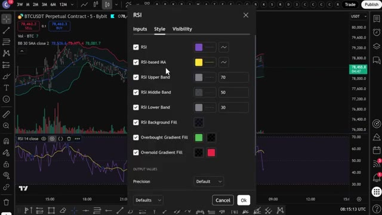
*⏱️ 00:05:06 — Fenêtre de configuration du style pour l'indicateur RSI affichée par-dessus un graphique de prix sur TradingView.*

---

### ⏱️ `[00:05:22 - 00:05:42]` | Segment #14

**🔊 Audio (Transcription Intégrale Mot pour Mot en Français) :**
> Maintenant, comparons ces deux indicateurs pour trouver des trades potentiellement rentables. Si le prix dépasse la bande de Bollinger supérieure, vous pouvez entrer dans une position courte. Mais si le prix passe sous la bande de Bollinger inférieure, vous pouvez entrer dans une position longue. Parfois, le prix peut traverser ces bandes plusieurs fois et vous pouvez voir beaucoup de faux signaux juste ici.

**👁️ Analyse Visuelle d'Écran (gemini-3.5-flash-lite) :**
**Interface & Outils** : Graphique de trading TradingView (contrat perpétuel BTCUSDT sur Bybit).

**Contenu textuel & Code** : Bandes de Bollinger (BB 30 SMA close 2) et indicateur RSI (RSI 14 close).

**Action / Démonstration** : Analyse technique pour identifier une opportunité de vente à découvert (short) lorsque le prix dépasse la bande supérieure.

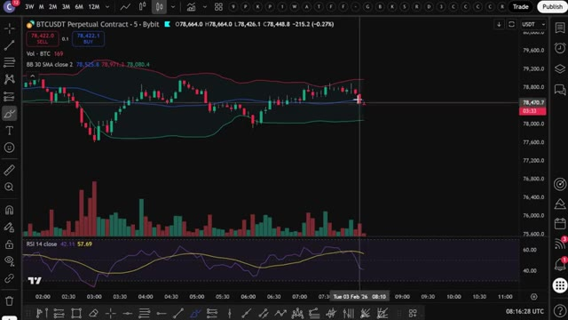
*⏱️ 00:05:27 — Graphique en chandeliers japonais du BTCUSDT montrant le prix testant la bande de Bollinger supérieure avec l'indicateur RSI en bas.*

---

### ⏱️ `[00:05:42 - 00:06:01]` | Segment #15

**🔊 Audio (Transcription Intégrale Mot pour Mot en Français) :**
> En fait, si vous agissiez sur chaque signal, vous perdriez probablement beaucoup d'argent. Donc nous ne pouvons certainement pas faire cela dans O. Pour résoudre ce problème, vous allez ajouter notre second indicateur, le RSI. Si le prix chute sous la bande de Bollinger inférieure et que le RSI tombe au niveau inférieur autour de 30, vous ouvrirez une position longue.

**👁️ Analyse Visuelle d'Écran (gemini-3.5-flash-lite) :**
**Interface & Outils** : TradingView (sur l'exchange Bybit)

**Contenu textuel & Code** : BTCUSDT Perpetual Contract, graphique en unité de temps 5 minutes, indicateurs Bandes de Bollinger (BB 30 SMA close 2) et RSI 14, histogramme de volume au centre.

**Action / Démonstration** : Analyse visuelle des faux signaux des bandes de Bollinger et préparation de l'ajout d'un filtre RSI.

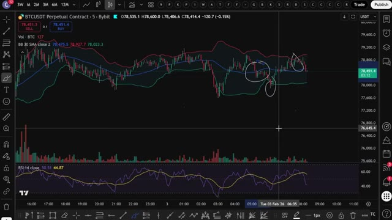
*⏱️ 00:05:47 — Graphique en chandeliers japonais du BTCUSDT montrant les bandes de Bollinger et le RSI avec des zones entourées au crayon sur le graphique principal.*

---

### ⏱️ `[00:06:01 - 00:06:26]` | Segment #16

**🔊 Audio (Transcription Intégrale Mot pour Mot en Français) :**
> Mais si le prix dépasse la bande de Bollinger supérieure et que le RSI atteint environ le niveau de 70, il est temps d'ouvrir une position courte. Laissez-moi vous donner quelques exemples ici. Si le prix commence à tomber en dessous de la bande de Bollinger inférieure, comme vous pouvez le voir ici, mais que le RSI n'est pas encore tout à fait à son niveau idéal, ce qui montre qu'il est survendu, vous pouvez patienter jusqu'à ce que le RSI chute au niveau de 30, qu'il finira par atteindre, comme vous pouvez le voir ici.

**👁️ Analyse Visuelle d'Écran (gemini-3.5-flash-lite) :**
**Interface & Outils** : TradingView

**Contenu textuel & Code** : Graphique BTCUSDT Perpetual Contract (Bybit), Bandes de Bollinger, indicateur de volume, indicateur RSI avec une zone de surachat autour du niveau 70, et un outil de position courte (Short Position).

**Action / Démonstration** : Analyse d'un exemple de trade court basé sur le dépassement de la bande de Bollinger supérieure et un RSI atteignant le niveau 70.

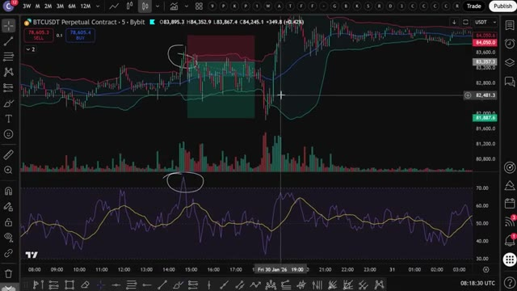
*⏱️ 00:06:07 — Graphique en chandeliers japonais de BTCUSDT sur un intervalle de 5 minutes avec les Bandes de Bollinger, le volume et le RSI, montrant un signal de vente (short) avec une zone de position tracée.*

---

### ⏱️ `[00:06:26 - 00:06:46]` | Segment #17

**🔊 Audio (Transcription Intégrale Mot pour Mot en Français) :**
> Juste au moment où le RSI chute au niveau de 30 ou en dessous, vous verrez que le prix du Bitcoin se trouve sur la bande de Bollinger inférieure ou en dessous. Ensuite, vous pouvez ouvrir une position longue sur Bybit ou Bitunix. Comme vous pouvez le voir, après avoir ouvert votre position longue, le prix rebondit comme prévu. Si vous aimez ouvrir des positions courtes, la stratégie est la même.

**👁️ Analyse Visuelle d'Écran (gemini-3.5-flash-lite) :**
**Interface & Outils** : TradingView / Bybit

**Contenu textuel & Code** : Prix du Bitcoin, graphiques en chandeliers, volume des transactions et indicateur RSI en bas du graphique montrant un niveau inférieur à 30.

**Action / Démonstration** : Analyse technique illustrant le moment où le RSI chute en dessous de 30 pour identifier une opportunité d'ouvrir une position longue.

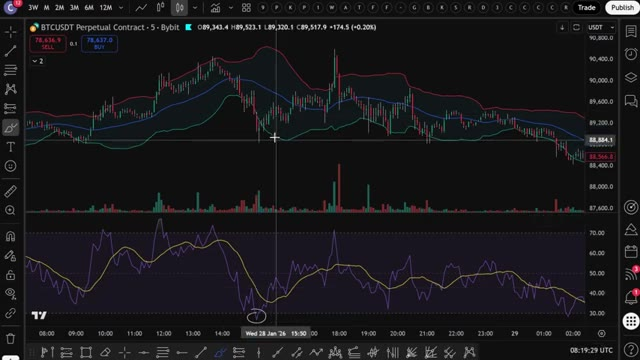
*⏱️ 00:06:31 — Graphique TradingView montrant le contrat perpétuel BTCUSDT sur Bybit avec les indicateurs techniques et le RSI en zone de survente.*

---

### ⏱️ `[00:06:47 - 00:07:21]` | Segment #18

**🔊 Audio (Transcription Intégrale Mot pour Mot en Français) :**
> Ouvrez simplement une position courte si le prix du Bitcoin atteint la bande de Bollinger supérieure et atteint en même temps la zone de surachat sur le RSI, au niveau 70 ou au-dessus. Une chose à noter est que si le marché évolue latéralement, cette stratégie n'est pas la meilleure. La plupart des stratégies de trading ont du mal à prédire les mouvements du marché dans ces conditions. Mais revenant au graphique, vous pouvez voir ici que le prix du Bitcoin chute en dessous de la bande de Bollinger là où le RSI est dans la zone de survente. Mais le problème est que le prix continue de s'effondrer encore plus. Si vous étiez entré dans le trade ici, vous auriez

**👁️ Analyse Visuelle d'Écran (gemini-3.5-flash-lite) :**
**Interface & Outils** : TradingView

**Contenu textuel & Code** : BTCUSDT Perpetual Contract, Bandes de Bollinger, Indicateur RSI au-dessus du niveau 70, outil de mesure de position (Risk/Reward).

**Action / Démonstration** : Analyse d'une stratégie de trading montrant l'ouverture d'une position courte (Short) lors du croisement de la bande supérieure de Bollinger et d'un RSI en surachat.

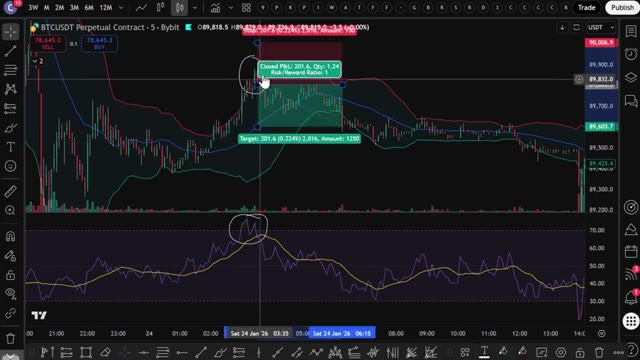
*⏱️ 00:06:55 — Graphique de trading montrant le cours du Bitcoin avec les Bandes de Bollinger et le RSI en zone de surachat, illustrant une position courte.*

---

### ⏱️ `[00:07:21 - 00:07:52]` | Segment #19

**🔊 Audio (Transcription Intégrale Mot pour Mot en Français) :**
> subir une perte massive. Pour éviter cette perte d'argent, vous devez faire attention à détecter les premiers signes de grands mouvements de prix avant même qu'ils ne se produisent. Regardez comment les bandes de Bollinger sont fines maintenant et rapprochées. Vous pouvez voir que le marché évolue latéralement, ce qui n'est pas bon. De plus, le RSI évolue également entre les lignes inférieure et supérieure et ne dépasse pas et ne descend pas en dessous des points majeurs de surachat et de survente. Tout cela est un très, très grand signal d'alarme. Nous ne voulons pas entrer ici. Dans ces cas-là, évitez tout simplement le trade.

**👁️ Analyse Visuelle d'Écran (gemini-3.5-flash-lite) :**
**Interface & Outils** : TradingView, graphique en chandeliers (échange Bybit).

**Contenu textuel & Code** : Paire BTCUSDT Perpetual Contract en unité de temps 5 minutes, avec indicateur de bandes de Bollinger et un oscillateur de type RSI / Stochastique en sous-fenêtre.

**Action / Démonstration** : Analyse de la contraction des bandes de Bollinger et de la volatilité pour détecter un mouvement de prix imminent.

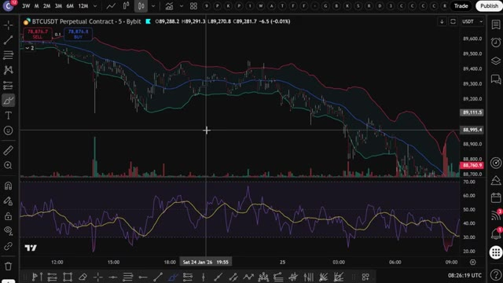
*⏱️ 00:07:29 — Un graphique de trading affichant les bandes de Bollinger et un oscillateur en bas sur la plateforme TradingView pour BTCUSDT.*

---

### ⏱️ `[00:07:53 - 00:08:23]` | Segment #20

**🔊 Audio (Transcription Intégrale Mot pour Mot en Français) :**
> Mais laissez-moi vous montrer l'exemple parfait pour ouvrir le trade parfait qui vous donnera ce taux de réussite attendu de 92 %. Ici, le prix chute en dessous de la bande de Bollinger inférieure, puis remonte au-dessus. Mais ensuite, le prix commence à redescendre en formant un nouveau plus bas par rapport au plus bas précédent. Cependant, si vous jetez un œil au RSI, vous pouvez voir que le RSI vient de former un plus haut bas. C'est une divergence haussière. La divergence haussière se caractérise par la formation de plus bas successivement inférieurs par les bougies de prix.

**👁️ Analyse Visuelle d'Écran (gemini-3.5-flash-lite) :**
**Interface & Outils** : TradingView

**Contenu textuel & Code** : Bandes de Bollinger, volumes et oscillateur stochastique/RSI.

**Action / Démonstration** : Analyse graphique de la chute du prix sous la bande de Bollinger inférieure.

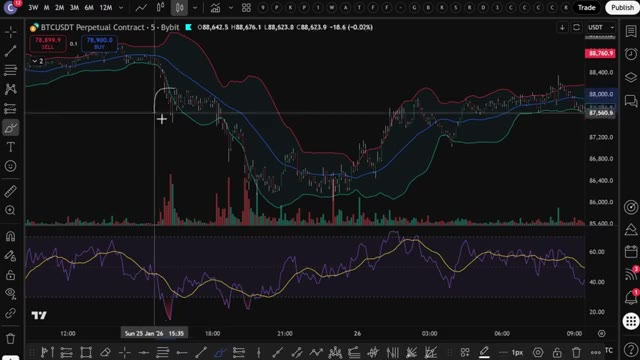
*⏱️ 00:08:00 — Graphique TradingView montrant le cours du BTCUSDT avec des bandes de Bollinger et un oscillateur en bas.*

---

### ⏱️ `[00:08:24 - 00:08:55]` | Segment #21

**🔊 Audio (Transcription Intégrale Mot pour Mot en Français) :**
> En même temps, le RSI forme progressivement des creux de plus en plus hauts. C'est l'une de vos meilleures chances d'ouvrir une position longue, car vous aurez de fortes chances de faire du profit. D'un autre côté, si le prix monte en flèche vers la bande de Bollinger supérieure, puis redescend, et qu'ensuite le prix se remet à monter, formant un nouveau sommet plus élevé par rapport au sommet précédent. Mais si vous jetez un œil au RSI, vous pouvez voir que le RSI vient de former un nouveau sommet plus bas. C'est une divergence baissière. L'opportunité parfaite pour ouvrir une position courte.

**👁️ Analyse Visuelle d'Écran (gemini-3.5-flash-lite) :**
**Interface & Outils** : TradingView, graphique en chandeliers (Timeframe 5 minutes)

**Contenu textuel & Code** : Bandes de Bollinger, histogramme de volume et indicateur RSI avec des lignes de tendance tracées sur les creux.

**Action / Démonstration** : Analyse technique mettant en évidence la formation de creux de plus en plus hauts sur l'indicateur RSI en corrélation avec l'évolution des prix.

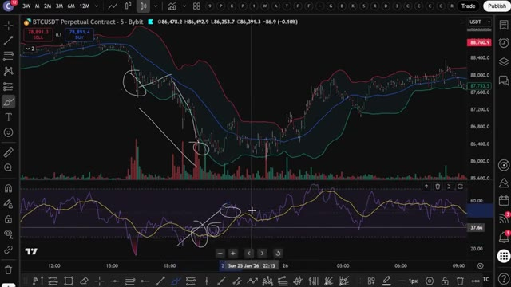
*⏱️ 00:08:31 — Un graphique TradingView en bougies japonaises illustrant la paire BTCUSDT sur un contrat perpétuel Bybit, avec des bandes de Bollinger et le RSI en sous-fenêtre montrant des creux ascendants.*

---

### ⏱️ `[00:08:55 - 00:09:30]` | Segment #22

**🔊 Audio (Transcription Intégrale Mot pour Mot en Français) :**
> Utiliser les bandes de Bollinger et le RSI en même temps, c'est une très très très bonne stratégie et j'ai eu tellement de succès avec ça comme vous pouvez clairement le voir ici. Donc maintenant vous comprenez exactement comment cette stratégie fonctionne manuellement. Mais c'est là que ça devient vraiment intéressant, au lieu de surveiller des graphiques toute la journée et de faire ça manuellement, j'ai donné cette exact stratégie à Claude et je lui ai demandé de m'écrire un script Pine complet pour que TradingView puisse détecter automatiquement ces signaux pour moi et voici le prompt que j'ai utilisé, je vais l'afficher à l'écran maintenant pour que vous puissiez le copier exactement, c'est tout, c'est le prompt complet, vous le collez

**👁️ Analyse Visuelle d'Écran (gemini-3.5-flash-lite) :**
**Interface & Outils** : TradingView (Graphique de prix et éditeur Pine Editor)

**Contenu textuel & Code** : Bandes de Bollinger, oscillateur RSI, volumes, et code source Pine Script (calcul de l'ATR Trailing Stop, variables, conditions d'achat/vente).

**Action / Démonstration** : Analyse technique d'un trade manuel avec calcul du ratio risque/rendement, puis transition vers l'affichage et la programmation du script sur TradingView.

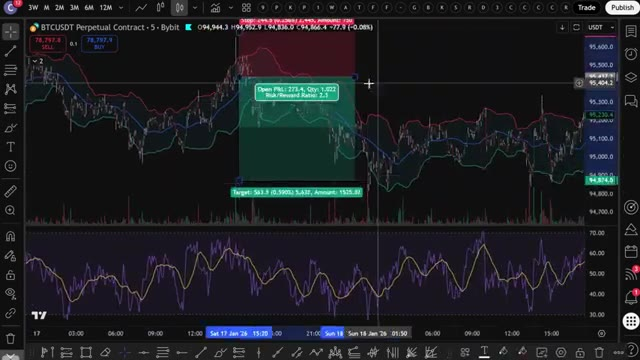
*⏱️ 00:09:04 — Graphique TradingView affichant les bandes de Bollinger et le RSI avec un outil de mesure de position (Risk/Reward Ratio : 2.1) sur le contrat perpétuel BTCUSDT.*

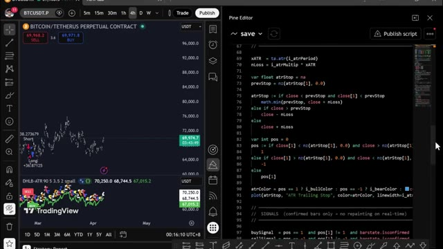
*⏱️ 00:09:21 — Interface de TradingView divisée en deux avec un graphique des prix à gauche et l'éditeur Pine Script affichant du code de stratégie à droite.*

---

### ⏱️ `[00:09:30 - 00:09:58]` | Segment #23

**🔊 Audio (Transcription Intégrale Mot pour Mot en Français) :**
> dans Claude, j'utilise Claude code ici et en quelques secondes, il crache un travail complet en Pine script dans un bloc-notes. Ouvrez ce fichier, appuyez sur contrôle plus a pour tout sélectionner du code, puis sur contrôle plus c pour le copier. C'est tout ce dont vous avez besoin. Maintenant, amenons-le dans TradingView. Au fait, ce prompt exact ainsi que le script Pine spécifique utilisé dans cette vidéo sont disponibles dans mon groupe WAP. Vous pouvez trouver le lien en bas. Ouvrez TradingView et allez sur n'importe quel graphique.

**👁️ Analyse Visuelle d'Écran (gemini-3.5-flash-lite) :**
**Interface & Outils** : Explorateur de fichiers Windows, éditeur de texte (Bloc-notes) et interface web Alex Carter Trading.

**Contenu textuel & Code** : Code Pine Script pour une stratégie de trading (BB_RSI_Divergence_Strategy), avec des variables d'entrées (rsiLength, oversoldLevel, overboughtLevel) et des fonctions de signal (plotshape).

**Action / Démonstration** : Navigation dans les fichiers pour ouvrir le script généré, sélection intégrée du code et consultation de l'interface web dédiée au Pine Script.

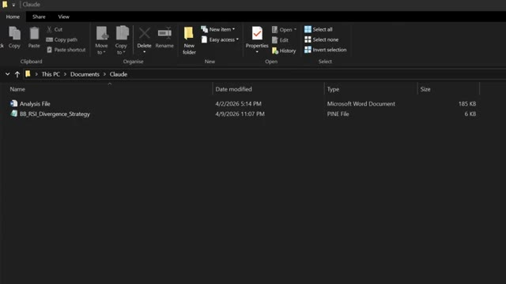
*⏱️ 00:09:37 — Explorateur de fichiers Windows affichant le dossier "Claude" contenant un fichier PINE nommé "BB_RSI_Divergence_Strategy".*

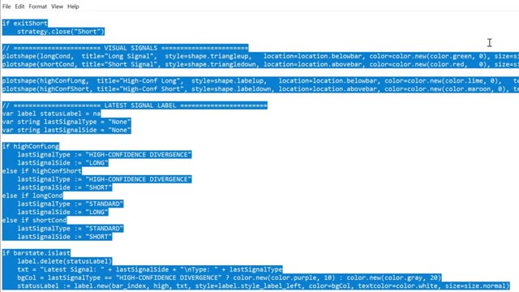
*⏱️ 00:09:44 — Éditeur de texte affichant du code source Pine Script entièrement sélectionné en surbrillance bleue.*

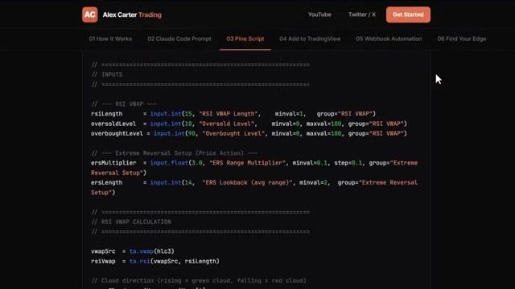
*⏱️ 00:09:51 — Interface Web d'Alex Carter Trading montrant un extrait de code Pine Script avec des paramètres d'entrées et de calculs RSI VWAP.*

---

### ⏱️ `[00:09:58 - 00:10:30]` | Segment #24

**🔊 Audio (Transcription Intégrale Mot pour Mot en Français) :**
> Je vais réutiliser Bitcoin. En bas à droite de l'écran, cliquez sur l'onglet de l'éditeur Pine Script, celui qui ressemble à un pin. Une fois que l'éditeur est ouvert, vous y verrez du code par défaut, sélectionnez-tout et supprimez-le, puis collez le code que Claude vient de vous donner. Cliquez maintenant sur "Ajouter au graphique", c'est le bouton en haut à droite de l'éditeur Pine Script. TradingView va compiler le script et l'appliquer directement sur votre graphique, et voilà, vous pouvez voir les bandes de Bollinger sur le graphique, le panneau RSI en dessous et les signaux d'achat et de vente tracés automatiquement par des flèches vertes.

**👁️ Analyse Visuelle d'Écran (gemini-3.5-flash-lite) :**
**Interface & Outils** : TradingView et Pine Editor (v5).

**Contenu textuel & Code** : Code source en Pine Script dans l'éditeur (lignes 345-358 avec des conditions d'alerte) et graphique en chandeliers du BTCUSDT Perpetual Contract sur un intervalle de 5 minutes.

**Action / Démonstration** : Manipulation de l'éditeur Pine Script pour modifier ou intégrer le code de la stratégie de trading.

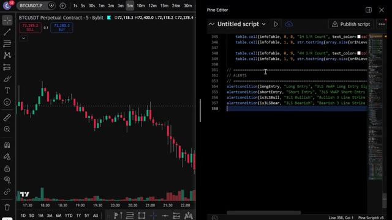
*⏱️ 00:10:06 — Capture d'écran montrant le graphique de TradingView à gauche et l'éditeur Pine Script à droite.*

---

### ⏱️ `[00:10:30 - 00:11:06]` | Segment #25

**🔊 Audio (Transcription Intégrale Mot pour Mot en Français) :**
> pour les positions acheteuses, et des flèches rouges pour les positions vendeuses. Les signaux de divergence à haute confiance sont étiquetés séparément pour que vous sachiez quelles configurations sont les plus solides. Pour configurer des alertes, cliquez sur l'icône de réveil en haut de TradingView, sélectionnez créer une alerte, et dans le menu déroulant des conditions, vous verrez les conditions d'alerte que Claude a ajoutées, signal d'achat et signal de vente. Configurez-les et TradingView vous avertira dès qu'un signal se déclenche. Ainsi, au lieu de surveiller le graphique manuellement, TradingView fait tout le travail à votre place. Dès que les conditions des bandes de Bollinger et du RSI s'alignent, en particulier sur une divergence,

**👁️ Analyse Visuelle d'Écran (gemini-3.5-flash-lite) :**
**Interface & Outils** : TradingView (Graphique de prix avec indicateurs techniques)

**Contenu textuel & Code** : Graphique en chandeliers BTCUSDT, bandes de Bollinger, indicateur de volume en bas, oscillateur stochastique/RSI, et signaux textuels/graphiques de trading (« HC LONG », « Long », « Short », « Close entry(s) order »).

**Action / Démonstration** : Analyse technique et présentation visuelle des signaux de trading automatisés avec des flèches vertes et rouges.

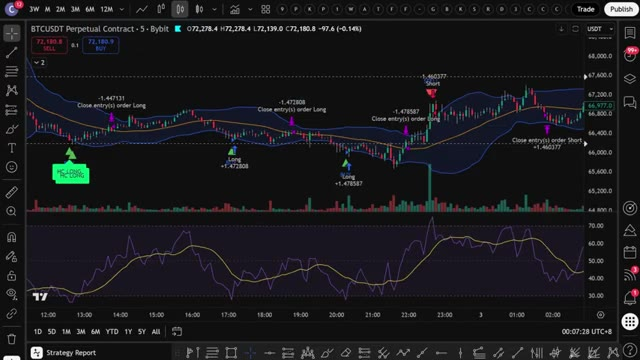
*⏱️ 00:10:39 — Un graphique de trading de crypto-monnaie affichant le contrat perpétuel BTCUSDT en unité de temps de 5 minutes sur la plateforme TradingView avec des indicateurs personnalisés de signaux d'achat et de vente.*

---

### ⏱️ `[00:11:06 - 00:11:40]` | Segment #26

**🔊 Audio (Transcription Intégrale Mot pour Mot en Français) :**
> vous recevez une alerte directement sur votre téléphone. Maintenant, si vous voulez aller encore plus loin et ouvrir automatiquement un trade sur votre exchange dès qu'un signal est émis, j'ai ce qu'il vous faut. J'ai créé un groupe privé où je partage tous mes cas d'usage pour Claude Code, de son intégration avec Telegram, TradingView, à la recherche de baleines sur Hyperliquid. Le tout de manière automatique. Tout ce que je vous ai montré aujourd'hui, c'est entièrement dans le groupe. Et j'ajoute constamment de nouvelles choses, de nouvelles stratégies, de nouveaux prompts, de nouvelles intégrations. Chaque fois que je construis quelque chose de nouveau, ça va directement là-dedans. Le prix est de 79,99 $

**👁️ Analyse Visuelle d'Écran (gemini-3.5-flash-lite) :**
**Interface & Outils** : Interface de trading (Blofin/WEEX), graphique TradingView et site web/documentation d'Alex Carter Trading.

**Contenu textuel & Code** : Paire ETH/USDT (prix d'entrée 2052,00, PnL non réalisé -0,0236 USDT, effet de levier 5x), graphique Bitcoin 4h avec indicateurs techniques et signaux 'Long'/'Short', et texte explicatif sur le suivi des portefeuilles de baleines sur Hyperliquid.

**Action / Démonstration** : Présentation des interfaces de trading, analyse d'un graphique technique avec signaux et explication des fonctionnalités logicielles de suivi des baleines.

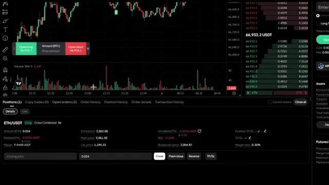
*⏱️ 00:11:15 — Interface d'échange (Blofin/WEEX) affichant un graphique de prix crypto, un carnet d'ordres à droite et une position ETH/USDT ouverte en bas avec ses métriques.*

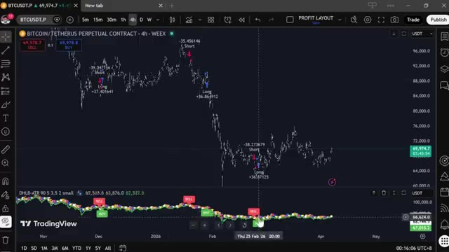
*⏱️ 00:11:23 — Graphique TradingView en unité 4h pour Bitcoin / Tether (BTCUSDT.P) avec des signaux d'achat et de vente et des indicateurs techniques en bas.*

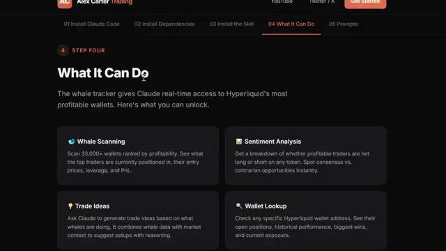
*⏱️ 00:11:32 — Page web de formation ou de documentation d'Alex Carter intitulée « What It Can Do » détaillant les fonctionnalités de suivi des baleines (Whale Scanning, Sentiment Analysis, etc.).*

---

### ⏱️ `[00:11:40 - 00:12:21]` | Segment #27

**🔊 Audio (Transcription Intégrale Mot pour Mot en Français) :**
> un mois. Et honnêtement, quand on y pense, ce qu'est réellement ce système, la configuration de trading par IA la plus avancée disponible pour les traders particuliers en ce moment, constamment mise à jour avec tout inclus. À l'intérieur, il y aussi un cours complet de trading agentique. 2,5 heures. Du débutant à l'expert. Aucune compétence en programmation requise. À la fin, vous aurez votre propre système de trading par IA en direct. Quelque chose que la plupart des traders particuliers ne savent même pas être possible en ce moment. 79,99 $ par mois. Un seul bon trade couvre ce montant. Et les 100 premiers membres bloquent ce tarif de façon permanente. Après cela, le prix augmente. Le lien est dans la description. Vous ne pouvez vraiment pas vous permettre de rater ça.

**👁️ Analyse Visuelle d'Écran (gemini-3.5-flash-lite) :**
**Interface & Outils** : Navigateur web, plateforme Whop et interface de documentation de configuration.

**Contenu textuel & Code** : Listes des fonctionnalités de trading (ordres, effet de levier, stop-loss, spot, infos de compte) et tarifs d'abonnement.

**Action / Démonstration** : Navigation dans la documentation du système et présentation de l'offre d'abonnement.

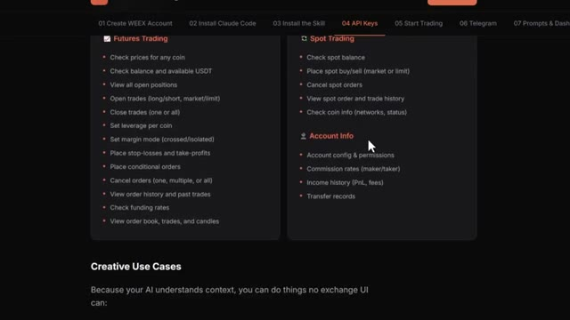
*⏱️ 00:11:51 — Vue d'une page de documentation listant les fonctionnalités de trading automatisé par IA, incluant Futures, Spot et Account Info.*

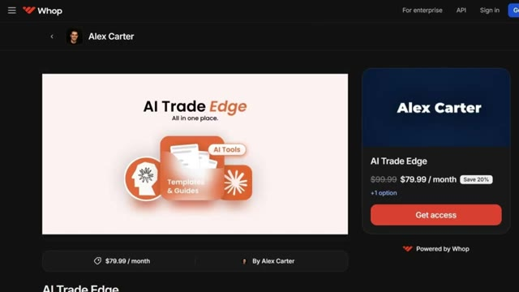
*⏱️ 00:12:11 — Page de la plateforme Whop affichant l'offre "AI Trade Edge" d'Alex Carter au prix de 79,99 $ par mois.*

---

### ⏱️ `[00:12:21 - 00:12:43]` | Segment #28

**🔊 Audio (Transcription Intégrale Mot pour Mot en Français) :**
> Et c'est tout, les gars. C'est comme ça qu'on prend une stratégie sur Internet, qu'on la donne à Claude et qu'on obtient un script Pine fonctionnel dans TradingView. Pas de codage, pas de surveillance manuelle des graphiques. Si vous voulez voir une démonstration complète de la façon dont je trade en utilisant uniquement mon Telegram et la démonstration complète de tous les cas d'utilisation sur TradingView, cliquez sur la vidéo qui apparaît à l'écran dès maintenant. Si vous avez trouvé cela utile, laissez un pouce bleu.

**👁️ Analyse Visuelle d'Écran (gemini-3.5-flash-lite) :**
**Interface & Outils** : Claude Code (PowerShell) et interface de graphique TradingView.

**Contenu textuel & Code** : Prompt textuel de génération de script, graphique de prix avec indicateurs techniques (Bollinger Bands, RSI) et tableaux de confluence multi-timeframe.
[DESC_IMAGE_3]

**Action / Démonstration** : Génération de code via l'assistant IA et visualisation des signaux de trading sur un graphique de cryptomonnaie.

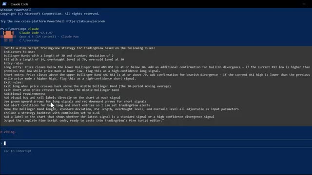
*⏱️ 00:12:27 — Interface de terminal Claude Code affichant un prompt détaillé pour générer un script de stratégie Pine Script basé sur les bandes de Bollinger et le RSI.*

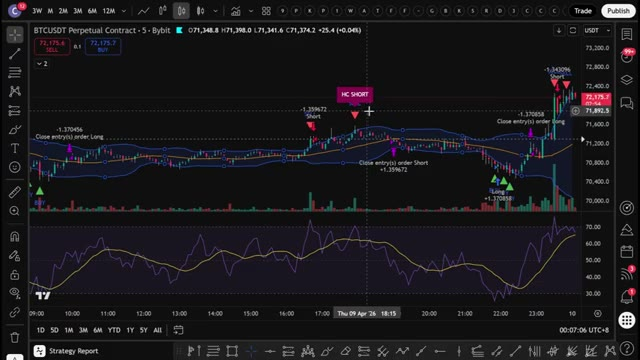
*⏱️ 00:12:32 — Graphique TradingView (BTCUSDT Perpetual Contract) montrant les bandes de Bollinger, le RSI et des signaux d'achat/vente automatisés.*

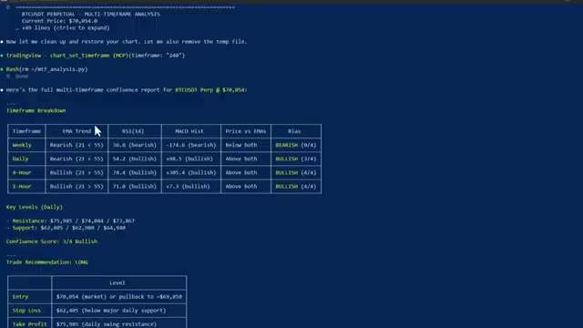
*⏱️ 00:12:38 — Terminal de commandes affichant un rapport d'analyse multi-timeframe complet pour BTCUSDT avec des métriques EMA, RSI, MACD et des recommandations de trade.*

---

### ⏱️ `[00:12:44 - 00:12:48]` | Segment #29

**🔊 Audio (Transcription Intégrale Mot pour Mot en Français) :**
> Cela aide vraiment beaucoup la chaîne. Abonnez-vous si ce n'est pas déjà fait, et je vous vois dans la prochaine.

**👁️ Analyse Visuelle d'Écran (gemini-3.5-flash-lite) :**
**Interface & Outils** : Aucune interface visible.

**Contenu textuel & Code** : Aucun contenu technique, graphique ou textuel.

**Action / Démonstration** : Aucune action en cours.

---

