# 🎬 The Easiest Way to Trade Crypto in 2026 (YUBIT Tap Trading Tutorial)

> **Chaîne** : [Alex Carter](https://www.youtube.com/@AlexCarterTrading)  
> **Lien YouTube** : [https://www.youtube.com/watch?v=yt2fWhXT7g0](https://www.youtube.com/watch?v=yt2fWhXT7g0)  
> **Date de publication** : 20260701  
> **Durée** : 00:12:14  
> **Identifiant vidéo** : `yt2fWhXT7g0`  
> **Transcription & Analyse** : `whisper-v3-large-turbo+gemini-3.5-flash-lite`  

---

## 📌 Synthèse Exécutive & Outils

### 💡 Résumé

Cette vidéo signée Alex Carter explore les innovations de rupture de la plateforme d'échange Yubit (UBIT), en mettant l'accent sur deux produits phares : le « Tap Trading » et les marchés de prédiction. En tant qu'analyste quantitatif, il décortique une approche du trading épurée à l'extrême, qui s'affranchit des interfaces traditionnelles surchargées (absence de graphiques complexes, de carnets d'ordres ou de gestion manuelle du levier et des stop-losses). Le Tap Trading repose sur une grille dynamique de niveaux de prix et de multiplicateurs, où le trader mise sur la capacité du prix en direct (sur la paire Solana/USDT) à toucher une cible spécifique dans une fenêtre de règlement ultra-courte de 60 secondes. 

L'analyse met également en lumière l'écosystème incitatif de la plateforme, notamment un programme de bonus de bienvenue pouvant atteindre 50 000 USDT via des paliers de volume de trading, ainsi qu'une accessibilité immédiate grâce à un modèle sans KYC pour les dépôts en cryptomonnaies. En parallèle, la présentation des marchés de prédiction introduit des mécaniques de paris spéculatifs sur des événements réels (sport, politique, crypto à venir) comparables à des protocoles de type Polymarket. Alex Carter insiste sur l'importance cruciale de la phase d'entraînement en mode démo doté de 100 USDT virtuels, indispensable pour assimiler la vitesse d'exécution supérieure au scalping classique et calibrer sa gestion du risque avant le lancement du trading réel.

### 🛠️ Outils, Modèles & Logiciels Présentés

* **Yubit (UBIT)** : Échange crypto innovant proposant le Tap Trading sans KYC et des marchés de prédiction à haut rendement.
* **Tap Trading (Yubit)** : Outil de trading ultra-simplifié basé sur des grilles de multiplicateurs et des fenêtres de règlement de 60 secondes.
* **Marchés de Prédiction (Yubit)** : Interface de paris spéculatifs sur des résultats du monde réel (sport, politique, crypto) fonctionnant avec des cotes en temps réel.
* **Mode Démo Yubit** : Environnement de simulation doté de 100 USDT virtuels pour s'entraîner sans risque aux mécanismes de rapidité du Tap Trading.
* **Réseau TRC20** : Standard de réseau blockchain recommandé pour des transferts de fonds rapides et à frais réduits.
* **Système de Bonus Yubit** : Programme d'incitation offrant jusqu'à 50 000 USDT de bons de position et des boîtes mystères selon les volumes de trading cumulés.

### 🔑 Points Clés & Enseignements Stratégiques

* **Disparition des interfaces classiques** : Le Tap Trading élimine les indicateurs techniques, les graphiques complexes et la gestion des effets de levier pour se concentrer uniquement sur la vitesse d'exécution et la sélection de cibles de prix.
* **Mécanique du Tap Trading** : Le prix central du marché évolue toutes les 5 secondes, entouré d'une grille de multiplicateurs qui augmentent proportionnellement à l'éloignement du niveau de prix visé.
* **Fenêtre de règlement courte** : Chaque position engagée dispose d'une échéance stricte de 60 secondes pour déterminer si le prix cible a été touché ou non.
* **Gestion de la zone tampon** : Une zone neutre immédiate entoure le prix en direct, interdisant le placement d'ordres trop proches afin de structurer un minimum de distance pour le mouvement des cours.
* **Phase d'entraînement obligatoire** : L'utilisation du mode démo avec 100 USDT virtuels est impérative pour s'adapter à une cadence d'exécution souvent plus rapide que le scalping traditionnel.
* **Politique sans KYC optionnelle** : La possibilité de déposer des cryptomonnaies (comme l'USDT) sans vérification d'identité permet une accessibilité instantanée et contourne les restrictions régionales.
* **Sécurité des transferts** : L'utilisation du réseau TRC20 et la recommandation d'envoyer systématiquement un montant test (10 à 20 dollars) préviennent les pertes de fonds dues à des erreurs de routage.
* **Structure des bonus progressifs** : Les récompenses s'échelonnent de 1 000 $ à 10 000 $ de bonus de position et intègrent des boîtes mystères atteignant 15 000 USDT, corrélées au volume de trading global généré.
* **Typologie des ordres sur les marchés de prédiction** : Distinction claire entre l'ordre au marché (exécution immédiate aux cotes actuelles) et l'ordre déclenché (similaire à un ordre limite classique).
* **Analyse probabiliste des cotes** : Le paiement des marchés de prédiction (options Oui/Non) varie dynamiquement en fonction de la probabilité perçue et du volume global échangé par la communauté.

---

## ⏱️ Chronologie & Transcription Complète Audio & Visuelle (Mot pour Mot)

### ⏱️ `[00:00:00 - 00:00:20]` | Segment #01

**🔊 Audio (Transcription Intégrale Mot pour Mot en Français) :**
> Ubit vient de lancer quelque chose de complètement différent de tout ce que j'ai vu sur un échange crypto et je pense que beaucoup d'entre vous vont vouloir en entendre parler. Ils ont introduit le trading par tapotement où vous ne gérez pas de levier, vous ne définissez pas de stop-loss, vous ne surveillez pas les prix de liquidation. Vous regardez juste le prix, vous tapotez un numéro et vous découvrez en quelques secondes si vous avez gagné.

**👁️ Analyse Visuelle d'Écran (gemini-3.5-flash-lite) :**
**Interface & Outils** : Interface web de l'échange Yubit (sections Prediction Market et Tap Trading).

**Contenu textuel & Code** : Graphiques de prix, grille de multiplicateurs verts et rouges basés sur le temps et le prix, montants de mise configurables (Stake Amount de 1$ à 5$), et historique des ordres de trading.

**Action / Démonstration** : Navigation sur la plateforme Yubit et démonstration de l'interface de "Tap Trading" sans effet de levier traditionnel ni stop-loss.

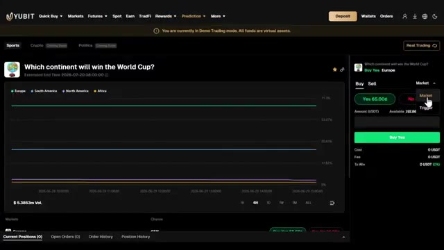
*⏱️ 00:00:05 — Capture d'écran montrant l'interface de la plateforme Yubit sur un marché de prédiction ("Which continent will win the World Cup?").*

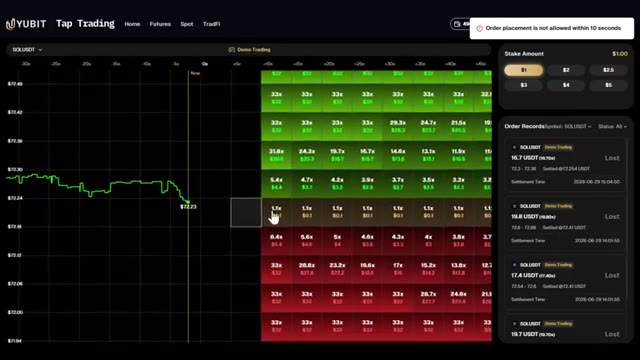
*⏱️ 00:00:10 — Capture d'écran montrant l'interface de "Tap Trading" sur Yubit avec un graphique SOLUSDT et une grille de multiplicateurs de mise en temps réel.*

---

### ⏱️ `[00:00:21 - 00:00:43]` | Segment #02

**🔊 Audio (Transcription Intégrale Mot pour Mot en Français) :**
> Et en plus de ça, ils ont également lancé des marchés de prédiction où vous pouvez parier sur des résultats du monde réel comme des événements sportifs et bientôt la crypto et la politique aussi. Dans cette vidéo, je vais vous montrer exactement comment tout cela fonctionne étape par étape. Comment s'inscrire, comment déposer, comment réclamer jusqu'à 50 000 USDT de bonus de bienvenue, et comment placer concrètement votre premier trade sur les deux produits.

**👁️ Analyse Visuelle d'Écran (gemini-3.5-flash-lite) :**
**Interface & Outils** : Site web de la plateforme de trading et de prédiction Yubit.

**Contenu textuel & Code** : Interface utilisateur affichant des marchés de prédiction sportive (ex. Coupe du Monde FIFA 2026, probabilités et cotes par équipe/continent) ainsi qu'un menu de navigation (Sports, Crypto, Politics).

**Action / Démonstration** : Navigation et présentation des marchés de prédiction sportive disponibles sur la plateforme Yubit.

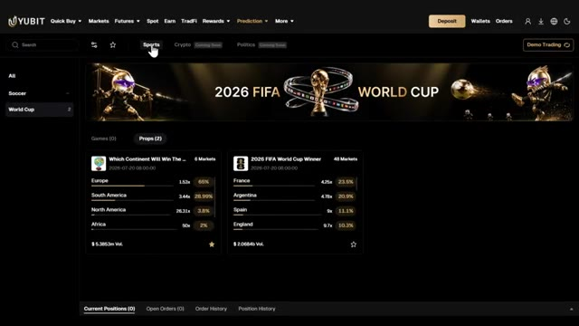
*⏱️ 00:00:26 — Capture d'écran montrant l'interface de la plateforme de prédiction avec un menu pour les événements sportifs et des marchés sur la Coupe du Monde FIFA 2026.*

---

### ⏱️ `[00:00:44 - 00:01:16]` | Segment #03

**🔊 Audio (Transcription Intégrale Mot pour Mot en Français) :**
> Très bien, entrons dans le vif du sujet. Première chose, cliquez sur le lien dans la description. C'est important. Utiliser mon lien est ce qui débloque le package de bonus complet. Sans lui, vous obtiendrez une offre complètement différente. Une fois sur la page UBIT, vous pouvez vous inscrire avec votre email, votre numéro de téléphone, ou vous connecter via Google ou Apple ID. Pour ce tutoriel, j'utiliserai l'email. Entrez simplement vos coordonnées, créez un mot de passe fort, acceptez les conditions d'utilisation, et cliquez sur s'inscrire. Entrez le code de vérification par email et votre compte est prêt. Tout le processus prend moins de 30 secondes.

**👁️ Analyse Visuelle d'Écran (gemini-3.5-flash-lite) :**
**Interface & Outils** : Site web de la plateforme d'échange YUBIT

**Contenu textuel & Code** : Formulaire d'inscription, champ email, mot de passe et code de parrainage 'ALEX'

**Action / Démonstration** : Saisie des informations d'inscription et préparation du clic sur le bouton 'Sign Up'

*⏱️ 00:00:52 — Page d'inscription de la plateforme YUBIT avec un visuel de cadeau promotionnel et le code de parrainage 'ALEX' pré-rempli.*

*⏱️ 00:01:00 — Même page d'inscription sur YUBIT montrant les options de connexion rapide en bas de formulaire.*

*⏱️ 00:01:08 — Formulaire d'inscription YUBIT rempli avec une adresse e-mail et un mot de passe, prêt à valider.*

---

### ⏱️ `[00:01:16 - 00:01:48]` | Segment #04

**🔊 Audio (Transcription Intégrale Mot pour Mot en Français) :**
> Et gardez à l'esprit que UBIT est une plateforme sans KYC. Vous n'avez pas besoin de compléter de vérification d'identité pour commencer à trader. Cela la rend accessible même dans les régions restreintes, et cela signifie que vous pouvez commencer à trader presque instantanément après vous être inscrit. Très bien, mettons un peu d'argent sur votre compte et commençons à débloquer ces bonus. Allez dans votre portefeuille et cliquez sur Déposer. Sélectionnez la cryptomonnaie que vous souhaitez déposer. L'USDT est idéal pour le trading. Ensuite, sélectionnez votre réseau de dépôt. Je recommande TRC20.

**👁️ Analyse Visuelle d'Écran (gemini-3.5-flash-lite) :**
**Interface & Outils** : Site web et interface de la plateforme d'échange YUBIT.

**Contenu textuel & Code** : Texte explicatif sur l'absence de KYC, slogan de la plateforme et formulaire de dépôt de cryptomonnaies (USDT, BTC, ETH, etc.).

**Action / Démonstration** : Navigation sur le site de YUBIT, lecture des conditions d'inscription et consultation de la page de dépôt.

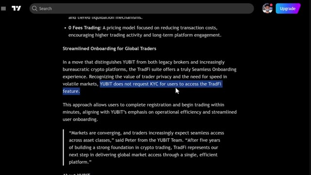
*⏱️ 00:01:24 — Article sur l'absence de KYC pour accéder aux fonctionnalités TradFi de la plateforme YUBIT.*

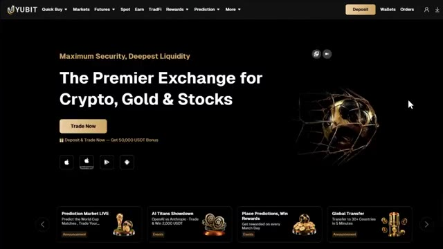
*⏱️ 00:01:32 — Page d'accueil de la plateforme d'échange YUBIT mettant en avant les cryptos, l'or et les actions.*

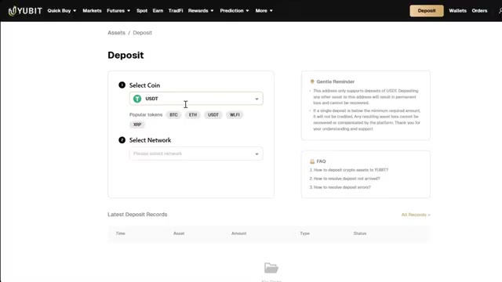
*⏱️ 00:01:40 — Interface de dépôt de fonds de la plateforme YUBIT avec sélection de cryptomonnaies et de réseaux.*

---

### ⏱️ `[00:01:48 - 00:02:25]` | Segment #05

**🔊 Audio (Transcription Intégrale Mot pour Mot en Français) :**
> C'est rapide et les frais sont très bas. Vous verrez ensuite votre adresse de dépôt personnelle. Copiez-la soigneusement. Allez sur votre échange ou portefeuille actuel. Collez l'adresse et envoyez vos fonds. Envoyez toujours d'abord un petit montant test, peut-être 10 à 20 dollars, juste pour confirmer que tout arrive correctement avant d'envoyer le montant total. C'est très important. Envoyer sur le mauvais réseau peut signifier perdre vos fonds. Maintenant, voici où interviennent les bonus. Et c'est un gros bonus. Avec mon lien, vous débloquez jusqu'à 50 000 USDT de bonus de bienvenue. Voici comment cela se décompose. Si vous déposez au moins 100 dollars et

**👁️ Analyse Visuelle d'Écran (gemini-3.5-flash-lite) :**
**Interface & Outils** : Plateforme d'échange de cryptomonnaies YUBIT.

**Contenu textuel & Code** : Formulaires de dépôt, de retrait et d'inscription avec sélection de tokens (USDT, BTC, ETH) et réseaux associés.
[COMPORTEMENT] Démonstration du processus de dépôt et de retrait de fonds sur un échange crypto.

**Action / Démonstration** : Explications face caméra et analyse conceptuelle des marchés.

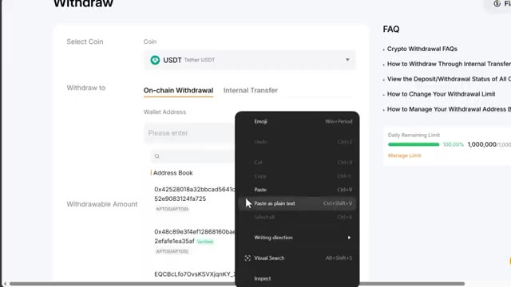
*⏱️ 00:01:57 — Interface de retrait d'actifs affichant le collage d'une adresse de dépôt crypto.*

*⏱️ 00:02:06 — Page de dépôt de la plateforme YUBIT permettant de sélectionner une cryptomonnaie et un réseau.*

*⏱️ 00:02:15 — Page d'inscription de la plateforme YUBIT avec un code de parrainage affilié "ALEX".*

---

### ⏱️ `[00:02:25 - 00:02:51]` | Segment #06

**🔊 Audio (Transcription Intégrale Mot pour Mot en Français) :**
> atteignez 10 000 $ de volume de trading, vous obtenez un bon de position de 1 000 $. Cela va jusqu'à un bon de position de 10 000 $ si vous déposez 10 000 $ et atteignez 2 millions de dollars de volume de trading. En plus de cela, il y a des récompenses de boîtes mystères de trading de contrats à terme. Atteignez 100 000 $ de volume de trading, et vous obtenez une boîte mystère d'une valeur d'au moins 50 USDT, et cela va jusqu'à 50 millions de dollars de volume de trading.

**👁️ Analyse Visuelle d'Écran (gemini-3.5-flash-lite) :**
**Interface & Outils** : Page web d'une plateforme de échange crypto (Yubit/Rewards).

**Contenu textuel & Code** : Paliers de bonus (1 000 USDT, 10 000 USDT de bon de position) et progression des boîtes mystères allant de 50 USDT à 15 000 USDT de récompense.

**Action / Démonstration** : Présentation visuelle des conditions d'obtention des bonus de dépôt et des récompenses de volume de trading.

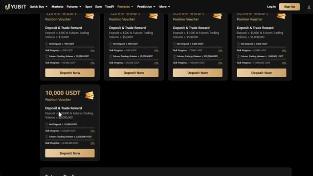
*⏱️ 00:02:31 — Capture d'écran de l'interface des récompenses d'une plateforme de trading montrant différents paliers de bonus de dépôt et de volume de trading futures.*

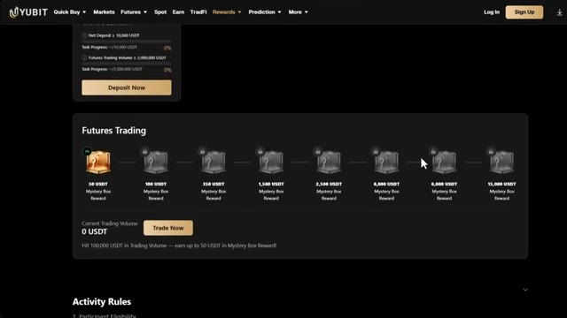
*⏱️ 00:02:38 — Suite de la page montrant le système de boîtes mystères (Mystery Box Rewards) basées sur le volume de trading des contrats futures.*

---

### ⏱️ `[00:02:51 - 00:03:25]` | Segment #07

**🔊 Audio (Transcription Intégrale Mot pour Mot en Français) :**
> Et vous regardez une boîte mystère de 15 000 dollars en USDT. Celles-ci s'empilent toutes les unes sur les autres, donc plus vous déposez et tradez, plus vous en débloquez. Assurez-vous d'utiliser mon lien ci-dessous pour avoir accès à tout cela. Si vous n'avez pas encore de crypto et que vous voulez en acheter directement sur Ubit, c'est également possible, mais pour cela, vous devrez d'abord compléter la vérification KYC. Allez sur l'icône de votre profil sur la page d'accueil et cliquez sur KYC, cliquez sur vérifier maintenant, fournissez votre e-mail, vos informations personnelles, votre vérification.

**👁️ Analyse Visuelle d'Écran (gemini-3.5-flash-lite) :**
**Interface & Outils** : Site web de la plateforme d'échange YUBIT

**Contenu textuel & Code** : Offres de bonus de dépôt, conditions de volume de trading futures, interface d'achat de crypto

**Action / Démonstration** : Navigation sur le site web pour présenter les récompenses et les fonctionnalités d'achat de crypto-monnaies

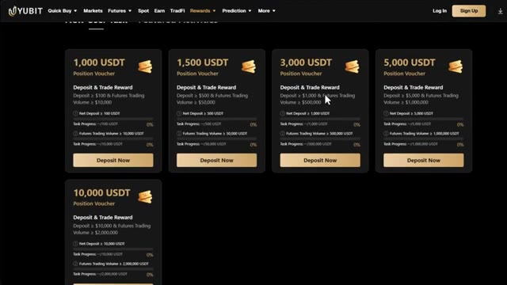
*⏱️ 00:03:00 — Interface de la plateforme YUBIT affichant les bonus de dépôt et les bons de position de 1 000 à 10 000 USDT.*

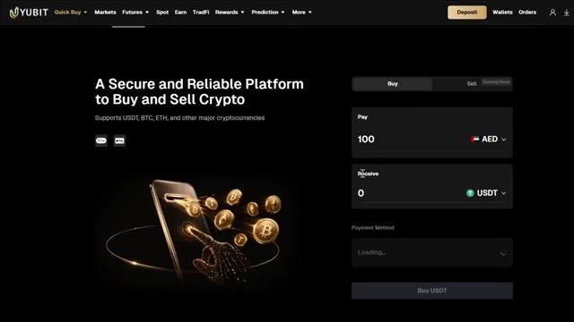
*⏱️ 00:03:08 — Interface de la plateforme YUBIT montrant la section d'achat rapide de crypto-monnaies avec conversion de devises (AED vers USDT).*

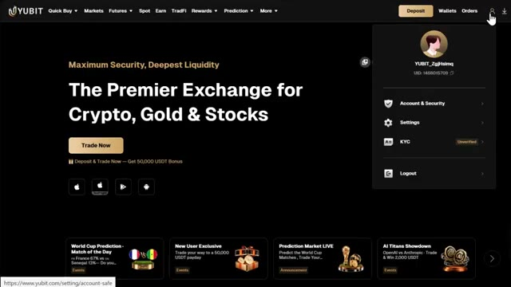
*⏱️ 00:03:17 — Page d'accueil de la plateforme YUBIT avec le menu utilisateur ouvert affichant les options de compte, de sécurité et de KYC.*

---

### ⏱️ `[00:03:25 - 00:03:59]` | Segment #08

**🔊 Audio (Transcription Intégrale Mot pour Mot en Français) :**
> documents, et un selfie. Une fois que c'est approuvé, vous pouvez utiliser l'option d'achat rapide sur UBIT pour acheter des cryptos directement avec monnaie fiat en utilisant une carte de crédit ou de débit. Si vous avez déjà des cryptos sur un autre échange ou portefeuille, vous pouvez ignorer entièrement le KYC et simplement déposer directement, ce qui est l'option la plus rapide pour la plupart des gens. Très bien, c'est la partie que je suis le plus excité de vous montrer. Passons au tap trading. Cliquez sur prédiction dans la barre de navigation supérieure. Vous verrez deux options, tap trading et marché de prédiction. Commençons par le tap trading. Une fois que vous êtes sur l'interface du tap trading,

**👁️ Analyse Visuelle d'Écran (gemini-3.5-flash-lite) :**
**Interface & Outils** : Plateforme d'échange crypto YUBIT (interface web).

**Contenu textuel & Code** : Options de dépôt de cryptos (USDT, BTC, etc.), méthodes de paiement par tiers (Alchemy Pay), menus de navigation et options de trading.
[COMPORTEMENT] Navigation sur la plateforme YUBIT, démonstration de l'option d'achat rapide et de dépôt de fonds.

**Action / Démonstration** : Explications face caméra et analyse conceptuelle des marchés.

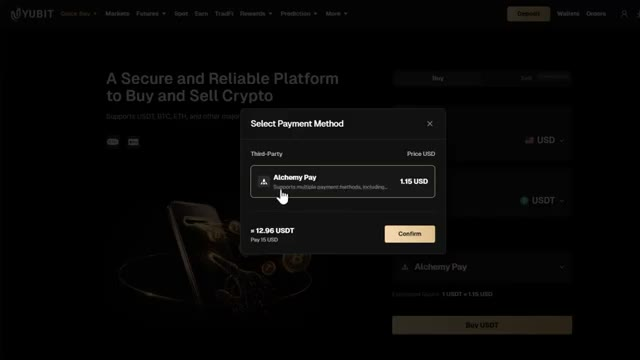
*⏱️ 00:03:33 — Interface de la plateforme YUBIT affichant une fenêtre modale pour sélectionner le mode de paiement (Alchemy Pay) lors d'un achat rapide de cryptomonnaie.*

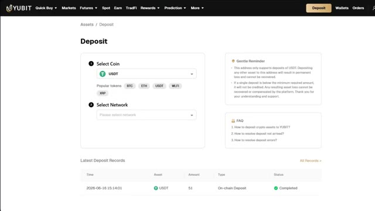
*⏱️ 00:03:42 — Page de dépôt de la plateforme YUBIT avec les options pour sélectionner la cryptomonnaie (USDT) et le réseau, ainsi que l'historique des derniers dépôts.*

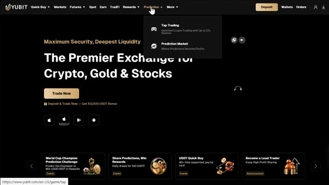
*⏱️ 00:03:50 — Page d'accueil de la plateforme YUBIT avec un menu déroulant ouvert sur l'onglet 'Prediction' montrant les options 'Tap Trading' et 'Prediction Market'.*

---

### ⏱️ `[00:03:59 - 00:04:27]` | Segment #09

**🔊 Audio (Transcription Intégrale Mot pour Mot en Français) :**
> La première chose que vous remarquerez, c'est que cela est très différent d'un terminal de trading normal, et c'est intentionnel. Il n'y a pas de graphique avec des indicateurs, pas de carnet d'ordres, pas de paramètres de effet de levier. C'est épuré pour n'garder que l'essentiel. Voici ce que vous regardez. Sur le côté gauche, vous avez une colonne de prix. Ce sont les niveaux de prix sur lesquels vous pouvez toucher et prédire. Au milieu, vous avez le prix en direct qui bouge. C'est le prix réel Solana USDT, qui se met à jour toutes les cinq secondes.

**👁️ Analyse Visuelle d'Écran (gemini-3.5-flash-lite) :**
**Interface & Outils** : Interface web de la plateforme Yubit (mode Tap Trading).

**Contenu textuel & Code** : Graphique de prix minimaliste de SOLUSDT montrant une ligne verte, grille de multiplicateurs de paris/options (vert et rouge avec des valeurs en 'x' et en dollars), sélecteur de montant de mise (Stake Amount de 1$ à 5$).

**Action / Démonstration** : Présentation de l'interface utilisateur épurée et alternative de trading sans indicateurs techniques ni carnet d'ordres traditionnel.

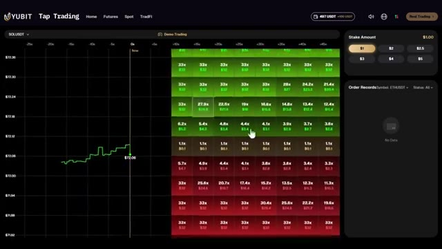
*⏱️ 00:04:06 — Capture d'écran montrant l'interface épurée de trading "Tap Trading" sur la plateforme Yubit avec un graphique simplifié à gauche et une grille de multiplicateurs de mise à droite.*

---

### ⏱️ `[00:04:28 - 00:05:05]` | Segment #10

**🔊 Audio (Transcription Intégrale Mot pour Mot en Français) :**
> Sur le côté droit, vous avez une autre colonne de prix qui reflète celle de gauche. En haut à droite, vous verrez votre sélecteur de montant de mise. Vous pouvez choisir entre 1 et 5 dollars par appui, et en dessous, vous avez vos registres d'ordres, où vous pouvez filtrer par symbole et par le statut de vos transactions, qu'elles soient gagnées, perdues ou en attente. En haut à gauche, vous pouvez choisir votre paire de trading. Pour l'instant, seule la paire Solana USDT est disponible. Mais les paires Bitcoin et Ethereum arrivent bientôt. Maintenant, laissez-moi vous expliquer exactement comment cela fonctionne, car une fois que vous avez compris, c'est en fait très simple. Le prix au milieu bouge

**👁️ Analyse Visuelle d'Écran (gemini-3.5-flash-lite) :**
**Interface & Outils** : Plateforme de trading en ligne Yubit (Tap Trading)

**Contenu textuel & Code** : Graphique de prix en temps réel pour SOLUSDT, sélecteur de montant de mise (Stake Amount de $1 à $5), grille de multiplicateurs verts et rouges, et section des registres d'ordres (Order Records).

**Action / Démonstration** : Sélection du montant de mise ($5) dans le panneau supérieur droit et visualisation de la grille de trading.

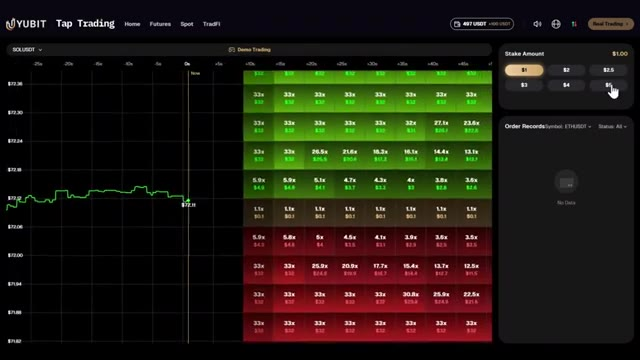
*⏱️ 00:04:37 — Interface de la plateforme Yubit Tap Trading montrant un graphique de prix SOLUSDT à gauche, une grille de multiplicateurs au centre, et le sélecteur de mise ainsi que les registres d'ordres à droite.*

---

### ⏱️ `[00:05:05 - 00:05:41]` | Segment #11

**🔊 Audio (Transcription Intégrale Mot pour Mot en Français) :**
> toutes les cinq secondes. Autour de ce prix, vous verrez une grille de nombres. Ce sont des niveaux de prix potentiels. Chaque case affiche un multiplicateur. Combien vous gagnerez si le prix touche ce niveau dans la fenêtre de règlement de 60 secondes. Plus un niveau de prix est éloigné du prix actuel, plus le multiplicateur est élevé. Parce qu'il est moins susceptible d'être atteint, les cases plus proches du prix actuel ont des multiplicateurs plus faibles mais une plus grande chance d'être atteintes. La case jaune au milieu affichant quelque chose comme 1,1 fois est la zone la plus proche du prix actuel. Pour placer un trade, vous sélectionnez d'abord votre

**👁️ Analyse Visuelle d'Écran (gemini-3.5-flash-lite) :**
**Interface & Outils** : Interface web de courtier/échange (YUBIT Tap Trading)

**Contenu textuel & Code** : Graphique de prix en temps réel pour SOLUSDT, grille de niveaux de prix avec multiplicateurs de gains (allant de 1.1x à 33x), panneau de sélection de mise (Stake Amount) avec des montants de 1$ à 5$, et historique des ordres (Order Records).

**Action / Démonstration** : Présentation de la grille de multiplicateurs de prix et des options de mise pour le trading à court terme.

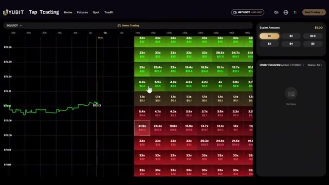
*⏱️ 00:05:14 — Interface de trading 'Tap Trading' sur la plateforme YUBIT montrant un graphique de prix pour SOLUSDT et une grille de multiplicateurs de gains potentiels.*

---

### ⏱️ `[00:05:41 - 00:06:03]` | Segment #12

**🔊 Audio (Transcription Intégrale Mot pour Mot en Français) :**
> le montant de la mise en haut à droite. Disons 1 dollar. Ensuite, vous regardez la grille. Les tuiles vertes sur le côté supérieur signifient que vous prévoyez que le prix va monter et toucher ce niveau. Les tuiles rouges sur le côté inférieur signifient que vous prévoyez que le prix va chuter et toucher ce niveau. Il vous suffit de toucher la tuile au niveau de prix que le marché, selon vous, atteindra. Au moment où vous touchez la tuile, votre ordre est placé.

**👁️ Analyse Visuelle d'Écran (gemini-3.5-flash-lite) :**
**Interface & Outils** : Interface web de courtier/échange (Yubit Tap Trading)

**Contenu textuel & Code** : Graphique de prix SOLUSDT, grille de trading avec multiplicateurs (ex: 33x, 17.2x, etc.), tuiles vertes (haussières) et rouges (baissières), panneau de sélection de mise 'Stake Amount' fixé à 1.00$

**Action / Démonstration** : Explication et démonstration de la grille de prédiction de prix (tuiles vertes et rouges) et de la configuration du montant de la mise.

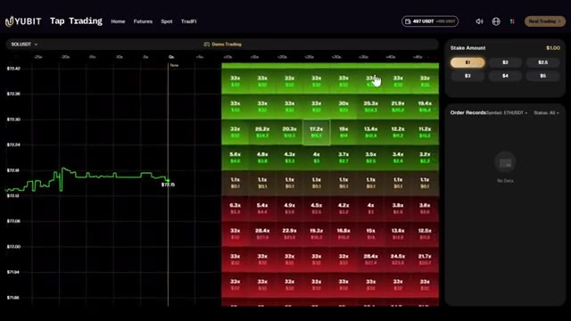
*⏱️ 00:05:46 — Interface de trading 'Tap Trading' sur la plateforme Yubit montrant un graphique de prix SOLUSDT à gauche et une grille de tuiles de prédiction (vertes et rouges) avec des multiplicateurs et un panneau de mise de 1 dollar à droite.*

---

### ⏱️ `[00:06:03 - 00:06:40]` | Segment #13

**🔊 Audio (Transcription Intégrale Mot pour Mot en Français) :**
> En moins de 60 secondes, vous connaîtrez le résultat. Si le prix touche le niveau que vous avez sélectionné, votre gain est crédité instantanément, selon le multiplicateur affiché sur cette case. S'il ne l'atteint pas, vous perdez votre mise pour ce trade. Une chose importante à garder à l'esprit : les cases les plus proches de l'évolution actuelle du prix ne peuvent pas être sélectionnées. Il y a une petite zone tampon juste autour du prix en direct où les ordres ne peuvent pas être placés. Regardez donc toujours un peu plus loin du milieu lorsque vous effectuez votre placement. Et en ce moment, le trading par tapotement fonctionne en mode démo, le trading réel arrivant très bientôt. C'est donc le moment idéal pour vous entraîner. Vous disposez de 100 USDT de fonds simulés.

**👁️ Analyse Visuelle d'Écran (gemini-3.5-flash-lite) :**
**Interface & Outils** : Plateforme de trading YUBIT - Section Tap Trading

**Contenu textuel & Code** : Graphique de prix en temps réel de SOLUSDT, grille de multiplicateurs avec des cases vertes et rouges, panneau de mise (Stake Amount) avec des options de 1$ à 5$, et historique des ordres.

**Action / Démonstration** : Le curseur de la souris survole une case spécifique de la grille de multiplicateurs pour placer potentiellement un trade.

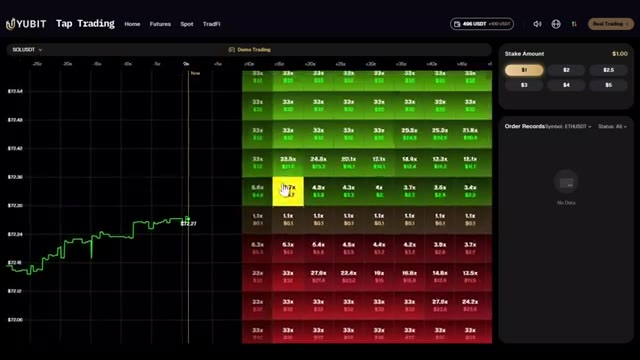
*⏱️ 00:06:12 — Interface de trading rapide montrant un graphique de prix pour SOLUSDT à gauche et une grille de multiplicateurs colorés en vert et rouge à droite.*

---

### ⏱️ `[00:06:40 - 00:07:16]` | Segment #14

**🔊 Audio (Transcription Intégrale Mot pour Mot en Français) :**
> pour tester votre stratégie sans aucun risque. Je vous recommande de passer un peu certaines ici avant que le trading réel ne commence, car la vitesse est généralement plus rapide que le scalping traditionnel. Vous devez vous familiariser avec la rapidité des mouvements de prix et apprendre à lire la grille avant de risquer de l'argent réel. Vous pouvez suivre toute votre activité dans la section des carnets d'ordres. Les ordres ouverts, les ordres fermés, les gains et les pertes y sont tous enregistrés afin que vous puissiez analyser vos performances. Au fait, si vous ne vous êtes pas encore inscrit, c'est vraiment le moment idéal pour le faire. Le "tap trading" en est encore à ses débuts, ce qui signifie que vous pouvez vous entraîner en mode démo, vous familiariser avec le produit et être prêt à vous lancer dès que

**👁️ Analyse Visuelle d'Écran (gemini-3.5-flash-lite) :**
**Interface & Outils** : Interface de la plateforme de trading YUBIT (section Tap Trading et Rewards Hub).

**Contenu textuel & Code** : Graphique de prix SOLUSDT, grille de multiplicateurs et multiplicateurs potentiels, panneau de sélection de mise (Stake Amount) et historique des ordres (Order Records).

**Action / Démonstration** : Navigation et démonstration d'une interface de trading à haut risque avec des ordres en attente (Pending) en mode démo.

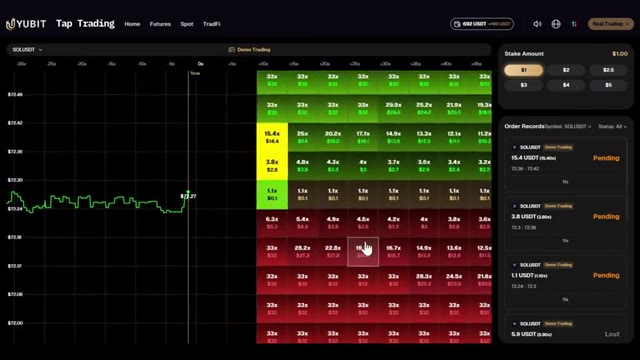
*⏱️ 00:06:49 — Interface de trading 'Tap Trading' sur la plateforme YUBIT montrant un graphique de prix en temps réel et une grille de multiplicateurs de gains (Demo Trading).*

---

### ⏱️ `[00:07:16 - 00:07:51]` | Segment #15

**🔊 Audio (Transcription Intégrale Mot pour Mot en Français) :**
> moment où le vrai trading commence. Et avec le bonus de bienvenue de 50 000 USDT disponible via mon lien dans la description, vous cumulez aussi des récompenses dès le premier jour. Le lien est plus bas. Le tout premier dans la description. Très bien, passons maintenant au deuxième produit, les marchés de prédiction. Retournez sur le menu principal d'UBIT, cliquez à nouveau sur prédiction, et cette fois, sélectionnez marché de prédiction. Cela vous amènera à l'interface du marché de prédiction. Et si vous avez déjà utilisé des plateformes comme Polymarket, cela vous semblera familier. Si ce n'est pas le cas, ne vous inquiétez pas. Je vais vous expliquer tout en détail. Dans le

**👁️ Analyse Visuelle d'Écran (gemini-3.5-flash-lite) :**
**Interface & Outils** : Interface web de la plateforme d'échange YUBIT (sections Rewards, Accueil, Prediction)

**Contenu textuel & Code** : Paliers de bonus de trading futures (50 USDT à 15 000 USDT), cotes et probabilités de paris sur la Coupe du Monde FIFA 2026 (France, Argentine, etc.)

**Action / Démonstration** : Navigation sur la plateforme YUBIT pour présenter les bonus de bienvenue et les marchés de prédiction disponibles

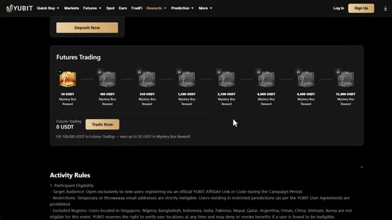
*⏱️ 00:07:25 — Page des récompenses (Rewards) sur la plateforme YUBIT, mettant en avant le programme de bonus "Futures Trading" avec des paliers allant jusqu'à 15 000 USDT en Mystery Box.*

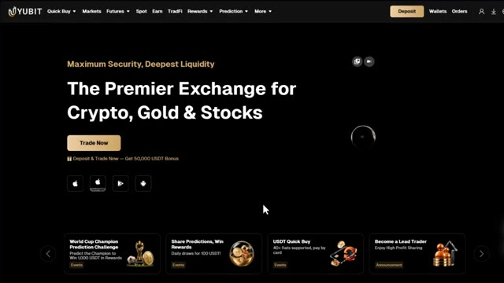
*⏱️ 00:07:34 — Page d'accueil de la plateforme d'échange YUBIT affichant le slogan "The Premier Exchange for Crypto, Gold & Stocks" avec une offre de bonus de 50 000 USDT.*

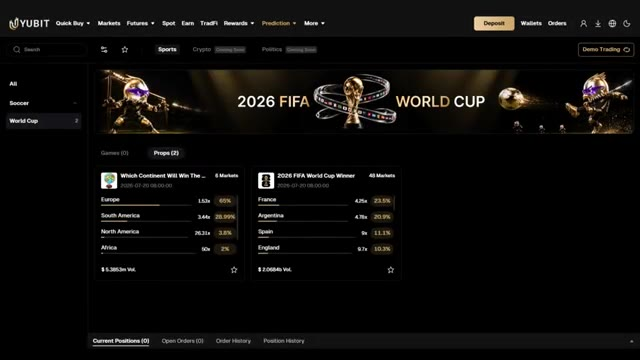
*⏱️ 00:07:43 — Interface de prédiction sur YUBIT montrant des marchés de paris sportifs pour la Coupe du Monde 2026 (options par continent et vainqueur avec cotes et probabilités).*

---

### ⏱️ `[00:07:51 - 00:08:24]` | Segment #16

**🔊 Audio (Transcription Intégrale Mot pour Mot en Français) :**
> au milieu de l'écran, vous verrez la question active actuelle. C'est le marché sur lequel vous pouvez parier. Vous pouvez voir combien de choix de résultats sont disponibles pour cette question, la date limite du marché, le multiplicateur actuel, les cotes actuelles et le volume total échangé sur ce marché. Si vous voulez sauvegarder un marché pour plus tard, vous pouvez cliquer sur l'icône en forme d'étoile en bas à droite pour l'ajouter aux favoris. Sur le côté gauche, vous pouvez voir tous les paris et marchés actifs actuels. En haut, vous remarquerez qu'il affiche actuellement les sports uniquement, avec les cryptos et la politique à venir. En haut à droite, vous pouvez

**👁️ Analyse Visuelle d'Écran (gemini-3.5-flash-lite) :**
**Interface & Outils** : Interface web de la plateforme de prédiction et d'échange Yubit.

**Contenu textuel & Code** : Marchés de prédiction avec des questions telles que "Which Continent Will Win The..." (Europe 1.53x / 69%, South America 3.44x / 28.99%, etc.) et "2026 FIFA World Cup Winner" (France, Argentine, Espagne, Angleterre). Volume total affiché ($5.3853m Vol.).

**Action / Démonstration** : Navigation et présentation des marchés de paris et de prédiction sportive sur l'interface Yubit.

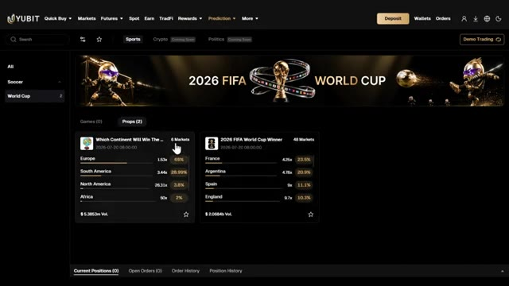
*⏱️ 00:08:00 — Capture d'écran de l'interface de prédiction de la plateforme Yubit montrant les marchés liés à la Coupe du Monde FIFA 2026.*

---

### ⏱️ `[00:08:24 - 00:08:44]` | Segment #17

**🔊 Audio (Transcription Intégrale Mot pour Mot en Français) :**
> basculer entre le mode démo et le trading réel. Et il y aura une bannière de notification en haut de l'écran pour vous rappeler dans quel mode vous vous trouvez actuellement. Donc, vérifiez toujours cela à deux reprises avant de passer un ordre réel. Maintenant, cliquons sur l'un des marchés pour voir comment cela fonctionne. Une nouvelle fenêtre s'ouvrirait. Au milieu, vous verrez les cotes en direct et le pourcentage de chance pour chaque résultat.

**👁️ Analyse Visuelle d'Écran (gemini-3.5-flash-lite) :**
**Interface & Outils** : Interface web de courtage/échange Yubit (section Prediction).

**Contenu textuel & Code** : Bannière indiquant « You are currently in Demo Trading mode », marchés de prédiction sportive (ex: Coupe du Monde 2026), graphiques de probabilités et carnet d'ordres.

**Action / Démonstration** : Navigation sur la plateforme de prédiction et sélection d'un marché pour afficher les détails et placer un ordre.

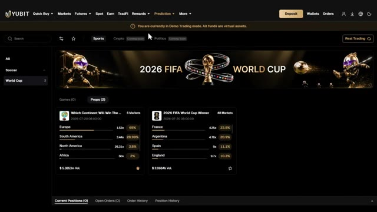
*⏱️ 00:08:29 — Interface de la plateforme Yubit affichant le mode démo de trading avec des options de paris sur la Coupe du Monde 2026.*

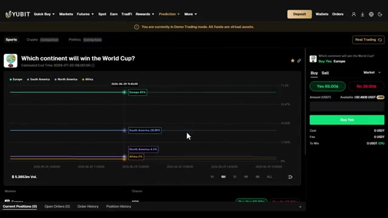
*⏱️ 00:08:39 — Vue détaillée d'un marché de prédiction sur Yubit montrant les graphiques de probabilité et le panneau d'ordre d'achat/vente.*

---

### ⏱️ `[00:08:45 - 00:09:07]` | Segment #18

**🔊 Audio (Transcription Intégrale Mot pour Mot en Français) :**
> Cela se met à jour en temps réel à mesure que davantage de personnes placent des paris. Sur le côté droit, vous verrez les boutons d'achat et de vente ainsi que deux types d'ordres, au marché et déclenché. Un ordre au marché s'exécute immédiatement aux cotes actuelles. Un ordre déclenché vous permet de définir un niveau de cote spécifique auquel vous souhaitez entrer, de manière similaire à un ordre limite dans le trading classique. En dessous, vous verrez les boutons oui et non.

**👁️ Analyse Visuelle d'Écran (gemini-3.5-flash-lite) :**
**Interface & Outils** : Interface de la plateforme de prédiction Yubit (en mode Demo Trading).

**Contenu textuel & Code** : Graphique des probabilités en temps réel pour le marché "Which continent will win the World Cup?", panneau de trading latéral avec les onglets "Buy" et "Sell", type d'ordre "Market", boutons "Yes 65.0¢" et "No 36.0¢", champ de montant (Amount USDT), solde disponible (192.8653 USDT) et bouton vert "Buy Yes".

**Action / Démonstration** : Le présentateur montre l'interface de passage d'ordres sur le côté droit de l'écran, expliquant le fonctionnement des ordres au marché et des types d'ordres de prédiction.

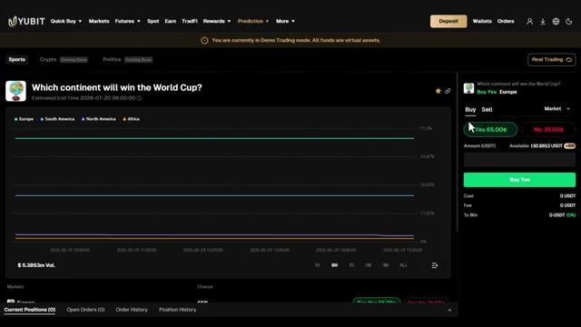
*⏱️ 00:08:51 — Capture d'écran de l'interface de prédiction Yubit montrant un marché sur la Coupe du Monde avec un graphique en temps réel et le panneau de passage d'ordres à droite.*

---

### ⏱️ `[00:09:08 - 00:09:43]` | Segment #19

**🔊 Audio (Transcription Intégrale Mot pour Mot en Français) :**
> Voici comment vous prenez votre position. Oui signifie que vous pensez que ce résultat va se produire. Non signifie que vous pensez qu'il ne se produira pas. Vous saisissez le montant de votre mise et, juste là, en un seul coup d'œil, vous pouvez voir le coût, les frais et combien vous pouvez gagner, le tout avant de confirmer quoi que ce soit. Faites défiler vers le bas et vous verrez plus de détails, l'option spécifique disponible, le pourcentage de probabilité actuel pour chacune, et à nouveau les boutons oui et voici comment fonctionne le gain dans les marchés de prédiction. Si vous cliquez sur oui pour un résultat et que ce résultat se produit réellement lorsque le marché se clôture, vous gagnez. Si vous cliquez sur non

**👁️ Analyse Visuelle d'Écran (gemini-3.5-flash-lite) :**
**Interface & Outils** : Plateforme de trading et de prédiction YUBIT (mode démo).

**Contenu textuel & Code** : Marché de prédiction "Which continent will win the World Cup?", options d'achat "Yes" (65.0¢) et "No" (35.0¢), champ de saisie du montant de mise en USDT et résumé des frais et gains potentiels.

**Action / Démonstration** : Démonstration du placement d'un ordre de prédiction avec le calcul des coûts et des gains potentiels affichés en temps réel.

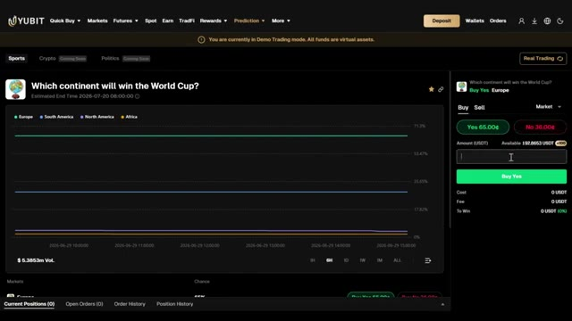
*⏱️ 00:09:17 — Interface de la plateforme de prédiction YUBIT montrant un marché sur la Coupe du Monde avec le panneau de placement d'ordres à droite.*

---

### ⏱️ `[00:09:43 - 00:10:17]` | Segment #20

**🔊 Audio (Transcription Intégrale Mot pour Mot en Français) :**
> et que le résultat ne se produit pas, vous gagnez également. Le paiement dépend des cotes au moment où vous avez placé votre pari. Plus la probabilité d'un résultat est faible, plus votre paiement est élevé s'il se réalise. Disons que nous regardons un marché du football. L'Europe a actuellement 65 % de chances, au prix de 0,65 $ par action. Si vous achetez "oui" sur l'Europe à 0,65 $ et que l'Europe gagne, chaque action rapporte 1 $. Votre bénéfice est donc de 0,35 $ par action. Si vous investissez 100 USDT, vous pouvez voir le coût exact, les frais et vos gains potentiels affichés directement là

**👁️ Analyse Visuelle d'Écran (gemini-3.5-flash-lite) :**
**Interface & Outils** : Plateforme de trading et de prédiction (Yubit)

**Contenu textuel & Code** : Marché de prédiction sportive avec les pourcentages de chance pour chaque continent (Europe 65 %, Amérique du Sud 28,99 %, Amérique du Nord 3 %, Afrique 2 %, Asie 1,3 %, Océanie 0,2 %), panneau d'achat "Buy Yes / Buy No", et montant de transaction configuré à 100 USDT.

**Action / Démonstration** : Visualisation et démonstration d'un marché de prédiction pour les parts de différents continents.

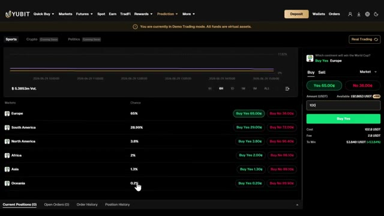
*⏱️ 00:09:52 — Interface de la plateforme montrant un marché de prédiction sportive (quel continent remportera la Coupe du monde) avec différentes options de paris par continent et leurs probabilités associées.*

---

### ⏱️ `[00:10:17 - 00:10:47]` | Segment #21

**🔊 Audio (Transcription Intégrale Mot pour Mot en Français) :**
> Avant de confirmer. Une fois que vous aurez cliqué sur oui, une fenêtre de confirmation de commande apparaîtra. Vérifiez la commande une dernière fois. Vérifiez le montant, le résultat sur lequel vous pariez et le coût. Cliquez ensuite sur confirmer. Après avoir confirmé, vous pouvez voir votre position actuelle dans le panneau des positions, votre prix d'enchère moyen, le montant principal que vous avez investi, vos gains potentiels, votre valeur actuelle et votre P&L non réalisé. Et surtout, vous avez la possibilité de vendre votre position avant même que le marché n'ait clôturé.

**👁️ Analyse Visuelle d'Écran (gemini-3.5-flash-lite) :**
**Interface & Outils** : Interface de la plateforme de prédiction (Yubit / marché de prédiction).

**Contenu textuel & Code** : Fenêtre de confirmation avec les détails de la position : Prix (Market price), Montant (100 USDT), Coût (102,8 USDT), Frais (2,8 USDT) et gain potentiel (53,8461 USDT / +53,84%).

**Action / Démonstration** : Vérification des détails de la commande avant de cliquer sur le bouton de confirmation ("Confirm").

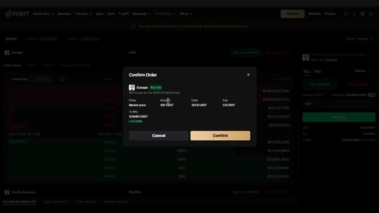
*⏱️ 00:10:25 — Fenêtre modale de confirmation de commande ("Confirm Order") sur une plateforme de prédiction de marché, affichant le prix du marché, le montant de 100 USDT, le coût total de 102,8 USDT et les frais associés.*

---

### ⏱️ `[00:10:48 - 00:11:10]` | Segment #22

**🔊 Audio (Transcription Intégrale Mot pour Mot en Français) :**
> Donc, si les cotes évoluent en votre faveur et que vous souhaitez sécuriser un profit à l'avance, vous pouvez le faire. Il vous suffit de cliquer sur vendre, de vérifier le bon de commande et de confirmer. Une chose que je tiens à souligner : lisez toujours la section des règles de chaque marché avant de placer un pari. Elle vous indique exactement comment le résultat sera déterminé, quand le marché ferme, quand le règlement a lieu et s'il y a des interdictions de trading.

**👁️ Analyse Visuelle d'Écran (gemini-3.5-flash-lite) :**
**Interface & Outils** : Interface de la plateforme de courtage Yubit (section Prediction / Sports).

**Contenu textuel & Code** : Carnet d'ordres (Order Book) affichant les prix en cents (63.00¢ à 57.00¢) et le volume des parts, ainsi qu'un panneau de vente (Sell Yes) configuré pour 153 contrats.

**Action / Démonstration** : Le curseur de la souris clique sur le bouton "Max" pour sélectionner le montant maximal de parts disponibles en vue d'une vente anticipée.

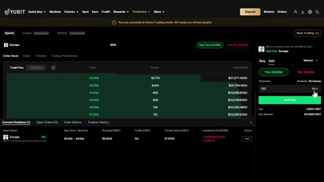
*⏱️ 00:10:53 — Capture d'écran montrant l'interface de trading de prédiction de la plateforme Yubit en mode démo, avec le carnet d'ordres et le panneau de vente pour un marché sportif (Europe).*

---

### ⏱️ `[00:11:10 - 00:11:28]` | Segment #23

**🔊 Audio (Transcription Intégrale Mot pour Mot en Français) :**
> C'est important parce que certains marchés ont des conditions spécifiques qui affectent le déroulement de votre pari. Ne sautez pas cette étape. Très bien, voilà donc l'analyse détaillée étape par étape de la façon d'utiliser le *tap trading* et les marchés de prédiction sur UBIT. Le *tap trading* est vraiment l'un des produits les plus uniques que j'aie vus sur un échange de crypto-monnaies.

**👁️ Analyse Visuelle d'Écran (gemini-3.5-flash-lite) :**
**Interface & Outils** : Plateforme de trading UBIT (section Prédiction et carnets d'ordres).

**Contenu textuel & Code** : Règles de marché de prédiction (FIFA 2026), carnets d'ordres avec prix d'achat/vente (ex: 64.00¢, 65.00¢), volumes en actions et montants en USDT.

**Action / Démonstration** : Consultation des règles spécifiques du marché puis analyse du carnet d'ordres avant d'effectuer un placement sur UBIT.

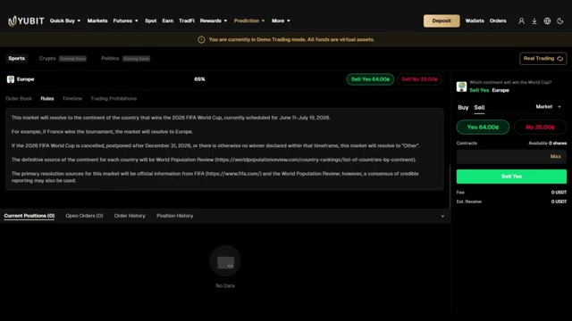
*⏱️ 00:11:14 — L'interface de la plateforme UBIT affichant les règles d'un marché de prédiction sportif concernant la Coupe du Monde FIFA 2026.*

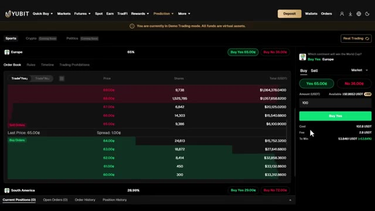
*⏱️ 00:11:23 — Le carnet d'ordres (Order Book) détaillé et le panneau de passage d'ordres pour un marché de prédiction sur la plateforme UBIT.*

---

### ⏱️ `[00:11:29 - 00:12:04]` | Segment #24

**🔊 Audio (Transcription Intégrale Mot pour Mot en Français) :**
> Pas deeffet de levier, pas de liquidations, juste des prédictions de prix rapides avec des gains de 33 fois ou plus. et les marchés de prédiction vous offrent une toute autre façon de participer aux résultats au-delà des simples graphiques de prix. Tous deux valent la peine d'être explorés, en particulier tant que le tap trading est encore en mode démo et que vous pouvez vous entraîner gratuitement. Utilisez mon lien dans la description pour vous inscrire sur UBIT et réclamer le pack de bonus de bienvenue complet pouvant aller jusqu'à 50 000 USTT de récompenses. Tous les détails sont ci-dessous. Si vous avez des questions, posez-les dans les commentaires. Je les lis. Si cette vidéo vous a aidé, assurez-vous

**👁️ Analyse Visuelle d'Écran (gemini-3.5-flash-lite) :**
**Interface & Outils** : Plateforme d'échange et de prédiction YUBIT (sections Prediction, Tap Trading et Rewards).

**Contenu textuel & Code** : Multiplicateurs de prix rapides (ex: 33x, 5.9x), graphiques de cours SOLUSDT, montants de mise en USDT, conditions de bonus de dépôt et de volume de trading futures.

**Action / Démonstration** : Navigation à travers les options de prédiction de prix rapides, visualisation des multiplicateurs de gains potentiels et consultation des récompenses de dépôt.

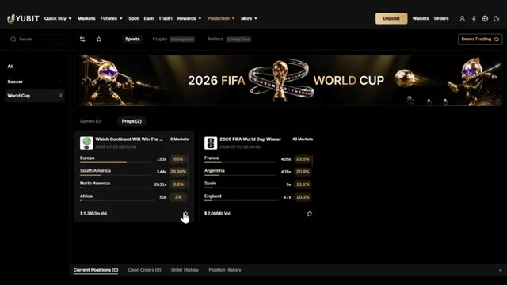
*⏱️ 00:11:37 — Interface de la plateforme YUBIT affichant les marchés de prédiction sportifs, notamment la Coupe du Monde FIFA 2026.*

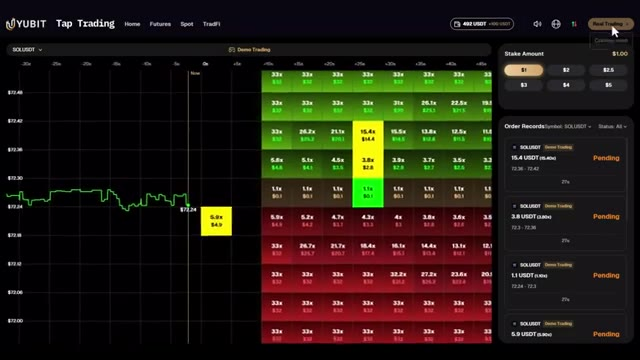
*⏱️ 00:11:46 — Interface de 'Tap Trading' sur YUBIT montrant un graphique de prix en temps réel (SOLUSDT) avec une grille de multiplicateurs de gains (allant jusqu'à 33x ou plus) et un panneau de carnets d'ordres en attente.*

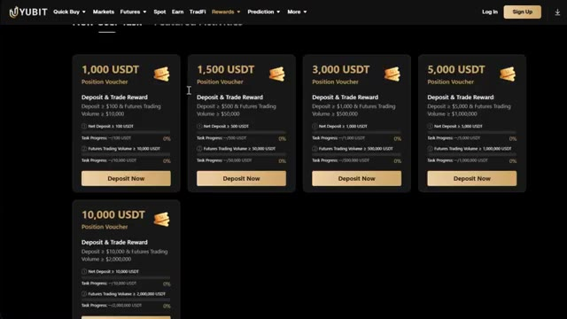
*⏱️ 00:11:55 — Page des récompenses et des bonus de dépôt ('Rewards') de la plateforme YUBIT avec des bons de position de 1 000 à 10 000 USDT.*

---

### ⏱️ `[00:12:04 - 00:12:14]` | Segment #25

**🔊 Audio (Transcription Intégrale Mot pour Mot en Français) :**
> Aimez et abonnez-vous pour plus de tutoriels crypto comme celui-ci. Et pour une présentation plus détaillée de la plateforme UBIT elle-même, consultez la vidéo qui s'affiche sur votre écran en ce moment même. Je vous vois dans la prochaine.

**👁️ Analyse Visuelle d'Écran (gemini-3.5-flash-lite) :**
**Interface & Outils** : Plateforme de trading UBIT (section Tap Trading).

**Contenu textuel & Code** : Graphique de prix SOLUSDT, grille de multiplicateurs (allant de 1.1x à 33x), panneau "Stake Amount" avec des mises de 1$ à 5$, et carnet "Order Records" affichant des ordres "Pending".

**Action / Démonstration** : Présentation de l'interface de trading interactif (Tap Trading) de la plateforme UBIT.

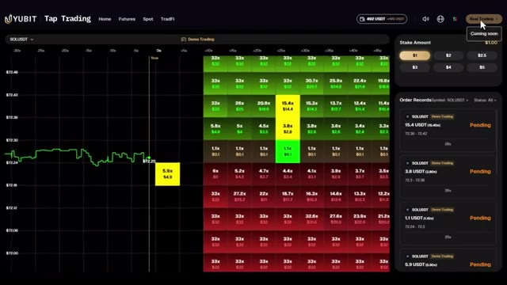
*⏱️ 00:12:06 — Interface de la plateforme de trading UBIT (Tap Trading) affichant un graphique de prix SOLUSDT, une grille de multiplicateurs et un panneau d'historique des ordres en cours.*

---

