# 🎬 Which Crypto AI Assistant Actually Works? (Bybit TradeGPT vs Toobit Synapse)

> **Chaîne** : [Alex Carter](https://www.youtube.com/@AlexCarterTrading)  
> **Lien YouTube** : [https://www.youtube.com/watch?v=fZol-8LsNRE](https://www.youtube.com/watch?v=fZol-8LsNRE)  
> **Date de publication** : 20260703  
> **Durée** : 00:17:15  
> **Identifiant vidéo** : `fZol-8LsNRE`  
> **Transcription & Analyse** : `whisper-v3-large-turbo+gemini-3.5-flash-lite`  

---

## 📌 Synthèse Exécutive & Outils

### 💡 Résuddhme

Cette vidéo de la chaîne Alex Carter propose une analyse comparative approfondie entre deux assistants en intelligence artificielle intégrés à des plateformes d'échange de cryptomonnaies de premier plan : **TradeGPT** sur Bybit et **Synapse** sur Toobit (désigné phonétiquement par « 2Bit »). L'enjeu est de déterminer quel outil offre un véritable avantage opérationnel aux traders, qu'il s'agisse de débutants cherchant à s'orienter ou de traders actifs en quête d'optimisation. L'analyse met en lumière la dichotomie entre des assistants axés sur la veille d'actualités et la sélection de jetons, et des copilotes sophistiqués capables de traiter des flux de données en temps réel pour générer des stratégies exploitables.

Au-delà des interfaces de chat traditionnelles, la démonstration détaille l'écosystème de Bybit (divisé en modules tels que ChatNow, Lens et Daily Pulse) qui permet de passer instantanément de l'analyse fondamentale des réseaux sociaux ou de la capitalisation boursière à l'exécution de contrats au comptant (*spot*), de contrats à terme (*futures*) ou de bots de trading. À l'opposé, la présentation de Toobit Synapse met en avant une architecture plus robuste, adossée au modèle de langage **Claude** et au protocole **MCP (Model Context Protocol)**, positionnant l'outil non pas comme un simple générateur de FAQ, mais comme un analyste quantitatif et un copilote de marché permanent.

L'angle stratégique de la vidéo insiste sur l'importance cruciale de la gestion du risque (*Risk Management*) et de l'automatisation. Alors que Bybit TradeGPT démocratise l'accès aux données comportementales et aux tendances de volume (ratios long/short), Toobit Synapse préfigure l'automatisation avancée des ordres et la surveillance continue du marché. L'analyste conclut sur une mise en garde indispensable : les intelligences artificielles doivent être utilisées comme des points de départ analytiques et des outils d'aide à la décision, et non comme des substituts aveugles à la discipline personnelle et à la recherche fondamentale (*DYOR*).

### 🛠️ Outils, Modèles & Logiciels Présentés

* **TradeGPT** : Assistant IA intégré à l'échange Bybit, structuré autour du chat, de l'évaluation sociale des jetons et des résumés d'actualités quotidiens.
* **Toobit Synapse** : Copilote de trading propulsé par l'IA de Toobit, conçu pour décoder le bruit du marché et générer des stratégies automatisées complexes.
* **Claude** : Modèle de langage de pointe développé par Anthropic, servant de moteur conversationnel et analytique pour Toobit Synapse.
* **Model Context Protocol (MCP)** : Protocole technologique permettant à Synapse de se connecter en direct aux flux de données de marché en temps réel sans spéculation aveugle.
* **Bybit Lens** : Module d'analyse fondamentale de Bybit évaluant l'engagement social, l'activité de la communauté sur X et la dynamique de capitalisation des cryptomonnaies.
* **Daily Pulse** : Fonctionnalité de résumé macroéconomique et sectoriel de Bybit permettant de décrypter l'actualité quotidienne et d'auditer ses actifs en un clic.
* **AI Trade Edge** : Solution externe mentionnée pour la création d'intelligences artificielles génétiques dédiées au trading automatisé sur les marchés crypto et actions.
* **TradingView** : Plateforme de graphisme et d'analyse technique incontournable, souvent couplée aux stratégies de scalping et au langage Pine Script dans l'écosystème du trading quantitatif.
* **Grok Bots** : Outils d'automatisation et de génération de stratégies basés sur l'IA, pertinents pour la surveillance des opportunités de marché.

### 🔑 Points Clés & Enseignements Stratégiques

* **Dualité des architectures IA** : Comprendre la différence fondamentale entre un assistant orienté vers la vulgarisation et l'actualité (TradeGPT) et un copilote quantitatif connecté en direct aux carnets d'ordres (Synapse).
* **Accès sans friction à l'exécution** : La possibilité de basculer immédiatement d'une analyse d'indicateurs par l'IA à l'ouverture d'une position sur le marché spot, futures ou via un bot de trading sans quitter la page.
* **Exploitation de la fonction de réflexion approfondie (*Deep Thinking*)** : Activer les modes de calcul avancés des assistants IA pour mener des recherches plus rigoureuses sur les cryptomonnaies avant d'engager du capital.
* **Filtrage de la dynamique sociale via Bybit Lens** : Utiliser les scores d'évaluation basés sur l'engagement communautaire et la présence sur les réseaux sociaux pour repérer l'élan d'un actif dès ses prémices.
* **Optimisation de la routine quotidienne avec Daily Pulse** : Gagner un temps précieux en s'appuyant sur des synthèses automatisées des nouveaux listings, des performances des principaux actifs et des variations macroéconomiques.
* **Gestion stricte des limites de requêtes** : Traiter les quotas quotidiens de questions aux assistants IA comme une ressource stratégique, en évitant les requêtes basiques au profit de questions à forte valeur ajoutée pour les trades.
* **Supériorité contextuelle du Model Context Protocol (MCP)** : Tirer parti d'outils capables de s'affranchir des simples prédictions génériques grâce à l'accès direct aux données de marché en temps réel via des modèles comme Claude.
* **Neutralisation des biais émotionnels** : Intégrer l'IA dans son processus pour maintenir une rigueur mathématique et analytique 24h/24 et 7j/7, là où l'humain cède souvent à la panique ou à l'euphorie.
* **Automatisation future de la gestion des ordres** : Se préparer à l'intégration de gardiens de marché intelligents capables de surveiller les graphiques en continu et d'appliquer des règles strictes de protection des profits.
* **Principe cardinal du DYOR (*Do Your Own Research*)** : Traiter systématiquement les signaux et prédictions générés par l'intelligence artificielle comme des pistes de travail et des points de départ, et non comme des conseils financiers absolus.

---

## ⏱️ Chronologie & Transcription Complète Audio & Visuelle (Mot pour Mot)

### ⏱️ `[00:00:00 - 00:00:34]` | Segment #01

**🔊 Audio (Transcription Intégrale Mot pour Mot en Français) :**
> Deux des plus grands échanges de crypto viennent d'intégrer des assistants IA directement dans leurs plateformes. Bybit a TradeGPT. 2Bit a Synapse. Et dans cette vidéo, je vais vous montrer les deux étape par étape et vous dire exactement lequel est le meilleur et pourquoi. Maintenant, j'ai utilisé les deux et je peux vous dire qu'ils ne sont pas pareils. Ils ont l'air similaires en surface, mais une fois que vous entrez dedans, les différences sont très claires. Et à la fin de cette vidéo, vous saurez exactement lequel correspond à votre style de trading. Nous allons commencer par TradeGPT sur Bybit, et passer en revue

**👁️ Analyse Visuelle d'Écran (gemini-3.5-flash-lite) :**
**Interface & Outils** : Interfaces web des plateformes d'échange de cryptomonnaies Toobit et Bybit (TradeGPT).

**Contenu textuel & Code** : Recommandations de cryptomonnaies (BTC, ETH, SOL, TRX, STETH), capitalisations boursières, messages de prompts et avertissements sur les risques.
[DESC_IMAGE_3] Navigation dans les fonctionnalités d'assistant IA et saisie de prompts pour obtenir des analyses de marché.

**Action / Démonstration** : Explications face caméra et analyse conceptuelle des marchés.

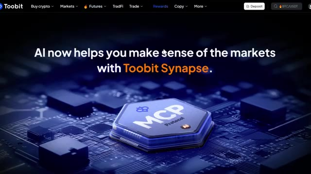
*⏱️ 00:00:08 — Page d'accueil de Toobit mettant en avant son assistant IA "Toobit Synapse".*

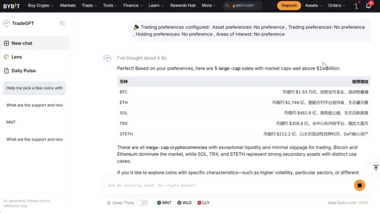
*⏱️ 00:00:17 — Interface de Bybit TradeGPT affichant une liste de cryptomonnaies à grande capitalisation suite à une requête utilisateur.*

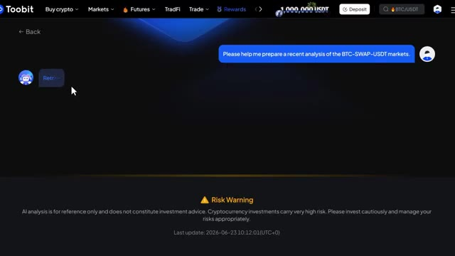
*⏱️ 00:00:25 — Interface de chat de l'assistant Toobit Synapse avec un utilisateur demandant une analyse du marché BTC-SWAP-USDT.*

---

### ⏱️ `[00:00:34 - 00:01:13]` | Segment #02

**🔊 Audio (Transcription Intégrale Mot pour Mot en Français) :**
> tout ce qu'il fait, puis passer directement à 2Bit Synapse. Et à la fin, je vous donnerai mon avis honnête sur celui qui vous donne réellement l'avantage. Entrons dans le vif du sujet. Mais avant d'entrer dans le vif du sujet, si vous ne vous êtes pas encore inscrit sur 2Bit, c'est le meilleur moment pour le faire. En utilisant le lien dans la description, vous pouvez obtenir jusqu'à 8 810 $ de récompenses ainsi que des bonus VIP exclusifs disponibles uniquement via mon lien. Rien qu'en vous inscrivant, vous obtenez un bonus futures de 30 $ et le niveau VIP un pendant un mois. En plus de cela, il y a un défi de palier de dépôt où vous pouvez débloquer jusqu'à 750 USDT et un défi de trading

**👁️ Analyse Visuelle d'Écran (gemini-3.5-flash-lite) :**
**Interface & Outils** : Site web de la plateforme d'échange de cryptomonnaies Toobit.

**Contenu textuel & Code** : Offres promotionnelles, bonus de bienvenue de 15 000+ USDT, bonus Futures de 30 $, statut VIP1, et comptes à rebours.

**Action / Démonstration** : Navigation sur le site web de Toobit pour présenter les offres de parrainage et les bonus d'inscription.

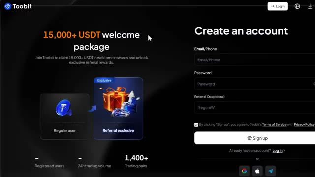
*⏱️ 00:00:44 — Page d'inscription de la plateforme Toobit affichant le package de bienvenue de plus de 15 000 USDT.*

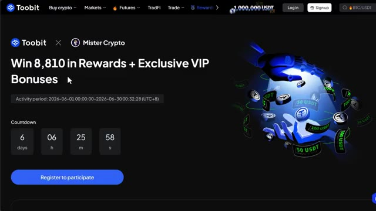
*⏱️ 00:00:53 — Page promotionnelle Toobit x Mister Crypto affichant des récompenses de 8 810 $ et un compte à rebours.*

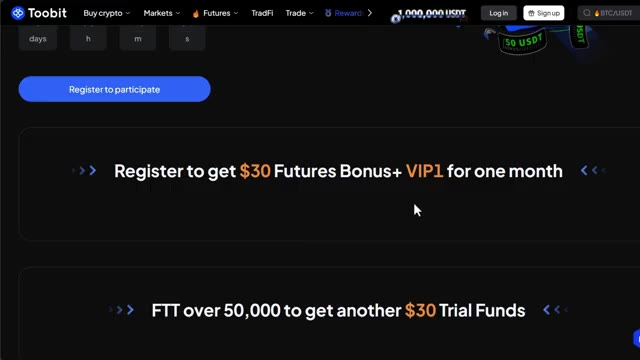
*⏱️ 00:01:03 — Détails des bonus sur la page de promotion Toobit, incluant un bonus Futures de 30 $ et un statut VIP1 d'un mois.*

---

### ⏱️ `[00:01:13 - 00:01:38]` | Segment #03

**🔊 Audio (Transcription Intégrale Mot pour Mot en Français) :**
> d'une valeur maximale de 150 USDT. Tout cela se cumule. Le lien est dans la description. Cliquez dessus, inscrivez-vous, et entrons dans le vif du sujet. Très bien, alors premièrement, vous allez avoir besoin d'un compte Bybit. Si vous en avez déjà un, vous pouvez avancer. Si ce n'est pas le cas, cliquez sur le lien dans la description. Il vous mènera directement à la page d'inscription où vous débloquerez automatiquement le package de bonus complet que j'ai personnellement négocié pour ma communauté.

**👁️ Analyse Visuelle d'Écran (gemini-3.5-flash-lite) :**
**Interface & Outils** : Plateforme d'échange de cryptomonnaies Toobit et page d'inscription de l'exchange Bybit.

**Contenu textuel & Code** : Offres promotionnelles, codes de parrainage, graphiques de paliers de bonus de dépôt ($50 à $30,000) et formulaire de création de compte.

**Action / Démonstration** : Présentation des étapes d'inscription et des avantages/bonus de parrainage sur Bybit.

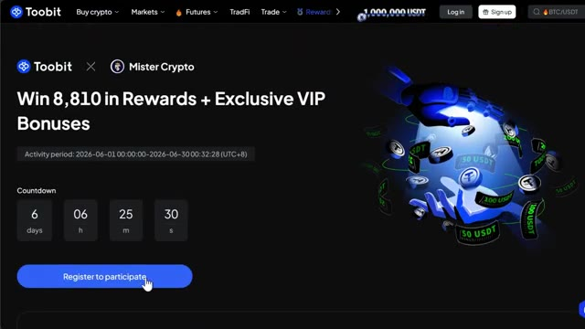
*⏱️ 00:01:19 — Page d'accueil de la plateforme Toobit affichant une offre de récompenses promotionnelles avec le partenariat Mister Crypto.*

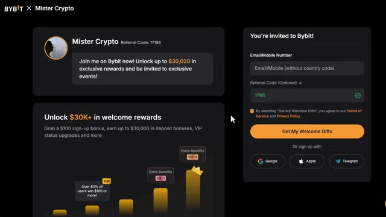
*⏱️ 00:01:25 — Page d'inscription officielle de l'échange Bybit avec un formulaire de parrainage et les détails des bonus de bienvenue.*

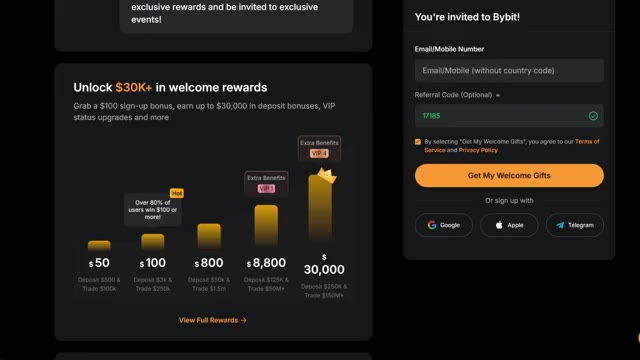
*⏱️ 00:01:31 — Vue détaillée du programme de récompenses de bienvenue de Bybit montrant les paliers de dépôt et de volume de trading requis.*

---

### ⏱️ `[00:01:38 - 00:02:00]` | Segment #04

**🔊 Audio (Transcription Intégrale Mot pour Mot en Français) :**
> Tu n'obtiendras pas toutes ces récompenses sans utiliser le lien, alors assure-toi de l'utiliser. Une fois que tu es connecté et sur la page d'accueil de Bybit, tu es prêt à commencer. La plateforme peut sembler un peu chargée au début, mais ne t'inquiète pas. Je vais te guider exactement là où tu dois aller et sur quoi cliquer. Garde à l'esprit que tout ce que je te montre aujourd'hui est entièrement gratuit une fois que tu as un compte.

**👁️ Analyse Visuelle d'Écran (gemini-3.5-flash-lite) :**
**Interface & Outils** : Plateforme d'échange crypto Bybit (site web).

**Contenu textuel & Code** : Offres de bienvenue (100 USDT Welcome Gifts + NVDAX), cagnottes de tokens (ONDO, HYPE, OPG, MNT) et étapes pour obtenir des bonus.
[DESC_IMAGE_3] Navigation sur la page d'accueil de Bybit pour présenter les bonus d'inscription et les événements promotionnels.

**Action / Démonstration** : Explications face caméra et analyse conceptuelle des marchés.

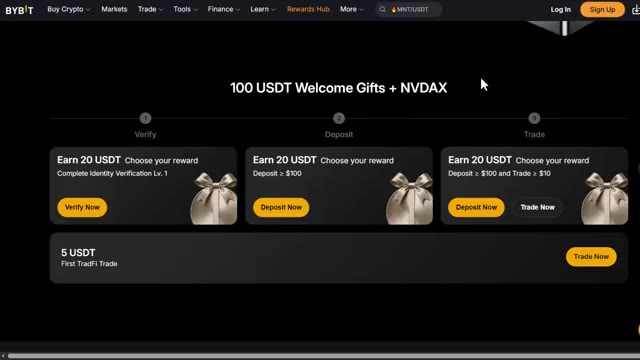
*⏱️ 00:01:44 — Page Bybit montrant les récompenses de bienvenue de 100 USDT et le détail des étapes de vérification et de dépôt.*

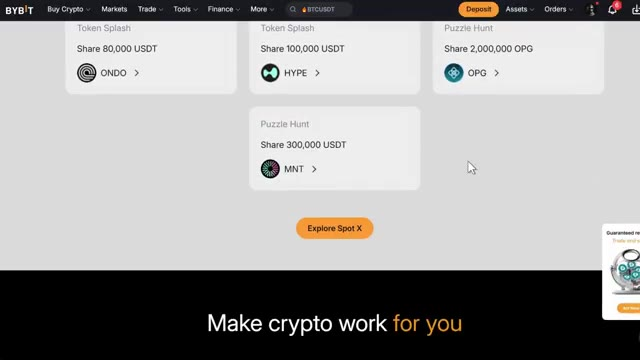
*⏱️ 00:01:49 — Section de la plateforme Bybit présentant les différentes opportunités de gains et les événements de type 'Token Splash'.*

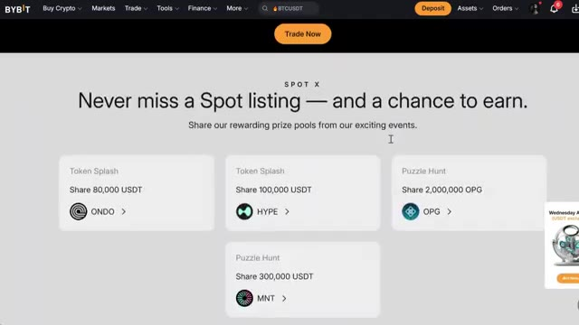
*⏱️ 00:01:54 — Vue de la page 'Spot X' sur Bybit mettant en avant les nouvelles listes de tokens et les cagnottes de récompenses.*

---

### ⏱️ `[00:02:00 - 00:02:18]` | Segment #05

**🔊 Audio (Transcription Intégrale Mot pour Mot en Français) :**
> Pas d'abonnement supplémentaire, pas de frais cachés. C'est simplement intégré directement dans la plateforme. Donc pour trouver TradeGPT, ce que vous voulez faire c'est aller dans la barre de navigation supérieure et cliquer sur outils. Une fois que vous y êtes, cherchez TradeGPT et cliquez dessus. Maintenant, lorsque vous l'ouvrez, vous allez voir trois options principales juste ici.

**👁️ Analyse Visuelle d'Écran (gemini-3.5-flash-lite) :**
**Interface & Outils** : Interface web de l'échange de cryptomonnaies Bybit (barre de navigation, menus déroulants d'outils).

**Contenu textuel & Code** : Menus des outils de trading incluant Copy Trading, TradeGPT, Trading Bot, Leaderboard, TradingView, Position Builder et Demo Trading.

**Action / Démonstration** : Navigation dans les menus du site Bybit pour localiser et sélectionner l'outil TradeGPT comme indiqué dans l'audio.

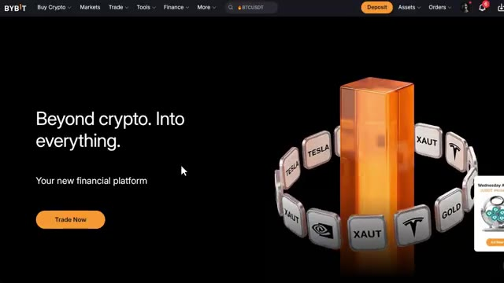
*⏱️ 00:02:05 — Page d'accueil de la plateforme Bybit affichant le slogan 'Beyond crypto. Into everything.' avec le menu supérieur visible.*

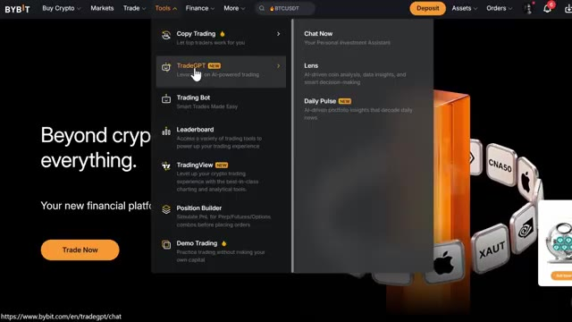
*⏱️ 00:02:14 — Menu déroulant de l'onglet 'Tools' sur la plateforme Bybit, mettant en évidence l'option 'TradeGPT'.*

---

### ⏱️ `[00:02:19 - 00:02:39]` | Segment #06

**🔊 Audio (Transcription Intégrale Mot pour Mot en Français) :**
> Chat Now, Lens, Daily Pulse. Chacun d'eux fait quelque chose de différent, et je vais vous présenter les trois. Commençons par ChatNow. Donc, ChatNow est fondamentalement votre assistant d'investissement personnel. Voyez cela comme le fait d'avoir ChatGPT, mais qui sait réellement ce qui se passe sur le marché des cryptos en ce moment, et il est connecté directement aux données de Bybit.

**👁️ Analyse Visuelle d'Écran (gemini-3.5-flash-lite) :**
**Interface & Outils** : Plateforme d'échange Bybit, section TradeGPT, menus déroulants et interface de chatbot IA.

**Contenu textuel & Code** : Menus avec les options Chat Now, Lens, Daily Pulse, et suggestions de requêtes de marché (support/résistance pour SUI, rapport MNT).

**Action / Démonstration** : Navigation dans les outils IA de Bybit pour présenter les fonctionnalités de Chat Now et TradeGPT mentionnées dans l'audio.

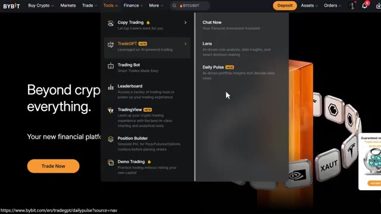
*⏱️ 00:02:24 — Menu déroulant de la plateforme Bybit affichant les outils d'intelligence artificielle incluant Chat Now, Lens et Daily Pulse.*

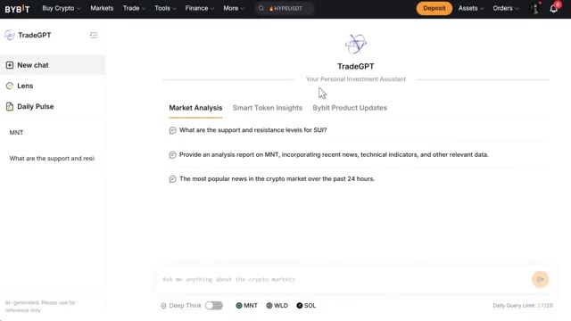
*⏱️ 00:02:29 — Interface principale de TradeGPT sur Bybit, présentant l'assistant d'investissement personnel avec des options de requêtes sur le marché crypto.*

---

### ⏱️ `[00:02:40 - 00:02:58]` | Segment #07

**🔊 Audio (Transcription Intégrale Mot pour Mot en Français) :**
> Quand vous cliquez dessus, vous verrez une fenêtre de chat, très similaire à ce que vous verriez sur n'importe quel assistant IA. Sur le côté gauche, vous pouvez ajouter de nouveaux chats et vous pouvez également passer de Lens à Dally Pulse d'ici également. Maintenant, à l'intérieur du chat, vous remarquerez qu'il y a trois catégories dans lesquelles vous pouvez poser des questions. Analyse de marché.

**👁️ Analyse Visuelle d'Écran (gemini-3.5-flash-lite) :**
**Interface & Outils** : Bybit TradeGPT (interface Web d'assistant IA de trading)

**Contenu textuel & Code** : Menu latéral avec les options New chat, Lens, Daily Pulse, et suggestions de requêtes de marché (Market Analysis, Smart Token Insights, Bybit Product Updates).

**Action / Démonstration** : Navigation et présentation de l'interface de l'assistant virtuel TradeGPT.

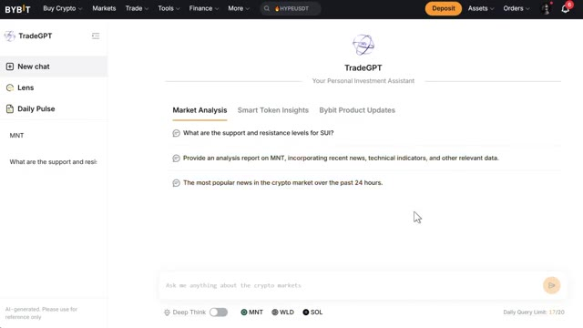
*⏱️ 00:02:45 — Interface de l'outil TradeGPT de Bybit montrant le panneau de discussion avec les options de menu à gauche et des exemples de questions de marché.*

---

### ⏱️ `[00:02:59 - 00:03:31]` | Segment #08

**🔊 Audio (Transcription Intégrale Mot pour Mot en Français) :**
> C'est ici que vous pouvez poser des questions telles que : quelles sont les actualités les plus populaires dans la crypto au cours des dernières 24 heures ? Quels sont les niveaux de support et de résistance pour SWE en ce moment ? Et cela vous donnera une analyse détaillée. Vraiment utile pour obtenir une lecture rapide du marché avant d'ouvrir un trade. Des informations intelligentes sur les jetons. Ici, vous pouvez demander des recommandations de pièces, trouver des projets phares au-dessus d'une certaine capitalisation boursière, obtenir une analyse de ce qui est tendance et pourquoi. Donc, si vous cherchez votre prochaine idée de trade, c'est un excellent point de départ. Mises à jour des produits Bybit. Celui-ci est davantage axé sur la plateforme.

**👁️ Analyse Visuelle d'Écran (gemini-3.5-flash-lite) :**
**Interface & Outils** : Interface web de l'échange de cryptomonnaies Bybit (module TradeGPT).

**Contenu textuel & Code** : Suggestions de questions pré-intégrées sur le marché (ex: niveaux de support et résistance pour SUI, analyse du MNT, actualités crypto des dernières 24 heures) et barre de saisie pour poser des questions sur les marchés crypto.

**Action / Démonstration** : Navigation et présentation des fonctionnalités conversationnelles de l'assistant TradeGPT avec un curseur pointant sur une requête type.

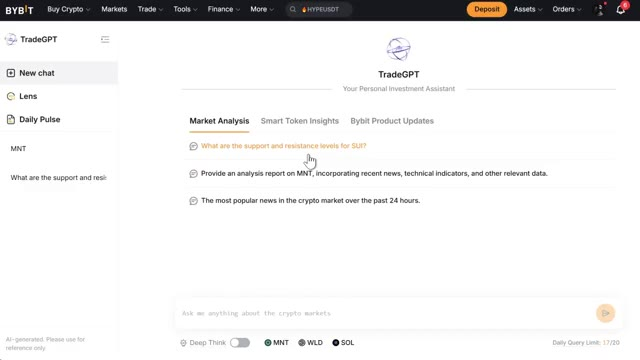
*⏱️ 00:03:07 — Interface de l'assistant TradeGPT de la plateforme Bybit affichant des exemples de requêtes pour l'analyse de marché.*

---

### ⏱️ `[00:03:32 - 00:04:04]` | Segment #09

**🔊 Audio (Transcription Intégrale Mot pour Mot en Français) :**
> Vous pouvez poser des questions de type FAQ comme la façon de naviguer dans certaines fonctionnalités, comment optimiser votre portefeuille en fonction de ce que vous détenez actuellement, ou même comment configurer et créer des stratégies de base pour des bots de trading. C'est très pratique si vous vous familiarisez encore avec la plateforme. Maintenant, une chose que je tiens à souligner, vous verrez une option pour activer la réflexion approfondie. Ce que cela fait, c'est de permettre à l'IA de faire des recherches plus approfondies avant de vous donner une réponse. Cela prend un peu plus de temps, mais les réponses sont plus approfondies. Donc, si vous faites des recherches sérieuses sur une cryptomonnaie ou une stratégie, activez-la sans hésiter.

**👁️ Analyse Visuelle d'Écran (gemini-3.5-flash-lite) :**
**Interface & Outils** : Interface Web de l'échange de cryptomonnaies Bybit (section TradeGPT).

**Contenu textuel & Code** : Suggestions de questions fréquentes : 'Please help me optimize my investment portfolio based on my current holdings', 'How to deposit fiat currency on Bybit', 'Strategies and tips for creating a grid trading bot on Bybit'.

**Action / Démonstration** : Navigation et survol des options d'assistance interactive proposées par TradeGPT pour interroger l'écosystème Bybit.

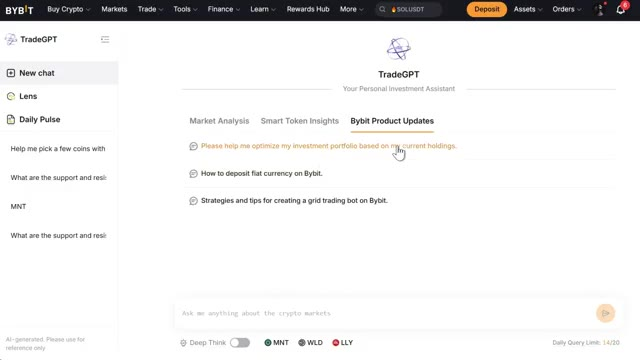
*⏱️ 00:03:40 — Interface de l'assistant TradeGPT sur la plateforme Bybit présentant des suggestions de requêtes interactives.*

---

### ⏱️ `[00:04:05 - 00:04:38]` | Segment #10

**🔊 Audio (Transcription Intégrale Mot pour Mot en Français) :**
> Vous pouvez également voir une liste de pièces directement sous le chat. Si vous cliquez sur l'une d'entre elles, TradeGPT affichera des données telles que le prix actuel, le niveau de risque, la prédiction du taux de réussite, les niveaux d'indicateurs, et bien plus encore. Vraiment solide pour un aperçu rapide avant de prendre une décision. Une chose importante à garder à l'esprit, vous avez une limite de requêtes quotidiennes d'au moins 20 questions. Utilisez-les donc judicieusement. Ne les gaspillez pas pour des choses basiques que vous pouvez chercher sur Google. Gardez-les pour les questions qui comptent vraiment pour vos trades. Au fait, si vous souhaitez créer votre propre IA génétique pour la crypto, les actions et d'autres marchés

**👁️ Analyse Visuelle d'Écran (gemini-3.5-flash-lite) :**
**Interface & Outils** : Bybit TradeGPT

**Contenu textuel & Code** : Prix du MNT à 0.62590 $, niveau de risque "Normal", prédiction du taux de réussite (Win Rate Prediction) à 68 % de chances de hausse, analyse détaillée avec indicateurs On-Chain et analyse technique.

**Action / Démonstration** : Présentation des données d'analyse générées par l'intelligence artificielle pour la cryptomonnaie sélectionnée.

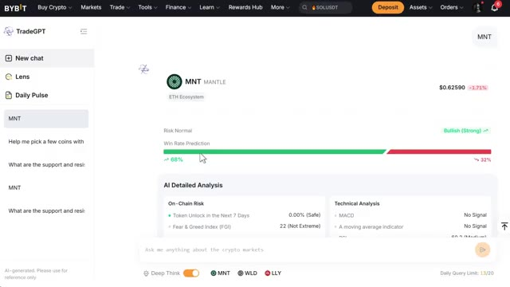
*⏱️ 00:04:13 — Interface TradeGPT sur l'échange Bybit affichant l'analyse détaillée du token MNT (Mantle) avec le niveau de risque et la prédiction du taux de réussite.*

---

### ⏱️ `[00:04:38 - 00:04:57]` | Segment #11

**🔊 Audio (Transcription Intégrale Mot pour Mot en Français) :**
> du début à la fin et laissez-le trader pour vous automatiquement, découvrez AI Trade Edge via le lien juste en dessous. Très bien, ensuite vient Lens, et celui-ci est vraiment intéressant. Je vais faire cette partie un peu plus courte car c'est assez simple une fois que vous l'avez vu. Lorsque vous cliquez sur Lens, la première chose que vous verrez en haut, c'est Tous les projets et la sélection de projets du jour.

**👁️ Analyse Visuelle d'Écran (gemini-3.5-flash-lite) :**
**Interface & Outils** : Plateforme de formation en ligne et interface de l'outil TradeGPT sur l'échange de cryptomonnaies Bybit.

**Contenu textuel & Code** : Modules de cours numérotés (21 à 26) avec des intitulés sur les bots Python, l'architecture agentique et le déploiement VPS ; tableau de données de cryptomonnaies (BTC, ETH, USDT, XRP, etc.) avec indicateurs de prix, capitalisation boursière, volume sur 24h et score IA.

**Action / Démonstration** : Navigation à travers les modules de formation d'un cours de trading algorithmique, puis sélection de la fonctionnalité "Lens" dans l'interface de TradeGPT sur Bybit.

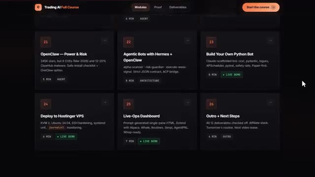
*⏱️ 00:04:43 — Interface d'un cours en ligne "Trading AI Full Course" montrant une grille de modules de formation sur les bots de trading, l'automatisation et les scripts Python.*

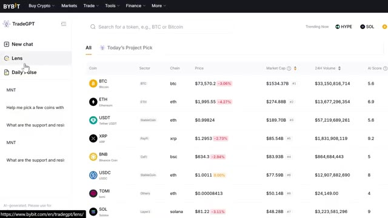
*⏱️ 00:04:48 — Interface de la plateforme Bybit TradeGPT montrant un tableau de crypto-monnaies avec leurs prix, capitalisations et scores IA, avec un curseur pointant sur la section "Lens".*

---

### ⏱️ `[00:04:58 - 00:05:16]` | Segment #12

**🔊 Audio (Transcription Intégrale Mot pour Mot en Français) :**
> Le Project Pick est la recommandation de l'intelligence artificielle de Bybit pour la journée. Je vais y revenir dans une seconde. Donc dans la vue principale, vous pouvez choisir n'importe quelle crypto-monnaie parmi l'offre de Bybit. Disons que vous cliquez sur une crypto-monnaie, vous verrez immédiatement un résumé complet, le prix actuel du marché, la capitalisation boursière, le volume, l'offre en circulation, toutes les données clés dont vous avez besoin.

**👁️ Analyse Visuelle d'Écran (gemini-3.5-flash-lite) :**
**Interface & Outils** : Bybit TradeGPT / Navigateur web

**Contenu textuel & Code** : Évaluation AI (8.1), prix du MNT ($0.626, -1.79%), capitalisation boursière ($2.07B), informations de la communauté et analyses sectorielles.

**Action / Démonstration** : Présentation de la recommandation du jour ("Today's Project Pick") et des analyses détaillées d'une cryptomonnaie par l'IA.

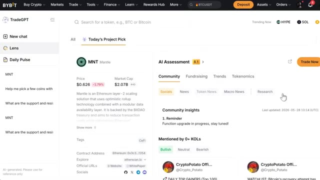
*⏱️ 00:05:02 — Interface de TradeGPT sur Bybit montrant l'évaluation par l'intelligence artificielle de la cryptomonnaie MNT (Mantle) avec une note de 8.1 et des détails communautaires.*

---

### ⏱️ `[00:05:17 - 00:05:37]` | Segment #13

**🔊 Audio (Transcription Intégrale Mot pour Mot en Français) :**
> Sur le côté droit, vous verrez l'évaluation par IA, qui attribue un score à la pièce. Ce score est basé sur des éléments comme l'activité de la communauté, les abonnés sur X, l'engagement social, l'exposition médiatique, en gros, les performances de la pièce dans le monde des réseaux sociaux, et s'il y a un véritable engouement derrière. C' reprenant vraiment utile pour repérer l'élan dès le début.

**👁️ Analyse Visuelle d'Écran (gemini-3.5-flash-lite) :**
**Interface & Outils** : Bybit (TradeGPT / Lens)

**Contenu textuel & Code** : Score IA global de 5.6, Community Score à 7.6 (X Followers, Social Engagement, Media Exposure), Trends à 8.8, Fundraising à 0.4, informations sur le Bitcoin (prix à $73,576.6, market cap à $1473.22B), publications de Lookonchain et UZX Official.

**Action / Démonstration** : Présentation et explication des différents critères de notation par IA d'une cryptomonnaie basés sur l'activité sociale, la communauté et l'exposition médiatique.

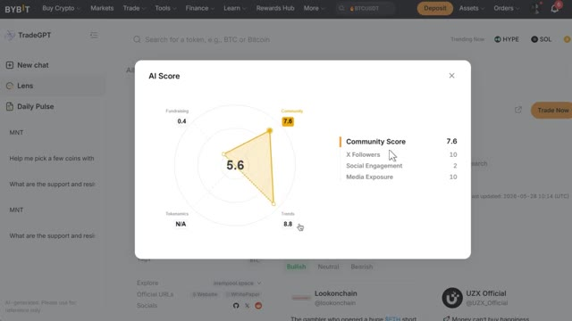
*⏱️ 00:05:22 — Fenêtre contextuelle affichant l'évaluation par IA (AI Score) avec un graphique radar détaillé sous forme de triangle, montrant les scores pour la communauté (7.6), les tendances (8.8), la collecte de fonds (0.4) et un score global de 5.6.*

*⏱️ 00:05:32 — Interface de la plateforme Bybit (TradeGPT) affichant l'évaluation par IA (AI Assessment) pour le Bitcoin avec les onglets Communauté, Fundraising et Trends, ainsi que des actualités et des mentions de KOLs.*

---

### ⏱️ `[00:05:38 - 00:05:57]` | Segment #14

**🔊 Audio (Transcription Intégrale Mot pour Mot en Français) :**
> Vous pouvez également consulter la section de collecte de fonds pour voir l'équipe derrière le projet et qui sont les investisseurs. Et puis il y a les propres données de tendance de Bybit, le ratio long/court, les entrées et sorties, le volume, les tendances comportementales, et plus encore. Et si, après tout cela, vous voulez réellement trader la pièce, il y a un bouton « trader maintenant » juste là.

**👁️ Analyse Visuelle d'Écran (gemini-3.5-flash-lite) :**
**Interface & Outils** : Échange de cryptomonnaies Bybit (outil TradeGPT)

**Contenu textuel & Code** : Informations sur Bitcoin (prix à $73,577.3, capitalisation boursière, volume sur 24h) et onglet "Fundraising" montrant les investisseurs ("Pantera Capital").

**Action / Démonstration** : Navigation dans l'outil TradeGPT de Bybit pour consulter la section de collecte de fonds et les investisseurs d'un projet.

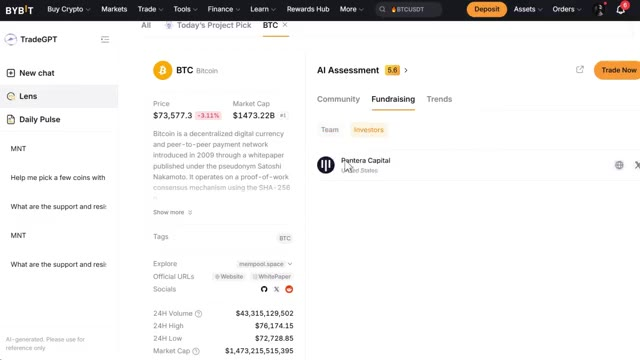
*⏱️ 00:05:43 — Capture d'écran de l'interface Bybit (TradeGPT) affichant les détails de Bitcoin (BTC), y compris la section Fundraising avec l'investisseur Pantera Capital.*

---

### ⏱️ `[00:05:57 - 00:06:34]` | Segment #15

**🔊 Audio (Transcription Intégrale Mot pour Mot en Français) :**
> cliquez dessus, une fenêtre pop-up apparaîtra et vous pourrez choisir votre méthode de trading préférée, au comptant (spot), contrats à terme (futures), convert, prêt (loan), bot de trading ou DCA, vous passez ainsi de la recherche à l'exécution sans jamais quitter la page, c'est une touche bien agréable. Maintenant, en revenant sur la sélection de projet du jour, cela vaut la peine d'y jeter un œil quotidiennement, cela vous donne l'évaluation complète par IA de ce que Bybit met en avant ce jour-là, parfait pour une vérification matinale rapide afin de voir ce qui est sur le radar. Et puis il y a Daily Pulse, qui est probablement celle que j'utiliserais le plus régulièrement dans le cadre d'une routine quotidienne. Daily Pulse vous offre des informations pilotées par l'IA

**👁️ Analyse Visuelle d'Écran (gemini-3.5-flash-lite) :**
**Interface & Outils** : Plateforme d'échange Bybit (outil TradeGPT / interface de recherche et d'exécution).

**Contenu textuel & Code** : Options de trading (Spot, Futures, Convert, Prêt, Bot, DCA), prix du Bitcoin et du token Mantle (MNT), score d'évaluation IA (8.1), et métriques de volume et capitalisation.

**Action / Démonstration** : Sélection d'une méthode de navigation et d'exécution de trading directement depuis l'interface d'analyse de l'échange.

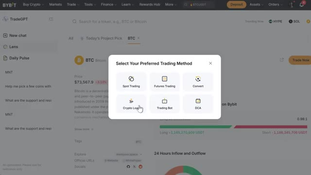
*⏱️ 00:06:07 — Interface de Bybit TradeGPT affichant une pop-up de sélection de méthode de trading (Spot, Futures, Convert, Crypto Loan, Trading Bot, DCA) pour le Bitcoin.*

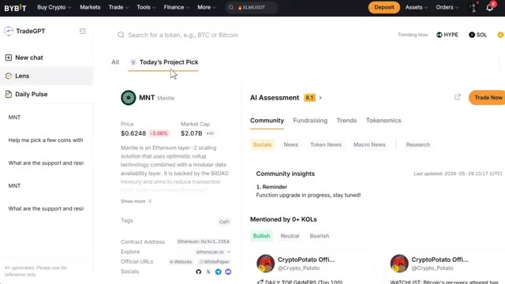
*⏱️ 00:06:16 — Interface de Bybit TradeGPT affichant l'évaluation par IA et les actualités communautaires du token MNT (Mantle) avec son prix et sa capitalisation boursière.*

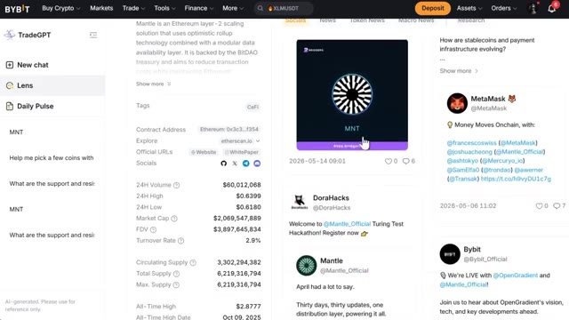
*⏱️ 00:06:25 — Interface de Bybit TradeGPT montrant les métriques de marché avancées du token MNT (volume sur 24h, plus haut/bas, capitalisation, offre en circulation) et les publications associées.*

---

### ⏱️ `[00:06:34 - 00:07:08]` | Segment #16

**🔊 Audio (Transcription Intégrale Mot pour Mot en Français) :**
> des analyses de portefeuille qui décryptent l'actualité quotidienne. Donc, lorsque vous l'ouvrez, vous pouvez consulter les dernières actualités sur les cryptomonnaies, voir vos principaux actifs, découvrir quelles paires ont été nouvellement listées sur Bybit, et obtenir en gros une vue d'ensemble de ce qui se passe sur le marché en ce moment, le tout au même endroit. Ce que j'apprécie vraiment, c'est la section des principaux actifs. Vous pouvez en fait demander à l'IA plus d'informations sur n'importe lequel de vos actifs directement à partir d'ici, et elle vous fournira un résumé afin que vous puissiez prendre une meilleure décision quant à l'opportunité de conserver, d'ajouter ou de réduire votre position. Ce genre de

**👁️ Analyse Visuelle d'Écran (gemini-3.5-flash-lite) :**
**Interface & Outils** : Plateforme d'échange Bybit (onglet TradeGPT / Daily Pulse).

**Contenu textuel & Code** : Résumé IA sur le Bitcoin, actualités du marché, liste de nouveaux tokens (BILL, BLEND, CHIP), analyse technique (RSI, MACD) et métriques de sentiment des baleines (Long/Short ratio).

**Action / Démonstration** : Présentation des actualités cryptos quotidiennes et des analyses de marché automatisées par IA sur Bybit.

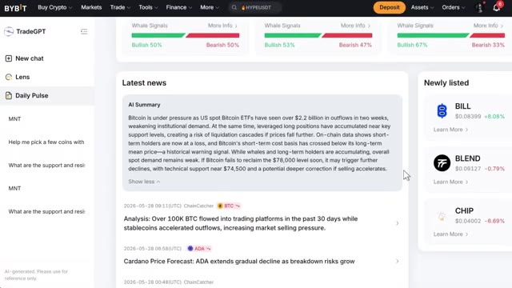
*⏱️ 00:06:43 — Interface de l'échange Bybit montrant la section TradeGPT avec le résumé quotidien des actualités crypto et les cryptos nouvellement listées.*

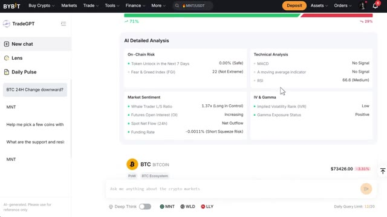
*⏱️ 00:06:59 — Interface de Bybit affichant l'analyse détaillée par IA avec les indicateurs de risque on-chain, l'analyse technique et le sentiment du marché pour Bitcoin.*

---

### ⏱️ `[00:07:08 - 00:07:39]` | Segment #17

**🔊 Audio (Transcription Intégrale Mot pour Mot en Français) :**
> Le contexte est véritablement utile, surtout les jours où le marché bouge rapidement et où vous n'avez pas le temps d'aller fouiller dans les articles d'actualité. Maintenant, et c'est important, tout ce que TradeGPT vous fournit est généré par IA. Utilisez-le donc comme une référence et un point de départ, et non comme un conseil financier. Faites toujours vos propres recherches avant de prendre toute décision de trading. L'intelligence artificielle est un outil pour vous aider à réfléchir, et non pour réfléchir à votre place. C'est donc ça, TradeGPT : trois fonctionnalités, toutes gratuites, toutes intégrées à Bybit.

**👁️ Analyse Visuelle d'Écran (gemini-3.5-flash-lite) :**
**Interface & Outils** : Bybit (TradeGPT)

**Contenu textuel & Code** : Analyse du marché de Bitcoin sur 24 heures, mentionnant un déclin à 73 466,7 $, une sortie nette de capitaux de 858 millions de dollars, un ratio long/short à 60%+, et une recommandation de trading ("Consider scaling into longs near $72,700 support with stops below $72,500") avec une prédiction de taux de réussite (Win Rate Prediction à 71% de chances de hausse).

**Action / Démonstration** : Consultation de l'analyse générée par l'intelligence artificielle pour évaluer les tendances et les niveaux de support/résistance du Bitcoin.

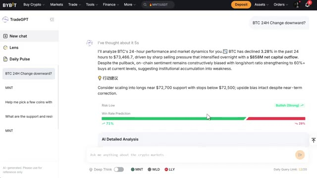
*⏱️ 00:07:16 — Interface de l'outil TradeGPT sur la plateforme Bybit affichant une analyse textuelle et des prédictions de marché pour Bitcoin.*

---

### ⏱️ `[00:07:39 - 00:07:58]` | Segment #18

**🔊 Audio (Transcription Intégrale Mot pour Mot en Français) :**
> C'est vraiment utile, surtout la fonction de filtre pour repérer rapidement la dynamique sociale dans Daily Pulse, pour rester à la page sur le marché sans passer une heure à lire les actualités. Mais voyons maintenant ce que 2Bit a construit. Parce que Synapse adopte une approche très différente, et je pense qu'une fois que vous l'aurez vu, vous comprendrez pourquoi je pense que c'est l'outil le plus puissant pour les traders sérieux.

**👁️ Analyse Visuelle d'Écran (gemini-3.5-flash-lite) :**
**Interface & Outils** : Interfaces web de Bybit (Daily Pulse) et de Toobit (Synapse).

**Contenu textuel & Code** : Métriques de cryptomonnaies (BTC, ADA, SOL), signaux de baleines, résumés d'actualités générés par IA et présentations des fonctionnalités de la plateforme Toobit Synapse.

**Action / Démonstration** : Navigation et présentation des interfaces de veille et d'analyse de marché par intelligence artificielle sur Bybit et Toobit.

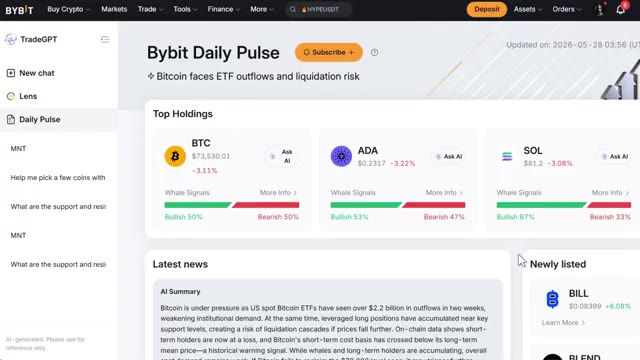
*⏱️ 00:07:44 — Interface de Bybit affichant le tableau de bord 'Daily Pulse' avec les informations sur le Bitcoin, l'ADA et Solana ainsi qu'un résumé d'actualités par IA.*

*⏱️ 00:07:48 — Page d'accueil de Toobit présentant 'Toobit Synapse' avec une illustration de circuit imprimé et le protocole MCP.*

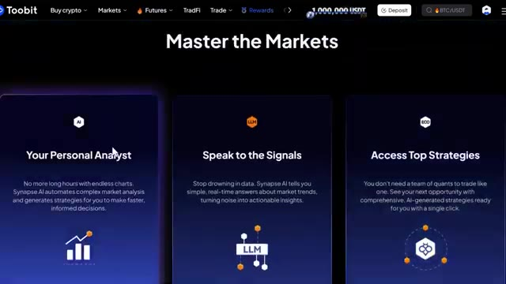
*⏱️ 00:07:53 — Présentation des fonctionnalités de Toobit Synapse ('Your Personal Analyst', 'Speak to the Signals', 'Access Top Strategies').*

---

### ⏱️ `[00:07:59 - 00:08:18]` | Segment #19

**🔊 Audio (Transcription Intégrale Mot pour Mot en Français) :**
> Alors d'abord, qu'est-ce que c'est réellement que Synapse ? 2Bit Synapse est un assistant propulsé par l'IA conçu pour être votre copilote personnel sur le marché des cryptomonnaies. Pensez-y comme si vous aviez un analyste professionnel assis à côté de vous 24 heures sur 24 et 7 jours sur 7, sauf qu'il ne dort jamais, ne devient jamais émotionnel, et qu'il traite les données beaucoup plus rapidement que n'importe quel humain ne le pourrait jamais.

**👁️ Analyse Visuelle d'Écran (gemini-3.5-flash-lite) :**
**Interface & Outils** : Interface de la plateforme d'échange de cryptomonnaies Toobit (section Synapse AI)

**Contenu textuel & Code** : Rapport d'analyse technique, résumé exécutif, facteurs haussiers/baissiers et implications pour les traders d'ETH-SWAP-USDT (prix actuel autour de 1 653,46 $)

**Action / Démonstration** : Présentation des fonctionnalités de l'assistant de trading propulsé par l'IA et de ses rapports d'analyse automatisés.

*⏱️ 00:08:04 — Page FAQ de l'interface Toobit montrant la définition de l'assistant IA Synapse.*

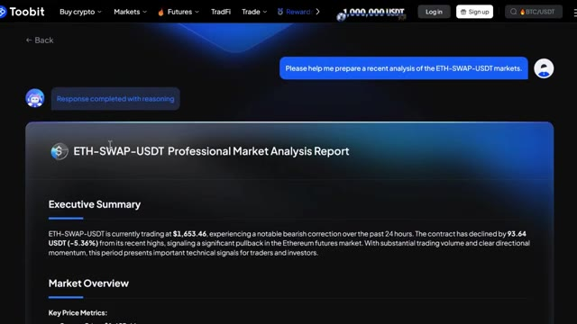
*⏱️ 00:08:09 — Rapport d'analyse de marché professionnel généré par l'IA pour ETH-SWAP-USDT.*

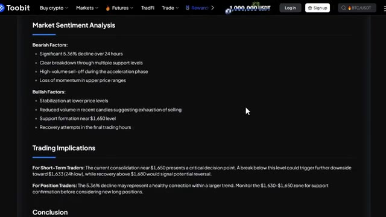
*⏱️ 00:08:13 — Analyse du sentiment de marché et implications pour le trading affichées par l'assistant Synapse.*

---

### ⏱️ `[00:08:18 - 00:08:37]` | Segment #20

**🔊 Audio (Transcription Intégrale Mot pour Mot en Français) :**
> C'est propulsé par Claude, l'un des modèles d'IA les plus avancés au monde, et ça utilise quelque chose appelé le Model Context Protocol, ou MCP, pour récupérer des données de marché en temps réel. C'est ce qui le différencie du simple fait de demander à ChatGPT à propos du Bitcoin. Synapse a un accès réel au marché en direct. Ça ne devine pas. Ça lit le marché en ce moment même.

**👁️ Analyse Visuelle d'Écran (gemini-3.5-flash-lite) :**
**Interface & Outils** : Interface web de change crypto (FAQ), graphique de trading (TradingView), terminal de commande CLI et interface ChatGPT.

**Contenu textuel & Code** : Texte explicatif sur le Model Context Protocol (MCP), graphiques de prix, logs de connexion du terminal et points d'analyse textuelle sur le Bitcoin.

**Action / Démonstration** : Présentation des capacités techniques de l'assistant IA connectant des outils en temps réel via le protocole MCP.

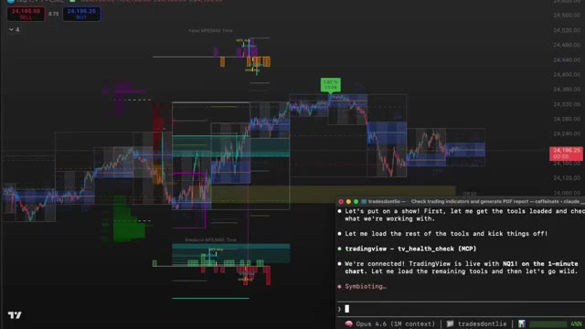
*⏱️ 00:08:28 — Graphique de trading en arrière-plan avec un terminal de commande en bas à droite affichant l'initialisation des outils MCP et la connexion en direct à TradingView.*

---

### ⏱️ `[00:08:37 - 00:09:11]` | Segment #21

**🔊 Audio (Transcription Intégrale Mot pour Mot en Français) :**
> Et voici ce que ça fait réellement pour vous. Il automatise des recherches de marché complexes et génère des stratégies afin que vous puissiez prendre des décisions plus rapides et plus éclairées sans passer des heures à faire l'analyse vous-même. Il décode le bruit du marché. Au lieu de vous noyer dans les données, vous obtenez des réponses simples et en temps réel sur les tendances et les signaux. Ce qui se passe, pourquoi cela se passe, et quoi faire à ce sujet. De plus, il vous donne accès à des stratégies complètes générées par l'IA qui sont prêtes à être mises en œuvre. Vous n'avez pas besoin d'une équipe de quantitatifs pour trader comme eux. Un clic et vous avez une analyse complète. Maintenant, gardez à l'esprit qu'il y a aussi un prochain

**👁️ Analyse Visuelle d'Écran (gemini-3.5-flash-lite) :**
**Interface & Outils** : Site web de la plateforme d'échange Toobit (assistant IA Synapse)

**Contenu textuel & Code** : Texte explicatif sur Synapse, avantages de l'IA, analyse technique ETH-SWAP-USDT, niveaux de support et résistance, implications de trading, facteurs haussiers et baissiers.

**Action / Démonstration** : Navigation et lecture d'un rapport de recherche de marché généré par l'intelligence artificielle sur une plateforme crypto.

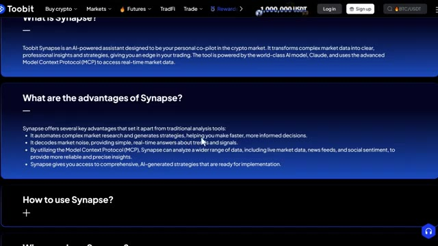
*⏱️ 00:08:45 — Interface web de la plateforme Toobit montrant la présentation et les avantages de l'assistant IA "Synapse".*

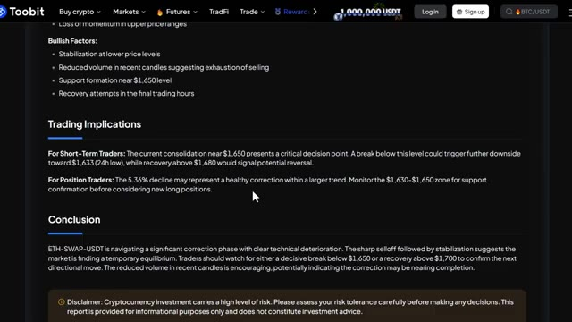
*⏱️ 00:08:54 — Rapport d'analyse de marché détaillé avec les implications de trading et la conclusion pour la paire ETH-SWAP-USDT.*

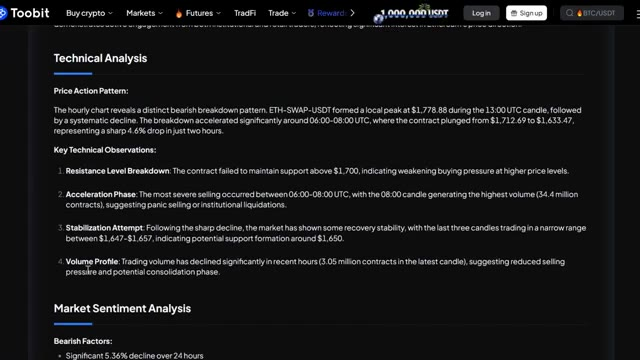
*⏱️ 00:09:02 — Analyse technique détaillée affichant les configurations de prix et l'analyse du sentiment de marché sur Toobit.*

---

### ⏱️ `[00:09:11 - 00:09:44]` | Segment #22

**🔊 Audio (Transcription Intégrale Mot pour Mot en Français) :**
> phase arrive. Des fonctionnalités comme un gardien de marché IA 24h/24 et 7j/7 qui surveille le marché pour vous en continu et envoie des alertes instantanées lorsque la bonne opportunité se présente. Et une gestion automatisée des ordres avec des règles intelligentes pour protéger vos profits et limiter vos pertes. Tout cela arrive bientôt. Mais ce qui est disponible dès maintenant est déjà incroyablement puissant. Alors entrons dans le vif du sujet. Et soit dit en passant, je vais vous montrer quelque chose à la fin de cette vidéo qui, je pense, va complètement changer votre façon d'aborder le trading avec l'IA. Alors restez avec moi jusqu'à la fin. Très bien, alors allons maintenant trouver

**👁️ Analyse Visuelle d'Écran (gemini-3.5-flash-lite) :**
**Interface & Outils** : Site web Toobit Synapse et plateforme éducative "Trading AI Full Course".

**Contenu textuel & Code** : Descriptions textuelles des fonctionnalités d'IA de Toobit (gardien de marché 24h/24, gestion automatisée) et études de cas de trading (Polymarket, Hyperliquid, Claude Code).

**Action / Démonstration** : Présentation des fonctionnalités de la plateforme et des modules de formation sur l'automatisation du trading par IA.

*⏱️ 00:09:19 — Capture d'écran de la plateforme Toobit Synapse présentant trois fonctionnalités clés : All-in-One Trading Hub, Your 24/7 Market Watchdog et Perfect Discipline.*

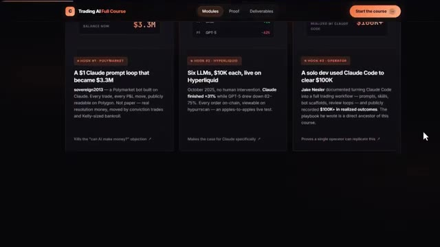
*⏱️ 00:09:35 — Interface de cours de trading IA affichant trois modules distincts axés sur des études de cas de bots et de workflows de trading automatisés.*

---

### ⏱️ `[00:09:44 - 00:10:19]` | Segment #23

**🔊 Audio (Transcription Intégrale Mot pour Mot en Français) :**
> Synapse sur la plateforme. C'est très simple. Une fois que vous êtes connecté à votre compte 2-bit, allez dans la barre de navigation supérieure, cliquez sur "trade", et dans le menu déroulant, vous verrez 2-bit Synapse. Il suffit de cliquer dessus. Vous arriverez sur la page de Synapse et tout de suite vous pourrez voir exactement ce qu'il fait. Trois choses. Il agit comme votre analyste personnel. Fini les longues heures passées sur des graphiques interminables. Synapse automatise l'analyse et génère des stratégies pour vous. Ensuite, il parle aux signaux. Au lieu de vous noyer dans les données, vous obtenez des réponses simples en temps réel sur les tendances du marché. Le bruit se transforme en informations exploitables,

**👁️ Analyse Visuelle d'Écran (gemini-3.5-flash-lite) :**
**Interface & Outils** : Interface web de l'échange de cryptomonnaies Toobit et sa section Synapse.

**Contenu textuel & Code** : Menus de navigation de l'échange et sections descriptives des outils d'intelligence artificielle et d'analyse de marché automatisée de Synapse.

**Action / Démonstration** : Navigation sur la plateforme Toobit pour accéder au service Toobit Synapse via le menu Trade.

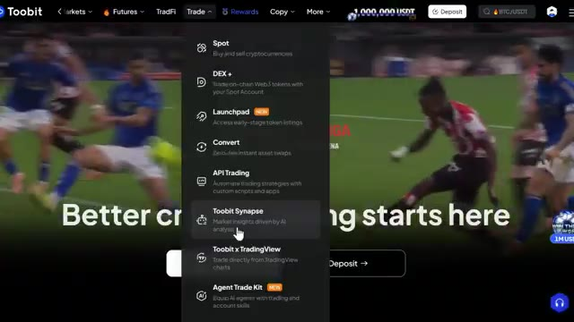
*⏱️ 00:09:52 — Capture d'écran de la plateforme Toobit montrant le menu déroulant de l'onglet "Trade" avec l'option "Toobit Synapse" surlignée.*

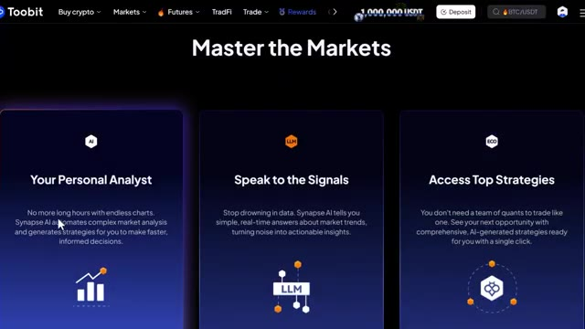
*⏱️ 00:10:01 — Page d'accueil de Toobit Synapse présentant les fonctionnalités principales : "Your Personal Analyst", "Speak to the Signals" et "Access Top Strategies".*

---

### ⏱️ `[00:10:19 - 00:10:57]` | Segment #24

**🔊 Audio (Transcription Intégrale Mot pour Mot en Français) :**
> et cela vous donne accès à des stratégies de premier plan. Vous n'avez pas besoin d'une équipe de quantitatifs pour trader comme eux. Des stratégies complètes générées par IA prêtes en un seul clic et dès maintenant, vous pouvez obtenir une analyse IA de niveau institutionnel pour les principales cryptomonnaies : Bitcoin, Ethereum, Solana et Doge. Très bien, utilisons-le vraiment. Étape par étape. Étape 1, sélectionnez la cryptomonnaie que vous souhaitez analyser. Vous verrez les options juste là. Bitcoin, ETH, Solana, Doge. Cliquez simplement sur la paire pour laquelle vous souhaitez obtenir une analyse. Étape 2, une fois que vous avez sélectionné votre paire, cliquez sur essayer Two-bit Synapse.

**👁️ Analyse Visuelle d'Écran (gemini-3.5-flash-lite) :**
**Interface & Outils** : Plateforme d'échange de cryptomonnaies Toobit (section Synapse AI).

**Contenu textuel & Code** : Présentation des fonctionnalités d'analyse de marché automatisée par IA, de génération de stratégies et de sélection d'actifs (BTC, ETH, SOL, DOGE).

**Action / Démonstration** : Navigation et survol des fonctionnalités de la plateforme Toobit Synapse pour l'analyse et l'accès aux stratégies de trading automatisées.

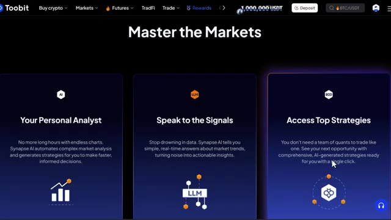
*⏱️ 00:10:28 — Interface de la plateforme Toobit présentant ses fonctionnalités d'intelligence artificielle : "Your Personal Analyst", "Speak to the Signals" et "Access Top Strategies".*

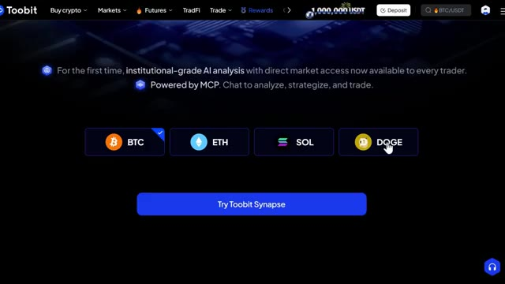
*⏱️ 00:10:38 — Interface de la plateforme Toobit montrant la sélection des cryptomonnaies majeures (BTC, ETH, SOL, DOGE) pour l'analyse par IA institutionnelle (Toobit Synapse).*

---

### ⏱️ `[00:10:57 - 00:11:30]` | Segment #25

**🔊 Audio (Transcription Intégrale Mot pour Mot en Français) :**
> Et c'est là que ça devient intéressant. Une fenêtre de chat va apparaître. Elle se connecte aux serveurs MCP et en quelques secondes, vous obtiendrez une vue d'ensemble de l'analyse détaillée par IA générée par Synapse. Maintenant, il ne s'agit pas d'une simple réponse de chatbot. C'est un rapport structuré de niveau professionnel. Laissez-moi vous guider à travers ce que vous regardez réellement. Vous avez le résumé exécutif tout en haut, un aperçu clair de la situation actuelle de l'actif. Ensuite, l'aperçu de l'action des prix, ce que le prix a fait, les mouvements clés et le contexte. Puis, les configurations d'analyse technique,

**👁️ Analyse Visuelle d'Écran (gemini-3.5-flash-lite) :**
**Interface & Outils** : Plateforme de trading Toobit, assistant de chat IA Synapse

**Contenu textuel & Code** : Rapport d'analyse technique BTC-SWAP-USDT, cours actuel à 62 430,50 $, plus haut sur 24h à 65 595,70 $, plus bas à 61 877,10 $, variation de -2,76% (-1 771,30 $), volume de trading de 116,6 millions de contrats.

**Action / Démonstration** : Génération et affichage d'un rapport d'analyse technique automatisé par intelligence artificielle pour le marché des contrats futures Bitcoin.

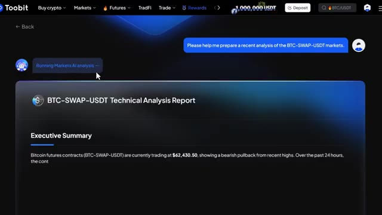
*⏱️ 00:11:05 — Interface de chat sur la plateforme Toobit montrant la requête utilisateur pour une analyse de marché BTC-SWAP-USDT et le début du rapport généré par l'IA de Synapse.*

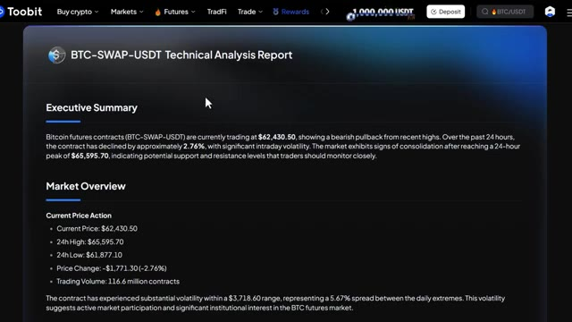
*⏱️ 00:11:13 — Rapport d'analyse technique complet généré par l'IA (Synapse) pour BTC-SWAP-USDT, détaillant le résumé exécutif et l'aperçu du marché avec des prix et variations chiffrés.*

---

### ⏱️ `[00:11:30 - 00:12:02]` | Segment #26

**🔊 Audio (Transcription Intégrale Mot pour Mot en Français) :**
> C'est là que ça se complique. Synapse identifie les configurations de graphiques, les structures de tendances et les signaux qu'il vous faudrait normalement beaucoup de temps pour cartographier manuellement. Ensuite, l'analyse du volume, car un prix sans volume est incomplet. Synapse lit les deux. Ensuite, l'évaluation du sentiment du marché. C'est là que le MCP brille vraiment. Il intègre non seulement les données de prix, mais aussi des signaux de sentiment provenant des flux d'actualités et des données sociales. Ensuite, les niveaux clés, vos zones de support et de résistance clairement définies. Et enfin, la conclusion, un résumé clair et exploitable de ce que tout cela signifie pour

**👁️ Analyse Visuelle d'Écran (gemini-3.5-flash-lite) :**
**Interface & Outils** : Plateforme de trading et d'échange Toobit (interface web)

**Contenu textuel & Code** : Texte détaillé d'analyse technique (« Technical Analysis », « Hourly Trend Breakdown », « Volume Analysis », « Key Support and Resistance Levels ») avec des données chiffrées sur Bitcoin (prix de $64,109.80 à $65,547.90, volumes en millions de contrats).

**Action / Démonstration** : Affichage et lecture à l'écran d'un rapport textuel d'analyse technique et de volume généré par l'outil Synapse.

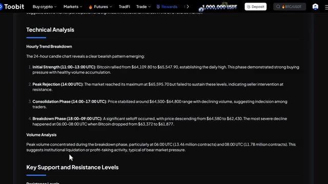
*⏱️ 00:11:38 — Capture d'écran de l'interface de la plateforme Toobit montrant une section de rapport d'analyse technique automatisée avec des détails sur les tendances horaires, l'analyse du volume et les niveaux de support/résistance.*

---

### ⏱️ `[00:12:02 - 00:12:23]` | Segment #27

**🔊 Audio (Transcription Intégrale Mot pour Mot en Français) :**
> votre métier. Tout cela en une seule page simple en quelques secondes. Et une fois que vous avez le rapport, vous pouvez le copier ou le partager directement depuis la fenêtre de discussion. Maintenant, juste en toute transparence ici. L'analyse par IA est fournie à titre de référence uniquement et ne constitue pas un conseil en investissement. Les investissements en cryptomonnaies comportent des risques très élevés.

**👁️ Analyse Visuelle d'Écran (gemini-3.5-flash-lite) :**
**Interface & Outils** : Interface de la plateforme de trading Toobit.

**Contenu textuel & Code** : Texte de conclusion sur BTC-SWAP-USDT mentionnant des caractéristiques de marché baissier après rejet aux plus hauts journaliers, niveau critique à 64 000 $, avertissements de risques et boutons "Copy" et "Share".

**Action / Démonstration** : Interaction avec l'interface pour copier ou partager le rapport d'analyse généré par IA.

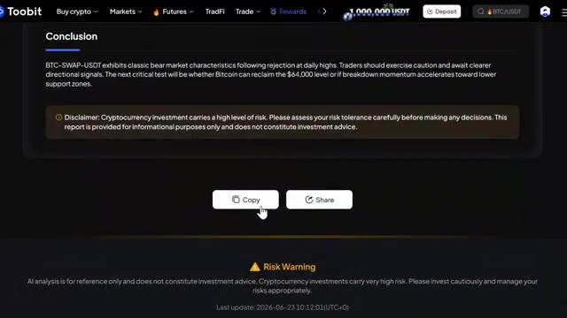
*⏱️ 00:12:08 — Interface web montrant la section conclusion d'un rapport d'analyse de marché pour Bitcoin sur la plateforme Toobit.*

---

### ⏱️ `[00:12:24 - 00:12:43]` | Segment #28

**🔊 Audio (Transcription Intégrale Mot pour Mot en Français) :**
> Veuillez investir avec prudence et gérez vos risques de manière appropriée. Écoutez, je veux prendre un moment ici parce que je pense qu'il est facile de faire défiler rapidement ce genre de chose sans vraiment apprécier ce que c'est. La plupart des investisseurs particuliers prennent des décisions basées sur des informations incomplètes, des réactions émotionnelles, ou simplement en copiant ce que quelqu'un d'autre a dit sur Twitter.

**👁️ Analyse Visuelle d'Écran (gemini-3.5-flash-lite) :**
**Interface & Outils** : Plateforme X (Twitter) et site web Medium.

**Contenu textuel & Code** : Publications sur les marchés financiers, actions Tesla, S&P 500, et graphique de performance de trading ("Total Account Value") pour l'expérience Alpha Arena.

**Action / Démonstration** : Navigation et défilement sur les réseaux sociaux et articles d'actualité financière.

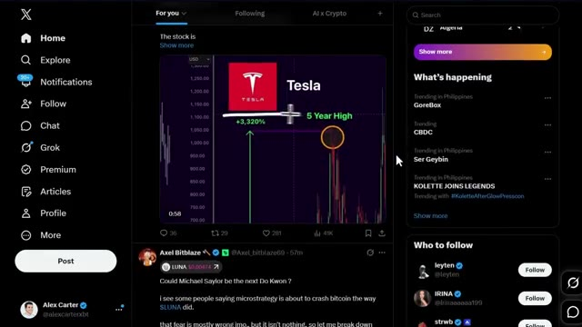
*⏱️ 00:12:28 — Capture d'écran montrant le fil d'actualité de la plateforme X (Twitter) avec un tweet sur l'action Tesla et son cours sur 5 ans.*

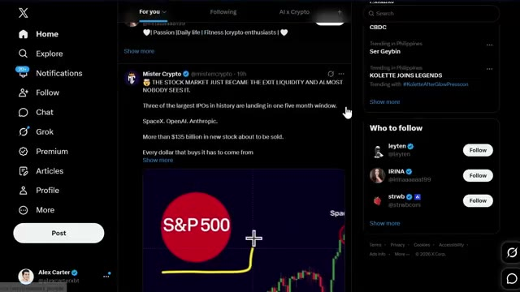
*⏱️ 00:12:33 — Capture d'écran montrant le fil d'actualité de la plateforme X (Twitter) avec un tweet sur le marché boursier, les IPO et le S&P 500.*

*⏱️ 00:12:38 — Capture d'écran d'un article Medium présentant Alpha Arena et un graphique de performance comparant différents LLM en trading.*

---

### ⏱️ `[00:12:43 - 00:13:15]` | Segment #29

**🔊 Audio (Transcription Intégrale Mot pour Mot en Français) :**
> et les traders qui sont régulièrement rentables, ils ont des systèmes, ils ont des données, ils ont des analyses. Synapse donne fondamentalement à chaque trader sur 2-bit accès à ce même niveau d'analyse, le genre qui nécessitait auparavant soit un terminal Bloomberg, soit une équipe d'analystes. Et c'est intégré directement dans l'échange que vous utilisez déjà. En plus de cela, comme c'est propulsé par MCP et Claude, cela ne se contente pas de récupérer des données statiques. Cela lit le marché en direct. C'est très important. Donc si vous n'utilisez pas ceci, vous laissez un avantage sur la table. C'est aussi simple que ça.

**👁️ Analyse Visuelle d'Écran (gemini-3.5-flash-lite) :**
**Interface & Outils** : Site web de Toobit (Synapse) et page officielle de Bloomberg Professional Services.

**Contenu textuel & Code** : Texte descriptif sur l'analyse IA institutionnelle, le protocole MCP et la présentation de la FAQ sur Toobit Synapse, ainsi qu'une capture d'un terminal Bloomberg.

**Action / Démonstration** : Navigation sur les pages de présentation de Toobit Synapse et du terminal Bloomberg pour illustrer l'accès à des outils d'analyse avancés.

*⏱️ 00:12:51 — Page d'accueil du site Toobit présentant Synapse et son analyse IA de niveau institutionnel.*

*⏱️ 00:12:59 — Page web de Bloomberg Professional Services montrant le terminal Bloomberg en action.*

*⏱️ 00:13:07 — Section FAQ du site Toobit expliquant ce qu'est Synapse et son intégration avec l'IA Claude.*

---

### ⏱️ `[00:13:16 - 00:13:52]` | Segment #30

**🔊 Audio (Transcription Intégrale Mot pour Mot en Français) :**
> Très bien, donc maintenant vous avez vu les deux. Laissez-moi vous donner mon avis honnête. Trade GPT est large. Il couvre les actualités, le sentiment social, les analyses de portefeuille, la découverte de pièces. C'est génial si vous voulez un aperçu quotidien du marché et que vous aimez explorer de nouveaux projets. La fonction lens en particulier est vraiment utile pour repérer le momentum tôt en fonction de l'activité sociale. Et Daily Pulse est un outil de routine matinale solide. La limite quotidienne de 20 questions est cependant une vraie contrainte. Vous devez être sélectif sur la façon dont vous l'utilisez. Synapse est profond. Il n'essaie pas de tout faire. Il prend une pièce,

**👁️ Analyse Visuelle d'Écran (gemini-3.5-flash-lite) :**
**Interface & Outils** : Bybit (TradeGPT / Daily Pulse)

**Contenu textuel & Code** : Résumé IA concernant la pression sur le Bitcoin (sorties des ETF spot US, données on-chain, prix de revient, niveaux de support à 74 500 $), actualités récentes sur les cryptos (BTC, ADA) et liste de nouveaux jetons (BILL, BLEND, CHIP).

**Action / Démonstration** : Navigation dans l'interface de l'outil TradeGPT pour consulter les actualités du marché et le résumé généré par l'IA.

*⏱️ 00:13:25 — Capture d'écran de l'interface TradeGPT sur la plateforme Bybit, montrant le panneau 'Latest news' avec un résumé IA sur le Bitcoin et une liste de nouvelles crypto-monnaies répertoriées.*

---

### ⏱️ `[00:13:53 - 00:14:28]` | Segment #31

**🔊 Audio (Transcription Intégrale Mot pour Mot en Français) :**
> se connecte aux données de marché en direct via MCP, et vous donne un rapport d'analyse structuré et de qualité professionnelle en quelques secondes. Résumé exécutif, action des prix, configurations techniques, volume, sentiment, niveaux clés, conclusion, tout y est, c'est le genre de rapport qu'il fallait toute une équipe d'analystes pour produire, la différence essentielle est celle-ci : TradeGPT est propulsé par la propre couche de données de Bybit, Synapse est propulsé par Claude et MCP, ce qui signifie qu'il extrait des données d'un environnement de données en direct beaucoup plus large, ce n'est pas rien, c'est la différence entre un outil qui lit les données de Bybit et un

**👁️ Analyse Visuelle d'Écran (gemini-3.5-flash-lite) :**
**Interface & Outils** : Interface web de la plateforme Toobit affichant des rapports textuels et des rubriques d'aide (FAQ).

**Contenu textuel & Code** : Analyse technique détaillée du Bitcoin (prix, volumes, phases de tendance) et explications sur l'assistant IA Synapse connecté en direct aux données de marché via MCP.

**Action / Démonstration** : Présentation des fonctionnalités d'analyse automatisée de marché et de l'assistant de trading intelligent de la plateforme.

*⏱️ 00:14:01 — Rapport d'analyse technique textuel structuré affichant une analyse de tendance horaire, une analyse des volumes et des niveaux de support/résistance.*

*⏱️ 00:14:19 — Section FAQ de la plateforme présentant l'assistant IA « Toobit Synapse » propulsé par le modèle Claude via le protocole MCP (Model Context Protocol).*

---

### ⏱️ `[00:14:28 - 00:14:51]` | Segment #32

**🔊 Audio (Transcription Intégrale Mot pour Mot en Français) :**
> un outil qui lit le marché si vous êtes un trader occasionnel qui veut un briefing quotidien rapide et la découverte de pièces. TradeGPT fait bien cela. Si vous êtes un trader sérieux qui veut une analyse de niveau institutionnel avant d'ouvrir une position, Synapse est le meilleur outil et il ne fera que devenir plus puissant à mesure que les fonctionnalités de chien de garde automatisé et de gestion des ordres seront déployées. Les deux sont gratuits.

**👁️ Analyse Visuelle d'Écran (gemini-3.5-flash-lite) :**
**Interface & Outils** : Plateformes d'échange crypto Bybit (module TradeGPT) et Toobit (section Toobit Synapse).

**Contenu textuel & Code** : - Métriques BTC sur TradeGPT : Prix ($73,582.5), Market Cap ($1,473.22B), score "AI Assessment" (5.6/10), volume 24h ($43.31B), Plus haut/bas 24h ($76,174.15 / $72,728.85), actualités et sentiments sociaux (Bullish/Neutral/Bearish).
- Piliers Toobit Synapse : "All-in-One Trading Hub" (MCP), "Your 24/7 Market Watchdog" (alertes IA), "Perfect Discipline" (gestion automatisée des ordres et des risques).

**Action / Démonstration** : Présentation comparative des assistants IA pour le trading crypto : utilisation de TradeGPT sur Bybit pour la veille rapide et découverte de tokens, puis présentation de Toobit Synapse comme solution d'analyse et d'exécution automatisée de niveau institutionnel.

*⏱️ 00:14:34 — Interface de l'outil TradeGPT sur Bybit affichant le profil complet de Bitcoin (BTC) avec son évaluation IA et ses métriques de marché.*

*⏱️ 00:14:45 — Page d'accueil de Toobit Synapse présentant les fonctionnalités clés de la plateforme et de ses agents IA pour le trading.*

---

### ⏱️ `[00:14:51 - 00:15:10]` | Segment #33

**🔊 Audio (Transcription Intégrale Mot pour Mot en Français) :**
> Les deux sont intégrés dans leurs plateformes. Mais en termes de profondeur et de qualité des données, Synapse a l'avantage en ce moment. Très bien. Et écoutez, pour les prochaines années, deux types de traders existeront. Ceux qui utilisent l'IA et ceux qui font encore tout manuellement. Même marché. Résultats très différents. Voici comment vous vous mettez du bon côté de ça.

**👁️ Analyse Visuelle d'Écran (gemini-3.5-flash-lite) :**
**Interface & Outils** : Plateforme Toobit (Synapse AI) et réseau social X (Twitter).

**Contenu textuel & Code** : Cartes descriptives de Synapse AI sur Toobit ; Post X énumérant les avantages algorithmiques ("AI is smarter", "AI is faster", "AI has no emotions", "AI manages risk better").

**Action / Démonstration** : Navigation sur la page de présentation de Synapse AI puis affichage d'une publication X illustrant le passage du trading manuel vers l'IA.

*⏱️ 00:14:56 — Présentation des trois fonctionnalités clés de Synapse AI sur la plateforme Toobit : "Your Personal Analyst", "Speak to the Signals" et "Access Top Strategies".*

*⏱️ 00:15:00 — Publication X (Twitter) du compte @alexcarterxbt listant les arguments en faveur du trading par IA par rapport au trading manuel.*

---

### ⏱️ `[00:15:10 - 00:15:30]` | Segment #34

**🔊 Audio (Transcription Intégrale Mot pour Mot en Français) :**
> J'ai tout rassemblé au sein de la communauté AI Trade Edge. Chaque prompt, chaque bot, chaque template, chaque guide étape par étape que j'utilise personnellement, le tout en un seul endroit. Et tout ce que je créerai à l'avenir est directement ajouté au groupe dès sa sortie. Nous testons également des stratégies venant de tout Internet.

**👁️ Analyse Visuelle d'Écran (gemini-3.5-flash-lite) :**
**Interface & Outils** : Interface web de la plateforme "Alex Carter Trading" avec un menu d'onglets de tutoriel ("Prerequisites", "Install Claude Code", "Install the MCP Server", "Launch TradingView", "Connect & Verify", "What It Can Do").

**Contenu textuel & Code** : Texte listant les fonctionnalités des 78 outils permettant à Claude de contrôler TradingView, séparé en deux catégories : "Chart Reading" (lecture de graphiques, données OHLCV, indicateurs comme RSI, MACD, EMA, bandes de Bollinger) et "Chart Control" (changement de symbole, d'unités de temps, ajout/suppression d'indicateurs).

**Action / Démonstration** : Présentation visuelle des guides et templates étape par étape inclus dans la communauté pour l'automatisation du trading.

*⏱️ 00:15:15 — Capture d'écran de la plateforme communautaire ou du site web de formation montrant les étapes d'installation et de configuration (section 'What It Can Do' détaillant l'intégration de Claude avec TradingView).*

---

### ⏱️ `[00:15:30 - 00:16:02]` | Segment #35

**🔊 Audio (Transcription Intégrale Mot pour Mot en Français) :**
> les automatiser en utilisant Pine Script, les exécuter en direct et partager exactement ce qui fonctionne et ce qui ne fonctionne pas, de sorte que vous n'obtenez pas seulement des outils, vous obtenez une véritable opération de recherche en direct. À l'intérieur, il y a aussi un cours complet sur le trading agentique, 2,5 heures, de débutant à expert, aucune expérience en programmation n'est requise. À la fin de celui-ci, vous aurez votre propre système de trading par IA fonctionnant en direct, quelque chose que la plupart des traders particuliers ne savent même pas être possible à l'heure actuelle. 79,99 $ par mois. Un seul bon trade le rembourse. Et le premier

**👁️ Analyse Visuelle d'Écran (gemini-3.5-flash-lite) :**
**Interface & Outils** : TradingView, Plateforme web de cours en ligne (« Trading AI Full Course »).

**Contenu textuel & Code** : - Image 1 : Paire BTC/USD sur TradingView (unité 2h, Binance), indicateur « RSI-VWAP Indicator % », signaux Buy/Sell sur les bougies, fenêtre de métriques PnL.
- Image 2 : Modules du cours (« 00 Cold Open + Sources », « 01 Foundations », « 02 The Complete AI Trading Stack »), durée totale de 2.5 heures.

**Action / Démonstration** : Démonstration visuelle d'un script d'indicateur/stratégie automatisé sur TradingView, suivie d'une présentation du portail de cours sur l'IA appliquée au trading.

*⏱️ 00:15:38 — Graphique TradingView de la paire BTC/USD (2h, Binance) affichant des signaux d'achat/vente ainsi que l'indicateur RSI-VWAP au bas du graphique.*

*⏱️ 00:15:46 — Dashboard de la formation « Trading AI Full Course » illustrant la carte du cours et les premiers modules pédagogiques.*

---

### ⏱️ `[00:16:02 - 00:16:36]` | Segment #36

**🔊 Audio (Transcription Intégrale Mot pour Mot en Français) :**
> 100 membres bloquent ce tarif de façon permanente. Après cela, le prix augmente. Le lien est dans la description. Vous ne pouvez vraiment pas vous permettre de rater ça. Et c'est tout. Trade GPT contre 2-bit Synapse, entièrement décortiqué côte à côte. Les deux outils sont gratuits. Les deux sont intégrés dans leurs plateformes. mais si vous prenez le trading avec l'IA au sérieux, Synapse est celui qu'il faut surveiller, surtout avec tout ce qui arrive ensuite. Si vous n'êtes pas encore sur 2-bit, le lien est dans la description, jusqu'à huit mille huit cent dix dollars de récompenses, trente dollars juste pour l'inscription

**👁️ Analyse Visuelle d'Écran (gemini-3.5-flash-lite) :**
**Interface & Outils** : Whop, Bybit (TradeGPT), Toobit (rapport d'analyse technique).

**Contenu textuel & Code** : Tarifs d'abonnement, menus d'outils de trading IA, résumé exécutif et aperçu du marché BTC-SWAP-USDT (prix actuel, variations sur 24h, volume).

**Action / Démonstration** : Navigation à travers différentes plateformes pour présenter les outils IA et les rapports d'analyse technique de trading.

*⏱️ 00:16:19 — Interface de la plateforme Bybit montrant le menu des outils, incluant TradeGPT et des options d'analyse IA.*

*⏱️ 00:16:28 — Rapport d'analyse technique de Toobit pour BTC-SWAP-USDT affichant le prix actuel, le résumé exécutif et les données de marché.*

---

### ⏱️ `[00:16:36 - 00:17:09]` | Segment #37

**🔊 Audio (Transcription Intégrale Mot pour Mot en Français) :**
> VIP 1 pendant un mois, des bonus sur les dépôts, des bonus de trading, tout se cumule, ça prend deux minutes et ça en vaut déjà la peine avant même de placer le moindre trade. Si vous voulez la visite guidée complète de la plateforme pour savoir comment trader concrètement sur 2bit et Bybit, les dépôts, les contrats futures, tout, j'ai aussi une vidéo pour ça. Allez voir ça à l'écran dès maintenant. Et si vous voulez le guide complet étape par étape sur la façon de construire votre propre système de trading agentique avec Claude, cette vidéo apparaît à l'écran également. Allez voir ça ensuite. Si cela a été utile, laissez un pouce bleu. Ça aide vraiment la chaîne. Abonnez-vous si vous

**👁️ Analyse Visuelle d'Écran (gemini-3.5-flash-lite) :**
**Interface & Outils** : Sites web et plateformes d'échange de cryptomonnaies : Toobit et Bybit.

**Contenu textuel & Code** : Formulaire d'inscription Toobit (Email, mot de passe, ID de parrainage) et fenêtre de configuration des ordres Bybit (Order by Qty en BTC ou Order by Value en USDT).

**Action / Démonstration** : Présentation des interfaces d'inscription de Toobit et des paramètres de placement d'ordres sur Bybit en lien avec la visite guidée des plateformes.

*⏱️ 00:16:44 — Page d'inscription de la plateforme Toobit affichant le package de bienvenue de 15 000+ USDT et le formulaire de création de compte.*

*⏱️ 00:16:53 — Interface de trading de la plateforme Bybit affichant un graphique du BTCUSDT avec une fenêtre modale de préférences de placement d'ordres ("Order Placement Preferences").*

---

### ⏱️ `[00:17:09 - 00:17:14]` | Segment #38

**🔊 Audio (Transcription Intégrale Mot pour Mot en Français) :**
> Je veux plus de ça. Je teste chaque nouvel outil de trading IA dès sa sortie. Je vous vois dans la prochaine.

**👁️ Analyse Visuelle d'Écran (gemini-3.5-flash-lite) :**
**Interface & Outils** : Aucune

**Contenu textuel & Code** : Aucun

**Action / Démonstration** : Aucune

---

