# 🎬 Manual Crypto Traders Are Running Out of Time... and Why I’m Switching to Claude

> **Chaîne** : [Alex Carter](https://www.youtube.com/@AlexCarterTrading)  
> **Lien YouTube** : [https://www.youtube.com/watch?v=V4qtOSsyy08](https://www.youtube.com/watch?v=V4qtOSsyy08)  
> **Date de publication** : 20260707  
> **Durée** : 00:14:34  
> **Identifiant vidéo** : `V4qtOSsyy08`  
> **Transcription & Analyse** : `whisper-v3-large-turbo+gemini-3.5-flash-lite`  

---

## 📌 Synthèse Exécutive & Outils

### 💡 Résumé
Cette vidéo de la chaîne Alex Carter pose un diagnostic percutant sur l'évolution des marchés cryptographiques : à l'ère du trading algorithmique ultra-dominé par les institutions et les fonds quantitatifs (qui captent plus de 80 % des volumes), le trader particulier manuel est condamné à l'obsolescence s'il ne s'équipe pas de systèmes automatisés. L'intervenant démontre comment l'accessibilité récente d'intelligences artificielles de pointe comme **Claude Code** permet désormais à un trader solitaire de combler cet écart technologique pour seulement 20 dollars par mois, en s'affranchissant des contraintes historiques de temps, de capital et d'équipes de développement.

La démonstration pratique s'articule autour de cas d'usage hautement sophistiqués : cartographie automatisée des supports et résistances avec biais directionnel, génération de scripts **Pine Script** et exécution de backtests complexes, et surtout, pilotage d'un assistant de trading via **Telegram**. L'intervenant montre en direct l'ouverture de positions complexes en une seule phrase, la production de rapports de risque et de courbes de capital dignes d'un desk institutionnel, ainsi que la mise en place de stratégies avancées telles que le *funding rate farming* (capture des taux de financement) et le copy-trading on-chain sur les portefeuilles les plus performants d'**Hyperliquid**.

### 🛠️ Outils, Modèles & Logiciels Présentés
* **Claude Code / Claude** : Modèle d'intelligence artificielle agentique utilisé comme environnement de développement et assistant décisionnel pour coder, analyser les marchés, générer des stratégies et exécuter des ordres en langage naturel.
* **TradingView** : Plateforme de graphisme et d'analyse technique utilisée pour le tracé automatique des niveaux clés, l'écriture d'indicateurs et la transmission de signaux via des webhooks.
* **Telegram** : Application de messagerie convertie en interface de commande mobile sécurisée pour piloter les bots de trading, recevoir des alertes en temps réel et interroger l'IA à distance.
* **Hyperliquid** : Échange décentralisé de contrats perpétuels (DEX) sur sa propre blockchain, exploité pour son accessibilité on-chain transparente permettant d'analyser et de tracker les portefeuilles des meilleures "baleines".
* **Grok Bots** : Mentionné comme partie intégrante de l'écosystème des bots pilotés par l'IA pour l'analyse des données de marché.

### 🔑 Points Clés & Enseignements Stratégiques
* **Démocratisation de l'avantage institutionnel** : Plus de 80 % des volumes sur les marchés crypto étant algorithmiques, l'utilisation de l'IA par les particuliers ne relève plus du luxe mais d'une nécessité de survie pour rivaliser à armes égales.
* **Productivité multipliée par l'IA textuelle** : Le passage de la configuration manuelle au langage naturel via Claude permet de concevoir des outils complexes (traqueurs, scanners, tableaux de bord) en quelques secondes au lieu de plusieurs mois de codage.
* **Cartographie technique automatisée** : L'IA est capable d'analyser l'historique des prix, d'identifier et tracer mathématiquement les supports (verts) et résistances (rouges) avec leur nombre de tests, générant un biais directionnel instantané.
* **Automatisation de bout en bout (Zero-Touch)** : Coupler les stratégies de l'IA aux webhooks de TradingView permet d'exécuter automatiquement les ordres sur l'exchange dès qu'un signal est validé, sans intervention humaine.
* **Trading conversationnel mobile** : Le pilotage des positions via Telegram permet d'ouvrir des trades, de modifier des stop-loss ou de prendre des profits depuis un smartphone en une simple phrase, s'affranchissant de la surveillance permanente des graphiques.
* **Génération de reporting institutionnel** : Capacité à extraire en temps réel l'ensemble des données de compte pour produire instantanément des tableaux de bord visuels en mode sombre incluant PnL, frais de financement, courbes de capital et distances de liquidation.
* **Exploitation des taux de financement (*Funding Rate Farming*)** : Stratégie delta-neutre ou directionnelle consistant à scanner automatiquement les paires futures présentant les taux annualisés les plus élevés pour percevoir des paiements passifs toutes les huit heures.
* **Analyse comportementale des "Baleines" On-Chain** : Méthodologie consistant à extraire et analyser des dizaines de milliers de portefeuilles publics (notamment sur Hyperliquid) pour identifier les 20 traders les plus rentables et dupliquer leurs allocations et niveaux d'entrée.
* **Risk Management et dimensionnement rigoureux** : Intégration systématique des paramètres de risque (stop-loss en pourcentage, take-profit, effet de levier calculé) dès la formulation de l'ordre initial par l'IA.
* **Composition de l'avantage stratégique** : L'automatisation supprime l'erreur psychologique et émotionnelle humaine, permettant d'appliquer des stratégies rigoureuses de manière répétitive et de faire composer ses performances au fil du temps.

---

## ⏱️ Chronologie & Transcription Complète Audio & Visuelle (Mot pour Mot)

### ⏱️ `[00:00:00 - 00:00:36]` | Segment #01

**🔊 Audio (Transcription Intégrale Mot pour Mot en Français) :**
> Et si je vous disais qu'il y a actuellement une opportunité en or dans la crypto et l'IA que la plupart des gens ignorent totalement ? Et je ne parle pas d'acheter la bonne crypto au bon moment. Je parle de quelque chose de bien plus grand que ça. Les traders qui vont gagner au cours des cinq prochaines années ne gagneront pas parce qu'ils lisent mieux les graphiques. Ils vont gagner parce qu'ils ont construit des systèmes, des systèmes automatisés, des systèmes alimentés par l'IA, des systèmes qui tournent pendant qu'ils dorment, qui analysent des milliers de portefeuilles en quelques secondes et qui exécutent des transactions à partir d'une simple phrase sur leur téléphone. Et le fait est que construire ce genre de système coûtait auparavant une équipe de

**👁️ Analyse Visuelle d'Écran (gemini-3.5-flash-lite) :**
**Interface & Outils** : Pump.fun, TradingView, WEEX.

**Contenu textuel & Code** : Liste de jetons mèmes avec métriques de capitalisation (ex: $115K, $28.3K, $121M) et graphique en chandelier de Bitcoin sur un intervalle de 5 minutes avec lignes de prix horizontales.

**Action / Démonstration** : Navigation et présentation des plateformes d'échange et de création de jetons.

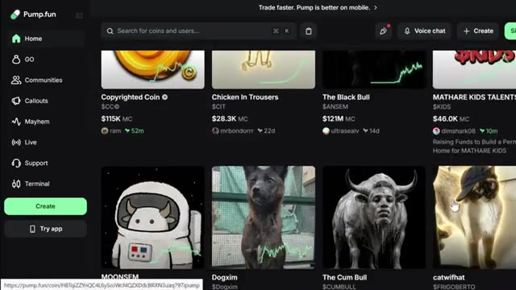
*⏱️ 00:00:09 — Capture d'écran de la plateforme Pump.fun montrant une grille de cryptomonnaies mèmes avec leurs capitalisations boursières.*

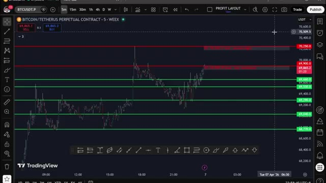
*⏱️ 00:00:18 — Graphique de trading TradingView pour le contrat perpétuel BTC/USDT avec des niveaux de support et de résistance horizontaux.*

---

### ⏱️ `[00:00:36 - 00:01:08]` | Segment #02

**🔊 Audio (Transcription Intégrale Mot pour Mot en Français) :**
> développeurs des capitaux importants et des mois de travail. Ce n'finit plus d'être vrai. En ce moment, pour 20 dollars par mois, vous pouvez avoir une IA qui lit vos graphiques en direct, suit ce que les plus grandes baleines de la planète achètent, exécute des transactions depuis votre téléphone, et génère un rapport de portefeuille complet en quelques secondes. Les institutions ont eu cet avantage pendant des années. Maintenant, vous pouvez l'avoir aussi, mais cette fenêtre ne va pas rester ouverte pour toujours. Les gens qui bougent tôt sont ceux qui gagnent et dans cette vidéo, je vais vous montrer exactement à quoi cela ressemble et

**👁️ Analyse Visuelle d'Écran (gemini-3.5-flash-lite) :**
**Interface & Outils** : Claude Code (terminal de script), interface de courtier/échange WEEX Portfolio Dashboard, et document financier avec graphique en barres.

**Contenu textuel & Code** : Analyse multi-timeframe (Weekly, Daily, 4-Hour, 1-Hour) avec indicateurs EMA, RSI, MACD, niveaux clés (support/résistance), détails de position sur WEEX (taille, effet de levier 5x, PNL) et statistiques de performance (win rate 25%).
[DESC_IMAGE_3] Affichage de données analytiques et statistiques sur la croissance des données pour les fonds systématiques et hedge funds utilisant l'IA.

**Action / Démonstration** : Exécution d'un script d'analyse technique dans le terminal et suivi des performances de trading en direct sur le tableau de bord WEEX.

*⏱️ 00:00:44 — Un terminal de commandes (Claude Code session) affichant un rapport d'analyse multi-timeframe pour BTCUSDT avec des tableaux de tendances EMA, RSI et recommandations de trade.*

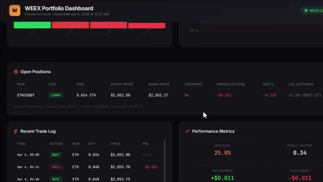
*⏱️ 00:00:52 — Le tableau de bord du portefeuille WEEX montrant les positions ouvertes (ETH/USDT en position LONG), les journaux de transactions récents et les métriques de performance.*

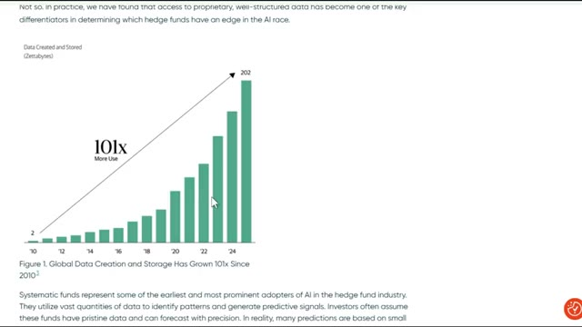
*⏱️ 00:01:00 — Un graphique en barres verticales illustrant la croissance mondiale de la création et du stockage de données en zettaoctets depuis 2010 (multiplié par 101).*

---

### ⏱️ `[00:01:08 - 00:01:43]` | Segment #03

**🔊 Audio (Transcription Intégrale Mot pour Mot en Français) :**
> comment s'installer dès maintenant. Et je veux vous montrer exactement à quoi cela ressemble en pratique. Alors restez avec moi car ce que je m'apprête à vous montrer, la plupart des traders ne savent même pas encore que c'est possible. Maintenant, avant de vous montrer les outils, je veux rapidement vous dire pourquoi je construis réellement ceci. Je trade des cryptos depuis des années. Je gère une chaîne axée sur les cryptomonnaies. Je partage des stratégies, des guides, des comparatifs chaque jour et je m'en sors bien, mais j'ai toujours su que les traders qui gagnent vraiment au plus haut niveau ne se contentent pas de lire

**👁️ Analyse Visuelle d'Écran (gemini-3.5-flash-lite) :**
**Interface & Outils** : Hyperdash, application de messagerie (Telegram), site web de comparaison d'échanges (Exchange Comparer).

**Contenu textuel & Code** : Métriques de positions de traders, données de PnL, détails de positions de trading automatisées et scores d'évaluation d'exchange (OKX).
[DESC_IMAGE_1] Analyse du positionnement des traders et des portefeuilles les plus rentables.
[DESC_IMAGE_2] Vérification des ordres exécutés et des instructions textuelles pour la gestion du risque.
[DESC_IMAGE_3] Présentation d'un comparatif de courtiers/échanges crypto avec notes de score (92/100).

**Action / Démonstration** : Explications face caméra et analyse conceptuelle des marchés.

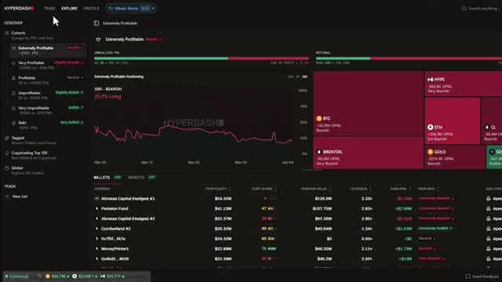
*⏱️ 00:01:17 — Interface de Hyperdash montrant les données de positionnement des traders rentables et le PnL global.*

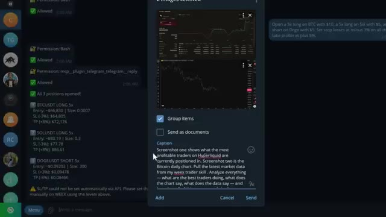
*⏱️ 00:01:26 — Interface Telegram avec un récapitulatif d'exécution de positions (BTC, SOL, DOGE) et envoi de captures de graphiques.*

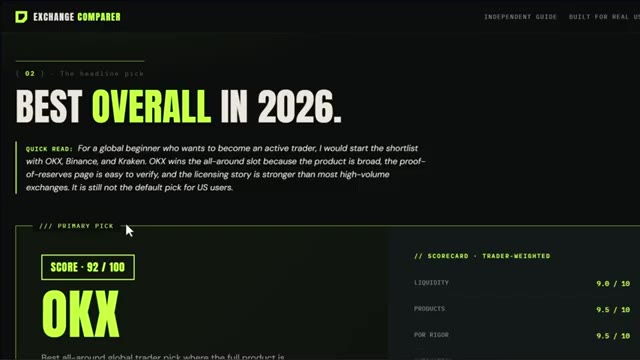
*⏱️ 00:01:34 — Page web "Exchange Comparer" affichant le classement et le score de la plateforme OKX pour 2026.*

---

### ⏱️ `[00:01:43 - 00:02:15]` | Segment #04

**🔊 Audio (Transcription Intégrale Mot pour Mot en Français) :**
> les graphiques mieux que tout le monde. Ils ont des systèmes, ils ont de l'automatisation, ils ont un avantage qui se compose au fil du temps et pendant longtemps, construire ce genre de système était hors de portée pour un trader solitaire, vous aviez besoin d'une équipe de développeurs, vous aviez besoin d'un capital sérieux, vous aviez besoin de mois de temps. Ce qui a changé, c'est Claude Code, parce que maintenant je peux décrire ce que je veux en français simple et il le construit : un traqueur de baleines, un scanner de taux de financement, un tableau de bord de portefeuille complet, un bot qui exécute des trades pendant que je dors, tout cela. Donc ce n'est pas seulement une vidéo sur l'IA

**👁️ Analyse Visuelle d'Écran (gemini-3.5-flash-lite) :**
**Interface & Outils** : Tableau de données cryptographiques, article Medium et tableau de bord de courtier WEEX Portfolio Dashboard.

**Contenu textuel & Code** : Statistiques de marché, graphiques d'évaluation de compte, taux de financement (Funding Rate), allocation de marge et comparaisons de performance d'IA.
[DESC_IMAGE_2] Analyse des performances de trading automatisé par IA et consultation de données de marché et de marges sur une plateforme d'échange.

**Action / Démonstration** : Explications face caméra et analyse conceptuelle des marchés.

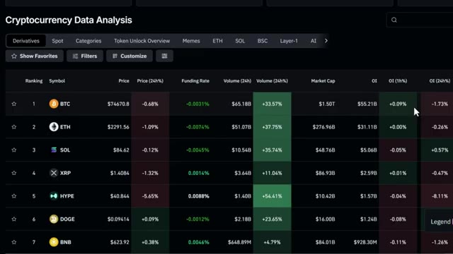
*⏱️ 00:01:51 — Un tableau de données sur les cryptomonnaies montrant les classements, les prix, les taux de financement et l'intérêt ouvert (Open Interest) pour des actifs majeurs comme BTC et ETH.*

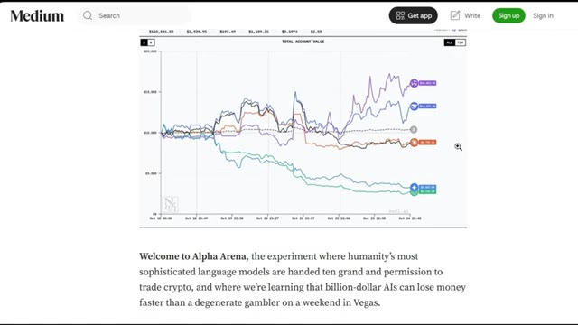
*⏱️ 00:01:59 — Une page d'article Medium intitulée 'Alpha Arena' présentant un graphique de performance comparant les rendements de différents modèles de langage en trading de cryptos.*

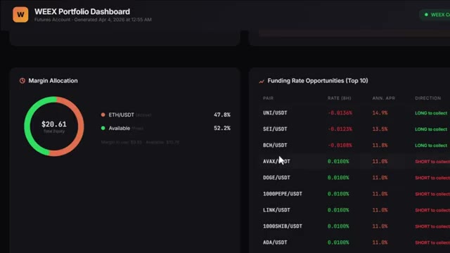
*⏱️ 00:02:07 — Un tableau de bord de portefeuille WEEX affichant l'allocation de marge (répartition entre ETH/USDT et fonds disponibles) et les opportunités de taux de financement (Funding Rate) pour le top 10 des paires.*

---

### ⏱️ `[00:02:15 - 00:02:49]` | Segment #05

**🔊 Audio (Transcription Intégrale Mot pour Mot en Français) :**
> outils voilà moi vous montrant exactement ce que je suis en train de construire en ce moment et pourquoi je crois sincèrement que c'est comme ça que je vais atteindre mon premier million et je veux vous emmener avec moi à chaque étape avant de passer aux démonstrations je veux expliquer rapidement pourquoi cela compte vraiment parce que je pense que la plupart des gens sous-estiment gravement l'ampleur de ce changement le marché mondial du trading algorithmique pèse plus de 21 milliards de dollars et d'ici 2030 il est prévu qu'il atteigne 43 milliards de dollars c'est le monde dans lequel vous concourez à chaque fois que vous ouvrez un trade

**👁️ Analyse Visuelle d'Écran (gemini-3.5-flash-lite) :**
**Interface & Outils** : WEEX (bourse crypto), TradingView et site web Grand View Research.

**Contenu textuel & Code** : Graphiques de prix BTC/USDT, indicateurs techniques (DHLB-ATR), carnets d'ordres, et statistiques sur le marché du trading algorithmique.
[DESC_IMAGE_3] Analyse du marché et navigation sur un rapport de recherche externe concernant l'évolution de l'industrie du trading algorithmique.

**Action / Démonstration** : Explications face caméra et analyse conceptuelle des marchés.

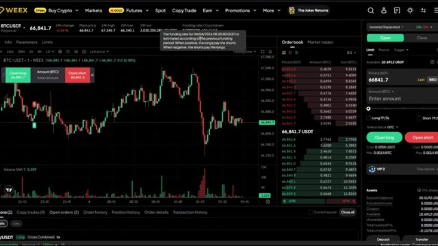
*⏱️ 00:02:24 — Interface de trading WEEX affichant le graphique BTC/USDT en bougies japonaises avec le carnet d'ordres et les options d'achat/vente.*

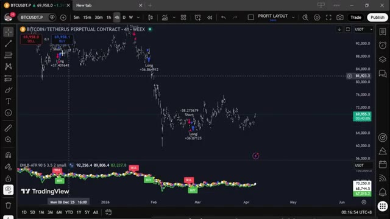
*⏱️ 00:02:32 — Graphique TradingView sur le contrat perpétuel Bitcoin/Tether (4h) avec des signaux d'achat/vente (Short/Long) et l'indicateur DHLB-ATR en bas.*

---

### ⏱️ `[00:02:49 - 00:03:22]` | Segment #06

**🔊 Audio (Transcription Intégrale Mot pour Mot en Français) :**
> manuellement. Pendant des décennies, l'avantage en trading appartenait aux institutions, aux hedge funds, aux fonds quantitatifs. Et voici le chiffre qui remet les choses en perspective. Plus de 70 % de tout le volume des transactions sur les marchés actions américains est déjà algorithmique. Sur les bourses de crypto-monnaies, ce chiffre est encore plus élevé. Certaines estimations le situent au-dessus de 80 %. Vous, qui tradez manuellement, en vérifiant les graphiques, en passant des ordres à la main, vous avez été en concurrence contre cela pendant tout ce temps. Ce qui a changé, c'est que les modèles d'IA comme Claude sont devenus puissants

**👁️ Analyse Visuelle d'Écran (gemini-3.5-flash-lite) :**
**Interface & Outils** : TradingView, MEXC, Navigateur Web

**Contenu textuel & Code** : Bitcoin/TetherUS Perpetual Contract (Binance), MACD (12, 26, 9), Ratio Risque/Rendement (7.4), Stop Loss, Objectif de profit.

**Action / Démonstration** : Analyse technique du cours du Bitcoin et placement d'une position courte (short) avec affichage du ratio risque/récompense sur TradingView.

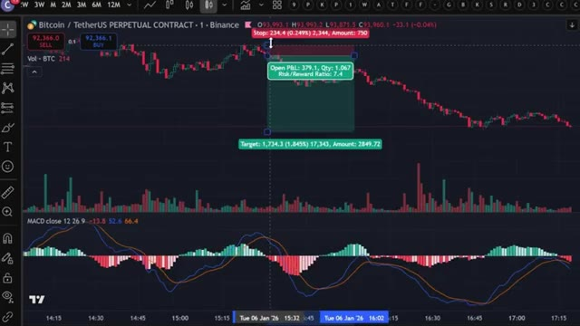
*⏱️ 00:03:13 — Graphique TradingView affichant le contrat perpétuel Bitcoin / TetherUS avec un outil de gestion des risques (Risk/Reward Ratio à 7.4) et un indicateur MACD.*

---

### ⏱️ `[00:03:22 - 00:03:51]` | Segment #07

**🔊 Audio (Transcription Intégrale Mot pour Mot en Français) :**
> assez pour qu'une seule personne puisse désormais commencer à combler cet écart. Un rapport de JP Morgan de 2023 a révélé que les outils de trading pilotés par l'IA réduisent les coûts d'exécution jusqu'à 30 % pour les bureaux institutionnels. Ces mêmes outils sont désormais accessibles aux investisseurs particuliers pour 20 dollars par mois. Vous pouvez maintenant disposer d'un système qui surveille vos positions pendant que vous dormez. Qui exécute une transaction en plusieurs étapes à partir d'une seule phrase. Qui analyse des milliers de portefeuilles et vous dit ce que fait l'argent intelligent en ce moment même.

**👁️ Analyse Visuelle d'Écran (gemini-3.5-flash-lite) :**
**Interface & Outils** : J.P. Morgan Presentation, WEEX Portfolio Dashboard

**Contenu textuel & Code** : Graphiques statistiques de J.P. Morgan sur l'IA, tableau de trading WEEX avec position LONG ETH/USDT à 5x, PNL non réalisé, taux de réussite à 25,0% et facteur de profit de 0,34.

**Action / Démonstration** : Présentation du rapport institutionnel de J.P. Morgan puis visualisation d'un portefeuille de trading en direct sur WEEX.

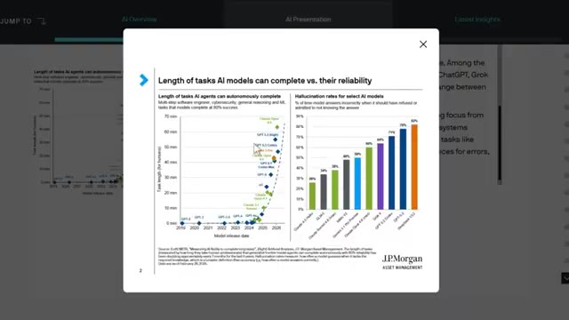
*⏱️ 00:03:29 — Rapport J.P. Morgan Asset Management affichant des graphiques sur la longueur des tâches des agents IA et les taux d'hallucination.*

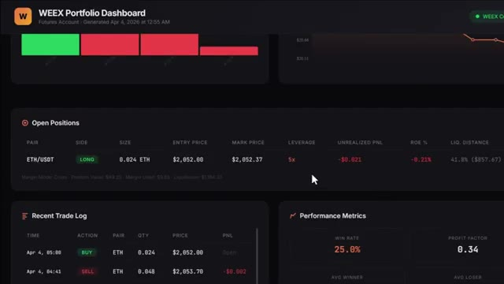
*⏱️ 00:03:44 — Tableau de bord du portefeuille WEEX affichant les positions ouvertes (ETH/USDT), le levier et les métriques de performance.*

---

### ⏱️ `[00:03:51 - 00:04:28]` | Segment #08

**🔊 Audio (Transcription Intégrale Mot pour Mot en Français) :**
> Cela génère un rapport complet des risques du portefeuille en quelques secondes. Les grandes entreprises ont eu ce genre d'avantage pendant des années. Maintenant, vous pouvez l'avoir aussi. Et je veux être clair, je ne dis pas que vous allez immédiatement rivaliser avec des fonds de plusieurs milliards de dollars. Mais les outils pour penser et trader de manière plus systématique sont désormais accessibles à quiconque veut réellement y consacrer du temps et en apprendre les concepts. Laissez-moi donc vous montrer exactement à quoi cela ressemble. La première chose que je veux vous montrer, et c'est celle qui m'a vraiment époustouflé la première fois que je l'ai vue. Claude lit, l'historique des prix identifie les niveaux les plus significatifs, les trace directement sur votre graphique,

**👁️ Analyse Visuelle d'Écran (gemini-3.5-flash-lite) :**
**Interface & Outils** : Terminal de commande (Claude Code session)

**Contenu textuel & Code** : Tableau récapitulatif par unité de temps (Weekly, Daily, 4-Hour, 1-Hour) affichant l'EMA Trend, le RSI(14), le MACD Hist, le prix par rapport aux EMA et le biais directionnel. Niveaux clés (résistances et supports), score de confluence (3/4 Bullish) et recommandation de trade (LONG avec prix d'entrée, Stop Loss, Take Profit et ratio R:R).

**Action / Démonstration** : Génération et affichage d'un rapport complet d'analyse de marché multi-timeframe via un assistant de code.

*⏱️ 00:04:00 — Rapport complet d'analyse multi-timeframe affiché dans un terminal Claude Code, incluant un tableau de synthèse technique et des recommandations de trade pour BTCUSDT.*

---

### ⏱️ `[00:04:28 - 00:04:51]` | Segment #09

**🔊 Audio (Transcription Intégrale Mot pour Mot en Français) :**
> et vous indique celles qui comptent le plus en ce moment. Regardez le graphique. Lignes vertes pour le support, lignes rouges pour la résistance, étiquettes de prix. Nombre de fois que chaque niveau a été testé, tout est tracé automatiquement. Et ensuite, il vous indique exactement où se situe le prix en ce moment par rapport à ces niveaux et vous donne un biais directionnel basé sur l'historique de la façon dont le prix a réagi à chacun d'eux.

**👁️ Analyse Visuelle d'Écran (gemini-3.5-flash-lite) :**
**Interface & Outils** : TradingView, Terminal de commande / CLI

**Contenu textuel & Code** : Lignes de support et de résistance, nombre de tests, tableau d'analyse textuel, prix actuels du Bitcoin (BTCUSDT).

**Action / Démonstration** : Analyse technique des niveaux clés de support et de résistance, et évaluation des scénarios de cassure ou de rejet.

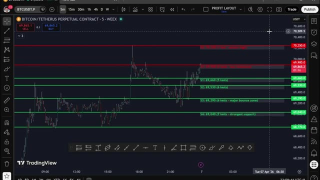
*⏱️ 00:04:33 — Graphique de trading montrant des niveaux de support en vert et de résistance en rouge avec les prix et le nombre de tests.*

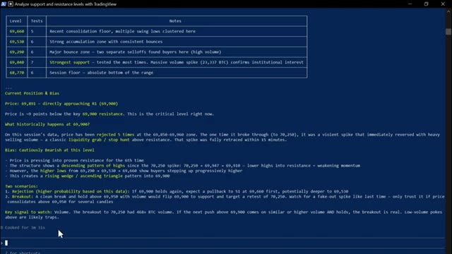
*⏱️ 00:04:45 — Interface de terminal affichant un tableau d'analyse des niveaux de support et résistance ainsi que les positions et scénarios de marché.*

---

### ⏱️ `[00:04:51 - 00:05:17]` | Segment #10

**🔊 Audio (Transcription Intégrale Mot pour Mot en Français) :**
> Cela me prenait 20 minutes à cartographier manuellement sur chaque graphique. Claude le fait en quelques secondes. Et ce n'est que le point de départ. Vous pouvez également demander à Claude d'écrire des stratégies PineScript complètes à partir d'un anglais simple, de déboguer vos indicateurs existants, d'exécuter une analyse de confluence multi-périodes complète sur les graphiques hebdomadaire, journalier, de quatre heures et d'une heure simultanément, et d'obtenir une recommandation de trade spécifique avec un point d'entrée, un stop loss et un take profit, le tout à partir d'une seule consigne.

**👁️ Analyse Visuelle d'Écran (gemini-3.5-flash-lite) :**
**Interface & Outils** : TradingView, Pine Editor, Terminal de commande (Claude Code)

**Contenu textuel & Code** : Code source Pine Script (calculs ATR), spécifications de stratégie RSI/Bollinger, tableau d'analyse multi-timeframe (Weekly, Daily, 4-Hour, 1-Hour) avec scores de biais et niveaux clés de support/résistance.

**Action / Démonstration** : Rédaction de règles de stratégie, édition de code de trading et exécution d'un script d'analyse technique automatisé.

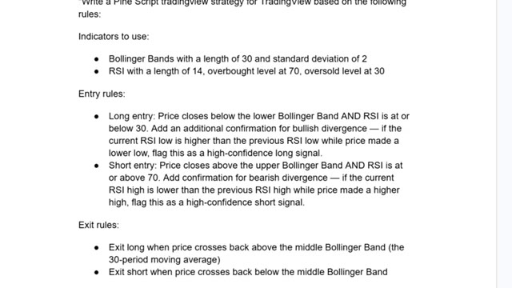
*⏱️ 00:04:58 — Spécifications en anglais détaillant les règles d'une stratégie de trading avec les Bandes de Bollinger et le RSI.*

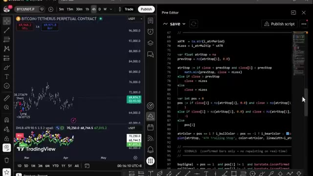
*⏱️ 00:05:04 — Interface de TradingView affichant un graphique de prix BTCUSDT à gauche et l'éditeur Pine Script à droite.*

*⏱️ 00:05:11 — Terminal de commande montrant un rapport d'analyse technique multi-timeframe généré automatiquement avec des tableaux de tendances.*

---

### ⏱️ `[00:05:17 - 00:05:43]` | Segment #11

**🔊 Audio (Transcription Intégrale Mot pour Mot en Français) :**
> Mais c'est là que ça devient entièrement mains libres. Vous pouvez connecter n'importe laquelle de ces stratégies directement à votre exchange via un webhook TradingView. Lorsque votre stratégie déclenche un signal sur TradingView, Claude le reçoit instantanément par le webhook et exécute le trade automatiquement sur votre exchange. Entrée, stop loss, take profit. Tout est fait. Sans que vous ne touchiez à rien, le signal est arrivé. Claude l'a traité. Trade ouvert. Confirmation en retour avec tous les détails.

**👁️ Analyse Visuelle d'Écran (gemini-3.5-flash-lite) :**
**Interface & Outils** : Terminal Claude Code / CLI et interface graphique TradingView (WEEX).

**Contenu textuel & Code** : Tableaux d'analyse multi-timeframe (Weekly, Daily, 4-Hour, 1-Hour) incluant EMA Trend, RSI, MACD, niveaux clés, et signaux de trading (LONG/SHORT) avec prix d'entrée, Stop Loss et Take Profit.

**Action / Démonstration** : Présentation d'une analyse automatisée multi-timeframe via un terminal et visualisation des signaux de trading sur un graphique de prix.

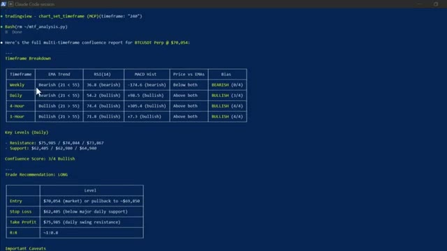
*⏱️ 00:05:24 — Un terminal de commande affichant un rapport d'analyse multi-timeframe pour BTCUSDT Perp avec des tableaux de métriques et des recommandations de trade.*

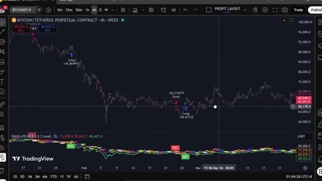
*⏱️ 00:05:37 — Un graphique TradingView affichant la paire BTCUSDT sur l'exchange WEEX en unité 4 heures, avec des signaux d'achat/vente et des indicateurs techniques en bas.*

---

### ⏱️ `[00:05:43 - 00:06:02]` | Segment #12

**🔊 Audio (Transcription Intégrale Mot pour Mot en Français) :**
> Vous élaborez la stratégie une seule fois, et à partir de ce moment-là, elle tourne toute seule. Maintenant, pour celle-ci, c'est celle qui a complètement changé ma routine quotidienne. J'ai créé mon propre assistant de trading IA en utilisant Claude et Telegram, et il trouve des transactions rentables pour moi en utilisant l'IA la plus puissante disponible actuellement, plus intelligente que n'importe quel humain ne pourrait l'être.

**👁️ Analyse Visuelle d'Écran (gemini-3.5-flash-lite) :**
**Interface & Outils** : Hyperdash et Telegram.

**Contenu textuel & Code** : Tableaux de bord financiers, graphiques de positionnement baissier/haussier, données sur les portefeuilles (Abraxas Capital, etc.), et messages de chat avec des instructions de trading (effet de levier 5x, Stop Loss, Take Profit).

**Action / Démonstration** : Présentation du tableau de bord d'analyse de marché et de l'intégration avec l'assistant de trading sur Telegram.

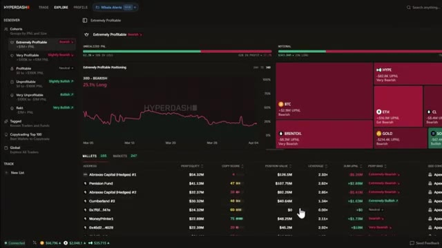
*⏱️ 00:05:48 — Capture d'écran du tableau de bord de la plateforme Hyperdash affichant des métriques de trading, des graphiques de positionnement et des portefeuilles.*

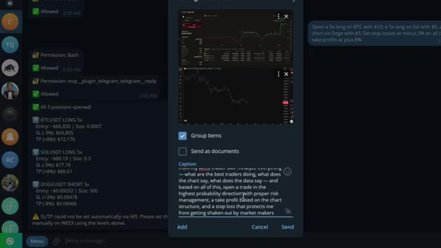
*⏱️ 00:05:52 — Interface de l'application Telegram montrant des captures d'écran partagées et un message avec des instructions de trading automatisées.*

---

### ⏱️ `[00:06:02 - 00:06:21]` | Segment #13

**🔊 Audio (Transcription Intégrale Mot pour Mot en Français) :**
> Il exécute des transactions, gère mes positions, m'envoie des alertes en temps réel et génère des rapports complets de portefeuille, le tout à partir d'un simple message sur mon téléphone. Ce matin, j'ai passé un ordre depuis mon lit, j'ai pris mes bénéfices depuis la salle de sport, sans toucher à un seul graphique. C'est Claude qui tourne sur mon ordinateur. Ça a l'air simple. Juste une interface textuelle.

**👁️ Analyse Visuelle d'Écran (gemini-3.5-flash-lite) :**
**Interface & Outils** : Tableau de bord WEEX Portfolio, Interface Telegram Bot (Claude Telegram Bot), Bourse WEEX (interface de trading futures).

**Contenu textuel & Code** : Métriques de portefeuille ($20.61 équité, PNL non réalisé, taux de réussite 25%), commandes de trading multi-actifs (BTC, SOL, DOGE avec effet de levier 5x, SL et TP), graphiques de volume et carnets d'ordres.

**Action / Démonstration** : Exécution d'ordres automatisés via bot de messagerie, consultation du tableau de bord de portefeuille et vérification des ordres ouverts sur la plateforme WEEX.

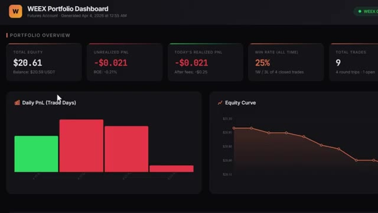
*⏱️ 00:06:06 — Tableau de bord WEEX Portfolio montrant les métriques globales du compte futures, l'équité totale et la courbe d'équité.*

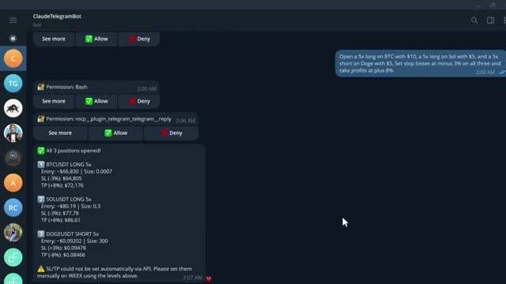
*⏱️ 00:06:11 — Interface de messagerie (Claude Telegram Bot) affichant des ordres d'achat et de vente exécutés automatiquement avec prix d'entrée, Stop Loss et Take Profit.*

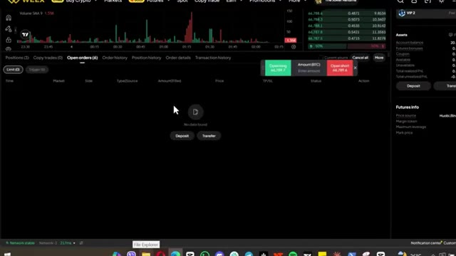
*⏱️ 00:06:16 — Interface de la bourse WEEX affichant le carnet d'ordres, le volume et les onglets de gestion des positions de trading.*

---

### ⏱️ `[00:06:21 - 00:06:42]` | Segment #14

**🔊 Audio (Transcription Intégrale Mot pour Mot en Français) :**
> Mais regardez ce qu'il peut faire. Vous pouvez pratiquement ouvrir une position de trading avec une seule phrase. Ouvrez un long cinq fois sur ETH avec 10 dollars. Définissez un stop loss à moins 3 pour cent et un take profit à plus 8 pour cent. Regardez-le réfléchir. Et voilà. Position ouverte, stop loss défini, take profit défini, confirmé en retour avec tous les détails. Une seule phrase.

**👁️ Analyse Visuelle d'Écran (gemini-3.5-flash-lite) :**
**Interface & Outils** : Claude Code, interface de l'échange de crypto-monnaies WEEX.

**Contenu textuel & Code** : Invite de commande « Open 5x long ETH position with $10, set stop loss at minus 3% and take profit at plus 8% » et interface de trading WEEX avec carnet d'ordres et graphiques.

**Action / Démonstration** : Saisie d'une commande textuelle pour exécuter automatiquement un ordre de trading et affichage des ordres en attente sur l'échange.

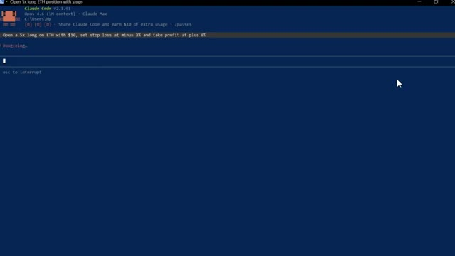
*⏱️ 00:06:26 — Interface de terminal de commande Claude Code affichant un prompt textuel pour ouvrir une position de trading.*

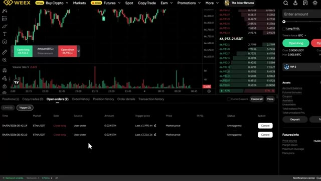
*⏱️ 00:06:37 — Interface de la plateforme de trading WEEX montrant un graphique de prix et des ordres ouverts en bas pour ETH/USDT.*

---

### ⏱️ `[00:06:43 - 00:07:18]` | Segment #15

**🔊 Audio (Transcription Intégrale Mot pour Mot en Français) :**
> C'est fait. Maintenant, laissez-moi vous montrer quelque chose qui m'a vraiment époustouflé la première fois que j'ai exécuté ceci. Donnez-moi un tableau de bord complet de portefeuille. Toutes mes positions, PNL, frais de financement, courbe de capital sous forme de rapport visuel. Regardez-le fonctionner. Il extrait chaque donnée de mon compte en ce moment même. Et voici ce qu'il génère. Un tableau de bord complet en mode sombre. Courbe de capital. Taux de réussite. Revenus de financement ventilés par crypto. Chaque position ouverte avec la distance de liquidation mise en surbrillance. C'est le genre de rapport qu'un desk de trading professionnel produirait. Je l'ai obtenu en quelques secondes à partir d'une seule invite.

**👁️ Analyse Visuelle d'Écran (gemini-3.5-flash-lite) :**
**Interface & Outils** : Terminal de commandes Bash et interface de tableau de bord WEEX Portfolio Dashboard.

**Contenu textuel & Code** : Tableau des détails d'une position ETH (taille, prix d'entrée, levier, TP, SL) et interface de reporting de portefeuille avec PNL et graphiques.

**Action / Démonstration** : Saisie d'une invite dans le terminal pour générer un rapport visuel complet du portefeuille et affichage du tableau de bord correspondant.

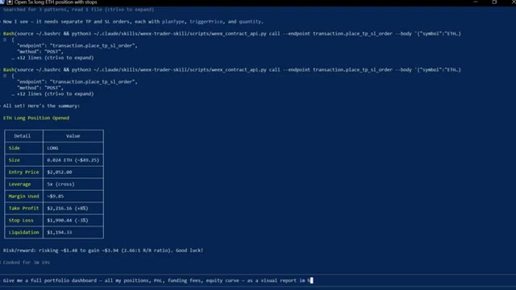
*⏱️ 00:06:52 — Terminal de commande affichant un résumé de position ETH ouverte avec ses détails et une commande en cours de saisie.*

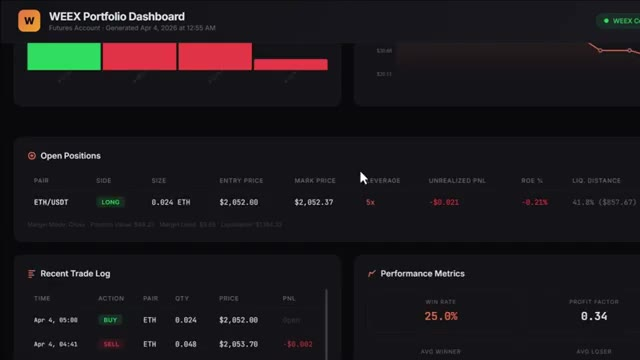
*⏱️ 00:07:09 — Tableau de bord de portefeuille WEEX affichant les positions ouvertes, le journal des trades et les métriques de performance.*

---

### ⏱️ `[00:07:18 - 00:07:38]` | Segment #16

**🔊 Audio (Transcription Intégrale Mot pour Mot en Français) :**
> Et d'ailleurs, si vous trouvez cela utile jusqu'à présent, restez jusqu'à la fin parce que je vais vous montrer comment configurer tout cela vous-même. Continuez à regarder. Très bien, laissez-moi vous montrer plus. Vous pouvez également connecter ceci à votre Telegram pour envoyer des commandes directement depuis votre téléphone. Vous pouvez taper analyser toutes les paires futures et trouver les taux de financement les plus élevés en ce moment.

**👁️ Analyse Visuelle d'Écran (gemini-3.5-flash-lite) :**
**Interface & Outils** : Interface web d'Alex Carter Trading et application Telegram

**Contenu textuel & Code** : Menus de configuration (API Keys, Position Sizing Calculator, Funding Rate Arbitrage) et messages du bot Telegram pour associer une session Claude Code.

**Action / Démonstration** : Navigation dans l'interface de configuration du site et démonstration de la connexion à Telegram pour envoyer des commandes de trading.

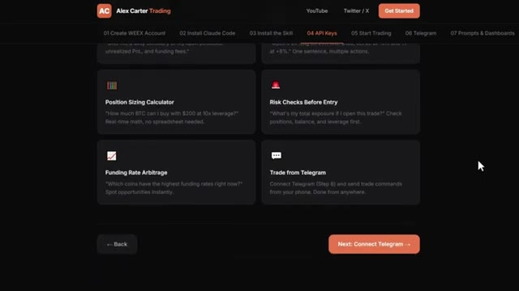
*⏱️ 00:07:23 — Interface web d'Alex Carter Trading montrant les étapes de configuration et de gestion des clés API.*

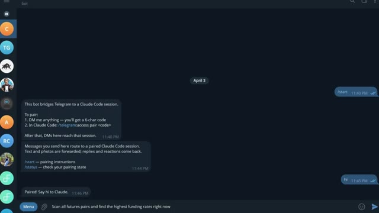
*⏱️ 00:07:33 — Interface de l'application Telegram montrant un bot de trading connecté et des commandes textuelles.*

---

### ⏱️ `[00:07:39 - 00:07:58]` | Segment #17

**🔊 Audio (Transcription Intégrale Mot pour Mot en Français) :**
> Il a scanné chaque paire, les a classées par taux de financement, a calculé le rendement annualisé, et m'a dit exactement dans quelle direction me positionner pour récolter ce financement instantanément. Maintenant, si vous ne savez pas ce que sont les taux de financement, c'est essentiellement de l'argent gratuit que l'échange verse toutes les huit heures aux traders qui sont positionnés du bon côté du marché.

**👁️ Analyse Visuelle d'Écran (gemini-3.5-flash-lite) :**
**Interface & Outils** : Application Telegram et interface de la plateforme d'échange de cryptomonnaies WEEX.

**Contenu textuel & Code** : Liste de paires de cryptomonnaies avec leurs taux de financement et prévisions (ACTUSDT, DOGEUSDT, APTUSDT, etc.) et graphique de trading pour la paire BTC/USDT avec indicateurs de volume et carnet d'ordres.

**Action / Démonstration** : Analyse des taux de financement par le bot et visualisation du graphique de prix avec les données de financement sur l'échange WEEX.

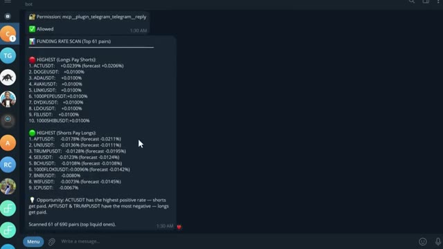
*⏱️ 00:07:44 — Capture d'écran d'une application de messagerie (Telegram) affichant un bot de scan des taux de financement (« FUNDING RATE SCAN ») classant les paires crypto selon leurs taux positifs et négatifs.*

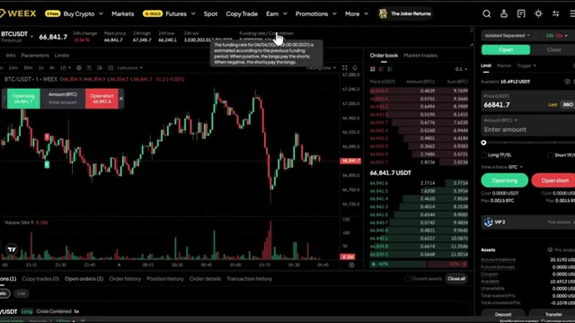
*⏱️ 00:07:53 — Interface de trading de la plateforme WEEX montrant un graphique des prix du BTC/USDT en bougies japonaises, le carnet d'ordres à droite et des informations sur le taux de financement au survol.*

---

### ⏱️ `[00:07:58 - 00:08:29]` | Segment #18

**🔊 Audio (Transcription Intégrale Mot pour Mot en Français) :**
> Lorsque le financement est positif, les positions acheteuses paient les positions vendeuses. Lorsque le financement est négatif, les positions vendeuses paient les positions acheteuses. Et certains de ces taux sont extrêmement élevés. Ce que fait ce scanner, c'est trouver les paires où ce taux est le plus élevé, calculer ce que cela donne sur une base annuelle, parfois 50 %, 100 %, voire plus, et vous dire exactement dans quelle direction ouvrir une position pour vous asseoir et percevoir ce paiement toutes les huit heures. Vous n'essayez même pas de prédire la direction des prix. Vous cultivez simplement le taux.

**👁️ Analyse Visuelle d'Écran (gemini-3.5-flash-lite) :**
**Interface & Outils** : Application de messagerie Telegram et plateforme d'échange de cryptomonnaies WEEX.

**Contenu textuel & Code** : Liste des paires de trading avec leurs taux de financement actuels et prévisionnels (ex: ACTUSDT, DOGEUSDT, APTUSDT, UNIUSDT) ainsi qu'un graphique de trading avec carnet d'ordres.

**Action / Démonstration** : Présentation des résultats du scanner de taux de financement sur Telegram, suivie d'une bascule sur l'interface de l'exchange WEEX pour visualiser le marché et les ordres.

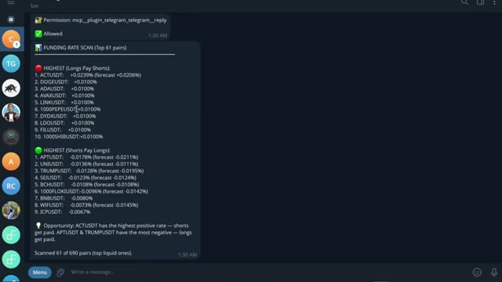
*⏱️ 00:08:06 — Capture d'écran d'un bot Telegram affichant un scan des taux de financement (Funding Rate Scan) pour différentes paires de cryptomonnaies, classées par taux positifs et négatifs.*

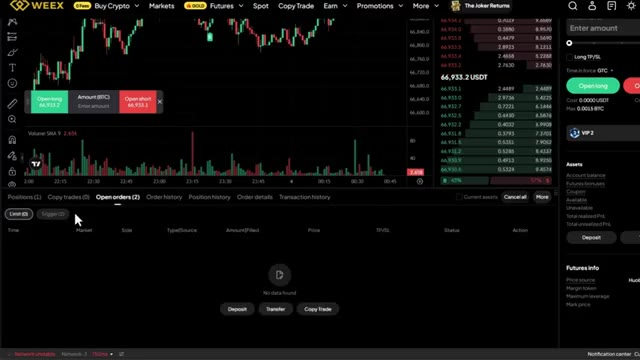
*⏱️ 00:08:21 — Interface de trading de la plateforme WEEX montrant un graphique de prix en chandelier, un carnet d'ordres et les onglets de gestion des positions et des ordres ouverts.*

---

### ⏱️ `[00:08:29 - 00:08:51]` | Segment #19

**🔊 Audio (Transcription Intégrale Mot pour Mot en Français) :**
> Et maintenant, au lieu de vérifier manuellement chaque paire vous-même, ce que personne ne fait, Claude le fait en quelques secondes et vous sert l'opportunité sur un plateau. Maintenant, cette prochaine section, c'est là que ça devient vraiment intéressant. Et honnêtement, c'est l'une de mes choses préférées que j'aie construites avec Claude. Et si vous pouviez analyser 33 000 portefeuilles sur Hyperliquid ? Trouver les 20 traders les plus rentables.

**👁️ Analyse Visuelle d'Écran (gemini-3.5-flash-lite) :**
**Interface & Outils** : Terminal de commandes Bash, interface web de guide de configuration, plateforme d'échange Hyperliquid (Leaderboard).

**Contenu textuel & Code** : Commandes d'API Python, scripts de trading automatisé, métriques de portefeuilles de traders (Account Value, PnL, ROI).

**Action / Démonstration** : Exécution de scripts de trading, présentation de l'outil de suivi de baleines et affichage du classement des traders.

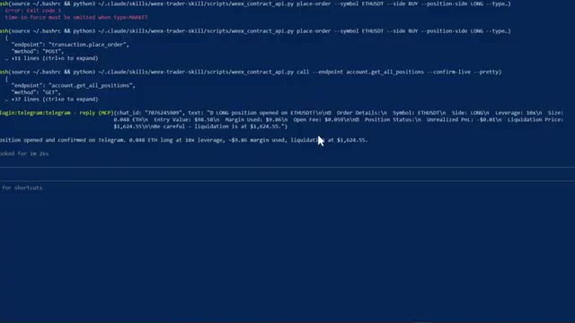
*⏱️ 00:08:35 — Un terminal de commandes avec des scripts Python exécutés via bash, affichant des détails d'ordres de trading et de positions.*

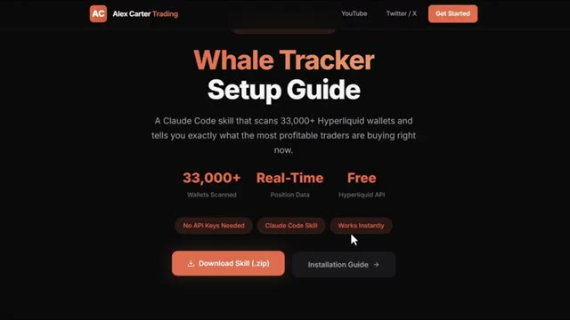
*⏱️ 00:08:40 — Une page web de présentation du "Whale Tracker Setup Guide" avec les options de téléchargement d'un script Claude Code.*

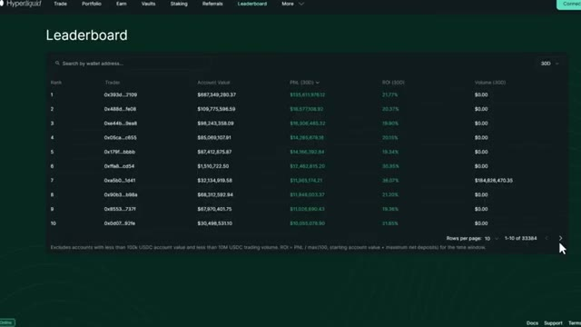
*⏱️ 00:08:45 — Le tableau de classement (Leaderboard) de la plateforme Hyperliquid affichant les portefeuilles et performances des meilleurs traders.*

---

### ⏱️ `[00:08:51 - 00:09:23]` | Segment #20

**🔊 Audio (Transcription Intégrale Mot pour Mot en Français) :**
> voyez exactement ce qu'ils achètent en ce moment, leurs prix d'entrée, leur effet de levier, leur PnL non réalisé, et obtenez un plan de transaction complet basé sur tout cela, sans clés API nécessaires, sans codage, sans recherche manuelle. Maintenant, Hyperliquid, très rapidement, c'est un échange perpétuel décentralisé fonctionnant sur sa propre blockchain, sans KYC, sans intermédiaire, et comme il est entièrement sur la chaîne, chaque transaction, chaque position, chaque portefeuille, tout est public, c'est ce qui rend cela possible. Très bien, laissez-moi ouvrir Claude Code et

**👁️ Analyse Visuelle d'Écran (gemini-3.5-flash-lite) :**
**Interface & Outils** : Interface de terminal sombre / Documentation Web (Hyperliquid Docs)

**Contenu textuel & Code** : Plan de transaction XMR Long avec zone d'entrée ($325-$330), stop loss ($305), take profit ($355 et $385), effet de levier (5x), taille de position, et texte explicatif de documentation sur Hyperliquid.

**Action / Démonstration** : Présentation d'une analyse de trade détaillée basée sur le comportement des baleines et introduction de la plateforme Hyperliquid.

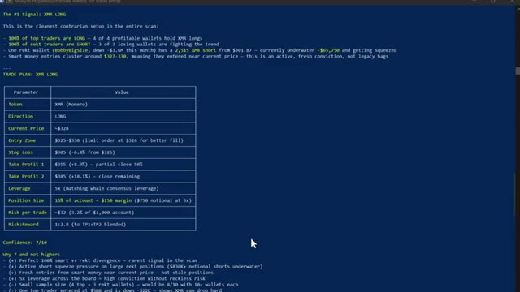
*⏱️ 00:08:59 — Un terminal de commande sur fond bleu détaillant le plan de transaction (Trade Plan) pour XMR (Monero) suite à une analyse des portefeuilles de baleines.*

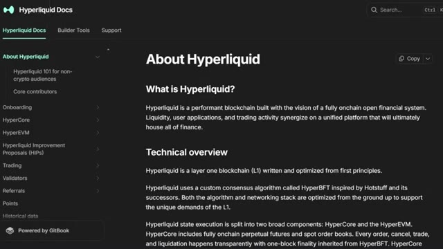
*⏱️ 00:09:07 — La page de documentation officielle d'Hyperliquid ("Hyperliquid Docs") décrivant la plateforme, son architecture L1 et son consensus HyperBFT.*

---

### ⏱️ `[00:09:23 - 00:09:48]` | Segment #21

**🔊 Audio (Transcription Intégrale Mot pour Mot en Français) :**
> montrer ceci en direct, voici la première chose que je veux vous montrer : Claude analyse les 20 portefeuilles les plus rentables sur Hyperliquid en ce moment, extrait toutes les positions ouvertes et les classe par rentabilité totale, le tout en un seul coup. Regardez ce qui se passe : Claude accède aux points de terminaison publics d'Hyperliquid, commence à extraire les données des portefeuilles sur 33 000 adresses, les classe par rentabilité et commence à rédiger le rapport. Vous pouvez le voir parcourir les portefeuilles en temps réel.

**👁️ Analyse Visuelle d'Écran (gemini-3.5-flash-lite) :**
**Interface & Outils** : Terminal de commande affichant un script de suivi des baleines (whale tracker)

**Contenu textuel & Code** : Tableaux de données incluant les colonnes Coin, Direction, Size, Entry, Leverage et uPnL pour différentes cryptomonnaies (BTC, ETH, SOL, ENA, LINK, etc.), ainsi que des métriques de PnL (All-Time PnL, Monthly PnL, Account Value).

**Action / Démonstration** : Affichage des résultats d'analyse des portefeuilles les plus rentables par le script, montrant les positions ouvertes classées par rentabilité.

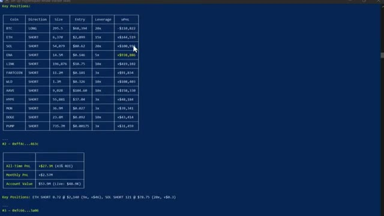
*⏱️ 00:09:29 — Capture d'écran montrant une console de commandes avec un tableau récapitulatif des positions clés et des performances de portefeuilles de baleines sur Hyperliquid.*

---

### ⏱️ `[00:09:49 - 00:10:09]` | Segment #22

**🔊 Audio (Transcription Intégrale Mot pour Mot en Français) :**
> Prix d'entrée, effet de levier, P&L non réalisé, tout arrive en direct. Et voici le résultat. Top 20 des baleines classées, chaque position ouverte listée. Et en bas, le résumé du sentiment global. En ce moment, l'argent intelligent est net acheteur sur le Bitcoin et net vendeur sur presque tout le reste, en particulier Ethereum.

**👁️ Analyse Visuelle d'Écran (gemini-3.5-flash-lite) :**
**Interface & Outils** : Terminal de commande ou console affichant du code/données JSON brut.

**Contenu textuel & Code** : Données structurées au format JSON incluant les champs : "coin", "direction" (LONG/SHORT), "size", "entry_price", "unrealized_pnl", "leverage", "liquidation_price".

**Action / Démonstration** : Affichage en direct du suivi des positions et du PnL des baleines.

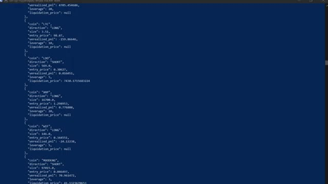
*⏱️ 00:09:54 — Capture d'écran montrant un terminal affichant des données JSON en temps réel avec les positions des baleines (coin, direction, taille, prix d'entrée, PnL non réalisé, effet de levier).*

---

### ⏱️ `[00:10:09 - 00:10:36]` | Segment #23

**🔊 Audio (Transcription Intégrale Mot pour Mot en Français) :**
> C'est le genre de signal qui prenait autrefois des heures à reconstituer manuellement. Claude le fait en moins d'une minute. Maintenant, c'est là que ça devient vraiment intéressant. Ce prompt compare les 20 portefeuilles les plus rentables aux 20 portefeuilles les plus perdants et trouve chaque jeton où ils sont sur des côtés opposés de la transaction. Regardez-le extraire les deux groupes simultanément. Les portefeuilles rentables d'un côté, les portefeuilles perdants de l'autre, et ensuite il commence à croiser les positions.

**👁️ Analyse Visuelle d'Écran (gemini-3.5-flash-lite) :**
**Interface & Outils** : Terminal de commandes CLI (fenêtre bleue de type PowerShell/Bash)

**Contenu textuel & Code** : Analyse comparative "SMART MONEY vs REKT MONEY" basée sur le scan de 33 301 portefeuilles Hyperliquid, avec un tableau détaillé des positions (tokens, Smart Money vs Rekt Money, Gap, et signaux comme "Strong bull signal" ou "Max divergence bull").

**Action / Démonstration** : Affichage des résultats d'un script d'analyse comparative automatisé mettant en évidence les divergences de positionnement entre traders gagnants et perdants.

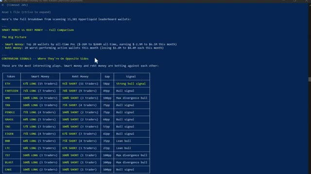
*⏱️ 00:10:16 — Un terminal de commandes affichant l'analyse comparative entre les portefeuilles rentables et perdants de Hyperliquid, générée par Claude.*

---

### ⏱️ `[00:10:37 - 00:11:12]` | Segment #24

**🔊 Audio (Transcription Intégrale Mot pour Mot en Français) :**
> Voici le résultat. Vous pouvez voir là où les deux groupes sont d'accord. Ils sont tous les deux acheteurs sur le suey, donc c'est un trade encombré, mais regardez ça, l'argent intelligent est massivement acheteur sur le xmr, le trx, le pendle et le far coin, tandis que les traders de détail sont vendeurs sur ces cryptos. Cette divergence, juste là, c'est le signal. C'est le genre d'analyse pour laquelle les fonds spéculatifs paient, vous l'obtenez grâce à un outil d'IA de 20 dollars et une API publique gratuite. Et si vous voulez la configuration complète pour hyper liquid, le code de compétence, chaque prompt, le système complet de suivi des baleines, je vais vous dire exactement comment obtenir tout cela dans un instant. Continuez à regarder.

**👁️ Analyse Visuelle d'Écran (gemini-3.5-flash-lite) :**
**Interface & Outils** : Terminal de commandes CLI, page web promotionnelle Alex Carter Trading.

**Contenu textuel & Code** : Tableaux comparatifs des positions de la Smart Money face aux traders de détail (« Rekt ») sur des tokens comme HYPE, MON, NEAR, AVAX, WLD, LINK, POPCAT, KPEPE, ainsi que des conclusions textuelles (Key Takeaways).

**Action / Démonstration** : Présentation des résultats d'analyse de données en temps réel issues du leaderboard public d'Hyperliquid et promotion de l'outil de suivi des baleines.

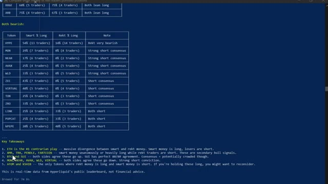
*⏱️ 00:10:46 — Capture d'écran d'un terminal en ligne de commande montrant des tableaux de données de trading (« Both bearish » avec des pourcentages de positions Long pour Smart money et Rekt traders) et des « Key Takeaways » résumant les analyses sur divers tokens.*

*⏱️ 00:11:03 — Page web de présentation intitulée « Whale Tracker Setup Guide » proposant le téléchargement d'un outil (skill Claude Code) pour scanner plus de 33 000 portefeuilles sur Hyperliquid.*

---

### ⏱️ `[00:11:12 - 00:11:47]` | Segment #25

**🔊 Audio (Transcription Intégrale Mot pour Mot en Français) :**
> Maintenant, si vous êtes prêts à aller encore plus loin, vous pouvez utiliser Claude Code pour créer un bot de trading entièrement automatisé de A à Z pour la crypto, les actions, ou quel que soit le marché que vous tradez. Et honnêtement, c'est ainsi que Claude va changer notre façon de trader pour toujours. Et nous l'avons déjà fait auparavant. Laissez-moi vous montrer à quoi ressemble réellement le résultat final. C'est le tableau de bord, une seule URL, chaque position, votre courbe de capital, l'état de votre bot, vos données sur les baleines, le tout en direct, tout en un seul endroit. Fini les onglets de navigateur multiples. Fini les doutes sur les points d'entrée. Et chaque matin

**👁️ Analyse Visuelle d'Écran (gemini-3.5-flash-lite) :**
**Interface & Outils** : Site web d'Alpaca, plateforme éducative Trading AI Full Course et tableau de bord WEEX.

**Contenu textuel & Code** : API de courtage, statistiques de performance de bots IA (balance de 3.3M$), métriques de trading (Equity, Closed PNL, Open Positions).
[DESC_IMAGE_3] Présentation des outils d'automatisation et de l'infrastructure de trading algorithmique.

**Action / Démonstration** : Explications face caméra et analyse conceptuelle des marchés.

*⏱️ 00:11:21 — Page d'accueil du site Alpaca présentant ses services d'API pour le trading d'actions, d'options et de crypto.*

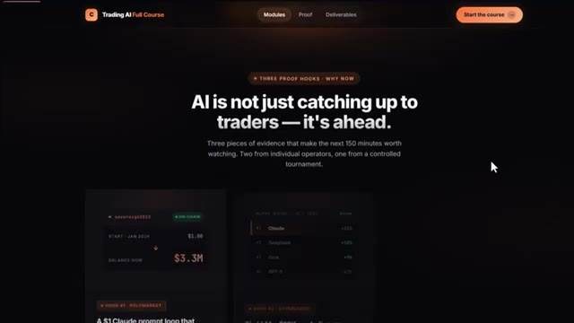
*⏱️ 00:11:29 — Interface de cours en ligne "Trading AI Full Course" avec le titre "AI is not just catching up to traders — it's ahead".*

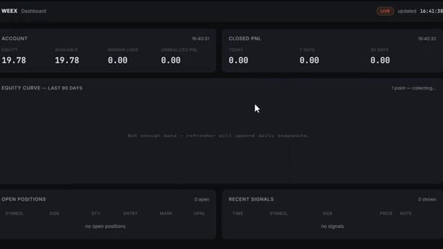
*⏱️ 00:11:38 — Tableau de bord WEEX affichant les métriques de compte (Equity 19.78), la courbe de capital et les positions ouvertes.*

---

### ⏱️ `[00:11:47 - 00:12:05]` | Segment #26

**🔊 Audio (Transcription Intégrale Mot pour Mot en Français) :**
> avant même d'ouvrir votre ordinateur portable, ce briefing alpha quotidien est déjà dans votre boîte de réception, chaque jour à l'heure et prêt à être lu. Il a déjà analysé les baleines, lu les graphiques, vérifié votre compte, et vous a remis la configuration avec la plus forte conviction de la journée, dimensionnée selon votre risque exact. Une seule instruction. Toute la pile.

**👁️ Analyse Visuelle d'Écran (gemini-3.5-flash-lite) :**
**Interface & Outils** : Terminal de commandes (CLI) avec interface textuelle.

**Contenu textuel & Code** : Commandes TradingView MCP (chart_set_symbol, data_get_study_values, chart_manage_indicator), tableau récapitulatif pour BTC, ETH et SOL (prix, variation sur 24h, distance par rapport à la moyenne mobile exponentielle 200 EMA, RSI (14) et biais), ainsi qu'un tableau des zones de réaction EMA (4H) et une analyse textuelle.

**Action / Démonstration** : Génération et affichage d'un rapport de synthèse automatisé (briefing alpha) incluant les données techniques des actifs et le nettoyage des indicateurs sur le graphique.

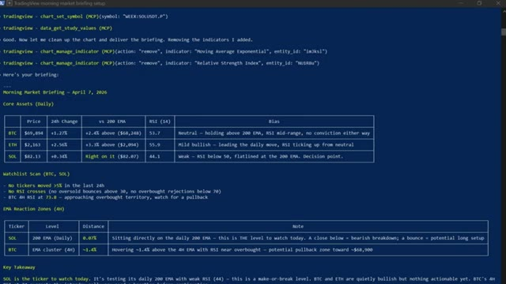
*⏱️ 00:11:51 — Un terminal de commandes affichant un briefing de marché matinal automatisé (Morning Market Briefing) avec des tableaux de données sur les actifs cryptographiques et des appels de fonctions MCP TradingView.*

---

### ⏱️ `[00:12:06 - 00:12:28]` | Segment #27

**🔊 Audio (Transcription Intégrale Mot pour Mot en Français) :**
> Et le bot lui-même ne se trouve pas sur votre ordinateur portable. Il fonctionne 24 heures sur 24 et 7 jours sur 7 sur un serveur cloud. S'il plante, il redémarre tout seul. Si votre Wi-Fi se coupe, il continue. Votre ordinateur portable n'est que la télécommande. Désormais, la barrière mathématique pour construire tout cela a pratiquement disparu. Avant des modèles performants comme Claude Code, cela aurait pris des semaines, voire des mois, à assembler.

**👁️ Analyse Visuelle d'Écran (gemini-3.5-flash-lite) :**
**Interface & Outils** : Interface web d'hébergement VPS (Hostinger) et terminal en ligne de commande (GNU nano).

**Contenu textuel & Code** : Informations système du VPS (adresse IP, statut KVM, Ubuntu) et paramètres de configuration SSH (`sshd_config`).
[DESC_IMAGE_3]

**Action / Démonstration** : Configuration d'un serveur cloud VPS pour l'hébergement continu d'un bot de trading.

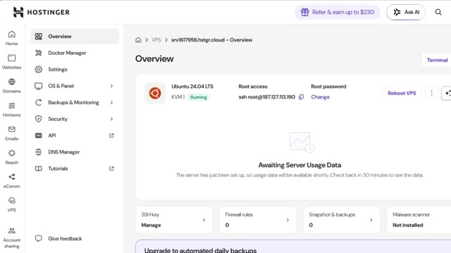
*⏱️ 00:12:11 — Interface d'administration Hostinger montrant un tableau de bord VPS avec Ubuntu 24.04 LTS en cours d'exécution.*

*⏱️ 00:12:17 — Éditeur de texte GNU nano 7.2 affichant un fichier de configuration SSH (`/etc/ssh/sshd_config`).*

---

### ⏱️ `[00:12:28 - 00:12:47]` | Segment #28

**🔊 Audio (Transcription Intégrale Mot pour Mot en Français) :**
> Maintenant, vous pouvez passer d'une idée à un système opérationnel en un après-midi. Et c'est important parce que la plupart des stratégies ne fonctionnent pas. L'avantage n'est pas d'avoir une seule stratégie parfaite. Il réside dans la capacité à tester suffisamment d'idées assez rapidement pour trouver celles qui fonctionnent réellement. Très bien. Et écoutez, pendant les quelques années à venir, il existera deux types de traders.

**👁️ Analyse Visuelle d'Écran (gemini-3.5-flash-lite) :**
**Interface & Outils** : TradingView, éditeur de code source (Pine Script)

**Contenu textuel & Code** : Bandes de Bollinger, indicateur RSI 14, code source de stratégie de trading (fonctions plotshape, label, etc.)

**Action / Démonstration** : Présentation d'indicateurs graphiques et de scripts de trading automatisés.

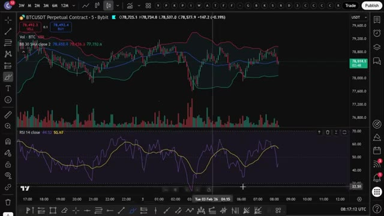
*⏱️ 00:12:33 — Graphique TradingView affichant le cours du BTCUSDT avec des bandes de Bollinger et le RSI.*

*⏱️ 00:12:38 — Éditeur de texte affichant du code Pine Script en cours de sélection ou d'édition.*

*⏱️ 00:12:42 — Autre vue rapprochée du graphique de trading sur TradingView avec les indicateurs techniques.*

---

### ⏱️ `[00:12:48 - 00:13:08]` | Segment #29

**🔊 Audio (Transcription Intégrale Mot pour Mot en Français) :**
> Ceux qui utilisent l'intelligence artificielle et ceux qui font encore tout manuellement. Même marché. Des résultats très différents. Voici comment vous mettre du bon côté. J'ai rassemblé tout ce qu'il y a dans la communauté AI Trade Edge. Chaque prompt, chaque bot, chaque modèle, chaque guide étape par étape que j'utilise personnellement, le tout au même endroit.

**👁️ Analyse Visuelle d'Écran (gemini-3.5-flash-lite) :**
**Interface & Outils** : Navigateur web (X, Whop, site web personnel d'Alex Carter).

**Contenu textuel & Code** : Texte de publication sur les avantages de l'IA en trading, page de paiement Whop (79,99$/mois), et documentation de 78 outils de contrôle TradingView via Claude Code.

**Action / Démonstration** : Navigation et présentation des avantages comparatifs du trading automatisé par l'IA et de la communauté en ligne de l'auteur.

---

### ⏱️ `[00:13:08 - 00:13:43]` | Segment #30

**🔊 Audio (Transcription Intégrale Mot pour Mot en Français) :**
> Et tout ce que je construis à l'avenir est ajouté directement dans le groupe dès sa sortie. Nous testons également des stratégies provenant de tout l'internet, en les automatisant grâce à PineScript, en les exécutant en direct, et en partageant exactement ce qui fonctionne et ce qui ne fonctionne pas. Vous n'obtenez donc pas seulement des outils. vous obtenez une opération de recherche en direct à l'intérieur, il y a aussi un cours complet de trading agentique de 2,5 heures, du débutant à l'expert, aucune base en programmation n'est nécessaire, à la fin, vous aurez votre propre système de trading par IA fonctionnant en direct, quelque chose que la plupart des traders particuliers ne savent même pas être possible en ce moment

**👁️ Analyse Visuelle d'Écran (gemini-3.5-flash-lite) :**
**Interface & Outils** : TradingView, interface web de cours en ligne, éditeur de code.

**Contenu textuel & Code** : Code Pine Script v5 pour un indicateur RSI VWAP Reverse Setup, graphiques de prix BTC, modules de formation sur l'automatisation avec Telegram et Webhooks.

**Action / Démonstration** : Présentation du code source d'une stratégie et visualisation de ses performances sur un graphique de trading.

*⏱️ 00:13:17 — Interface web d'Alex Carter présentant l'étape 3 du code Pine Script et l'éditeur.*

*⏱️ 00:13:26 — Graphique TradingView sur Bitcoin (BTCUSD) affichant l'indicateur RSI-VWAP avec des signaux d'achat et de vente.*

*⏱️ 00:13:35 — Tableau de bord du cours "Trading AI Full Course" montrant divers modules de formation et d'automatisation.*

---

### ⏱️ `[00:13:43 - 00:14:19]` | Segment #31

**🔊 Audio (Transcription Intégrale Mot pour Mot en Français) :**
> 79,99 par mois, un seul bon trade suffit à couvrir les frais, et les 100 premiers membres bloquent ce tarif définitivement, après quoi le prix augmentera, le lien est dans la description, vous ne pouvez sincèrement pas vous permettre de rater ça, et c'est tout, c'est ainsi que Claude change le trading pour toujours et que vous pouvez en faire partie, si vous voulez approfondir l'un de ces sujets individuellement, la visite guidée complète de TradingView sur Telegram et le suivi des baleines sur Hyperliquid, toutes ces vidéos s'affichent à l'écran en ce moment même, allez les voir à votre rythme, et si vous voulez le guide complet étape par étape sur la façon de construire votre

**👁️ Analyse Visuelle d'Écran (gemini-3.5-flash-lite) :**
**Interface & Outils** : Navigateur web (Whop), Terminal de commande (Claude Code)

**Contenu textuel & Code** : Tarification d'abonnement (79.99$/mo), FAQ sur les intégrations (WEEX), et interface CLI Claude Code.

**Action / Démonstration** : Présentation de la plateforme payante d'abonnement et transition vers l'outil de développement Claude Code.

*⏱️ 00:13:52 — Page web hébergée sur Whop présentant l'offre "AI Trade Edge" d'Alex Carter à 79.99$/mois avec FAQ et bouton d'accès.*

*⏱️ 00:14:01 — Terminal de commande affichant l'interface de Claude Code v2.1.91 (Opus 4.6) avec un fond bleu.*

---

### ⏱️ `[00:14:19 - 00:14:33]` | Segment #32

**🔊 Audio (Transcription Intégrale Mot pour Mot en Français) :**
> propre système de trading agentique en utilisant Claude, cette vidéo s'affiche également à l'écran. Allez la voir ensuite. Si vous avez trouvé cela utile, laissez un pouce bleu. Cela aide vraiment la chaîne. Abonnez-vous si ce n'est pas déjà fait, et je vous dis à la prochaine.

**👁️ Analyse Visuelle d'Écran (gemini-3.5-flash-lite) :**
**Interface & Outils** : Aucune interface visible.

**Contenu textuel & Code** : Aucun contenu, code ou indicateur affiché.

**Action / Démonstration** : Aucune action ou manipulation en cours.

---

