# 🎬 How I Turn Any Trading Strategy Into an AI Bot Using Claude

> **Chaîne** : [Alex Carter](https://www.youtube.com/@AlexCarterTrading)  
> **Lien YouTube** : [https://www.youtube.com/watch?v=aynjmrDLCCc](https://www.youtube.com/watch?v=aynjmrDLCCc)  
> **Date de publication** : 20260708  
> **Durée** : 00:12:19  
> **Identifiant vidéo** : `aynjmrDLCCc`  
> **Transcription & Analyse** : `whisper-v3-large-turbo+gemini-3.5-flash-lite`  

---

## 📌 Synthèse Exécutive & Outils

### 💡 Résumé

Dans cette vidéo, Alex Carter s'attaque au piège classique de la surcharge d'indicateurs en trading pour proposer une approche épurée, rigoureuse et axée sur le scalping en unité de temps 5 minutes. Le cœur de la méthodologie repose sur la confluence de trois outils techniques fondamentaux : les canaux de Donchian (paramétrés à 96) pour identifier la dynamique de tendance et les niveaux de support/résistance dynamiques, l'indicateur LWTI (Larry Williams Large Trade Index, période 25/20) pour valider l'intervention des gros acteurs institutionnels, et un indicateur de volume standard enrichi d'une moyenne mobile à 30 périodes pour attester de la force réelle des flux acheteurs ou vendeurs. 

L'auteur démontre l'application pratique de cette configuration sur le marché du Bitcoin via des exemples de trades en direct, détaillant des règles d'entrée strictes fondées sur le triptyque prix-momentum-volume. Pour pallier l'écueil du trading manuel chronophage, Carter franchit un cap technologique majeur en automatisant l'intégralité de la stratégie. Grâce à l'utilisation de l'intelligence artificielle — en l'occurrence Claude et son environnement de développement — il transforme le cahier des charges de la stratégie en un script Pine Script exécutable et fonctionnel sur TradingView en quelques secondes, sans nécessiter de compétences préalables en programmation.

Enfin, la vidéo aborde l'infrastructure opérationnelle indispensable à l'exécution de ces stratégies, en présentant des plateformes de trading de contrats à terme sur cryptomonnaies telles qu'UBIT (mettant en avant des bonus de dépôt et des options d'accès sans KYC strict pour le trading de base via TRC20) et Blofen comme alternative. L'objectif global est d'offrir aux traders une feuille de route complète, allant de la détection discrétionnaire à haute probabilité jusqu'à la génération automatisée d'un bot d'exécution agentique.

### 🛠️ Outils, Modèles & Logiciels Présentés

* **Claude / Claude Code** : Assistant de pointe en intelligence artificielle utilisé pour traduire en quelques secondes les règles d'une stratégie de trading en un code Pine Script entièrement fonctionnel et exempt d'erreurs.
* **TradingView** : Plateforme de référence mondiale pour l'analyse technique des graphiques de prix, l'affichage des indicateurs avancés et l'intégration de l'éditeur Pine Script pour le backtesting et l'automatisation.
* **UBIT** : Échange de cryptomonnaies orienté futures (USDT-M), valorisé pour ses bonus d'inscription attractifs et son accessibilité sans KYC obligatoire pour les opérations de base.
* **Blofen** : Échange alternatif de contrats à terme sur cryptomonnaies dispensant également de vérification d'identité obligatoire pour le trading initial et proposant des incitations financières pour les nouveaux utilisateurs.
* **Canaux de Donchian** : Indicateur de volatilité et de suivi de tendance servant à matérialiser les bandes extrêmes de prix et la ligne médiane de retour à la moyenne.
* **LWTI (Larry Williams Large Trade Index)** : Oscillateur de momentum servant à identifier et confirmer la pression directionnelle exercée par les institutionnels et les grands opérateurs de marché.
* **Indicateur de Volume Standard** : Outil couplé à une moyenne mobile à 30 périodes pour filtrer les faux signaux et valider l'authenticité des volumes de transactions lors des cassures de prix.

### 🔑 Points Clés & Enseignements Stratégiques

* **Simplification analytique** : Réduire le nombre d'indicateurs à trois piliers fondamentaux (Donchian, LWTI, Volume) sur un graphique en 5 minutes permet d'éliminer le bruit de marché et les biais de décision liés à la sur-analyse.
* **Rôle de la ligne médiane des Donchian** : La ligne centrale du canal sert de boussole directionnelle (dynamique haussière au-dessus, baissière en dessous) et constitue le seuil de référence pour la gestion des risques et des stop-loss.
* **Filtrage des marchés en range** : L'utilisation conjointe du LWTI et du volume permet de neutraliser les faux signaux de cassure générés lorsque les bandes de Donchian se resserrent en période de consolidation latérale.
* **Configuration d'entrée pour l'achat (Long)** : Requiert simultanément que le prix touche ou dépasse la bande supérieure rouge des Donchian, que le LWTI affiche une couleur verte et que les barres de volume surpassent la moyenne mobile blanche en étant également vertes.
* **Configuration d'entrée pour la vente (Short)** : Exige à l'inverse que le prix casse la bande inférieure rouge, que le LWTI vire au rouge et que les volumes soient supérieurs à la moyenne mobile avec une coloration rouge marquant la pression vendeuse.
* **Stratégie rigoureuse de Risk Management** : Le placement du stop-loss est systématiquement positionné juste de l'autre côté de la ligne médiane orange des canaux de Donchian, encadrant strictement le risque par rapport au point d'entrée.
* **Ratio Risque/Rendement fixe** : Application stricte d'un ratio de 2 pour 1 (par exemple, risquer 20 dollars pour aller chercher 40 dollars de profit), garantissant une mathématique de trading profitable sur le long terme même avec un taux de réussite modéré.
* **Optimisation par l'IA générative** : L'utilisation de Claude en tant que "développeur virtuel" permet de s'affranchir des barrières du codage en convertissant un prompt textuel décrivant la stratégie en un script Pine Script prêt à l'emploi.
* **Flux de travail automatisé (No-Code)** : Le processus d'automatisation consiste simplement à copier le code généré par l'IA dans l'éditeur Pine Script de TradingView pour que la plateforme détecte et exécute les configurations en temps réel.
* **Gestion des infrastructures d'échange** : L'utilisation de plateformes sans KYC comme UBIT ou Blofen (via des transferts en USDT sur réseau TRC20 rapide et peu onéreux) permet d'accéder instantanément aux marchés mondiaux de futures.
* **Sécurité opérationnelle des transferts** : Recommandation systématique d'effectuer un micro-transfert test (10 à 20 dollars) avant de déplacer l'intégralité des fonds afin d'éviter toute perte définitive liée à une erreur de réseau de blockchain.

---

## ⏱️ Chronologie & Transcription Complète Audio & Visuelle (Mot pour Mot)

### ⏱️ `[00:00:00 - 00:00:37]` | Segment #01

**🔊 Audio (Transcription Intégrale Mot pour Mot en Français) :**
> La plupart des traders compliquent à l'excès le trading. Ils empilent 10 indicateurs, surveillent 5 unités de temps, et n'arrivent toujours pas à savoir quand entrer. J'utilise 3 indicateurs, un graphique en 5 minutes et une configuration tellement claire qu'une fois qu'on la voit, on ne peut plus ne pas la voir. Dans cette vidéo, je vais vous montrer exactement comment j'utilise les canaux de Donchian, l'indicateur LWTI et le volume ensemble pour repérer des trades à haute probabilité sur n'importe quelle paire. Je vais vous guider à travers la configuration complète sur TradingView, vous montrer des exemples de trades en direct, et ensuite je vais vous montrer comment j'ai pris cette stratégie exacte, je l'ai confiée à Claude et j'ai récupéré un script Pine entièrement fonctionnel en quelques minutes, sans codage, sans devinettes, juste un script.

**👁️ Analyse Visuelle d'Écran (gemini-3.5-flash-lite) :**
**Interface & Outils** : Interface de type TradingView / WEEX affichant un graphique de contrats perpétuels.

**Contenu textuel & Code** : Paire BTC/TETHERUS PERPETUAL CONTRACT - 5 - WEEX, avec les données OHLC (O, H, L, C) et le sélecteur d'unités de temps (1s à 1M).

**Action / Démonstration** : Sélection de l'unité de temps de 5 minutes sur le graphique pour illustrer la stratégie de trading.

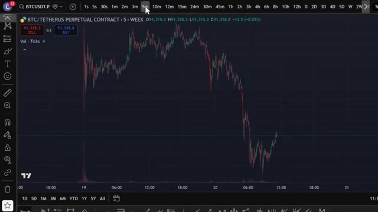
*⏱️ 00:00:09 — Un graphique en chandeliers japonais montrant le cours du Bitcoin (BTC/USDT) avec un curseur en train de sélectionner l'unité de temps de 5 minutes.*

---

### ⏱️ `[00:00:37 - 00:01:12]` | Segment #02

**🔊 Audio (Transcription Intégrale Mot pour Mot en Français) :**
> prêt à être intégré directement dans TradingView et à trader pour moi automatiquement et restez bien jusqu'à la fin car je vais vous montrer comment obtenir tous mes prompts, stratégies et configurations et comment construire votre propre bot de trading agentique avec Claude qui peut trader les cryptos, les actions, les indices et plus encore, alors entrons dans le vif du sujet. Très bien les gars, étape numéro une, inscrivez-vous sur un échange. Pour cette stratégie, nous allons utiliser UBIT. C'est l'un de mes échanges préférés pour le trading de futures en ce moment, et ils ont de sérieux bonus pour les nouveaux utilisateurs. Jusqu'à 50 000 $ de bonus rien que pour l'inscription et le trading en utilisant

**👁️ Analyse Visuelle d'Écran (gemini-3.5-flash-lite) :**
**Interface & Outils** : Navigateur web, plateforme d'échange Yubit, interface de configuration de bot de trading.

**Contenu textuel & Code** : Menus de configuration d'API, fonctionnalités de trading futures et spot, formulaires d'inscription avec code de parrainage, bannières promotionnelles de bonus.
[DESC_IMAGE_1] Présentation des capacités d'automatisation des ordres.
[DESC_IMAGE_2] Présentation du processus d'inscription utilisateur.
[DESC_IMAGE_3] Présentation de la page d'accueil de la bourse en ligne.

**Action / Démonstration** : Explications face caméra et analyse conceptuelle des marchés.

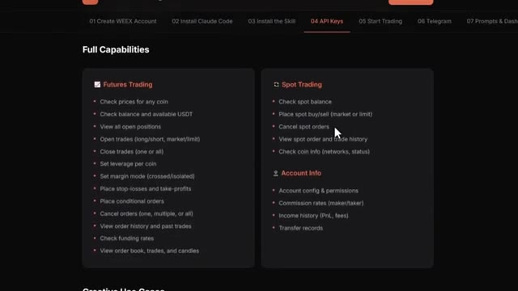
*⏱️ 00:00:46 — Interface web détaillant les fonctionnalités complètes d'un bot de trading (Futures Trading, Spot Trading, Account Info).*

*⏱️ 00:00:54 — Page d'inscription de la plateforme Yubit avec un bonus de parrainage affilié.*

*⏱️ 00:01:03 — Page d'accueil de la plateforme d'échange Yubit pour le trading de crypto, d'or et d'actions.*

---

### ⏱️ `[00:01:12 - 00:01:31]` | Segment #03

**🔊 Audio (Transcription Intégrale Mot pour Mot en Français) :**
> Mon lien en bas. Si UBIT ne vous convient pas, vous pouvez utiliser Blofen comme alternative. Blofen ne requiert pas de vérification KYC obligatoire pour le trading de base, ce qui signifie que vous pouvez commencer à trader immédiatement. De plus, les nouveaux utilisateurs peuvent gagner jusqu'à 5 000 USDT grâce à des bonus de dépôt et de volume de trading.

**👁️ Analyse Visuelle d'Écran (gemini-3.5-flash-lite) :**
**Interface & Outils** : Navigateur web affichant le site de l'échange de cryptomonnaies BloFin et une revue détaillée.

**Contenu textuel & Code** : Texte et interface utilisateur de BloFin : "No KYC required", bonus de bienvenue "up to 5,000 USDT", frais de trading, options de copy trading et paires de cryptomonnaies supportées.

**Action / Démonstration** : Navigation sur le site de BloFin et présentation de ses avantages clés pour le trading sans vérification KYC obligatoire.

*⏱️ 00:01:17 — Page d'inscription de la plateforme BloFin montrant un partenariat avec Mister Crypto et une offre de bonus de bienvenue.*

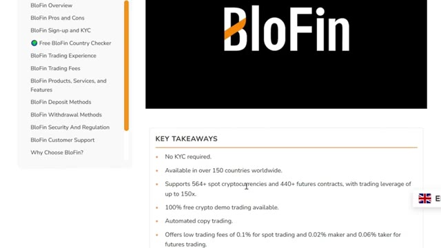
*⏱️ 00:01:21 — Article de revue ou résumé des caractéristiques de BloFin mettant en avant l'absence de KYC obligatoire ("No KYC required") et ses fonctionnalités principales.*

*⏱️ 00:01:26 — Page d'accueil de la section récompenses de BloFin affichant l'offre exclusive pour les nouveaux utilisateurs jusqu'à 5000 USDT.*

---

### ⏱️ `[00:01:31 - 00:02:06]` | Segment #04

**🔊 Audio (Transcription Intégrale Mot pour Mot en Français) :**
> Je mettrai les deux liens en bas. Une fois que vous êtes sur la page d'UBIT, vous pouvez vous inscrire avec votre adresse e-mail, votre numéro de téléphone, ou vous connecter via Google ou un identifiant Apple. Pour ce tutoriel, je vais utiliser l'e-mail. Entrez simplement vos informations, créez un mot de passe fort, acceptez les conditions d'utilisation, et cliquez sur s'inscrire. Entrez le code de vérification par e-mail et votre compte est prêt. Tout le processus prend moins de 30 secondes. Et gardez à l'esprit qu'UBIT est une plateforme sans KYC. Vous n'avez pas besoin de compléter la vérification d'identité pour commencer à trader. Cela la rend accessible même dans les pays restreints

**👁️ Analyse Visuelle d'Écran (gemini-3.5-flash-lite) :**
**Interface & Outils** : Site web de la plateforme UBIT.

**Contenu textuel & Code** : Formulaire d'inscription, code de parrainage (ALEX) et captcha de sécurité.

**Action / Démonstration** : Remplissage du formulaire d'inscription et résolution du captcha.

*⏱️ 00:01:40 — Formulaire d'inscription de la plateforme UBIT avec les champs email et mot de passe.*

*⏱️ 00:01:48 — Pop-up de vérification anti-bot (captcha visuel) lors de l'inscription sur UBIT.*

---

### ⏱️ `[00:02:06 - 00:02:24]` | Segment #05

**🔊 Audio (Transcription Intégrale Mot pour Mot en Français) :**
> régions et cela signifie que vous pouvez commencer à trader presque instantanément après vous être inscrit. Allez dans votre portefeuille et cliquez sur dépôt. Sélectionnez la cryptomonnaie que vous souhaitez déposer. L'USDT est idéal pour le trading. Ensuite, sélectionnez votre réseau de dépôt. Je recommande TRC20. C'est rapide et les frais sont très bas.

**👁️ Analyse Visuelle d'Écran (gemini-3.5-flash-lite) :**
**Interface & Outils** : Interface web de l'échange de cryptomonnaies Yubit (pages d'accueil et de dépôt).

**Contenu textuel & Code** : Options de dépôt de cryptomonnaies avec sélection de l'actif (USDT, BTC, ETH) et du réseau, accompagnées d'informations d'aide (Gentle Reminder et FAQ).

**Action / Démonstration** : Navigation sur la plateforme d'échange Yubit pour expliquer la procédure de dépôt de cryptomonnaies.

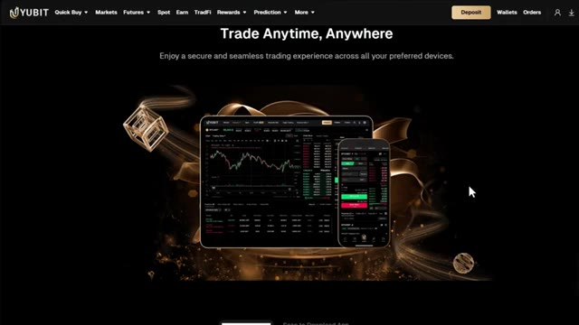
*⏱️ 00:02:10 — Page d'accueil de la plateforme Yubit montrant le slogan 'Trade Anytime, Anywhere' avec des aperçus de l'interface sur tablette et smartphone.*

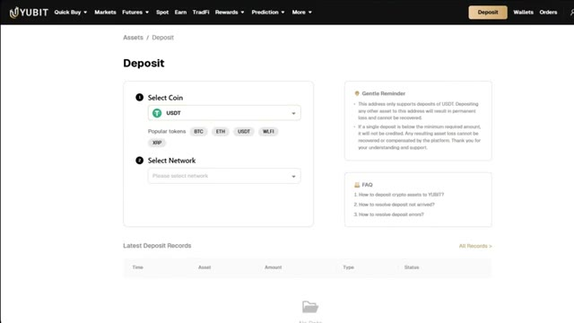
*⏱️ 00:02:15 — Page de dépôt de la plateforme Yubit permettant de sélectionner la cryptomonnaie (USDT) et le réseau de dépôt.*

---

### ⏱️ `[00:02:24 - 00:02:45]` | Segment #06

**🔊 Audio (Transcription Intégrale Mot pour Mot en Français) :**
> Vous verrez alors votre adresse de dépôt personnelle. Copiez-la soigneusement. Rendez-vous sur votre plateforme d'échange ou votre portefeuille actuel. Collez l'adresse et envoyez vos fonds. Envoyez toujours d'abord un petit montant test, peut-être 10 à 20 dollars, juste pour confirmer que tout arrive correctement avant d'envoyer la totalité. C'est très important. Envoyer sur le mauvais réseau peut signifier la perte de vos fonds.

**👁️ Analyse Visuelle d'Écran (gemini-3.5-flash-lite) :**
**Interface & Outils** : Interface web d'échange de cryptomonnaies (plateforme de type Yubit/Bybit).

**Contenu textuel & Code** : Formulaires de retrait et de dépôt de cryptomonnaies, sélection de l'actif (USDT), choix du réseau (TRON/TRC20), adresses de portefeuille et frais de transaction (1 USDT).

**Action / Démonstration** : Saisie et configuration d'un transfert de fonds en cryptomonnaies avec vérification des détails de la transaction.

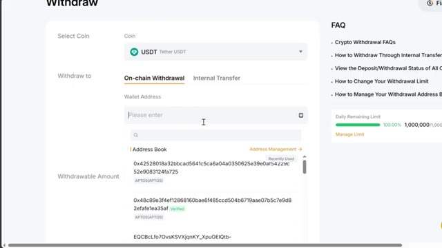
*⏱️ 00:02:30 — Interface de retrait d'une plateforme montrant le champ de saisie de l'adresse de portefeuille et l'historique des adresses.*

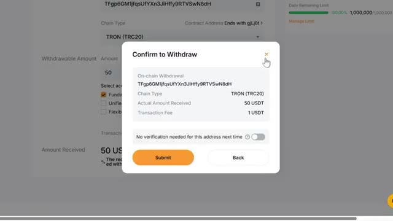
*⏱️ 00:02:35 — Fenêtre modale de confirmation de retrait affichant les détails de la transaction, le réseau TRON et les frais.*

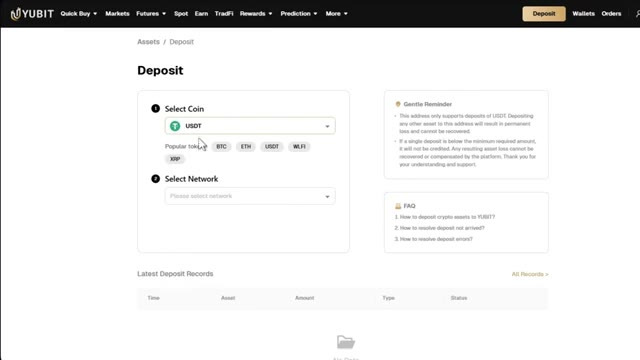
*⏱️ 00:02:40 — Page de dépôt d'une plateforme d'échange (Yubit) avec sélection de la cryptomonnaie USDT et du réseau.*

---

### ⏱️ `[00:02:45 - 00:03:05]` | Segment #07

**🔊 Audio (Transcription Intégrale Mot pour Mot en Français) :**
> Si vous n'avez pas encore de crypto et que vous voulez en acheter directement sur UBIT, c'est également possible. Mais pour cela, vous devrez d'abord compléter la procédure KYC. Allez sur l'icône de votre profil sur la page d'accueil et cliquez sur KYC. Cliquez sur Vérifier maintenant. Fournissez votre e-mail, vos informations personnelles, vos documents de vérification et un selfie.

**👁️ Analyse Visuelle d'Écran (gemini-3.5-flash-lite) :**
**Interface & Outils** : Site web de la plateforme d'échange UBIT.

**Contenu textuel & Code** : Menu du profil utilisateur, options "Account & Security", "Settings", "KYC" (marqué "Unverified"), et page "Identity Verification" avec les boutons "Verify Now".

**Action / Démonstration** : Navigation vers le menu du profil utilisateur pour accéder à la procédure de vérification KYC sur la plateforme UBIT.

*⏱️ 00:02:55 — Page d'accueil de la plateforme UBIT avec le menu déroulant du profil utilisateur affichant l'option KYC.*

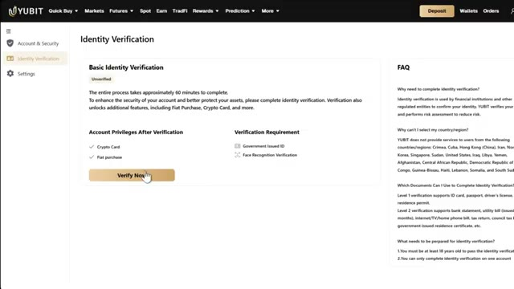
*⏱️ 00:03:00 — Page de vérification d'identité (Identity Verification) sur UBIT avec le bouton "Verify Now".*

---

### ⏱️ `[00:03:05 - 00:03:26]` | Segment #08

**🔊 Audio (Transcription Intégrale Mot pour Mot en Français) :**
> Une fois que c'est approuvé, vous pouvez utiliser l'option d'achat rapide sur UBIT pour acheter des cryptos directement avec monnaie fiduciaire en utilisant une carte de crédit ou de débit. Si vous avez déjà des cryptos sur un autre échange ou portefeuille, vous pouvez ignorer entièrement la procédure KYC et faire simplement un dépôt direct, ce qui est l'option la plus rapide pour la plupart des gens. Cliquez sur futures dans la barre de navigation supérieure et cliquez sur USDT-M.

**👁️ Analyse Visuelle d'Écran (gemini-3.5-flash-lite) :**
**Interface & Outils** : Plateforme d'échange de cryptomonnaies UBIT (pages Quick Buy et Deposit).

**Contenu textuel & Code** : Formulaires d'achat rapide de crypto avec passerelle de paiement Alchemy Pay et options de dépôt sur chaîne avec sélection de jetons (USDT, BTC, ETH) et de réseau.

**Action / Démonstration** : Navigation sur l'interface de la plateforme UBIT pour présenter les options d'achat direct par carte et les procédures de dépôt de fonds.

*⏱️ 00:03:10 — Interface de la plateforme UBIT montrant la page d'achat rapide de crypto-monnaies (Quick Buy) avec conversion de monnaie fiduciaire (USD) en USDT.*

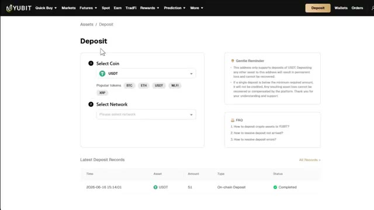
*⏱️ 00:03:16 — Interface de dépôt de la plateforme UBIT permettant de sélectionner une cryptomonnaie, un réseau et de consulter l'historique des dépôts récents.*

---

### ⏱️ `[00:03:27 - 00:03:48]` | Segment #09

**🔊 Audio (Transcription Intégrale Mot pour Mot en Français) :**
> Cela vous mènera à l'interface de trading de contrats à terme UBIT. Cela peut paraître un peu intimidant au début, mais je vais décortiquer chaque section pour que tout devienne parfaitement clair. En haut à gauche, vous avez le sélecteur de paire de trading. C'est ici que vous choisissez l'actif à trader. UBIT propose plus de 500 paires de trading, du Bitcoin et de l'Ethereum jusqu'aux memecoins et aux principaux altcoins.

**👁️ Analyse Visuelle d'Écran (gemini-3.5-flash-lite) :**
**Interface & Outils** : Interface web de la plateforme de trading YUBIT (section Futures).

**Contenu textuel & Code** : Graphique en chandeliers japonais du BTCUSDT en unité de temps 15 minutes, carnet d'ordres en temps réel, données de marché (Mark Price, Index Price, variation sur 24h) et panneau de gestion des ordres (Market/Limit, levier 10x).

**Action / Démonstration** : Présentation générale de l'interface utilisateur des contrats à terme, mise en avant du sélecteur de paire de trading en haut à gauche.

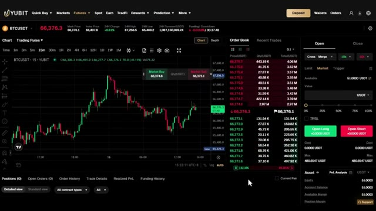
*⏱️ 00:03:32 — Interface complète de trading de contrats à terme de la plateforme YUBIT affichant le graphique du BTCUSDT, le carnet d'ordres et le panneau de passage d'ordres.*

---

### ⏱️ `[00:03:48 - 00:04:09]` | Segment #10

**🔊 Audio (Transcription Intégrale Mot pour Mot en Français) :**
> Vous pouvez choisir entre des contrats perpétuels sur marge USDT et des contrats perpétuels sur marge de crypto-monnaie, qui sont des transactions réglées dans votre propre crypto-monnaie au lieu de l'USDT. Au centre se trouve le graphique des prix propulsé par TradingView avec tous les outils de dessin et les indicateurs techniques dont vous avez besoin pour l'analyse. Sur le côté droit se trouve le carnet d'ordres montrant tous les ordres d'achat et de vente en direct sur le marché.

**👁️ Analyse Visuelle d'Écran (gemini-3.5-flash-lite) :**
**Interface & Outils** : Plateforme de trading en ligne Yubit (section Futures / Coin-M) et graphique TradingView intégré.

**Contenu textuel & Code** : Paires de contrats perpétuels Coin-M (BTCUSDCM, ETHUSDCM), carnet d'ordres en temps réel, panneau de passage d'ordres (Market/Limit, effet de levier 10x), et informations de marché (prix du Bitcoin à 66 343.3 USDT).

**Action / Démonstration** : Navigation dans le menu des contrats à terme pour sélectionner et illustrer les contrats perpétuels sur marge de crypto-monnaie (Coin-M).

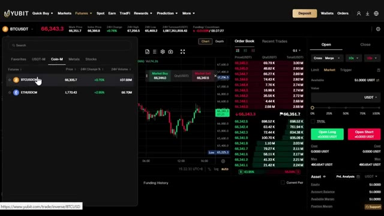
*⏱️ 00:03:53 — Capture d'écran de l'interface de trading de la plateforme Yubit montrant la sélection des contrats Coin-M (marge en crypto) avec un menu déroulant affichant les paires BTCUSDCM et ETHUSDCM, ainsi que le carnet d'ordres et le graphique central.*

---

### ⏱️ `[00:04:09 - 00:04:35]` | Segment #11

**🔊 Audio (Transcription Intégrale Mot pour Mot en Français) :**
> Et en bas se trouve votre panneau de gestion des ordres. C'est ici que vous suivez vos positions ouvertes, vos ordres ouverts et votre historique de transactions. Tout ce dont vous avez besoin est juste ici sur un seul écran. Tout d'abord, vous avez besoin de TradingView. Le lien est dans la description si vous ne l'avez pas encore. Ouvrez TradingView et sélectionnez la paire de trading que vous souhaitez trader. Pour cet exemple, j'utiliserai Bitcoin USDT. Ensuite, cliquez sur le sélecteur d'unité de temps et choisissez le graphique en cinq minutes.

**👁️ Analyse Visuelle d'Écran (gemini-3.5-flash-lite) :**
**Interface & Outils** : Plateforme de trading Yubit, graphiques et outil de recherche de symboles TradingView.

**Contenu textuel & Code** : Graphiques en chandeliers de BTCUSDT, volumes, carnets d'ordres, soldes de compte et listes de contrats perpétuels multi-plateformes.

**Action / Démonstration** : Présentation du panneau de gestion des ordres, navigation dans les graphiques et recherche de contrats sur TradingView.

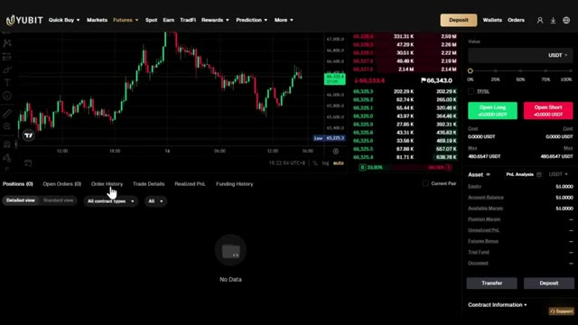
*⏱️ 00:04:16 — Interface de trading Yubit montrant un graphique des prix de BTC/USDT et un panneau de gestion des ordres en bas.*

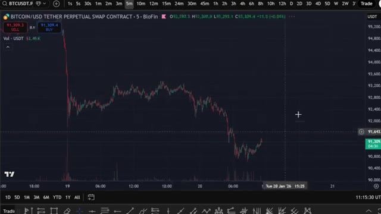
*⏱️ 00:04:22 — Graphique TradingView affichant une paire de contrats perpétuels Bitcoin/USD Tether (BloFin) avec des chandeliers en unités de 5 minutes.*

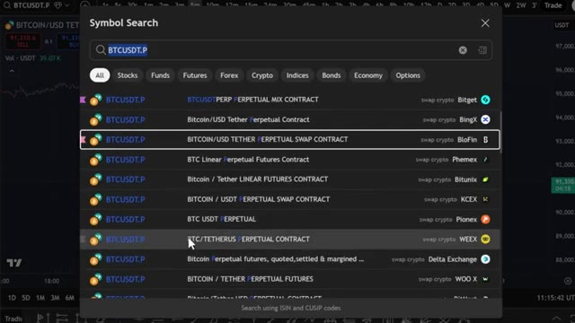
*⏱️ 00:04:29 — Fenêtre de recherche de symboles sur TradingView listant divers contrats perpétuels pour BTCUSDT sur différentes plateformes (Bitget, BingX, BloFin, Phemex, etc.).*

---

### ⏱️ `[00:04:35 - 00:05:13]` | Segment #12

**🔊 Audio (Transcription Intégrale Mot pour Mot en Français) :**
> C'est une stratégie de scalping, donc nous cherchons des mouvements rapides tout au long de la journée. Maintenant, ajoutons les indicateurs. L'indicateur numéro un est les canaux de Donchian. Cliquez sur l'onglet des indicateurs, tapez canaux de Donchian, et sélectionnez-le. Cliquez sur les paramètres de l'indicateur, allez dans les entrées, et changez la longueur à 96. Ensuite, allez dans le style et changez les couleurs des bandes supérieure et inférieure en rouge pour qu'elles soient plus faciles à voir. Voici comment fonctionne cet indicateur. Vous verrez trois lignes sur votre graphique. La ligne du milieu agit comme un point de retour à la moyenne. Si le prix est au-dessus de cette ligne, nous sommes dans une dynamique haussière. S'il est en dessous, nous sommes dans une dynamique baissière. Les bandes rouges supérieure et inférieure

**👁️ Analyse Visuelle d'Écran (gemini-3.5-flash-lite) :**
**Interface & Outils** : Graphique de trading (interface type TradingView / WEEX).

**Contenu textuel & Code** : Canaux de Donchian (DC 96 0) et barres de volume sur une unité de temps de 5 minutes.

**Action / Démonstration** : Affichage et analyse du graphique de prix avec l'indicateur Donchian pour une stratégie de scalping.

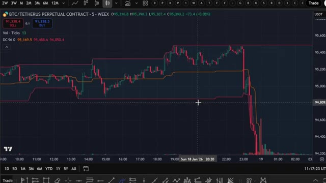
*⏱️ 00:04:44 — Graphique en chandelier d'un contrat perpétuel BTC/USDT avec les canaux de Donchian appliqués.*

---

### ⏱️ `[00:05:13 - 00:05:49]` | Segment #13

**🔊 Audio (Transcription Intégrale Mot pour Mot en Français) :**
> agissent comme des niveaux dynamiques de support et de résistance. Lorsque le prix atteint ces niveaux, il est souvent rejeté, mais ils peuvent aussi agir sur des points de cassure. Maintenant, voici le problème d'utiliser cet indicateur seul. Lorsque le marché évolue latéralement, ces bandes se rapprochent vraiment et vous obtiendrez de faux signaux de cassure qui peuvent vous faire perdre des trades. C'est pourquoi nous avons besoin de deux indicateurs de confirmation supplémentaires. L'indicateur numéro deux est le LWTI ou Larry Williams Large Trade Index. Cliquez sur indicateurs, tapez LWTI ou Larry Williams Large Trade Index, et sélectionnez-le. Allez dans les paramètres, cliquez sur entrées,

**👁️ Analyse Visuelle d'Écran (gemini-3.5-flash-lite) :**
**Interface & Outils** : Interface de trading WEEX / graphique TradingView

**Contenu textuel & Code** : Indicateur technique Donchian Channels (DC 96 avec lignes supérieure, médiane et inférieure en rouge/orange), graphique en chandeliers 5 minutes de la paire BTC/USDT, carnet d'ordres simplifié et boutons d'achat/vente.

**Action / Démonstration** : Analyse technique illustrant un rejet des prix sur la bande supérieure du canal de Donchian suivi d'une cassure baissière marquée, expliquée par des annotations dessinées à l'écran.

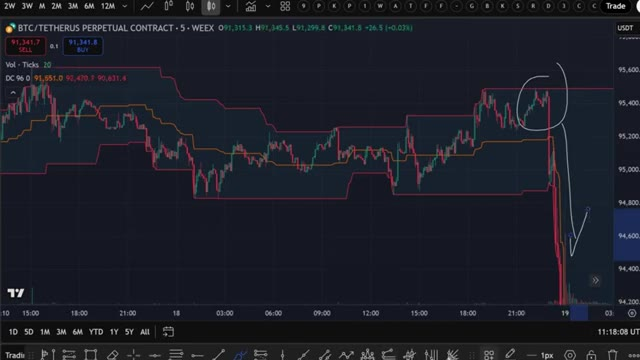
*⏱️ 00:05:22 — Graphique en chandeliers japonais illustrant les mouvements de prix du contrat perpétuel BTC/USDT sur l'interface WEEX avec l'indicateur Donchian Channels (DC 96) et des annotations tracées à main levée.*

---

### ⏱️ `[00:05:49 - 00:06:25]` | Segment #14

**🔊 Audio (Transcription Intégrale Mot pour Mot en Français) :**
> et changez la période à 25. Ensuite, changez la période de lissage à 20. Cet indicateur nous aide à identifier quand les grands traders entrent sur le marché. Quand il est vert, il confirme la dynamique haussière. Quand il est rouge, il confirme la dynamique baissière. Indicateur numéro trois, le volume. Cliquez sur indicateurs, tapez volume, et sélectionnez l'indicateur de volume standard. Allez dans les paramètres, cliquez sur entrées, et changez la longueur de la moyenne mobile à 30. Ensuite, allez dans le style, activez la moyenne mobile du volume, et changez sa couleur en blanc. Cet indicateur nous montre quand il y a une réelle dynamique derrière un mouvement, et pas seulement

**👁️ Analyse Visuelle d'Écran (gemini-3.5-flash-lite) :**
**Interface & Outils** : Graphique de trading WEEX (type TradingView)

**Contenu textuel & Code** : Paire BTC/TETHERUS PERPETUAL CONTRACT en timeframe 5 minutes, indicateur LWTI [Loxx] 25 SMA 20, Donchian Channels (DC).

**Action / Démonstration** : Visualisation et explication de l'indicateur LWTI configuré à une période de 25 avec une moyenne mobile lissée de 20 pour identifier la dynamique du marché.

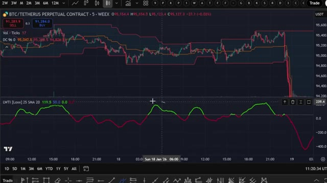
*⏱️ 00:05:58 — Graphique en chandeliers du BTC/USDT sur WEEX avec l'indicateur LWTI en bas, montrant des zones vertes (haussières) et rouges (baissières).*

---

### ⏱️ `[00:06:25 - 00:07:00]` | Segment #15

**🔊 Audio (Transcription Intégrale Mot pour Mot en Français) :**
> une petite fluctuation. Maintenant, nous avons les trois indicateurs configurés. Laissez-moi vous montrer exactement comment les utiliser. Pour une position acheteuse, vous avez besoin de trois choses. Le prix doit toucher ou dépasser la bande supérieure rouge de Donchian. L'indicateur LWTI doit être vert. Cela confirme une dynamique haussière de la part des grands traders. Les barres de volume doivent être situées au-dessus de la ligne de moyenne mobile blanche et être vertes. Cela montre qu'il y a une réelle pression à l'achat, et pas seulement une consolidation. Une fois que ces trois conditions sont réunies, vous ouvrez votre position acheteuse. Placez votre ordre stop-loss juste en dessous de la ligne orange du milieu des canaux de Donchian. Fixez votre prise

**👁️ Analyse Visuelle d'Écran (gemini-3.5-flash-lite) :**
**Interface & Outils** : Interface de trading WEEX avec graphique de type TradingView.

**Contenu textuel & Code** : Paire BTC/TETHERUS PERPETUAL CONTRACT en unités de 5 minutes, bandes de Donchian supérieures et inférieures en rouge, indicateur de volume et courbe d'oscillateur (LWTI ou similaire) en vert.

**Action / Démonstration** : Explication de la configuration graphique et démonstration des conditions requises pour une position acheteuse (long).

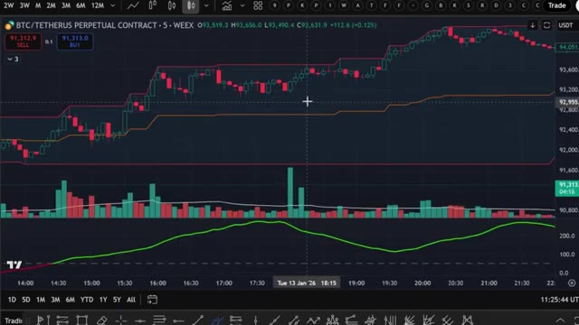
*⏱️ 00:06:34 — Graphique en chandeliers japonais affichant le cours du BTC/USDT sur WEEX, accompagné des bandes de Donchian et d'indicateurs de volume et de momentum en sous-fenêtres.*

---

### ⏱️ `[00:07:00 - 00:07:29]` | Segment #16

**🔊 Audio (Transcription Intégrale Mot pour Mot en Français) :**
> profit avec un ratio risque-rendement de deux pour un. Donc, si vous risquez 20 dollars, vous visez 40 dollars. Laissez-moi vous montrer un exemple sur le graphique. Juste ici, vous pouvez voir que le prix a touché la bande supérieure. Le LWT était vert, et le volume était au dessus de la ligne blanche et aussi vert. C'est une entrée acheteuse parfaite. Vous entreriez ici, placeriez votre stop loss en dessous de la ligne du milieu, et votre take profit serait atteint juste ici pour un trade gagnant net. Pour une position vendeuse, les règles sont inversées.

**👁️ Analyse Visuelle d'Écran (gemini-3.5-flash-lite) :**
**Interface & Outils** : Graphique de trading en chandeliers sur la plateforme WEEX (paire BTC/Tether).

**Contenu textuel & Code** : Outil de position longue affichant un objectif (Target: 1,627.9 / 1.74%), un stop loss (Stop: 815.2 / 0.87%) et un ratio risque/rendement de 2, ainsi qu'un indicateur de type bande et un oscillateur vert en sous-fenêtre.

**Action / Démonstration** : Le curseur survole la zone de position ouverte pour illustrer visuellement la configuration d'un trade gagnant avec un ratio risque-rendement de 2 pour 1.

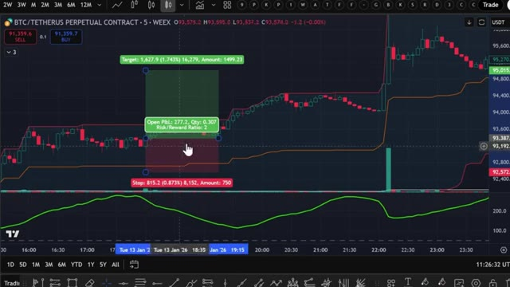
*⏱️ 00:07:07 — Un graphique en chandeliers montrant une configuration de trade avec un outil de risque/rendement réglé sur 2:1, incluant des bandes de tendance colorées et un oscillateur de volume en bas.*

---

### ⏱️ `[00:07:29 - 00:07:53]` | Segment #17

**🔊 Audio (Transcription Intégrale Mot pour Mot en Français) :**
> Le prix doit toucher ou casser en dessous de la bande rouge inférieure de Duncan. L'indicateur LWTI doit être rouge, confirmant une dynamique baissière. Les barres de volume doivent être au dessus de la ligne blanche et rouges, montrant une forte pression vendeuse. Une fois que ces trois conditions sont réunies, ouvrez votre position vendeuse. Placez votre ordre stop loss juste au dessus de la ligne orange du milieu. Placez votre take profit à un ratio risque/rendement de 2 pour 1.

**👁️ Analyse Visuelle d'Écran (gemini-3.5-flash-lite) :**
**Interface & Outils** : Graphique TradingView (WEEX)

**Contenu textuel & Code** : Paire BTC/TETHERUS PERPETUAL CONTRACT en unité de temps 5 minutes, bandes de Duncan, barres de volume et indicateur LWTI.

**Action / Démonstration** : Analyse technique d'une configuration baissière validant les conditions d'entrée en position courte (break sous la bande rouge, volume fort et LWTI négatif).

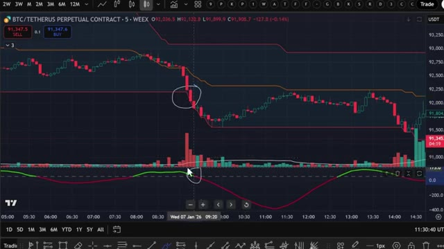
*⏱️ 00:07:35 — Graphique de trading montrant le cours du BTC/USDT avec les bandes de Duncan, le volume et l'indicateur LWTI.*

---

### ⏱️ `[00:07:54 - 00:08:29]` | Segment #18

**🔊 Audio (Transcription Intégrale Mot pour Mot en Français) :**
> Voici un exemple. Le prix a touché la bande inférieure, le LWTI est passé au rouge, et le volume était au-dessus de la ligne en rouge. Entrée short parfaite. Vous entreriez ici, placeriez votre stop loss au-dessus de la ligne du milieu, et prendriez vos bénéfices ici pour un autre trade gagnant. En combinant cette stratégie avec une analyse de base des supports et résistances, vous augmentez considérablement votre taux de réussite. Et si vous voulez commencer à utiliser ceci dès maintenant, assurez-vous de vous inscrire en utilisant mon lien dans la description pour obtenir ce package de bonus complet, c'est totalement gratuit et vous pouvez l'utiliser pour commencer à trader avec plus de capital, alors maintenant vous comprenez exactement comment cela

**👁️ Analyse Visuelle d'Écran (gemini-3.5-flash-lite) :**
**Interface & Outils** : Graphique TradingView intégré et interface de lecture YouTube.

**Contenu textuel & Code** : Graphique en chandeliers, indicateur de volume, oscillateur LWTI, lignes de tendance (rouge et orange), et informations sur le contrat perpétuel BTC/USDT.

**Action / Démonstration** : Analyse technique d'un graphique de trading démontrant une opportunité d'entrée short.

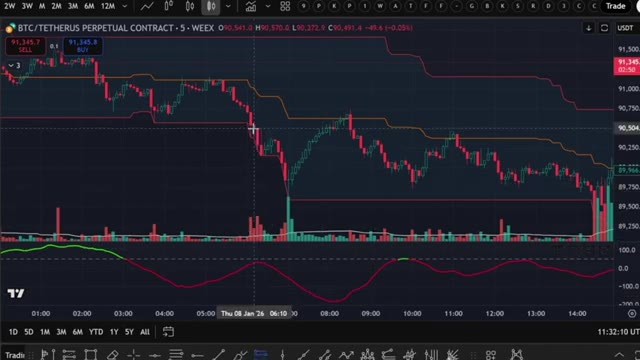
*⏱️ 00:08:02 — Un graphique TradingView affichant une paire de cryptomonnaies (BTC/TETHERUS PERPETUAL CONTRACT) avec des indicateurs techniques comme les bandes de prix, les volumes et un oscillateur rouge/vert.*

---

### ⏱️ `[00:08:29 - 00:09:02]` | Segment #19

**🔊 Audio (Transcription Intégrale Mot pour Mot en Français) :**
> La stratégie fonctionne manuellement, mais c'est là que ça devient vraiment intéressant : au lieu de regarder des graphiques toute la journée et de faire cela manuellement, j'ai donné cette stratégie exacte à Claude et je lui ai demandé de m'écrire un script Pine complet pour que TradingView puisse détecter automatiquement ces signaux pour moi. Et voici le prompt que j'utilise. Je vais l'afficher à l'écran dès maintenant pour que vous puissiez le copier exactement. C'est tout. C'est le prompt complet. Vous collez ça dans Claude. J'utilise Claude Code ici. Et en quelques secondes, il crache un script Pine complet et fonctionnel dans un fichier bloc-notes. Maintenant, ce prompt exact, ainsi que le script Pine utilisé dans ce

**👁️ Analyse Visuelle d'Écran (gemini-3.5-flash-lite) :**
**Interface & Outils** : TradingView, Google Docs / Éditeur de texte, Interface de prévisualisation de prompt.

**Contenu textuel & Code** : Canaux de Donchian (longueur 96), Larry Williams Large Trade Index (LWTI), indicateur de volume avec moyenne mobile à 30 périodes, règles d'entrée pour signaux Long et Short, et conditions d'alerte.

**Action / Démonstration** : Présentation de la stratégie de trading manuelle sur graphique puis du prompt textuel soumis à l'IA pour automatisation.

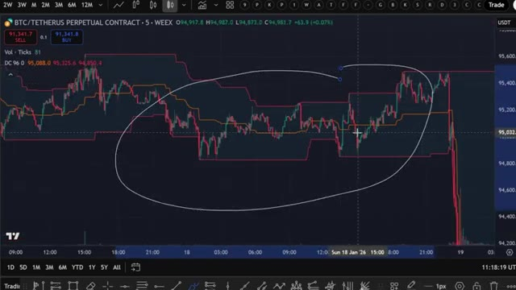
*⏱️ 00:08:37 — Graphique de trading en chandeliers affichant la paire BTC/USDT avec des canaux de Donchian et une zone entourée au centre.*

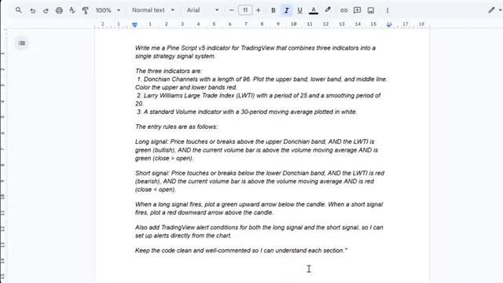
*⏱️ 00:08:46 — Document texte contenant le prompt détaillé pour générer un script Pine Script v5 combinant Donchian, LWTI et le volume.*

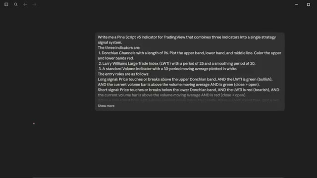
*⏱️ 00:08:54 — Interface sombre affichant le même prompt textuel présenté à l'image 2, centré dans une fenêtre d'aperçu.*

---

### ⏱️ `[00:09:02 - 00:09:35]` | Segment #20

**🔊 Audio (Transcription Intégrale Mot pour Mot en Français) :**
> vidéo, est disponible dans mon groupe privé. Vous pouvez trouver le lien en bas. Une fois que Claude a terminé, vous verrez un fichier bloc-notes apparaître avec le PineScript complet à l'intérieur. Ouvrez ce fichier, appuyez sur contrôle plus A pour tout sélectionner le code, puis sur contrôle plus C pour le copier. C'est tout ce dont vous avez besoin. Maintenant, amenons cela dans TradingView. Ouvrez TradingView et allez sur n'importe quel graphique. Je vais utiliser Bitcoin à nouveau. Au bas de l'écran, cliquez sur l'onglet Éditeur PineScript. Si vous ne le voyez pas, allez dans la barre d'outils inférieure et cliquez sur Éditeur PineScript. Une fois l'éditeur ouvert, vous verrez quelques éléments par défaut

**👁️ Analyse Visuelle d'Écran (gemini-3.5-flash-lite) :**
**Interface & Outils** : Bloc-notes Windows et interface de graphique TradingView.

**Contenu textuel & Code** : Code source Pine Script pour les conditions de signal d'achat/vente (Donchian, LWTI, Volume) et graphique de prix BTCUSDT.
[DESC_IMAGE_1] Sélection et manipulation du code source du script pour copie.

**Action / Démonstration** : Explications face caméra et analyse conceptuelle des marchés.

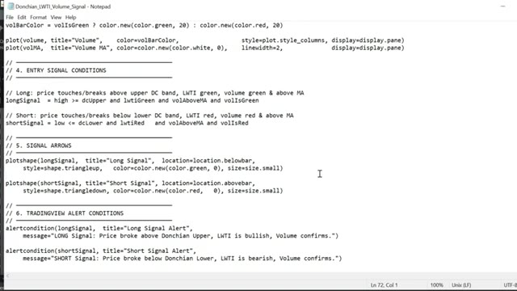
*⏱️ 00:09:11 — Affichage d'un fichier bloc-notes contenant du code Pine Script (conditions d'entrée, flèches de signal et conditions d'alerte TradingView).*

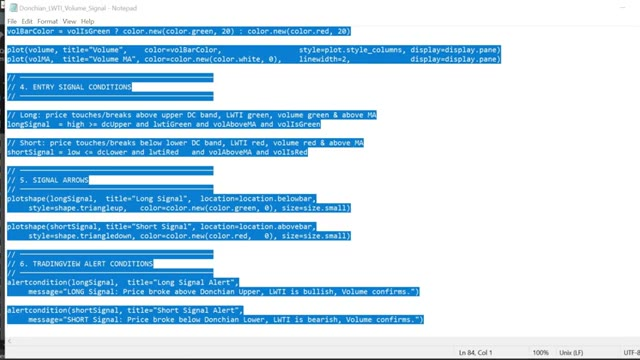
*⏱️ 00:09:19 — Même fichier bloc-notes avec l'intégralité du code Pine Script sélectionné en surbrillance bleue.*

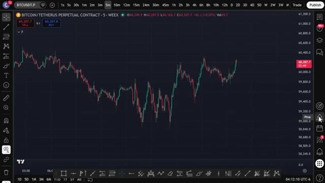
*⏱️ 00:09:27 — Graphique en chandeliers japonais de Bitcoin (BTC/USDT) en unité de temps 5 minutes sur la plateforme TradingView.*

---

### ⏱️ `[00:09:35 - 00:10:07]` | Segment #21

**🔊 Audio (Transcription Intégrale Mot pour Mot en Français) :**
> code dedans, sélectionnez tout et supprimez-le, puis collez le code que Claude vient de vous donner, maintenant cliquez sur ajouter au graphique, c'est le bouton en haut à droite de l'éditeur Pine Script, TradingView va compiler le script et l'appliquer directement sur votre graphique et voilà, vous pouvez voir les canaux de Donchian sur le graphique, le panneau LWTI en dessous de l'indicateur de volume et les signaux d'achat et de vente tracés automatiquement, des flèches vertes pour les achats ou des flèches rouges pour les ventes, tout se déclenche exactement de la manière que nous avons configurée manuellement mais maintenant il le fait pour

**👁️ Analyse Visuelle d'Écran (gemini-3.5-flash-lite) :**
**Interface & Outils** : Interface TradingView (Graphique et Pine Editor)

**Contenu textuel & Code** : Code Pine Script v5 dans l'éditeur, graphiques de chandeliers BTCUSDT, bandes de Donchian, signaux graphiques (triangles d'achat/vente) et indicateur de volume/oscillateur.

**Action / Démonstration** : Compilation du script Pine et application directe de l'indicateur sur le graphique en cliquant sur le bouton d'ajout.

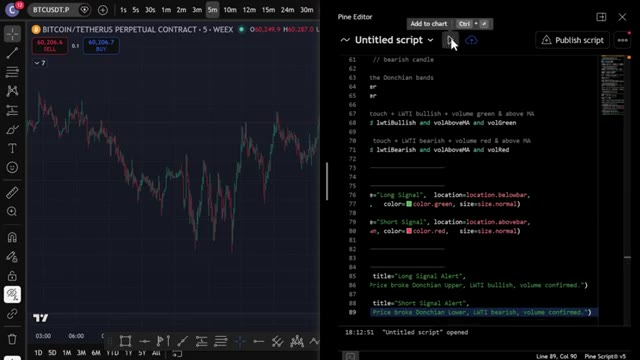
*⏱️ 00:09:43 — Vue partagée de TradingView montrant le graphique de prix du Bitcoin à gauche et l'éditeur Pine Script à droite avec le code source de l'indicateur.*

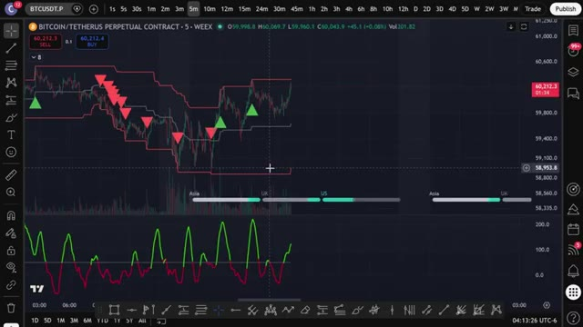
*⏱️ 00:09:51 — Graphique TradingView en plein écran affichant l'indicateur appliqué sur le cours du Bitcoin (BTCUSDT) avec des canaux de Donchian, des signaux d'achat/vente (triangles verts et rouges) et un oscillateur en bas.*

---

### ⏱️ `[00:10:07 - 00:10:42]` | Segment #22

**🔊 Audio (Transcription Intégrale Mot pour Mot en Français) :**
> vous pouvez maintenant configurer automatiquement des alertes, cliquez sur l'icône du réveil en haut de TradingView, sélectionnez créer une alerte et dans le menu déroulant des conditions, vous verrez les conditions d'alerte que Claude a ajoutées : signal long et signal court, configurez-les et TradingView vous avertira dès qu'un signal se déclenche, directement sur votre téléphone. Donc maintenant, au lieu de surveiller le graphique manuellement, TradingView fait tout le travail pour vous. Dès que les trois conditions sont réunies, vous recevez une alerte, vous vérifiez, vous exécutez sur UBIT, et c'est tout. Maintenant, si vous voulez aller encore plus loin et faire en sorte qu'un trade s'ouvre automatiquement

**👁️ Analyse Visuelle d'Écran (gemini-3.5-flash-lite) :**
**Interface & Outils** : TradingView (Graphique de cryptomonnaie avec panneau de configuration d'alertes)

**Contenu textuel & Code** : Fenêtre de création d'alerte pour BTCUSDT.P, avec les options de condition (Price, Crossing, Value), de déclenchement et de notification (App, Webhook, Sound). Panneau latéral droit listant des alertes actives.

**Action / Démonstration** : Configuration d'une alerte de trading sur la plateforme TradingView.

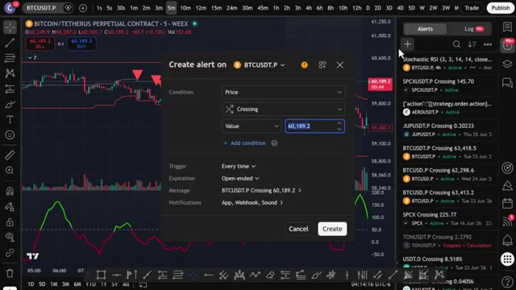
*⏱️ 00:10:16 — Interface de la plateforme TradingView affichant un graphique de prix BTCUSDT.P avec la fenêtre de dialogue 'Create alert' ouverte au centre.*

---

### ⏱️ `[00:10:42 - 00:11:16]` | Segment #23

**🔊 Audio (Transcription Intégrale Mot pour Mot en Français) :**
> sur votre exchange dès qu'un signal se déclenche, je m'occupe de tout. J'ai créé un groupe privé où je partage tous mes cas d'usage pour Claude Code, de son intégration avec Telegram, TradingView, à la recherche de baleines sur Hyperliquid. Tout cela de manière entièrement automatique. Tout ce que je vous ai montré aujourd'hui, c'est dans le groupe. Et j'ajoute constamment de nouvelles choses, de nouvelles stratégies, de nouveaux prompts, de nouvelles intégrations. Chaque fois que je construis quelque chose de nouveau, ça va directement là-dedans. Le prix est de 79,99 $ par mois. Et honnêtement, quand on y pense, c'est l'IA de trading la plus de pointe

**👁️ Analyse Visuelle d'Écran (gemini-3.5-flash-lite) :**
**Interface & Outils** : Interface web de documentation et plateforme de vente Whop.

**Contenu textuel & Code** : Liste des 78 outils de contrôle de TradingView par l'IA et offre d'abonnement payant de la communauté.

**Action / Démonstration** : Présentation des outils d'automatisation et promotion du groupe privé de trading de l'auteur.

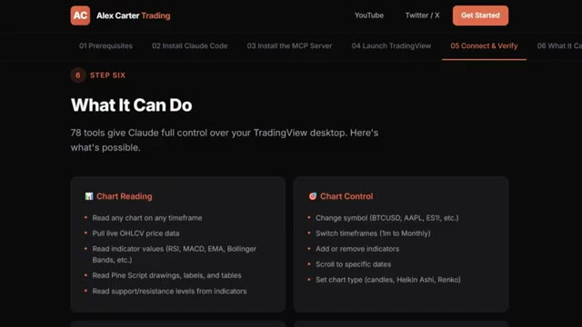
*⏱️ 00:10:51 — Interface web montrant les fonctionnalités de Claude Code pour TradingView (Step 6 : What It Can Do).*

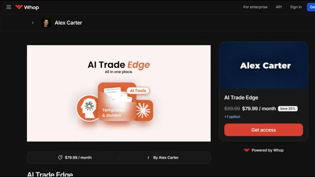
*⏱️ 00:11:08 — Page de la plateforme Whop d'Alex Carter présentant l'abonnement "AI Trade Edge" à 79.99$/mois.*

---

### ⏱️ `[00:11:16 - 00:11:37]` | Segment #24

**🔊 Audio (Transcription Intégrale Mot pour Mot en Français) :**
> configuration disponible pour les traders particuliers en ce moment, constamment mise à jour avec tout inclus. À l'intérieur, il y a aussi un cours complet de trading agentique. 2,5 heures. Du débutant à l'expert. Aucune base en codage n'est nécessaire. D'ici la fin, vous aurez votre propre système de trading par IA en direct. Quelque chose que la plupart des traders particuliers ne savent même pas être possible en ce moment.

**👁️ Analyse Visuelle d'Écran (gemini-3.5-flash-lite) :**
**Interface & Outils** : Interface web de cours/plateforme de trading (Alex Carter Trading) avec un menu de navigation par étapes (01 à 05) et des blocs de fonctionnalités.

**Contenu textuel & Code** : Section "Step Four: What It Can Do" présentant quatre blocs : Whale Scanning, Sentiment Analysis, Trade Ideas et Wallet Lookup, expliquant comment l'IA accède aux données on-chain d'Hyperliquid.

**Action / Démonstration** : Navigation sur la plateforme de la formation pour présenter les capacités du système de trading agentique aux utilisateurs.

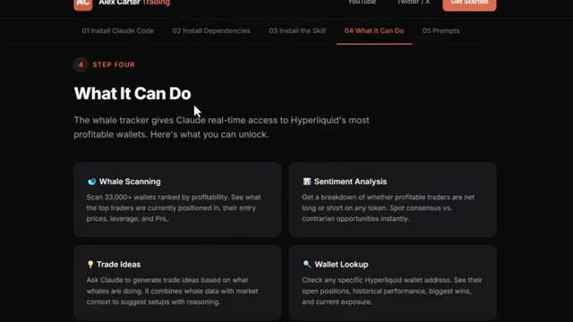
*⏱️ 00:11:22 — Capture d'écran de l'interface de la formation montrant les fonctionnalités du module agentique, notamment le suivi des portefeuilles de baleines sur Hyperliquid.*

---

### ⏱️ `[00:11:37 - 00:12:14]` | Segment #25

**🔊 Audio (Transcription Intégrale Mot pour Mot en Français) :**
> 79,99 dollars par mois. Un seul bon trade suffit à couvrir le coût. Et les 100 premiers membres bloquent ce tarif définitivement. Après cela, le prix augmentera. Le lien est dans la description. Vous ne pouvez vraiment pas vous permettre de rater ça. Et c'est tout les gars. C'est comme ça qu'on prend une stratégie sur Internet, qu'on la confie à Claude et qu'on obtient un script Pine fonctionnel sur TradingView. Pas de code, pas de surveillance manuelle des graphiques. Si vous voulez voir une démo complète de la façon dont je trade en utilisant uniquement mon Telegram et la démo complète de tous les cas d'utilisation sur TradingView, cliquez sur la vidéo qui s'affiche à l'écran dès maintenant. Si vous avez trouvé cela utile, laissez un pouce bleu. C'

**👁️ Analyse Visuelle d'Écran (gemini-3.5-flash-lite) :**
**Interface & Outils** : Whop, interface de messagerie/code (Claude), graphique TradingView

**Contenu textuel & Code** : Code Pine Script v5 pour indicateur multi-stratégie, Donchian Channels, Larry Williams Large Trade Index (LWTI), indicateur de volume, signaux d'achat (triangle vert) et de vente (triangles rouges)

**Action / Démonstration** : Génération de code Pine Script par IA et visualisation des signaux de trading sur le graphique de prix du Bitcoin.

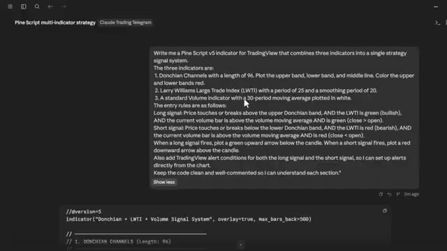
*⏱️ 00:11:56 — Interface de Claude montrant un prompt demandant la création d'un indicateur Pine Script v5 combinant Donchian Channels, LWTI et Volume.*

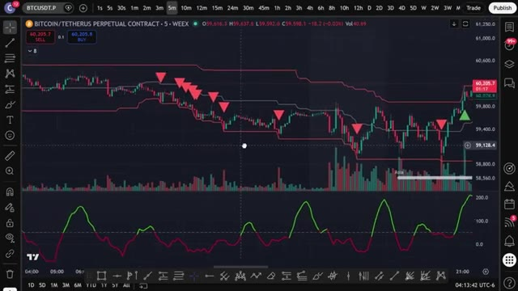
*⏱️ 00:12:05 — Graphique TradingView affichant Bitcoin (BTCUSDT) avec l'indicateur combiné (Donchian Channels, LWTI et volumes) et des signaux d'achat/vente.*

---

### ⏱️ `[00:12:14 - 00:12:18]` | Segment #26

**🔊 Audio (Transcription Intégrale Mot pour Mot en Français) :**
> cela aide vraiment beaucoup la chaîne. Abonnez-vous si ce n'est pas déjà fait et je vous vois dans la prochaine.

**👁️ Analyse Visuelle d'Écran (gemini-3.5-flash-lite) :**
**Interface & Outils** : Aucune interface visible.

**Contenu textuel & Code** : Aucun contenu technique, indicateur ou code source affiché.

**Action / Démonstration** : Aucune action ou manipulation technique effectuée à l'écran.

---

