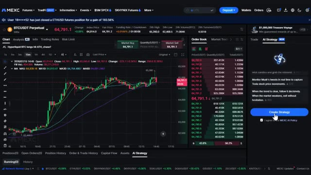
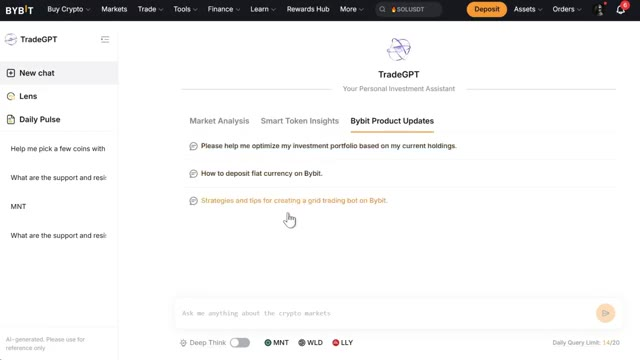
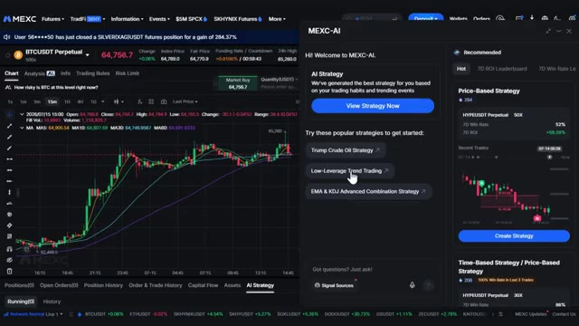
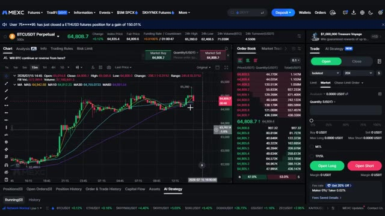
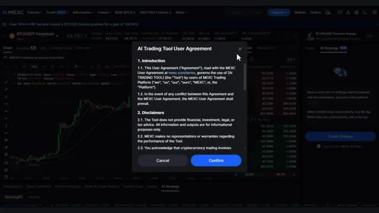
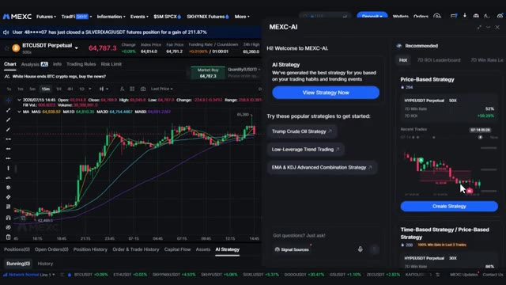
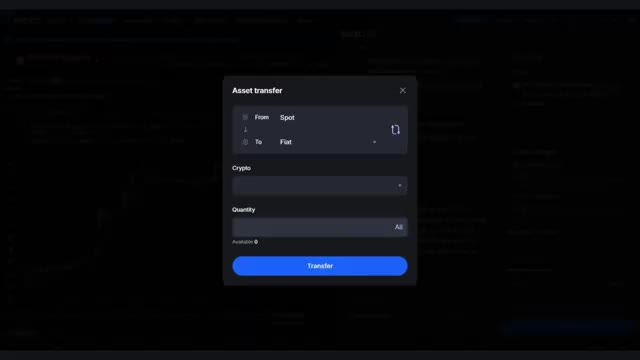
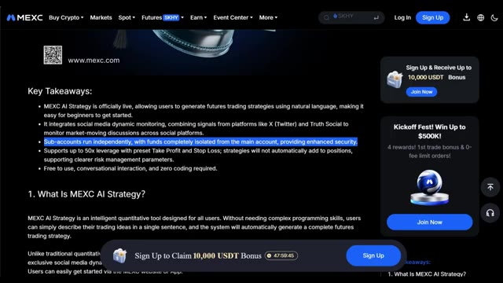

# 🎬 MEXC AI Strategy vs Bybit TradeGPT (Full Comparison & Setup Guide)

> **Chaîne** : [Alex Carter](https://www.youtube.com/@AlexCarterTrading)  
> **Lien YouTube** : [https://www.youtube.com/watch?v=FwmV1N_vMo0](https://www.youtube.com/watch?v=FwmV1N_vMo0)  
> **Date de publication** : 20260718  
> **Durée** : 00:16:37  
> **Identifiant vidéo** : `FwmV1N_vMo0`  
> **Transcription & Analyse** : `whisper-v3-large-turbo+gemini-3.5-flash-lite`  

---

## 📌 Synthèse Exécutive & Outils

### 💡 Résumé
Dans cette vidéo intitulée **Stratégie IA MEXC vs TradeGPT Bybit : Comparatif Complet & Guide de Configuration**, Alex Carter détaille une approche stratégique et pratique du trading et de l'automatisation par agents IA.

### 🛠️ Outils, Modèles & Logiciels Présentés
- **TradingView & Claude Code** : Analyse technique avancée et automatisation algorithmique.

### 🔑 Points Clés & Enseignements Stratégiques
- Respect rigoureux du ratio risque/rendement et du money management.
- Automatisation méthodique des déclencheurs d'ordres via des agents intelligents.

---

## ⏱️ Chronologie & Transcription Complète Audio & Visuelle (Mot pour Mot)

### ⏱️ `[00:00:00 - 00:00:29]` | Segment #01

**🔊 Audio (Transcription Intégrale Mot pour Mot en Français) :**
> Deux des plus grandes plateformes d'échange de cryptomonnaies au monde viennent de lancer discrètement des assistants de trading basés sur l'intelligence artificielle, et presque personne ne les compare côte à côte. L'un d'eux crée et exécute des stratégies de trading automatisées pour vous, surveille les publications de Trump, les tweets d'Elon, les indicateurs techniques, et passe des ordres pendant que vous dormez. Zéro code, totalement gratuit. L'autre, c'est comme avoir un analyste crypto personnel disponible 24h/24 et 7j/7. Analyse de marché en direct, notation des pièces, aperçus de portefeuille, actualités quotidiennes décodées.

**👁️ Analyse Visuelle d'Écran (gemini-3.5-flash-lite) :**
**Interface & Outils** : MEXC Exchange et Bybit TradeGPT

**Contenu textuel & Code** : Graphique en chandeliers, moyennes mobiles (MA), carnet d'ordres, et options de stratégie d'IA (« Create Strategy », « TradeGPT »).

**Action / Démonstration** : Navigation et présentation des interfaces d'assistants de trading basés sur l'intelligence artificielle sur deux grandes plateformes d'échange.

*⏱️ 00:00:07 — Interface de la plateforme MEXC montrant un graphique de trading de la paire BTCUSDT avec le panneau 'AI Strategy' sur le côté droit.*

*⏱️ 00:00:22 — Interface de la plateforme Bybit affichant 'TradeGPT', l'assistant d'investissement personnel par IA avec des options de chat et des mises à jour de produits.*

---

### ⏱️ `[00:00:29 - 00:00:51]` | Segment #02

**🔊 Audio (Transcription Intégrale Mot pour Mot en Français) :**
> tout à l'intérieur de la plateforme. Aussi complètement gratuit. Deux outils différents. Deux avantages différents. Et selon la façon dont vous tradez, l'un d'eux va vous donner un sérieux avantage sur tout le monde sur ce marché. Je vais vous présenter les deux étape par étape. Et à la fin, je vous dirai exactement lequel est le meilleur et pourquoi. Les liens vers les deux plateformes sont dans la description.

**👁️ Analyse Visuelle d'Écran (gemini-3.5-flash-lite) :**
**Interface & Outils** : Présentation ou face-caméra explicatif du trader sans interface logicielle partagée.

**Contenu textuel & Code** : Explications orales des stratégies et mise en contexte méthodologique du marché.

**Action / Démonstration** : Explications face caméra et analyse conceptuelle des marchés.

---

### ⏱️ `[00:00:52 - 00:01:34]` | Segment #03

**🔊 Audio (Transcription Intégrale Mot pour Mot en Français) :**
> J'ai personnellement négocié des packs de bonus exclusifs sur les deux. Vous n'obtiendrez pas toutes les récompenses sans utiliser mes liens, alors assurez-vous de le faire avant de vous inscrire. Maintenant, entrons dans le vif du sujet. Commençons par la stratégie Mexi AI. Très bien, donc pour y accéder, vous devez être sur la page de trading de futures Mexi. Si vous n'avez pas encore de compte, le lien se trouve dans la description. Assurez-vous de l'utiliser car vous obtiendrez le meilleur bonus d'inscription disponible. Une fois sur la page des futures, cela va ressembler à l'interface standard des futures perpétuels avec laquelle vous êtes probablement déjà familier. Vous avez le graphique au milieu, la sélection des coins en haut à gauche, le carnet d'ordres à côté du graphique, et le panneau de placement des ordres sur le côté droit où vous définissez votre mode de marge et votre effet de levier.

**👁️ Analyse Visuelle d'Écran (gemini-3.5-flash-lite) :**
**Interface & Outils** : Interface de la plateforme d'échange MEXC (section Futures et AI Strategy).

**Contenu textuel & Code** : Graphique BTCUSDT 15m avec moyennes mobiles (MA), carnet d'ordres en temps réel, options de levier (20X, Isolé), et stratégies de trading IA (Trump Crude Oil Strategy, Low-Leverage Trend Trading).

**Action / Démonstration** : Présentation des outils de trading automatisé par IA et navigation sur la plateforme d'échange MEXC.

*⏱️ 00:01:02 — Capture montrant l'interface MEXC avec le panneau 'MEXC-AI' ouvert sur la droite affichant les stratégies d'intelligence artificielle et un graphique de prix en arrière-plan.*

*⏱️ 00:01:23 — Capture de l'interface de trading MEXC (BTCUSDT Perpetual) montrant le carnet d'ordres, le graphique en chandeliers 15m avec moyennes mobiles et le panneau de passage d'ordre.*

---

### ⏱️ `[00:01:34 - 00:02:08]` | Segment #04

**🔊 Audio (Transcription Intégrale Mot pour Mot en Français) :**
> Toutes les choses habituelles. Maintenant, c'est là que ça devient intéressant. Vous allez voir une nouvelle section appelée Stratégie IA. Cliquez dessus. La première chose qui va apparaître est l'accord sur la politique MEXI AI. Lisez-le simplement, acceptez les conditions, puis cliquez sur créer une stratégie. Et voilà. Vous y êtes. Maintenant, une fois que vous êtes à l'intérieur, laissez-moi vous expliquer ce que vous avez sous les yeux. Parce qu'il y a vraiment beaucoup de choses ici et je veux m'assurer que vous compreniez chaque partie avant de commencer à cliquer sur tout. Sur le côté gauche, vous verrez un bouton « voir la stratégie maintenant » et en dessous, vous trouverez une liste de prompts de stratégie populaires. Ces

**👁️ Analyse Visuelle d'Écran (gemini-3.5-flash-lite) :**
**Interface & Outils** : Échange de cryptomonnaies MEXC (section Futures et MEXC-AI).

**Contenu textuel & Code** : Conditions d'utilisation de l'outil IA, graphiques de prix BTCUSDT en arrière-plan avec moyennes mobiles, et panneaux de stratégies IA recommandées (Price-Based Strategy, HYPEUSDT Perpetual).

**Action / Démonstration** : Acceptation des conditions d'utilisation de l'IA puis affichage du tableau de bord des stratégies automatisées.

*⏱️ 00:01:43 — Fenêtre pop-up affichant l'accord d'utilisation de l'outil de trading IA (AI Trading Tool User Agreement) sur la plateforme MEXC.*

*⏱️ 00:01:51 — Interface principale de MEXC-AI montrant les différentes stratégies de trading automatisées basées sur l'intelligence artificielle.*

---

### ⏱️ `[00:02:08 - 00:02:30]` | Segment #05

**🔊 Audio (Transcription Intégrale Mot pour Mot en Français) :**
> ce sont des idées de stratégies pré-écrites que d'autres traders utilisent déjà. Pensez-y comme à des modèles. Un très bon point de départ si vous ne savez pas quoi taper. Allez-y et cliquez sur l'une de ces stratégies populaires. Lorsque vous le ferez, cela va vous montrer la configuration complète. La paire de trading, les conditions de déclenchement, la direction dans laquelle elle trade, l'effet de levier utilisé, ainsi que les niveaux de take profit et de stop loss.

**👁️ Analyse Visuelle d'Écran (gemini-3.5-flash-lite) :**
**Interface & Outils** : Présentation ou face-caméra explicatif du trader sans interface logicielle partagée.

**Contenu textuel & Code** : Explications orales des stratégies et mise en contexte méthodologique du marché.

**Action / Démonstration** : Explications face caméra et analyse conceptuelle des marchés.

---

### ⏱️ `[00:02:31 - 00:02:51]` | Segment #06

**🔊 Audio (Transcription Intégrale Mot pour Mot en Français) :**
> Tout est clairement présenté pour que vous puissiez voir exactement ce que fait la stratégie avant de la lancer. Sur le côté droit, vous avez tous les détails modifiables. Les informations sur la paire, le mode de marge, l'effet de levier et tous les autres paramètres que vous souhaitez ajuster. Donc, si vous aimez la stratégie mais que vous souhaitez modifier l'effet de levier ou ajuster le take profit, vous pouvez le faire juste ici.

**👁️ Analyse Visuelle d'Écran (gemini-3.5-flash-lite) :**
**Interface & Outils** : Présentation ou face-caméra explicatif du trader sans interface logicielle partagée.

**Contenu textuel & Code** : Explications orales des stratégies et mise en contexte méthodologique du marché.

**Action / Démonstration** : Explications face caméra et analyse conceptuelle des marchés.

---

### ⏱️ `[00:02:52 - 00:03:12]` | Segment #07

**🔊 Audio (Transcription Intégrale Mot pour Mot en Français) :**
> Une fois que vous êtes satisfait de tout, cliquez sur confirmer. Si vous n'avez pas assez de fonds dans votre sous-compte, une fenêtre pop-up apparaîtra pour vous en informer. Transférez simplement les fonds, puis cliquez sur confirmer et exécuter. Gardez à l'esprit, et c'est important, que la stratégie Mexi AI s'exécute via un sous-compte indépendant. Vos fonds sont complètement isolés de votre compte principal.

**👁️ Analyse Visuelle d'Écran (gemini-3.5-flash-lite) :**
**Interface & Outils** : MEXC (plateforme d'échange de cryptomonnaies / documentation MEXC AI Strategy).

**Contenu textuel & Code** : Image 1 : Formulaire de transfert d'actifs avec champs Source (Spot), Destination, Cryptomonnaie et Quantité. Image 2 : Article de présentation soulignant « Sub-accounts run independently, with funds completely isolated from the main account, providing enhanced security ».

**Action / Démonstration** : Présentation de la gestion des sous-comptes et de la procédure de transfert de fonds pour alimenter la stratégie de trading algorithmique.

*⏱️ 00:02:57 — Fenêtre modale de transfert de fonds (« Asset transfer ») permettant de transférer du capital entre comptes (Spot / sous-compte) sur l'interface de trading.*

*⏱️ 00:03:07 — Page d'information MEXC détaillant le fonctionnement de la stratégie IA (« MEXC AI Strategy ») avec la ligne sur l'isolation des fonds des sous-comptes mise en surbrillance.*

---

### ⏱️ `[00:03:12 - 00:03:37]` | Segment #08

**🔊 Audio (Transcription Intégrale Mot pour Mot en Français) :**
> So even if a strategy takes a loss, it does not touch your main account margin. That's a really solid safety feature, especially if you're just getting started with automated strategies. Now on the right side of the interface, you'll also see a recommended strategy section. This is broken down into a few different tabs. You've got hot strategies, a seven-day ROI leaderboard, and a seven-day win rate leaderboard.

**👁️ Analyse Visuelle d'Écran (gemini-3.5-flash-lite) :**
**Interface & Outils** : Présentation ou face-caméra explicatif du trader sans interface logicielle partagée.

**Contenu textuel & Code** : Explications orales des stratégies et mise en contexte méthodologique du marché.

**Action / Démonstration** : Explications face caméra et analyse conceptuelle des marchés.

---

### ⏱️ `[00:03:37 - 00:03:59]` | Segment #09

**🔊 Audio (Transcription Intégrale Mot pour Mot en Français) :**
> For each strategy listed here, you can see the type of strategy it is, the trading pair it uses, the leverage being applied, the 7-day ROI, the 7-day win rate, the recent trades it has taken, and a chart showing exactly where it entered and exited. So you can actually look at the track record of a strategy before you decide to run it.

**👁️ Analyse Visuelle d'Écran (gemini-3.5-flash-lite) :**
**Interface & Outils** : Présentation ou face-caméra explicatif du trader sans interface logicielle partagée.

**Contenu textuel & Code** : Explications orales des stratégies et mise en contexte méthodologique du marché.

**Action / Démonstration** : Explications face caméra et analyse conceptuelle des marchés.

---

### ⏱️ `[00:04:00 - 00:04:21]` | Segment #10

**🔊 Audio (Transcription Intégrale Mot pour Mot en Français) :**
> That's a really useful feature. You're not just blindly following something. You can see how it's been performing. If you want to use one of these recommended strategies, just click Create Strategy on whichever one you want. It'll show you the same details as before. The open trigger, the close trigger, all the parameters. And once you're happy, click Confirm and you're live.

**👁️ Analyse Visuelle d'Écran (gemini-3.5-flash-lite) :**
**Interface & Outils** : Présentation ou face-caméra explicatif du trader sans interface logicielle partagée.

**Contenu textuel & Code** : Explications orales des stratégies et mise en contexte méthodologique du marché.

**Action / Démonstration** : Explications face caméra et analyse conceptuelle des marchés.

---

### ⏱️ `[00:04:22 - 00:04:59]` | Segment #11

**🔊 Audio (Transcription Intégrale Mot pour Mot en Français) :**
> Now this is the part I think is the most exciting and honestly the most powerful feature here. If you want to build your own strategy completely from scratch, you're going to see a button that says Got Questions? Just Ask. Click on that. This opens up a chat interface where you can literally type your strategy in plain language. Something like, I want a 30-minute MACD signal for leveraged two-way trend trading on mainstream coins with take profit and stop loss set in advance. The AI reads that, understands it, and built a full strategy configuration for you automatically. And here's a cool feature.

**👁️ Analyse Visuelle d'Écran (gemini-3.5-flash-lite) :**
**Interface & Outils** : Présentation ou face-caméra explicatif du trader sans interface logicielle partagée.

**Contenu textuel & Code** : Explications orales des stratégies et mise en contexte méthodologique du marché.

**Action / Démonstration** : Explications face caméra et analyse conceptuelle des marchés.

---

### ⏱️ `[00:04:59 - 00:05:34]` | Segment #12

**🔊 Audio (Transcription Intégrale Mot pour Mot en Français) :**
> If you're having a hard time typing it out, you can actually use your microphone and just speak your strategy. I think that's a genuinely useful touch, especially if you have a complex idea and you just want to talk through it quickly. Now let me show you the signal sources because this is where it gets really interesting. Inside the strategy builder, you can check the signal sources that the AI can monitor. And the list here is actually impressive. Price action and technical indicators from the MEXI platform itself. Things like MACD, KDJ, moving averages, candlestick

**👁️ Analyse Visuelle d'Écran (gemini-3.5-flash-lite) :**
**Interface & Outils** : Présentation ou face-caméra explicatif du trader sans interface logicielle partagée.

**Contenu textuel & Code** : Explications orales des stratégies et mise en contexte méthodologique du marché.

**Action / Démonstration** : Explications face caméra et analyse conceptuelle des marchés.

---

### ⏱️ `[00:05:34 - 00:05:56]` | Segment #13

**🔊 Audio (Transcription Intégrale Mot pour Mot en Français) :**
> Patterns public figure posts from X and Truth Social. And we're talking Donald Trump, Elon Musk, CZ, people whose posts genuinely move markets, geopolitical news, and event probability data from sources like Polymarket. So the sources here are very much up to date. You're not just running a basic indicator strategy. You can build something that reacts to real world events as they happen.

**👁️ Analyse Visuelle d'Écran (gemini-3.5-flash-lite) :**
**Interface & Outils** : Présentation ou face-caméra explicatif du trader sans interface logicielle partagée.

**Contenu textuel & Code** : Explications orales des stratégies et mise en contexte méthodologique du marché.

**Action / Démonstration** : Explications face caméra et analyse conceptuelle des marchés.

---

### ⏱️ `[00:05:56 - 00:06:15]` | Segment #14

**🔊 Audio (Transcription Intégrale Mot pour Mot en Français) :**
> That's a level of signal integration that most retail traders have never had access to before. A couple of things to keep in mind with the signal sources. You can combine up to two strategy types in a single setup monitoring-based strategies, the social media ones, need to be paired with a price condition to work properly.

**👁️ Analyse Visuelle d'Écran (gemini-3.5-flash-lite) :**
**Interface & Outils** : Présentation ou face-caméra explicatif du trader sans interface logicielle partagée.

**Contenu textuel & Code** : Explications orales des stratégies et mise en contexte méthodologique du marché.

**Action / Démonstration** : Explications face caméra et analyse conceptuelle des marchés.

---

### ⏱️ `[00:06:16 - 00:06:35]` | Segment #15

**🔊 Audio (Transcription Intégrale Mot pour Mot en Français) :**
> The AI supports eight different candlestick intervals from one minute all the way up to one day, so you can build both short-term and longer-term strategies. Before you go ahead and launch your first strategy, just a few quick things to keep in mind. Leverage goes up to 50 times, but it's capped at whatever the maximum is for your specific trading pair.

**👁️ Analyse Visuelle d'Écran (gemini-3.5-flash-lite) :**
**Interface & Outils** : Présentation ou face-caméra explicatif du trader sans interface logicielle partagée.

**Contenu textuel & Code** : Explications orales des stratégies et mise en contexte méthodologique du marché.

**Action / Démonstration** : Explications face caméra et analyse conceptuelle des marchés.

---

### ⏱️ `[00:06:36 - 00:06:55]` | Segment #16

**🔊 Audio (Transcription Intégrale Mot pour Mot en Français) :**
> So just be aware of that and set it according to your own risk tolerance. If you're just starting out, keep it low. Positions close only through your preset take profit or stop loss. The AI will not partially close a position, and it won't automatically add to a position either. That's actually a good thing, and it keeps the risk management clean and transparent.

**👁️ Analyse Visuelle d'Écran (gemini-3.5-flash-lite) :**
**Interface & Outils** : Présentation ou face-caméra explicatif du trader sans interface logicielle partagée.

**Contenu textuel & Code** : Explications orales des stratégies et mise en contexte méthodologique du marché.

**Action / Démonstration** : Explications face caméra et analyse conceptuelle des marchés.

---

### ⏱️ `[00:06:56 - 00:07:15]` | Segment #17

**🔊 Audio (Transcription Intégrale Mot pour Mot en Français) :**
> You can only run one strategy at a time right now. So if you want to switch strategies, you'll need to cancel the current one first and then create a new one. And the whole thing is completely free. No subscription, no coding, no complicated setup. Just describe what you want and let the AI do the work. So that is Mexi's AI strategy builder.

**👁️ Analyse Visuelle d'Écran (gemini-3.5-flash-lite) :**
**Interface & Outils** : Présentation ou face-caméra explicatif du trader sans interface logicielle partagée.

**Contenu textuel & Code** : Explications orales des stratégies et mise en contexte méthodologique du marché.

**Action / Démonstration** : Explications face caméra et analyse conceptuelle des marchés.

---

### ⏱️ `[00:07:16 - 00:07:52]` | Segment #18

**🔊 Audio (Transcription Intégrale Mot pour Mot en Français) :**
> It is genuinely impressive, especially the social media signal sources and the fact that it actually executes trades for you automatically. But now let me show you what Bybit has built. because trade GPT takes a completely different approach and once you see both of them the difference becomes very clear all right so first things first you are going to need a bybit account if you already have one you can skip ahead if you do not click the link in the description it will take you directly to the signup page where you will automatically unlock the full bonus package I personally negotiate for my community you will not get all of those

**👁️ Analyse Visuelle d'Écran (gemini-3.5-flash-lite) :**
**Interface & Outils** : Présentation ou face-caméra explicatif du trader sans interface logicielle partagée.

**Contenu textuel & Code** : Explications orales des stratégies et mise en contexte méthodologique du marché.

**Action / Démonstration** : Explications face caméra et analyse conceptuelle des marchés.

---

### ⏱️ `[00:07:52 - 00:08:24]` | Segment #19

**🔊 Audio (Transcription Intégrale Mot pour Mot en Français) :**
> rewards without using the link so make sure you use it once you are signed in and on the Bybit homepage you are ready to go the platform might look a little busy at first but do not worry I will walk you through exactly where to go and what to click keep in mind everything I'm showing you today is completely free to use once you have an account no extra subscriptions no hidden fees it is just built right into the platform so to find trade GPT what you want to do is is go to the top navigation bar and click on tools.

**👁️ Analyse Visuelle d'Écran (gemini-3.5-flash-lite) :**
**Interface & Outils** : Présentation ou face-caméra explicatif du trader sans interface logicielle partagée.

**Contenu textuel & Code** : Explications orales des stratégies et mise en contexte méthodologique du marché.

**Action / Démonstration** : Explications face caméra et analyse conceptuelle des marchés.

---

### ⏱️ `[00:08:24 - 00:08:43]` | Segment #20

**🔊 Audio (Transcription Intégrale Mot pour Mot en Français) :**
> Once you're in there, look for TradeGPT and click on it. Now when you open it up, you are going to see three main options right here. ChatNow, Lens, Daily Pulse. Each one of these does something different and I'm going to walk you through all three of them. Let's start with ChatNow. So ChatNow is basically your personal investment assistant.

**👁️ Analyse Visuelle d'Écran (gemini-3.5-flash-lite) :**
**Interface & Outils** : Présentation ou face-caméra explicatif du trader sans interface logicielle partagée.

**Contenu textuel & Code** : Explications orales des stratégies et mise en contexte méthodologique du marché.

**Action / Démonstration** : Explications face caméra et analyse conceptuelle des marchés.

---

### ⏱️ `[00:08:43 - 00:09:05]` | Segment #21

**🔊 Audio (Transcription Intégrale Mot pour Mot en Français) :**
> Think of it like having ChatGPT, but it actually knows what is happening in the crypto market right now and it is connected directly to Bybitz data. When you click on it, you will see a chat window very similar to what you would see on any AI assistant. On the left side, you can add new chats and you can also jump between Lens and Dally Pulse from here as well.

**👁️ Analyse Visuelle d'Écran (gemini-3.5-flash-lite) :**
**Interface & Outils** : Présentation ou face-caméra explicatif du trader sans interface logicielle partagée.

**Contenu textuel & Code** : Explications orales des stratégies et mise en contexte méthodologique du marché.

**Action / Démonstration** : Explications face caméra et analyse conceptuelle des marchés.

---

### ⏱️ `[00:09:05 - 00:09:43]` | Segment #22

**🔊 Audio (Transcription Intégrale Mot pour Mot en Français) :**
> Now inside the chat, you will notice there are three categories you can ask questions in, market analysis. This is where you can ask things like, what are the most popular news stories in crypto in the past 24 hours what are the support and resistance levels for swede right now and it will give you a proper breakdown really useful for getting a quick read on the market before you open a trade smart token insights here you can ask for coin recommendations find hot projects above a certain market cap get a breakdown of what is trending and why so if you are looking for your next trade idea this is a great place to start by bit product updates this one is more platform

**👁️ Analyse Visuelle d'Écran (gemini-3.5-flash-lite) :**
**Interface & Outils** : Présentation ou face-caméra explicatif du trader sans interface logicielle partagée.

**Contenu textuel & Code** : Explications orales des stratégies et mise en contexte méthodologique du marché.

**Action / Démonstration** : Explications face caméra et analyse conceptuelle des marchés.

---

### ⏱️ `[00:09:43 - 00:10:16]` | Segment #23

**🔊 Audio (Transcription Intégrale Mot pour Mot en Français) :**
> focused. You can ask FAQ style questions like how to navigate certain features, how to optimize your portfolio based on what you are currently holding, or even how to set up and create basic strategies for trading bots. Very handy if you are still getting familiar with the platform. Now one thing I want to point out, you will see an option to enable deep think. What this does is allow the AI to do deeper research before giving you an answer. It takes a little longer, but the responses are more thorough. So if you are doing serious research on a coin or a strategy, definitely turn that on.

**👁️ Analyse Visuelle d'Écran (gemini-3.5-flash-lite) :**
**Interface & Outils** : Présentation ou face-caméra explicatif du trader sans interface logicielle partagée.

**Contenu textuel & Code** : Explications orales des stratégies et mise en contexte méthodologique du marché.

**Action / Démonstration** : Explications face caméra et analyse conceptuelle des marchés.

---

### ⏱️ `[00:10:17 - 00:10:50]` | Segment #24

**🔊 Audio (Transcription Intégrale Mot pour Mot en Français) :**
> You can also see a list of coins directly below the chat. If you click on any of them, TradeGPT will pull up data like the current price, risk level, win rate prediction, indicator levels, and more. Really solid for a quick overview before you make a decision. One important thing to keep in mind, you do have a daily query limit of at least 20 questions. So use them wisely. Do not waste them on basic stuff you can google. Save them for the questions that actually matter for your trades. By the way, if you want to build your own egenic AI for crypto, stocks, and other markets

**👁️ Analyse Visuelle d'Écran (gemini-3.5-flash-lite) :**
**Interface & Outils** : Présentation ou face-caméra explicatif du trader sans interface logicielle partagée.

**Contenu textuel & Code** : Explications orales des stratégies et mise en contexte méthodologique du marché.

**Action / Démonstration** : Explications face caméra et analyse conceptuelle des marchés.

---

### ⏱️ `[00:10:50 - 00:11:09]` | Segment #25

**🔊 Audio (Transcription Intégrale Mot pour Mot en Français) :**
> from start to finish and let it trade for you automatically, check out AI Trade Edge from the link down below. All right, next up is Lens, and this one is really interesting. I will keep the section a bit shorter because it is fairly straightforward once you see it. When you click on Lens, the first thing you will see at the top is all projects and today's project pick.

**👁️ Analyse Visuelle d'Écran (gemini-3.5-flash-lite) :**
**Interface & Outils** : Présentation ou face-caméra explicatif du trader sans interface logicielle partagée.

**Contenu textuel & Code** : Explications orales des stratégies et mise en contexte méthodologique du marché.

**Action / Démonstration** : Explications face caméra et analyse conceptuelle des marchés.

---

### ⏱️ `[00:11:09 - 00:11:42]` | Segment #26

**🔊 Audio (Transcription Intégrale Mot pour Mot en Français) :**
> The project pick is Bybit's AI recommendation for the day. I will come back to that in a second. So in the main view, you can pick any coin from Bybit's offerings. Let's say you click on a coin, you will immediately see a full rundown, current market price, market cap, volume, circulating supply, all of the key data you need. On the right side, you will see the AI assessment, which gives the coin a score. This score is based on things like community activity, ex-followers, social engagement, media exposure, basically how the coin is performing in the social

**👁️ Analyse Visuelle d'Écran (gemini-3.5-flash-lite) :**
**Interface & Outils** : Présentation ou face-caméra explicatif du trader sans interface logicielle partagée.

**Contenu textuel & Code** : Explications orales des stratégies et mise en contexte méthodologique du marché.

**Action / Démonstration** : Explications face caméra et analyse conceptuelle des marchés.

---

### ⏱️ `[00:11:42 - 00:12:22]` | Segment #27

**🔊 Audio (Transcription Intégrale Mot pour Mot en Français) :**
> media world and whether there is any real hype behind it. This is actually really useful for spotting momentum early. You can also check the fundraising section to see the team behind the project and who the investors are. And then there is Bybit's own trend data, long slash short ratio, inflow and outflow volume behavior trends and more and if after all of that you want to actually trade the coin there is a trade now button right there click it a pop-up will appear and you can choose your preferred trading method spot futures convert loan trading bot or DCA so you go from research to

**👁️ Analyse Visuelle d'Écran (gemini-3.5-flash-lite) :**
**Interface & Outils** : Présentation ou face-caméra explicatif du trader sans interface logicielle partagée.

**Contenu textuel & Code** : Explications orales des stratégies et mise en contexte méthodologique du marché.

**Action / Démonstration** : Explications face caméra et analyse conceptuelle des marchés.

---

### ⏱️ `[00:12:22 - 00:12:54]` | Segment #28

**🔊 Audio (Transcription Intégrale Mot pour Mot en Français) :**
> execution without ever leaving the page that is a nice touch now going back to to today's project pick, this is worth checking daily. It gives you the full AI assessment on whatever Bybit is highlighting that day, perfect for a quick morning check to see what is on the radar. And then there is Daily Pulse, which is probably the one I would use most consistently as part of a daily routine. Daily Pulse gives you AI-driven portfolio insights that decode the daily news. So when you open it up, you can check the latest crypto news, see your top holdings,

**👁️ Analyse Visuelle d'Écran (gemini-3.5-flash-lite) :**
**Interface & Outils** : Présentation ou face-caméra explicatif du trader sans interface logicielle partagée.

**Contenu textuel & Code** : Explications orales des stratégies et mise en contexte méthodologique du marché.

**Action / Démonstration** : Explications face caméra et analyse conceptuelle des marchés.

---

### ⏱️ `[00:12:54 - 00:13:29]` | Segment #29

**🔊 Audio (Transcription Intégrale Mot pour Mot en Français) :**
> find out what pairs have been newly listed on Bybit, and basically get a full picture of what is happening in the market right now, all in one place. What I really like is the top holdings section. You can actually ask the AI for more information on any of your holdings directly from here, and it will give you a summary so you can make a better decision on whether to hold, add, or reduce your position. That kind of context is genuinely useful, especially on days when the market is moving fast and you do not have time to go digging through news articles. Now, and this is

**👁️ Analyse Visuelle d'Écran (gemini-3.5-flash-lite) :**
**Interface & Outils** : Présentation ou face-caméra explicatif du trader sans interface logicielle partagée.

**Contenu textuel & Code** : Explications orales des stratégies et mise en contexte méthodologique du marché.

**Action / Démonstration** : Explications face caméra et analyse conceptuelle des marchés.

---

### ⏱️ `[00:13:29 - 00:14:03]` | Segment #30

**🔊 Audio (Transcription Intégrale Mot pour Mot en Français) :**
> important, everything TradeGPT gives you is AI generated. So use it as a reference and a starting point, not as financial advice. Always do your own research before making any trading decisions. The AI is a tool to help you think, not to think for you. All right, so now you have seen both of them. So which one is better? Honestly, it depends on what kind of trader you are. If you want to set a strategy and let it run automatically without watching the charts all day, Mexi AI strategy is the one for you. It is genuinely powerful, especially the social media signal sources.

**👁️ Analyse Visuelle d'Écran (gemini-3.5-flash-lite) :**
**Interface & Outils** : Présentation ou face-caméra explicatif du trader sans interface logicielle partagée.

**Contenu textuel & Code** : Explications orales des stratégies et mise en contexte méthodologique du marché.

**Action / Démonstration** : Explications face caméra et analyse conceptuelle des marchés.

---

### ⏱️ `[00:14:03 - 00:14:36]` | Segment #31

**🔊 Audio (Transcription Intégrale Mot pour Mot en Français) :**
> That is a real edge. If you are someone who still wants to make your own trading decisions, but wants better research, better market context, and a smarter way to stay on top of what is happening, trade GPT on Bybit is the better fit. The daily pulse alone is worth using every single morning. And if you are serious about trading, honestly, use both. They complement each other well. Use TradeGPT to research and identify opportunities. Use Maxi AI strategy to automate the execution. That combination is actually a pretty solid setup. All right, and look, for the

**👁️ Analyse Visuelle d'Écran (gemini-3.5-flash-lite) :**
**Interface & Outils** : Présentation ou face-caméra explicatif du trader sans interface logicielle partagée.

**Contenu textuel & Code** : Explications orales des stratégies et mise en contexte méthodologique du marché.

**Action / Démonstration** : Explications face caméra et analyse conceptuelle des marchés.

---

### ⏱️ `[00:14:36 - 00:14:59]` | Segment #32

**🔊 Audio (Transcription Intégrale Mot pour Mot en Français) :**
> next few years, two kinds of traders will exist. The ones using AI and the ones still doing everything manually. Same market. Very different outcomes. Here is how you get on the right side of that. I have put together everything inside the AI Trade Edge community. Every prompt, every bot, every template, every step-by-step guide I personally use, all in one place.

**👁️ Analyse Visuelle d'Écran (gemini-3.5-flash-lite) :**
**Interface & Outils** : Présentation ou face-caméra explicatif du trader sans interface logicielle partagée.

**Contenu textuel & Code** : Explications orales des stratégies et mise en contexte méthodologique du marché.

**Action / Démonstration** : Explications face caméra et analyse conceptuelle des marchés.

---

### ⏱️ `[00:15:00 - 00:15:35]` | Segment #33

**🔊 Audio (Transcription Intégrale Mot pour Mot en Français) :**
> And everything I build going forward gets added straight into the group the moment it drops. We are also testing strategies from all over the internet, automating them using PineScript, running them live, and sharing exactly what works and what does not. So you are not just getting tools. you are getting a live research operation inside there is also a full agentic trading course 2.5 hours beginner to expert no coding background needed by the end of it you will have your own ai trading system running live something most retail traders do not even know is possible right now

**👁️ Analyse Visuelle d'Écran (gemini-3.5-flash-lite) :**
**Interface & Outils** : Présentation ou face-caméra explicatif du trader sans interface logicielle partagée.

**Contenu textuel & Code** : Explications orales des stratégies et mise en contexte méthodologique du marché.

**Action / Démonstration** : Explications face caméra et analyse conceptuelle des marchés.

---

### ⏱️ `[00:15:35 - 00:16:08]` | Segment #34

**🔊 Audio (Transcription Intégrale Mot pour Mot en Français) :**
> 79.99 a month one good trade covers it and the first 100 members lock in that rate permanently after that the price goes up. The link is in the description. You genuinely cannot afford to miss this. And that is it. Trade GPT on Bybit and Mexi AI Strategy. Both fully broken down and compared side by side. Both links are in the description below. Both come with exclusive bonuses I personally negotiated. Make sure you use the links or you will not get the full package. If you want to go

**👁️ Analyse Visuelle d'Écran (gemini-3.5-flash-lite) :**
**Interface & Outils** : Présentation ou face-caméra explicatif du trader sans interface logicielle partagée.

**Contenu textuel & Code** : Explications orales des stratégies et mise en contexte méthodologique du marché.

**Action / Démonstration** : Explications face caméra et analyse conceptuelle des marchés.

---

### ⏱️ `[00:16:08 - 00:16:37]` | Segment #35

**🔊 Audio (Transcription Intégrale Mot pour Mot en Français) :**
> even deeper and see the full platform walkthrough for either exchange, deposits, futures trading, the whole thing. I have got videos for both of them. Check those out on screen right now. And if you want the full step-by-step guide on how to build your own agentic trading system using Claude, that video is popping up on screen as well. Go and check that out next. If this was useful, leave a like. It genuinely does help the channel grow. Subscribe if you have not already, and I will see you in the next one.

**👁️ Analyse Visuelle d'Écran (gemini-3.5-flash-lite) :**
**Interface & Outils** : Présentation ou face-caméra explicatif du trader sans interface logicielle partagée.

**Contenu textuel & Code** : Explications orales des stratégies et mise en contexte méthodologique du marché.

**Action / Démonstration** : Explications face caméra et analyse conceptuelle des marchés.

---

