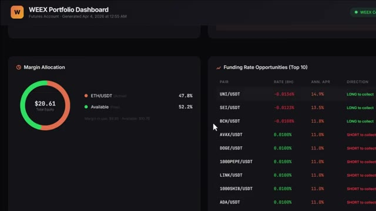
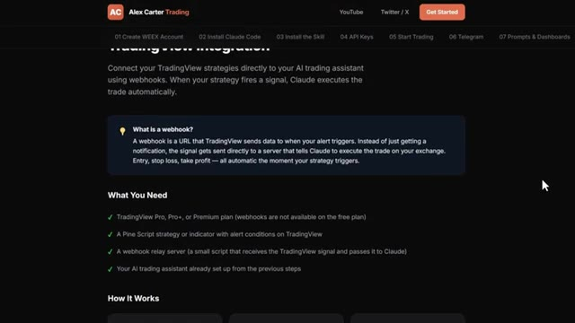
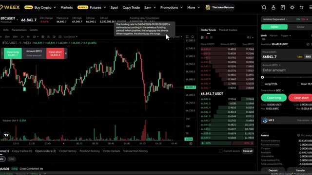

# 🎬 How I Put My Entire Trading System on Autopilot Using These 3 Tools

> **Chaîne** : [Alex Carter](https://www.youtube.com/@AlexCarterTrading)  
> **Lien YouTube** : [https://www.youtube.com/watch?v=M90U3ztiUAo](https://www.youtube.com/watch?v=M90U3ztiUAo)  
> **Date de publication** : 20260721  
> **Durée** : 00:12:20  
> **Identifiant vidéo** : `M90U3ztiUAo`  
> **Transcription & Analyse** : `whisper-v3-large-turbo+gemini-3.5-flash-lite`  

---

## 📌 Synthèse Exécutive & Outils

### 💡 Résumé
Dans cette vidéo intitulée **How I Put My Entire Trading System on Autopilot Using These 3 Tools**, Alex Carter détaille une approche stratégique et pratique du trading et de l'automatisation par agents IA.

### 🛠️ Outils, Modèles & Logiciels Présentés
- **TradingView & Claude Code** : Analyse technique avancée et automatisation algorithmique.

### 🔑 Points Clés & Enseignements Stratégiques
- Respect rigoureux du ratio risque/rendement et du money management.
- Automatisation méthodique des déclencheurs d'ordres via des agents intelligents.

---

## ⏱️ Chronologie & Transcription Complète Audio & Visuelle (Mot pour Mot)

### ⏱️ `[00:00:00 - 00:00:21]` | Segment #01

**🔊 Audio (Transcription Intégrale Mot pour Mot en Français) :**
> Right now, a brand new generation of crypto traders is being created. Not by working harder, not by staring at charts longer, but by building systems that do the work for them. There are solo traders out there. No team, no hedge fund backing, who are running whale tracking systems that scan thousands of wallets. Automated bots that execute trades while they sleep.

**👁️ Analyse Visuelle d'Écran (gemini-3.5-flash-lite) :**
**Interface & Outils** : Présentation ou face-caméra explicatif du trader sans interface logicielle partagée.

**Contenu textuel & Code** : Explications orales des stratégies et mise en contexte méthodologique du marché.

**Action / Démonstration** : Explications face caméra et analyse conceptuelle des marchés.

---

### ⏱️ `[00:00:21 - 00:00:58]` | Segment #02

**🔊 Audio (Transcription Intégrale Mot pour Mot en Français) :**
> Full portfolio dashboards that would make a professional trading desk jealous. And I'm not talking about some distant future thing. I have been building this myself. all of it. And I want to show you exactly what it looks like. Because right now in crypto, the traders who are really winning are not the ones reading charts the fastest. They are the ones who built a system that runs without them. So in this video, I'm going to show you the exact three tools I use to put my entire trading operation on autopilot and how you can do the exact same thing. Let's get into it. Now, before I show you the tools, I want to quickly

**👁️ Analyse Visuelle d'Écran (gemini-3.5-flash-lite) :**
**Interface & Outils** : Présentation ou face-caméra explicatif du trader sans interface logicielle partagée.

**Contenu textuel & Code** : Explications orales des stratégies et mise en contexte méthodologique du marché.

**Action / Démonstration** : Explications face caméra et analyse conceptuelle des marchés.

---

### ⏱️ `[00:00:58 - 00:01:33]` | Segment #03

**🔊 Audio (Transcription Intégrale Mot pour Mot en Français) :**
> tell you why I'm actually building this. I have been trading crypto for years. I run a cryptocurrency focused channel. I share strategies, guides, comparison every single day. And I've been doing well. But I've always known that the traders who are really winning at the highest level are not just reading charts better than everyone else. They have systems. They have automation. They have an edge that compounds over time. And for a long time, building that kind of system was out of reach for a solo trader. You needed a team of developers. You needed serious capital. You needed months of

**👁️ Analyse Visuelle d'Écran (gemini-3.5-flash-lite) :**
**Interface & Outils** : Présentation ou face-caméra explicatif du trader sans interface logicielle partagée.

**Contenu textuel & Code** : Explications orales des stratégies et mise en contexte méthodologique du marché.

**Action / Démonstration** : Explications face caméra et analyse conceptuelle des marchés.

---

### ⏱️ `[00:01:33 - 00:02:07]` | Segment #04

**🔊 Audio (Transcription Intégrale Mot pour Mot en Français) :**
> temps. Ce qui a changé, c'est Claude Code. Parce que maintenant, je peux décrire ce que je veux en simple anglais et il le construit. Un suivi de baleines, un scanner de taux de financement, un tableau de bord complet de portefeuille, un bot qui exécute des trades pendant que je dors. Tout cela. Ce n'est donc pas seulement une vidéo sur les outils d'IA. C'est moi qui vous montre exactement ce que je suis en train de construire en ce moment et pourquoi je crois sincèrement que c'est ainsi que j'atteindrai mon premier million. Et je veux vous emmener avec moi à chaque étape. La première chose que je veux vous montrer, et c'est celle qui m'a vraiment époustouflé la première fois que je l'ai vue, Claude lit,

**👁️ Analyse Visuelle d'Écran (gemini-3.5-flash-lite) :**
**Interface & Outils** : WEEX (Tableau de bord de portefeuille et interface Futures BTC/USDT), Site web Alex Carter Trading.

**Contenu textuel & Code** : - Métriques de portefeuille : équité totale ($20.61), allocation ETH/USDT (47.8%), solde disponible (52.2%).
- Tableau "Funding Rate Opportunities" : paires UNI/USDT, SEI/USDT, BCH/USDT, AVAX/USDT avec taux sur 8h, APR annuel et direction (Long/Short).
- Guide d'intégration : explications sur le fonctionnement des webhooks pour exécuter automatiquement des alertes Pine Script via Claude.
- Graphique boursier : bougies japonaises BTC/USDT autour de 66 841,7 USDT, carnet d'ordres en temps réel, fenêtres d'ordres Open Long / Open Short.

**Action / Démonstration** : Démonstration des outils de trading créés avec l'assistant IA : consultation d'un tableau de bord récapitulatif avec scanner de financement, explication de la connexion automatisée via webhooks TradingView, et affichage de l'interface d'exécution sur l'échangeur WEEX.

*⏱️ 00:01:42 — Tableau de bord de portefeuille WEEX affichant la répartition de la marge et un scanner des opportunités de taux de financement (Funding Rates).*

*⏱️ 00:01:50 — Page web de tutoriel Alex Carter Trading expliquant le fonctionnement de l'intégration des webhooks TradingView avec l'assistant IA.*

*⏱️ 00:01:59 — Interface de trading de l'échangeur WEEX pour la paire BTC/USDT montrant le graphique de prix, le carnet d'ordres et le panneau de passage d'ordres.*

---

### ⏱️ `[00:02:07 - 00:02:41]` | Segment #05

**🔊 Audio (Transcription Intégrale Mot pour Mot en Français) :**
> l'historique des prix identifie les niveaux les plus significatifs, les trace directement sur votre graphique, et vous indique lesquels comptent le plus en ce moment. Regardez le graphique. Des lignes vertes pour le support, des lignes rouges pour la résistance, des étiquettes de prix. Le nombre de fois que chaque niveau a été testé, tout est tracé automatiquement. Et ensuite, il vous indique exactement où se trouve le prix en ce moment par rapport à ces niveaux et vous donne un biais directionnel basé sur l'historique de la façon dont le prix a réagi à chacun d'eux. Cela me prenait 20 minutes à tracer manuellement sur chaque graphique. Claude le fait en

**👁️ Analyse Visuelle d'Écran (gemini-3.5-flash-lite) :**
**Interface & Outils** : Présentation ou face-caméra explicatif du trader sans interface logicielle partagée.

**Contenu textuel & Code** : Explications orales des stratégies et mise en contexte méthodologique du marché.

**Action / Démonstration** : Explications face caméra et analyse conceptuelle des marchés.

---

### ⏱️ `[00:02:41 - 00:03:14]` | Segment #06

**🔊 Audio (Transcription Intégrale Mot pour Mot en Français) :**
> secondes. Et ce n'est que le point de départ. Vous pouvez également demander à Claude d'écrire des stratégies PineScript complètes à partir d'un simple anglais, de déboguer vos indicateurs existants, d'exécuter une analyse complète de confluence multi-temporelle sur le graphique hebdomadaire, journalier, de quatre heures et d'une heure simultanément et d'obtenir une recommandation de trade spécifique avec un point d'entrée, un stop loss et un take profit, le tout à partir d'une seule invite. Mais voici où cela devient entièrement mains libres. Vous pouvez connecter n'importe laquelle de ces stratégies directement à votre exchange via un webhook TradingView. Lorsque votre stratégie déclenche un signal sur TradingView,

**👁️ Analyse Visuelle d'Écran (gemini-3.5-flash-lite) :**
**Interface & Outils** : Présentation ou face-caméra explicatif du trader sans interface logicielle partagée.

**Contenu textuel & Code** : Explications orales des stratégies et mise en contexte méthodologique du marché.

**Action / Démonstration** : Explications face caméra et analyse conceptuelle des marchés.

---

### ⏱️ `[00:03:14 - 00:03:39]` | Segment #07

**🔊 Audio (Transcription Intégrale Mot pour Mot en Français) :**
> Claude receives it instantly through the webhook and executes the trade automatically on your exchange. Entry, stop loss, take profit. All done. Without you touching anything, signal came in. Claude processed it. Trade open. Confirm back with every detail. You build the strategy once, and from that point, it runs itself. Now this next section, this is where it gets really interesting, and honestly, this is one of my favorite things I have built with Claude.

**👁️ Analyse Visuelle d'Écran (gemini-3.5-flash-lite) :**
**Interface & Outils** : Présentation ou face-caméra explicatif du trader sans interface logicielle partagée.

**Contenu textuel & Code** : Explications orales des stratégies et mise en contexte méthodologique du marché.

**Action / Démonstration** : Explications face caméra et analyse conceptuelle des marchés.

---

### ⏱️ `[00:03:39 - 00:04:15]` | Segment #08

**🔊 Audio (Transcription Intégrale Mot pour Mot en Français) :**
> What if you could scan 33,000 wallets on Hyperliquid? Find the top 20 most profitable traders see exactly what they're buying right now their entry prices their leverage their unrealized pnl and get a complete trade plan based on all of it no api keys needed no coding no manual research now hyper liquid very quickly it's a decentralized perpetual exchange running on its own blockchain no kyc no middleman and because it's fully on chain every single trade every position, every wallet, it's all public. That's what makes this possible.

**👁️ Analyse Visuelle d'Écran (gemini-3.5-flash-lite) :**
**Interface & Outils** : Présentation ou face-caméra explicatif du trader sans interface logicielle partagée.

**Contenu textuel & Code** : Explications orales des stratégies et mise en contexte méthodologique du marché.

**Action / Démonstration** : Explications face caméra et analyse conceptuelle des marchés.

---

### ⏱️ `[00:04:16 - 00:04:50]` | Segment #09

**🔊 Audio (Transcription Intégrale Mot pour Mot en Français) :**
> All right, let me open Claude Code and show you this live. Here's the first thing I want to show you. Claude scans the top 20 most profitable wallets on Hyperliquid right now, pulls every open position, and ranks them by total profitability. All in one shot. Watch what happens. Claude hits Hyperliquid's public endpoints, starts pulling wallet data across 33,000 addresses, ranks them by profitability and starts building the report. You can see it working through the wallets in real time. Entry prices, leverage, unrealized P&L, all coming through live. And here's the output.

**👁️ Analyse Visuelle d'Écran (gemini-3.5-flash-lite) :**
**Interface & Outils** : Présentation ou face-caméra explicatif du trader sans interface logicielle partagée.

**Contenu textuel & Code** : Explications orales des stratégies et mise en contexte méthodologique du marché.

**Action / Démonstration** : Explications face caméra et analyse conceptuelle des marchés.

---

### ⏱️ `[00:04:50 - 00:05:25]` | Segment #10

**🔊 Audio (Transcription Intégrale Mot pour Mot en Français) :**
> Top 20 whales ranked, every open position listed. And at the bottom, the overall sentiment summary. Right now, smart money is net long on Bitcoin and net short on almost everything else, especially Ethereum. That's the kind of signal that used to take hours to piece together manually. Claude does it in under a minute. Now this one is where it gets really interesting. This prompt compares the top 20 most profitable wallets against the top 20 most losing wallets and finds every token where they're on opposite sides of the trade. Watch it pull both groups simultaneously.

**👁️ Analyse Visuelle d'Écran (gemini-3.5-flash-lite) :**
**Interface & Outils** : Présentation ou face-caméra explicatif du trader sans interface logicielle partagée.

**Contenu textuel & Code** : Explications orales des stratégies et mise en contexte méthodologique du marché.

**Action / Démonstration** : Explications face caméra et analyse conceptuelle des marchés.

---

### ⏱️ `[00:05:25 - 00:05:56]` | Segment #11

**🔊 Audio (Transcription Intégrale Mot pour Mot en Français) :**
> Profitable wallets on one side, losing wallets on the other, and then it starts cross-referencing the positions. Here's the output. You can see where both groups agree. They're both long suey, So that's a crowded trade. But look at this. Smart money is heavily long on XMR, TRX, Pendle, and Farcoin, while rec traders are short on these coins. That divergence right there, that's the signal. This is the kind of analysis that hedge funds pay for. You're getting it from a $20 AI tool and a free public API.

**👁️ Analyse Visuelle d'Écran (gemini-3.5-flash-lite) :**
**Interface & Outils** : Présentation ou face-caméra explicatif du trader sans interface logicielle partagée.

**Contenu textuel & Code** : Explications orales des stratégies et mise en contexte méthodologique du marché.

**Action / Démonstration** : Explications face caméra et analyse conceptuelle des marchés.

---

### ⏱️ `[00:05:56 - 00:06:29]` | Segment #12

**🔊 Audio (Transcription Intégrale Mot pour Mot en Français) :**
> and if you want the full hyper liquid setup the skill code every prompt the full whale tracking system I will tell you exactly how to get all of that in just a moment keep watching now this next one this is the one that changed my daily routine completely I built my own AI trading assistant using Claude and telegram and it finds profitable trades for me using the most powerful AI available right now smarter than any human could be it executes trades manages my positions, sends me real-time alerts, and generates full portfolio reports. All from a

**👁️ Analyse Visuelle d'Écran (gemini-3.5-flash-lite) :**
**Interface & Outils** : Présentation ou face-caméra explicatif du trader sans interface logicielle partagée.

**Contenu textuel & Code** : Explications orales des stratégies et mise en contexte méthodologique du marché.

**Action / Démonstration** : Explications face caméra et analyse conceptuelle des marchés.

---

### ⏱️ `[00:06:29 - 00:07:06]` | Segment #13

**🔊 Audio (Transcription Intégrale Mot pour Mot en Français) :**
> simple message on my phone. This morning I placed a trade from my bed, took profits from the gym, didn't touch a single chart. This is Claude running on my computer. It looks simple. Just a text interface. But watch what it can do. You can basically open a trade position with a single sentence. Open a five times long on ETH with $10. Set stop loss at minus 3% and take profit at plus 8%. Watch it think. And there it is. Position open. Stop loss set. Take profit set. Confirm back with every detail. One sentence. Done. Now let me show you something that genuinely blew my mind the first

**👁️ Analyse Visuelle d'Écran (gemini-3.5-flash-lite) :**
**Interface & Outils** : Présentation ou face-caméra explicatif du trader sans interface logicielle partagée.

**Contenu textuel & Code** : Explications orales des stratégies et mise en contexte méthodologique du marché.

**Action / Démonstration** : Explications face caméra et analyse conceptuelle des marchés.

---

### ⏱️ `[00:07:06 - 00:07:38]` | Segment #14

**🔊 Audio (Transcription Intégrale Mot pour Mot en Français) :**
> time I ran this. Give me a full portfolio dashboard. All my positions, P&L, funding fees, equity curve as a visual report. Watch it work. It is pulling every piece of data from my account right now. And here is what it generates. A full dark theme dashboard. Equity curve. Win rate. Funding income broken down by coin. Every open position with liquidation distance highlighted. This is the kind of report a professional trading desk would produce. I got it in seconds from one prompt.

**👁️ Analyse Visuelle d'Écran (gemini-3.5-flash-lite) :**
**Interface & Outils** : Présentation ou face-caméra explicatif du trader sans interface logicielle partagée.

**Contenu textuel & Code** : Explications orales des stratégies et mise en contexte méthodologique du marché.

**Action / Démonstration** : Explications face caméra et analyse conceptuelle des marchés.

---

### ⏱️ `[00:07:38 - 00:07:58]` | Segment #15

**🔊 Audio (Transcription Intégrale Mot pour Mot en Français) :**
> And by the way, if you are finding this useful so far, stick around until the end because I'm going to show you how to get all of this set up yourself. Keep watching. All right, let me show you more. You can also connect this to your telegram to send commands directly from your phone. You can type scan all futures pairs and find the highest funding rates right now.

**👁️ Analyse Visuelle d'Écran (gemini-3.5-flash-lite) :**
**Interface & Outils** : Présentation ou face-caméra explicatif du trader sans interface logicielle partagée.

**Contenu textuel & Code** : Explications orales des stratégies et mise en contexte méthodologique du marché.

**Action / Démonstration** : Explications face caméra et analyse conceptuelle des marchés.

---

### ⏱️ `[00:07:59 - 00:08:18]` | Segment #16

**🔊 Audio (Transcription Intégrale Mot pour Mot en Français) :**
> Il a scanné chaque paire, les a classées par taux de financement, a calculé le rendement annualisé, et m'a indiqué exactement dans quelle direction me positionner pour récolter ce financement instantanément. Maintenant, si vous ne savez pas ce que sont les taux de financement, c'est essentiellement de l'argent gratuit que la bourse verse toutes les huit heures aux traders qui sont positionnés du bon côté du marché.

**👁️ Analyse Visuelle d'Écran (gemini-3.5-flash-lite) :**
**Interface & Outils** : Présentation ou face-caméra explicatif du trader sans interface logicielle partagée.

**Contenu textuel & Code** : Explications orales des stratégies et mise en contexte méthodologique du marché.

**Action / Démonstration** : Explications face caméra et analyse conceptuelle des marchés.

---

### ⏱️ `[00:08:18 - 00:08:54]` | Segment #17

**🔊 Audio (Transcription Intégrale Mot pour Mot en Français) :**
> When funding is positive, longs pay shorts. When funding is negative, shorts pay longs. And some of these rates are extremely high. What this scanner does is find the pairs where that rate is most elevated, calculate what that works out to annually, sometimes 50%, 100%, even higher, and tell you exactly which direction to open a position to sit and collect that payment every eight hours. You're not even trying to predict price direction. You're just farming the rate. And now instead of manually checking every single pair yourself, which nobody does,

**👁️ Analyse Visuelle d'Écran (gemini-3.5-flash-lite) :**
**Interface & Outils** : Présentation ou face-caméra explicatif du trader sans interface logicielle partagée.

**Contenu textuel & Code** : Explications orales des stratégies et mise en contexte méthodologique du marché.

**Action / Démonstration** : Explications face caméra et analyse conceptuelle des marchés.

---

### ⏱️ `[00:08:54 - 00:09:29]` | Segment #18

**🔊 Audio (Transcription Intégrale Mot pour Mot en Français) :**
> Claude le fait en quelques secondes et vous sert l'opportunité sur un plateau. Maintenant, si vous êtes prêt à aller encore plus loin, vous pouvez utiliser Claude code pour créer un bot de trading entièrement automatisé de A à Z pour la crypto, les actions, ou peu importe le marché sur lequel vous tradez. Et honnêtement, c'est ainsi que Claude va changer notre façon de trader pour toujours. Et nous l'avons déjà fait auparavant. Laissez-moi vous montrer à quoi ressemble réellement le résultat final. C'est le tableau de bord. Une seule URL. Chaque position, votre courbe de capital, l'état de votre bot, vos données sur les baleines, le tout en direct, le tout au même endroit. Fini les multiples onglets de navigateur.

**👁️ Analyse Visuelle d'Écran (gemini-3.5-flash-lite) :**
**Interface & Outils** : Présentation ou face-caméra explicatif du trader sans interface logicielle partagée.

**Contenu textuel & Code** : Explications orales des stratégies et mise en contexte méthodologique du marché.

**Action / Démonstration** : Explications face caméra et analyse conceptuelle des marchés.

---

### ⏱️ `[00:09:30 - 00:09:49]` | Segment #19

**🔊 Audio (Transcription Intégrale Mot pour Mot en Français) :**
> No more second-guessing entries. And every morning before you even open your laptop, this daily alpha brief is already in your inbox. Every day on time and ready to read. It has already scanned the whales, read the charts, checked your account, and handed you the single highest conviction setup for the day, size to your exact risk.

**👁️ Analyse Visuelle d'Écran (gemini-3.5-flash-lite) :**
**Interface & Outils** : Présentation ou face-caméra explicatif du trader sans interface logicielle partagée.

**Contenu textuel & Code** : Explications orales des stratégies et mise en contexte méthodologique du marché.

**Action / Démonstration** : Explications face caméra et analyse conceptuelle des marchés.

---

### ⏱️ `[00:09:49 - 00:10:08]` | Segment #20

**🔊 Audio (Transcription Intégrale Mot pour Mot en Français) :**
> One prompt. The whole stack. And the bot itself is not sitting on your laptop. It is running 24-7 on a cloud server. If it crashes, it restarts itself. If your Wi-Fi drops, it keeps going. Your laptop is just the remote control. Now, the math barrier to building all of this is basically gone.

**👁️ Analyse Visuelle d'Écran (gemini-3.5-flash-lite) :**
**Interface & Outils** : Présentation ou face-caméra explicatif du trader sans interface logicielle partagée.

**Contenu textuel & Code** : Explications orales des stratégies et mise en contexte méthodologique du marché.

**Action / Démonstration** : Explications face caméra et analyse conceptuelle des marchés.

---

### ⏱️ `[00:10:08 - 00:10:42]` | Segment #21

**🔊 Audio (Transcription Intégrale Mot pour Mot en Français) :**
> before capable models like cloud code this would have taken weeks if not months to put together now you can go from idea to a working system in an afternoon and that matters because most strategies do not work the edge is not in having one perfect strategy it is in being able to test enough ideas fast enough to find the ones that actually do all right and look for the next few years two kinds of traders will exist the ones using ai and the ones still doing everything manually. Same market, very different outcomes. Here is how you get on the right side of that.

**👁️ Analyse Visuelle d'Écran (gemini-3.5-flash-lite) :**
**Interface & Outils** : Présentation ou face-caméra explicatif du trader sans interface logicielle partagée.

**Contenu textuel & Code** : Explications orales des stratégies et mise en contexte méthodologique du marché.

**Action / Démonstration** : Explications face caméra et analyse conceptuelle des marchés.

---

### ⏱️ `[00:10:42 - 00:11:19]` | Segment #22

**🔊 Audio (Transcription Intégrale Mot pour Mot en Français) :**
> I have put together everything inside the AI Trade Edge community. Every prompt, every bot, every template, every step-by-step guide I personally use, all in one place. And everything I build going forward gets added straight into the group the moment it drops. We are also testing strategies from all over the internet automating them using pine script running them live and sharing exactly what works and what does not so you are not just getting tools you are getting a live research operation inside there is also a full agentic trading course 2.5 hours beginner to

**👁️ Analyse Visuelle d'Écran (gemini-3.5-flash-lite) :**
**Interface & Outils** : Présentation ou face-caméra explicatif du trader sans interface logicielle partagée.

**Contenu textuel & Code** : Explications orales des stratégies et mise en contexte méthodologique du marché.

**Action / Démonstration** : Explications face caméra et analyse conceptuelle des marchés.

---

### ⏱️ `[00:11:19 - 00:11:56]` | Segment #23

**🔊 Audio (Transcription Intégrale Mot pour Mot en Français) :**
> expert no coding background needed by the end of it you will have your own ai trading system running live. Something most retail traders do not even know is possible right now. $79.99 a month. One good trade covers it. And the first 100 members lock in that rate permanently. After that, the price goes up. The link is in the description. You genuinely cannot afford to miss this. And that is it. That is how Claude is changing trading forever and how you can be part of it. If you want to go deep on any of these individually, the full trading view, telegram walkthrough, and in hyper liquid

**👁️ Analyse Visuelle d'Écran (gemini-3.5-flash-lite) :**
**Interface & Outils** : Présentation ou face-caméra explicatif du trader sans interface logicielle partagée.

**Contenu textuel & Code** : Explications orales des stratégies et mise en contexte méthodologique du marché.

**Action / Démonstration** : Explications face caméra et analyse conceptuelle des marchés.

---

### ⏱️ `[00:11:56 - 00:12:21]` | Segment #24

**🔊 Audio (Transcription Intégrale Mot pour Mot en Français) :**
> whale tracking, those videos are all popping up on screen right now. Go and check those out at your own pace. And if you want the full step-by-step guide on how to build your own agentic trading system using Claude, that video is popping up on screen as well. Go and check that out next. If you found this useful, leave a like. It really does help the channel. Subscribe if you have not already and I will see you in the next one

**👁️ Analyse Visuelle d'Écran (gemini-3.5-flash-lite) :**
**Interface & Outils** : Aucune interface visible.

**Contenu textuel & Code** : Aucun contenu, code ou graphique affiché.

**Action / Démonstration** : Aucune action en cours.

---

