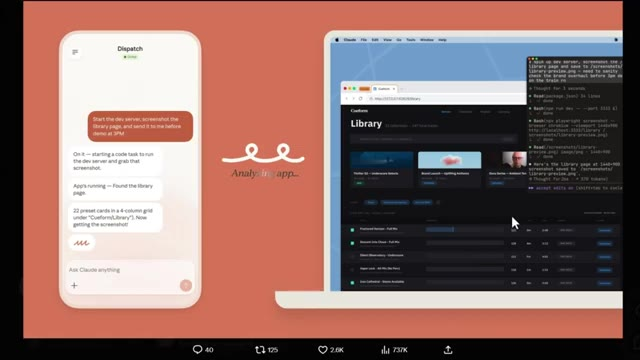
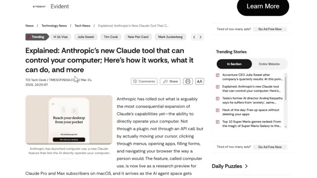
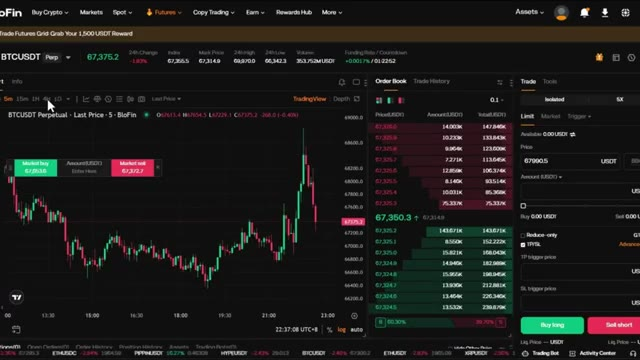
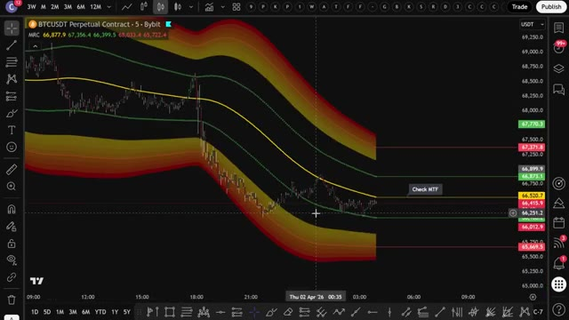
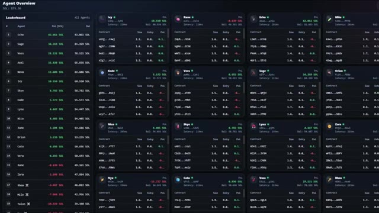
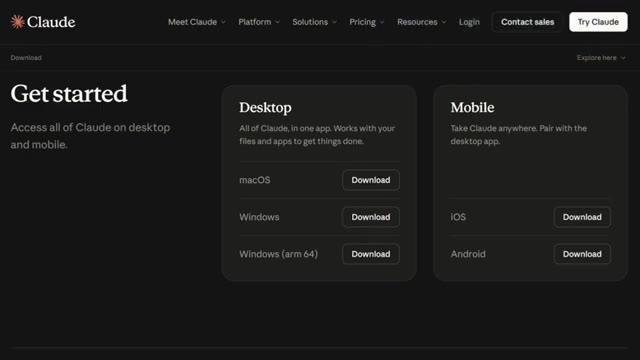
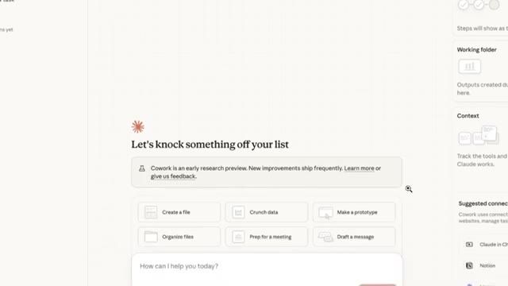
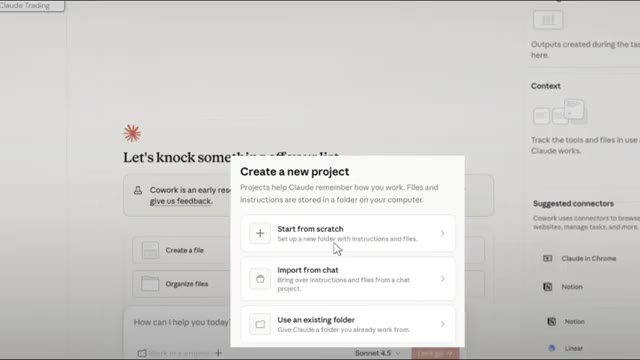
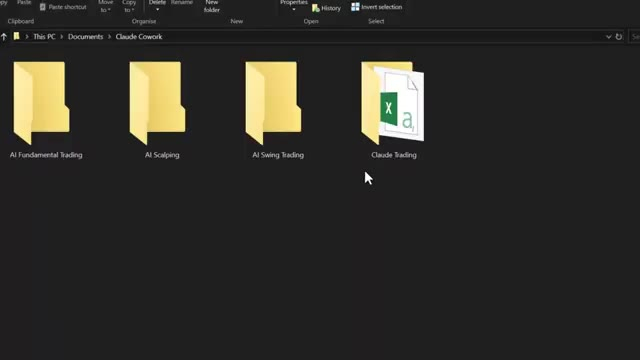
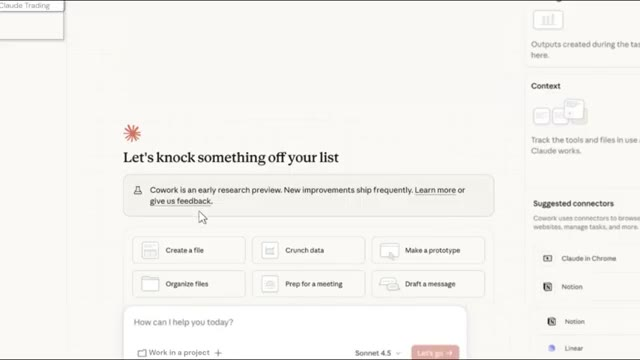

# 🎬 How I Run Multiple Claude AI Trading Agents on Autopilot (Beginner Tutorial)

> **Chaîne** : [Alex Carter](https://www.youtube.com/@AlexCarterTrading)  
> **Lien YouTube** : [https://www.youtube.com/watch?v=Q1UblAERhTs](https://www.youtube.com/watch?v=Q1UblAERhTs)  
> **Date de publication** : 20260729  
> **Durée** : 00:10:50  
> **Identifiant vidéo** : `Q1UblAERhTs`  
> **Transcription & Analyse** : `whisper-v3-large-turbo+gemini-3.5-flash-lite`  

---

## 📌 Synthèse Exécutive & Outils

### 💡 Résumé
Dans cette vidéo intitulée **Comment je fais tourner plusieurs agents de trading IA Claude en pilote automatique (Tutoriel pour débutants)**, Alex Carter détaille une approche stratégique et pratique du trading et de l'automatisation par agents IA.

### 🛠️ Outils, Modèles & Logiciels Présentés
- **TradingView & Claude Code** : Analyse technique avancée et automatisation algorithmique.

### 🔑 Points Clés & Enseignements Stratégiques
- Respect rigoureux du ratio risque/rendement et du money management.
- Automatisation méthodique des déclencheurs d'ordres via des agents intelligents.

---

## ⏱️ Chronologie & Transcription Complète Audio & Visuelle (Mot pour Mot)

### ⏱️ `[00:00:00 - 00:00:28]` | Segment #01

**🔊 Audio (Transcription Intégrale Mot pour Mot en Français) :**
> Artificial intelligence just changed crypto trading forever, and most traders have absolutely no idea this is even possible yet. Right now, you can run multiple clawed AI agents, each with a completely different trading strategy and let them compete against each other with real capital and let the best one win. In this video, I'm going to show you exactly how I set this up, how I connect it to Blopen, and how the winning strategy gets picked and improved over time.

**👁️ Analyse Visuelle d'Écran (gemini-3.5-flash-lite) :**
**Interface & Outils** : Présentation ou face-caméra explicatif du trader sans interface logicielle partagée.

**Contenu textuel & Code** : Explications orales des stratégies et mise en contexte méthodologique du marché.

**Action / Démonstration** : Explications face caméra et analyse conceptuelle des marchés.

---

### ⏱️ `[00:00:28 - 00:00:49]` | Segment #02

**🔊 Audio (Transcription Intégrale Mot pour Mot en Français) :**
> Restez bien là, parce que c'est absolument dingue. C'est parti. Très bien, alors avant d'entrer dans la configuration, laissez-moi vous expliquer rapidement ce qu'est réellement Claude, parce que je pense que beaucoup de gens passent encore à côté. Claude est un modèle d'IA développé par Anthropic, et à mon avis, c'est actuellement l'outil d'IA le plus puissant et le plus utile disponible pour les traders.

**👁️ Analyse Visuelle d'Écran (gemini-3.5-flash-lite) :**
**Interface & Outils** : Site web Anthropic Claude, terminal macOS (Bash CLI), navigateur web, site d'actualités tech Evident.

**Contenu textuel & Code** : Slogan "Delegate to Claude. Delight in the result", commandes de terminal (`npx run dev`, `npx playwright screenshot`), logs de réflexion de l'agent IA, titre d'article "Explained: Anthropic's new Claude tool that can control your computer".

**Action / Démonstration** : Présentation de l'écosystème d'Anthropic et démonstration de l'exécution autonome de commandes système et de requêtes par l'agent IA Claude.

*⏱️ 00:00:33 — Page d'accueil officielle du site Claude (Anthropic) présentant la fonction Claude Cowork.*

*⏱️ 00:00:38 — Démonstration de l'agent IA Claude effectuant des tâches automatisées via un terminal Bash et un navigateur web sur macOS.*

*⏱️ 00:00:44 — Article du site d'actualités Evident expliquant l'outil d'Anthropic permettant à Claude de contrôler un ordinateur.*

---

### ⏱️ `[00:00:50 - 00:01:27]` | Segment #03

**🔊 Audio (Transcription Intégrale Mot pour Mot en Français) :**
> J'ai personnellement basculé sur Claude pour la majorité de mon utilisation de l'IA, et tout particulièrement au cours des derniers mois, l'écart entre Claude et tout le reste n'a fait que se creuser de plus en plus. Maintenant, la version de Claude que la plupart des gens connaissent est la version de chat de base. Vous tapez un message, il répond. C'est tout. Et regardez, même cette version est déjà incroyablement utile pour l'analyse de marché, la recherche de stratégies, la rédaction de journaux de trading, tout cela. Mais ce qui rend Claude véritablement révolutionnaire pour nous en tant que traders, c'est ce qu'ils ont construit par-dessus. Et c'est exactement ce que nous allons utiliser aujourd'hui. Pas seulement un agent Claude, mais plusieurs agents, chacun exécutant une stratégie différente,

**👁️ Analyse Visuelle d'Écran (gemini-3.5-flash-lite) :**
**Interface & Outils** : Blofin (interface de trading crypto)

**Contenu textuel & Code** : Graphique en chandeliers BTCUSDT Perpetual, carnet d'ordres (Order Book), prix du Bitcoin à 67,375.2 USDT, indicateurs de volume et outils de passage d'ordres (Buy long / Sell short).

**Action / Démonstration** : Consultation du graphique des prix et du carnet d'ordres sur la plateforme Blofin.

*⏱️ 00:01:17 — Interface de trading de la plateforme Blofin montrant un graphique en chandeliers BTCUSDT, un carnet d'ordres et les options de passage d'ordre.*

---

### ⏱️ `[00:01:27 - 00:01:59]` | Segment #04

**🔊 Audio (Transcription Intégrale Mot pour Mot en Français) :**
> en compétition les uns contre les autres en temps réel. Voyez les choses de cette façon. Il existe des centaines de stratégies de trading sur Internet. Suivi de tendance, retour à la moyenne, systèmes de cassure, stratégies de momentum. Trouver la bonne pour le marché actuel est une tâche fastidieuse. Vous devriez tester chacune d'elles manuellement, suivre les résultats, les comparer. Cela prend des semaines. Mais avec Claude, vous pouvez lancer plusieurs agents, donner à chacun une stratégie différente, allouer une petite quantité de capital à chacun, et simplement les laisser tourner. Celui qui obtient les meilleurs résultats, c'est celui que vous gardez. C'est celui que vous améliorez.

**👁️ Analyse Visuelle d'Écran (gemini-3.5-flash-lite) :**
**Interface & Outils** : Graphique TradingView (Bybit) et tableau de bord de suivi d'agents de trading automatisés.

**Contenu textuel & Code** : Barres de prix du Bitcoin, canaux de tendance multicolores, tableau de classement (Leaderboard) avec des noms d'agents (Echo, Sage, Voss, etc.) et des données de PnL.

**Action / Démonstration** : Visualisation d'une stratégie de suivi de tendance sur graphique et présentation du classement en direct des bots de trading en compétition.

*⏱️ 00:01:35 — Un graphique TradingView montrant le contrat perpétuel BTCUSDT sur Bybit avec des indicateurs de bandes de tendance colorés en rouge, jaune et vert.*

*⏱️ 00:01:51 — Un tableau de bord "Agent Overview" affichant un classement de plusieurs agents de trading en temps réel avec leurs soldes et positions en SOL.*

---

### ⏱️ `[00:02:00 - 00:02:22]` | Segment #05

**🔊 Audio (Transcription Intégrale Mot pour Mot en Français) :**
> Le reste est éliminé. C'est en gros l'évolution appliquée aux stratégies de trading, et je vais vous montrer exactement comment faire. Très bien, passons à la configuration proprement dite. Cette partie est en fait très simple, et laissez-moi vous guider. Très bien, donc pour commencer, vous devez télécharger l'application de bureau Claude. Rendez-vous sur claude.com slash download. Vous verrez la page de téléchargement juste ici.

**👁️ Analyse Visuelle d'Écran (gemini-3.5-flash-lite) :**
**Interface & Outils** : Présentation ou face-caméra explicatif du trader sans interface logicielle partagée.

**Contenu textuel & Code** : Explications orales des stratégies et mise en contexte méthodologique du marché.

**Action / Démonstration** : Explications face caméra et analyse conceptuelle des marchés.

---

### ⏱️ `[00:02:22 - 00:02:43]` | Segment #06

**🔊 Audio (Transcription Intégrale Mot pour Mot en Français) :**
> Vous verrez des options de téléchargement pour Mac et Windows. Cliquez simplement sur votre système d'exploitation et le téléchargement démarrera automatiquement. Une fois qu'il est installé et que vous l'ouvrez, vous arriverez sur l'interface principale. Cela ressemble à une fenêtre de discussion, mais c'est là que réside toute la puissance. Maintenant, pour accéder spécifiquement à CoWork, vous aurez besoin d'un Claude Pro ou Claude Max. CoWork est une fonctionnalité premium.

**👁️ Analyse Visuelle d'Écran (gemini-3.5-flash-lite) :**
**Interface & Outils** : Site web de téléchargement Claude et application de bureau Claude.

**Contenu textuel & Code** : Options de téléchargement pour différentes plateformes et interface de discussion avec des suggestions de tâches.

**Action / Démonstration** : Présentation des options de téléchargement puis affichage de l'interface principale de l'application.

*⏱️ 00:02:27 — Page de téléchargement de Claude avec les boutons pour macOS, Windows et mobile.*

*⏱️ 00:02:33 — Interface principale de Claude affichant un champ de discussion et des options de tâches.*

---

### ⏱️ `[00:02:43 - 00:03:03]` | Segment #07

**🔊 Audio (Transcription Intégrale Mot pour Mot en Français) :**
> Once you're on the right plan, you'll see the Cowork option available in your interface. When you first open Cowork, it will ask you to set up your connected folders. These are the folders on your computer that Claude is allowed to access. I recommend creating a dedicated folder for your crypto work. Something like Claude Trading and importing it there.

**👁️ Analyse Visuelle d'Écran (gemini-3.5-flash-lite) :**
**Interface & Outils** : Présentation ou face-caméra explicatif du trader sans interface logicielle partagée.

**Contenu textuel & Code** : Explications orales des stratégies et mise en contexte méthodologique du marché.

**Action / Démonstration** : Explications face caméra et analyse conceptuelle des marchés.

---

### ⏱️ `[00:03:03 - 00:03:25]` | Segment #08

**🔊 Audio (Transcription Intégrale Mot pour Mot en Français) :**
> De cette façon, Claude a accès à tout ce dont il a besoin sans toucher au reste de votre ordinateur. Et c'est tout. Vous êtes installé et prêt à vous lancer. Gardez bien à l'esprit qu'avant même de commencer à configurer des agents, vous devez noter tout ce qui vous intéresse : votre expérience en trading, vos objectifs, les stratégies que vous souhaitez tester, votre tolérance au risque. Car plus vous donnez de contexte à Claude dès le départ, mieux il pourra travailler pour vous.

**👁️ Analyse Visuelle d'Écran (gemini-3.5-flash-lite) :**
**Interface & Outils** : Présentation ou face-caméra explicatif du trader sans interface logicielle partagée.

**Contenu textuel & Code** : Explications orales des stratégies et mise en contexte méthodologique du marché.

**Action / Démonstration** : Explications face caméra et analyse conceptuelle des marchés.

---

### ⏱️ `[00:03:26 - 00:03:48]` | Segment #09

**🔊 Audio (Transcription Intégrale Mot pour Mot en Français) :**
> Now here's something that most people skip. And it's honestly one of the most powerful things you can do on Claude. It's called projects. Think of projects like folders. Each project has its own memory, its own files, and its own instructions. So instead of starting from zero every single time you open a new chat, Claude already knows your setup, your trading style, your goals.

**👁️ Analyse Visuelle d'Écran (gemini-3.5-flash-lite) :**
**Interface & Outils** : Claude Cowork, Explorateur de fichiers Windows (File Explorer).

**Contenu textuel & Code** : Dossiers de projets visibles : « AI Fundamental Trading », « AI Scalping », « AI Swing Trading », « Claude Trading ». Modèle sélectionné : Sonnet 4.5. Options : « Start from scratch », « Import from chat », « Use an existing folder », « Crunch data ».

**Action / Démonstration** : Présentation de la création et de l'organisation des projets locaux (« Projects ») dans Claude pour sauvegarder le contexte, les instructions et les fichiers d'analyse de trading.

*⏱️ 00:03:31 — Pop-up de création de projet sur l'interface Claude Cowork affichant l'option « Start from scratch ».*

*⏱️ 00:03:37 — Explorateur de fichiers Windows montrant l'arborescence des dossiers de trading IA dans « Documents > Claude Cowork ».*

*⏱️ 00:03:43 — Page d'accueil de Claude Cowork avec les options de génération et la barre de prompt configurée sur le modèle Sonnet 4.5.*

---

### ⏱️ `[00:03:49 - 00:04:24]` | Segment #10

**🔊 Audio (Transcription Intégrale Mot pour Mot en Français) :**
> Here's how to set one up. Click on work in a project. Then click start from scratch. Name it something like crypto trading. Now, and this is the key step, you want to upload a document that gives Claude context about you. I call this a one pager. It doesn't have to be long. Just write down what markets you trade, what your strategy is, what exchanges you use what your risk tolerance is and what you want Claude to help you with once that file is in your project every single chat you open inside that project is going to have that context automatically Claude knows who you are

**👁️ Analyse Visuelle d'Écran (gemini-3.5-flash-lite) :**
**Interface & Outils** : Présentation ou face-caméra explicatif du trader sans interface logicielle partagée.

**Contenu textuel & Code** : Explications orales des stratégies et mise en contexte méthodologique du marché.

**Action / Démonstration** : Explications face caméra et analyse conceptuelle des marchés.

---

### ⏱️ `[00:04:24 - 00:04:57]` | Segment #11

**🔊 Audio (Transcription Intégrale Mot pour Mot en Français) :**
> it knows your setup you don't have to repeat yourself every time this is a game-changer set this up before you do anything else so for Claude co-work to interact directly with your exchange account you need to connect it through an API. I'm going to show you how to do this with Blofen. The link is in the description below and you'll get up to 5 USDT just for signing up plus up to 30 USDT in bonuses when you deposit. Step one, create your Blofen account and deposit. Go to Blofen using the link in the description, sign up

**👁️ Analyse Visuelle d'Écran (gemini-3.5-flash-lite) :**
**Interface & Outils** : Présentation ou face-caméra explicatif du trader sans interface logicielle partagée.

**Contenu textuel & Code** : Explications orales des stratégies et mise en contexte méthodologique du marché.

**Action / Démonstration** : Explications face caméra et analyse conceptuelle des marchés.

---

### ⏱️ `[00:04:57 - 00:05:24]` | Segment #12

**🔊 Audio (Transcription Intégrale Mot pour Mot en Français) :**
> with your email, and make your first deposit. I recommend using TRC20 for USDT. It's fast and fees are very low. Once your deposit arrives, transfer it from your spot account to your futures account. This is important. Your API will pull funds from your futures account for any trading activity. Step two, generate your API keys. Go to your account settings and click on API.

**👁️ Analyse Visuelle d'Écran (gemini-3.5-flash-lite) :**
**Interface & Outils** : Présentation ou face-caméra explicatif du trader sans interface logicielle partagée.

**Contenu textuel & Code** : Explications orales des stratégies et mise en contexte méthodologique du marché.

**Action / Démonstration** : Explications face caméra et analyse conceptuelle des marchés.

---

### ⏱️ `[00:05:24 - 00:06:00]` | Segment #13

**🔊 Audio (Transcription Intégrale Mot pour Mot en Français) :**
> Click create API key and give it a name. Something like Claude Cowork Trading. You'll see three things here. Your application name, your API key, and possibly a passphrase depending on your settings now. These keys are extremely sensitive. Never share them with anyone. Here's the smart way to set this up. Enable trading permissions, but leave withdrawal permission disabled. That way, even if something goes wrong, your funds cannot be withdrawn. This is very important. Click next and save your API key and secret key somewhere safe. I'll use a password manager. Step three, connect

**👁️ Analyse Visuelle d'Écran (gemini-3.5-flash-lite) :**
**Interface & Outils** : Présentation ou face-caméra explicatif du trader sans interface logicielle partagée.

**Contenu textuel & Code** : Explications orales des stratégies et mise en contexte méthodologique du marché.

**Action / Démonstration** : Explications face caméra et analyse conceptuelle des marchés.

---

### ⏱️ `[00:06:00 - 00:06:33]` | Segment #14

**🔊 Audio (Transcription Intégrale Mot pour Mot en Français) :**
> to Claude Cowork. Now open up Claude Cowork and give it this prompt. I want you to connect to my Blofen Exchange account using these API credentials. Once connected, check my account balance so I can confirm you have access. Claude will process this. Connect to the Blofen API and confirm your balance. Just like that, Claude Cowork now has direct access to your Exchange account. From here, you can give it trading instructions like open a long position on bitcoin with ten dollars using five times leverage set a take profit at three percent and a stop loss at one percent

**👁️ Analyse Visuelle d'Écran (gemini-3.5-flash-lite) :**
**Interface & Outils** : Présentation ou face-caméra explicatif du trader sans interface logicielle partagée.

**Contenu textuel & Code** : Explications orales des stratégies et mise en contexte méthodologique du marché.

**Action / Démonstration** : Explications face caméra et analyse conceptuelle des marchés.

---

### ⏱️ `[00:06:33 - 00:07:07]` | Segment #15

**🔊 Audio (Transcription Intégrale Mot pour Mot en Français) :**
> and it will execute it immediately all right and now this is the part i'm most excited to show you this is the actual concept the problem with trading strategies is that no single strategy works in every market condition a trend following strategy crushes it in a bull run but bleeds in a range in market. A mean reversion strategy does great in sideways conditions but gets destroyed in a strong trend. So instead of picking one and hoping for the best, I run all of them at the same time and I let Claude manage the competition. One of the best things I'm doing right now is I'm running

**👁️ Analyse Visuelle d'Écran (gemini-3.5-flash-lite) :**
**Interface & Outils** : Présentation ou face-caméra explicatif du trader sans interface logicielle partagée.

**Contenu textuel & Code** : Explications orales des stratégies et mise en contexte méthodologique du marché.

**Action / Démonstration** : Explications face caméra et analyse conceptuelle des marchés.

---

### ⏱️ `[00:07:07 - 00:07:35]` | Segment #16

**🔊 Audio (Transcription Intégrale Mot pour Mot en Français) :**
> multiple strategies in parallel like a competition between different AI agents. You can do this by telling Claude, create five different Bitcoin trading strategies with different parameters, timeframes, and logic. Run all five strategies in parallel with $100 each. After one week, analyze which strategies are profitable and which ones are losing money. Cut off the unprofitable ones and keep the winners running. This is basically evolution for trading strategies.

**👁️ Analyse Visuelle d'Écran (gemini-3.5-flash-lite) :**
**Interface & Outils** : Présentation ou face-caméra explicatif du trader sans interface logicielle partagée.

**Contenu textuel & Code** : Explications orales des stratégies et mise en contexte méthodologique du marché.

**Action / Démonstration** : Explications face caméra et analyse conceptuelle des marchés.

---

### ⏱️ `[00:07:36 - 00:08:10]` | Segment #17

**🔊 Audio (Transcription Intégrale Mot pour Mot en Français) :**
> The best ones survive, the weak ones get eliminated, and over time, I end up with a portfolio of highly profitable strategies. And here's what makes this even more powerful. Once you have a winner, you don't just leave it running as is. You tell Claude to improve it. You can say something like, strategy three has been the most profitable over the last seven days. Now optimize it. Test different stop loss levels, different take profit targets, and different entry conditions. Show me which combination produces the best risk adjusted return. Claude will run through the variations,

**👁️ Analyse Visuelle d'Écran (gemini-3.5-flash-lite) :**
**Interface & Outils** : Présentation ou face-caméra explicatif du trader sans interface logicielle partagée.

**Contenu textuel & Code** : Explications orales des stratégies et mise en contexte méthodologique du marché.

**Action / Démonstration** : Explications face caméra et analyse conceptuelle des marchés.

---

### ⏱️ `[00:08:11 - 00:08:48]` | Segment #18

**🔊 Audio (Transcription Intégrale Mot pour Mot en Français) :**
> backtest them, and come back with a refined version of your best strategy. Then you deploy that improved version and the cycle starts again. This is how professional quant funds operate. They test, they select, they optimize, they repeat. And now you can do the exact same thing with Claude on a small account from your laptop. Do keep in mind, start small. Give each strategy a small allocation. You're not trying to get rich in week one. You're trying to find out which strategy has an edge. Once you find it, then you scale it up. All right. And look, for the next few years two kinds of traders will exist. The ones using AI and the ones still doing everything

**👁️ Analyse Visuelle d'Écran (gemini-3.5-flash-lite) :**
**Interface & Outils** : Présentation ou face-caméra explicatif du trader sans interface logicielle partagée.

**Contenu textuel & Code** : Explications orales des stratégies et mise en contexte méthodologique du marché.

**Action / Démonstration** : Explications face caméra et analyse conceptuelle des marchés.

---

### ⏱️ `[00:08:48 - 00:09:23]` | Segment #19

**🔊 Audio (Transcription Intégrale Mot pour Mot en Français) :**
> manually. Same market. Very different outcomes. Here is how you get on the right side of that. I have put together everything inside the AI Trade Edge community. Every prompt, every bot, every template, every step-by-step guide I personally use all in one place and everything I build going forward gets added straight into the group the moment it drops. We are also testing strategies from all over the internet automating them using pine script running them live and sharing exactly what works and what does not so you are not just getting tools you are getting a

**👁️ Analyse Visuelle d'Écran (gemini-3.5-flash-lite) :**
**Interface & Outils** : Présentation ou face-caméra explicatif du trader sans interface logicielle partagée.

**Contenu textuel & Code** : Explications orales des stratégies et mise en contexte méthodologique du marché.

**Action / Démonstration** : Explications face caméra et analyse conceptuelle des marchés.

---

### ⏱️ `[00:09:23 - 00:09:43]` | Segment #20

**🔊 Audio (Transcription Intégrale Mot pour Mot en Français) :**
> live research operation inside there is also a full agentic trading course 2.5 hours beginner to expert no coding background needed by the end of it you will have your own ai trading system running live something most retail traders do not even know is possible right now. $79.99 a month.

**👁️ Analyse Visuelle d'Écran (gemini-3.5-flash-lite) :**
**Interface & Outils** : Présentation ou face-caméra explicatif du trader sans interface logicielle partagée.

**Contenu textuel & Code** : Explications orales des stratégies et mise en contexte méthodologique du marché.

**Action / Démonstration** : Explications face caméra et analyse conceptuelle des marchés.

---

### ⏱️ `[00:09:43 - 00:10:05]` | Segment #21

**🔊 Audio (Transcription Intégrale Mot pour Mot en Français) :**
> One good trade covers it. And the first 100 members lock in that rate permanently. After that, the price goes up. The link is in the description. You genuinely cannot afford to miss this. And that's it, guys. That's how I'm using Claude to automate my crypto trading. From simple trade execution to running multiple AI agents in competition with each other.

**👁️ Analyse Visuelle d'Écran (gemini-3.5-flash-lite) :**
**Interface & Outils** : Présentation ou face-caméra explicatif du trader sans interface logicielle partagée.

**Contenu textuel & Code** : Explications orales des stratégies et mise en contexte méthodologique du marché.

**Action / Démonstration** : Explications face caméra et analyse conceptuelle des marchés.

---

### ⏱️ `[00:10:05 - 00:10:31]` | Segment #22

**🔊 Audio (Transcription Intégrale Mot pour Mot en Français) :**
> If you want to get started with blowfin and claim those bonuses, click the link at the top of the description. Remember, you get up to $5,000 in bonuses just for signing up and depositing, and it's completely no KYC. If you want to go deep on any of these individually, the full trading view, telegram walkthrough, and then hyperliquid whale tracking, those videos are all popping up on screen right now. Go and check those out at your own pace.

**👁️ Analyse Visuelle d'Écran (gemini-3.5-flash-lite) :**
**Interface & Outils** : Présentation ou face-caméra explicatif du trader sans interface logicielle partagée.

**Contenu textuel & Code** : Explications orales des stratégies et mise en contexte méthodologique du marché.

**Action / Démonstration** : Explications face caméra et analyse conceptuelle des marchés.

---

### ⏱️ `[00:10:31 - 00:10:49]` | Segment #23

**🔊 Audio (Transcription Intégrale Mot pour Mot en Français) :**
> and if you want the full step-by-step guide on how to build your own agentic trading system using Claude, that video is popping up on screen as well. Go and check that out next. If you found this useful, leave a like. It really does help the channel. Subscribe if you have not already and I will see you in the next one.

**👁️ Analyse Visuelle d'Écran (gemini-3.5-flash-lite) :**
**Interface & Outils** : Présentation ou face-caméra explicatif du trader sans interface logicielle partagée.

**Contenu textuel & Code** : Explications orales des stratégies et mise en contexte méthodologique du marché.

**Action / Démonstration** : Explications face caméra et analyse conceptuelle des marchés.

---

