# 🎬 I Tested Every AI Bot on MEXC vs Blofin (Here’s The Clear Winner)

> **Chaîne** : [Alex Carter](https://www.youtube.com/@AlexCarterTrading)  
> **Lien YouTube** : [https://www.youtube.com/watch?v=1MoiCZEAaG0](https://www.youtube.com/watch?v=1MoiCZEAaG0)  
> **Date de publication** : 20260730  
> **Durée** : 00:25:57  
> **Identifiant vidéo** : `1MoiCZEAaG0`  
> **Transcription & Analyse** : `whisper-v3-large-turbo+gemini-3.5-flash-lite`  

---

## 📌 Synthèse Exécutive & Outils

### 💡 Résumé
Dans cette vidéo intitulée **J'ai testé tous les bots IA de MEXC vs Blofin (Voici le vainqueur incontestable)**, Alex Carter détaille une approche stratégique et pratique du trading et de l'automatisation par agents IA.

### 🛠️ Outils, Modèles & Logiciels Présentés
- **TradingView & Claude Code** : Analyse technique avancée et automatisation algorithmique.

### 🔑 Points Clés & Enseignements Stratégiques
- Respect rigoureux du ratio risque/rendement et du money management.
- Automatisation méthodique des déclencheurs d'ordres via des agents intelligents.

---

## ⏱️ Chronologie & Transcription Complète Audio & Visuelle (Mot pour Mot)

### ⏱️ `[00:00:00 - 00:00:33]` | Segment #01

**🔊 Audio (Transcription Intégrale Mot pour Mot en Français) :**
> J'ai testé des robots de copy trading sur deux des plus grands exchanges sans KYC du marché, Mexi et Blofen. Et après avoir fait tourner les deux côte à côte, il y a un vainqueur évident. Même marché, mêmes conditions, des résultats complètement différents. Dans cette vidéo, je vais vous guider exactement sur la façon de configurer des robots de DCA et des robots de grille en copy trading sur les deux plateformes, étape par étape, afin que vous puissiez voir exactement ce que j'ai vu. Ensuite, à la fin, je vous dirai lequel j'utilise réellement avec mon propre argent. Commençons d'abord par Mexi. Première chose à faire, vous avez besoin d'un compte Mexi. Si vous n'en avez pas encore,

**👁️ Analyse Visuelle d'Écran (gemini-3.5-flash-lite) :**
**Interface & Outils** : Interface web d'échange de cryptomonnaies (Mexi / Blofin).

**Contenu textuel & Code** : Paramètres de configuration d'un plan DCA (sélection de tokens, intervalle, montant par tour) et profils de traders avec leurs performances sur 7 jours (+120.64% pour Kacheli, +448.28% pour MadMax36, +89.22% pour Mexctrader).

**Action / Démonstration** : Configuration d'un bot de trading et consultation des recommandations de copy trading.

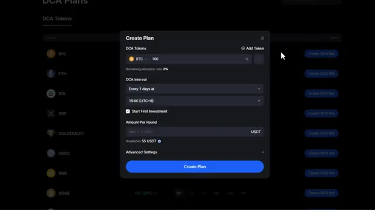
*⏱️ 00:00:08 — Interface de création d'un plan DCA (Dollar-Cost Averaging) sur une plateforme de trading.*

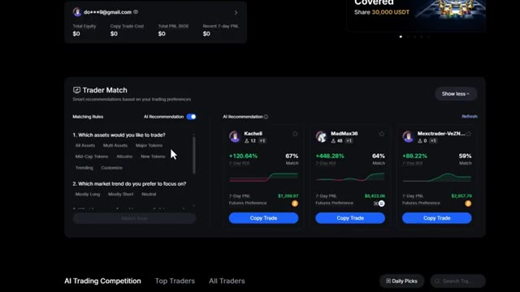
*⏱️ 00:00:17 — Interface de "Trader Match" avec des recommandations de traders à copier intégrant des statistiques de performance.*

---

### ⏱️ `[00:00:33 - 00:00:53]` | Segment #02

**🔊 Audio (Transcription Intégrale Mot pour Mot en Français) :**
> Cliquez sur le lien dans la description. Vous obtiendrez un bon d'achat de 10 USDT rien qu'en créant un nouveau compte. Un autre bon d'achat de 10 USDT lorsque vous téléchargez et vous connectez sur l'application Mexi. En plus de cela, vous obtenez 770 USDT de récompenses pour les nouveaux utilisateurs, incluant des bonus sur les contrats à terme, des airdrops de positions et des bons d'achat.

**👁️ Analyse Visuelle d'Écran (gemini-3.5-flash-lite) :**
**Interface & Outils** : Site web de l'échangeur de cryptomonnaies MEXC (Rewards Hub).

**Contenu textuel & Code** : Bons d'achat et bonus de 10 USDT, 50 USDT, et le total de 770 USDT de récompenses pour nouveaux utilisateurs.

**Action / Démonstration** : Navigation et présentation des récompenses et bonus disponibles sur la plateforme MEXC pour les nouveaux inscrits.

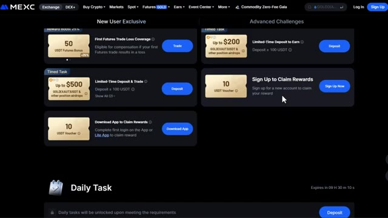
*⏱️ 00:00:38 — Interface du Rewards Hub de l'échangeur MEXC montrant les différentes tâches pour nouveaux utilisateurs et les bons d'achat de 10 USDT.*

*⏱️ 00:00:48 — Interface du Rewards Hub de l'échangeur MEXC affichant l'offre de récompenses allant jusqu'à 770 USDT pour les nouveaux utilisateurs.*

---

### ⏱️ `[00:00:53 - 00:01:27]` | Segment #03

**🔊 Audio (Transcription Intégrale Mot pour Mot en Français) :**
> Donc utilisez définitivement le lien dans la description. Ces bonus sont uniquement disponibles via mon lien et c'est littéralement de l'argent gratuit que vous pouvez utiliser pour commencer à trader. Une fois connecté, assurez-vous d'avoir des fonds sur votre compte, si vous avez besoin de faire un dépôt, cliquez sur dépôt dans le coin supérieur droit et cliquez sur dépôt en chaîne, sélectionnez l'USDT, choisissez votre réseau, je recommande TRC20 pour des frais bas, et envoyez vos fonds depuis votre autre échange ou portefeuille, ils arriveront en quelques minutes. Maintenant, passons aux bots, le premier bot que nous allons couvrir est le bot DCA au comptant, c'est parfait si vous voulez un

**👁️ Analyse Visuelle d'Écran (gemini-3.5-flash-lite) :**
**Interface & Outils** : MEXC Exchange (plateforme d'échange de cryptomonnaies)

**Contenu textuel & Code** : Solde de 55 USDT, options de dépôt, sélection de réseaux et frais de trading (Maker 0.01%, Taker 0.04%).

**Action / Démonstration** : Navigation sur la plateforme MEXC pour montrer le processus de dépôt et la configuration du compte.

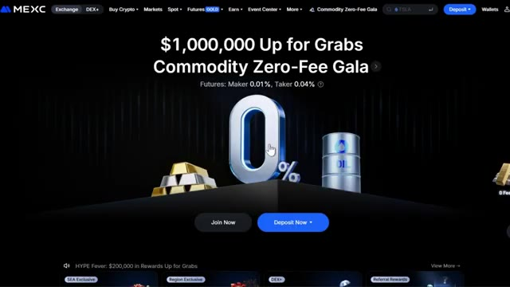
*⏱️ 00:01:01 — Page d'accueil de la plateforme d'échange MEXC présentant une promotion « Commodity Zero-Fee Gala » avec des frais de 0.01% pour le Maker et 0.04% pour le Taker.*

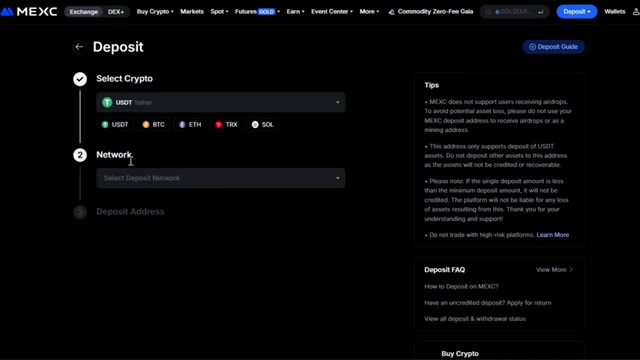
*⏱️ 00:01:10 — Interface de dépôt de la plateforme MEXC montrant la sélection de cryptomonnaies (USDT, BTC, ETH, TRX, SOL) et de réseau.*

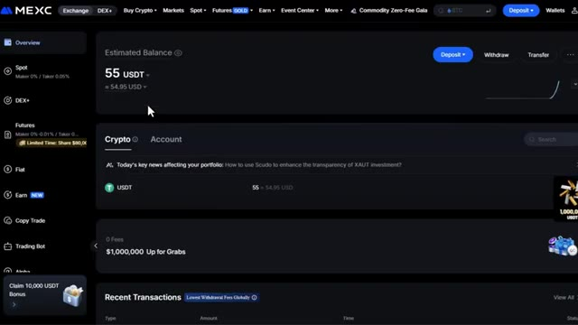
*⏱️ 00:01:18 — Tableau de bord du compte utilisateur sur MEXC affichant un solde estimé de 55 USDT (équivalent à 54.95 USD).*

---

### ⏱️ `[00:01:27 - 00:02:03]` | Segment #04

**🔊 Audio (Transcription Intégrale Mot pour Mot en Français) :**
> lissez vos achats de Bitcoin, d'Ethereum ou de toute autre cryptomonnaie grâce au coût moyen par dollar de manière automatique, sans avoir à chronométrer le marché. Pour y accéder, survolez l'onglet « Spot » dans le menu supérieur et sélectionnez les robots DCA Spot. Cela vous amènera au tableau de bord. En haut, vous pouvez voir vos avoirs, vos profits et pertes, ainsi que le nombre de robots que vous avez actuellement actifs. Faites défiler un peu vers le bas et vous verrez différentes catégories : vous avez les jetons principaux, c'est-à-dire le type d'actifs dans lesquels vous souhaitez investir. Maintenant, sous les plans DCA, vous pouvez voir les jetons individuels.

**👁️ Analyse Visuelle d'Écran (gemini-3.5-flash-lite) :**
**Interface & Outils** : Interface web de l'échange de cryptomonnaies MEXC.

**Contenu textuel & Code** : Menus déroulants de navigation, options de robots DCA Spot, statistiques de portefeuille (My Holdings, Total PNL, Active), cartes de performances à 1 an (Major Tokens -21,21 %, POW -8,21 %, Public chain coins -20,85 %) et section DCA Plans.

**Action / Démonstration** : Navigation dans les menus de la plateforme MEXC pour accéder à la section Spot DCA et exploration du tableau de bord des robots d'investissement automatique.

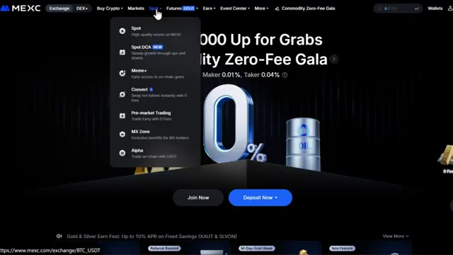
*⏱️ 00:01:36 — Page d'accueil de la plateforme MEXC montrant le menu supérieur et le survol de l'onglet « Spot » avec le sous-menu « Spot DCA ».*

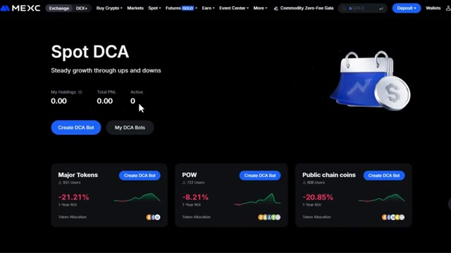
*⏱️ 00:01:45 — Tableau de bord « Spot DCA » sur MEXC affichant les portefeuilles, le PnL total, le nombre de robots actifs et différentes catégories de tokens.*

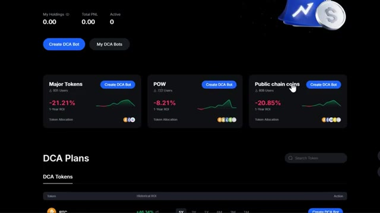
*⏱️ 00:01:54 — Vue détaillée du tableau de bord « Spot DCA » avec les cartes des tokens majeurs, POW, coins de chaînes publiques et la section des plans DCA.*

---

### ⏱️ `[00:02:03 - 00:02:28]` | Segment #05

**🔊 Audio (Transcription Intégrale Mot pour Mot en Français) :**
> comme Bitcoin, Ethereum et Solana. Pour chaque jeton, vous pouvez voir le retour sur investissement historique. Cela vous montre à quel point une stratégie d'investissement programmé aurait performé au fil du temps. Vous pouvez basculer le retour sur investissement historique selon différentes périodes ici. Vous pouvez choisir entre cinq ans, trois ans, un an, et tout descendre jusqu'à un mois. Cela vous donne une bonne idée de la régularité de l'investissement programmé pour cet actif spécifique.

**👁️ Analyse Visuelle d'Écran (gemini-3.5-flash-lite) :**
**Interface & Outils** : Interface web de gestion de plans DCA et de bots de trading.

**Contenu textuel & Code** : Liste de crypto-monnaies (BTC, ETH, SOL, XRP, GOLD/XAUT, USDC, BNB, DOGE) avec leurs pourcentages de ROI historique respectifs (+46,34%, +36,09%, +497,43%, +225,36%, etc.) et des sélecteurs de périodes (5Y, 3Y, 1Y, 6M, 3M, 1M).

**Action / Démonstration** : Navigation et survol de la liste des jetons et de leurs performances historiques de DCA par le curseur de la souris.

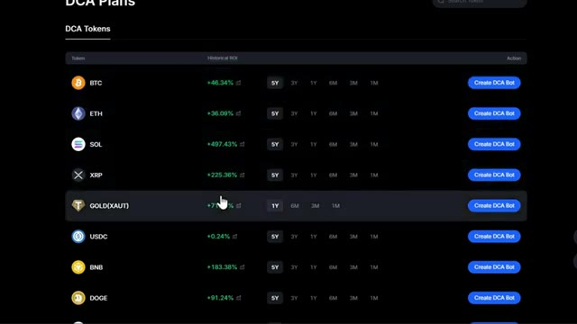
*⏱️ 00:02:09 — Tableau des plans DCA affichant la liste des jetons, le retour sur investissement historique (Historical ROI) sur différentes périodes et les boutons pour créer un bot DCA.*

---

### ⏱️ `[00:02:29 - 00:03:06]` | Segment #06

**🔊 Audio (Transcription Intégrale Mot pour Mot en Français) :**
> Une fois que vous avez trouvé la pièce dans laquelle vous souhaitez investir, cliquez sur créer un bot DCA. C'est ici que vous créez votre plan. D'abord, vous pouvez ajouter des jetons. Vous pouvez sélectionner jusqu'à 10 jetons différents si vous souhaitez diversifier votre stratégie DCA sur plusieurs pièces. Ensuite, vous verrez le ratio d'allocation. C'est ainsi que vous souhaitez répartir votre investissement par pièce. Par exemple, si vous investissez dans le Bitcoin et l'Ethereum, vous pouvez allouer 50 % à chacun ou 70 % au Bitcoin et 30 % à l'Ethereum, selon votre préférence. Maintenant, définissez votre intervalle DCA. Vous pouvez choisir entre horaire, quotidien, hebdomadaire ou mensuel. Cliquez sur plus d'options

**👁️ Analyse Visuelle d'Écran (gemini-3.5-flash-lite) :**
**Interface & Outils** : Interface web d'une plateforme de trading ou d'investissement (plan DCA).

**Contenu textuel & Code** : Liste de jetons (BTC, ETH, SOL, XRP, GOLD, USDC, BNB) avec leurs prix actuels et variations en pourcentage, ainsi qu'un compteur "1/10 Selected".

**Action / Démonstration** : Sélection d'un jeton (BTC) pour l'ajouter à la stratégie DCA.

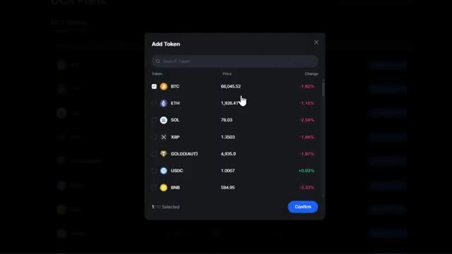
*⏱️ 00:02:38 — Fenêtre modale "Add Token" affichant une liste de cryptomonnaies avec leurs prix et variations pour la création d'un plan DCA.*

---

### ⏱️ `[00:03:06 - 00:03:40]` | Segment #07

**🔊 Audio (Transcription Intégrale Mot pour Mot en Français) :**
> ici pour voir tous les intervalles disponibles. Vous pouvez également sélectionner à quelle heure de la journée vous voulez que le bot achète. C'est utile si vous voulez acheter à un moment précis où vous pensez que le marché est généralement plus bas. Il y a aussi une option pour démarrer le premier investissement immédiatement. Si vous activez ceci, le bot fera son premier achat dès que vous l'aurez activé. Ensuite, entrez combien de USDT vous voulez investir par tour. C'est le montant que le bot dépensera à chaque fois qu'il achète selon votre intervalle. Maintenant, si vous cliquez sur les paramètres avancés, vous obtenez encore plus de contrôle. Ici, vous pouvez modifier les

**👁️ Analyse Visuelle d'Écran (gemini-3.5-flash-lite) :**
**Interface & Outils** : Interface web de création de plan DCA sur une plateforme de trading.

**Contenu textuel & Code** : Menus de sélection horaire (11:00 à 15:00) avec les fuseaux horaires (UTC+4 à UTC+8), option "Start First Investment", champ pour le montant par tour et bouton de validation "Create Plan".

**Action / Démonstration** : Configuration des paramètres temporels et d'investissement pour la création d'un bot DCA automatisé.

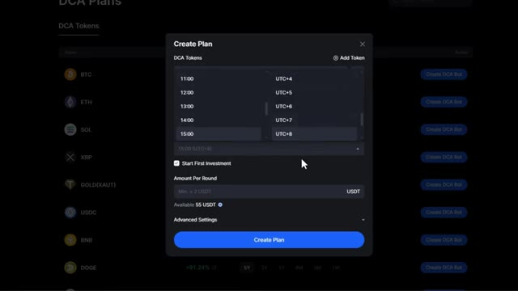
*⏱️ 00:03:15 — Interface de configuration d'un plan DCA montrant le menu déroulant pour sélectionner l'heure et le fuseau horaire.*

---

### ⏱️ `[00:03:40 - 00:04:02]` | Segment #08

**🔊 Audio (Transcription Intégrale Mot pour Mot en Français) :**
> nom de votre bot DCA. C'est utile si vous faites tourner plusieurs bots et que vous voulez les garder organisés. Vous pouvez aussi activer la fourchette de prix d'achat. Quand vous activez cette option, vous pouvez définir un prix inférieur et un prix supérieur. Cela signifie que le bot n'achètera que lorsque le prix se situera dans cette fourchette. C'est utile si vous voulez éviter d'acheter pendant des hausses extrêmes et seulement accumuler pendant les baisses ou la consolidation.

**👁️ Analyse Visuelle d'Écran (gemini-3.5-flash-lite) :**
**Interface & Outils** : Application Web / Plateforme d'échange de cryptomonnaies (fenêtre modale "Create Plan").

**Contenu textuel & Code** : Formulaire de configuration DCA : sélection du jeton (ETH - 30%), intervalle (Every 1 days at 15:00), montant par round (USDT), paramètres avancés ("Name": "BTC DCA Plan", "Buy Price Range" désactivé).

**Action / Démonstration** : Configuration des paramètres avancés du plan DCA avec attribution d'un nom spécifique au bot.

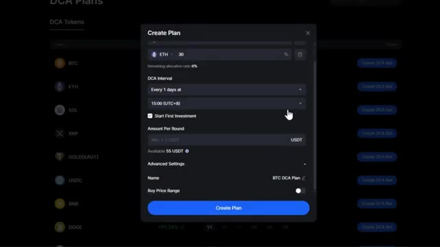
*⏱️ 00:03:45 — Interface de création d'un plan DCA (Dollar-Cost Averaging) avec les paramètres de configuration avancés et le nom du bot.*

---

### ⏱️ `[00:04:02 - 00:04:35]` | Segment #09

**🔊 Audio (Transcription Intégrale Mot pour Mot en Français) :**
> Une fois que vous avez terminé, cliquez sur créer un plan et votre bot DCA est actif. Il va maintenant investir automatiquement à l'intervalle que vous avez choisi sans que vous ayez à faire quoi que ce soit. Maintenant, si vous voulez rendre cela encore plus facile, remontez la page et découvrez les plans pré-faits. Ici, Mexi a déjà créé des plans DCA pour vous. Vous pouvez voir les cryptos, la répartition, les intervalles, et plus encore. Tout est fait pour vous. Tout ce que vous avez à faire est d'entrer le montant par cycle que vous souhaitez investir. Une fois que vous avez entré votre montant, cliquez simplement sur créer et c'est terminé. C'est le moyen le plus rapide de commencer avec le DCA si vous ne

**👁️ Analyse Visuelle d'Écran (gemini-3.5-flash-lite) :**
**Interface & Outils** : MEXC (Exchange crypto, Trading Bot / DCA Plan)

**Contenu textuel & Code** : Détails du bot DCA : PNL total, ROI, valeur du portefeuille, allocation de tokens (BTC 70%, ETH 30%), et paramètres de configuration du plan DCA (BTC 50%, ETH 30%, SOL 20%, intervalle et montant).

**Action / Démonstration** : Consultation des détails d'un bot DCA actif et configuration des paramètres de création d'un nouveau plan DCA.

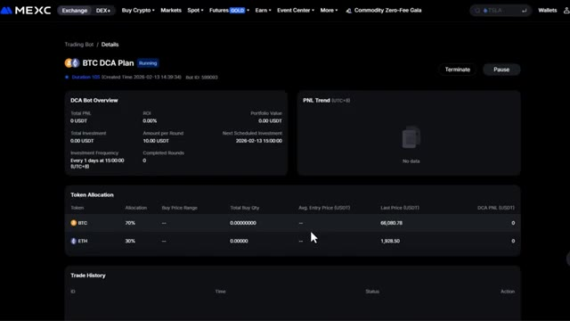
*⏱️ 00:04:11 — Interface MEXC affichant les détails d'un plan DCA Bitcoin actif (Running) avec aperçu du bot et allocation de tokens.*

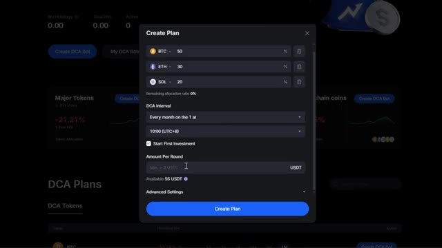
*⏱️ 00:04:27 — Fenêtre de création d'un plan DCA sur MEXC avec répartition des cryptos, intervalle et montant par tour.*

---

### ⏱️ `[00:04:35 - 00:05:02]` | Segment #10

**🔊 Audio (Transcription Intégrale Mot pour Mot en Français) :**
> voulez tout personnaliser vous-même. Le suivant est le Bot de Grille Futures. C'est idéal pour les marchés volatils où vous voulez profiter automatiquement des fluctuations de prix. Pour y accéder, survolez Futures dans le menu supérieur et sélectionnez le trading sur grille. Cela vous amène au panneau de trading sur grille futures. Il ressemble à une interface futures normale. Vous avez votre graphique de trading au milieu, le panneau de contrôle sur le côté droit, et vos positions en bas. Vous pouvez sélectionner votre paire de trading en haut à gauche.

**👁️ Analyse Visuelle d'Écran (gemini-3.5-flash-lite) :**
**Interface & Outils** : Plateforme d'échange de cryptomonnaies MEXC (interface Futures Grid).

**Contenu textuel & Code** : Graphique de prix en unités de 15 minutes, moyennes mobiles (MA), et options de configuration de bot de grille (Short-to-Mid Term Volatility, Mid-Term Volatility, Long-Term Volatility).

**Action / Démonstration** : Présentation de l'interface de configuration d'un Bot de Grille Futures avec des stratégies basées sur la volatilité.

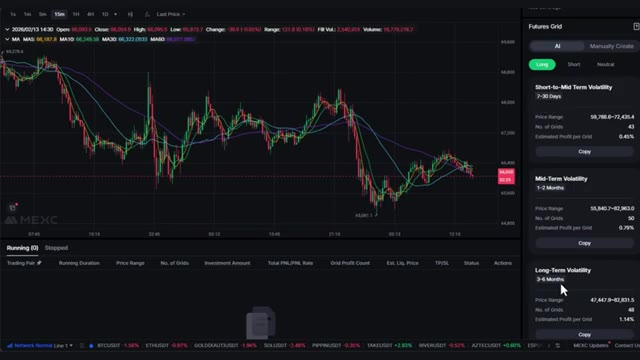
*⏱️ 00:04:42 — Interface de trading de contrats à terme (Futures Grid) sur MEXC, affichant un graphique de prix en chandeliers avec des moyennes mobiles à gauche et le panneau de configuration du bot de grille à droite.*

---

### ⏱️ `[00:05:02 - 00:05:33]` | Segment #11

**🔊 Audio (Transcription Intégrale Mot pour Mot en Français) :**
> Partons sur BTC slash USDT pour cet exemple. Vous pouvez rechercher n'importe quelle paire que vous voulez ici. Faites maintenant défiler vers le bas jusqu'au panneau des positions en bas. Une fois que vous avez un bot en cours d'exécution, vous verrez tous les détails importants ici. La paire de trading, la durée d'exécution, la fourchette de prix, le nombre de grilles, le montant de l'investissement, le P&L total, le nombre de profits de grille, le prix de liquidation, le take profit et le stop loss, le statut du bot et les actions que vous pouvez entreprendre. Sur le côté droit, vous verrez deux options, Mexi AI et créer manuellement.

**👁️ Analyse Visuelle d'Écran (gemini-3.5-flash-lite) :**
**Interface & Outils** : Échange de cryptomonnaies MEXC (interface Web de trading Futures Grid).

**Contenu textuel & Code** : Graphique en chandeliers pour la paire BTC/USDT (prix actuel à 66 057,6), indicateurs de moyennes mobiles (MA), et panneau latéral Futures Grid affichant des options de configuration pour différentes durées de volatilité.

**Action / Démonstration** : Navigation et présentation de la paire BTC/USDT ainsi que des paramètres de configuration pour un bot de trading automatisé de type Grid.

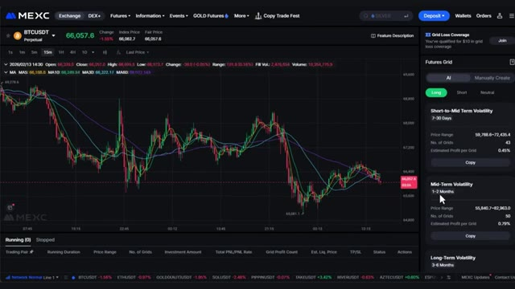
*⏱️ 00:05:10 — Capture d'écran de l'interface de l'échange MEXC montrant le graphique de la paire BTC/USDT en mode perpétuel avec des moyennes mobiles et le panneau de configuration d'un bot Grid Futures.*

---

### ⏱️ `[00:05:33 - 00:06:08]` | Segment #12

**🔊 Audio (Transcription Intégrale Mot pour Mot en Français) :**
> Commençons par la sélection de Mexi AI. Ici, vous pouvez choisir entre long, court et neutre, selon vos perspectives de marché. Mexi propose une sélection de robots IA selon votre horizon temporel. Vous pouvez choisir entre 7 et 30 jours, 1 à 2 mois, ou même 3 à 6 mois. C'est formidable car vous pouvez faire correspondre le robot à votre style de trading. Pour chaque robot IA, vous pouvez voir le nom, la চারchette de prix, le nombre de grilles à utiliser et le profit estimé par grille. Lorsque vous cliquez sur copier, cela montre sur le graphique exactement où les grilles achèteront ou vendront. Cela vous donne une représentation visuelle de la façon dont le robot

**👁️ Analyse Visuelle d'Écran (gemini-3.5-flash-lite) :**
**Interface & Outils** : Interface de trading de l'échange MEXC.

**Contenu textuel & Code** : Graphique de prix, moyennes mobiles, sélections de bots par horizon temporel (7-30 jours, 1-2 mois, 3-6 mois) avec fourchettes de prix, nombre de grilles (No. of Grids) et profit estimé par grille.

**Action / Démonstration** : Présentation des différentes options de robots de trading IA et de leurs configurations selon l'horizon temporel sur MEXC.

*⏱️ 00:05:42 — Interface de la plateforme MEXC montrant un graphique des cours en chandeliers japonais avec des moyennes mobiles, ainsi que les options de robots IA classées par horizon temporel (Short-to-Mid Term Volatility 7-30 Days, Mid-Term Volatility 1-2 Months, Long-Term Volatility 3-6 Months).*

---

### ⏱️ `[00:06:08 - 00:06:43]` | Segment #13

**🔊 Audio (Transcription Intégrale Mot pour Mot en Français) :**
> vont s'échanger. Sur le côté droit, vous pouvez voir toutes vos informations. C'est ici que vous saisissez votre montant d'investissement et votre effet de levier. Vous pouvez sélectionner jusqu'à cinquante fois d'effet de levier ici, mais si vous êtes débutant, limitez-vous à un faible effet de levier, peut-être cinq à dix fois. Un effet de levier élevé augmente votre risque de liquidation, alors faites vraiment attention à cela. Maintenant, si vous cliquez sur les paramètres avancés, vous verrez des options supplémentaires. La première est le mode de contrôle du risque. Décocher cette option réduit l'exigence d'investissement et augmente la taille de la position, mais cela augmente également le risque de liquidation. La cocher réduit le risque,

**👁️ Analyse Visuelle d'Écran (gemini-3.5-flash-lite) :**
**Interface & Outils** : Interface web de l'exchange MEXC (section Futures Grid Trading)

**Contenu textuel & Code** : Paramètres de trading de grille (Grid Trading) : plage de prix, nombre de grilles (43), mode de fonctionnement arithmétique, effet de levier (sélectionnable jusqu'à 50X), montant d'investissement et avertissement de solde (« Insufficient available balance »).

**Action / Démonstration** : Ajustement et sélection de l'effet de levier (glissement jusqu'à 50X) et configuration des paramètres de la stratégie de grille de futures sur MEXC.

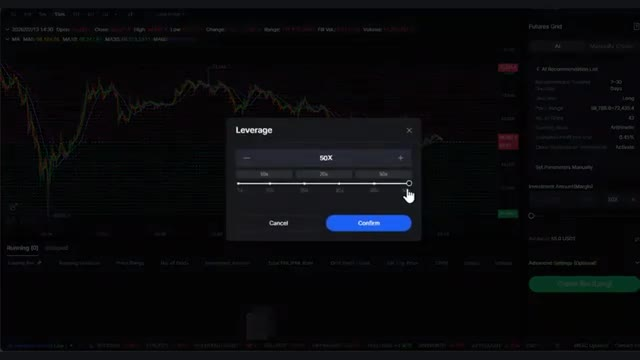
*⏱️ 00:06:17 — Fenêtre contextuelle (pop-up) de sélection du niveau d'effet de levier (« Leverage ») affichant un curseur réglé sur 50X avec des boutons de confirmation.*

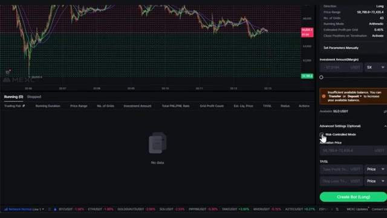
*⏱️ 00:06:34 — Interface de trading de futures sur MEXC avec un graphique en arrière-plan et un panneau de configuration à droite affichant les paramètres de grille et un avertissement de solde insuffisant.*

---

### ⏱️ `[00:06:43 - 00:07:03]` | Segment #14

**🔊 Audio (Transcription Intégrale Mot pour Mot en Français) :**
> mais qui peut ne pas réduire les besoins en investissement si vous utilisez un effet de levier élevé et des grilles larges. Je recommande de garder cette option cochée si vous débutez. Vous pouvez également voir le prix d'activation. C'est le prix auquel le bot commencera à trader. Ensuite, vous pouvez définir vos take profit et stop loss. Vous pouvez les définir par prix, par PNL ou par pourcentage de PNL.

**👁️ Analyse Visuelle d'Écran (gemini-3.5-flash-lite) :**
**Interface & Outils** : Interface web de l'échange de cryptomonnaies MEXC (section Grid Trading).

**Contenu textuel & Code** : Paramètres de configuration du bot (effet de levier 5X, plage de prix 59 788,6 - 72 435,4 USDT, nombre de grilles 43, mode de risque contrôlé activé, et champ du prix d'activation).

**Action / Démonstration** : Configuration et explication des paramètres avancés d'un bot de trading automatisé sur MEXC, notamment le mode de contrôle du risque et le prix d'activation.

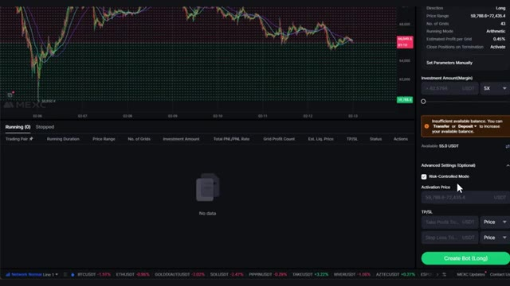
*⏱️ 00:06:48 — Interface de configuration d'un bot de trading de grille sur la plateforme MEXC, montrant les paramètres avancés avec l'option 'Risk-Controlled Mode' cochée et le champ du prix d'activation.*

---

### ⏱️ `[00:07:04 - 00:07:24]` | Segment #15

**🔊 Audio (Transcription Intégrale Mot pour Mot en Français) :**
> Je vous recommande vivement de définir un stop loss pour protéger votre capital. Une fois que vous avez tout examiné, cliquez sur Créer le bot, et votre bot de grille futures est lancé. Maintenant, si vous préférez une approche plus manuelle, cliquez sur Définir les paramètres manuellement. Ici, vous pouvez soit créer à partir de zéro, soit modifier les paramètres fournis par l'IA. Cela vous donne un contrôle total sur chaque aspect du bot.

**👁️ Analyse Visuelle d'Écran (gemini-3.5-flash-lite) :**
**Interface & Outils** : Interface web de l'échange de cryptomonnaies MEXC (section Bot de trading Futures).

**Contenu textuel & Code** : Paramètres de trading avec effet de levier (10X), montant d'investissement (32 USDT), et configuration des seuils de Take Profit (100000 USDT) et de Stop Loss (55000 USDT).

**Action / Démonstration** : Configuration des paramètres de gestion des risques et survol du bouton pour créer le bot de trading long.

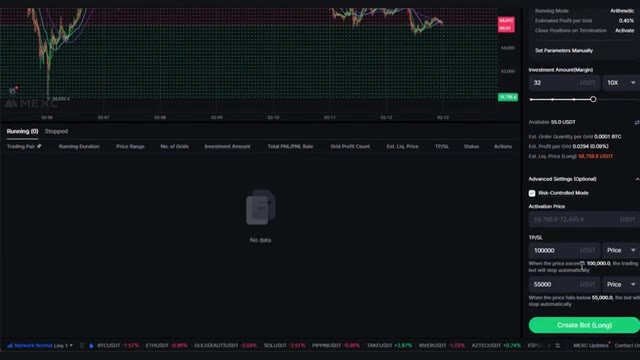
*⏱️ 00:07:09 — Interface de configuration d'un bot de grille futures sur la plateforme MEXC, montrant le graphique des prix en haut et les paramètres avancés de gestion des risques (Take Profit / Stop Loss) dans le panneau latéral droit.*

---

### ⏱️ `[00:07:25 - 00:07:50]` | Segment #16

**🔊 Audio (Transcription Intégrale Mot pour Mot en Français) :**
> Vous pouvez toujours voir la direction, long, court ou neutre. Ensuite, définissez votre fourchette de prix. C'est la fourchette où le bot placera les ordres d'achat et de vente. Ensuite, choisissez le nombre de grilles. Vous pouvez définir entre 200 et 300 grilles. Plus de grilles signifient des transactions plus fréquentes mais des profits plus petits par transaction. Moins de grilles signifient des transactions moins fréquentes mais des profits plus importants par transaction. Vous pouvez également choisir le mode, soit arithmétique, soit géométrique.

**👁️ Analyse Visuelle d'Écran (gemini-3.5-flash-lite) :**
**Interface & Outils** : MEXC Exchange (Interface Web Futures Grid)

**Contenu textuel & Code** : Paire BTCUSDT Perpétuel à 66,026.5 $, graphique en bougies 15m avec moyennes mobiles (MA5, MA10, MA30, MA60), panneau de configuration du Futures Grid avec sélection de direction (Long), fourchette de prix (59788.6 - 72435.4), nombre de grilles (43), effet de levier (10X) et bouton "Create Bot (Long)".

**Action / Démonstration** : Configuration manuelle des paramètres d'un bot de trading de grille (Futures Grid) sur MEXC en définissant la fourchette de prix et le nombre de grilles.

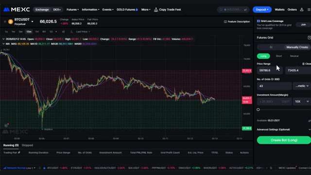
*⏱️ 00:07:31 — Interface de trading Futures Grid sur l'échange MEXC montrant le graphique du Bitcoin (BTCUSDT) avec des bandes de fourchette de prix et le panneau de configuration du bot de grille à droite.*

---

### ⏱️ `[00:07:50 - 00:08:24]` | Segment #17

**🔊 Audio (Transcription Intégrale Mot pour Mot en Français) :**
> L'arithmétique place des grilles de manière égale sur toute la plage de prix. La géométrique place plus de grilles près du prix actuel, ce qui est mieux pour les marchés volatils. Après cela, vous avez toujours les mêmes paramètres qu'avant : le montant de l'investissement, l'effet de levier et les mêmes paramètres avancés disponibles en mode IA. Une fois que tout est correct, cliquez sur créer le bot. Vous pouvez voir tous vos bots en cours d'exécution dans la partie inférieure du panneau. C'est ici que vous surveillerez leurs performances et effectuerez des ajustements si nécessaire. La dernière fonctionnalité de spot que je veux vous montrer est la copie de trading par IA, qui vous permet de copier automatiquement des traders IA rentables sur

**👁️ Analyse Visuelle d'Écran (gemini-3.5-flash-lite) :**
**Interface & Outils** : Échange de cryptomonnaies MEXC (interface de trading Futures Grid).

**Contenu textuel & Code** : Graphique en chandeliers 15m de BTCUSDT avec moyennes mobiles (MA), panneau de création de bot de grille (mode long, fourchette de prix, nombre de grilles, montant de l'investissement, effet de levier 10X).

**Action / Démonstration** : Configuration d'un bot de trading en grille sur les futures en position longue, montrant les paramètres de fourchette de prix et de levier.

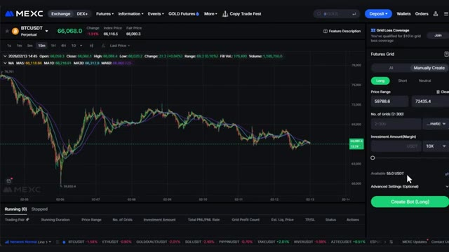
*⏱️ 00:07:58 — Interface de trading MEXC montrant le graphique de la paire BTCUSDT avec le panneau de configuration des bots de grille (Futures Grid) à droite.*

---

### ⏱️ `[00:08:24 - 00:08:50]` | Segment #18

**🔊 Audio (Transcription Intégrale Mot pour Mot en Français) :**
> MEXC. Pour y accéder, passez votre curseur sur Futures et sélectionnez AI Copy Trade. Une fois sur le tableau de bord, vous pouvez voir vos capitaux propres, les coûts du copy trading, le PNL total et le PNL des sept derniers jours en haut. Maintenant, faites défiler vers le bas et regardez sur le côté gauche. MEXC propose une fonctionnalité appelée Trader Match. Celle-ci vous fera correspondre au trader IA le plus proche en fonction de vos préférences, telles que les actifs que vous souhaitez trader, votre tolérance au risque et la fréquence de vos trades.

**👁️ Analyse Visuelle d'Écran (gemini-3.5-flash-lite) :**
**Interface & Outils** : Plateforme d'échange de cryptomonnaies MEXC (section AI Copy Trading)

**Contenu textuel & Code** : Capitaux propres, coûts de copy trading, PNL total, PNL sur 7 jours, et cartes de performance des traders (ex: Kacheli, MadMax36) avec ROI et score de correspondance.

**Action / Démonstration** : Navigation et défilement sur le tableau de bord du copy trading pour explorer les options de filtrage et les traders recommandés.

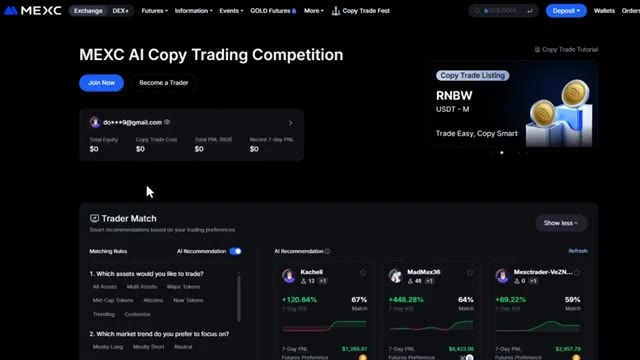
*⏱️ 00:08:30 — Vue d'ensemble du tableau de bord MEXC AI Copy Trading Competition montrant les métriques de compte et la section Trader Match avec des recommandations de traders.*

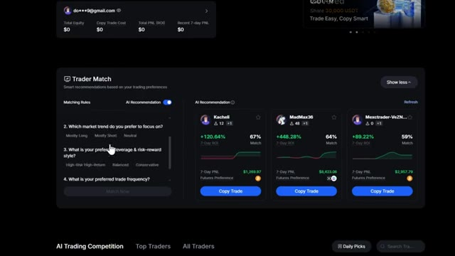
*⏱️ 00:08:44 — Gros plan sur la section Trader Match de MEXC montrant les critères de filtrage par préférences de trading et les cartes de traders recommandés.*

---

### ⏱️ `[00:08:50 - 00:09:10]` | Segment #19

**🔊 Audio (Transcription Intégrale Mot pour Mot en Français) :**
> Sur le côté droit, vous pouvez voir les recommandations de l'IA. Pour chaque trader, vous pouvez voir leur retour sur investissement sur 7 jours, combien de followers ils ont, et leur préférence de token. Faites défiler vers le bas et vous verrez le classement complet des traders IA avec leur PNL sur 180 jours, leur PNL sur 7 jours, leur meilleur trade, et leur taux de réussite.

**👁️ Analyse Visuelle d'Écran (gemini-3.5-flash-lite) :**
**Interface & Outils** : Plateforme d'échange de cryptomonnaies (MEXC Copy Trade - Trader Match)

**Contenu textuel & Code** : ROI sur 7 jours, PNL, nombre de followers, taux de correspondance IA et préférences de tokens pour différents traders.

**Action / Démonstration** : Défilement de la page pour consulter les recommandations de l'IA et le classement des traders.

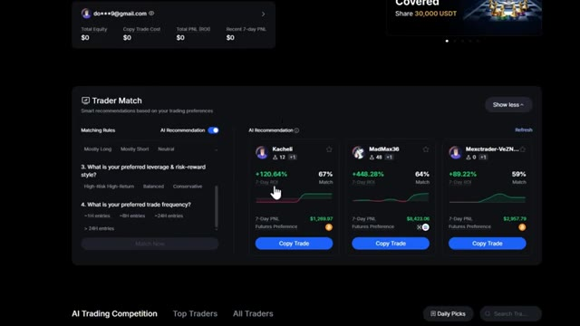
*⏱️ 00:08:55 — Interface de copy trading affichant les recommandations de traders IA avec leurs performances sur 7 jours et leurs préférences de tokens.*

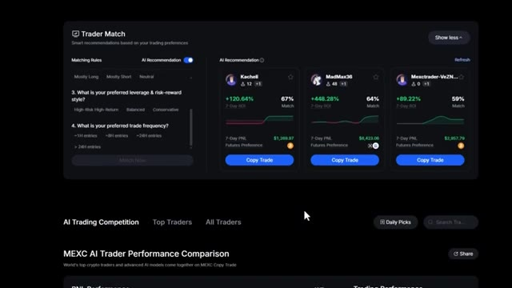
*⏱️ 00:09:00 — Vue défilée vers le bas de la plateforme montrant les sections de compétition de trading IA et de comparaison de performances.*

---

### ⏱️ `[00:09:10 - 00:09:29]` | Segment #20

**🔊 Audio (Transcription Intégrale Mot pour Mot en Français) :**
> Cela vous donne une image complète de leur performance. Une fois que vous avez trouvé un trader qui vous plaît, cliquez sur le bouton Copier le trade sur le côté droit de son profil. Mexi propose trois modes de copy trading : ratio intelligent, montant fixe et ratio fixe. Le ratio intelligent est recommandé pour les débutants. Il permet au trader maître de gérer automatiquement le risque de votre portefeuille.

**👁️ Analyse Visuelle d'Écran (gemini-3.5-flash-lite) :**
**Interface & Outils** : Interface de la plateforme d'échange MEXC (section Copy Trade).

**Contenu textuel & Code** : Graphiques de performance PnL, tableau de classement des traders, statistiques de rentabilité (PnL 180 jours, taux de réussite sur 7 jours) et options de configuration du copy trading.

**Action / Démonstration** : Sélection d'un trader dans le classement et affichage de la fenêtre de configuration des modes de copy trading sur MEXC.

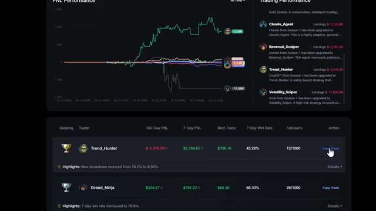
*⏱️ 00:09:15 — Interface de copy trading montrant les performances PnL des différents agents avec un curseur cliquant sur le bouton 'Copy Trade' pour le trader Trend_Hunter.*

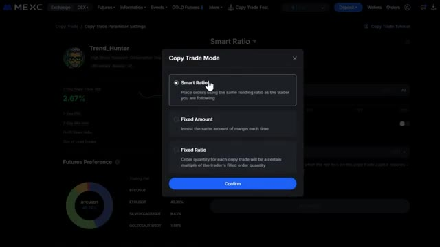
*⏱️ 00:09:20 — Fenêtre modale sur la plateforme MEXC affichant les trois modes de copy trading : Smart Ratio, Fixed Amount et Fixed Ratio.*

---

### ⏱️ `[00:09:30 - 00:09:52]` | Segment #21

**🔊 Audio (Transcription Intégrale Mot pour Mot en Français) :**
> Fixed amount means you copy a fixed dollar amount per trade, like $10 per position. Fixed ratio copies a percentage of your portfolio that matches the trader's allocation. For beginners, I recommend smart ratio. First, enter your copy trade amount. This is the total you'll invest in copying this trader. Don't put all your funds into one trader. Next, set your account stop loss.

**👁️ Analyse Visuelle d'Écran (gemini-3.5-flash-lite) :**
**Interface & Outils** : Interface web de l'exchange MEXC (fenêtre modale de paramètres de copy trading).

**Contenu textuel & Code** : Options de mode de copy trading : Smart Ratio, Fixed Amount (Invest the same amount of margin each time), Fixed Ratio, et le bouton de confirmation 'Confirm'.

**Action / Démonstration** : Sélection ou survol du mode de copy trading 'Fixed Ratio' dans la fenêtre de configuration.

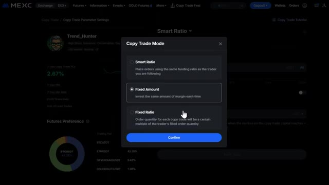
*⏱️ 00:09:36 — Une fenêtre pop-up de configuration des paramètres de copy trading sur la plateforme MEXC, affichant les modes 'Smart Ratio', 'Fixed Amount' et 'Fixed Ratio'.*

---

### ⏱️ `[00:09:53 - 00:10:17]` | Segment #22

**🔊 Audio (Transcription Intégrale Mot pour Mot en Français) :**
> Lorsque vos capitaux propres atteignent ce niveau, le copy trading se termine automatiquement et ferme toutes les positions. Cliquez sur plus de paramètres pour des options supplémentaires. Ici, vous pouvez choisir quelles paires de contrats à terme copier. Je recommande de commencer uniquement avec Bitcoin et Ethereum. Vous pouvez également définir des ratios de take profit et de stop loss pour un ordre unique. Par exemple, définissez un take profit de 20 % et un stop loss de 10 % pour gérer automatiquement chaque transaction.

**👁️ Analyse Visuelle d'Écran (gemini-3.5-flash-lite) :**
**Interface & Outils** : Échange de cryptomonnaies MEXC (interface de Copy Trading).

**Contenu textuel & Code** : Paramètres de copy trading : montant, Smart Ratio, Account Stop-Loss (20 USDT), et liste des paires de contrats à terme (BTCUSDT, ETHUSDT, etc.).

**Action / Démonstration** : Configuration des paramètres de risque du copy trading et sélection des paires de contrats à terme autorisées.

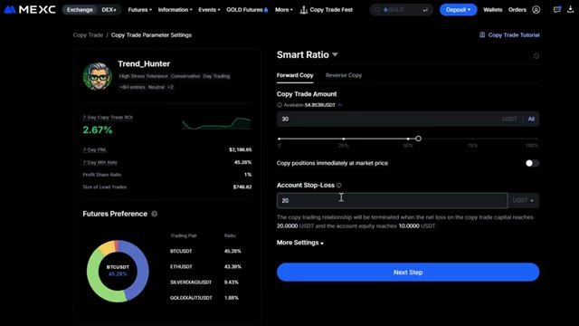
*⏱️ 00:09:59 — Interface de configuration du copy trading sur l'échange MEXC, affichant les paramètres du trader 'Trend_Hunter' et les options de gestion des risques comme le Stop-Loss du compte.*

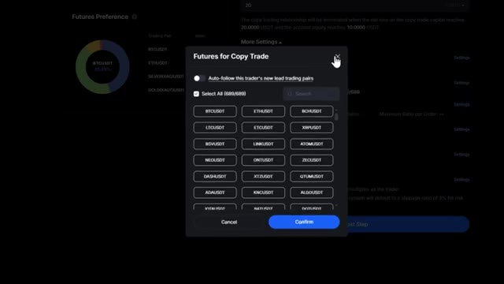
*⏱️ 00:10:05 — Fenêtre modale 'Futures for Copy Trade' sur l'échange MEXC, permettant de sélectionner les paires de contrats à terme à copier avec une option 'Select All'.*

---

### ⏱️ `[00:10:18 - 00:10:40]` | Segment #23

**🔊 Audio (Transcription Intégrale Mot pour Mot en Français) :**
> Pour le mode de marge, je recommande vivement le mode isolé pour les débutants, car il limite votre risque à ce trade spécifique. Vous pouvez également personnaliser votre effet de levier. Vous pouvez suivre l'effet de levier du trader ou définir votre propre effet de levier fixe. Sur le côté gauche, vous pouvez voir un aperçu du profil du trader, y compris son profit et perte sur sept jours, son taux de réussite et son ratio de partage des profits, qui se situe généralement entre 10 et 20 %.

**👁️ Analyse Visuelle d'Écran (gemini-3.5-flash-lite) :**
**Interface & Outils** : Interface de trading de contrats à terme (Futures) avec une fenêtre contextuelle de configuration.

**Contenu textuel & Code** : Options de marge : Mode Isolé (« Isolated »), Mode Croisé (« Cross »), et Suivre le trader (« Follow trader »). Bouton de confirmation bleu en bas.

**Action / Démonstration** : Sélection du mode de marge isolé par un clic de curseur, illustrant la configuration des préférences pour le copy trading.

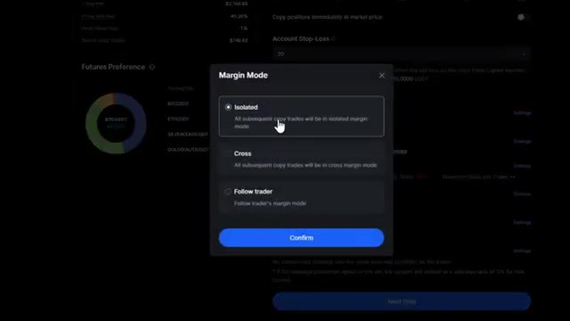
*⏱️ 00:10:23 — Fenêtre modale de sélection du mode de marge (« Margin Mode ») affichant les options « Isolated », « Cross » et « Follow trader ».*

---

### ⏱️ `[00:10:40 - 00:11:06]` | Segment #24

**🔊 Audio (Transcription Intégrale Mot pour Mot en Français) :**
> Voici ce que le trader gagne sur vos bénéfices. Une fois que tout semble correct, cliquez sur Étape suivante et Soumettre. Votre copy trading est désormais actif. Très bien, voilà donc toute la gamme de Mexibot, du DCA à la grille et au copy trading par IA, qui fonctionnent tous en pilotage automatique. Passons maintenant à Blowfin, car cette plateforme propose en réalité trois types de bots supplémentaires que Mexi n'a pas, dont un qui se connecte directement à TradingView. Analysons cela exactement de la même manière.

**👁️ Analyse Visuelle d'Écran (gemini-3.5-flash-lite) :**
**Interface & Outils** : MEXC et Blofin (plateformes d'échange de cryptomonnaies)

**Contenu textuel & Code** : Paramètres de gestion des risques (Take Profit, Stop Loss), modes de marge, sélection des paires de trading et configuration de signaux TradingView par webhook.

**Action / Démonstration** : Configuration des paramètres de copy trading, sélection de traders et ajout de signaux de trading automatisés.

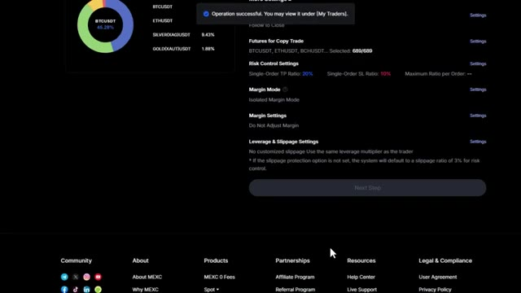
*⏱️ 00:10:47 — Interface de configuration finale d'un copy trading avec message de succès 'Operation successful'.*

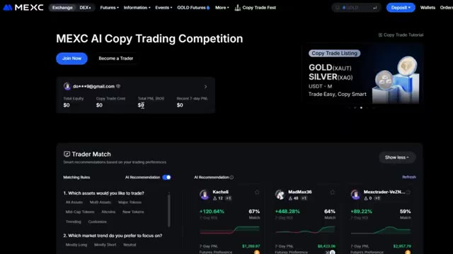
*⏱️ 00:10:53 — Tableau de bord MEXC AI Copy Trading affichant la liste des meilleurs traders et les options de correspondance.*

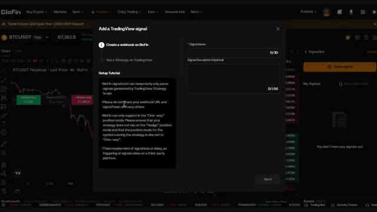
*⏱️ 00:11:00 — Interface Blofin montrant une fenêtre contextuelle pour configurer un signal TradingView (Webhook).*

---

### ⏱️ `[00:11:06 - 00:11:29]` | Segment #25

**🔊 Audio (Transcription Intégrale Mot pour Mot en Français) :**
> Tout d'abord, vous avez besoin d'un compte Blowfin. Si vous n'en avez pas encore un,cliquez sur le lien dans la description. Vous aurez accès à des bonus exclusifs rien qu'en vous inscrivant et en tradant. Je vous montrerai exactement comment les réclamer plus tard dans la vidéo. Il faut moins d'une minute pour créer votre compte. Une fois que vous êtes connecté, assurez-vous d'avoir des fonds sur votre compte. Si vous devez faire un dépôt, allez simplement dans Actifs, cliquez sur Dépôt, sélectionnez USDT, choisissez votre réseau.

**👁️ Analyse Visuelle d'Écran (gemini-3.5-flash-lite) :**
**Interface & Outils** : Interface web de la plateforme d'échange de cryptomonnaies BloFin (Rewards Hub et page d'accueil).

**Contenu textuel & Code** : Offres promotionnelles, bonus de bienvenue jusqu'à 5 000 USDT, et options de trading pour les nouveaux utilisateurs.

**Action / Démonstration** : Présentation de la plateforme BloFin et de ses avantages pour inciter l'utilisateur à créer un compte via le lien d'affiliation.

*⏱️ 00:11:12 — Page du Rewards Hub de la plateforme BloFin montrant l'offre exclusive pour les nouveaux utilisateurs de gagner jusqu'à 5 000 USDT.*

*⏱️ 00:11:23 — Page d'accueil de la plateforme BloFin avec le slogan « Where Whales are Made » et un bouton « Trade Now ».*

---

### ⏱️ `[00:11:29 - 00:11:50]` | Segment #26

**🔊 Audio (Transcription Intégrale Mot pour Mot en Français) :**
> Je recommande TRC20 pour les frais bas et envoyez vos fonds. Ils arriveront en quelques minutes. Maintenant, passons aux bots. Survolez Futures dans le menu supérieur et cliquez sur Trading Bots. C'est votre tableau de bord des bots. En haut, vous verrez votre P&L total, vos actifs totaux et les bots en cours d'exécution. Maintenant, faites défiler un peu vers le bas et vous verrez quelque chose de vraiment sympa.

**👁️ Analyse Visuelle d'Écran (gemini-3.5-flash-lite) :**
**Interface & Outils** : Interface web de la plateforme d'échange de cryptomonnaies BloFin.

**Contenu textuel & Code** : Solde du compte (15.68 USDT), sections Funding, Spot, Futures, et options du tableau de bord des Trading Bots (Futures Grid, Futures DCA, Spot Grid, Spot DCA, Signal Bot, TWAP).

**Action / Démonstration** : Navigation dans les menus de la plateforme BloFin pour accéder au tableau de bord des robots de trading.

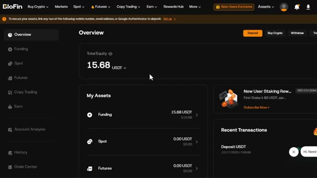
*⏱️ 00:11:34 — Capture montrant l'interface du portefeuille (Overview) sur la plateforme BloFin, affichant un capital total de 15,68 USDT.*

*⏱️ 00:11:40 — Capture montrant le menu déroulant "Futures" sur BloFin, avec le curseur pointant sur l'option "Trading Bots".*

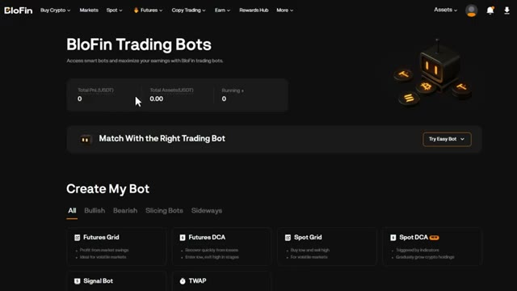
*⏱️ 00:11:45 — Capture montrant le tableau de bord des bots de trading sur BloFin, avec les sections "Total P&L", "Total Assets" et "Create My Bot".*

---

### ⏱️ `[00:11:50 - 00:12:09]` | Segment #27

**🔊 Audio (Transcription Intégrale Mot pour Mot en Français) :**
> Blowfin vous associera en fait au bon bot de trading en fonction de vos préférences. Cliquez sur Essayer EasyBot. Ici, vous pouvez répondre à certaines questions comme sur quels contrats ou quelle devise aimeriez-vous vous concentrer ? Quelle direction de marché attendez-vous ? Haussière, baissière ou volatile ? Une fois que vous avez terminé, cliquez sur Obtenir ma correspondance.

**👁️ Analyse Visuelle d'Écran (gemini-3.5-flash-lite) :**
**Interface & Outils** : Interface web de l'échange BloFin (Trading Bots).

**Contenu textuel & Code** : Options de bots de trading (Futures Grid, Futures DCA, Spot Grid, Spot DCA, Signal Bot, TWAP) et onglets de filtrage par tendance (All, Bullish, Bearish, Slicing Bots, Sideways).

**Action / Démonstration** : Navigation et présentation de l'outil de correspondance de bots de trading sur la plateforme BloFin.

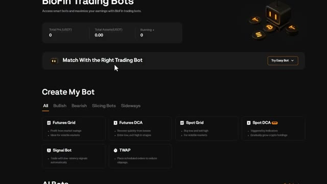
*⏱️ 00:11:55 — Capture d'écran de l'interface des bots de trading BloFin montrant la section de matching 'Match With the Right Trading Bot' et les options de création de bots (Futures Grid, Futures DCA, Spot Grid, Spot DCA, Signal Bot, TWAP).*

---

### ⏱️ `[00:12:10 - 00:12:31]` | Segment #28

**🔊 Audio (Transcription Intégrale Mot pour Mot en Français) :**
> L'intelligence artificielle de Blowfin choisira la meilleure correspondance selon vos critères. Vous pouvez voir le type de bot, le taux de rendement annuel (APR) testé rétrospectivement, la période suggérée, et même la raison pour laquelle l'IA de Blowfin vous a associé à ce bot. C'est parfait si vous voulez simplement commencer rapidement sans trop réfléchir. Maintenant, faites défiler un peu plus vers le bas et vous verrez la section Créer mon bot. Ici, vous pouvez voir tous les bots disponibles.

**👁️ Analyse Visuelle d'Écran (gemini-3.5-flash-lite) :**
**Interface & Outils** : Interface web de Blofin Trading Bots.

**Contenu textuel & Code** : Actif BTCUSDT, direction de marché 'Bullish', bot 'Futures Grid', APR testé rétrospectivement à +737,42%, période suggérée de 7 à 20 jours, et explications détaillées de l'IA.

**Action / Démonstration** : Sélection des critères de trading et consultation des raisons de correspondance de l'IA pour le bot de trading automatisé.

*⏱️ 00:12:15 — Interface de Blofin montrant l'outil 'Match With the Right Trading Bot' avec l'actif BTCUSDT et le résultat suggéré 'Futures Grid' affichant un APR de +737,42%.*

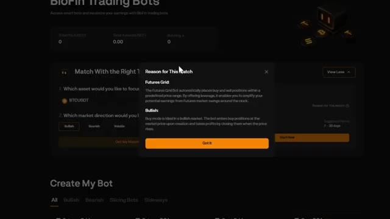
*⏱️ 00:12:20 — Pop-up affichant la section 'Reason for This Match' détaillant pourquoi le bot Futures Grid a été sélectionné pour le marché haussier (Bullish).*

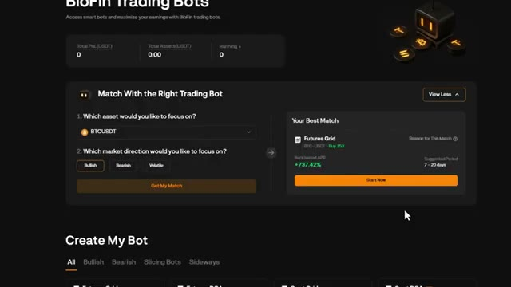
*⏱️ 00:12:26 — Retour à l'interface principale des bots de trading de Blofin après la fermeture de la fenêtre pop-up explicative.*

---

### ⏱️ `[00:12:31 - 00:12:55]` | Segment #29

**🔊 Audio (Transcription Intégrale Mot pour Mot en Français) :**
> Vous pouvez également voir la direction du marché et le bon bot pour cette condition de marché. Des bots haussiers, baissiers, tranchants et latéraux. Nous reviendrons sur la façon d'en créer un vous-même dans quelques minutes. Faites défiler un peu plus bas et vous verrez les bots IA fournis par Blowfin. Ici, vous pouvez voir la crypto, le type de tendance dans laquelle elle se trouve, le type de bot recommandé, le biais et l'effet de levier utilisé.

**👁️ Analyse Visuelle d'Écran (gemini-3.5-flash-lite) :**
**Interface & Outils** : Interface web de la plateforme de trading Blofin, section de création de bots automatisés.

**Contenu textuel & Code** : Options de bots de trading par condition de marché ('Bullish', 'Bearish', 'Sideways'), types de bots ('Futures Grid', 'Spot Grid') et cartes de bots IA avec performances de backtest (ex: DOGEUSDT +365.07% APR, BTCUSDT +467.36% APR, SUIUSDT +524.31% APR).

**Action / Démonstration** : Navigation et sélection des options de bots de trading classés par direction de marché et présentation des bots propulsés par l'IA.

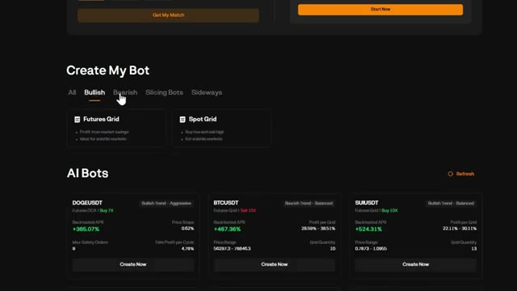
*⏱️ 00:12:37 — Interface de création de bots de trading affichant les catégories de conditions de marché (Bullish, Bearish, Slicing Bots, Sideways) et une section 'AI Bots' avec les performances (DOGEUSDT, BTCUSDT, SUIUSDT).*

---

### ⏱️ `[00:12:55 - 00:13:16]` | Segment #30

**🔊 Audio (Transcription Intégrale Mot pour Mot en Français) :**
> Vous pouvez également voir le taux annuel en pourcentage (APR) testé sur l'historique, le profit par grille, la fourchette de prix et le nombre de grilles. Cela vous donne une tonne de données pour décider si vous voulez copier l'un de ces bots. Une fois que vous cliquez sur Créer maintenant sur l'un de ces bots, cela vous amène au tableau de bord de trading où vous pouvez voir tous ces paramètres. Tout ce que vous avez à faire est d'entrer votre montant d'investissement et de cliquer sur Créer, qu'il s'agisse d'une position d'achat ou de vente.

**👁️ Analyse Visuelle d'Écran (gemini-3.5-flash-lite) :**
**Interface & Outils** : Plateforme d'échange de cryptomonnaies Blofin (section AI Bots et interface de trading Futures Grid).

**Contenu textuel & Code** : Métriques de performance des bots de trading (Backtested APR, Profit per Grid, Price Range, Grid Quantity, effet de levier).

**Action / Démonstration** : Présentation et sélection des bots IA de trading automatisé basés sur les grilles sur la plateforme Blofin.

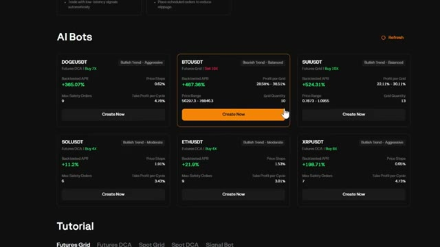
*⏱️ 00:13:00 — Interface de la plateforme affichant plusieurs cartes de bots IA de trading (DOGEUSDT, BTCUSDT, SUIUSDT, etc.) avec leurs performances et paramètres de grille.*

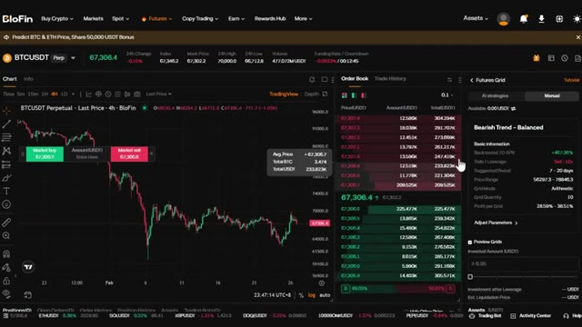
*⏱️ 00:13:11 — Interface de trading avancée de Blofin montrant un graphique des prix du BTCUSDT, un carnet d'ordres et les détails de configuration d'un bot de grille (Futures Grid).*

---

### ⏱️ `[00:13:17 - 00:13:51]` | Segment #31

**🔊 Audio (Transcription Intégrale Mot pour Mot en Français) :**
> Maintenant que vous savez comment naviguer sur le tableau de bord, parlons de tous les types de bots disponibles. Ici, vous pouvez voir différents types de bots. Futures Grid. C'est idéal pour les marchés volatils. Il tire profit des fluctuations de prix en plaçant des ordres d'achat et de vente dans une fourchette de prix définie. Futures DCA. Il s'agit d'un plan d'investissement programmé (dollar cost averaging) pour les contrats à terme. Il achète à intervalles réguliers quel que soit le prix, parfait pour l'accumulation à long terme avec effet de levier. Spot Grid. Cela fonctionne comme une grille de futures mais sans effet de levier. Idéal pour les marchés stagnants où vous voulez acheter bas et vendre haut.

**👁️ Analyse Visuelle d'Écran (gemini-3.5-flash-lite) :**
**Interface & Outils** : Interface web de trading de crypto-monnaies (section de création de bots).

**Contenu textuel & Code** : Liste des types de bots de trading : Futures Grid, Futures DCA, Spot Grid, Spot DCA, Signal Bot, TWAP, ainsi que des sections de filtrage par stratégie (All, Bullish, Bearish, Slicing Bots, Sideways) et des options AI Bots.

**Action / Démonstration** : Navigation et survol par le curseur de la souris sur le type de bot "Futures Grid" pour en présenter les caractéristiques.

*⏱️ 00:13:25 — Vue d'ensemble du tableau de bord de création de bots de trading affichant les différentes catégories disponibles telles que Futures Grid, Futures DCA, Spot Grid, Spot DCA, Signal Bot et TWAP.*

---

### ⏱️ `[00:13:51 - 00:14:11]` | Segment #32

**🔊 Audio (Transcription Intégrale Mot pour Mot en Français) :**
> automatiquement. Spot DCA. C'est l'option la plus sûre. Il achète la crypto de votre choix à intervalles réguliers sans effet de levier, ce qui élimine les émotions de l'investissement. SignalBot, celui-ci est unique. Il vous permet d'automatiser des transactions basées sur des signaux TradingView. TWAP, ou prix moyen pondéré dans le temps.

**👁️ Analyse Visuelle d'Écran (gemini-3.5-flash-lite) :**
**Interface & Outils** : Interface web de trading automatisé / bot de cryptomonnaies.

**Contenu textuel & Code** : Menus de sélection de bots : Futures Grid, Futures DCA, Spot Grid, Spot DCA, Signal Bot, TWAP, ainsi que des sections pour les bots IA.

**Action / Démonstration** : Sélection et survol de l'option 'Spot DCA' avec le curseur de la souris.

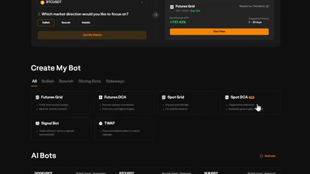
*⏱️ 00:13:56 — Interface de création de bot de trading présentant différentes options, avec un curseur pointant sur l'option 'Spot DCA'.*

---

### ⏱️ `[00:14:11 - 00:14:31]` | Segment #33

**🔊 Audio (Transcription Intégrale Mot pour Mot en Français) :**
> Cela répartit votre ordre sur une période définie pour éviter le slippage. Laissez-moi maintenant vous montrer comment créer chacun d' eux, en commençant par le plus populaire, le Futures Grid. Créons un bot Futures Grid à partir de zéro. C' est l' un des bots les plus populaires car il tire profit de la volatilité. Cliquez sur Futures Grid. En haut à gauche, vous pouvez sélectionner votre paire de trading.

**👁️ Analyse Visuelle d'Écran (gemini-3.5-flash-lite) :**
**Interface & Outils** : Interface web de trading de cryptomonnaies.

**Contenu textuel & Code** : Options de bots de trading : Futures Grid, Futures DCA, Spot Grid, Spot DCA, Signal Bot, TWAP, ainsi que des sections de bots IA.

**Action / Démonstration** : Le curseur de la souris survole l'option TWAP dans l'interface de création de bot.

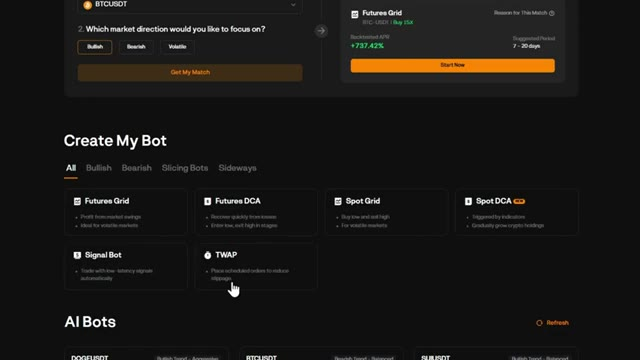
*⏱️ 00:14:16 — Interface de création de bot de trading montrant différentes options de stratégies comme Futures Grid, Futures DCA, Spot Grid, Spot DCA, Signal Bot et TWAP.*

---

### ⏱️ `[00:14:32 - 00:14:52]` | Segment #34

**🔊 Audio (Transcription Intégrale Mot pour Mot en Français) :**
> Allons-y avec Bitcoin USDT. Vous pouvez rechercher n'importe quelle paire que vous voulez ici. Sur le côté droit, vous verrez les sélections de Blowfin AI. Ce sont des bots pré-intégrés avec leurs statistiques si vous voulez les utiliser comme référence. Vous avez deux modes, les stratégies IA et le mode manuel. Commençons par la stratégie IA. Ici, l'IA de Blowfin vous montrera les bots pré-fabriqués.

**👁️ Analyse Visuelle d'Écran (gemini-3.5-flash-lite) :**
**Interface & Outils** : Interface web de l'échange Blofin, graphique de prix, carnet d'ordres (Order Book) et panneau de stratégies IA (Futures Grid).

**Contenu textuel & Code** : Paire BTCUSDT Perpétuelle avec un prix à 67310.2, données de marché (24h-Change, Index, Mark Price, High, Low, Volume, Funding Rate), carnet d'ordres et stratégies de bots Grid avec des APR backtestés (ex: +309.61%, +493.73%).

**Action / Démonstration** : Navigation et présentation de la plateforme de trading Blofin, montrant la paire Bitcoin/USDT, le carnet d'ordres et les sélections de bots IA sur le côté droit.

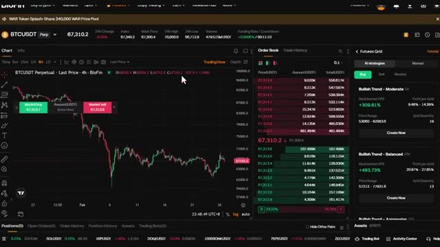
*⏱️ 00:14:37 — Interface de trading de la plateforme Blofin montrant le graphique de la paire BTCUSDT en unités 4h, le carnet d'ordres au centre et les sélections de bots de trading IA sur le panneau latéral droit.*

---

### ⏱️ `[00:14:52 - 00:15:26]` | Segment #35

**🔊 Audio (Transcription Intégrale Mot pour Mot en Français) :**
> vous pouvez choisir la direction ici telle que achat, vente et neutre, ici vous pouvez également voir le nom du bot, le levier utilisé, l'APR testé historiquement, la fourchette de prix, les profits par grille et la quantité de grilles en fonction des conditions actuelles du marché, une fois que vous cliquez sur créer maintenant, tout ce que vous avez làm à faire est de saisir votre montant d'investissement total, vous pouvez voir sur le graphique du côté gauche les grilles d'aperçu où il achètera ou vendra en fonction de vos paramètres, maintenant si vous voulez un contrôle total, vous pouvez passer en mode manuel en cliquant sur ajuster les paramètres, ici vous pouvez définir manuellement la fourchette de prix, le nombre de grilles et le levier

**👁️ Analyse Visuelle d'Écran (gemini-3.5-flash-lite) :**
**Interface & Outils** : Plateforme d'échange de cryptomonnaies Blofin (interface de trading Futures avec panneau de grilles et carnet d'ordres).

**Contenu textuel & Code** : Graphique de prix BTCUSDT Perpetual (unité 4H), carnet d'ordres en temps réel, et options de stratégie de grille (Futures Grid, mode Neutre, stratégies AI avec APR historique affiché, fourchette de prix et profit par grille).

**Action / Démonstration** : Navigation et présentation des paramètres de configuration d'un bot de trading de grille (Futures Grid) sur Blofin.

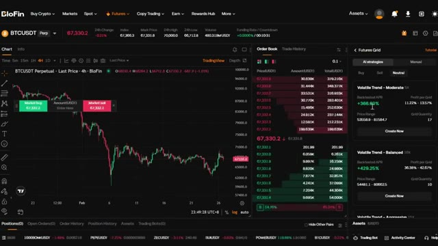
*⏱️ 00:15:01 — Interface de la plateforme Blofin affichant un graphique de prix BTCUSDT en unités 4H et le panneau latéral de configuration pour un bot de type "Futures Grid" avec des stratégies automatisées.*

---

### ⏱️ `[00:15:26 - 00:16:00]` | Segment #36

**🔊 Audio (Transcription Intégrale Mot pour Mot en Français) :**
> vous-même. Vous pouvez également voir le take profit et le stop loss, que je recommande vivement d'activer. Ceux-ci sont optionnels, mais ils vous donnent un contrôle supplémentaire sur la gestion des risques. Vous pouvez également définir le mode de grille, tel qu'arithmétique et géométrique. Arithmétique signifie que la différence de prix entre chaque grille est égale. Donc, si vous définissez des grilles espacées de 100 dollars, chaque grille sera exactement espacée de 100 dollars. Géométrique signifie que la différence de pourcentage entre les grilles est égale. C'est mieux pour les marchés volatils car cela s'adapte à de plus grandes fluctuations de prix. Une fois que tout semble correct, cliquez sur créer et votre bot de grille futures est activé.

**👁️ Analyse Visuelle d'Écran (gemini-3.5-flash-lite) :**
**Interface & Outils** : Interface de courtier/échange (type plateforme de trading de cryptomonnaies avec bot de grille).

**Contenu textuel & Code** : Configuration d'un bot de trading avec des bornes de prix (53559 à 81584 USDT), une quantité de grille de 17, un effet de levier 5x, ainsi que des champs pour le Take Profit (TP) et le Stop Loss (SL), et le mode de grille réglé sur "Arithmetic".

**Action / Démonstration** : Configuration des paramètres de gestion des risques (TP/SL) et du mode de grille dans le panneau de configuration du bot de trading.

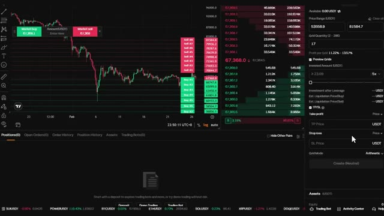
*⏱️ 00:15:35 — Interface de trading affichant un graphique de prix avec des ordres de grille configurés, un carnet d'ordres et un panneau latéral de paramétrage incluant les options de take profit, stop loss et le mode de grille arithmétique.*

---

### ⏱️ `[00:16:00 - 00:16:35]` | Segment #37

**🔊 Audio (Transcription Intégrale Mot pour Mot en Français) :**
> Ensuite vient le bot DCA futures, le lissage des coûts par la moyenne avec effet de levier. C'est idéal si vous souhaitez accumuler une position au fil du temps tout en utilisant un effet de levier pour amplifier vos rendements. Voici comment cela fonctionne. D'abord, sélectionnez votre paire de trading. Choisissez la cryptomonnaie dans laquelle vous voulez investir dans le coin supérieur gauche. Sur le côté droit, vous pouvez toujours voir deux modes comme avant, les stratégies IA et le manuel. Vous pouvez choisir entre l'achat et la vente et voir les recommandations du bot IA Blowfin. Vous pouvez voir le nom, l'effet de levier utilisé, le taux annuel en pourcentage (APR) testé rétroactivement, le nombre maximal d'ordres de sécurité, les paliers de prix et le cycle de prise de bénéfices.

**👁️ Analyse Visuelle d'Écran (gemini-3.5-flash-lite) :**
**Interface & Outils** : Échange de cryptomonnaies Blofin (interface de trading Futures avec panneau DCA Bot intégré).

**Contenu textuel & Code** : Paire BTCUSDT Perpetual, prix actuel à 67341.5, graphique en chandeliers (Timeframe 4h), carnet d'ordres (Order Book), et module "Futures DCA" affichant des stratégies IA telles que "Long-term Moderate Bullish 2X" (+14.70% APR) et "Mid-term Balanced Bullish 6X" (+56.35% APR).

**Action / Démonstration** : Présentation de l'interface de configuration du bot de DCA sur les contrats futures de la plateforme Blofin.

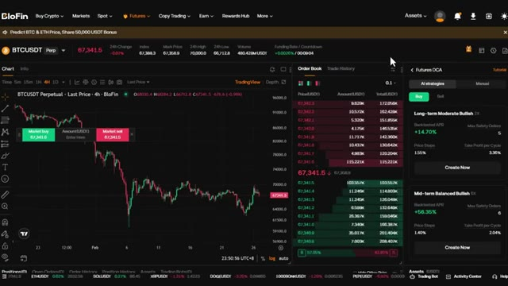
*⏱️ 00:16:09 — Capture d'écran de l'interface de trading Blofin montrant le graphique de la paire BTCUSDT en unités 4h, le carnet d'ordres au centre et le panneau de configuration du bot "Futures DCA" sur la droite avec les stratégies prédéfinies.*

---

### ⏱️ `[00:16:35 - 00:16:57]` | Segment #38

**🔊 Audio (Transcription Intégrale Mot pour Mot en Français) :**
> Si vous avez sélectionné celui que vous aimez, cliquez sur créer maintenant. Ici, vous pouvez saisir le montant investi. Une fois que vous avez tout configuré, cliquez sur créer et le bot s'occupe du reste. Maintenant, si vous voulez un contrôle total, vous pouvez l'ajuster en allant en mode manuel en cliquant sur ajuster les paramètres. Ici, vous pouvez définir manuellement les paliers de prix, le take profit par cycle et les ordres de sécurité maximums.

**👁️ Analyse Visuelle d'Écran (gemini-3.5-flash-lite) :**
**Interface & Outils** : BloFin (Interface de trading de crypto-monnaies et de bot Futures DCA)

**Contenu textuel & Code** : Graphique BTCUSDT, carnet d'ordres (Order Book), paramètres de stratégie Futures DCA (Bullish Trend - Moderate, Backtested 7D APR, Leverage 2x, Price Steps, Take Profit), et champ de saisie du montant investi (77.83 USDT).

**Action / Démonstration** : Saisie du montant d'investissement dans le panneau de configuration du bot Futures DCA et clic sur le bouton de création de la stratégie.

*⏱️ 00:16:41 — Interface de la plateforme BloFin montrant un graphique de prix BTCUSDT en unités 4h, le carnet d'ordres au centre, et le panneau de configuration d'un bot Futures DCA sur la droite avec un champ de saisie du montant investi.*

*⏱️ 00:16:46 — Suite de l'interface BloFin montrant le curseur du montant investi et le curseur de la souris positionné sur le bouton « Create (Buy) » pour lancer le bot Futures DCA.*

---

### ⏱️ `[00:16:57 - 00:17:35]` | Segment #39

**🔊 Audio (Transcription Intégrale Mot pour Mot en Français) :**
> Les paliers de prix déterminent à quelle distance le prix doit baisser avant que le bot n'achète à nouveau. Le nombre maximal d'ordres de sécurité est le nombre maximum de fois que le bot renforcera votre position. Le take profit par cycle définit le pourcentage de profit visé par le bot avant de clôturer l'ensemble de la position. Une fois que tout vous convient, cliquez sur créer et le bot sera actif. Au fait, si vous voulez les instructions de configuration complètes sur la façon de trader en utilisant votre application Telegram, comment intégrer Claude à TradingView ou analyser les baleines sur Hyperliquid, le tout automatiquement, chaque invite, chaque guide étape par étape, et tous les modèles d'agents que j'utilise personnellement, tout cela se trouve à l'intérieur de l'IA

**👁️ Analyse Visuelle d'Écran (gemini-3.5-flash-lite) :**
**Interface & Outils** : Interface de courtage/échange (BioFin / TradingView) et plateforme DeFi (Hyperliquid).

**Contenu textuel & Code** : Paramètres de configuration d'un bot DCA (Price Steps : 1.55%, Take Profit per Cycle : 3.36%, Max Safety Orders : 5) et tableau de classement des traders.

**Action / Démonstration** : Configuration des paramètres d'un bot de trading DCA et navigation sur le leaderboard d'une plateforme.

*⏱️ 00:17:07 — Interface de trading affichant un graphique BTCUSDT en chandelier 4H avec le panneau de configuration d'un bot DCA Futures (Price Steps, Take Profit per Cycle, Max Safety Orders).*

*⏱️ 00:17:25 — Page de classement (Leaderboard) de la plateforme Hyperliquid montrant les adresses de portefeuilles, la valeur des comptes, les PNL et le ROI sur 30 jours.*

---

### ⏱️ `[00:17:35 - 00:18:08]` | Segment #40

**🔊 Audio (Transcription Intégrale Mot pour Mot en Français) :**
> Trade Edge community. Le lien est dans la description. Le bot Spot Grid fonctionne exactement comme la grille Futures mais sans effet de levier. C'est parfait si vous voulez acheter bas et vendre haut automatiquement dans un marché stagnant sans le risque de liquidation. En haut à gauche, vous pouvez sélectionner votre paire de trading. Prenons Ethereum USDT. Vous pouvez rechercher n'importe quelle paire que vous voulez ici. Sur le côté droit, vous verrez les sélections de Blowfin AI. Ce sont des bots préconçus avec leurs statistiques si vous voulez les utiliser comme référence. Vous avez deux modes, les stratégies IA et le mode manuel. Commençons par la stratégie IA.

**👁️ Analyse Visuelle d'Écran (gemini-3.5-flash-lite) :**
**Interface & Outils** : Interface web de la plateforme de trading Blofin (section Spot Grid et Trading Bot).

**Contenu textuel & Code** : Options de bots de trading (Futures Grid, Spot Grid, DCA), graphiques de prix BTC/USDT, carnet d'ordres en temps réel et stratégies Spot Grid automatisées avec des APR backtestés.

**Action / Démonstration** : Navigation et sélection des différents types de bots de trading automatisé sur la plateforme Blofin.

*⏱️ 00:17:43 — Interface de création de bot sur Blofin montrant différentes options de trading automatisé, incluant Futures Grid, Futures DCA, Spot Grid et Spot DCA.*

*⏱️ 00:17:52 — Interface de trading Blofin sur la paire BTC/USDT avec le graphique en chandeliers, le carnet d'ordres au centre et le panneau Spot Grid à droite.*

---

### ⏱️ `[00:18:09 - 00:18:30]` | Segment #41

**🔊 Audio (Transcription Intégrale Mot pour Mot en Français) :**
> Ici, l'intelligence artificielle de Blowfin vous montrera les bots préconçus. Ici, vous pouvez également voir le nom du bot, le taux annuel en pourcentage (APR) testé au préalable, la fourchette de prix, les profits par grille et la quantité de grille en fonction des conditions actuelles du marché. Remarquez qu'il n'y a pas d'effet de levier ici. Vous tradez uniquement avec votre propre capital, ce qui rend cela beaucoup plus sûr. Une fois que vous cliquez sur Créer maintenant, tout ce que vous avez à faire est d'entrer votre montant d'investissement total.

**👁️ Analyse Visuelle d'Écran (gemini-3.5-flash-lite) :**
**Interface & Outils** : Interface web de l'échange BloFin (Spot Trading / Grid Bot)

**Contenu textuel & Code** : Graphique de prix TradingView pour ETH/USDT en unité 1h, carnet d'ordres en temps réel, et panneaux de stratégies de bots automatisés (ex: "Bullish Trend - Moderate" avec un APR backtesté de +478,95 %, fourchette de prix, profit par grille et quantité de grilles).

**Action / Démonstration** : Présentation et analyse des paramètres des bots de grille préconçus par l'intelligence artificielle sur BloFin.

*⏱️ 00:18:14 — Capture d'écran de l'interface de l'échange BloFin montrant la paire ETH/USDT avec un graphique des prix à gauche, le carnet d'ordres au centre et les stratégies de bots de grille IA (Spot Grid) sur le panneau de droite.*

---

### ⏱️ `[00:18:30 - 00:18:49]` | Segment #42

**🔊 Audio (Transcription Intégrale Mot pour Mot en Français) :**
> Vous pouvez voir sur un graphique sur le côté gauche les grilles d'aperçu où il achètera ou vendra en fonction de vos paramètres. Le bot placera des ordres d'achat à l'extrémité inférieure de la fourchette et des ordres de vente à l'extrémité supérieure, capturant ainsi des profits à chaque fluctuation de prix. C'est idéal pour accumuler une position au fil du temps sans effet de levier.

**👁️ Analyse Visuelle d'Écran (gemini-3.5-flash-lite) :**
**Interface & Outils** : BloFin (Échange de cryptomonnaies), Graphique TradingView intégré.

**Contenu textuel & Code** : Paire ETH/USDT, prix actuel 2033.22, indicateurs de grille de trading (Spot Grid) avec niveaux d'achat (Buy #1 à #4) et de vente (Sell #1 à #3) affichés sur le graphique, ainsi que les paramètres de stratégie (fourchette de prix 1739.35 - 2355.59, mode arithmétique, quantité de grilles : 10).

**Action / Démonstration** : Visualisation des grilles d'aperçu du bot de trading Spot Grid avec les ordres d'achat et de vente configurés sur la fourchette de prix.

*⏱️ 00:18:35 — Interface de la plateforme de trading BloFin affichant un graphique en chandeliers de la paire ETH/USDT en unité 1h, le carnet d'ordres au centre et le panneau de configuration d'un bot Spot Grid sur la droite.*

---

### ⏱️ `[00:18:49 - 00:19:09]` | Segment #43

**🔊 Audio (Transcription Intégrale Mot pour Mot en Français) :**
> Maintenant, si vous voulez un contrôle total, vous pouvez passer en mode manuel en cliquant sur ajuster les paramètres. Ici, vous pouvez définir manuellement la fourchette de prix et le nombre de grilles vous-même. Vous pouvez également définir le mode de grille, tel que arithmétique et géométrique, tout comme avec la grille Futures. Une fois que tout semble correct, cliquez sur Créer et votre bot Spot Grid est lancé.

**👁️ Analyse Visuelle d'Écran (gemini-3.5-flash-lite) :**
**Interface & Outils** : Plateforme d'échange de cryptomonnaies BloFin (interface Spot Grid).

**Contenu textuel & Code** : Graphique de prix ETH/USDT, carnet d'ordres (Order Book), et paramètres du Spot Grid en mode manuel (fourchette de prix, quantité de grilles, montant investi, mode arithmétique).

**Action / Démonstration** : Configuration manuelle des paramètres du bot de trading Spot Grid sur BloFin.

*⏱️ 00:18:54 — Interface de trading de la plateforme BloFin montrant le graphique de la paire ETH/USDT, le carnet d'ordres et le panneau de configuration du bot 'Spot Grid' en mode manuel.*

---

### ⏱️ `[00:19:09 - 00:19:32]` | Segment #44

**🔊 Audio (Transcription Intégrale Mot pour Mot en Français) :**
> Le bot Spot DCA est l'option la plus sûre. Il est parfait pour les investisseurs à long terme qui veulent accumuler sans effet de levier et sans se soucier du timing du marché. Cliquez sur Spot DCA. Voici comment cela fonctionne. D'abord, sélectionnez votre paire de trading. Choisissez la crypto dans laquelle vous voulez investir dans le coin supérieur gauche. Sur le côté droit, vous pouvez toujours voir deux modes comme avant, Stratégies IA et Manuel.

**👁️ Analyse Visuelle d'Écran (gemini-3.5-flash-lite) :**
**Interface & Outils** : Plateforme d'échange crypto Blofin (interface de trading au comptant et section bots).

**Contenu textuel & Code** : Options de bots de trading (Futures Grid, Spot DCA, Spot Grid, Signal Bot), graphiques en chandeliers japonais, carnets d'ordres et stratégies DCA automatisées (Long-term Moderate Bullish avec un APR backtesté de +121.52%).

**Action / Démonstration** : Sélection du bot "Spot DCA" sur l'interface de création de bots puis transition vers l'interface de trading dédiée à la configuration de la stratégie.

*⏱️ 00:19:15 — Vue d'ensemble de l'interface de création de bots sur Blofin, montrant la sélection des différents types de bots de trading, avec un curseur pointant sur "Spot DCA".*

*⏱️ 00:19:26 — Interface de trading de la plateforme Blofin affichant un graphique des prix de la paire BTC/USDT, un carnet d'ordres et le panneau latéral de configuration du bot "Spot DCA".*

---

### ⏱️ `[00:19:32 - 00:19:55]` | Segment #45

**🔊 Audio (Transcription Intégrale Mot pour Mot en Français) :**
> Vous pouvez voir le nom, le test rétrospectif, l'APR, les ordres de sécurité maximum, les paliers de prix et le cycle de take profit. Remarquez qu'il n'y a pas deeffet de levier ici. Il s'agit de trading au comptant pur, ce qui signifie que vous n'utilisez que votre propre capital avec un risque de liquidation nul. Si vous avez sélectionné celui qui vous plaît, cliquez sur Créer maintenant. Ici, vous pouvez saisir le montant investi. Le bot achètera automatiquement à intervalles réguliers, peu importe le prix.

**👁️ Analyse Visuelle d'Écran (gemini-3.5-flash-lite) :**
**Interface & Outils** : BloFin (plateforme d'échange de cryptomonnaies) - Interface de trading Spot DCA.

**Contenu textuel & Code** : Graphique TradingView pour BTC/USDT (prix actuel à 67 236,18 $), carnet d'ordres en temps réel, et panneau latéral affichant les configurations de stratégies Spot DCA (notamment 'Long-term Moderate Bullish' avec un Backtested APR de +121,52%, 8 ordres de sécurité maximum, des paliers de prix à 1,94% et un Take Profit par cycle de 2,88%).

**Action / Démonstration** : Présentation et analyse des paramètres d'une stratégie de DCA automatisée en mode spot sans effet de levier sur BloFin.

*⏱️ 00:19:38 — Capture d'écran de l'interface de trading Spot DCA sur la plateforme BloFin montrant les paramètres d'une stratégie automatisée sur la paire BTC/USDT.*

---

### ⏱️ `[00:19:56 - 00:20:17]` | Segment #46

**🔊 Audio (Transcription Intégrale Mot pour Mot en Français) :**
> Cela élimine toute émotion de l'investissement et vous aide à vous positionner au fil du temps. Une fois que vous avez tout configuré, cliquez sur Créer, et le bot s'occupe du reste. Maintenant, si vous voulez un contrôle total, vous pouvez l'ajuster en passant en mode manuel en cliquant sur Ajuster les paramètres. Ici, vous pouvez définir manuellement les paliers de prix, le take profit par cycle et les ordres de sécurité maximum.

**👁️ Analyse Visuelle d'Écran (gemini-3.5-flash-lite) :**
**Interface & Outils** : BloFin (Plateforme d'échange de cryptomonnaies) et graphique de trading intégré TradingView.

**Contenu textuel & Code** : Graphique de prix BTC/USDT (67,403.02 $), niveaux de take profit et ordres de sécurité (Safety Order 1 à 8) positionnés sur le graphique, carnet d'ordres (Order Book) et panneau de configuration de stratégie Spot DCA (Backtested 7D APR : +121,52 %, Price Steps : 1,94 %, Take Profit per Cycle : 2,80 %).

**Action / Démonstration** : Configuration et finalisation d'un bot de trading automatisé Spot DCA sur la plateforme BloFin avant de cliquer sur 'Créer'.

*⏱️ 00:20:01 — Interface de la plateforme BloFin affichant le graphique de la paire BTC/USDT en unité 1h, ainsi que le panneau de configuration d'un bot de trading Spot DCA avec le bouton 'Create' visible en bas à droite.*

---

### ⏱️ `[00:20:17 - 00:20:38]` | Segment #47

**🔊 Audio (Transcription Intégrale Mot pour Mot en Français) :**
> C'est la stratégie ultime « configure et oublie ». Vous n'avez pas besoin de surveiller les graphiques. Vous n'avez pas besoin de chronométrer le marché. Vous laissez simplement le bot accumuler pour vous sur des semaines, des mois, ou même des années. Une fois que tout est à votre convenance, cliquez sur créer et le bot sera actif. Parlons maintenant du bot de signaux. Celui-ci est vraiment intéressant car il vous permet d'automatiser des transactions basées sur des signaux TradingView.

**👁️ Analyse Visuelle d'Écran (gemini-3.5-flash-lite) :**
**Interface & Outils** : Interface web de l'échange de cryptomonnaies BloFin, outil de trading Spot DCA et sélecteur de bots.

**Contenu textuel & Code** : Paramètres de DCA Spot (Price Steps, Take Profit, Max Safety Orders, Invested Amount) et options de bots automatisés.

**Action / Démonstration** : Configuration et finalisation des paramètres d'un bot d'accumulation automatique sur BloFin.

*⏱️ 00:20:23 — Interface de la plateforme BloFin montrant un graphique de prix BTC/USDT et les paramètres de configuration d'un bot Spot DCA manuel avec le bouton 'Create'.*

*⏱️ 00:20:33 — Page de création de bots de trading sur BloFin affichant différentes catégories (Futures Grid, Futures DCA, Spot Grid, Spot DCA, Signal Bot, TWAP).*

---

### ⏱️ `[00:20:39 - 00:21:15]` | Segment #48

**🔊 Audio (Transcription Intégrale Mot pour Mot en Français) :**
> Lorsque vous cliquez sur SignalBot, cela vous amène au tableau de bord de trading. En haut à droite, vous verrez un bouton d'ajout de signal. Cliquez dessus. Voici comment cela fonctionne. Les robots de signaux Blowfin peuvent analyser les signaux générés par les scripts de stratégie de TradingView. Cela signifie que si vous avez une stratégie de trading sur TradingView, vous pouvez la connecter directement à Blowfin et automatiser vos trades. Maintenant, voici ce que vous devez savoir : ne partagez votre URL de webhook ou votre jeton de signal avec personne. Blowfin prend uniquement en charge le mode de position unidirectionnel. Assurez-vous que votre stratégie TradingView ne repose pas sur le mode de couverture. Il peut y / y avoir des risques de perte ou de retard de signal puisque ce

**👁️ Analyse Visuelle d'Écran (gemini-3.5-flash-lite) :**
**Interface & Outils** : Interface de la plateforme d'échange BloFin (SignalBot)

**Contenu textuel & Code** : Champs "Signal Name", "Signal Description" et instructions du tutoriel concernant les scripts de stratégie TradingView et le mode de position "One-way".

**Action / Démonstration** : Configuration d'un nouveau signal TradingView dans le bot de signal de BloFin.

*⏱️ 00:20:48 — Fenêtre modale "Add a TradingView signal" sur l'interface de la plateforme de trading BloFin, affichant les étapes de configuration et un tutoriel.*

---

### ⏱️ `[00:21:15 - 00:21:49]` | Segment #49

**🔊 Audio (Transcription Intégrale Mot pour Mot en Français) :**
> repose sur une plateforme tierce d'accord alors voici comment le configurer d'abord créez un nom de signal et une description de signal c'est juste pour votre propre référence une fois que vous avez fait ça cliquez sur suivant blowfin vous fournira une URL de webhook et un message d'alerte copiez cette URL de webhook vous en aurez besoin pour trading view maintenant allez sur trading view ouvrez votre stratégie cliquez sur les alertes et collez l'URL du webhook et le message d'alerte dans vos paramètres d'alerte une fois que vous avez terminé cliquez sur complet sur blowfin votre signal apparaîtra désormais dans mes signaux à partir d'ici vous pouvez

**👁️ Analyse Visuelle d'Écran (gemini-3.5-flash-lite) :**
**Interface & Outils** : Blofin (échange crypto) et TradingView (plateforme de graphiques boursiers).

**Contenu textuel & Code** : Formulaire de création de signal Webhook sur Blofin et message d'alerte JSON configuré sur TradingView avec des variables dynamiques (stratégie, ticker, montant).

**Action / Démonstration** : Configuration d'un bot de signal sur Blofin et paramétrage d'une alerte Webhook sur TradingView.

*⏱️ 00:21:23 — Interface de Blofin montrant la fenêtre de configuration pour ajouter un signal TradingView avec les champs du nom et de la description du signal.*

*⏱️ 00:21:40 — Interface de TradingView affichant la fenêtre de création d'alerte avec un message JSON contenant le signal token, l'instrument et les paramètres d'ordre.*

---

### ⏱️ `[00:21:49 - 00:22:22]` | Segment #50

**🔊 Audio (Transcription Intégrale Mot pour Mot en Français) :**
> créer un bot basé sur ces signaux. Cliquez sur créer un bot. Ici, vous pouvez modifier le symbole, définir votre effet de levier et entrer votre marge investie. Dans les paramètres avancés, vous pouvez choisir vos paramètres d'entrée. Vous pouvez vous baser sur le signal TradingView, utiliser une marge fixe, un pourcentage de votre marge, ou un pourcentage de votre investissement libre. Vous pouvez également activer les entrées multiples. Cela permet au bot d'ajouter à votre position si le signal se déclenche à nouveau. C'est parfait pour échelonner ses positions. Définissez vos niveaux de take profit et de stop loss. Une fois que vous avez terminé, cliquez sur créer bot. Si vous

**👁️ Analyse Visuelle d'Écran (gemini-3.5-flash-lite) :**
**Interface & Outils** : Présentation ou face-caméra explicatif du trader sans interface logicielle partagée.

**Contenu textuel & Code** : Explications orales des stratégies et mise en contexte méthodologique du marché.

**Action / Démonstration** : Explications face caméra et analyse conceptuelle des marchés.

---

### ⏱️ `[00:22:22 - 00:22:55]` | Segment #51

**🔊 Audio (Transcription Intégrale Mot pour Mot en Français) :**
> Si vous voulez jamais supprimer ou modifier un signal, cliquez simplement sur plus à côté du nom du signal. Le dernier bot est le TWAP, prix moyen pondéré dans le temps. Ce bot est conçu pour répartir votre ordre sur une période de temps définie afin d'éviter le slippage et d'obtenir un meilleur prix d'entrée moyen. Voici comment ça fonctionne. Vous pouvez voir le mode de marge et les paramètres de levier en haut. Ensuite, entrez le montant que vous voulez investir et définissez le temps total. Vous pouvez le définir en heures et en minutes. Vous pouvez également modifier la fréquence de cinq secondes jusqu'à 60 secondes. Cela contrôle la fréquence à laquelle le bot place des ordres dans le temps que vous avez défini.

**👁️ Analyse Visuelle d'Écran (gemini-3.5-flash-lite) :**
**Interface & Outils** : Plateforme d'échange crypto Blofin (interface de bots et interface de trading futures).

**Contenu textuel & Code** : Options de bots de trading (Futures Grid, Futures DCA, Spot Grid, Spot DCA, Signal Bot, TWAP) et panneau de configuration TWAP (mode isolé, effet de levier, montant, temps total, fréquence).

**Action / Démonstration** : Sélection et présentation du bot TWAP pour planifier des ordres échelonnés afin de réduire le slippage.

*⏱️ 00:22:30 — Interface de création de bot montrant les différentes options de trading automatisé, avec le curseur pointant sur le bot TWAP.*

*⏱️ 00:22:39 — Interface de trading de la plateforme Blofin sur la paire BTCUSDT montrant le graphique de prix, le carnet d'ordres et le panneau de configuration du bot TWAP.*

---

### ⏱️ `[00:22:55 - 00:23:29]` | Segment #52

**🔊 Audio (Transcription Intégrale Mot pour Mot en Français) :**
> period. Here's why this is useful. If you're entering a large position, placing one big market order can move the price against you. TWAP splits your order into smaller chunks and executes them over time, giving you a better average price and reducing market impact. Once you're done, click buy long if you're going long or sell short if you're going short. The bot will automatically spread your order over the time period you set. So here's the real comparison. Mexi gives you three bots, spot DCA, futures grid, and AI copy trade. And honestly, the AI copy trade section is the

**👁️ Analyse Visuelle d'Écran (gemini-3.5-flash-lite) :**
**Interface & Outils** : Présentation ou face-caméra explicatif du trader sans interface logicielle partagée.

**Contenu textuel & Code** : Explications orales des stratégies et mise en contexte méthodologique du marché.

**Action / Démonstration** : Explications face caméra et analyse conceptuelle des marchés.

---

### ⏱️ `[00:23:29 - 00:24:05]` | Segment #53

**🔊 Audio (Transcription Intégrale Mot pour Mot en Français) :**
> la partie la plus forte avec une transparence totale sur les taux de réussite des traders, le PNL sur 180 jours et les ratios de partage des profits avant même de copier qui que ce soit. Blofen, d'un autre côté, vous offre six bots au total, y compris SignalBot et TWAP, que Mexi n'a pas du tout. Si vous voulez de l'automatisation pure et copier de vrais traders avec des données à l'appui, le copy trading par IA de Mexi l'emporte. Mais si vous voulez plus de contrôle, plus de variété de bots, et que vous utilisez déjà des stratégies TradingView, Blofen l'emporte. Pour la plupart des débutants qui se lancent spécifiquement dans le copy trading, je pencherais pour Mexi. Le système de correspondance des traders et la transparence

**👁️ Analyse Visuelle d'Écran (gemini-3.5-flash-lite) :**
**Interface & Outils** : Interface web de la plateforme BloFin (section copy trading et configuration de bot de signal).

**Contenu textuel & Code** : Tableaux de performances de traders (Claude_Agent, Gold_Seeker, Volatility_Sniper) avec métriques et code JSON de configuration pour webhook TradingView.

**Action / Démonstration** : Navigation et présentation des fonctionnalités de copy trading et de bots de trading automatisés (Signal Bot).

*⏱️ 00:23:38 — Interface de copy trading montrant les statistiques des traders (PNL, taux de réussite) sur une plateforme de trading.*

*⏱️ 00:23:56 — Fenêtre de configuration d'un Signal Bot sur la plateforme BloFin, intégrant des paramètres de webhook pour TradingView.*

---

### ⏱️ `[00:24:05 - 00:24:40]` | Segment #54

**🔊 Audio (Transcription Intégrale Mot pour Mot en Français) :**
> on profit sharing makes it easier to trust who you're copying. All right, and look, for the next few years, two kinds of traders will exist. The ones using AI and the ones still doing everything manually. Same market, very different outcomes. Here is how you get on the right side of that. I have put together everything inside the AI Trade Edge community. Every prompt, every bot, every template, every step-by-step guide I personally use, all in one place. And everything i build going forward gets added straight into the group the moment it drops we are also testing

**👁️ Analyse Visuelle d'Écran (gemini-3.5-flash-lite) :**
**Interface & Outils** : Navigateur web (plateforme Whop et site web personnalisé Alex Carter Trading)

**Contenu textuel & Code** : Menus de configuration, étapes d'installation (Claude Code, dépendances), descriptions de modules (Whale Scanning, Sentiment Analysis, Trade Ideas, Wallet Lookup, Smart vs. Rekt, Real-Time Data) connectés à l'API Hyperliquid.

**Action / Démonstration** : Navigation à travers les sections d'un site web de formation ou d'outils de trading algorithmique.

*⏱️ 00:24:31 — Capture d'écran d'une interface web 'Alex Carter Trading' détaillant les fonctionnalités d'un outil de suivi de portefeuilles (Whale Scanning, Sentiment Analysis, etc.).*

---

### ⏱️ `[00:24:40 - 00:25:15]` | Segment #55

**🔊 Audio (Transcription Intégrale Mot pour Mot en Français) :**
> stratégies provenant de tout l'internet les automatisant en utilisant pine script en les exécutant en direct et en partageant exactement ce qui fonctionne et ce qui ne fonctionne pas donc vous n'obtenez pas seulement des outils vous obtenez une opération de recherche en direct à l'intérieur il y a aussi un cours complet de trading agentique de 2,5 heures débutant expert sans aucune base en codage nécessaire à la fin de celui-ci vous aurez votre propre système de trading IA fonctionnant en direct quelque chose que la plupart des traders particuliers ne savent même pas être possible actuellement 79,99 dollars par mois un bon trade le couvre et les 100 premiers

**👁️ Analyse Visuelle d'Écran (gemini-3.5-flash-lite) :**
**Interface & Outils** : TradingView intégré sur Blofin / Interface web de cours en ligne

**Contenu textuel & Code** : Graphique de prix ETH/USDT en chandeliers, indicateur STC Combo, signaux Buy/Sell, et modules de cours sur l'utilisation de Claude pour le trading automatisé.

**Action / Démonstration** : Analyse d'un graphique technique de cryptomonnaie et présentation du programme de formation en trading IA.

*⏱️ 00:24:49 — Un graphique TradingView montrant le contrat perpétuel ETH/USDT avec des indicateurs techniques et des signaux d'achat/vente.*

*⏱️ 00:24:57 — Une page web de cours en ligne montrant le plan de cours "Trading AI Full Course" avec trois modules principaux axés sur les bots de trading IA.*

---

### ⏱️ `[00:25:15 - 00:25:50]` | Segment #56

**🔊 Audio (Transcription Intégrale Mot pour Mot en Français) :**
> les membres bloquent ce taux de manière permanente, après quoi le prix augmente, le lien est dans la description, vous ne pouvez vraiment pas vous permettre de rater ça, très bien, voilà l'analyse complète des deux plateformes, les liens vers Mexi et Blowfin sont dans la description si vous voulez réclamer vos bonus et commencer à tester ces bots vous-même. Si vous voulez le guide complet sur la façon de trader des contrats à terme sur l'une de ces plateformes, cliquez sur la vidéo qui apparaît à l'écran dès maintenant. Et si vous voulez le guide complet étape par étape sur la façon de construire votre propre système de trading agentique en utilisant Claude, cette vidéo apparaît également à l'écran. Allez voir ça ensuite. Si vous

**👁️ Analyse Visuelle d'Écran (gemini-3.5-flash-lite) :**
**Interface & Outils** : Interface web de l'échange de cryptomonnaies MEXC.

**Contenu textuel & Code** : Cartes de bots IA affichant les paires de trading (DOGEUSDT, BTCUSDT, SUIUSDT, etc.), l'APR backtesté (ex: +365.07%, +467.36%), ainsi que des tâches quotidiennes de futures avec des bonus en USDT.

**Action / Démonstration** : Navigation et présentation des fonctionnalités de bots de trading automatisés et des récompenses/tâches de la plateforme.

*⏱️ 00:25:23 — Interface d'échange affichant des bots de trading IA avec différentes cryptomonnaies (DOGE, BTC, SUI, SOL, ETH, XRP) et leurs performances de backtest.*

*⏱️ 00:25:32 — Interface de la plateforme MEXC montrant les sections 'New User Exclusive' et 'Daily Task' avec des bonus USDT et des tâches de trading de futures.*

---

### ⏱️ `[00:25:50 - 00:25:56]` | Segment #57

**🔊 Audio (Transcription Intégrale Mot pour Mot en Français) :**
> found this useful, leave a like. It really does help the channel. Subscribe if you have not already, and I will see you in the next one.

**👁️ Analyse Visuelle d'Écran (gemini-3.5-flash-lite) :**
**Interface & Outils** : Présentation ou face-caméra explicatif du trader sans interface logicielle partagée.

**Contenu textuel & Code** : Explications orales des stratégies et mise en contexte méthodologique du marché.

**Action / Démonstration** : Explications face caméra et analyse conceptuelle des marchés.

---

