# 🎬 I Built a No-Code Fibonacci Trading Bot Using Claude (Full Beginner Tutorial)

> **Chaîne** : [Alex Carter](https://www.youtube.com/@AlexCarterTrading)  
> **Lien YouTube** : [https://www.youtube.com/watch?v=UYDa_ovy7NA](https://www.youtube.com/watch?v=UYDa_ovy7NA)  
> **Date de publication** : 20260731  
> **Durée** : 00:14:11  
> **Identifiant vidéo** : `UYDa_ovy7NA`  
> **Transcription & Analyse** : `whisper-v3-large-turbo+gemini-3.5-flash-lite`  

---

## 📌 Synthèse Exécutive & Outils

### 💡 Résumé
Cette vidéo de la chaîne Alex Carter propose une immersion complète et pragmatique dans le trading quantitatif et le scalping algorithmique, en combinant l'analyse technique traditionnelle à l'intelligence artificielle générative. L'animateur y décrypte une méthode d'entrée hautement probabiliste : la « zone dorée » de Fibonacci, rigoureusement optimisée grâce à un système de multi-confluence. En couplant les retracements de Fibonacci (niveaux 0.382 à 0.618) avec des fractales de swing, une moyenne mobile exponentielle (EMA) à 200 périodes et un VWAP ancré, la stratégie élimine les approximations visuelles et filtre les faux signaux inhérents à l'action des prix volatile sur les unités de temps courtes comme le graphique de 5 minutes.

Au-delà de la méthodologie manuelle, la véritable valeur ajoutée de la vidéo réside dans l'automatisation sans code de la stratégie via l'intelligence artificielle. En transmettant un prompt structuré à un assistant IA avancé (Claude / Claude Code), le créateur démontre comment générer instantanément un script Pine Script fonctionnel pour TradingView. Cette approche illustre la démocratisation du trading algorithmique, permettant aux traders débutants comme expérimentés de transformer des concepts théoriques complexes en signaux de trading automatisés, exécutables en temps réel sur des plateformes de produits dérivés crypto de premier plan.

---

### 🛠️ Outils, Modèles & Logiciels Présentés
* **Blowfin** : Échangeur de cryptomonnaies orienté contrats futures USDT-M, ne nécessitant pas de vérification KYC obligatoire pour le trading de base et proposant des bonus de dépôt attractifs.
* **MEXI** : Plateforme d'échange alternative offrant une grande variété de paires de trading et la possibilité de basculer entre des fonctionnalités centralisées et des contrats perpétuels décentralisés.
* **TradingView** : Plateforme de graphisme et d'analyse technique de référence, utilisée pour configurer les indicateurs, identifier les configurations de prix et exécuter le code Pine Script.
* **Claude / Claude Code** : Assistant conversationnel et environnement de développement par IA utilisé pour générer, sans compétences de codage préalables, le script Pine Script complet à partir d'un prompt textuel.
* **Outil de Retracement de Fibonacci** : Indicateur technique clé paramétré pour isoler la « zone dorée » (entre 0.382 et 0.618) afin d'anticiper les rebonds de continuation de tendance.
* **Indicateur de Fractals** : Outil de détection de sommets et creux de swing (configuré ici à 10 périodes) pour tracer objectivement l'origine et le terme des mouvements de prix majeurs.
* **Moyenne Mobile Exponentielle 200 (EMA 200)** : Indicateur de tendance à long terme servant de support ou de résistance dynamique additionnel.
* **VWAP Ancré (Anchored VWAP)** : Ligne de volume moyen pondéré ancrée au début d'une forte impulsion de tendance pour confirmer la dynamique institutionnelle.

---

### 🔑 Points Clés & Enseignements Stratégiques
* **Sélection rigoureuse des unités de temps** : La stratégie de scalping est optimisée pour le graphique de 5 minutes sur des paires à forte volatilité comme BTC/USDT, tout en restant adaptable à des horizons temporels supérieurs (jusqu'en 4 heures).
* **Paramétrage précis de Fibonacci** : Les niveaux indispensables à retenir sont 0, 0.382, 0.5, 0.618 et 1, la zone critique comprise entre 0.382 et 0.618 constituant la « zone dorée » de retournement à haute probabilité.
* **Objectivité des swings grâce aux fractales** : L'utilisation de l'indicateur de fractales ajusté à 10 périodes permet d'éliminer le bruit de marché et de repérer sans subjectivité les points bas (fractales rouges) et hauts (fractales vertes) indispensables au tracé de Fibonacci.
* **Le concept de la quadruple confluence** : Un signal d'entrée valide ne repose jamais sur un seul indicateur, mais sur l'alignement simultané de la zone dorée de Fibonacci, d'un test/nouveau test de support/résistance, de l'EMA 200 et du VWAP ancré.
* **Gestion stricte du risque (Risk Management)** : L'utilisation systématique d'ordres en mode de marge isolée permet de cloisonner le risque au capital alloué à une position spécifique, protégeant ainsi le reste du portefeuille en cas de scénario défavorable.
* **Placement chirurgical du Stop-Loss** : Le stop-loss est placé méthodiquement juste en dessous de la zone dorée (généralement sous le niveau de retracement 0.618) pour invalider rapidement le trade en cas de rupture de structure.
* **Optimisation des Take-Profits** : Les objectifs de gains sont fixés soit sur le sommet précédent du mouvement impulsif, soit en respectant un ratio risque/rendement fixe de 1:2 ou 1:3.
* **Automatisation par IA sans code (No-Code AI Coding)** : Il est possible de s'affranchir de la programmation Pine Script en rédigeant un prompt clair et structuré destiné à Claude, qui rédige et formate instantanément le code source prêt à l'emploi.
* **Déploiement simple sur TradingView** : L'intégration d'un algorithme personnalisé se fait en quelques clics via l'Éditeur Pine (Pine Editor) de TradingView après un simple copier-coller du code généré par l'IA.
* **Gestion des leviers pour débutants** : Pour le trading sur marge de contrats futures (USDT-M), il est fortement conseillé aux débutants de démarrer avec un effet de levier modéré de 5x à 10x afin d'apprivoiser la volatilité du marché.

---

## ⏱️ Chronologie & Transcription Complète Audio & Visuelle (Mot pour Mot)

### ⏱️ `[00:00:00 - 00:00:22]` | Segment #01

**🔊 Audio (Transcription Intégrale Mot pour Mot en Français) :**
> Il y a un outil qui sépare les traders qui devinent leurs points d'entrée de ceux qui savent exactement où le prix va rebondir. Et ce n'est pas un indicateur secret dont personne n'a entendu parler. C'est Fibonacci. Mais voilà le problème. 99 % des gens qui utilisent le retracement de Fibonacci le dessinent complètement de travers, ce qui explique exactement pourquoi leurs trades continuent de se faire stopper juste avant que le vrai mouvement ne se produise.

**👁️ Analyse Visuelle d'Écran (gemini-3.5-flash-lite) :**
**Interface & Outils** : Interface de trading TradingView intégrée à la plateforme BloFin.

**Contenu textuel & Code** : Graphique Bitcoin (BITCOIN/USD TETHERE PERPETUAL SWAP CONTRACT), indicateur Auto Fib Retracemement, niveaux de Fibonacci (0.382, 0.5, 0.618), zone "GOLDEN ZONE", volumes en bas du graphique.

**Action / Démonstration** : Analyse technique du cours de l'actif avec l'outil de retracement de Fibonacci pour identifier les zones de rebond potentiel.

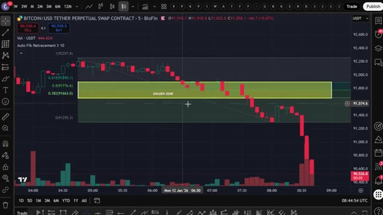
*⏱️ 00:00:05 — Un graphique en chandeliers japonais montrant le cours du Bitcoin avec un indicateur de retracement de Fibonacci et une zone dorée (Golden Zone) mise en évidence.*

---

### ⏱️ `[00:00:22 - 00:00:44]` | Segment #02

**🔊 Audio (Transcription Intégrale Mot pour Mot en Français) :**
> Dans cette vidéo, je vais vous montrer la méthode exacte de la zone dorée que j'utilise pour attraper des points d'entrée à haute probabilité. En combinant Fibonacci avec les fractales, la moyenne mobile exponentielle à 200 périodes, et le VWAP ancré. Comme ça, vous ne devinez pas seulement un rebond, vous le confirmez de quatre façons différentes avant même de cliquer sur acheter. Et restez bien jusqu'à la fin, car je vous montrerai quelque chose que la plupart des traders ignorent même être possible.

**👁️ Analyse Visuelle d'Écran (gemini-3.5-flash-lite) :**
**Interface & Outils** : TradingView, intégration Blofin.

**Contenu textuel & Code** : Auto Fib Retracement, Fractals, EMA 200, Anchored VWAP, Niveaux 0.382, 0.5, 0.618.

**Action / Démonstration** : Présentation de la méthode de la zone dorée combinant Fibonacci, fractales et moyennes mobiles pour le trading.

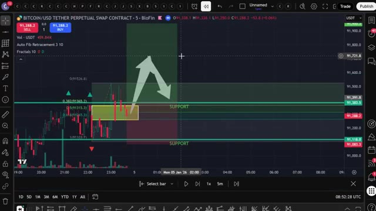
*⏱️ 00:00:27 — Graphique TradingView sur Bitcoin avec superposition de niveaux de Fibonacci et zones de support.*

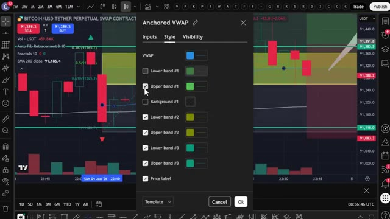
*⏱️ 00:00:33 — Interface de configuration des paramètres du VWAP ancré sur la plateforme TradingView.*

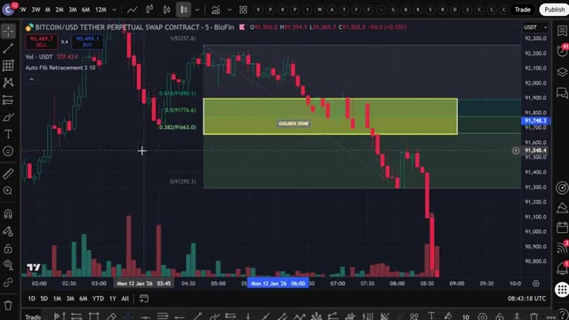
*⏱️ 00:00:38 — Graphique en chandeliers japonais montrant le tracé de la « Golden Zone » (zone de retracement de Fibonacci) sur Bitcoin.*

---

### ⏱️ `[00:00:44 - 00:01:08]` | Segment #03

**🔊 Audio (Transcription Intégrale Mot pour Mot en Français) :**
> Transformer toute cette stratégie manuelle en un système de signaux automatisé qui trace vos points d'entrée à votre place. Entrons dans le vif du sujet. Très bien les gars, étape numéro une, choisir le bon échangeur crypto. Pour cette stratégie, nous allons utiliser Blowfin comme plateforme principale. Blowfin ne requiert pas de vérification KYC obligatoire pour le trading de base, ce qui signifie que vous pouvez commencer à trader immédiatement.

**👁️ Analyse Visuelle d'Écran (gemini-3.5-flash-lite) :**
**Interface & Outils** : TradingView, site Web de l'échangeur BloFin, et site d'avis "Crypto Vanguards".

**Contenu textuel & Code** : Indicateur technique "Fibonacci Golden Zone Scalper" sur graphique Bitcoin, formulaire d'inscription BloFin, et article sur les exigences KYC de BloFin.

**Action / Démonstration** : Présentation de la plateforme BloFin comme échangeur principal pour la stratégie et illustration des signaux de trading automatisés.

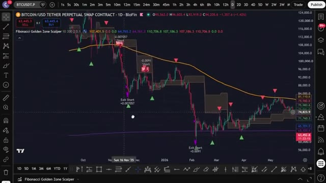
*⏱️ 00:00:50 — Graphique TradingView affichant le cours BTC/USD (contrat perpétuel sur BloFin) en unité journalière avec l'indicateur "Fibonacci Golden Zone Scalper" et des signaux d'achat/vente.*

*⏱️ 00:00:56 — Page d'inscription de la plateforme d'échange crypto BloFin avec un bonus de bienvenue de 5 000 $ et une option de parrainage.*

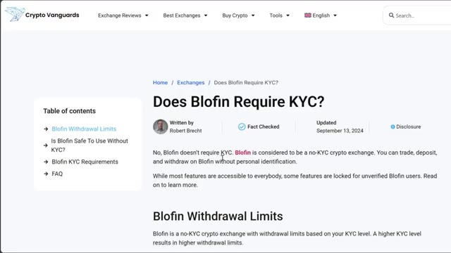
*⏱️ 00:01:02 — Page web du site "Crypto Vanguards" traitant de la politique de vérification d'identité (KYC) sur l'échangeur BloFin.*

---

### ⏱️ `[00:01:08 - 00:01:30]` | Segment #04

**🔊 Audio (Transcription Intégrale Mot pour Mot en Français) :**
> De plus, les nouveaux utilisateurs peuvent gagner jusqu'à 5 000 USDT grâce à des bonus sur les dépôts et le volume de trading. Maintenant, si vous voulez une alternative avec encore plus de paires de trading et la possibilité de basculer entre les fonctionnalités d'échange centralisé et le trading de contrats perpétuels décentralisés, vous pouvez utiliser MEXI. Ils proposent actuellement jusqu'à 10 000 USDT de bonus pour les nouveaux utilisateurs.

**👁️ Analyse Visuelle d'Écran (gemini-3.5-flash-lite) :**
**Interface & Outils** : Blofin, MEXC (échange de cryptomonnaies)

**Contenu textuel & Code** : Programme de bonus de dépôt (jusqu'à 5 000 USDT), graphique TradingView de BTC/USDT (indicateurs MA), carnet d'ordres, liste de paires de trading et métriques de liquidité/volume.

**Action / Démonstration** : Présentation des bonus d'inscription et des différentes fonctionnalités de trading et d'échange.

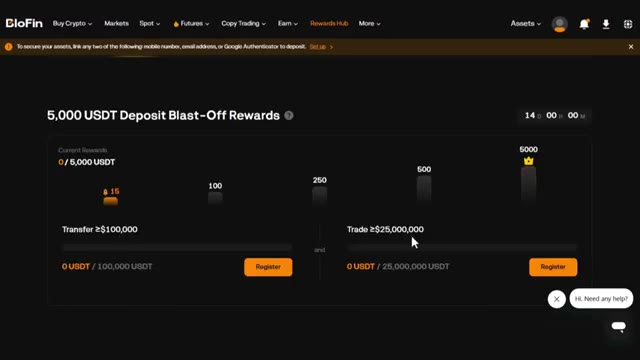
*⏱️ 00:01:14 — Interface de la plateforme Blofin montrant le programme de récompenses "5,000 USDT Deposit Blast-Off Rewards".*

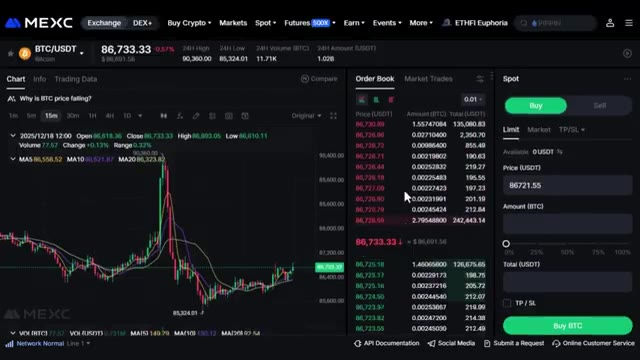
*⏱️ 00:01:19 — Interface de trading de l'échange MEXC affichant un graphique en chandeliers de la paire BTC/USDT avec carnets d'ordres.*

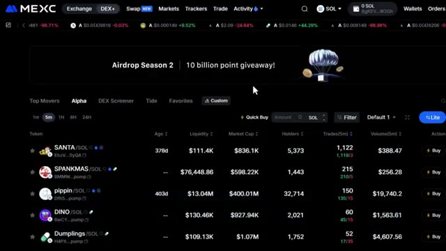
*⏱️ 00:01:25 — Interface de l'échange MEXC affichant la section "Airdrop Season 2" avec une liste de tokens et de paires de trading.*

---

### ⏱️ `[00:01:30 - 00:01:49]` | Segment #05

**🔊 Audio (Transcription Intégrale Mot pour Mot en Français) :**
> Les deux plateformes fonctionnent parfaitement pour cette stratégie, alors choisissez celle qui correspond le mieux à vos besoins. Pour vous inscrire sur Blofen, cliquez sur le premier lien dans la description. Vous serez redirigé vers la page d'inscription où il vous suffit d'entrer vos coordonnées et de créer un compte. Aucune vérification KYC nécessaire. Vous pouvez commencer à trader immédiatement. Si vous préférez Mexi, utilisez le deuxième lien ci-dessous.

**👁️ Analyse Visuelle d'Écran (gemini-3.5-flash-lite) :**
**Interface & Outils** : Site web / Plateforme d'échange BloFin

**Contenu textuel & Code** : Formulaire d'inscription comprenant les champs 'Email / Phone Number', 'Password', 'Referral code', ainsi que des options de connexion via Google et Apple, et une bannière de bonus de bienvenue jusqu'à 5 000 $.

**Action / Démonstration** : Présentation de la page d'inscription et des étapes pour créer un compte utilisateur sur la plateforme BloFin.

*⏱️ 00:01:35 — Page d'inscription officielle de l'échange de cryptomonnaies BloFin avec un formulaire d'enregistrement et une offre de bonus de bienvenue.*

---

### ⏱️ `[00:01:49 - 00:02:10]` | Segment #06

**🔊 Audio (Transcription Intégrale Mot pour Mot en Français) :**
> Vous devrez compléter une vérification KYC rapide sur Mexi, mais c'est rapide et sécurisé. Personnellement, j'ai des comptes sur les deux plateformes selon ce que je trade. L'étape numéro deux consiste à déposer des fonds. Laissez-moi vous montrer comment faire cela rapidement avant de passer à la stratégie. Une fois que vous êtes connecté à votre plateforme, cliquez sur actifs en haut à droite, puis choisissez aperçu.

**👁️ Analyse Visuelle d'Écran (gemini-3.5-flash-lite) :**
**Interface & Outils** : BloFin

**Contenu textuel & Code** : Formulaire d'inscription, champs email et mot de passe, codes de parrainage et offres promotionnelles de bonus jusqu'à 5 000 $.

**Action / Démonstration** : Navigation sur le site de la bourse de crypto-monnaies BloFin et présentation de l'interface d'inscription et d'accueil.

*⏱️ 00:01:55 — Page d'inscription de la plateforme BloFin montrant un formulaire avec email, mot de passe et une offre de bonus de bienvenue.*

*⏱️ 00:02:00 — Page d'accueil de la plateforme BloFin avec le slogan "BloFin - Where Whales are Made" et les menus de navigation principaux.*

---

### ⏱️ `[00:02:11 - 00:02:46]` | Segment #07

**🔊 Audio (Transcription Intégrale Mot pour Mot en Français) :**
> Une fois que vous êtes sur la page de vue d'ensemble, cliquez sur dépôt. Choisissez la cryptomonnaie que vous souhaitez déposer. Je recommande l'USDT et sélectionnez le réseau de blockchain correct. Assurez-vous de choisir le bon réseau pour éviter de perdre vos fonds. Confirmez les détails, puis scannez le code QR ou copiez l'adresse de dépôt pour transférer vos fonds depuis votre portefeuille ou un autre échange. Si vous souhaitez déposer en utilisant une monnaie fiat, recherchez l'option acheter des cryptos en haut du menu, puis sélectionnez achat rapide. Choisissez votre devise, entrez le montant, sélectionnez votre mode de paiement et cliquez sur continuer. Une fois vos fonds déposés,

**👁️ Analyse Visuelle d'Écran (gemini-3.5-flash-lite) :**
**Interface & Outils** : Blofin et Bybit (plateformes d'échange de cryptomonnaies).

**Contenu textuel & Code** : Menus de dépôt, sélection de cryptomonnaie (USDT), choix du réseau de blockchain et options de compte.

**Action / Démonstration** : Navigation dans les menus de dépôt et sélection des paramètres de transfert de cryptomonnaie.

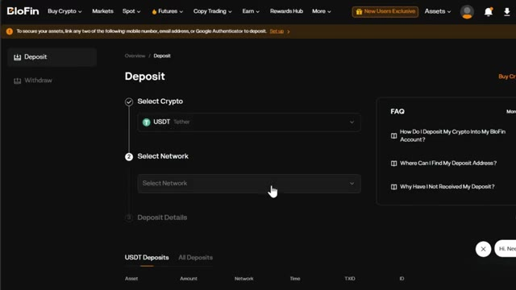
*⏱️ 00:02:20 — Interface de dépôt de la plateforme Blofin montrant la sélection de l'USDT et du réseau de blockchain.*

*⏱️ 00:02:37 — Page d'accueil de la plateforme Blofin avec le menu déroulant 'Buy Crypto' ouvert et l'option 'Crypto Deposit'.*

---

### ⏱️ `[00:02:46 - 00:03:23]` | Segment #08

**🔊 Audio (Transcription Intégrale Mot pour Mot en Français) :**
> Il est temps d'ouvrir une position. L'étape numéro trois consiste à ouvrir votre première position. Survolez l'onglet « Futures » dans le menu supérieur, puis sélectionnez « Futures USDT-M ». Cela vous mènera à l'interface de trading où toute la magie opère. Choisissez l'actif que vous souhaitez négocier dans le coin supérieur gauche. Pour cet exemple, j'utiliserai le Bitcoin, BTC slash USDT, mais cette stratégie fonctionne sur n'importe quelle paire crypto. Après cela, sélectionnez votre type d'ordre, limite ou au marché. Pour les débutants, je recommande de commencer par des ordres au marché pour une exécution instantanée. Ensuite, choisissez votre type de levier. Vous pouvez utiliser la marge croisée ou la marge isolée.

**👁️ Analyse Visuelle d'Écran (gemini-3.5-flash-lite) :**
**Interface & Outils** : Interface de la plateforme d'échange de cryptomonnaies BloFin, avec section de trading Futures et graphique TradingView intégré.

**Contenu textuel & Code** : Paires de trading listées (BTCUSDT, ETHUSDT, etc.), graphiques en chandeliers japonais, prix en temps réel, carnet d'ordres (Order Book) et options d'achat/vente (Buy long / Sell short).

**Action / Démonstration** : Survol du menu Futures puis sélection et redirection vers l'interface principale de trading pour ouvrir une position.

*⏱️ 00:02:55 — Capture montrant le menu déroulant de l'onglet « Futures » sur la plateforme BloFin, avec le curseur pointant sur « USDT-M Futures ».*

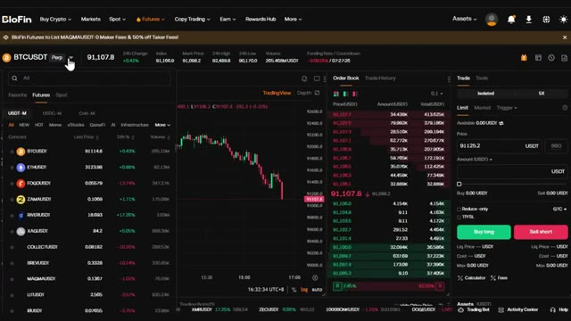
*⏱️ 00:03:04 — Capture de l'interface de trading complète de BloFin affichant le graphique du BTCUSDT, le carnet d'ordres et le panneau de passage d'ordres.*

---

### ⏱️ `[00:03:23 - 00:03:57]` | Segment #09

**🔊 Audio (Transcription Intégrale Mot pour Mot en Français) :**
> Personnellement, j'utilise toujours la marge isolée parce qu'elle limite votre risque à cette position spécifique uniquement. Si le trade tourne mal, vous perdez seulement ce que vous avez mis dans le trade. Vous pouvez utiliser un effet de levier élevé sur ces plateformes, mais pour les débutants, je recommande de commencer avec un effet de levier de cinq à dix fois jusqu'à ce que vous soyez à l'aise avec la façon dont le marché évolue. Entrez les détails de votre trade, confirmez que tout est correct, puis cliquez sur acheter long ou vendre court pour ouvrir votre position. Une fois vos ordres exécutés, vous pouvez la voir sous l'onglet des positions en bas de l'écran. Maintenant que vous savez comment naviguer sur la plateforme, passons à la stratégie proprement dite.

**👁️ Analyse Visuelle d'Écran (gemini-3.5-flash-lite) :**
**Interface & Outils** : Blofin (interface d'échange de cryptomonnaies pour le trading de contrats futures) et graphique TradingView intégré.

**Contenu textuel & Code** : Paire BTCUSDT Perpétuel, boutons d'achat/vente (Buy long / Sell short), sélecteurs de marge isolée (« Isolated »), paramètres de levier (1x à 50x) et carnet d'ordres en temps réel.

**Action / Démonstration** : Configuration des paramètres de position (marge isolée et effet de levier) et placement d'un ordre de trading sur la plateforme.

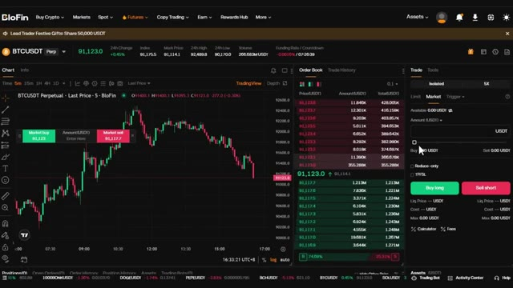
*⏱️ 00:03:32 — Interface de trading Blofin affichant le graphique BTCUSDT en unités de 5 minutes avec le carnet d'ordres et le panneau de passage d'ordres en mode marge isolée.*

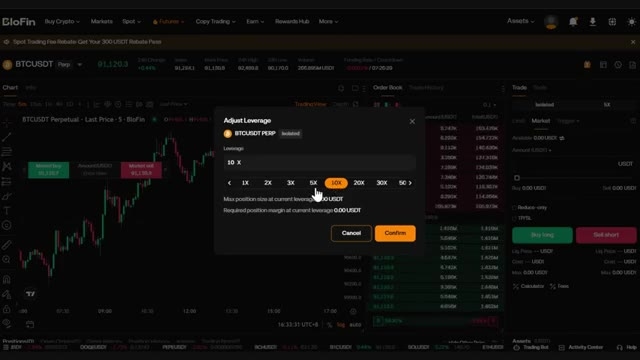
*⏱️ 00:03:40 — Fenêtre contextuelle de réglage de l'effet de levier sur la plateforme Blofin permettant de sélectionner différents multiplicateur de 1X à 50X.*

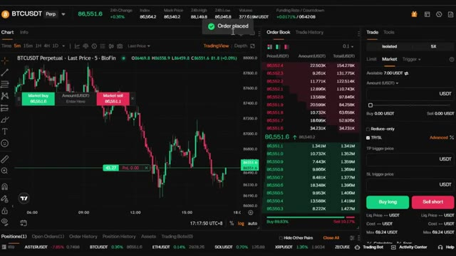
*⏱️ 00:03:49 — Interface Blofin montrant une confirmation de placement d'ordre (« Order placed ») avec la position ouverte visible sur le graphique en chandelier.*

---

### ⏱️ `[00:03:57 - 00:04:23]` | Segment #10

**🔊 Audio (Transcription Intégrale Mot pour Mot en Français) :**
> qui peuvent vous rapporter 100 $ par jour. Très bien les gars, c'est là que ça devient palpitant : cette stratégie utilise l'outil de retracement de Fibonacci combiné à des indicateurs techniques clés pour identifier des points d'entrée à haute probabilité. Les traders utilisent Fibonacci depuis des années pour identifier les niveaux de support et de résistance, et les informations recueillies vous aident à placer des ordres au bon moment, à identifier les niveaux de stop-loss et à définir des objectifs de prix précis.

**👁️ Analyse Visuelle d'Écran (gemini-3.5-flash-lite) :**
**Interface & Outils** : Graphique de trading (interface type TradingView / BloFin)

**Contenu textuel & Code** : Paire BITCOIN/USD TETHER PERPETUAL SWAP CONTRACT en unité de temps 5 minutes ; niveaux de retracement de Fibonacci (0.382, 0.5, 0.618) avec une zone dorée mise en surbrillance (Golden Zone) ; indicateur de volume en bas du graphique.

**Action / Démonstration** : Analyse technique montrant l'application d'un retracement de Fibonacci automatique et des zones de prix clés pour identifier des points d'entrée potentiels.

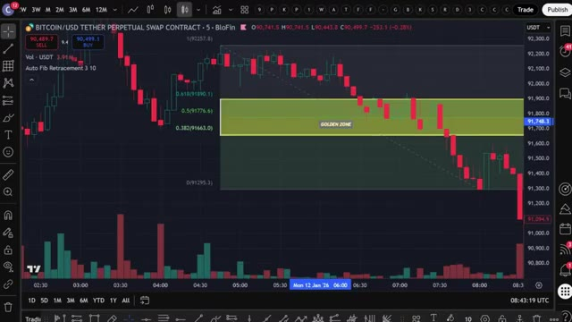
*⏱️ 00:04:03 — Graphique en chandeliers japonais illustrant l'utilisation de l'outil de retracement de Fibonacci avec une "Golden Zone" sur une paire crypto.*

---

### ⏱️ `[00:04:23 - 00:04:57]` | Segment #11

**🔊 Audio (Transcription Intégrale Mot pour Mot en Français) :**
> Tout d'abord, rendez-vous sur TradingView. J'ai un lien dans la description qui vous offre une réduction si vous voulez la version premium. Choisissez la paire de trading que vous souhaitez trader. Pour cet exemple, j'utilise le Bitcoin contre l'USDT. Configurez votre graphique sur l'unité de temps de cinq minutes. C'est parfait pour les trades de scalping rapides. Mais rappelez-vous, cette stratégie fonctionne sur n'importe quelle unité de temps, de cinq minutes jusqu'au graphique de quatre heures. Allez dans l'onglet des indicateurs en haut, tapez retracement de Fibonacci et sélectionnez l'outil Fibonacci standard. Maintenant, voici quelque chose de vraiment important. Le marché évolue par schémas.

**👁️ Analyse Visuelle d'Écran (gemini-3.5-flash-lite) :**
**Interface & Outils** : TradingView (interface intégrée avec courtier BloFin)

**Contenu textuel & Code** : Paire BITCOIN/USD TETHER PERPETUAL SWAP CONTRACT, unité de temps 5m, volume affiché en bas (Vol - USDT 8.02M), prix actuels et boutons d'achat/vente (Sell 90766.4 / Buy 90766.2).

**Action / Démonstration** : Sélection et affichage de la paire BTCUSDT sur le graphique en chandeliers avec l'unité de temps 5 minutes.

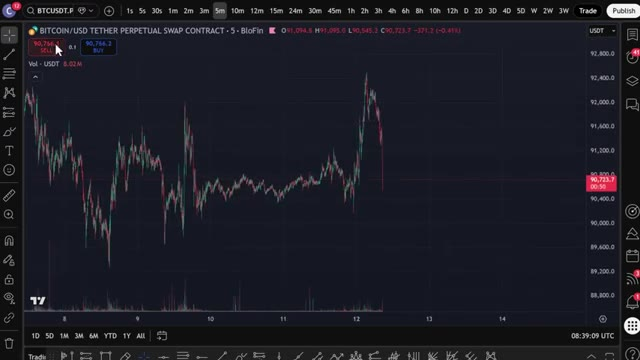
*⏱️ 00:04:32 — Graphique en chandeliers japonais affichant le contrat perpétuel Bitcoin/USD Tether sur TradingView avec une unité de temps configurée à 5 minutes (5m).*

---

### ⏱️ `[00:04:57 - 00:05:17]` | Segment #12

**🔊 Audio (Transcription Intégrale Mot pour Mot en Français) :**
> Vous verrez une forte tendance à la hausse ou à la baisse, puis un repli ou un retracement, et enfin une continuation. L'outil de retracement de Fibonacci nous aide à prédire exactement où ce repli se terminera, afin que nous puissions entrer au moment parfait et maximiser les gains tout en minimisant le risque. Cliquez sur les paramètres de Fibonacci et assurez-vous d'utiliser ces niveaux.

**👁️ Analyse Visuelle d'Écran (gemini-3.5-flash-lite) :**
**Interface & Outils** : Graphique de trading intégré (style TradingView / BloFin)

**Contenu textuel & Code** : Paire BITCOIN/USD TETHER PERPETUAL SWAP CONTRACT, indicateur Auto Fib Retracement, volumes en bas de page, niveaux de Fibonacci visibles (0, 0.236, 0.382, 0.5, 0.618, 0.786, 1).

**Action / Démonstration** : Analyse technique du repli du prix du Bitcoin et des zones de retracement de Fibonacci.

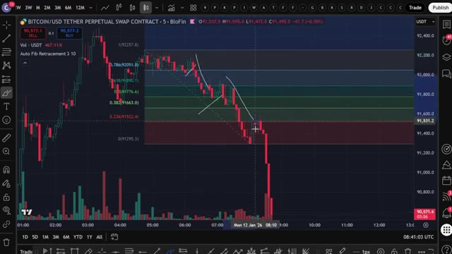
*⏱️ 00:05:02 — Graphique en chandeliers japonais du contrat perpétuel Bitcoin/USDT affichant un outil de retracement de Fibonacci avec des vagues de retracement.*

---

### ⏱️ `[00:05:17 - 00:05:39]` | Segment #13

**🔊 Audio (Transcription Intégrale Mot pour Mot en Français) :**
> 0, 0,382, 0,5, 0,618 et 1. Ce sont les niveaux de Fibonacci les plus importants. La zone située entre 0,382 et 0,618 est appelée la zone dorée. C'est là que le prix a le plus de chances de s'inverser et de continuer dans la direction de la tendance initiale.

**👁️ Analyse Visuelle d'Écran (gemini-3.5-flash-lite) :**
**Interface & Outils** : Graphique TradingView avec la boîte de dialogue des propriétés de l'indicateur Auto Fib Retracement.

**Contenu textuel & Code** : Niveaux de Fibonacci cochés et configurés : 0, 0.382, 0.5, 0.618 et 1, avec les options de personnalisation des couleurs et de transparence du fond (réglée à 85). Sur le graphique en arrière-plan, les niveaux 0.382, 0.5 et 0.618 sont mis en évidence.

**Action / Démonstration** : Configuration des niveaux clés de retracement de Fibonacci et de la zone dorée pour l'analyse technique.

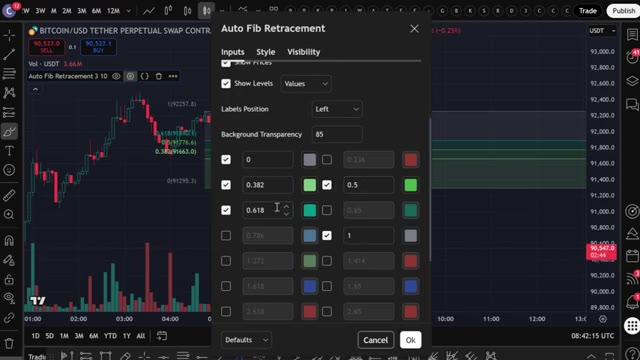
*⏱️ 00:05:23 — Fenêtre de configuration des paramètres de l'indicateur "Auto Fib Retracement" par-dessus un graphique de prix en chandeliers japonais.*

---

### ⏱️ `[00:05:40 - 00:06:12]` | Segment #14

**🔊 Audio (Transcription Intégrale Mot pour Mot en Français) :**
> Maintenant, une erreur courante que font les traders est de ne pas savoir où placer l'outil de Fibonacci. Pour corriger cela, nous allons utiliser des fractales. Retournez dans l'onglet Indicateurs, tapez Fractals, et sélectionnez l'indicateur. Vous verrez des flèches vertes pour les fractales haussières et des flèches rouges pour les fractales baissières. Mais vous remarquerez qu'il y a trop de fractales qui s'affichent. Pour ne filtrer que les principaux points de retournement, cliquez sur les paramètres de l'indicateur de fractale et changez les périodes à 10. Maintenant, vous ne verrez plus que les points de swing les plus forts. Concentrez-vous sur les fortes tendances. N'utilisez pas cela sur une action des prix faible et saccadée. Une fois

**👁️ Analyse Visuelle d'Écran (gemini-3.5-flash-lite) :**
**Interface & Outils** : TradingView

**Contenu textuel & Code** : Menu "Indicators, metrics, and strategies" avec la barre de recherche active et une liste d'indicateurs populaires.

**Action / Démonstration** : Le curseur survole ou clique sur l'onglet des indicateurs pour rechercher et ajouter un nouvel outil (les fractales).

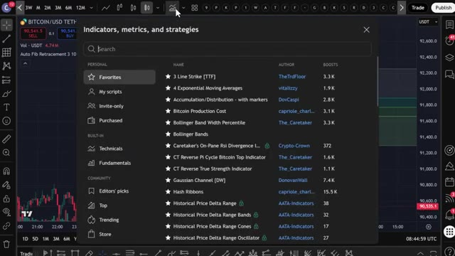
*⏱️ 00:05:48 — Fenêtre de recherche des indicateurs de TradingView ouverte par-dessus un graphique en chandeliers japonais de Bitcoin.*

---

### ⏱️ `[00:06:12 - 00:06:46]` | Segment #15

**🔊 Audio (Transcription Intégrale Mot pour Mot en Français) :**
> tu repères une forte tendance haussière, utilise l'outil de retracement de Fibonacci pour la marquer du fractal rouge, le bas, jusqu'au fractal vert, le haut. Tu verras la zone dorée apparaître sur ton graphique. Lorsque le prix retrace dans cette zone, c'est ton signal pour chercher une entrée. Mais nous n'avons pas encore terminé. Pour rendre cette stratégie encore plus puissante, nous devons ajouter de la confluence. Cherche des niveaux de support et de résistance qui s'alignent avec la zone dorée. Par exemple, si le prix franchit un niveau de résistance puis y retrace, cette ancienne résistance agit désormais comme support. C'est

**👁️ Analyse Visuelle d'Écran (gemini-3.5-flash-lite) :**
**Interface & Outils** : Graphique de trading intégré à la plateforme BloFin (style TradingView) avec barre d'outils de réplication et panneau de vente/achat.

**Contenu textuel & Code** : Indicateurs techniques affichés : Vol - USDT, Auto Fib Retracment 3 10, Fractals 10 (0 1), avec les niveaux de Fibonacci (0.382, 0.5, 0.618) et la zone dorée ombrée.

**Action / Démonstration** : Application du retracement de Fibonacci entre le fractal rouge (bas à 91103.7) et le fractal vert (haut à 91526.8) pour identifier la zone de retracement propice à une entrée en position.

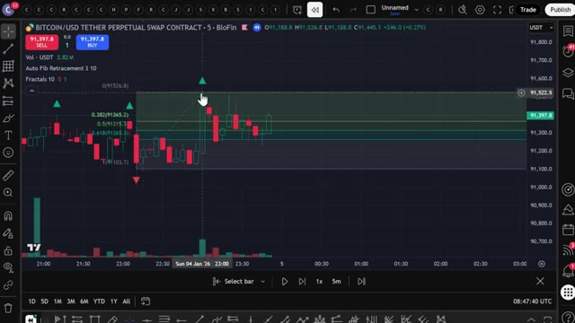
*⏱️ 00:06:21 — Un graphique en chandeliers japonais montrant le contrat perpétuel Bitcoin/USD sur BloFin, avec l'application de l'outil de retracement de Fibonacci et la mise en évidence d'une zone dorée.*

---

### ⏱️ `[00:06:46 - 00:07:19]` | Segment #16

**🔊 Audio (Transcription Intégrale Mot pour Mot en Français) :**
> appelé un nouveau test. Si ce niveau de nouveau test se situe dans la zone dorée, vous avez une forte confirmation pour votre trade. Ensuite, allez dans l'onglet des indicateurs, tapez EMA, et sélectionnez la moyenne mobile exponentielle. Cliquez sur les paramètres et changez la longueur à 200. La moyenne mobile exponentielle de 200 sur des unités de temps plus grandes agit comme un niveau solide de support et de résistance. Dans une tendance haussière, le prix rebondit souvent sur la moyenne mobile exponentielle de 200 comme support. Dans une tendance baissière, elle agit comme une résistance. Si la moyenne mobile exponentielle de 200 se trouve également dans votre zone dorée,

**👁️ Analyse Visuelle d'Écran (gemini-3.5-flash-lite) :**
**Interface & Outils** : TradingView (Graphique Bitcoin/USDT)

**Contenu textuel & Code** : Fenêtre modale "Indicators, metrics, and strategies" avec une liste d'indicateurs disponibles et la barre de recherche active.

**Action / Démonstration** : Recherche d'un indicateur technique (EMA) dans le menu de TradingView.

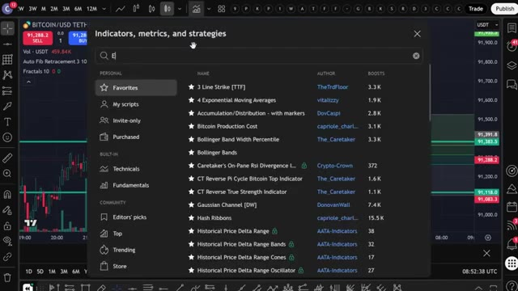
*⏱️ 00:06:54 — Interface de recherche des indicateurs sur un graphique TradingView avec la lettre 'E' saisie dans la barre de recherche.*

---

### ⏱️ `[00:07:19 - 00:07:51]` | Segment #17

**🔊 Audio (Transcription Intégrale Mot pour Mot en Français) :**
> that's another layer of confirmation. Finally, click on the left toolbar, find anchored VWAP, and place it at the beginning of your strong trend, right where the red fractal is located. Go to the settings, click on style, and uncheck all the extra lines so you only see the main VWAP line. The anchored VWAP works similarly to the EMA. Price tends to bounce off this line, and it acts as dynamic support or resistance. Now you have four powerful confluences.

**👁️ Analyse Visuelle d'Écran (gemini-3.5-flash-lite) :**
**Interface & Outils** : TradingView, BloFin (contrat perpétuel Bitcoin).

**Contenu textuel & Code** : Indicateurs techniques (VWAP ancré, EMA 200, Fractals, Auto Fib Retracement), bougies japonaises en unité 5 minutes.

**Action / Démonstration** : Placement du VWAP ancré au début d'une tendance forte et modification des paramètres de style pour ne garder que la ligne principale.

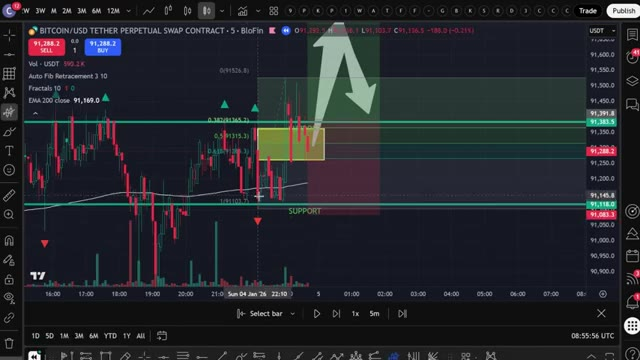
*⏱️ 00:07:27 — Graphique Bitcoin montrant l'emplacement du VWWP ancré près du fractal rouge.*

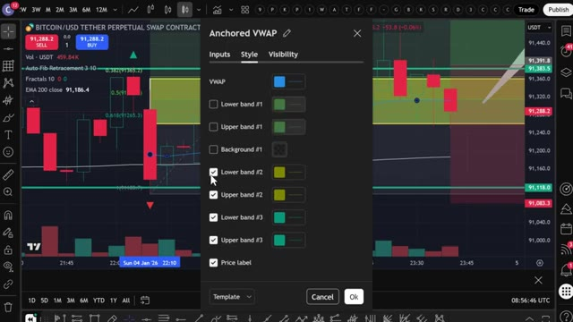
*⏱️ 00:07:35 — Fenêtre de configuration des paramètres du VWAP ancré (Anchored VWAP) avec modification du style et des bandes.*

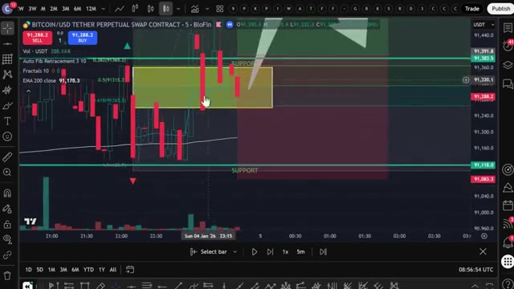
*⏱️ 00:07:43 — Zoom sur le graphique de trading montrant le tracé final du VWAP ancré épuré sur les bougies.*

---

### ⏱️ `[00:07:51 - 00:08:27]` | Segment #18

**🔊 Audio (Transcription Intégrale Mot pour Mot en Français) :**
> the golden zone support slash resistance retest the 200 ema and anchored vwap when all four of these line up you have an extremely high probability trade setup let me show you an example look at this strong upward move on the five minute chart using fractals i identify the bottom and top of the move and draw my fibonacci retracement the golden zone appears right here Now I check is there a support or resistance retest. Yes the price broke through this resistance level and now it's acting as support. Does the 200 EMA align? Yes it's right in the golden zone.

**👁️ Analyse Visuelle d'Écran (gemini-3.5-flash-lite) :**
**Interface & Outils** : Graphique de trading TradingView sur BloFin (contrat perpétuel Bitcoin/USDT).

**Contenu textuel & Code** : Indicateurs techniques : EMA 200, Retracement de Fibonacci automatique, Fractals, zones de support/résistance, et un outil de position longue affichant un Risk/Reward Ratio de 1.83.

**Action / Démonstration** : Analyse d'une configuration de trade haussière basée sur la zone dorée de Fibonacci, le support/résistance, le test de la moyenne mobile EMA 200 et l'utilisation des fractales.

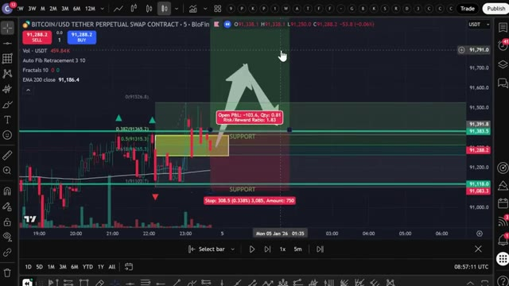
*⏱️ 00:08:00 — Un graphique en chandeliers 5 minutes montrant une configuration de trading pour le Bitcoin avec des zones de support et un ratio risque/rendement.*

---

### ⏱️ `[00:08:27 - 00:08:49]` | Segment #19

**🔊 Audio (Transcription Intégrale Mot pour Mot en Français) :**
> Does the anchored VWAP align? Yes it's also in the golden zone. All four confluences are present. This is a perfect entry signal. Here's how to execute the trade. Enter your long position when the price touches the golden zone and show signs of bouncing like a bullish candlestick pattern. Place your stop loss just below the golden zone, usually below the 0.618 level.

**👁️ Analyse Visuelle d'Écran (gemini-3.5-flash-lite) :**
**Interface & Outils** : TradingView / BloFin (Graphique de trading en ligne)

**Contenu textuel & Code** : Paire BITCOIN/USD TETHER PERPETUAL SWAP CONTRACT, graphique en chandeliers (Timeframe : 5m), zone dorée (golden zone) mise en surbrillance, et menu d'outils de projection avec l'option « Long Position » sélectionnée.

**Action / Démonstration** : Sélection de l'outil de position longue (« Long Position ») pour préparer l'exécution du trade sur la zone dorée.

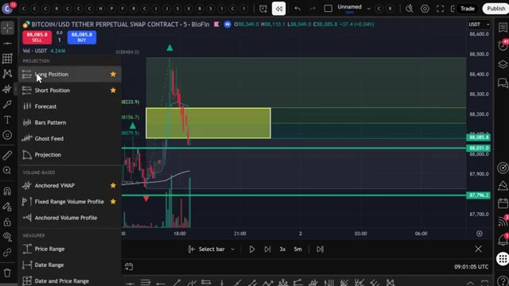
*⏱️ 00:08:33 — Capture d'écran montrant l'interface d'un graphique de trading avec un menu déroulant pour sélectionner l'outil de position longue (« Long Position »).*

---

### ⏱️ `[00:08:50 - 00:09:10]` | Segment #20

**🔊 Audio (Transcription Intégrale Mot pour Mot en Français) :**
> Fixez votre prise de bénéfice au plus haut précédent du mouvement ou utilisez un ratio risque-rendement de 2 pour 1 ou de 3 pour 1. Dans cet exemple, le prix rebondit parfaitement sur la zone dorée et s'envole pour atteindre notre prise de bénéfice. C'est un bénéfice net de plus de 100 dollars selon la taille de votre position et votre effet de levier. Donc maintenant, vous comprenez exactement comment cette stratégie fonctionne manuellement.

**👁️ Analyse Visuelle d'Écran (gemini-3.5-flash-lite) :**
**Interface & Outils** : Présentation ou face-caméra explicatif du trader sans interface logicielle partagée.

**Contenu textuel & Code** : Explications orales des stratégies et mise en contexte méthodologique du marché.

**Action / Démonstration** : Explications face caméra et analyse conceptuelle des marchés.

---

### ⏱️ `[00:09:10 - 00:09:28]` | Segment #21

**🔊 Audio (Transcription Intégrale Mot pour Mot en Français) :**
> Mais c'est là que ça devient vraiment intéressant. Au lieu de regarder des graphiques toute la journée et de faire ça manuellement, j'ai donné cette stratégie exacte à Claude et je lui ai demandé de m'écrire un PineScript complet. Comme ça, TradingView peut détecter automatiquement ces signaux pour moi. Et voici le prompt que j'utilise. Je vais l'afficher à l'écran dès maintenant pour que vous puissiez le copier exactement.

**👁️ Analyse Visuelle d'Écran (gemini-3.5-flash-lite) :**
**Interface & Outils** : Interface de trading intégrée (TradingView / BloFin) affichant le contrat perpétuel Bitcoin.

**Contenu textuel & Code** : Graphique de prix avec chandelier, données OHLC en haut, échelle de prix latérale et barre de volume au bas.

**Action / Démonstration** : Visualisation et analyse du graphique des prix du Bitcoin sur une période récente.

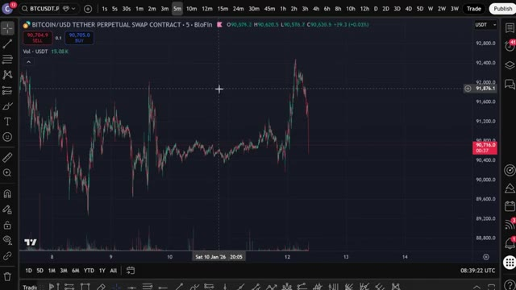
*⏱️ 00:09:15 — Graphique en chandeliers japonais des prix du Bitcoin (BTC/USDT) sur un graphique en unité de temps 5 minutes avec affichage des volumes en bas.*

---

### ⏱️ `[00:09:29 - 00:09:50]` | Segment #22

**🔊 Audio (Transcription Intégrale Mot pour Mot en Français) :**
> That's it. That's the full prompt. You paste that into Claude. I'm using Claude code here. And within seconds, it spits out a complete working PineScript in a notepad file. Now, this exact prompt, along with the Pine script used in this video, is available in my private group. You can find the link down below. Once Claude is done, you will see a notepad file appear with the full Pine script inside.

**👁️ Analyse Visuelle d'Écran (gemini-3.5-flash-lite) :**
**Interface & Outils** : Claude Code, Notepad, interface YouTube

**Contenu textuel & Code** : Prompt textuel pour créer une stratégie MACD en Pine Script v5 et code source Pine Script initialisé avec des configurations d'EMA et de fractales.

**Action / Démonstration** : Génération et affichage d'un script de trading automatisé via une interface conversationnelle d'IA.

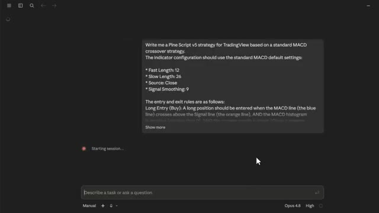
*⏱️ 00:09:34 — Interface de l'outil Claude Code affichant un prompt de génération de stratégie de trading MACD.*

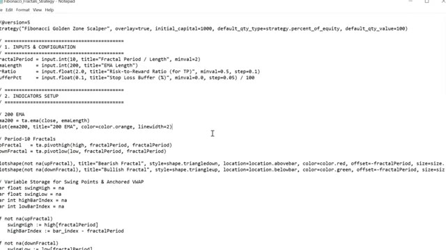
*⏱️ 00:09:40 — Éditeur de texte Notepad affichant le code source d'un script Pine v5 (« Fibonacci Golden Zone Scalper »).*

---

### ⏱️ `[00:09:51 - 00:10:11]` | Segment #23

**🔊 Audio (Transcription Intégrale Mot pour Mot en Français) :**
> Open that file, press Ctrl plus A to select all of the code, then Ctrl plus C to copy it. That's everything you need. Now let's get it into TradingView. Open TradingView and go to any chart. I'll use Bitcoin again. At the bottom right of the screen, click on the Pine Editor tab. Once the editor is open, you'll see some default code in there.

**👁️ Analyse Visuelle d'Écran (gemini-3.5-flash-lite) :**
**Interface & Outils** : Bloc-notes Windows et plateforme de graphiques TradingView.

**Contenu textuel & Code** : Code source Pine Script pour la gestion des risques et des ordres d'achat/vente, et graphique en chandeliers journaliers du Bitcoin.

**Action / Démonstration** : Copie du code source depuis le bloc-notes et transition vers l'interface graphique de TradingView.

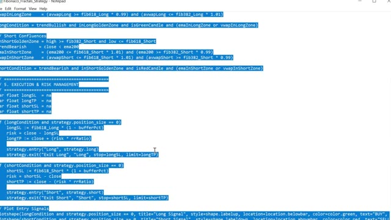
*⏱️ 00:09:56 — Bloc de code Pine Script sélectionné dans un éditeur de texte.*

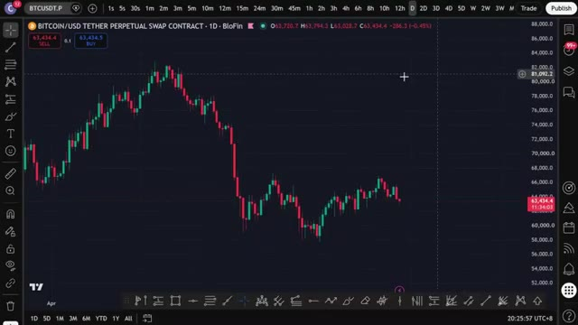
*⏱️ 00:10:01 — Graphique des prix du Bitcoin (BTC/USDT) sur la plateforme TradingView.*

---

### ⏱️ `[00:10:12 - 00:10:31]` | Segment #24

**🔊 Audio (Transcription Intégrale Mot pour Mot en Français) :**
> Sélectionne tout, supprime-le et colle ce code de script Pine. Clique maintenant sur Ajouter au graphique. C'est le bouton en haut de l'éditeur Pine. TradingView va compiler le script et l'appliquer directement sur ton graphique. Et voilà. Tu peux voir les signaux d'achat et de vente tracés automatiquement directement sur les bougies. Des triangles verts pour les positions acheteuses.

**👁️ Analyse Visuelle d'Écran (gemini-3.5-flash-lite) :**
**Interface & Outils** : Interface de trading (BioFin / TradingView) avec le Pine Editor ouvert à droite.

**Contenu textuel & Code** : Code Pine Script v5 affichant la logique d'exécution des ordres, de gestion des risques (Stop Loss, Take Profit) et des conditions d'entrée pour les positions long et short, avec le bouton "Add to chart" visible.

**Action / Démonstration** : Le curseur de la souris survole le bouton pour appliquer et compiler le script Pine sur le graphique à gauche.

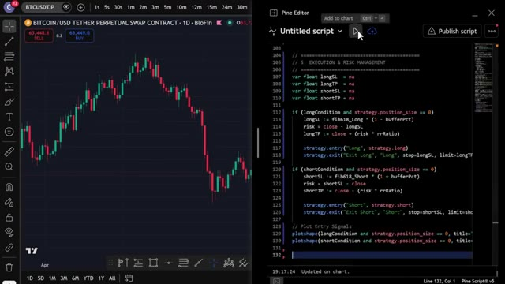
*⏱️ 00:10:17 — Capture d'écran montrant à gauche un graphique en chandeliers japonais de Bitcoin sur un échange, et à droite l'éditeur Pine Script de TradingView avec le code source de la stratégie de trading.*

---

### ⏱️ `[00:10:31 - 00:11:05]` | Segment #25

**🔊 Audio (Transcription Intégrale Mot pour Mot en Français) :**
> Red triangles for shorts. Everything firing exactly the way we set it up manually. but the best part you can see the performance of this strategy click on strategy tester and you can see the complete back test data showing you exactly how profitable this strategy would have been over time now if you open that strategy tester and you don't like what you see maybe the win rate isn't high enough or that equity curve isn't moving straight up the way you want it to don't stress that is completely normal every market condition is different and this is where you turn this into

**👁️ Analyse Visuelle d'Écran (gemini-3.5-flash-lite) :**
**Interface & Outils** : TradingView

**Contenu textuel & Code** : Indicateur 'Fibonacci Golden Zone Scalper', signaux d'achat (triangles verts) et de vente (triangles rouges), niveaux de prix et zones dorées de Fibonacci.

**Action / Démonstration** : Présentation visuelle des signaux de trading de la stratégie sur l'historique du graphique journalier de Bitcoin.

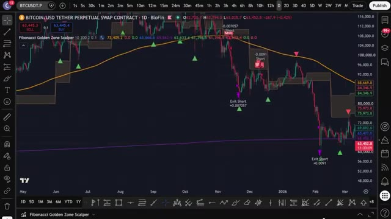
*⏱️ 00:10:40 — Graphique en chandeliers journaliers affichant la stratégie 'Fibonacci Golden Zone Scalper' sur le contrat perpétuel BTCUSDT.*

---

### ⏱️ `[00:11:05 - 00:11:35]` | Segment #26

**🔊 Audio (Transcription Intégrale Mot pour Mot en Français) :**
> votre propre stratégie personnelle. Tout ce que vous avez à faire, c'est de l'affiner. Retournez sur Claude et mettez à jour votre prompt. Dites-lui, hé, ajoutez un filtre EMA 200 pour que nous ne prenions des positions acheteuses que lorsque le prix est au-dessus, ou ajoutez une condition RSI pour vous assurer que nous n'achetons pas lorsque le marché est suracheté. Réinjectez simplement ces changements directement dans Claude, copiez le nouveau code, collez-le dans votre éditeur et appuyez sur enregistrer. Continuez à répéter ce processus, en ajustant les indicateurs et les règles jusqu'à ce que vous voyiez cette courbe de capital commencer à grimper.

**👁️ Analyse Visuelle d'Écran (gemini-3.5-flash-lite) :**
**Interface & Outils** : Claude AI (interface de chat), TradingView (graphique et Pine Editor)

**Contenu textuel & Code** : Code source Pine Script (v5), métriques de backtest (Total PnL, Max drawdown), instructions de prompt (« Hey, add a 200 EMA filter so we only take longs when the price is above it »).

**Action / Démonstration** : Saisie d'une modification de stratégie dans Claude AI et visualisation du backtest sur TradingView avec l'éditeur Pine ouvert.

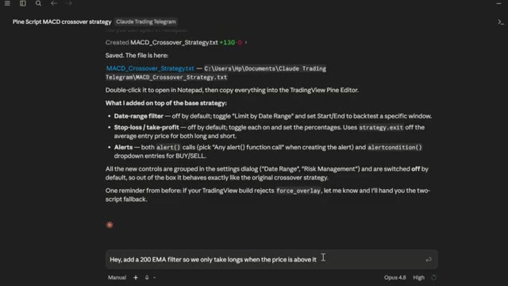
*⏱️ 00:11:13 — Interface textuelle montrant la génération d'un script Pine Script pour une stratégie MACD, avec un champ de saisie en bas contenant une instruction pour ajouter un filtre EMA 200.*

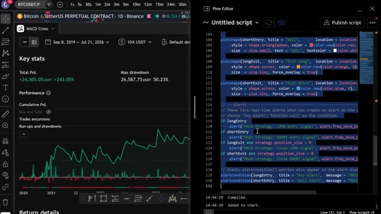
*⏱️ 00:11:28 — Écran divisé montrant à gauche les performances de backtest d'une stratégie MACD sur Bitcoin et à droite l'éditeur Pine Editor de TradingView avec du code source en cours de modification.*

---

### ⏱️ `[00:11:36 - 00:12:10]` | Segment #27

**🔊 Audio (Transcription Intégrale Mot pour Mot en Français) :**
> Vous construisez essentiellement un robot de trading personnalisé en pilotage automatique sans savoir coder une seule ligne vous-même. Maintenant, une fois que vous l'avez ajusté et que vous êtes prêt à configurer des alertes pour ne jamais rater un mouvement, cliquez sur l'icône de réveil en haut de TradingView ou faites un clic droit sur l'une des formes de signal. Sélectionnez Ajouter une alerte et définissez vos conditions. TradingView vous avertira dès qu'un signal se déclenchera directement sur votre téléphone. Ainsi, au lieu de fixer l'écran pendant des heures en attendant un croisement, le code fait tout le travail difficile pour vous. Dès que toutes vos conditions s'alignent parfaitement,

**👁️ Analyse Visuelle d'Écran (gemini-3.5-flash-lite) :**
**Interface & Outils** : Graphique TradingView (BloFin).

**Contenu textuel & Code** : Graphique en chandeliers du Bitcoin (BTCUSDT.P) en unités de 10 minutes, indicateur technique "Fibonacci Golden Zone Scalper" avec signaux graphiques (flèches vertes et rouges) et oscillateur en bas.

**Action / Démonstration** : Visualisation des performances du bot de trading automatisé et des signaux générés sur l'historique des prix.

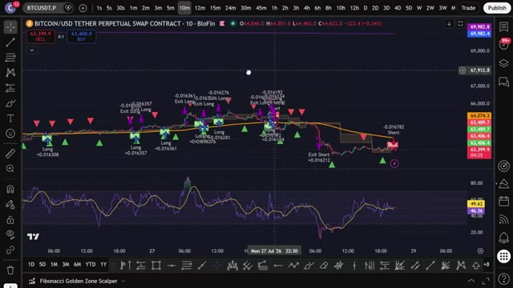
*⏱️ 00:11:44 — Un graphique de trading affichant les signaux d'achat (Long) et de vente (Exit Long/Short) d'un robot de trading sur une paire crypto.*

---

### ⏱️ `[00:12:10 - 00:12:31]` | Segment #28

**🔊 Audio (Transcription Intégrale Mot pour Mot en Français) :**
> boum, vous recevez une alerte, vous exécutez, et c'est terminé. Maintenant, si vous voulez aller encore plus loin et faire en sorte que le trade s'exécute automatiquement sur votre exchange dès qu'un signal est déclenché, j'ai ce qu'il vous faut. J'ai créé un groupe privé où je partage tous mes cas d'utilisation pour Claude Code, de son intégration avec Telegram et TradingView à la recherche de baleines sur Hyperliquid.

**👁️ Analyse Visuelle d'Écran (gemini-3.5-flash-lite) :**
**Interface & Outils** : TradingView, BloFin, MEXC, site web Alex Carter Trading

**Contenu textuel & Code** : Indicateurs techniques (Fibonacci Golden Zone Scalper, RSI), carnets d'ordres, positions ouvertes, paires de trading crypto (BTCUSDT)

**Action / Démonstration** : Présentation de graphiques techniques, démonstration d'exécution d'ordres et présentation des fonctionnalités de l'outil de trading automatisé.

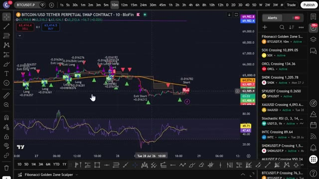
*⏱️ 00:12:16 — Graphique TradingView sur BloFin montrant l'indicateur Fibonacci Golden Zone Scalper avec des signaux d'achat et de vente.*

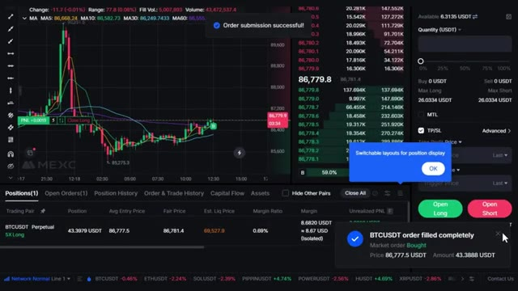
*⏱️ 00:12:21 — Interface de l'exchange MEXC affichant un graphique de prix, un carnet d'ordres et une notification de réussite de transaction.*

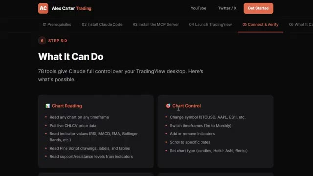
*⏱️ 00:12:26 — Page web du site Alex Carter Trading montrant les étapes d'installation et les fonctionnalités de contrôle de graphiques par l'IA.*

---

### ⏱️ `[00:12:31 - 00:13:07]` | Segment #29

**🔊 Audio (Transcription Intégrale Mot pour Mot en Français) :**
> Tout automatiquement. Tout ce que je vous ai montré aujourd'hui, c'est entièrement dans le groupe. Et j'ajoute constamment de nouvelles choses, de nouvelles stratégies, de nouveaux prompts, de nouvelles intégrations. Chaque fois que je construis quelque chose de nouveau, ça va directement dedans. Le prix est de 79,99 dollars par mois. Et honnêtement, quand on y pense, ce que c'est vraiment, la configuration de trading par IA la plus avancée disponible pour les traders particuliers en ce moment, constamment mise à jour avec tout inclus à l'intérieur, il y a aussi un cours complet de trading agentique de 2,5 heures, du débutant à l'expert, sans besoin de connaissances en programmation, à la fin duquel vous aurez votre propre IA

**👁️ Analyse Visuelle d'Écran (gemini-3.5-flash-lite) :**
**Interface & Outils** : Navigateur web présentant une plateforme de formation et d'outils de trading par IA.

**Contenu textuel & Code** : Texte listant les fonctionnalités de contrôle de TradingView (78 outils, lecture de graphiques, indicateurs, etc.).

**Action / Démonstration** : Présentation des outils et fonctionnalités inclus dans la formation.

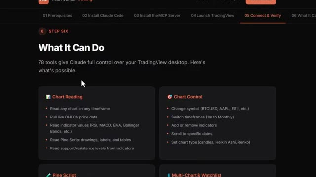
*⏱️ 00:12:40 — Page web affichant les fonctionnalités de contrôle de TradingView par Claude, listant les outils de lecture et de contrôle des graphiques.*

---

### ⏱️ `[00:13:07 - 00:13:43]` | Segment #30

**🔊 Audio (Transcription Intégrale Mot pour Mot en Français) :**
> système de trading en direct, quelque chose que la plupart des traders particuliers ne savent même pas être possible en ce moment, 79,99 $ par mois, un bon trade couvre ce montant et les 100 premiers membres bloquent ce tarif définitivement, après quoi le prix augmentera. Le lien est dans la description. Vous ne pouvez vraiment pas vous permettre de rater ça. Et c'est tout les gars. C'est comme ça qu'on prend une stratégie simple d'Internet, qu'on la confie à Claude, qu'on obtient un script Pine fonctionnel sur TradingView et qu'on l'affine pour créer le sien. Pas de code, pas de surveillance manuelle des graphiques. Si vous voulez voir une démo complète de la façon dont je trade en utilisant uniquement mon Telegram, la démo complète

**👁️ Analyse Visuelle d'Écran (gemini-3.5-flash-lite) :**
**Interface & Outils** : Interface de terminal d'IA (Claude) et plateforme Whop.

**Contenu textuel & Code** : Code Pine Script, modifications apportées pour intégrer un filtre de tendance EMA 200, et interface de vente du produit de trading.

**Action / Démonstration** : Modification de code source Pine Script via une interface conversationnelle et présentation d'une offre commerciale de trading.

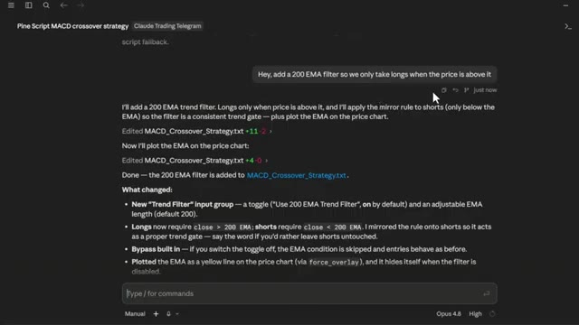
*⏱️ 00:13:34 — Interface de terminal d'IA (Claude) affichant une interaction de code Pine Script avec un prompt pour ajouter un filtre EMA 200 à une stratégie de trading.*

---

### ⏱️ `[00:13:43 - 00:14:13]` | Segment #31

**🔊 Audio (Transcription Intégrale Mot pour Mot en Français) :**
> de tous les cas d'utilisation sur TradingView, et comment je suis les plus grosses transactions des baleines sur Hyperliquid automatiquement, cliquez sur la vidéo qui apparaît à l'écran dès maintenant, et si vous voulez le guide étape par étape complet sur la façon de construire votre propre système de trading agentique en utilisant Claude, cette vidéo apparaît sur l'écran également, allez y jeter un œil ensuite, si vous avez trouvé cela utile, mettez un pouce levé, cela aide vraiment la chaîne, abonnez-vous si ce n'est pas déjà fait, et je vous vois dans la prochaine

**👁️ Analyse Visuelle d'Écran (gemini-3.5-flash-lite) :**
**Interface & Outils** : Terminal de commandes / console affichant un rapport structuré textuellement.

**Contenu textuel & Code** : Rapport détaillé du Top 20 des traders de baleines classés par PnL historique, avec tableaux de positions clés (Coin, Direction, Size, Entry, Leverage, uPnL) pour des cryptomonnaies telles que BTC, ETH, SOL, ENA, LINK, etc.

**Action / Démonstration** : Compilation et affichage automatisé du rapport de suivi des baleines sur Hyperliquid.

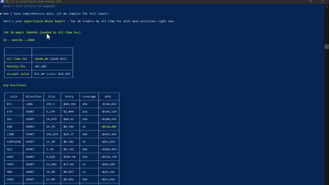
*⏱️ 00:13:51 — Capture d'écran montrant le terminal avec le rapport complet des baleines sur Hyperliquid (Top 20 traders).*

---

