# 🎬 How I’d Build an Automated AI Trading System With Claude (If My Life Depended on It)

> **Chaîne** : [Alex Carter](https://www.youtube.com/@AlexCarterTrading)  
> **Lien YouTube** : [https://www.youtube.com/watch?v=eF5w6tKDn5c](https://www.youtube.com/watch?v=eF5w6tKDn5c)  
> **Date de publication** : 20260801  
> **Durée** : 00:13:10  
> **Identifiant vidéo** : `eF5w6tKDn5c`  
> **Transcription & Analyse** : `whisper-v3-large-turbo+gemini-3.5-flash-lite`  

---

## 📌 Synthèse Exécutive & Outils

### 💡 Résumé

La vidéo de la chaîne Alex Carter propose une immersion radicale dans l'automatisation avancée du trading grâce à l'intelligence artificielle générative, et plus particulièrement via l'utilisation de **Claude**. Alors que la majorité des acteurs du marché continuent de s'épuiser sur des analyses manuelles chronophages — rafraîchissement d'interfaces comme Hyperliquid, traçage laborieux de supports et résistances, ou surveillance empirique des taux de financement —, une avant-garde de traders exploite des agents IA capables d'exécuter l'intégralité de ces processus de manière autonome, instantanée et 24h/24. La démonstration illustre la transition d'un trading discrétionnaire vers une approche algorithmique augmentée, où l'humain ne définit plus que les grandes lignes stratégiques tandis que l'IA gère l'analyse visuelle, la traduction en code, l'évaluation des risques et l'exécution directe des ordres.

Les démonstrations pratiques exposées dans la vidéo révèlent la puissance redoutable de cette automatisation de bout en bout. D'une part, Claude est mis à contribution pour analyser instantanément l'historique des prix sur **TradingView**, cartographier automatiquement les zones clés de support et de résistance, et générer ou déboguer des scripts de stratégie complexes en **Pine Script** à partir de simples instructions textuelles. D'autre part, la vidéo dévoile la mise en place d'un assistant de trading opérationnel couplé à **Telegram**, permettant d'ouvrir des positions complexes, de fixer des stop-loss et des take-profit, et de générer des rapports de portefeuille visuels de niveau institutionnel par de simples requêtes en langage naturel, sans jamais ouvrir un graphique.

Enfin, l'approche s'élève au niveau du trading quantitatif décentralisé en exploitant la transparence totale de la blockchain d'**Hyperliquid**. L'intelligence artificielle est programmée pour scanner en temps réel des dizaines de milliers de portefeuilles, identifier les positions des vingt traders les plus rentables (la "smart money"), et croiser ces données avec le comportement des portefeuilles déficitaires. Cette analyse croisée met en lumière des divergences comportementales majeures — telles que le positionnement inverse entre "baleines" et traders "rekt" — offrant ainsi des signaux de trading à forte asymétrie statistique. L'ensemble de la configuration transforme une opération de trading individuelle en un fonds quantitatif entièrement automatisé, accessible via un simple smartphone.

### 🛠️ Outils, Modèles & Logiciels Présentés

* **Claude / Claude Code** : Modèle de langage de pointe et environnement de développement par IA utilisé pour orchestrer l'analyse technique, rédiger le code Pine Script, exécuter des scripts de scraping et piloter les bots de trading via des requêtes textuelles.
* **TradingView** : Plateforme de graphisme boursier de référence exploitée pour la visualisation des prix, l'analyse multi-unités de temps et l'automatisation des entrées/sorties via des webhooks connectés aux stratégies.
* **Hyperliquid** : Échange décentralisé (DEX) de contrats perpétuels fonctionnant sur sa propre blockchain, dont l'accès public à l'intégralité des données on-chain permet d'analyser les positions des portefeuilles et de suivre l'argent intelligent.
* **Pine Script** : Langage de programmation propriétaire de TradingView utilisé pour concevoir, backtester et automatiser des stratégies de trading algorithmique.
* **Telegram** : Application de messagerie instantanée transformée ici en interface de commande à distance pour exécuter des ordres, recevoir des alertes de prix en temps réel et piloter le système de trading depuis un téléphone mobile.
* **Grok Bots** : Mentionné dans l'écosystème global comme alternative ou complément d'intelligence artificielle pour le traitement de données de marché en temps réel et le support à l'analyse quantitative.

### 🔑 Points Clés & Enseignements Stratégiques

* **Cartographie automatique des supports et résistances** : Claude est capable d'analyser l'historique des prix d'un actif, d'identifier les niveaux de prix les plus testés et de tracer automatiquement les lignes de support et de résistance avec leurs étiquettes en quelques secondes, éliminant la subjectivité et le travail manuel.
* **Génération et débogage de stratégies Pine Script** : Il est possible de concevoir des indicateurs complexes ou des stratégies de trading complètes sur TradingView simplement en formulant des consignes en anglais simple (ou en français), permettant d'itérer rapidement sur le code sans compétences avancées en programmation.
* **Analyse de confluence multi-unités de temps** : L'IA peut agréger et analyser simultanément les graphiques hebdomadaires, journaliers, en 4 heures et en 1 heure pour délivrer une recommandation de trade hautement filtrée, incluant un point d'entrée, un stop-loss et un take-profit précis.
* **Exécution de trades mains libres via Webhook** : En connectant une stratégie TradingView à un exchange par le biais d'un webhook, tout signal déclenché par l'indicateur est transmis instantanément à l'IA pour ouvrir, gérer et clore la position de manière totalement automatisée sans intervention humaine.
* **Interface de commande conversationnelle sur Telegram** : La mise en place d'un bot relié à Telegram permet de gérer son capital en langage naturel (ex: ouvrir un long 5x sur l'ETH avec des paramètres de risque précis) depuis n'importe quel endroit (lit, salle de sport), transformant la messagerie en un terminal de trading complet.
* **Génération de tableaux de bord de portefeuille institutionnels** : Par une simple consigne, l'assistant IA extrait toutes les données de compte en temps réel pour produire des rapports visuels incluant la courbe de capital, les taux de réussite, les frais de financement ventilés et la distance de liquidation de chaque position.
* **Exploitation automatisée des taux de financement (Funding Rate Farming)** : Un script de scan analyse l'ensemble des paires de futures, calcule les rendements annualisés des taux de financement (qui peuvent atteindre 50 % ou 100 %) et indique au trader la direction à adopter pour percevoir ces paiements toutes les huit heures sans spéculer sur la direction des prix.
* **Analyse on-chain des 20 meilleures "baleines"** : En interrogeant les points de terminaison publics d'Hyperliquid, Claude filtre parmi des dizaines de milliers de portefeuilles pour extraire les positions ouvertes, les prix d'entrée, l'effet de levier et le P&L non réalisé des traders les plus performants.
* **Détection des divergences "Smart Money" vs "Rekt Traders"** : En comparant simultanément les portefeuilles les plus rentables et les plus perdants, l'IA identifie les actifs où les deux groupes s'accordent (trades encombrés comme Sui) et ceux où ils s'opposent radicalement, fournissant des signaux de trading à forte valeur statistique.
* **Gestion du risque paramétrée par l'IA** : Chaque ordre automatisé intègre obligatoirement des règles strictes de gestion du risque (pourcentages précis de stop-loss et de take-profit, maîtrise de l'effet de levier), garantissant que l'automatisation ne se transforme pas en machine à pertes par manque de discipline.
* **Arbitrage temporel et gain de productivité massif** : L'automatisation par l'IA permet de réduire des tâches d'analyse qui prenaient des heures (cartographie, lecture des carnets d'ordres, suivi des baleines) à quelques secondes, permettant au trader de se concentrer exclusivement sur la macro-stratégie et l'allocation de capital.

---

## ⏱️ Chronologie & Transcription Complète Audio & Visuelle (Mot pour Mot)

### ⏱️ `[00:00:00 - 00:00:20]` | Segment #01

**🔊 Audio (Transcription Intégrale Mot pour Mot en Français) :**
> La façon dont les traders utilisent l'IA est sur le point de changer complètement. Pendant ces deux dernières années, le jeu a été le même pour pratiquement tout le monde dans ce milieu. Vous regardez les graphiques, vous lisez l'analyse technique, vous vérifiez les portefeuilles des baleines manuellement, et vous essayez de saisir le mouvement avant tout le monde. Et honnêtement, c'est sur cela que j'ai bâti toute cette chaîne.

**👁️ Analyse Visuelle d'Écran (gemini-3.5-flash-lite) :**
**Interface & Outils** : Financial Post, TradingView.

**Contenu textuel & Code** : Article financier sur l'IA dans les hedge funds, graphique de prix Bitcoin, indicateur de bandes, signaux Buy/Sell, indicateur de momentum et outil de position (Risk/Reward).

**Action / Démonstration** : Présentation d'un article d'actualité puis analyse de graphiques techniques sur le Bitcoin avec des indicateurs de tendance.

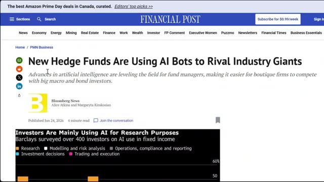
*⏱️ 00:00:05 — Capture d'écran d'un article du Financial Post intitulé "New Hedge Funds Are Using AI Bots to Rival Industry Giants".*

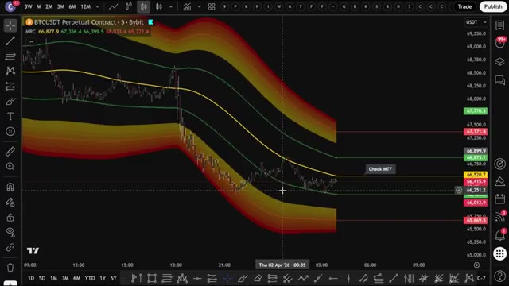
*⏱️ 00:00:10 — Graphique TradingView sur l'actif BTCUSDT en contrat perpétuel (Bybit) affichant des bandes de tendance colorées et des niveaux de prix.*

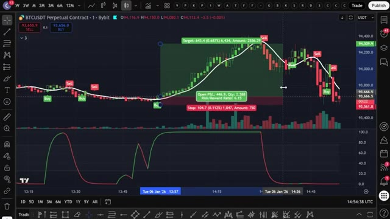
*⏱️ 00:00:15 — Graphique TradingView (BTCUSDT) en unité de temps courte avec signaux d'achat/vente (Buy/Sell) et un outil de gestion du risque affichant un ratio rendement/risque.*

---

### ⏱️ `[00:00:21 - 00:00:54]` | Segment #02

**🔊 Audio (Transcription Intégrale Mot pour Mot en Français) :**
> Appeler les creux, appeler les sommets, partager mes trades avec vous tous les jours. Mais il y a un changement qui se produit en ce moment et auquel la plupart des traders ne prêtent pas attention. Alors que tout le monde est encore en train de rafraîchir manuellement Hyperliquid, de faire défiler les taux de financement à la main, et de tracer les supports et les résistances ligne par ligne, il y a un petit groupe de traders qui utilisent tranquillement Claude pour faire tout cela instantanément, automatiquement, pendant qu'ils dorment. Et ce que j'ai découvert après avoir parlé à beaucoup de traders dans ma communauté, c'est que la raison pour laquelle la plupart d'entre vous ne font pas encore cela n'est pas parce que c'est

**👁️ Analyse Visuelle d'Écran (gemini-3.5-flash-lite) :**
**Interface & Outils** : TradingView, interface Web.

**Contenu textuel & Code** : Graphique en chandelier de Bitcoin (BTCUSDT) avec des lignes horizontales vertes (supports) et rouges (résistances).

**Action / Démonstration** : Analyse technique des niveaux de prix et des zones de support/résistance sur Bitcoin.

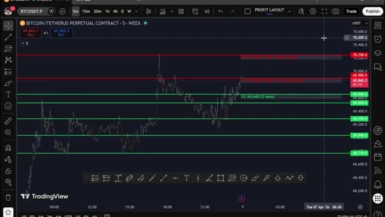
*⏱️ 00:00:37 — Graphique TradingView en unité de temps 5 minutes du contrat perpétuel Bitcoin (BTCUSDT.P) avec des niveaux de support et de résistance horizontaux.*

---

### ⏱️ `[00:00:54 - 00:01:30]` | Segment #03

**🔊 Audio (Transcription Intégrale Mot pour Mot en Français) :**
> compliqué. C'est parce que personne ne vous a réellement montré comment le configurer spécifiquement pour le trading. Tout le monde utilise l'IA pour écrire des e-mails ou créer une application aléatoire. Presque personne ne l'utilise pour lire ses graphiques, gérer ses positions et exécuter ses trades à sa place. Donc, dans cette vidéo, je vais vous montrer exactement comment je construirais une opération de trading entièrement automatisée en utilisant Claude si ma vie en dépendait. Lire automatiquement des graphiques TradingView, trader directement depuis Telegram sur votre téléphone, suivre en temps réel ce que font les "whales" (les gros investisseurs) du "smart money" sur Hyperliquid,

**👁️ Analyse Visuelle d'Écran (gemini-3.5-flash-lite) :**
**Interface & Outils** : Tableau de bord analytique de marché (type Coinglass / Velo) et plateforme de cartographie TradingView (paires WEEX).

**Contenu textuel & Code** : - Métriques multi-actifs (BCH, ZEC, SP500, ADA, XAU, SUI, AVAX, CL, XAUT, ASTER) : prix spot, Funding Rate, Volume 24h, Market Cap et Open Interest (OI 1h / 24h).
- Graphique BTCUSDT.P 5m : niveaux de support annotés S1 (69,660), S2 (69,530), S3 (69,290 - major bounce zone), S4 (69,040 - strongest support) et S5 (68,770), ainsi que des zones de résistance au-dessus du cours actuel (69,902 USDT).

**Action / Démonstration** : Analyse comparative du sentiment de marché via les données d'intérêt ouvert et de volume, puis identification précise des zones de liquidité et de rebond sur le graphique Bitcoin.

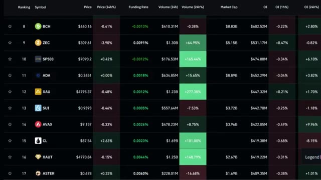
*⏱️ 00:01:12 — Tableau de bord d'analyse de marché présentant un classement d'actifs avec leurs métriques de prix, taux de financement, volume et intérêt ouvert (OI).*

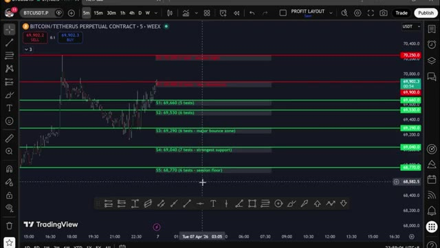
*⏱️ 00:01:21 — Graphique TradingView du contrat perpétuel BTCUSDT (5m sur WEEX) avec traçage automatique des niveaux de support et résistance basés sur le nombre de tests.*

---

### ⏱️ `[00:01:30 - 00:02:03]` | Segment #04

**🔊 Audio (Transcription Intégrale Mot pour Mot en Français) :**
> et même de construire votre propre bot qui tourne 24 heures sur 24 et 7 jours sur 7 sans que vous ne touchiez à absolument rien. C'est l'un des plus grands avantages disponibles sur ce marché en ce moment, et c'est encore totalement sous le radar. Alors entrons dans le vif du sujet. Maintenant, très rapidement, avant de vous montrer tout ça, je veux que vous compreniez à quel point l'argent afflue réellement dans l'IA en ce moment, parce que cela explique exactement pourquoi cet avantage existe. Les grandes entreprises technologiques dépensent des dizaines de milliards de dollars chaque mois dans ces trucs. Amazon, Microsoft, Google et Meta, ces quatre entreprises à elles seules sont en passe de dépenser

**👁️ Analyse Visuelle d'Écran (gemini-3.5-flash-lite) :**
**Interface & Outils** : Navigateur web affichant une plateforme de cours en ligne ('Trading AI Full Course').

**Contenu textuel & Code** : Liste de modules de formation de trading automatisé et d'infrastructure de bots (modules 21 à 26).

**Action / Démonstration** : Présentation du plan de cours et des étapes de construction d'un bot de trading en Python.

*⏱️ 00:01:38 — Interface du cours 'Trading AI' affichant les modules de formation, notamment 'Build Your Own Python Bot'.*

---

### ⏱️ `[00:02:03 - 00:02:36]` | Segment #05

**🔊 Audio (Transcription Intégrale Mot pour Mot en Français) :**
> environ 725 milliards de dollars au total en 2026. Ce n'est pas une erreur de frappe. C'est plus d'argent que le PIB de la plupart des pays, qui sert entièrement à construire des outils d'IA plus intelligents et plus performants. Et tandis que tout cet argent est injecté dans les infrastructures, presque personne ne parle de ce que cela signifie pour nous en tant que traders. Ces outils deviennent en ce moment assez puissants pour analyser réellement vos graphiques, gérer votre risque et exécuter des trades à votre place. La plupart des gens n'ont tout simplement pas encore fait le rapprochement.

**👁️ Analyse Visuelle d'Écran (gemini-3.5-flash-lite) :**
**Interface & Outils** : Navigateur web affichant des articles financiers, des blogs d'investissement (Value Add VC) et des données statistiques économiques.

**Contenu textuel & Code** : Chiffres du PIB mondial, catégories de dépenses en infrastructure IA en pourcentage, et liste des indicateurs de flux de données de marché.

**Action / Démonstration** : Navigation et défilement à travers des articles web illustrant les coûts massifs de l'IA et l'analyse de données sur les marchés financiers.

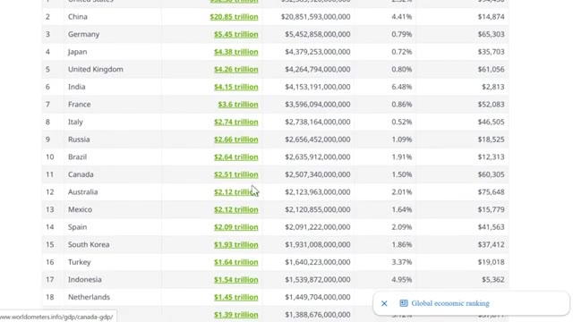
*⏱️ 00:02:11 — Tableau de classement économique mondial montrant le PIB de différents pays (États-Unis, Chine, Allemagne, etc.) avec des chiffres en trillions de dollars.*

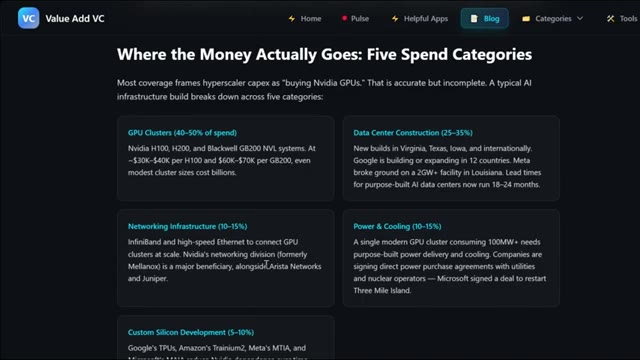
*⏱️ 00:02:19 — Article du site web 'Value Add VC' intitulé 'Where the Money Actually Goes: Five Spend Categories' détaillant la répartition des coûts d'infrastructure IA (GPU Clusters, Data Center Construction, Networking, Power & Cooling, Custom Silicon).*

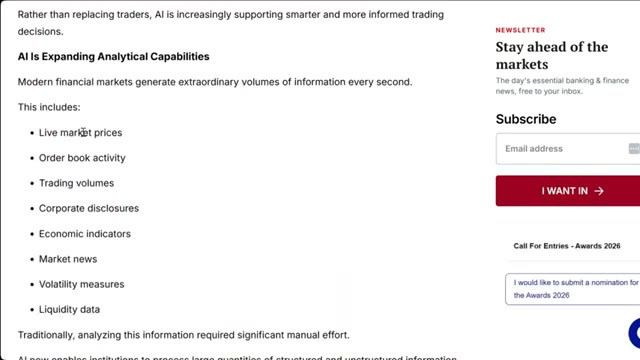
*⏱️ 00:02:27 — Article web listant les types de données financières générées en temps réel par les marchés modernes (Live market prices, Order book activity, Trading volumes, Corporate disclosures, etc.).*

---

### ⏱️ `[00:02:36 - 00:03:09]` | Segment #06

**🔊 Audio (Transcription Intégrale Mot pour Mot en Français) :**
> Donc, pendant que cet argent continue d'affluer et que ces outils deviennent de plus en plus intelligents, les traders qui comprennent comment intégrer cela à leur trading dès maintenant sont ceux qui vont avoir une avance considérable. Et c'est exactement ce que je veux vous montrer. Alors laissez-moi vous montrer exactement à quoi cela ressemble. La première chose que je veux vous montrer, et c'est vraiment celle qui m'a bluffé la première fois que je l'ai vue. Claude lit l'historique des prix, identifie les niveaux les plus significatifs, les trace directement sur votre graphique, et vous indique lesquels comptent le plus en ce moment. Regardez le graphique. Lignes vertes

**👁️ Analyse Visuelle d'Écran (gemini-3.5-flash-lite) :**
**Interface & Outils** : TradingView, Éditeur Pine Script, Terminal de commandes Claude Code.

**Contenu textuel & Code** : Code source Pine Script (calculs ATR, positions long/short) et terminal Claude Code avec message d'installation native.

**Action / Démonstration** : Présentation simultanée d'un script de trading technique sur TradingView et d'un outil de développement assisté par IA.

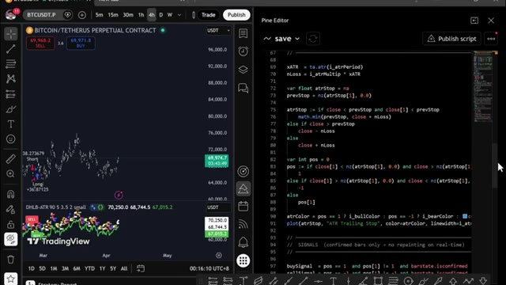
*⏱️ 00:02:44 — Interface TradingView avec un graphique de Bitcoin à gauche et l'éditeur de code Pine Script à droite.*

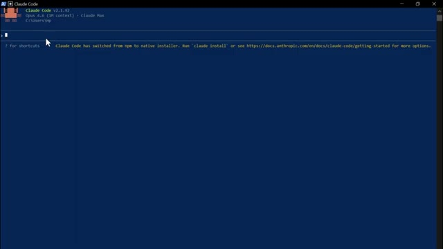
*⏱️ 00:02:52 — Terminal de commande affichant l'interface de Claude Code (v2.1.92).*

---

### ⏱️ `[00:03:09 - 00:03:43]` | Segment #07

**🔊 Audio (Transcription Intégrale Mot pour Mot en Français) :**
> pour le support, des lignes rouges pour la résistance, des étiquettes de prix. Le nombre de fois où chaque niveau a été testé, le tout tracé automatiquement, et ensuite il vous indique exactement où se situe le prix en ce moment par rapport à ces niveaux et vous donne un biais directionnel basé sur l'historique de la façon dont le prix a réagi à chacun d'eux. Cela me prenait autrefois 20 minutes à cartographier manuellement sur chaque graphique. Claude le fait en quelques secondes. Et ce n'est que le point de départ. Vous pouvez également demander à Claude d'écrire des stratégies PineScript complètes à partir d'un anglais simple, de déboguer vos indicateurs existants, d'exécuter une confluence multi-unités de temps complète

**👁️ Analyse Visuelle d'Écran (gemini-3.5-flash-lite) :**
**Interface & Outils** : Graphique TradingView et terminal de commande d'analyse textuelle.

**Contenu textuel & Code** : Niveaux de prix (résistances et supports avec nombre de tests), notes d'analyse, position actuelle (69 891), biais (Cautiously Bearish) et règles de trading (Bollinger, RSI).

**Action / Démonstration** : Analyse automatique des niveaux de support/résistance, affichage de la position actuelle par rapport aux niveaux et description du biais directionnel.

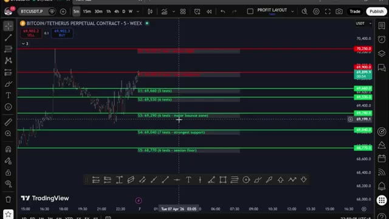
*⏱️ 00:03:17 — Graphique TradingView affichant le contrat perpétuel Bitcoin/TetherUS (5 minutes) avec des niveaux de support en vert et de résistance en rouge.*

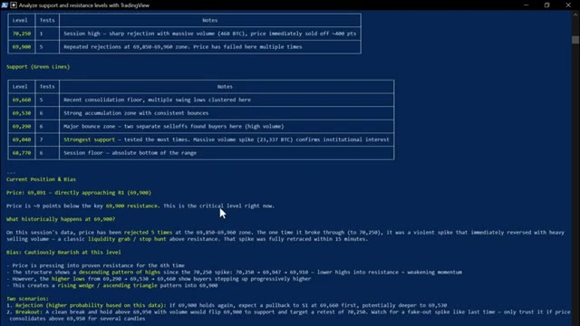
*⏱️ 00:03:26 — Interface de terminal affichant l'analyse des niveaux de support et de résistance, ainsi que la position actuelle et le biais directionnel (Cautiously Bearish).*

---

### ⏱️ `[00:03:43 - 00:04:10]` | Segment #08

**🔊 Audio (Transcription Intégrale Mot pour Mot en Français) :**
> analyse sur les graphiques hebdomadaire, journalier, de quatre heures et d'une heure simultanément et obtiens une recommandation de trade spécifique avec un point d'entrée, un stop-loss et un take-profit, le tout à partir d'une seule invite, mais c'est là que ça devient entièrement mains libres : tu peux connecter n'importe laquelle de ces stratégies directement à ton exchange via un webhook TradingView. Lorsque ta stratégie déclenche un signal sur TradingView, Claude le reçoit instantanément par le webhook et exécute le trade automatiquement sur ton exchange.

**👁️ Analyse Visuelle d'Écran (gemini-3.5-flash-lite) :**
**Interface & Outils** : Claude Code session (terminal) et TradingView.

**Contenu textuel & Code** : Tableau de rupture des timeframes (Weekly, Daily, 4-Hour, 1-Hour) avec EMA Trend, RSI, MACD, et niveaux clés de support et résistance. Recommandation de trade Long à 70,054$, Stop Loss à 62,405$ et Take Profit à 75,985$.

**Action / Démonstration** : Présentation du rapport d'analyse multi-timeframe généré automatiquement et visualisation graphique du prix du Bitcoin sur TradingView.

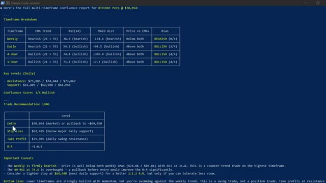
*⏱️ 00:03:50 — Un terminal de commandes affichant un rapport de confluence multi-timeframe pour BTCUSDT Perp avec une recommandation de trade LONG et des niveaux détaillés d'entrée, stop-loss et take-profit.*

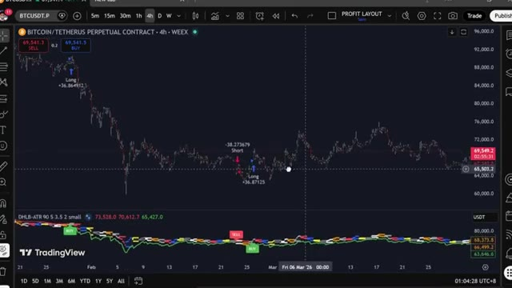
*⏱️ 00:04:04 — Un graphique TradingView en timeframe 4h montrant l'évolution du contrat perpétuel Bitcoin/Tether avec des indicateurs techniques et des signaux d'achat/vente.*

---

### ⏱️ `[00:04:11 - 00:04:38]` | Segment #09

**🔊 Audio (Transcription Intégrale Mot pour Mot en Français) :**
> Entrée, stop loss, take profit. Tout est fait. Sans que vous ne touchiez à rien, le signal est arrivé. Claude l'a traité. Trade ouvert. Confirmé en retour avec chaque détail. Vous construisez la stratégie une fois, et à partir de ce moment-là, elle tourne toute seule. Maintenant, la suivante, c'est celle qui a complètement changé ma routine quotidienne. J'ai créé mon propre assistant de trading IA en utilisant Claude et Telegram, et il trouve des trades rentables pour moi en utilisant l'IA la plus puissante disponible actuellement, plus intelligente que n'importe quel humain ne pourrait l'être.

**👁️ Analyse Visuelle d'Écran (gemini-3.5-flash-lite) :**
**Interface & Outils** : Terminal CLI Claude Code session, plateforme d'analyse de flux Hyperdash, application Telegram (ClaudeTelegramBot).

**Contenu textuel & Code** : Commandes MCP TradingView (`chart_manage_indicator`, `chart_set_timeframe`, `data_get_ohlcv`), cours du BTC à 70 054 $, indicateurs EMA 21/55 et RSI/MACD, statistiques PnL et positions de smart money (Abraxas Capital, Cumberland), commandes d'appairage Telegram.

**Action / Démonstration** : Automatisation de l'analyse technique et de la détection de signaux via Claude Code, analyse des flux de positions Hyperdash et synchronisation du bot Telegram pour l'exécution et les alertes de trading à distance.

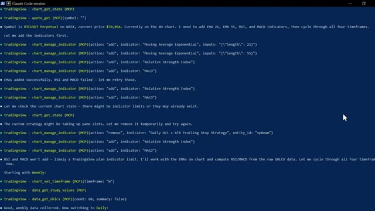
*⏱️ 00:04:18 — Console de commande « Claude Code session » exécutant des fonctions MCP pour interagir avec TradingView (ajout automatique d'indicateurs EMA 21/55 et extraction OHLCV sur le contrat BTCUSDT de WEEX).*

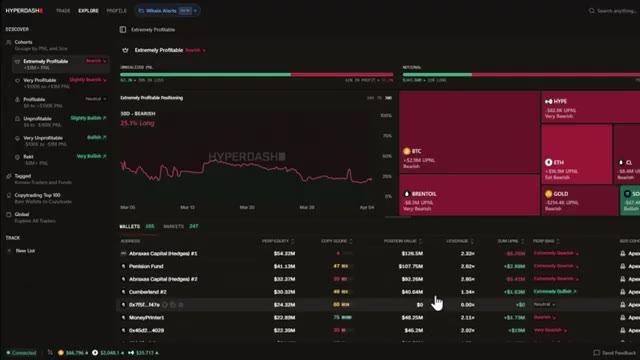
*⏱️ 00:04:25 — Tableau de bord Hyperdash (« Extremely Profitable ») visualisant l'exposition globale du marché (heatmap BTC, ETH, Brent Oil) et le suivi de portefeuilles de trading institutionnels/whales.*

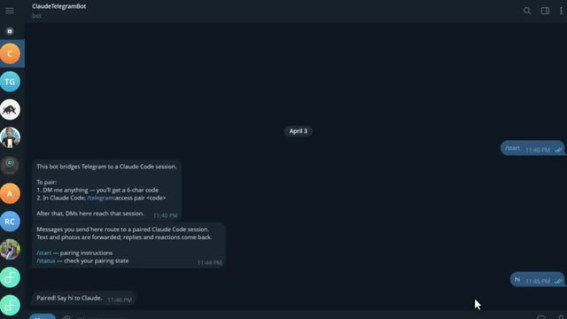
*⏱️ 00:04:31 — Discussion Telegram avec « ClaudeTelegramBot » montrant les messages d'instructions d'appairage pour router les échanges directement vers une session Claude Code active.*

---

### ⏱️ `[00:04:38 - 00:04:57]` | Segment #10

**🔊 Audio (Transcription Intégrale Mot pour Mot en Français) :**
> Il exécute des trades, gère mes positions, m'envoie des alertes en temps réel et génère des rapports de portefeuille complets, le tout à partir d'un simple message sur mon téléphone. Ce matin, j'ai placé un trade depuis mon lit, pris des bénéfices depuis la salle de sport, sans toucher à un seul graphique. C'est Claude qui tourne sur mon ordinateur. Ça a l'air simple, juste une interface textuelle.

**👁️ Analyse Visuelle d'Écran (gemini-3.5-flash-lite) :**
**Interface & Outils** : WEEX Portfolio Dashboard, Claude Telegram Bot, interface de trading crypto WEEX.

**Contenu textuel & Code** : Solde de portefeuille à $20.61, PnL journalier, ordres d'achat/vente automatisés sur BTCUSDT (LONG 5x), SOLUSDT (LONG 5x) et DOGEUSDT (SHORT 5x) avec niveaux de Stop Loss et Take Profit.

**Action / Démonstration** : Consultation du tableau de bord des performances et de l'historique des transactions exécutées par le bot Telegram.

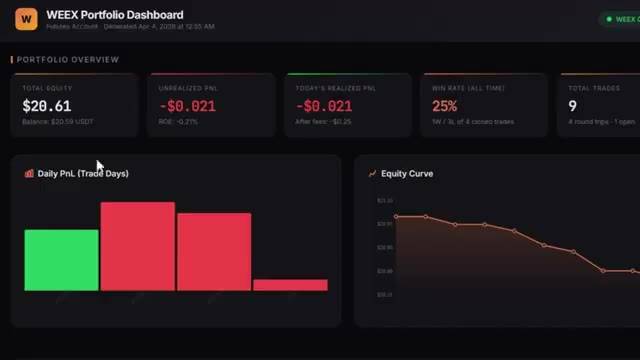
*⏱️ 00:04:43 — Tableau de bord de portefeuille WEEX affichant l'équité totale ($20.61), le PnL non réalisé et le graphique de courbe d'équité.*

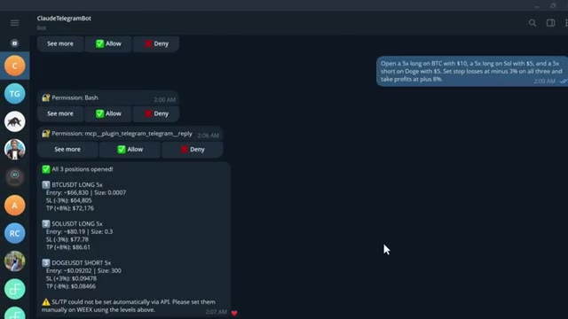
*⏱️ 00:04:48 — Interface de bot de messagerie Telegram montrant l'exécution automatisée d'ordres de trading avec effet de levier (BTC, SOL, DOGE).*

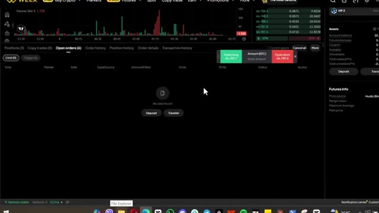
*⏱️ 00:04:52 — Interface de trading de la plateforme WEEX avec un graphique de volume, un carnet d'ordres et les onglets de gestion des positions.*

---

### ⏱️ `[00:04:58 - 00:05:19]` | Segment #11

**🔊 Audio (Transcription Intégrale Mot pour Mot en Français) :**
> Mais regardez ce qu'il peut faire. Vous pouvez pratiquement ouvrir une position de trading avec une seule phrase. Ouvrez un long cinq fois sur l'ETH avec 10 dollars. Définissez le stop loss à moins 3 pour cent et le take profit à plus 8 pour cent. Regardez-le réfléchir. Et voilà. Position ouverte. Stop loss défini. Take profit défini. Confirmation en retour avec tous les détails. Une seule phrase.

**👁️ Analyse Visuelle d'Écran (gemini-3.5-flash-lite) :**
**Interface & Outils** : Terminal de commandes Claude Code et interface de l'échange WEEX.

**Contenu textuel & Code** : Prompt textuel : « Open a 5x long on ETH with $10, set stop loss at minus 3% and take profit at plus 8% », et graphiques de prix avec carnets d'ordres sur WEEX.

**Action / Démonstration** : Exécution d'une commande textuelle pour placer un ordre de trading automatisé sur ETH avec effet de levier et gestion du risque.

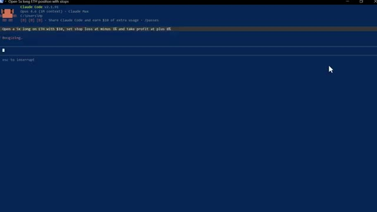
*⏱️ 00:05:03 — Interface en ligne de commande Claude Code affichant un prompt utilisateur pour ouvrir une position de trading.*

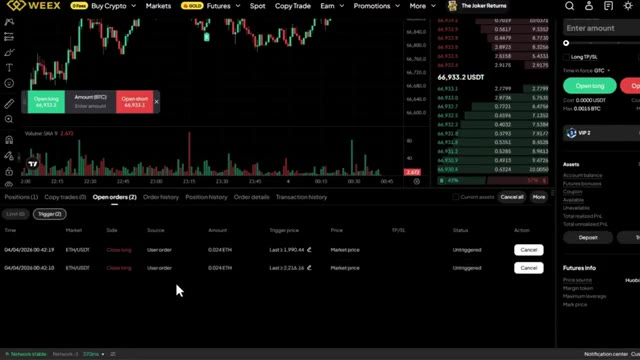
*⏱️ 00:05:14 — Interface de l'échange de cryptomonnaies WEEX montrant un graphique de trading et un carnet d'ordres.*

---

### ⏱️ `[00:05:19 - 00:05:49]` | Segment #12

**🔊 Audio (Transcription Intégrale Mot pour Mot en Français) :**
> C'est fait. Maintenant, laissez-moi vous montrer quelque chose qui m'a vraiment époustouflé la première fois que j'ai exécuté ceci. Donnez-moi un tableau de bord de portefeuille complet. Toutes mes positions, profits et pertes, frais de financement, courbe de capital, sous forme de rapport visuel. Regardez-le fonctionner. Il extrait chaque donnée de mon compte en ce moment même. Et voici ce qu'il génère. Un tableau de bord complet en mode sombre, une courbe de capital, un taux de réussite, des revenus de financement ventilés par crypto-monnaie, chaque position ouverte avec la distance de liquidation mise en évidence.

**👁️ Analyse Visuelle d'Écran (gemini-3.5-flash-lite) :**
**Interface & Outils** : Interface de terminal CLI (Claude Code) et tableau de bord Web (WEEX Portfolio Dashboard).

**Contenu textuel & Code** : Détails de position ETH (levier 5x, prix d'entrée $2,052.00, TP $2,216.16, SL $1,990.44), métriques de portefeuille (Total Equity $20.61, Unrealized PnL -$0.021, Win Rate 25%, Total Trades 9), graphiques de PnL journalier et courbe de capital.

**Action / Démonstration** : Saisie d'une commande dans le terminal pour générer un rapport de portefeuille visuel, puis affichage du tableau de bord généré avec les performances et statistiques de trading.

*⏱️ 00:05:27 — Interface de terminal de commande montrant l'exécution d'un ordre d'achat long sur Ethereum (ETH) avec les détails de la position (taille, prix d'entrée, effet de levier, Take Profit, Stop Loss) et la saisie d'un nouveau prompt demandant un tableau de bord de portefeuille.*

*⏱️ 00:05:41 — Tableau de bord visuel WEEX Portfolio Dashboard affichant la vue d'ensemble du portefeuille avec les métriques clés (Total Equity, Unrealized PnL, PnL réalisé, Win Rate, Total Trades), un graphique en barres du PnL journalier et une courbe de capital (Equity Curve).*

---

### ⏱️ `[00:05:49 - 00:06:25]` | Segment #13

**🔊 Audio (Transcription Intégrale Mot pour Mot en Français) :**
> C'est le genre de rapport qu'un bureau de trading professionnel produirait. Je l'ai obtenu en quelques secondes à partir d'une seule consigne et d'ailleurs, si vous trouvez cela utile jusqu'à présent, restez jusqu'à la fin parce que je vais vous montrer comment configurer tout cela vous-même, continuez à regarder. Très bien, laissez-moi vous montrer plus. Vous pouvez également connecter ceci à votre Telegram pour envoyer des commandes directement depuis votre téléphone. Vous pouvez taper "analyser toutes les paires de futures et trouver les taux de financement les plus élevés en ce moment". Il a analysé chaque paire, les a classées par taux de financement, a calculé le rendement annualisé et m'a dit exactement dans quelle direction me positionner pour percevoir ce financement.

**👁️ Analyse Visuelle d'Écran (gemini-3.5-flash-lite) :**
**Interface & Outils** : Site web de configuration et application de messagerie (Telegram).

**Contenu textuel & Code** : Menus de configuration d'API, cas d'utilisation pour l'IA, instructions de connexion et messages de pont entre Telegram et une session de code.

**Action / Démonstration** : Présentation du processus de configuration et des outils d'automatisation du trading par l'IA.

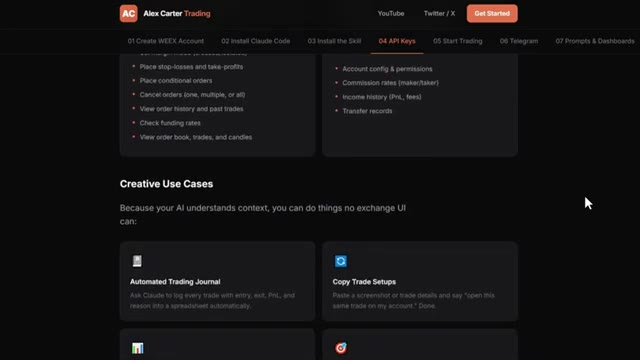
*⏱️ 00:05:58 — Capture d'écran du site web d'Alex Carter Trading montrant la section des clés API et les cas d'utilisation créatifs (journal de trading automatisé, copy trading).*

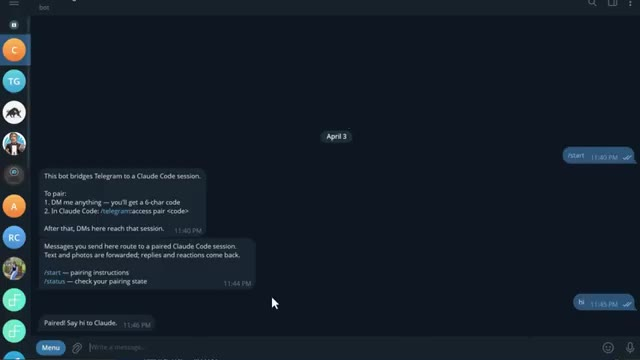
*⏱️ 00:06:07 — Interface de messagerie Telegram montrant un bot de pontage connecté à une session Claude Code avec des instructions de couplage.*

---

### ⏱️ `[00:06:25 - 00:07:00]` | Segment #14

**🔊 Audio (Transcription Intégrale Mot pour Mot en Français) :**
> instantanément. Maintenant, si vous ne savez pas ce que sont les taux de financement, il s'agit essentiellement d'argent gratuit que l'échange verse toutes les huit heures aux traders qui sont positionnés du bon côté du marché. Lorsque le financement est positif, les positions longues paient les courtes. Lorsque le financement est négatif, les positions courtes paient les longues. Et certains de ces taux sont extrêmement élevés. Ce que fait ce scanner, c'est trouver les paires où ce taux est le plus élevé. Calculer ce que cela représente sur une base annuelle. Parfois 50 %, 100 %, voire plus, et vous dire exactement dans quelle direction ouvrir une position pour vous asseoir et percevoir ce paiement toutes

**👁️ Analyse Visuelle d'Écran (gemini-3.5-flash-lite) :**
**Interface & Outils** : Interface de la plateforme de trading WEEX et application de messagerie Telegram (bot de scan).

**Contenu textuel & Code** : Graphique de prix BTC/USDT, carnet d'ordres, et liste de paires crypto classées par taux de financement positif (Longs Pay Shorts) et négatif (Shorts Pay Longs).

**Action / Démonstration** : Présentation visuelle de l'interface d'un échange et d'un rapport de scan automatisé des taux de financement par un bot Telegram.

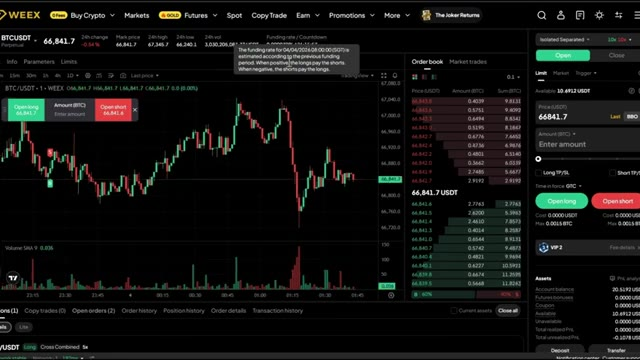
*⏱️ 00:06:34 — Interface de trading de la plateforme WEEX affichant le graphique du BTC/USDT et une infobulle explicative sur le taux de financement.*

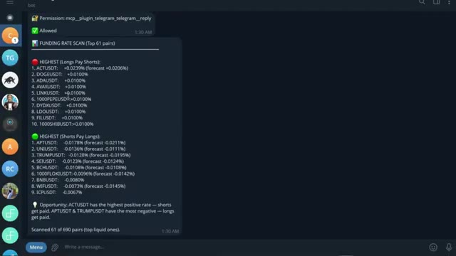
*⏱️ 00:06:42 — Interface Telegram affichant un bot de scan des taux de financement (Funding Rate Scan) avec le classement des meilleures paires de cryptomonnaies.*

---

### ⏱️ `[00:07:00 - 00:07:21]` | Segment #15

**🔊 Audio (Transcription Intégrale Mot pour Mot en Français) :**
> huit heures. Vous n'essayez même pas de prédire la direction des prix. Vous vous contentez de cultiver le taux. Et maintenant, au lieu de vérifier manuellement chaque paire vous-même, ce que personne ne fait, Claude le fait en quelques secondes et vous sert l'opportunité sur un plateau. Maintenant, cette prochaine section, c'est là que ça devient vraiment intéressant. Et honnêtement, c'est l'une de mes choses préférées que j'ai construites avec Claude.

**👁️ Analyse Visuelle d'Écran (gemini-3.5-flash-lite) :**
**Interface & Outils** : Telegram, plateforme de trading WEEX et page web d'Alex Carter Trading.

**Contenu textuel & Code** : Liste des taux de financement (Funding rates) pour différentes paires de cryptomonnaies (ACTUSDT, DOGEUSDT, ADAUSDT, etc.) et données de marché sur la plateforme WEEX.

**Action / Démonstration** : Consultation des opportunités de taux de financement générées par un bot Telegram et navigation sur la plateforme de trading.

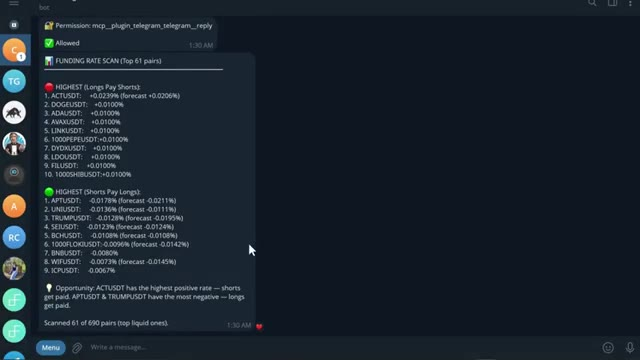
*⏱️ 00:07:06 — Image #1 montre une interface de messagerie (Telegram) affichant un rapport automatisé de taux de financement des paires crypto (Funding Rate Scan).*

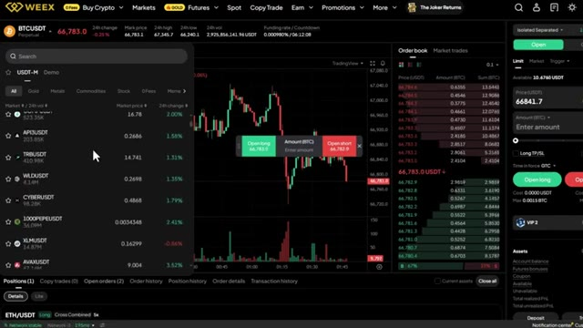
*⏱️ 00:07:11 — Image #2 montre l'interface de la plateforme de trading WEEX avec un graphique des prix en arrière-plan et la liste des paires de cryptomonnaies.*

---

### ⏱️ `[00:07:21 - 00:07:57]` | Segment #16

**🔊 Audio (Transcription Intégrale Mot pour Mot en Français) :**
> Et si vous pouviez analyser 33 000 portefeuilles sur Hyperliquid ? Trouver les 20 meilleurs traders les plus rentables. Voir exactement ce qu'ils achètent en ce moment même. Leurs prix d'entrée, leur effet de levier, leur P&L non réalisé, et obtenir un plan de trading complet basé sur tout cela. Aucune clé API nécessaire, pas de codage, pas de recherche manuelle. Maintenant, Hyperliquid. Très rapidement, c'est un échange décentralisé de contrats perpétuels fonctionnant sur sa propre blockchain. Pas de KYC, pas d'intermédiaire. Et comme c'est entièrement sur la chaîne, chaque transaction, chaque position, chaque portefeuille, tout est public. C'est ce qui rend cela possible.

**👁️ Analyse Visuelle d'Écran (gemini-3.5-flash-lite) :**
**Interface & Outils** : Terminal de script CLI personnalisé (Hyperliquid Whale Scan) et interface Web de l'échange décentralisé Hyperliquid.

**Contenu textuel & Code** : Tableaux d'analyse de portefeuilles (Smart Money vs Rekt Money), métriques de positions (Long/Short, P&L, prix d'entrée) et options de connexion de portefeuilles Web3.

**Action / Démonstration** : Analyse comparative des positions des baleines rentables face aux traders perdants, suivie d'une présentation d'un plan de trading complet sur XMR et d'une démonstration de connexion sur Hyperliquid.

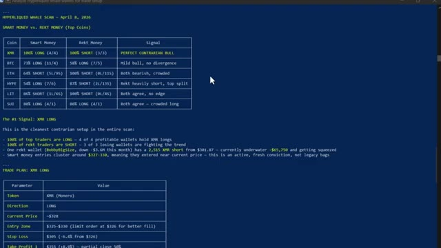
*⏱️ 00:07:30 — Résultat du scan des portefeuilles (Whale Scan) sous forme de tableau comparant les positions "Smart Money" et "Rekt Money" sur différents actifs, incluant XMR, BTC, ETH, HYPE, LIT, SUI, ainsi qu'un plan de trading détaillé pour XMR.*

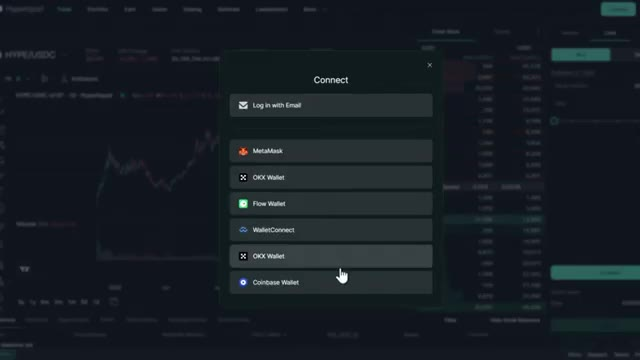
*⏱️ 00:07:48 — Interface de connexion de l'échange Hyperliquid affichant une fenêtre modale avec plusieurs options de portefeuilles (MetaMask, OKX Wallet, WalletConnect, Coinbase Wallet, etc.).*

---

### ⏱️ `[00:07:58 - 00:08:25]` | Segment #17

**🔊 Audio (Transcription Intégrale Mot pour Mot en Français) :**
> Très bien, laissez-moi ouvrir Claude Code et vous montrer ça en direct. Voici la première chose que je veux vous montrer. Claude analyse les 20 portefeuilles les plus rentables sur Hyperliquid en ce moment, extrait toutes les positions ouvertes et les classe par rentabilité totale. Le tout en un seul coup. Regardez ce qui se passe. Claude accède aux points de terminaison publics d'Hyperliquid, commence à extraire les données des portefeuilles parmi 33 000 adresses, les classe par rentabilité et commence à rédiger le rapport. Vous pouvez le voir traiter les portefeuilles en temps réel.

**👁️ Analyse Visuelle d'Écran (gemini-3.5-flash-lite) :**
**Interface & Outils** : Terminal de commandes / script CLI (Hyperliquid whale tracker bot).

**Contenu textuel & Code** : Métriques du portefeuille sélectionné (All-Time PnL: +$204.4M, ROI 202%, Monthly PnL: +$5.28M, Account Value: $71.0M) et tableau des positions clés (BTC, ETH, SOL, ENA, LINK, etc., avec direction Long/Short, taille, prix d'entrée, effet de levier et PnL latent uPnL).

**Action / Démonstration** : Exécution d'un script d'analyse en direct via Claude Code extrayant et classant les positions des portefeuilles les plus rentables d'Hyperliquid.

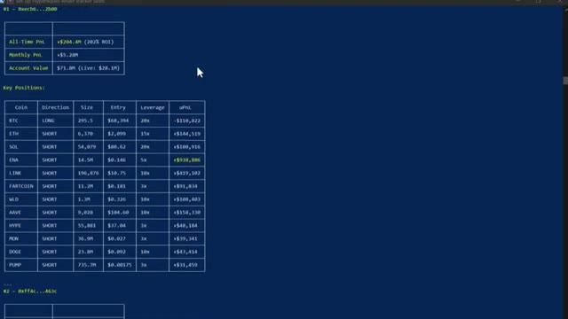
*⏱️ 00:08:05 — Interface en ligne de commande affichant les données d'un bot de suivi des baleines sur Hyperliquid, détaillant les performances globales et les positions ouvertes par portefeuille.*

---

### ⏱️ `[00:08:25 - 00:08:45]` | Segment #18

**🔊 Audio (Transcription Intégrale Mot pour Mot en Français) :**
> Prix d'entrée, effet de levier, P&L non réalisé, tout arrive en direct. Et voici le résultat. Le top 20 des baleines classées, chaque position ouverte listée, et en bas, le résumé du sentiment général. En ce moment, l'argent intelligent est acheteur net sur le Bitcoin et vendeur net sur presque tout le reste, en particulier l'Ethereum.

**👁️ Analyse Visuelle d'Écran (gemini-3.5-flash-lite) :**
**Interface & Outils** : Terminal de commande / Console Windows PowerShell exécutant un script de tracking Hyperliquid ("Set up Hyperliquid Whale Tracker").

**Contenu textuel & Code** : Données brutes au format JSON pour divers tokens (LIC, IDO, XRP, WIF, MOODENG) affichant les attributs de position : direction, size, entry_price, unrealized_pnl, leverage, liquidation_price.

**Action / Démonstration** : Récupération et affichage en temps réel des données des positions ouvertes des baleines via l'API de Hyperliquid.

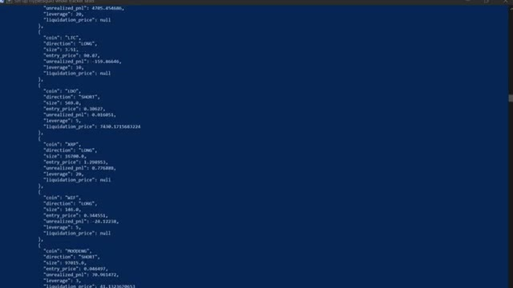
*⏱️ 00:08:30 — Console de commande affichant un flux JSON brut détaillant les positions ouvertes de traders (cryptos, direction LONG/SHORT, taille, prix d'entrée, PnL non réalisé et effet de levier).*

---

### ⏱️ `[00:08:46 - 00:09:13]` | Segment #19

**🔊 Audio (Transcription Intégrale Mot pour Mot en Français) :**
> C'est le genre de signal qui prenait autrefois des heures à reconstituer manuellement. Claude le fait en moins d'une minute. Maintenant, c'est là que ça devient vraiment intéressant. Ce prompt compare les 20 portefeuilles les plus rentables aux 20 portefeuilles les plus perdants et trouve chaque token où ils se trouvent de part et d'autre du trade. Regardez-le extraire les deux groupes simultanément. Les portefeuilles rentables d'un côté, les portefeuilles perdants de l'autre, et ensuite il commence à croiser les positions.

**👁️ Analyse Visuelle d'Écran (gemini-3.5-flash-lite) :**
**Interface & Outils** : Terminal de commande / Interface CLI (Claude Code).

**Contenu textuel & Code** : Tableau comparatif pour différents tokens (ETH, FARTCOIN, XMR, TRX, PENDLE, TAO, etc.) montrant le pourcentage de positions Long de la Smart Money face aux positions Short de la « Rekt Money », l'écart en points de pourcentage et le signal résultant (ex. « Strong bull signal », « Max divergence bull »).

**Action / Démonstration** : Analyse de sentiment et de positionnement contrarien basée sur le scan de 33 381 portefeuilles du classement Hyperliquid.

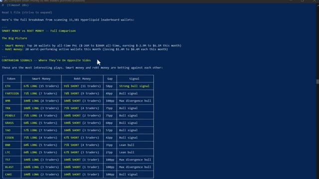
*⏱️ 00:08:53 — Interface de terminal affichant l'analyse comparative « Smart Money vs Rekt Money » sur Hyperliquid avec un tableau de signaux contrariens.*

---

### ⏱️ `[00:09:14 - 00:09:49]` | Segment #20

**🔊 Audio (Transcription Intégrale Mot pour Mot en Français) :**
> Voici le résultat. Vous pouvez voir où les deux groupes sont d'accord. Ils sont tous les deux long sur Sui. C'est donc un trade encombré. Mais regardez ceci. La smart money est massivement long sur XMR, TRX, Pendle et Farcoin, tandis que les traders rekt sont short sur ces cryptos. Cette divergence juste là, c'est le signal. C'est le genre d'analyse pour laquelle les hedge funds paient. Vous l'obtenez grâce à un outil d'IA à 20 $ et une API publique gratuite. Et si vous voulez la configuration Hyperliquid complète, le code de la compétence, chaque prompt, le système complet de suivi des baleines, je vais vous dire exactement comment obtenir tout cela dans un instant. Continuez à regarder.

**👁️ Analyse Visuelle d'Écran (gemini-3.5-flash-lite) :**
**Interface & Outils** : Terminal de données et tableaux d'analyse sur fond bleu, site web d'Alex Carter Trading.

**Contenu textuel & Code** : Tableaux comparatifs détaillant les pourcentages de positions longues pour divers tokens cryptographiques (Smart % Long vs Rekt % Long) et listes de conclusions clés sur le trading.

**Action / Démonstration** : Présentation des données en temps réel issues du classement public d'Hyperliquid pour analyser les divergences de positions.

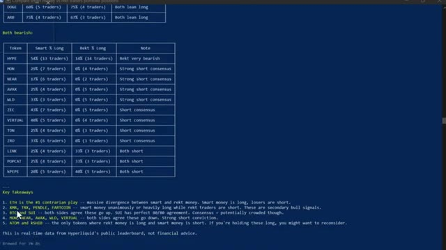
*⏱️ 00:09:22 — Un tableau comparatif sur fond bleu affichant les positions de la smart money par rapport aux traders "rekt", avec des tokens comme HYPE, MON, NEAR, etc., et des sections de conclusions clés ("Key Takeaways").*

---

### ⏱️ `[00:09:49 - 00:10:09]` | Segment #21

**🔊 Audio (Transcription Intégrale Mot pour Mot en Français) :**
> Maintenant, si vous êtes prêt à aller encore plus loin, vous pouvez utiliser Claude Code pour créer un bot de trading entièrement automatisé de A à Z pour les cryptos, les actions ou quel que soit le marché sur lequel vous tradez. Et honnêtement, c'est ainsi que Claude va changer notre façon de trader pour toujours. Et nous l'avons déjà fait auparavant. Laissez-moi vous montrer à quoi ressemble réellement le résultat final.

**👁️ Analyse Visuelle d'Écran (gemini-3.5-flash-lite) :**
**Interface & Outils** : Terminal de commande Claude Code et site web du courtier Interactive Brokers (TWS).

**Contenu textuel & Code** : Version de Claude Code (v2.1.91), interface de trading TWS avec graphiques en chandeliers et tableau de suivi de portefeuille.

**Action / Démonstration** : Présentation des outils de développement assistés par IA et des plateformes de courtage pour le trading automatisé.

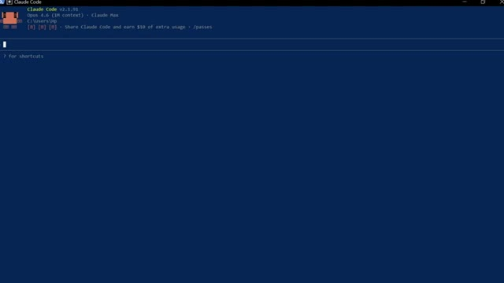
*⏱️ 00:09:54 — Interface de terminal sombre affichant Claude Code v2.1.91, montrant le contexte Opus 4.6.*

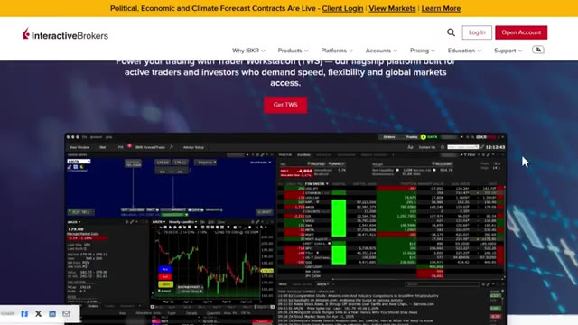
*⏱️ 00:09:59 — Capture du site web d'Interactive Brokers présentant la plateforme Trader Workstation (TWS) avec des graphiques de trading et des carnets d'ordres.*

---

### ⏱️ `[00:10:09 - 00:10:28]` | Segment #22

**🔊 Audio (Transcription Intégrale Mot pour Mot en Français) :**
> Voici le tableau de bord. Une seule URL. Chaque position, votre courbe de capital, le statut de votre bot, vos données sur les baleines, tout en direct, tout au même endroit. Fini les multiples onglets de navigateur. Fini de douter de vos entrées. Et chaque matin, avant même d'ouvrir votre ordinateur portable, ce brief alpha quotidien est déjà dans votre boîte de réception.

**👁️ Analyse Visuelle d'Écran (gemini-3.5-flash-lite) :**
**Interface & Outils** : Tableau de bord WEEX et terminal de commandes CLI.

**Contenu textuel & Code** : Métriques de compte (Equity 19.78, Available 19.78), courbe de capital sur 90 jours, et tableau de briefing incluant prix, variation sur 24h, distance par rapport à la moyenne mobile 200 EMA, RSI et biais de marché.

**Action / Démonstration** : Présentation du tableau de bord centralisé du bot de trading et affichage du briefing matinal automatisé généré par le système.

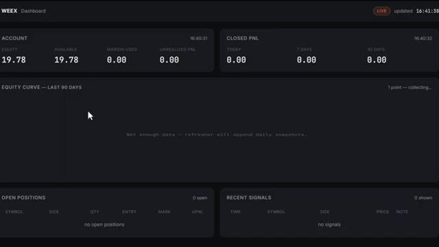
*⏱️ 00:10:14 — Capture d'écran du tableau de bord de trading WEEX affichant le capital, les PnL fermés, la courbe d'équité et les positions ouvertes.*

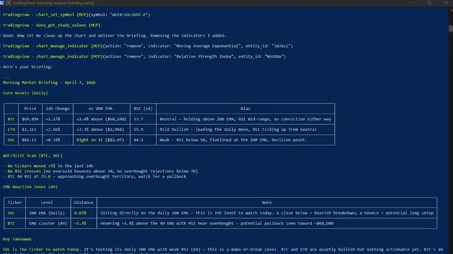
*⏱️ 00:10:23 — Capture d'écran d'un terminal de commande affichant un briefing de marché matinal automatisé avec des tableaux de données sur BTC, ETH et SOL.*

---

### ⏱️ `[00:10:29 - 00:10:47]` | Segment #23

**🔊 Audio (Transcription Intégrale Mot pour Mot en Français) :**
> Tous les jours à l'heure et prêt à lire. Il a déjà scanné les baleines, lu les graphiques, vérifié votre compte, et vous a remis la configuration avec la plus forte conviction de la journée, dimensionnée selon votre risque exact. Une seule consigne. Toute la pile. Et le bot lui-même n'est pas assis sur votre ordinateur portable. Il tourne 24h/24 et 7j/7 sur un serveur cloud.

**👁️ Analyse Visuelle d'Écran (gemini-3.5-flash-lite) :**
**Interface & Outils** : TradingView, WEEX, Terminal de commande CLI

**Contenu textuel & Code** : Graphique en chandeliers 4h du Bitcoin, tableau de prix et de biais pour les actifs majeurs (BTC, ETH, SOL), analyse des indicateurs EMA et RSI, et zones de réaction.

**Action / Démonstration** : Présentation de la configuration de marché quotidienne et analyse technique automatisée des cryptomonnaies.

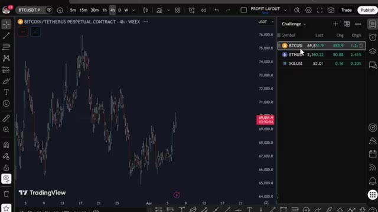
*⏱️ 00:10:33 — Un graphique TradingView affichant la paire BTCUSDT en unités de 4 heures sur l'exchange WEEX, avec une liste de surveillance à droite.*

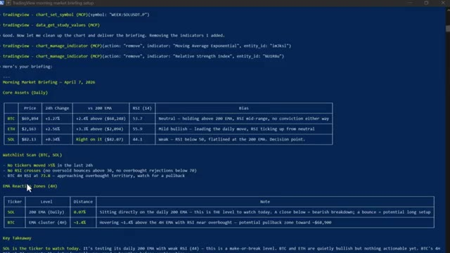
*⏱️ 00:10:38 — Un terminal de commande affichant un rapport textuel détaillé intitulé 'Morning Market Briefing - April 7, 2026' avec des tableaux de prix et des analyses pour BTC, ETH et SOL.*

---

### ⏱️ `[00:10:48 - 00:11:08]` | Segment #24

**🔊 Audio (Transcription Intégrale Mot pour Mot en Français) :**
> Si ça plante, ça redémarre tout seul. Si votre Wi-Fi se coupe, ça continue. Votre ordinateur portable n'est que la télécommande. Désormais, la barrière mathématique pour construire tout cela a pour ainsi dire disparu. Avant des modèles capables comme Claude Code, cela aurait pris des semaines, voire des mois, à assembler. Maintenant, vous pouvez passer d'une idée à un système fonctionnel en un après-midi.

**👁️ Analyse Visuelle d'Écran (gemini-3.5-flash-lite) :**
**Interface & Outils** : Éditeur GNU nano (terminal SSH) et interface web de la plateforme de cours 'Trading AI Full Course'.

**Contenu textuel & Code** : Commandes de configuration SSH et liste des modules de formation couvrant les scripts Python, les bots de trading, les intégrations d'API (WEEX, Alpaca, Kalshi) et l'utilisation de Claude.

**Action / Démonstration** : Modification des paramètres de configuration du serveur et navigation dans le catalogue des modules du cours de trading automatisé.

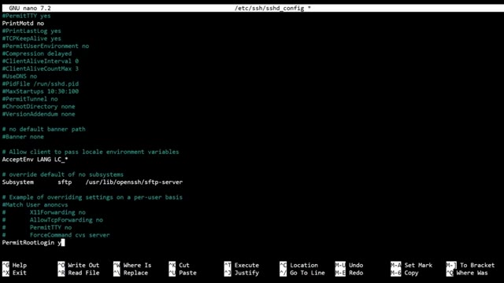
*⏱️ 00:10:53 — Un terminal Linux affichant l'éditeur GNU nano 7.2 pour modifier le fichier de configuration SSH '/etc/ssh/sshd_config'.*

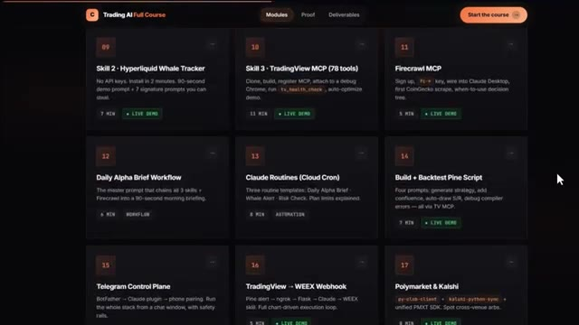
*⏱️ 00:11:03 — Une interface de plateforme e-learning montrant les modules de formation sur le trading par IA, incluant 'Skill 2 - Hyperliquid Whale Tracker', 'Skill 3 - TradingView MCP' et des sessions de backtest Pine Script.*

---

### ⏱️ `[00:11:09 - 00:11:28]` | Segment #25

**🔊 Audio (Transcription Intégrale Mot pour Mot en Français) :**
> Et c'est important parce que la plupart des stratégies ne fonctionnent pas. L'avantage n'est pas d'avoir une stratégie parfaite. Il réside dans la capacité à tester suffisamment d'idées assez rapidement pour trouver celles qui fonctionnent vraiment. Très bien, et écoutez, au cours des prochaines années, il existera deux types de traders. Ceux qui utilisent l'intelligence artificielle et ceux qui font encore tout manuellement.

**👁️ Analyse Visuelle d'Écran (gemini-3.5-flash-lite) :**
**Interface & Outils** : Éditeur de code (Notepad/IDE) et interface graphique de TradingView.

**Contenu textuel & Code** : Code source Pine Script (gestion des signaux d'achat/vente et des labels) et graphique de prix BTCUSDT avec indicateurs techniques (BB, Volume, RSI 14).

**Action / Démonstration** : Présentation du code de stratégie de trading et visualisation des indicateurs sur un graphique de prix.

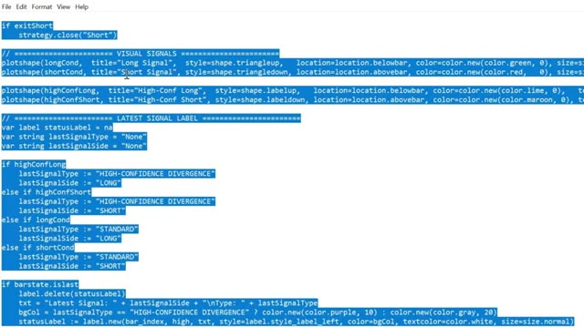
*⏱️ 00:11:13 — Extrait de code Pine Script montrant la gestion des signaux et des étiquettes graphiques.*

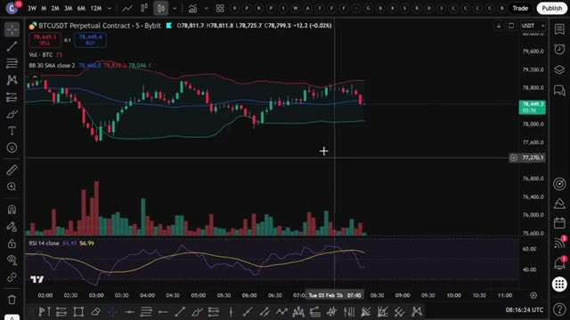
*⏱️ 00:11:18 — Graphique TradingView affichant le contrat perpétuel BTCUSDT avec bandes de Bollinger, volumes et RSI.*

---

### ⏱️ `[00:11:28 - 00:11:50]` | Segment #26

**🔊 Audio (Transcription Intégrale Mot pour Mot en Français) :**
> Même marché. Des résultats très différents. Voici comment vous vous mettez du bon côté de cela. J'ai rassemblé tout ce qui se trouve au sein de la communauté AI Trade Edge. Chaque invite, chaque bot, chaque modèle, chaque guide étape par étape que j'utilise personnellement, le tout en un seul endroit. Et tout ce que je construirai à l'avenir sera ajouté directement dans le groupe dès sa sortie.

**👁️ Analyse Visuelle d'Écran (gemini-3.5-flash-lite) :**
**Interface & Outils** : Navigateur web (plateforme Whop et site de formation d'Alex Carter Trading)

**Contenu textuel & Code** : Présentation des outils de la communauté 'AI Trade Edge' et liste des fonctionnalités d'automatisation et de contrôle de graphiques par l'IA.

**Action / Démonstration** : Présentation de l'offre d'abonnement et des guides pratiques inclus dans la communauté.

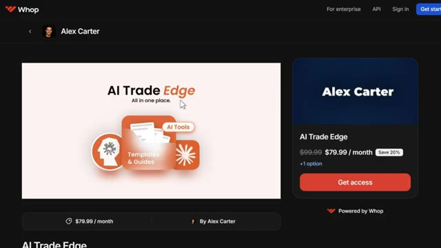
*⏱️ 00:11:33 — Page de vente Whop de la communauté 'AI Trade Edge' d'Alex Carter, affichant le tarif de 79,99 $/mois.*

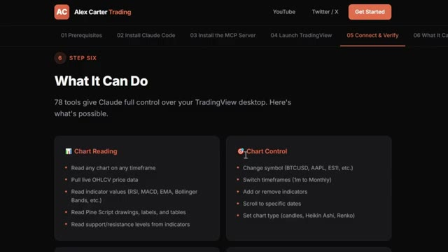
*⏱️ 00:11:39 — Guide étape par étape d'Alex Carter Trading détaillant les fonctionnalités de contrôle et de lecture de graphiques via Claude.*

---

### ⏱️ `[00:11:50 - 00:12:09]` | Segment #27

**🔊 Audio (Transcription Intégrale Mot pour Mot en Français) :**
> Nous testons également des stratégies provenant de tout l'internet. En les automatisant grâce à PineScript, en les exécutant en direct, et en partageant exactement ce qui fonctionne et ce qui ne fonctionne pas. Ainsi, vous n'obtenez pas seulement des outils. Vous obtenez une opération de recherche en direct. À l'intérieur, il y a également un cours complet de trading agentique. 2 heures et demie.

**👁️ Analyse Visuelle d'Écran (gemini-3.5-flash-lite) :**
**Interface & Outils** : Interface web de présentation de code et graphique TradingView (BloFin).

**Contenu textuel & Code** : Code Pine Script v5 (indicateur "RSI VWAP + Extreme Reversal Setup") et graphique des prix ETHUSDT avec indicateur de tendance et oscillateur en sous-fenêtre.

**Action / Démonstration** : Affichage du code source de l'indicateur puis transition vers la démonstration graphique du système sur l'exchange.

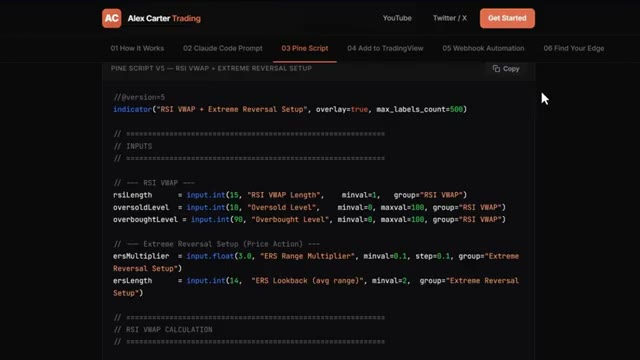
*⏱️ 00:11:55 — Interface web d'Alex Carter affichant du code source Pine Script v5 pour un indicateur de trading.*

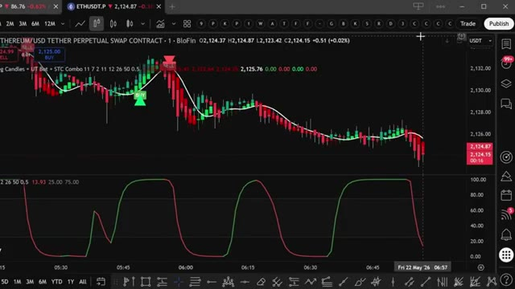
*⏱️ 00:12:00 — Graphique TradingView en chandeliers japonais d'ETH/USDT sur BloFin avec un indicateur technique et des signaux d'achat/vente.*

---

### ⏱️ `[00:12:09 - 00:12:28]` | Segment #28

**🔊 Audio (Transcription Intégrale Mot pour Mot en Français) :**
> Du débutant à l'expert. Aucune base en programmation n'est nécessaire. À la fin, vous aurez votre propre système de trading par IA opérationnel en direct. Quelque chose que la plupart des traders particuliers ne savent même pas être possible actuellement. 79,99 $ par mois. Un seul bon trade suffit à couvrir les frais. Et les 100 premiers membres bloquent ce tarif de façon permanente.

**👁️ Analyse Visuelle d'Écran (gemini-3.5-flash-lite) :**
**Interface & Outils** : Interface web de formation et plateforme de paiement Whop.

**Contenu textuel & Code** : Titres des modules de formation axés sur le trading par IA, les bots Python, le déploiement VPS et le tableau de bord Live-Ops, ainsi que le tarif d'abonnement à 79,99 $ par mois.

**Action / Démonstration** : Navigation à travers les modules du cours et présentation de l'offre d'abonnement commercial.

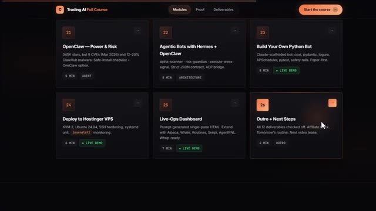
*⏱️ 00:12:14 — Interface du cours 'Trading AI Full Course' montrant la grille des modules de formation (modules 21 à 26).*

*⏱️ 00:12:23 — Page de vente de la plateforme Whop pour le programme 'AI Trade Edge' d'Alex Carter au prix de 79,99 $ par mois.*

---

### ⏱️ `[00:12:28 - 00:12:50]` | Segment #29

**🔊 Audio (Transcription Intégrale Mot pour Mot en Français) :**
> Après cela, le prix augmente. Le lien est dans la description. Vous ne pouvez vraiment pas vous permettre de rater ça. Et c'est tout. C'est ainsi que Claude change le trading pour toujours et comment vous pouvez en faire partie. Si vous voulez approfondir chacun d'eux individuellement, la vue complète du trading, la présentation de Telegram et le suivi des baleines sur Hyperliquid, toutes ces vidéos apparaissent à l'écran dès maintenant.

**👁️ Analyse Visuelle d'Écran (gemini-3.5-flash-lite) :**
**Interface & Outils** : Telegram Desktop, plugin MCP Telegram / terminal de trading, exchange WEEX.

**Contenu textuel & Code** : Positions exécutées en arrière-plan (BTCUSDT LONG 5x, SOLUSDT LONG 5x, DOGEUSDT SHORT 5x avec prix d'entrée, TP à +8% et SL à -3%), prompt multimodal demandant une analyse des graphiques et du carnet d'ordres WEEX pour ouvrir un trade à haute probabilité.

**Action / Démonstration** : Soumission d'un prompt multimodal enrichi de captures d'écran pour déléguer l'analyse technique, le calcul du risque et l'exécution d'ordres à un agent IA via Telegram.

*⏱️ 00:12:44 — Interface de commande Telegram affichant un prompt d'analyse multimodale avec captures graphiques jointes et récapitulatif d'exécution de positions WEEX en arrière-plan.*

---

### ⏱️ `[00:12:50 - 00:13:10]` | Segment #30

**🔊 Audio (Transcription Intégrale Mot pour Mot en Français) :**
> Allez voir tout ça à votre rythme. Et si vous voulez le guide complet étape par étape sur la façon de construire votre propre système de trading agentique en utilisant Claude, cette vidéo s'affiche également à l'écran. Allez voir ça ensuite. Si vous avez trouvé cela utile, laissez un pouce bleu. Ça aide vraiment la chaîne. Abonnez-vous si ce n'est pas déjà fait. Et je vous vois dans la prochaine.

**👁️ Analyse Visuelle d'Écran (gemini-3.5-flash-lite) :**
**Interface & Outils** : Aucune interface visible.

**Contenu textuel & Code** : Aucun contenu technique, code ou graphique affiché.

**Action / Démonstration** : Aucune action ou manipulation en cours.

---

