# 🎬 The Ultimate Beginner Guide To Kalshi Trading in 2026

> **Chaîne** : [Alex Carter](https://www.youtube.com/@AlexCarterTrading)  
> **Lien YouTube** : [https://www.youtube.com/watch?v=EnDUvHENMAw](https://www.youtube.com/watch?v=EnDUvHENMAw)  
> **Date de publication** : 20260810  
> **Durée** : 00:15:23  
> **Identifiant vidéo** : `EnDUvHENMAw`  
> **Transcription & Analyse** : `whisper-v3-large-turbo+gemini-3.5-flash-lite`  

---

## 📌 Synthèse Exécutive & Outils

### 💡 Résumé
Cette vidéo de la chaîne Alex Carter propose une immersion complète et analytique au sein de l'écosystème Kalshi, positionné comme le plus grand marché de prédiction réglementé aux États-Unis, tout en étendant ses fonctionnalités vers le trading de cryptomonnaies à effet de levier (jusqu'à 6,1x) via des contrats perpétuels (*perps*). L'analyse démontre comment transformer des événements macroéconomiques, politiques, sportifs ou culturels en opportunités de trading structurées grâce à des contrats binaires (Oui/Non) dont la valorisation oscille entre 0 $ et 1 $ en temps réel, s'apparentant structurellement au trading d'options à risque défini et plafonné. 

Au-delà de l'interface grand public, la présentation lève le voile sur **Kalshi Pro**, un terminal avancé destiné aux opérateurs cherchant à optimiser leurs exécutions. Sont notamment décortiqués l'intégration native de graphiques **TradingView**, la lecture fine du carnet d'ordres (*order book*), l'analyse des spreads et des volumes, ainsi que la gestion rigoureuse des flux de capitaux. La stratégie d'exécutions rapides et de suivi des cotations en direct s'appuie sur une infrastructure technique moderne, offrant aux traders quantitatifs et systématiques un terrain de jeu inédit pour appliquer des modèles prédictifs, du scalping haute fréquence et une diversification multi-actifs au sein d'un même compte régulé.

### 🛠️ Outils, Modèles & Logiciels Présentés
* **Kalshi / Kalshi Pro** : Plateforme centrale de marchés de prédiction réglementés et de trading de contrats perpétuels crypto offrant des interfaces standard et professionnelles avec carnets d'ordres complets.
* **TradingView** : Outil de cartographie et d'analyse technique avancé intégré nativement dans l'interface Pro pour l'étude des paires de crypto-monnaies et des graphiques de probabilité.
* **Grok Bots** : Assistants IA mentionnés dans le positionnement technologique global de la chaîne pour l'optimisation et l'automatisation des stratégies de marché.
* **Claude Code** : Environnement de développement et d'assistance par intelligence artificielle utilisé pour coder et affiner des scripts de trading algorithmique.
* **Pine Script** : Langage de programmation propriétaire de TradingView employé pour concevoir, backtester et déployer des indicateurs personnalisés et des stratégies automatisées.
* **Portefeuilles Web3 & Solutions de Paiement** : Passerelles de financement instantané incluant MetaMask, Phantom, Trust Wallet, Google Pay, ainsi que des exchanges partenaires (Coinbase, Uphold, Cash App).

### 🔑 Points Clés & Enseignements Stratégiques
* **Structure des contrats binaires** : Chaque marché repose sur une proposition binaire (Oui/Non) se réglant strictement à 0 $ ou 1 $, éliminant le risque de perte illimitée inhérent aux options traditionnelles.
* **Dynamique de probabilité en temps réel** : Les prix des contrats agissent comme un pourcentage de probabilité implicite, évoluant dynamiquement au gré des flux d'actualités, des sondages ou des scores en direct.
* **Avantages de Kalshi Pro pour l'analyse quantitative** : Déblocage de métriques indispensables telles que le volume, le spread acheteur/vendeur, la profondeur du carnet d'ordres et la taille exacte des positions.
* **Gestion du risque (*Risk Management*) intégrée** : Perte maximale mathématiquement plafonnée au montant investi par contrat (maximum 1 $ par part), simplifiant le calcul du ratio risque/rendement.
* **Diversification multi-classes d'actifs** : Possibilité de router du capital entre des marchés décorrélés (politique, météo, sport, matières premières) et des dérivés crypto à effet de levier modéré (jusqu'à 6,1x).
* **Stratégie de financement et liquidité** : Utilisation de dépôts instantanés via carte ou Google Pay (0 % de frais) pour saisir des opportunités de scalping rapide sans friction de trésorerie.
* **Exploitation du carnet d'ordres** : Lecture des flux d'ordres passifs et agressifs sur la gauche des graphiques de probabilité pour identifier les déséquilibres temporaires d'offre et de demande.
* **Dimension sociale et *Sentiment Analysis*** : Utilisation du fil communautaire intégré pour sonder l'opinion des pairs, repérer des biais de marché et contrarier ou valider ses propres hypothèses de trading.
* **Contraintes géographiques et conformité** : Nécessité de vérifier l'éligibilité réglementaire selon les États américains (restrictions notables dans l'Illinois, le Michigan, le New Jersey, etc.).
* **Arbitrage événementiel** : Mise en place de stratégies réactives face aux flux d'informations continus (sondages politiques, matchs de tennis point par point, publications économiques).
* **Automatisation potentielle** : Synergie entre les données de Kalshi Pro et l'utilisation de scripts Pine Script ou d'assistants de code pour modéliser des prises de position algorithmiques.

---

## ⏱️ Chronologie & Transcription Complète Audio & Visuelle (Mot pour Mot)

### ⏱️ `[00:00:00 - 00:00:34]` | Segment #01

**🔊 Audio (Transcription Intégrale Mot pour Mot en Français) :**
> Ceci est le guide ultime de CalSHI dont vous aurez besoin. Après cette vidéo, vous saurez tout sur le trading sur CalSHI, même si vous ne l'avez jamais utilisé auparavant. Je vais tout couvrir, de l'ouverture de votre compte au placement de votre premier trade sur un marché de prédiction, jusqu'à la manière de trader des cryptomonnaies avec effet de levier. Je couvrirai à la fois le CalSHI simple, adapté aux débutants, et aussi CalSHI Pro pour les utilisateurs avancés. Entrons donc dans le vif du sujet. Tout d'abord, CalSHI a commencé comme un marché de prédiction aux États-Unis où l'on trade sur des résultats du monde réel. C'est maintenant le plus grand qui existe et il est totalement

**👁️ Analyse Visuelle d'Écran (gemini-3.5-flash-lite) :**
**Interface & Outils** : Plateforme de trading et site web Kalshi (kalshi.com).

**Contenu textuel & Code** : Graphique de prix des cryptomonnaies (BTC), options d'ordres UP/DOWN, effet de levier (3.6x), et guide pour débutants Kalshi News.

**Action / Démonstration** : Navigation sur la plateforme de trading Kalshi et présentation du guide pour débutants.

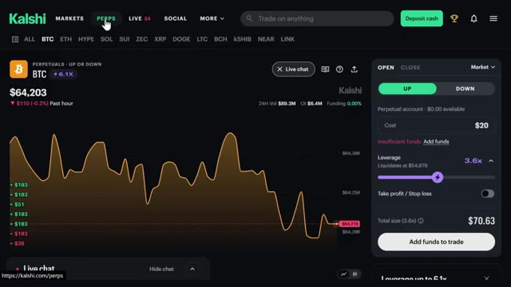
*⏱️ 00:00:08 — Interface de trading Kalshi montrant le graphique du Bitcoin (BTC) avec un cours à 64,203 $ et un panneau de commande d'ordres à droite.*

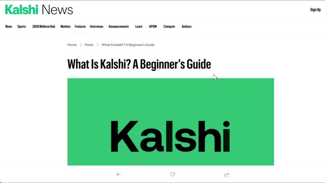
*⏱️ 00:00:25 — Page web du blog Kalshi News affichant l'article "What Is Kalshi? A Beginner's Guide" avec un grand logo vert.*

---

### ⏱️ `[00:00:34 - 00:01:08]` | Segment #02

**🔊 Audio (Transcription Intégrale Mot pour Mot en Français) :**
> réglementés et maintenant ils s'étendent à bien plus que de simples prédictions. Vous pouvez trader des cryptos avec effet de levier sur le même compte jusqu'à 6,1x et nous couvrons tout cela dans cette vidéo. Donc pour commencer, vous allez vouloir créer un compte. Vous pouvez vous inscrire avec Google, Apple, ou simplement votre e-mail. Le lien est juste en bas si vous voulez y aller directement. Et soit dit en passant, si vous vous inscrivez via mon lien sur les prédictions, vous obtenez un bonus pouvant aller jusqu'à 500 $ une fois que vous commencez à trader, et sur les contrats perpétuels, vous obtenez un bonus de 25 $ juste pour avoir commencé. Ça vaut donc vraiment le coup de le récupérer avant de vous lancer.

**👁️ Analyse Visuelle d'Écran (gemini-3.5-flash-lite) :**
**Interface & Outils** : Plateforme de trading et de prédictions Kalshi (Kalshi Pro)

**Contenu textuel & Code** : Graphique de prix BTC PERP, carnet d'ordres (order book), options de levier, marchés de prédiction politique (Michigan Democratic Senate nominee)

**Action / Démonstration** : Navigation sur la plateforme, présentation de l'interface de trading perpétuel et démonstration de la création de compte utilisateur

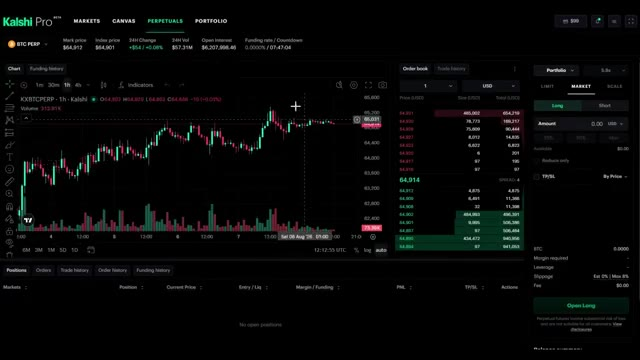
*⏱️ 00:00:42 — Interface de trading Kalshi Pro affichant un graphique en chandeliers du BTC PERP avec le carnet d'ordres et les options de levier.*

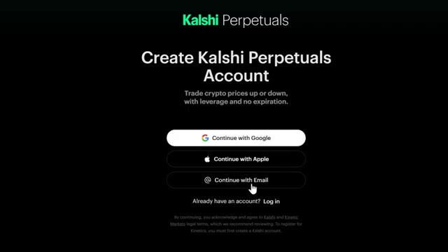
*⏱️ 00:00:51 — Écran de création de compte Kalshi Perpetuals proposant des options de connexion via Google, Apple ou Email.*

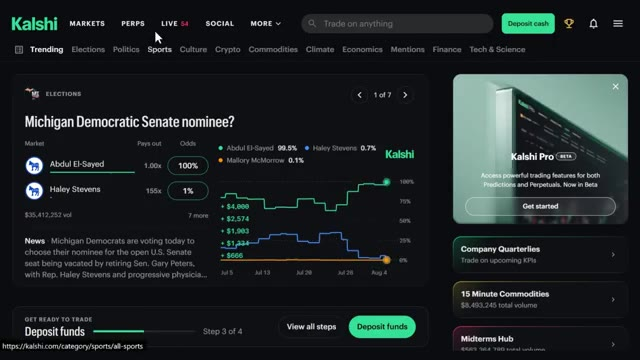
*⏱️ 00:00:59 — Page d'accueil de la plateforme Kalshi montrant les marchés de prédictions, les options de paris et un aperçu publicitaire de Kalshi Pro.*

---

### ⏱️ `[00:01:08 - 00:01:40]` | Segment #03

**🔊 Audio (Transcription Intégrale Mot pour Mot en Français) :**
> Si vous ne voyez pas l'invite tout de suite, allez simplement en haut à droite là où il est écrit s'inscrire et vous verrez ces mêmes options. Processus assez standard. Ils vous demanderont de vérifier deux ou trois choses mais une fois que vous y êtes, vous avez fondamentalement accès à tout ce que vous voyez sur mon écran en ce moment. Très bien, alors maintenant parlons du financement de votre compte parce que c'est là que les gens s'embrouillent un peu. En haut à droite, cliquez sur ces trois lignes et allez à ajouter des fonds. C'est une façon d'y accéder. Vous pouvez aussi cliquer sur déposer des espèces directement sur la page d'accueil et vous verrez trois options de virement instantané.

**👁️ Analyse Visuelle d'Écran (gemini-3.5-flash-lite) :**
**Interface & Outils** : Plateforme de prédiction et de trading Kalshi.

**Contenu textuel & Code** : Options de création de compte, marchés électoraux (Michigan Democratic Senate nominee) avec cotes et graphiques d'évolution des probabilités.

**Action / Démonstration** : Présentation du processus d'inscription puis navigation sur le tableau de bord des marchés de prédiction.

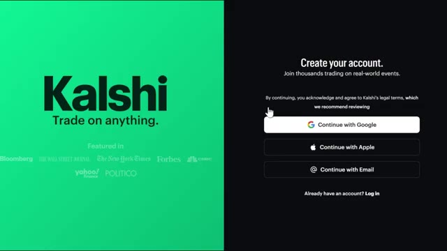
*⏱️ 00:01:16 — Page de connexion/inscription de la plateforme Kalshi avec les options d'authentification Google, Apple et Email.*

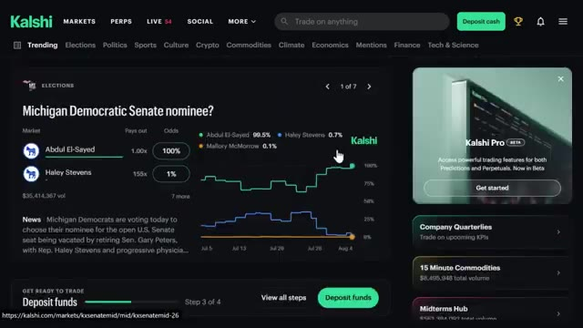
*⏱️ 00:01:24 — Interface principale du site de prédictions Kalshi affichant un marché sur les élections et des graphiques de probabilités.*

---

### ⏱️ `[00:01:40 - 00:02:03]` | Segment #04

**🔊 Audio (Transcription Intégrale Mot pour Mot en Français) :**
> Carte, Google Pay et crypto. Si vous cliquez sur plus d'options, vous verrez également le virement bancaire, qui prend au moins un jour ouvrable et celui-là a un minimum de 1 000 dollars, mais pas de maximum. C'est donc plutôt destiné aux personnes qui déplacent des montants plus importants. Maintenant, voici quelque chose d'important. Vous savez, si vous connectez votre carte ou Google Pay, il y a zero pour cent de frais de traitement sur ceux-là, ce qui est honnêtement génial.

**👁️ Analyse Visuelle d'Écran (gemini-3.5-flash-lite) :**
**Interface & Outils** : Site web Kalshi (plateforme de marché de prédiction)
[CONTenu] Options de dépôt : Card (marquée "Most popular"), Google Pay, Crypto, et Wire transfer ("Up to 1 business day").

**Contenu textuel & Code** : Explications orales des stratégies et mise en contexte méthodologique du marché.

**Action / Démonstration** : Un curseur de souris clique sur l'option "Wire transfer".

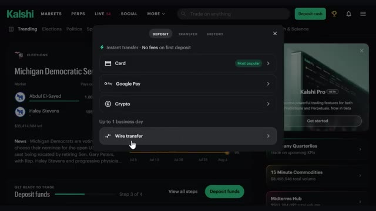
*⏱️ 00:01:46 — Fenêtre modale de dépôt sur la plateforme Kalshi montrant les différentes méthodes de paiement disponibles (Card, Google Pay, Crypto, Wire transfer).*

---

### ⏱️ `[00:02:03 - 00:02:36]` | Segment #05

**🔊 Audio (Transcription Intégrale Mot pour Mot en Français) :**
> Donc vous n'êtes pas pénalisé juste pour avoir fait un dépôt. Donc personnellement, si vous voulez l'option la plus rapide, je connecte simplement votre carte ou Google Pay directement et vous y êtes en quelques secondes. Mais si vous avez déjà des crypto-monnaies, vous pouvez aussi opter pour cette voie. Cliquez sur l'option crypto et vous verrez trois choix : dépôt sécurisé, dépôt standard, et acheter des crypto-monnaies. Sur dépôt sécurisé, vous pouvez connecter votre compte directement depuis des plateformes d'échange comme Coinbase, Uphold, Cash App, et quelques autres. Ou si vous avez des crypto-monnaies qui dorment dans un portefeuille, vous pouvez connecter Metamask, Phantom, Trust Wallet, et plus encore.

**👁️ Analyse Visuelle d'Écran (gemini-3.5-flash-lite) :**
**Interface & Outils** : Interface de la plateforme de courtage et de prédiction Kalshi.
[CONTenu] Options de dépôt : carte bancaire (marquée comme 'Most popular'), Google Pay, et crypto-monnaies, avec la mention 'Instant transfer - No fees on first deposit'.

**Contenu textuel & Code** : Explications orales des stratégies et mise en contexte méthodologique du marché.

**Action / Démonstration** : Présentation des différentes options de dépôt de fonds sur le compte utilisateur.

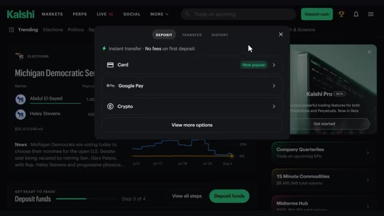
*⏱️ 00:02:11 — Fenêtre de dépôt sur la plateforme Kalshi affichant les différentes méthodes de paiement disponibles.*

---

### ⏱️ `[00:02:37 - 00:03:12]` | Segment #06

**🔊 Audio (Transcription Intégrale Mot pour Mot en Français) :**
> Si votre plateforme d'échange n'est pas répertoriée, vous pouvez faire un dépôt standard à la place, tout comme un transfert de cryptomonnaie normal. Choisissez votre jeton, comme l'USDT, choisissez votre réseau, cliquez sur afficher l'adresse, copiez cette adresse et allez la coller dans votre plateforme d'échange pour l'envoyer. Gardez simplement à l'esprit qu'il y a un minimum de 3 $ sur celui-ci. Et si vous n'avez pas du tout de cryptomonnaie, vous pouvez simplement l'acheter instantanément en utilisant votre carte par l'intermédiaire de fournisseurs comme Coinbase, Cash App ou Robinhood directement dans l'application. Si vous débutez tout juste, je suggère d'avoir un dépôt maximum journalier de pas plus de 500 $, ce qui, honnêtement, est amplement suffisant pour

**👁️ Analyse Visuelle d'Écran (gemini-3.5-flash-lite) :**
**Interface & Outils** : Kalshi (plateforme de prédiction et de trading)

**Contenu textuel & Code** : Menu de sélection de réseau pour le dépôt de crypto-actifs avec les différents réseaux disponibles (Tron, Arbitrum, BNB Chain, Polygon, Ethereum, Solana, Optimism) et sélection du jeton USDT.

**Action / Démonstration** : Sélection du réseau de transfert (clic sur le réseau Tron) pour effectuer un dépôt standard de cryptomonnaie sur la plateforme.

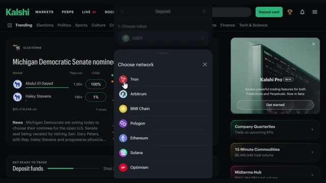
*⏱️ 00:02:46 — Interface de la plateforme Kalshi affichant une fenêtre modale de sélection du réseau pour un dépôt de cryptomonnaie (choix entre Tron, Arbitrum, BNB Chain, Polygon, Ethereum, Solana, Optimism).*

---

### ⏱️ `[00:03:12 - 00:03:48]` | Segment #07

**🔊 Audio (Transcription Intégrale Mot pour Mot en Français) :**
> la plupart des gens commencent. Et connecter votre carte ou votre banque rend également les retraits beaucoup plus rapides puisque cela va directement au même endroit. Maintenant qu'il est approvisionné, nous pouvons commencer à trader. La première fonctionnalité que nous allons aborder est le marché de prédiction classique. La façon dont fonctionne la prédiction Kalshi est en fait assez simple une fois qu'on le voit. Chaque marché que vous voyez ici est une question par oui ou par non, et chacun a un prix qui lui est associé. Donc par exemple, juste ici, qui sera le vainqueur du championnat Wyndham ? Nous avons différents joueurs listés, et oui signifie que ce joueur finit par remporter le tournoi. Si nous faisons défiler vers le bas, vous verrez bien d'autres marchés de ce genre. Maintenant, voici le

**👁️ Analyse Visuelle d'Écran (gemini-3.5-flash-lite) :**
**Interface & Outils** : Kalshi (plateforme de trading de prédictions)

**Contenu textuel & Code** : Solde du portefeuille de 98,41 $, onglets Predictions et Perpetuals, détails du compte (solde cash, taux d'intérêt à 3.25%, niveau d'API Basic, absence de positions ouvertes).

**Action / Démonstration** : Présentation du compte approvisionné prêt pour le trading et vérification du solde du portefeuille.

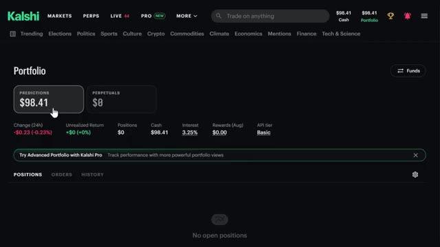
*⏱️ 00:03:21 — Vue d'ensemble de l'interface du portefeuille sur la plateforme Kalshi montrant le solde du compte après le dépôt.*

---

### ⏱️ `[00:03:48 - 00:04:10]` | Segment #08

**🔊 Audio (Transcription Intégrale Mot pour Mot en Français) :**
> partie importante. Ces prix montent et descendent toute la journée en fonction de ce qui se passe réellement, et chaque contrat finit par se régler à zéro ou un dollar. C'est basé purement sur la probabilité que cet événement se produise. Donc si Cameron Young finit par gagner, ce « oui » passe de 9,9 cents jusqu'à un dollar. S'il ne gagne pas, ce même 9,9 cents tombe à zéro.

**👁️ Analyse Visuelle d'Écran (gemini-3.5-flash-lite) :**
**Interface & Outils** : Plateforme de contrats prédictifs Kalshi.

**Contenu textuel & Code** : Marché « Wyndham Championship Winner » : courbe de cote de Cameron Young (9,9% / YES 9,9¢, NO 90,2¢) et Koivun (5,1%), volume total de 32 294 658 $, panneau de passage d'ordre avec sélection Buy/Sell.

**Action / Démonstration** : Présentation du fonctionnement des contrats à règlement binaire (0 $ ou 1 $) et de la fluctuation des prix en fonction des probabilités de victoire en temps réel.

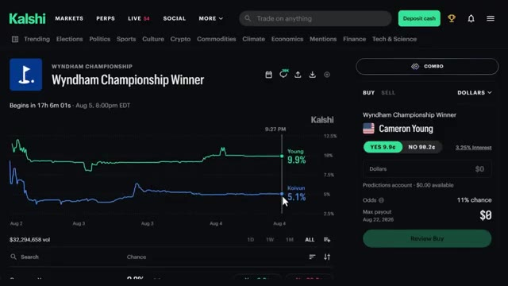
*⏱️ 00:03:53 — Interface du marché de prédiction Kalshi affichant le graphique des probabilités et le carnet d'ordres pour le vainqueur du tournoi de golf Wyndham Championship (Cameron Young vs Koivun).*

---

### ⏱️ `[00:04:11 - 00:04:30]` | Segment #09

**🔊 Audio (Transcription Intégrale Mot pour Mot en Français) :**
> Donc c'est un peu comme le trading d'options, sauf qu'il n'y a pas de potentiel de gain ou de perte illimité et fou. Comme quand on achète une option d'achat ou de vente. C'est plafonné à un dollar. Pire des cas, ça tombe à zéro. C'est aussi simple que ça. Et ce n'est pas seulement le golf ni même le sport en général. Vous pouvez parier sur des élections, de la politique, du sport, de la culture pop, et même sur des matières premières comme le pétrole ou l'or.

**👁️ Analyse Visuelle d'Écran (gemini-3.5-flash-lite) :**
**Interface & Outils** : Kalshi (plateforme de marchés de prédiction)

**Contenu textuel & Code** : Graphiques de probabilité pour Cameron Young (9,9%) et Jackson Koivun (5,1%), cotations des contrats YES (9.9¢) / NO (90.2¢), volume total de 32 294 659 $, et panneau d'exécution d'ordre.

**Action / Démonstration** : Démonstration du mécanisme d'un contrat de prédiction (binaire, plafonné entre 0 et 1 dollar) appliqué à un événement sportif.

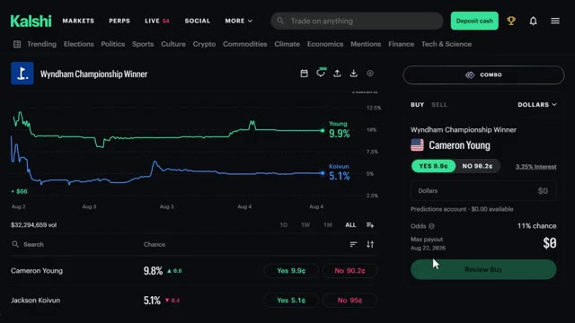
*⏱️ 00:04:15 — Graphique d'évolution des probabilités et panneau d'ordre sur la plateforme Kalshi pour le marché « Wyndham Championship Winner ».*

---

### ⏱️ `[00:04:30 - 00:04:55]` | Segment #10

**🔊 Audio (Transcription Intégrale Mot pour Mot en Français) :**
> Alors, que vous suiviez la politique de près, que vous aimiez le sport, ou que vous ayez simplement un avis bien tranché sur le fait qu'une certaine affaire de célébrité se produise ou non, il y a vraiment un marché pour presque tout ici. Maintenant, en plus de tous ces marchés d'événements, CalSheet propose aussi quelque chose qu'on appelle des « perps », et c'est spécifiquement pour la crypto. Mais le truc, c'est que ce n'achète pas du trading de crypto traditionnel où vous achetez une vraie pièce et surveillez le prix exact.

**👁️ Analyse Visuelle d'Écran (gemini-3.5-flash-lite) :**
**Interface & Outils** : Kalshi (plateforme de marchés de prédiction et contrats perpétuels)

**Contenu textuel & Code** : Cotes et probabilités de prédiction (50%, 16%, 37%), cours cryptos (BTC à $64,203, ETH à $1,867.5), niveaux de levier max (6.1X, 4.8X, 3.5X), volumes sur 24h et mini-graphiques en ligne (sparklines).

**Action / Démonstration** : Navigation sur la plateforme Kalshi, passage de la catégorie Culture vers l'onglet des contrats perpétuels (PERPS) et consultation de la liste des paires crypto négociables.

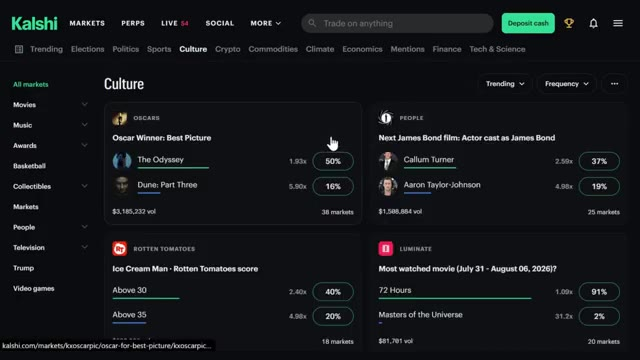
*⏱️ 00:04:36 — Interface Kalshi affichant la catégorie Culture avec des marchés de prédiction (Oscars, casting James Bond, Rotten Tomatoes).*

*⏱️ 00:04:42 — Page d'accueil/élections de Kalshi avec graphique de probabilités pour Michigan Democratic Senate nominee et curseur sur l'onglet PERPS.*

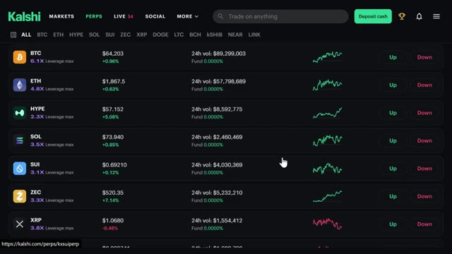
*⏱️ 00:04:49 — Section PERPS (contrats perpétuels) de Kalshi listant plusieurs crypto-monnaies (BTC, ETH, HYPE, SOL, SUI, ZEC, XRP) avec prix, variations et leviers.*

---

### ⏱️ `[00:04:55 - 00:05:15]` | Segment #11

**🔊 Audio (Transcription Intégrale Mot pour Mot en Français) :**
> Au lieu de cela, avec les perps, vous pariez simplement sur le fait que le prix monte ou baisse sur une période définie. C'est donc une façon binaire bien plus simple de jouer sur les mouvements de cours des cryptos sans détenir réellement l'actif ni avoir à gérer un portefeuille rempli de tokens. Nous aborderons le bonus pour cela dans une seconde, mais sachez simplement qu'il s'agit d'un produit distinct qui se trouve juste aux côtés de ces marchés de prédiction.

**👁️ Analyse Visuelle d'Écran (gemini-3.5-flash-lite) :**
**Interface & Outils** : Kalshi (plateforme de trading de contrats perpétuels et de prédictions)

**Contenu textuel & Code** : Graphique de prix du BTC sur 1 heure, prix actuel de 64,203 $, options d'effet de levier (3.6x), boutons de pari "UP" ou "DOWN", et détails de la position.

**Action / Démonstration** : Navigation et présentation de l'interface de trading de contrats perpétuels (perps) sur la plateforme Kalshi.

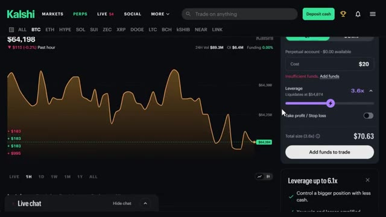
*⏱️ 00:05:00 — Interface de trading de contrats perpétuels sur la plateforme Kalshi affichant le graphique du cours du Bitcoin (BTC) à 64,198 $ avec les options de levier.*

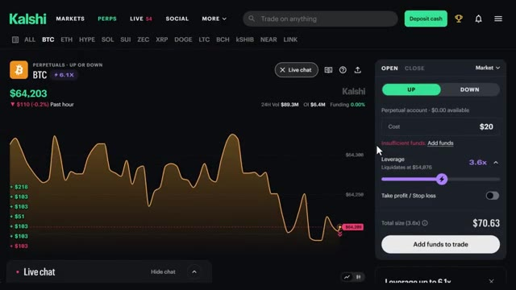
*⏱️ 00:05:05 — Vue de l'interface Kalshi montrant le sélecteur d'options "UP" ou "DOWN" pour parier sur la direction du prix du Bitcoin sur les perpétuels.*

---

### ⏱️ `[00:05:16 - 00:05:40]` | Segment #12

**🔊 Audio (Transcription Intégrale Mot pour Mot en Français) :**
> Et honnêtement, l'un de mes aspects préférés sur la plateforme, c'est simplement de faire défiler les marchés en direct, parce qu'on peut voir les choses bouger en temps réel, peu importe ce qui vous intéresse. En ce moment même, si je fais défiler, on a le marché du candidat démocrate qui évolue activement à mesure que de nouveaux sondages sortent. On a des matchs de tennis en direct où les cotes s'actualisent littéralement point par point au fur et à mesure que le match se déroule. Le Bitcoin a un marché de prix en direct qui bouge toutes les quelques minutes.

**👁️ Analyse Visuelle d'Écran (gemini-3.5-flash-lite) :**
**Interface & Outils** : Site web / plateforme de marché de prédictions Kalshi.

**Contenu textuel & Code** : Marchés en direct affichés : "MI-13 Democratic nominee?" (Donavan McKinney à 91%, Shri Thanedar à 7%, volume de $3,119,168) et "BTC 15 min - $64,248.85 target" (Down 96%, Up 4%). Interface de passage d'ordre sur la droite pour acheter/vendre des contrats ("YES 91.5¢", "NO 9.9¢").

**Action / Démonstration** : Démonstration de la navigation sur le flux en direct (section LIVE) de Kalshi pour consulter l'évolution en temps réel des cote et probabilités des marchés de prédiction.

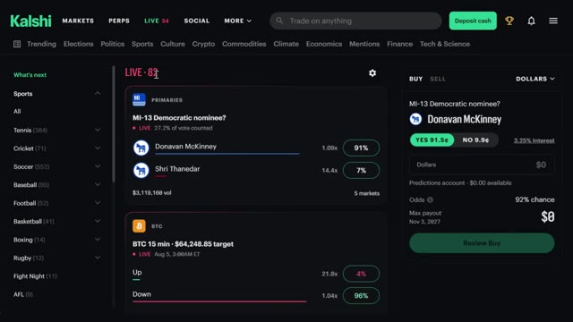
*⏱️ 00:05:22 — Interface de la plateforme de marchés de prédiction Kalshi montrant la section des événements en direct, notamment la primaire démocrate MI-13 et un marché de prédiction du cours de Bitcoin.*

---

### ⏱️ `[00:05:40 - 00:06:15]` | Segment #13

**🔊 Audio (Transcription Intégrale Mot pour Mot en Français) :**
> Il y a des matchs de cricket en direct en ce moment avec des cotes qui oscillent à chaque série de six lancers, et ce n'est que la surface. Il y a des trucs sur le cycle de l'actualité, des cérémonies de remise de prix, même des événements météorologiques qui se produisent en temps réel aussi. Donc vraiment, peu importe ce qui se passe dans le monde en ce moment, il y a de fortes chances pour que CalSh ait déjà un marché en direct qui suit cela, et vous pouvez simplement vous lancer et regarder les cotes bouger au fur et à mesure que ça se produit. Maintenant, CalShe a aussi un côté social, ce qui, je pense, est plutôt sous-estimé. Il y a toute une section où vous pouvez réellement publier vos transactions et voir ce que les autres échangent et quelles sont leurs opinions sur la direction que prend un marché. Donc c'est un peu

**👁️ Analyse Visuelle d'Écran (gemini-3.5-flash-lite) :**
**Interface & Outils** : Plateforme de prédiction et de paris Kalshi.

**Contenu textuel & Code** : Cotes en temps réel, volumes de transactions, probabilités et graphiques d'évolution des marchés de prédiction (sports et actualités politiques).

**Action / Démonstration** : Navigation et présentation des différents marchés de prédiction disponibles sur la plateforme Kalshi.

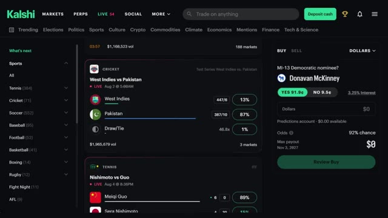
*⏱️ 00:05:49 — Interface de la plateforme Kalshi affichant des marchés de paris en direct sur le cricket (West Indies vs Pakistan) et le tennis.*

*⏱️ 00:05:58 — Interface de Kalshi montrant un marché de prédiction politique sur les élections au sénat américain avec un graphique d'évolution des cotes.*

---

### ⏱️ `[00:06:15 - 00:06:52]` | Segment #14

**🔊 Audio (Transcription Intégrale Mot pour Mot en Français) :**
> comme un fil communautaire intégré. Vous pouvez le faire défiler, voir l'avis de quelqu'un sur la raison pour laquelle il pense qu'un certain résultat va se réaliser, être d'accord ou pas d'accord avec cela, et honnêtement, c'est un bon moyen de repérer des choses auxquelles vous n'auriez peut-être pas pensé vous-même avant de placer un trade. Si vous cliquez sur « plus » dans le menu, c'est là que vous trouverez les politiques de Calci, les valeurs de leur entreprise, ainsi qu'un ensemble d'outils de recherche. Donc, si vous souhaitez un jour approfondir la manière dont la plateforme fonctionne réellement, leurs conditions d'utilisation, ou simplement consulter des recherches pour appuyer un trade que vous envisagez de faire, tout se trouve juste là dans cet onglet. Il y a aussi Calci Pro, qui est un cran au-dessus de la version standard. Avec

**👁️ Analyse Visuelle d'Écran (gemini-3.5-flash-lite) :**
**Interface & Outils** : Plateforme de marchés de prédiction Kalshi (interface web du fil social et page de politique).

**Contenu textuel & Code** : Publications d'utilisateurs avec paris « Yes / No », options de trading, et pourcentages de sondages sur la régulation des marchés (89%, 79%, Bipartisan Support).

**Action / Démonstration** : Navigation et défilement sur le fil communautaire de la plateforme Kalshi pour illustrer les fonctionnalités sociales du site.

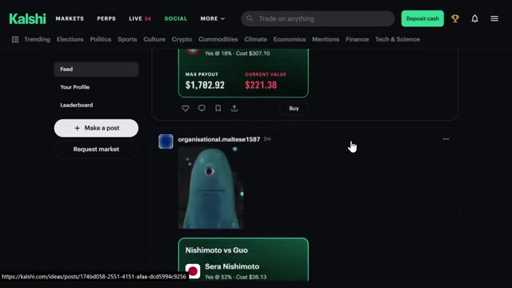
*⏱️ 00:06:24 — Capture d'écran de la plateforme Kalshi montrant le fil communautaire (social feed) avec des publications d'utilisateurs et des pronostics de marchés de prédiction.*

---

### ⏱️ `[00:06:52 - 00:07:25]` | Segment #15

**🔊 Audio (Transcription Intégrale Mot pour Mot en Français) :**
> pro vous obtenez accès à beaucoup plus de données et d'outils que le compte standard ne vous montre tout simplement pas des choses comme le volume, le spread, la taille des positions, le moment où un événement a réellement commencé et un tas d'autres métriques que les traders sérieux vont vouloir s'ils gèrent des positions plus importantes ou essaient de chronométrer leurs entrées plus précisément donc si vous vous trouvez à trader beaucoup et à vouloir plus de visibilité sur ce qui se passe réellement sous le capot d'un marché c'est là que pro entre en jeu donc disons que vous cliquez sur l'un des marchés ici au lieu du simple achat et de la vente que vous obtenez sur le normal

**👁️ Analyse Visuelle d'Écran (gemini-3.5-flash-lite) :**
**Interface & Outils** : Kalshi Pro (version bêta)

**Contenu textuel & Code** : Tableaux de données de marché incluant le volume sur 24h, le volume sur 5m, le spread, la taille des positions et les horodatages des événements.

**Action / Démonstration** : Présentation des fonctionnalités professionnelles et des métriques détaillées disponibles sur la plateforme Kalshi Pro.

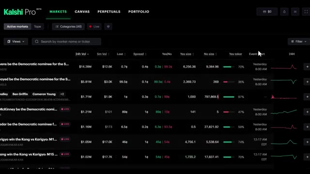
*⏱️ 00:07:00 — Capture d'écran de l'interface de Kalshi Pro montrant les marchés de prédiction et les données de trading avancées.*

---

### ⏱️ `[00:07:25 - 00:07:58]` | Segment #16

**🔊 Audio (Transcription Intégrale Mot pour Mot en Français) :**
> version pro, vous en voyez beaucoup plus, vous avez le carnet d'ordres complet, les volumes, les noms, l'expiration, tout est affiché juste là. C'est une vue beaucoup plus détaillée pour quiconque essaie vraiment de trader sérieusement. Maintenant, l'autre chose qui change par rapport au compte standard de Cash App, c'est qu'avec la version pro, vous pouvez réellement trader des crypto-monnaies comme sur un échange de crypto traditionnel, avec de vrais chiffres, et pas seulement avec des hausses ou des baisses comme les contrats perpetuals sur le compte classique. Ici, vous pouvez voir le sélecteur de paires, un graphique TradingView complet, le carnet d'ordres, le panneau d'ordres, et vos positions juste ici en bas.

**👁️ Analyse Visuelle d'Écran (gemini-3.5-flash-lite) :**
**Interface & Outils** : Kalshi Pro (plateforme de trading et marchés de prédiction)

**Contenu textuel & Code** : Carnets d'ordres complets, volumes, prix d'actifs, taux de financement, expiration des contrats et graphiques de prix en temps réel.

**Action / Démonstration** : Présentation des fonctionnalités professionnelles de la plateforme de trading Kalshi Pro.

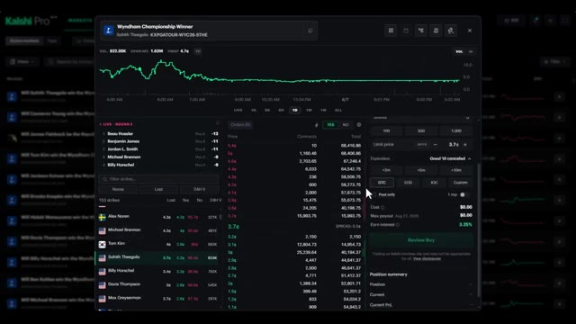
*⏱️ 00:07:33 — Interface de trading Kalshi Pro montrant les marchés de prédiction avec un graphique de prix et un carnet d'ordres détaillé.*

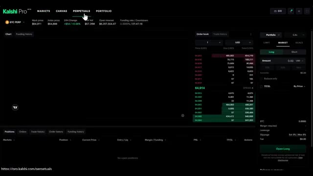
*⏱️ 00:07:41 — Interface Kalshi Pro affichant la section 'Perpetuals' pour le trading de cryptomonnaies avec carnet d'ordres et options de position longue/courte.*

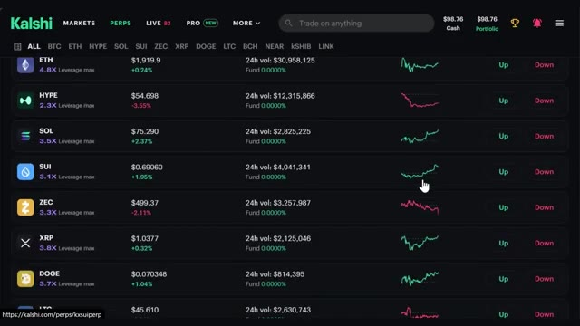
*⏱️ 00:07:50 — Vue d'ensemble de la plateforme Kalshi listant diverses cryptomonnaies (ETH, HYPE, SOL, SUI, etc.) avec leurs variations et volumes sur 24h.*

---

### ⏱️ `[00:07:58 - 00:08:20]` | Segment #17

**🔊 Audio (Transcription Intégrale Mot pour Mot en Français) :**
> en bas. Fondamentalement, un terminal de trading complet et lorsque vous allez dans votre portefeuille ici, vous pouvez voir toutes vos positions en un seul endroit et vous pouvez facilement basculer entre les prédictions et les perpetuals directement depuis ce même écran. Encore une fois, étant donné que c'est toujours en version bêta, attendez-vous à ce que certaines choses évoluent, mais nous entrerons plus en détail sur CalSharks Pro dans nos prochaines vidéos.

**👁️ Analyse Visuelle d'Écran (gemini-3.5-flash-lite) :**
**Interface & Outils** : Kalshi Pro (plateforme de trading et de prédiction)

**Contenu textuel & Code** : Menu de navigation supérieur avec les sections Markets, Canvas, Perpetuals, Portfolio, et les sous-onglets Predictions et Perpetuals.

**Action / Démonstration** : Navigation vers l'onglet Portfolio pour afficher l'ensemble des positions en un seul endroit.

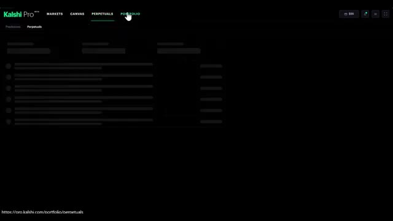
*⏱️ 00:08:03 — Capture d'écran montrant l'interface sombre de Kalshi Pro avec le curseur de la souris sur l'onglet 'PORTFOLIO' dans la barre de navigation supérieure.*

---

### ⏱️ `[00:08:20 - 00:08:42]` | Segment #18

**🔊 Audio (Transcription Intégrale Mot pour Mot en Français) :**
> Alors restez à l'écoute pour cela et assurez-vous de vous abonner pour ne pas le manquer. Petite note avant d'aller plus loin, CalShe est légal au niveau fédéral et disponible dans la plupart des États. Mais à l'heure actuelle, c'est restreint dans une poignée d'États comme l'Arizona, l'Illinois, le Massachusetts, le Michigan, le Nevada, le New Jersey et quelques autres. Cette liste change en fait assez souvent au fur et à mesure que les régulateurs s'affrontent sur ce sujet.

**👁️ Analyse Visuelle d'Écran (gemini-3.5-flash-lite) :**
**Interface & Outils** : Navigateur web affichant le site d'information de Kalshi (Kalshi News).

**Contenu textuel & Code** : Texte juridique et explicatif sur la structure réglementaire de Kalshi, sa régulation fédérale par la CFTC et sa distinction avec les paris sportifs.

**Action / Démonstration** : Navigation et lecture d'un article expliquant le statut juridique fédéral de Kalshi face aux lois des différents États.

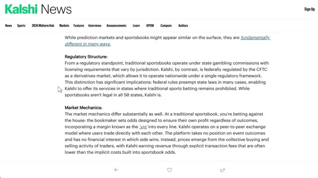
*⏱️ 00:08:26 — Capture d'écran du site web de Kalshi montrant un article comparant les marchés de prédiction et les paris sportifs traditionnels sous l'angle réglementaire.*

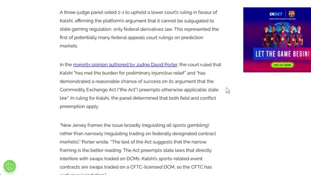
*⏱️ 00:08:36 — Suite de l'article sur Kalshi détaillant la décision de justice fédérale concernant la régulation par la CFTC.*

---

### ⏱️ `[00:08:42 - 00:09:04]` | Segment #19

**🔊 Audio (Transcription Intégrale Mot pour Mot en Français) :**
> Donc, vérifiez bien deux fois quand vous vous inscrivez. Ils feront en sorte que ce soit évident dans les deux cas. Alors, regardons vraiment un vrai marché, le vainqueur du championnat Wyndham. Cliquons dessus. Sur la gauche, vous verrez tous les ordres qui défilent, et en faisant défiler le graphique, vous pouvez littéralement regarder la probabilité bouger en temps réel pour différents joueurs. En ce moment, nous avons Young, Koivun et Matsuyama qui apparaissent ici.

**👁️ Analyse Visuelle d'Écran (gemini-3.5-flash-lite) :**
**Interface & Outils** : Plateforme de prédictions Kalshi (kalshi.com).

**Contenu textuel & Code** : Graphiques de probabilités pour le vainqueur du tournoi de golf Wyndham Championship (Cameron Young à 9,9 %, Jackson Koivun à 5,1 %), volumes de transactions et carnets d'ordres d'achat/vente.

**Action / Démonstration** : Recherche d'un marché spécifique (« Wyndham Championship Winner ») et navigation vers sa page détaillée pour analyser les cotes et les graphiques de prix.

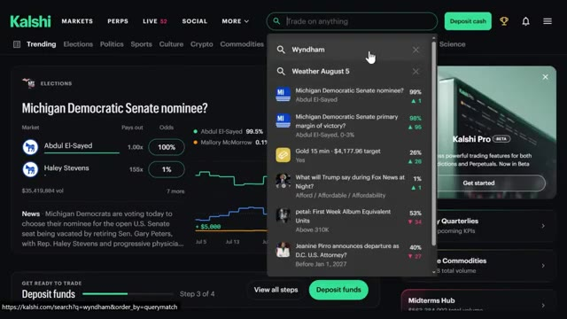
*⏱️ 00:08:48 — Interface de la plateforme Kalshi montrant la barre de recherche avec une requête en cours sur « Wyndham ».*

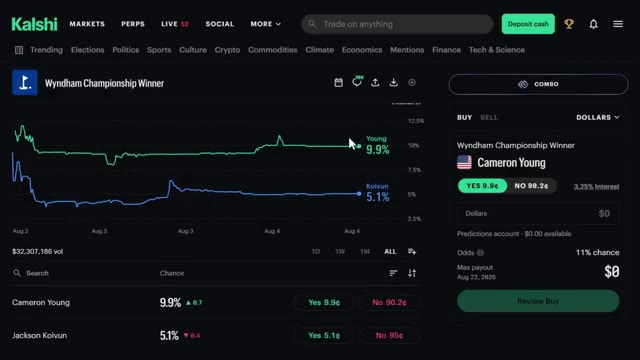
*⏱️ 00:08:53 — Page du marché « Wyndham Championship Winner » sur la plateforme Kalshi, affichant un graphique de probabilités et le carnet de trading à droite.*

---

### ⏱️ `[00:09:04 - 00:09:27]` | Segment #20

**🔊 Audio (Transcription Intégrale Mot pour Mot en Français) :**
> Ces gars n'ont pas encore tapé leur premier coup quand je filme ceci, donc c'est plutôt calme en ce moment. Mais une fois que le jeu commencera, ça va bouger beaucoup. Si vous regardez la semaine dernière, vous pouvez voir Koivun monter, puis redescendre. Tout cela reflète exactement ce qui se passe en direct sur le parcours. Il y a aussi une petite fonctionnalité de chat en haut où les gens lancent des idées, ainsi qu'un fil d'activité où vous pouvez réellement voir ce que font les autres traders.

**👁️ Analyse Visuelle d'Écran (gemini-3.5-flash-lite) :**
**Interface & Outils** : Kalshi (plateforme de marchés prédictifs)

**Contenu textuel & Code** : Graphiques de probabilité temporels affichant les courbes de Cameron Young (9,1% puis 9,9%) et Jackson Koivun (4,7%), ainsi que le carnet de commandes/panneau de transaction à droite pour Cameron Young (YES à 9,9¢, NO à 90,2¢) et un volume global de 32 308 077 $.

**Action / Démonstration** : Navigation et consultation des graphiques et des cotes des différents participants au tournoi de golf sur Kalshi.

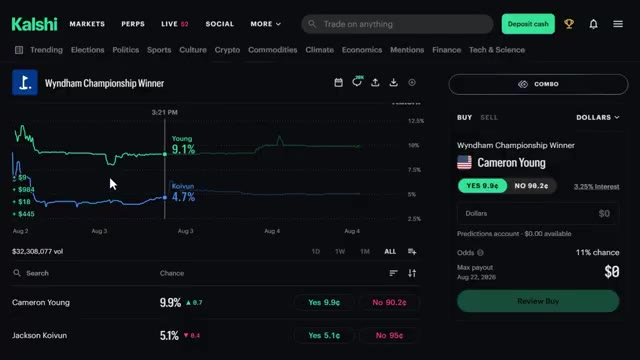
*⏱️ 00:09:10 — Capture d'écran de la plateforme Kalshi montrant le marché prédictif du Wyndham Championship Winner, avec les graphiques de probabilité pour Cameron Young et Jackson Koivun.*

---

### ⏱️ `[00:09:27 - 00:09:49]` | Segment #21

**🔊 Audio (Transcription Intégrale Mot pour Mot en Français) :**
> Vous pouvez définir un minimum, alors j'ai augmenté le mien à 10 000 $ juste pour voir les gros joueurs. Et la plus grande partie de ce qui s'y passe, ce sont des gens qui vendent des « non » à environ 90,2 cents, prenant un petit pourcentage de rendement mais sur un montant de capital énorme. Très bien, voyons exactement comment cela fonctionne. Donc nous sommes toujours sur le marché du vainqueur du championnat Wyndham, et j'ai Cameron Young affiché juste ici.

**👁️ Analyse Visuelle d'Écran (gemini-3.5-flash-lite) :**
**Interface & Outils** : Kalshi (plateforme de marché de prédiction)

**Contenu textuel & Code** : Contrats de prédiction pour le Wyndham Championship Winner avec les options « YES 9.9¢ » et « NO 90.2¢ », et des transactions affichant des volumes importants (ex: 25 000 contrats à 99.9¢, 15 000 à 99.7¢, 33 500 à 97.9¢ et 22 425.04 à 90.1¢).

**Action / Démonstration** : Navigation et consultation des transactions de gros volumes sur les options « Non » pour différents participants du marché de prédiction.

*⏱️ 00:09:33 — Capture d'écran de l'interface de la plateforme Kalshi affichant les marchés de prédiction pour le vainqueur du tournoi Wyndham Championship, avec l'historique des transactions sur le panneau de gauche montrant des achats massifs de contrats « Non » (Bought No) pour divers golfeurs.*

---

### ⏱️ `[00:09:49 - 00:10:19]` | Segment #22

**🔊 Audio (Transcription Intégrale Mot pour Mot en Français) :**
> Il s'échange à 9,9 cents, ce qui lui donne 9,9 % de chances de gagner. Si vous regardez le graphique en haut, vous pouvez voir que sa courbe monte ces derniers jours pour atteindre environ cette fourchette de 10 % maintenant, tandis que Jackson Koivin se situe à 5 %. Cela vous donne donc un bon aperçu visuel de la façon dont ces probabilités évoluent en temps réel au fil du tournoi. Maintenant, sur le côté droit, voici le panneau des ordres. Vous avez deux onglets en haut, acheter et vendre, et je l'ai configuré en dollars en ce moment au lieu des contrats.

**👁️ Analyse Visuelle d'Écran (gemini-3.5-flash-lite) :**
**Interface & Outils** : Kalshi (plateforme de marché de prédiction)

**Contenu textuel & Code** : Graphique de probabilité montrant Cameron Young à 10 % (9,9 cents) et Jackson Koivun à 5 %, volume total de 32 308 134 $.

**Action / Démonstration** : Analyse des cotes et des graphiques de probabilité des différents candidats pour le tournoi de golf.

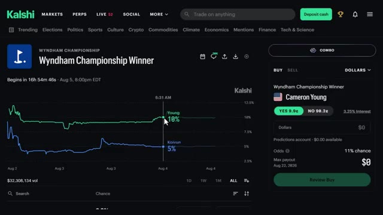
*⏱️ 00:09:57 — Capture d'écran de la plateforme de prédiction Kalshi montrant le marché du vainqueur du Wyndham Championship avec les graphiques de probabilité pour Cameron Young et Jackson Koivun.*

---

### ⏱️ `[00:10:20 - 00:10:57]` | Segment #23

**🔊 Audio (Transcription Intégrale Mot pour Mot en Français) :**
> En dessous de ça, vous pouvez voir le marché. Vainqueur du championnat Wyndham, Cameron Young, puis deux boutons, oui à 9,9 cents et non à 90,2 cents. Maintenant, gardez à l'esprit que ce chiffre n'est pas fixe. Il va évoluer au fur et à mesure que les cotes changent sur ce dans quoi vous avez pris position. Et au passage, vous gagnez en fait des intérêts sur votre argent disponible qui se trouve là. En ce moment, c'est 3,25 %, ce qui est un petit bonus sympa juste pour avoir des fonds déposés sur la plateforme. Cliquons sur oui, car je pense que Cameron Young a une chance ici. Je vais saisir un montant dans le champ des dollars. Faisons les choses en grand pour cet exemple.

**👁️ Analyse Visuelle d'Écran (gemini-3.5-flash-lite) :**
**Interface & Outils** : Plateforme de prédiction / trading Kalshi (interface web).

**Contenu textuel & Code** : Graphique de suivi des probabilités pour les joueurs (Cameron Young à 9,9%, Koivun à 5,1%), volume de transactions de $32,308,166, et panneau de passe d'ordre avec les boutons "YES 9.9¢" et "NO 90.2¢".

**Action / Démonstration** : Explication du fonctionnement des contrats de marché de prédiction, observation des variations de cotes et pointage sur le bouton "NO" à 90.2 cents.

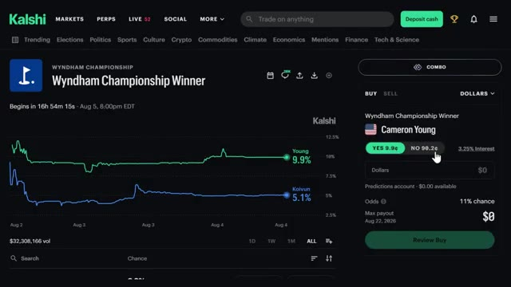
*⏱️ 00:10:29 — Interface du marché de prédiction Kalshi affichant les cotes pour le tournoi de golf Wyndham Championship (Cameron Young).*

---

### ⏱️ `[00:10:57 - 00:11:17]` | Segment #24

**🔊 Audio (Transcription Intégrale Mot pour Mot en Français) :**
> et disons 10 000 dollars, juste pour que vous puissiez voir comment les chiffres évoluent. Juste ici sur la droite, cela détaille le trade pour moi. Les cotes montrent une chance de 11 % et puis le grand chiffre, le paiement maximum. Si cela se réalise d'ici l'expiration du marché le 22 août 2026, mon paiement serait de 95 017,27 dollars.

**👁️ Analyse Visuelle d'Écran (gemini-3.5-flash-lite) :**
**Interface & Outils** : Kalshi (plateforme web de marchés de prédiction)

**Contenu textuel & Code** : Marché "Wyndham Championship Winner", sélection Cameron Young (contrat YES à 9.9¢), montant saisi de 10 000 $, cotes calculées à 11 % de chance, paiement potentiel maximal de 95 017,27 $, graphique comparatif des probabilités (Young à 9,9 %, Koivun à 5,1 %).

**Action / Démonstration** : Simulation de saisie d'un ordre d'achat pour illustrer le calcul du paiement maximum et des probabilités affichées par la plateforme.

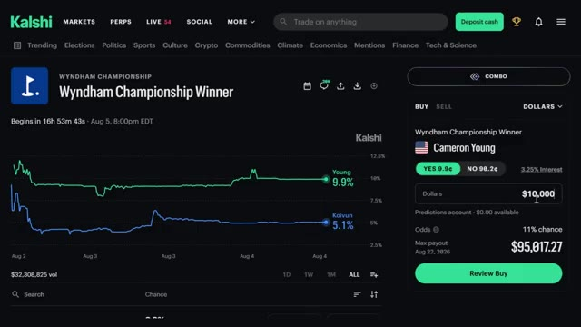
*⏱️ 00:11:02 — Interface de la plateforme de marchés de prédiction Kalshi montrant la simulation d'un ordre d'achat de 10 000 $ sur le joueur Cameron Young.*

---

### ⏱️ `[00:11:18 - 00:11:36]` | Segment #25

**🔊 Audio (Transcription Intégrale Mot pour Mot en Français) :**
> Donc, cela transforme 10 000 $ en pratiquement 95 000 $ si Cameron Young gagne ce tournoi. Une fois que tout semble correct, je clique simplement sur « Review Buy » tout en bas. Cela affichera un écran de confirmation montrant tout une fois de plus. Et une fois que vous confirmez, vous êtes dans le trade. Évidemment, vous n'êtes pas obligé d'y aller aussi fort.

**👁️ Analyse Visuelle d'Écran (gemini-3.5-flash-lite) :**
**Interface & Outils** : Kalshi (plateforme de prédictions et marchés financiers)

**Contenu textuel & Code** : Sélection de Cameron Young (YES à 9.9¢), montant saisi de 10 000 $, paiement maximum estimé à 95 017,27 $, et bouton « Review Buy ».

**Action / Démonstration** : Configuration d'un ordre d'achat de 10 000 $ sur la victoire de Cameron Young avant de cliquer sur « Review Buy ».

*⏱️ 00:11:22 — Capture d'écran de la plateforme Kalshi montrant le marché du Wyndham Championship Winner, avec un graphique des cotes et le panneau de commande pour parier sur le golfeur Cameron Young.*

---

### ⏱️ `[00:11:36 - 00:12:10]` | Segment #26

**🔊 Audio (Transcription Intégrale Mot pour Mot en Français) :**
> Vous pouvez saisir 10 $, 50 $, peu importe ce qui convient à votre capital, et la case des gains se met à jour instantanément, vous savez donc toujours exactement ce que vous risquez et ce que vous pouvez gagner avant même d'appuyer sur ce bouton. Maintenant, disons que Cameron Young a fait un excellent tour, et je veux sécuriser du profit sans attendre que tout le tournoi se termine. Je retourne donc sur le marché, et cette fois, au lieu de cliquer sur acheter en haut, je clique sur l'onglet vendre. Une fois que tout semble bon, je clique sur examiner la vente, et c'est vraiment la beauté de la chose. Vous n'êtes pas bloqué jusqu'à la résolution. Si

**👁️ Analyse Visuelle d'Écran (gemini-3.5-flash-lite) :**
**Interface & Outils** : Kalshi (plateforme de marchés de prédiction)

**Contenu textuel & Code** : Graphique de probabilité temporelle (Cameron Young à 9,9 %, Koivun à 5,1 %), panneau de passage d'ordre pour Cameron Young avec options YES (9.9¢) / NO (90.2¢), champ de saisie du montant en dollars, cotes (11% chance) et gain maximal potentiel (Max payout).

**Action / Démonstration** : Présentation de l'interface Kalshi expliquant comment saisir un montant pour visualiser instantanément le risque et le gain potentiel avant de valider l'achat.

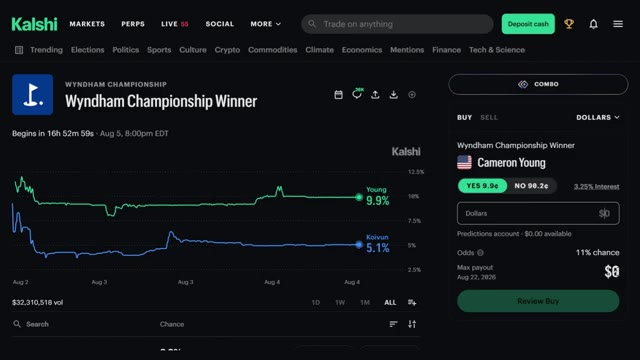
*⏱️ 00:11:44 — Interface de la plateforme de marchés de prédiction Kalshi affichant le graphique des probabilités pour le tournoi "Wyndham Championship Winner" (Cameron Young) et le panneau de saisie d'ordre d'achat.*

---

### ⏱️ `[00:12:10 - 00:12:31]` | Segment #27

**🔊 Audio (Transcription Intégrale Mot pour Mot en Français) :**
> les cotes tournent en votre faveur dès le début, vous pouvez simplement encaisser la victoire directement et passer au trade suivant. Pas besoin d'attendre que le tournoi se termine vraiment. Maintenant, disons que vous avez plusieurs paris en cours en même temps et que vous vous demandez où vous pouvez réellement tout voir au même endroit. Super simple. Cliquez simplement ici sur votre portefeuille en haut à droite et vous pouvez littéralement tout voir ici.

**👁️ Analyse Visuelle d'Écran (gemini-3.5-flash-lite) :**
**Interface & Outils** : Kalshi (plateforme de trading d'événements et de marchés de prédiction).

**Contenu textuel & Code** : Marchés de prédiction sportifs (Wyndham Championship, LIV Golf, Ryder Cup 2027), règles d'évaluation des contrats (Market Rules), cotes en temps réel, pourcentages de probabilité, solde du portefeuille ($98.64 Portfolio).

**Action / Démonstration** : Navigation sur la plateforme Kalshi, consultation des marchés actifs et affichage des règles de résolution des contrats pour la clôture des positions.

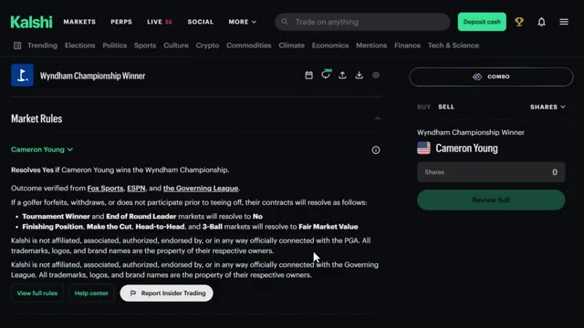
*⏱️ 00:12:15 — Page des règles du marché « Wyndham Championship Winner » sur la plateforme Kalshi avec le panneau de passation d'ordre pour le joueur Cameron Young.*

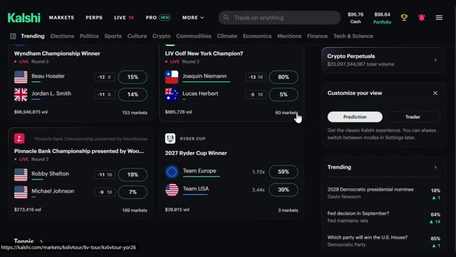
*⏱️ 00:12:20 — Tableau de bord principal de Kalshi présentant divers marchés de prédiction sportifs en direct (Golf, Ryder Cup) avec leurs cotes et probabilités.*

---

### ⏱️ `[00:12:31 - 00:13:06]` | Segment #28

**🔊 Audio (Transcription Intégrale Mot pour Mot en Français) :**
> votre valeur totale, le changement sur les dernières 24 heures, votre rendement non réalisé, la valeur de votre position, votre solde de liquidités plus vos intérêts et toutes les récompenses que vous avez récoltées en chemin. Si vous faites défiler vers le bas à partir d'ici, vous verrez toutes vos positions individuelles listées, et si vous cliquez sur l'une d'entre elles, cela vous amène directement sur la page de ce marché où vous pouvez soit renforcer votre position, soit la vendre, exactement comme nous venons de le voir. Donc, en réalité, votre page de portefeuille est votre base de référence. Tout ce que vous suivez est sur un seul écran et vous n'êtes qu'à un clic de gérer n'importe quoi

**👁️ Analyse Visuelle d'Écran (gemini-3.5-flash-lite) :**
**Interface & Outils** : Kalshi (plateforme de prédiction et de trading)

**Contenu textuel & Code** : Valeur totale du portefeuille ($98.64), changement sur 24h (-$0.12, -0.12%), rendement non réalisé ($0, +0%), valeur des positions ($1.88), solde de liquidités ($96.76), taux d'intérêt (3.25%), récompenses ($0.00), niveau API (Basic).

**Action / Démonstration** : Navigation et présentation des différentes métriques et soldes du compte utilisateur.

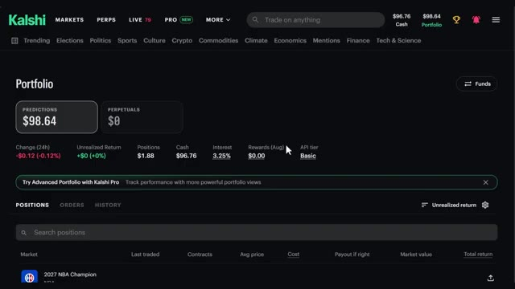
*⏱️ 00:12:40 — Vue d'ensemble du tableau de bord du portefeuille sur la plateforme Kalshi montrant les métriques clés.*

---

### ⏱️ `[00:13:06 - 00:13:43]` | Segment #29

**🔊 Audio (Transcription Intégrale Mot pour Mot en Français) :**
> seul trade. Très bien, maintenant parlons des frais parce que c'est honnêtement la partie que Cash App ne rend pas super évidente. Il faut pour ainsi dire creuser un peu. Faites défiler tout en bas de la page d'accueil, cliquez sur la grille tarifaire et vous verrez une fourchette qui a l'honnêteté de paraître confuse au début. Voici donc la version simple. Il y a des frais de maker et des frais de taker. Les frais de maker sont pour les ordres en attente, ce qui signifie que vous aidez le marché donc vous payez moins. Les frais de taker sont pour les ordres de marché. Vous voulez entrer tout de suite donc vous payez un peu plus. Le maximum que vous payerez the and never is d'environ 1,75 centime par contrat et le moins cher

**👁️ Analyse Visuelle d'Écran (gemini-3.5-flash-lite) :**
**Interface & Outils** : Site web de Kalshi (Interface de courtier / plateforme de prédiction).

**Contenu textuel & Code** : Menus du pied de page incluant Product, Company et Help (avec l'option "Fee schedule" visible dans la colonne Help).

**Action / Démonstration** : Navigation sur le site pour localiser la grille des frais tarifaires depuis le pied de page de la plateforme.

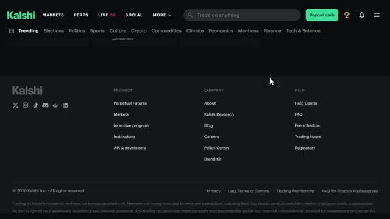
*⏱️ 00:13:15 — Capture d'écran montrant le pied de page (footer) du site web de Kalshi, avec différentes sections de liens dont le lien vers la grille tarifaire (Fee schedule).*

---

### ⏱️ `[00:13:43 - 00:14:15]` | Segment #30

**🔊 Audio (Transcription Intégrale Mot pour Mot en Français) :**
> les transactions ne coûtent presque rien. En gros, les marchés qui affichent des probabilités de 50-50 coûtent le plus cher en frais parce que c'est l'issue la plus incertaine. Mais quelque chose comme un grand favori à 90 % dans un match sportif ? ces frais tombent à moins d'un centime. Les ordres au marché coûtent environ quatre fois plus cher que les ordres à cours limité, alors gardez cela à l'esprit. À part ça, pas de frais de règlement, pas de frais d'adhésion, les dépôts ACH et les retraits sont gratuits. Les cartes de débit peuvent vous coûter jusqu'à deux pour cent, alors soyez simplement vigilants selon la façon approvisionnez votre compte.

**👁️ Analyse Visuelle d'Écran (gemini-3.5-flash-lite) :**
**Interface & Outils** : Site web Kalshi (plateforme de prédiction et de marchés financiers).

**Contenu textuel & Code** : Tableau listant différentes séries de marchés (US gas price, ATP Tennis Match, Ballon d'Or, prix du Bitcoin, etc.) avec les colonnes "maker fees", "multiplier" et "Fee range (100 contracts)" affichant des montants en dollars (ex: $0.07 - $1.75).

**Action / Démonstration** : Navigation et présentation des grilles de frais par le présentateur sur la plateforme Kalshi.

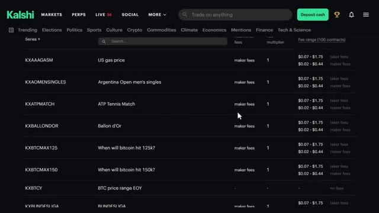
*⏱️ 00:13:51 — Capture d'écran de la plateforme Kalshi montrant la grille tarifaire des frais de transaction pour différents marchés de prédiction.*

---

### ⏱️ `[00:14:16 - 00:14:37]` | Segment #31

**🔊 Audio (Transcription Intégrale Mot pour Mot en Français) :**
> Alors, par où devriez-vous réellement commencer ? Honnêtement, commencez par ce que vous savez déjà. Kalshi propose des milliers de marchés, donc si vous suivez de près le sport, commencez par là. Si vous aimez les actions, ils ont même des marchés sur le prix du Bitcoin ou le S&P 500 à une certaine échéance. Commencez simplement petit, 5, 10, peut-être 100 contrats. Familiarisez-vous avec la plateforme, puis augmentez la mise une fois que vous savez ce que vous faites.

**👁️ Analyse Visuelle d'Écran (gemini-3.5-flash-lite) :**
**Interface & Outils** : Plateforme de prédiction et de trading Kalshi (site web).

**Contenu textuel & Code** : Catégories de marchés (Trending, Politics, Sports, Crypto, Economics, Finance), graphiques de probabilités, cours des cryptomonnaies (Bitcoin à 64,189 $, Ethereum, Solana, Sui) et sections de trading perpétuel.

**Action / Démonstration** : Navigation à travers les différentes catégories de marchés de la plateforme Kalshi pour illustrer la diversité des options de trading disponibles.

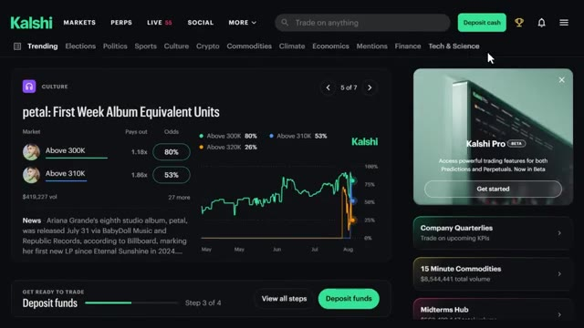
*⏱️ 00:14:21 — Capture d'écran de la plateforme Kalshi montrant l'onglet Culture avec un graphique d'évolution des cotes et différentes catégories de marchés disponibles.*

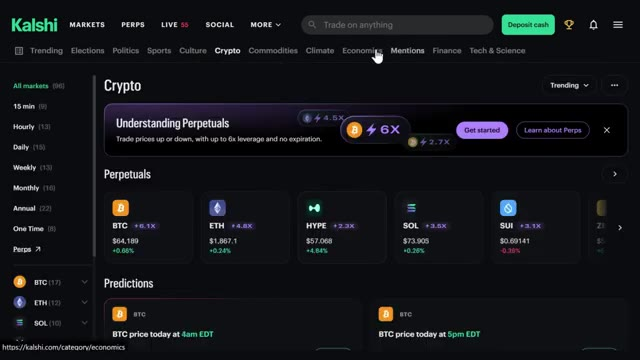
*⏱️ 00:14:26 — Capture d'écran de la plateforme Kalshi sur la section Crypto, affichant les marchés de cryptomonnaies, les contrats perpétuels et les options de prédiction de prix pour le Bitcoin.*

---

### ⏱️ `[00:14:37 - 00:14:59]` | Segment #32

**🔊 Audio (Transcription Intégrale Mot pour Mot en Français) :**
> Assurez-vous d'utiliser le lien d'inscription en bas dans la description si vous voulez commencer. En plus, rappelez-vous de ce bonus, jusqu'à 500 dollars sur les prédictions, 25 dollars sur les contrats perpétuels juste pour vous lancer. Dites-moi dans les commentaires quels marchés vous prévoyez de trader et si vous avez des questions sur la façon dont tout cela fonctionne. J'ai vraiment l'intention d'aller beaucoup plus en profondeur là-dessus au cours des prochaines vidéos.

**👁️ Analyse Visuelle d'Écran (gemini-3.5-flash-lite) :**
**Interface & Outils** : Site web de la plateforme de prédiction Kalshi (Kalshi Perpetuals).

**Contenu textuel & Code** : Options de connexion (Google, Apple, Email) et divers marchés de prédiction politique avec volumes, multiplicateurs et pourcentages (ex: détroit d'Ormuz, extraterrestres, procureur général).

**Action / Démonstration** : Présentation des étapes de création de compte et navigation à travers les différentes catégories de marchés de prédiction de la plateforme.

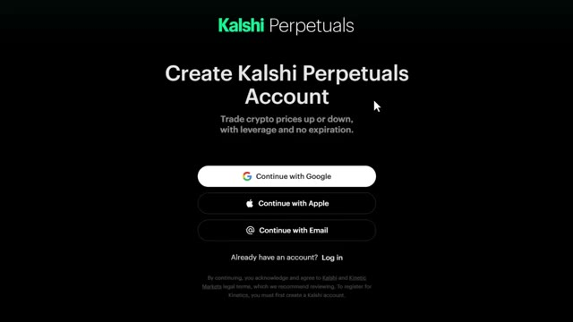
*⏱️ 00:14:43 — Page d'inscription à la plateforme Kalshi Perpetuals proposant de créer un compte avec Google, Apple ou un e-mail.*

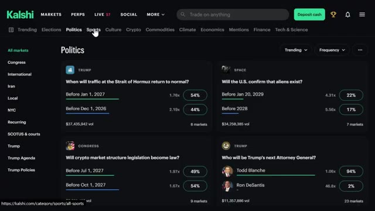
*⏱️ 00:14:54 — Interface de la plateforme de prédiction Kalshi affichant la catégorie 'Politics' avec différents marchés de prédiction et leurs probabilités en pourcentage.*

---

### ⏱️ `[00:14:59 - 00:15:22]` | Segment #33

**🔊 Audio (Transcription Intégrale Mot pour Mot en Français) :**
> Des choses comme la mise en place d'automatisations et de stratégies de suivi sur CalSHE. Alors restez à l'écoute pour ça. Et si vous voulez le guide étape par étape complet sur la façon de construire votre propre système de trading agentique en utilisant Claude, cette vidéo apparaît également à l'écran. Allez y jeter un œil ensuite. Si vous avez trouvé cela utile, laissez un pouce bleu. Cela aide vraiment la chaîne. Abonnez-vous si ce n'est pas déjà fait, et je vous vois dans la prochaine.

**👁️ Analyse Visuelle d'Écran (gemini-3.5-flash-lite) :**
**Interface & Outils** : Aucun élément d'interface affiché.

**Contenu textuel & Code** : Aucun contenu, code ou graphique visible.

**Action / Démonstration** : Aucune action démontrée à l'écran.

---

