# 🎬 How  I Automated My 3 Supertrend Strategies Using Claude (Full Beginner Tutorial)

> **Chaîne** : [Alex Carter](https://www.youtube.com/@AlexCarterTrading)  
> **Lien YouTube** : [https://www.youtube.com/watch?v=EIgwI1Eld8g](https://www.youtube.com/watch?v=EIgwI1Eld8g)  
> **Date de publication** : 20260811  
> **Durée** : 00:13:59  
> **Identifiant vidéo** : `EIgwI1Eld8g`  
> **Transcription & Analyse** : `whisper-v3-large-turbo+gemini-3.5-flash-lite`  

---

## 📌 Synthèse Exécutive & Outils

### 💡 Résumé
Cette vidéo plonge au cœur de l'automatisation du trading de dérivés en mariant l'analyse technique traditionnelle à la puissance des assistants de code conversationnels. L'auteur y aborde le problème récurrent de la fatigue visuelle et du manque de réactivité face aux graphiques, en confiant à l'intelligence artificielle le soin de coder des stratégies basées sur le Supertrend. L'objectif est d'éliminer les faux signaux en range et de s'affranchir des veilles graphiques interminables pour laisser TradingView identifier et tracer instantanément les opportunités d'achat ou de vente.

Trois configurations distinctes sont minutieusement décortiquées et prêtes à l'automatisation via Pine Script et Claude : le triple Supertrend aux paramètres croisés, l'association du Supertrend avec la moyenne mobile exponentielle à 200 périodes, et enfin le couplage avec le nuage Kumo de l'indicateur Ichimoku. Chacune de ces méthodes vise à filtrer le bruit des marchés directionnels à fort momentum tout en encadrant strictement les risques grâce à des règles de gestion rigoureuses et des leviers adaptés aux traders de tous niveaux.

L'approche démontre qu'il n'est plus nécessaire de posséder des compétences approfondies en programmation pour concevoir des scripts sur mesure. En combinant des échanges de cryptomonnaies performants et des invites (prompts) structurées destinées à Claude, le trader débutant comme confirmé peut bâtir un écosystème de scalping et de day trading entièrement automatisé, sécurisant ainsi ses prises de position sans céder aux biais psychologiques inhérents au trading manuel.

### 🛠️ Outils, Modèles & Logiciels Présentés
* **Claude (Anthropic)** : Assistant conversationnel et IA générative utilisé pour rédiger l'intégralité des scripts Pine Script sur mesure sans compétences préalables en codage.
* **TradingView** : Plateforme d'analyse graphique et d'édition de code (Pine Editor) servant à compiler et exécuter les indicateurs et scripts automatisés.
* **Bybit** : Échange centralisé de premier plan pour le trading de produits dérivés, offrant des bonus de bienvenue et des options de marge avancées.
* **BingX** : Échange alternatif proposé pour les utilisateurs ne souhaitant pas se soumettre à une vérification KYC obligatoire pour le trading de base.
* **Pine Script** : Langage de programmation propriétaire de TradingView utilisé pour implémenter, tester et tracer les stratégies Supertrend personnalisées.
* **Supertrend** : Indicateur technique pivot pour la détection du momentum et des tendances à court terme via des paramètres d'ATR modulables.
* **Moyenne Mobile Exponentielle 200 (EMA 200)** : Indicateur de tendance macroéconomique à long terme servant de filtre directionnel majeur.
* **Ichimoku (Nuage Kumo)** : Indicateur technique sophistiqué utilisé pour filtrer les entrées de marché grâce à sa zone de support et de résistance dynamique.

### 🔑 Points Clés & Enseignements Stratégiques
* **Dépassement du trading manuel** : L'automatisation des stratégies par l'IA permet de s'affranchir du stress lié à la surveillance continue des graphiques et d'éviter les opportunités manquées dues à un manque de réactivité.
* **Limitation des faux signaux du Supertrend** : Utilisé isolément, le Supertrend génère de faux signaux répétés en période de marché en range ; l'utilisation combinée de plusieurs indicateurs sert de filtre correctif indispensable.
* **Stratégie 1 (Triple Supertrend)** : Superposition de trois indicateurs Supertrend aux paramètres distincts (ATR 12/3, 10/1 et 11/2) pour n'entrer en position que lorsque l'intégralité des lignes s'aligne sur la même couleur.
* **Stratégie 2 (Supertrend + EMA 200)** : Combinaison d'un Supertrend aux paramètres par défaut avec une moyenne mobile exponentielle à 200 périodes pour valider les tendances à court terme dans le sens de la tendance de fond.
* **Stratégie 3 (Supertrend + Ichimoku)** : Filtrage strict des signaux Supertrend en exigeant que le prix évolue clairement au-dessus ou en dessous du nuage Kumo violet pour valider respectivement les positions long et short.
* **Gestion du risque et effet de levier** : Recommandation d'utiliser la marge isolée plutôt que croisée afin de circonscrire le risque à une position spécifique, avec un effet de levier modéré de 5x à 10x pour les débutants.
* **Règles de sortie rigoureuses** : Application systématique d'un ratio risk/reward avec un niveau de take profit fixé à 1,5, ou sortie anticipée du trade dès qu'une ligne change de couleur ou que le prix réintègre le nuage Kumo.
* **Accessibilité sans compétences en code** : Utilisation de prompts textuels précis adressés à Claude pour générer instantanément le code source prêt à être copié-collé dans l'éditeur Pine de TradingView.
* **Flexibilité des plateformes d'échange** : Choix entre Bybit (nécessitant un KYC rapide mais offrant des avantages maximaux) et BingX (alternative sans KYC obligatoire pour le trading de base) pour exécuter les ordres dérivés.
* **Exécution instantanée pour débutants** : Préférence pour les ordres au marché sur les plateformes de futures pour garantir une exécution immédiate lors de l'apprentissage des configurations graphiques automatisées.

---

## ⏱️ Chronologie & Transcription Complète Audio & Visuelle (Mot pour Mot)

### ⏱️ `[00:00:00 - 00:00:21]` | Segment #01

**🔊 Audio (Transcription Intégrale Mot pour Mot en Français) :**
> J'avais l'habitude de rester assis là pendant des heures, à passer d'une ligne super trend à une autre sur mon graphique, en attendant qu'elles finissent toutes par s'aligner. Et la moitié du temps, au moment où je le remarquais, le trade était déjà parti. Alors j'ai arrêté de le faire manuellement. À la place, j'ai pris trois de mes stratégies super trend préférées, et je les ai toutes confiées à Claude.

**👁️ Analyse Visuelle d'Écran (gemini-3.5-flash-lite) :**
**Interface & Outils** : TradingView

**Contenu textuel & Code** : Indicateurs Super Trend multiples, chandeliers BTCUSDT en timeframe 30m, lignes de tendance et outils de mesure de position (Long/Short avec PnL et ratio risque/rendement).

**Action / Démonstration** : Analyse graphique des configurations Super Trend et placement d'outils de mesure de position de trading.

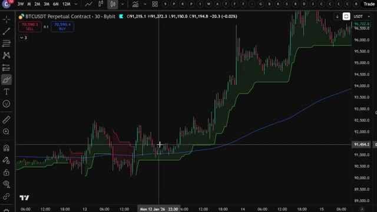
*⏱️ 00:00:05 — Graphique en chandeliers japonais BTCUSDT sur l'unité de temps 30 minutes, montrant un indicateur Super Trend vert et une ligne de tendance bleue.*

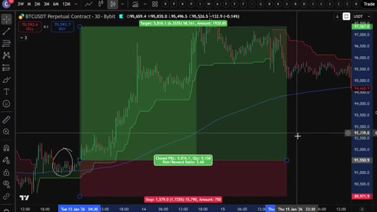
*⏱️ 00:00:11 — Graphique BTCUSDT 30 minutes avec un outil de position Long mesurant le risque/rendement (Risk/Reward Ratio : 3.68) et une zone cerclée au niveau du point d'entrée.*

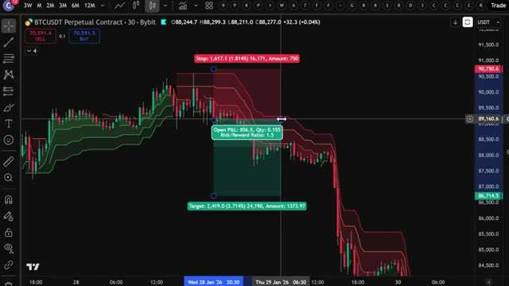
*⏱️ 00:00:16 — Graphique BTCUSDT 30 minutes illustrant une position Short avec plusieurs lignes Super Trend empilées et un outil Risk/Reward affichant un ratio de 1.5.*

---

### ⏱️ `[00:00:22 - 00:00:59]` | Segment #02

**🔊 Audio (Transcription Intégrale Mot pour Mot en Français) :**
> Dans cette vidéo, je vais vous montrer exactement comment j'ai automatisé les trois pour que TradingView attrape chaque signal pour moi, le trace directement sur le graphique, et m'alerte dès qu'il est prêt, sans que je regarde une seule bougie, sans savoir coder, et sans payer pour un groupe de signaux hors de prix. Et à la fin, je vous donnerai les invites exactes que j'utilise pour chaque stratégie, afin que vous puissiez les copier et construire la même configuration vous-même dans les 10 prochaines minutes. Passons donc directement aux choses sérieuses. Très bien, les gars, étape numéro une, inscrivez-vous sur un échange. Pour cette stratégie, nous allons utiliser Bybit. C'est l'un de mes principaux échanges pour le trading de produits dérivés et ils sont

**👁️ Analyse Visuelle d'Écran (gemini-3.5-flash-lite) :**
**Interface & Outils** : TradingView, Bybit

**Contenu textuel & Code** : Boîte de dialogue "Create alert on" avec la condition "ST+Ichimoku (10, 3, 9, 26, 52, 26, 1...)"; panneau latéral montrant des notifications Webhook exécutées.

**Action / Démonstration** : Configuration d'une alerte automatisée liée à un indicateur combiné sur le graphique de TradingView.

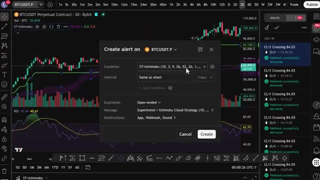
*⏱️ 00:00:31 — Fenêtre de création d'alerte sur un graphique TradingView pour le contrat BTCUSDT avec une stratégie combinant Supertrend et nuage d'Ichimoku.*

---

### ⏱️ `[00:00:59 - 00:01:23]` | Segment #03

**🔊 Audio (Transcription Intégrale Mot pour Mot en Français) :**
> offrant des bonus absolument fous en ce moment. Voici la partie importante. Si Bybit n'est pas disponible dans votre pays ou que vous ne voulez pas faire de KYC, vous pouvez utiliser BingX comme alternative. Et le meilleur dans tout ça ? BingX n'exige pas de vérification KYC obligatoire pour le trading de base. BingX offre également jusqu'à 9 800 USDT de bonus de bienvenue. Je mettrai les liens des deux en description. Mais pour cette vidéo, nous allons utiliser Bybit.

**👁️ Analyse Visuelle d'Écran (gemini-3.5-flash-lite) :**
**Interface & Outils** : Interfaces web des courtiers crypto Bybit et BingX.

**Contenu textuel & Code** : Offres promotionnelles, montants de bonus (30 000 USDT, 9 800+ USDT), et formulaires d'inscription.
[DESC_IMAGE_1] Navigation sur les plateformes d'échange alternatives pour présenter les bonus et options sans KYC.

**Action / Démonstration** : Explications face caméra et analyse conceptuelle des marchés.

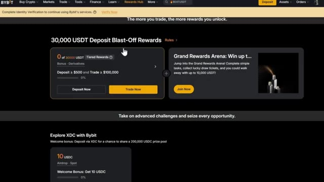
*⏱️ 00:01:05 — Interface de la plateforme Bybit affichant la section "Rewards Hub" avec les bonus de dépôt de 30 000 USDT.*

*⏱️ 00:01:11 — Page d'accueil de la plateforme BingX mettant en avant l'événement promotionnel "Can't Win the Final Battle Without You!" avec une mascotte animée.*

*⏱️ 00:01:17 — Page d'inscription de la plateforme BingX montrant les bonus de bienvenue ("9,800+ USDT Welcome Gift") et le formulaire de création de compte.*

---

### ⏱️ `[00:01:24 - 00:01:55]` | Segment #04

**🔊 Audio (Transcription Intégrale Mot pour Mot en Français) :**
> Pour vous inscrire sur Bybit et réclamer jusqu'à 30 000 USDT de bonus, cliquez sur le lien tout en haut de la description. Vous serez redirigé vers la page d'inscription où il vous suffit d'entrer vos informations et de créer un compte. Vous devrez compléter la vérification KYC sur Bybit pour profiter de tous les services sur leur plateforme. Personnellement, je n'ai aucun problème avec le KYC. C'est rapide et sécurisé. Mais si vous préférez une option sans KYC obligatoire, c'est pourquoi j'ai fourni BingX comme alternative ci-dessous. La deuxième étape consiste à déposer des fonds.

**👁️ Analyse Visuelle d'Écran (gemini-3.5-flash-lite) :**
**Interface & Outils** : Navigateur Web affichant les interfaces d'inscription des plateformes d'échange crypto Bybit et BingX.

**Contenu textuel & Code** : Statistiques de la plateforme (volume de trading 24h, utilisateurs enregistrés), bonus de bienvenue (USDT), champs de saisie pour e-mail/mot de passe et code de parrainage.

**Action / Démonstration** : Présentation des étapes pour s'inscrire sur les bourses de crypto-monnaies partenaires et bénéficier des bonus de bienvenue.

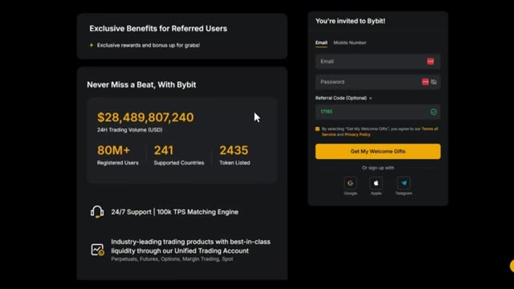
*⏱️ 00:01:32 — Page d'inscription de la plateforme Bybit affichant les statistiques clés et le formulaire de création de compte avec code de parrainage.*

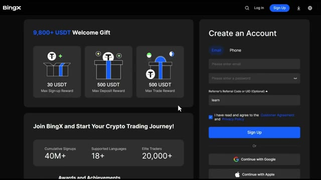
*⏱️ 00:01:47 — Page d'inscription de la plateforme BingX présentant les bonus de bienvenue et le formulaire de création de compte.*

---

### ⏱️ `[00:01:55 - 00:02:30]` | Segment #05

**🔊 Audio (Transcription Intégrale Mot pour Mot en Français) :**
> Laissez-moi vous montrer comment déposer des fonds avant que nous ne plongions dans la stratégie. Une fois que vous êtes connecté à Bybit, cliquez sur Actifs dans le coin supérieur droit, puis cliquez sur Dépôt. Choisissez la pièce que vous souhaitez déposer. Je recommande l'USDT et sélectionnez le bon réseau de blockchain. Assurez-vous de choisir le bon réseau pour éviter de perdre vos fonds. Nous confirmerons les détails puis scannez le code QR ou copiez l'adresse de dépôt pour transférer vos fonds depuis votre portefeuille ou un autre échange. Si vous souhaitez déposer en utilisant une monnaie fiat, cliquez sur Acheter des cryptos en haut du menu, puis sélectionnez Dépôt fiat. Choisissez votre devise, entrez le

**👁️ Analyse Visuelle d'Écran (gemini-3.5-flash-lite) :**
**Interface & Outils** : Bybit

**Contenu textuel & Code** : Options de dépôt de cryptomonnaies, sélection de l'USDT et choix des réseaux blockchain (TRC20, ERC20, Mantle Network).

**Action / Démonstration** : Navigation sur l'interface de l'exchange pour initier un dépôt de fonds en USDT.

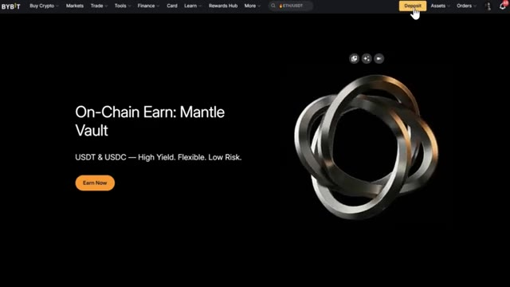
*⏱️ 00:02:04 — Page d'accueil de la plateforme Bybit avec le curseur sur le bouton de dépôt dans le coin supérieur droit.*

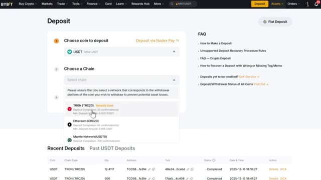
*⏱️ 00:02:13 — Interface de dépôt Bybit montrant la sélection de la crypto USDT et le menu déroulant des réseaux (chaînes) avec TRON (TRC20) sélectionné.*

---

### ⏱️ `[00:02:30 - 00:03:06]` | Segment #06

**🔊 Audio (Transcription Intégrale Mot pour Mot en Français) :**
> montant, sélectionnez votre mode de paiement et cliquez sur continuer. Une fois vos fonds déposés, il est temps d'ouvrir une position. L'étape numéro trois consiste à ouvrir votre première position. Cliquez sur trader dans le menu supérieur, puis sélectionnez futures. Cela vous mènera à l'interface de trading. Choisissez l'actif que vous souhaitez négocier dans le coin supérieur gauche. Pour cet exemple, j'utiliserai Bitcoin. Sélectionnez votre type d'ordre, limite, au marché ou conditionnel. Pour les débutants, je recommande de commencer par des ordres au marché pour une exécution instantanée. Saisissez les détails de votre trade tels que la quantité et le prix. Ensuite, choisissez votre effet de levier

**👁️ Analyse Visuelle d'Écran (gemini-3.5-flash-lite) :**
**Interface & Outils** : Plateforme d'échange de cryptomonnaies Bybit (interface web et interface de trading futures).

**Contenu textuel & Code** : Paires de cryptomonnaies (BTC/USDT, SOL/USDT, etc.), graphiques de prix en chandeliers, carnet d'ordres (Order Book), options de position (Long/Short, Isolé/Cross, effet de levier).

**Action / Démonstration** : Navigation sur la plateforme Bybit et transition vers l'interface de trading futures pour ouvrir une position.

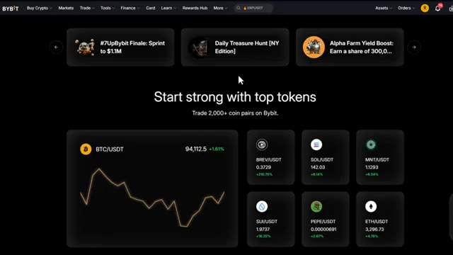
*⏱️ 00:02:39 — Page d'accueil de la plateforme Bybit affichant différents jetons et paires de cryptomonnaies.*

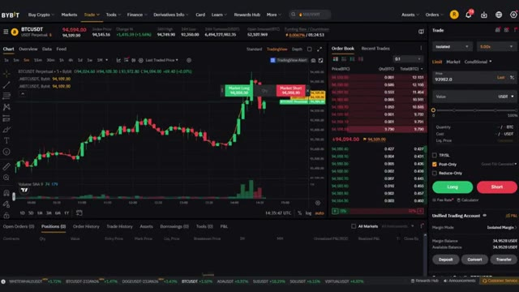
*⏱️ 00:02:48 — Interface de trading futures de Bybit montrant un graphique en chandeliers du BTC/USDT, le carnet d'ordres et le panneau de passage d'ordres.*

---

### ⏱️ `[00:03:06 - 00:03:29]` | Segment #07

**🔊 Audio (Transcription Intégrale Mot pour Mot en Français) :**
> type. Vous pouvez utiliser la marge croisée ou la marge isolée. Personnellement, j'utilise la marge isolée car elle limite votre risque à cette position spécifique uniquement. Vous pouvez utiliser jusqu'à 100 fois de effet de levier sur un pari d'achat, mais pour les débutants, je recommande de commencer avec 5 fois à 10 fois de effet de levier jusqu'à ce que vous soyez à l'aise. Confirmez les détails de votre ordre, puis cliquez sur acheter slash long ou vendre slash short pour ouvrir votre position.

**👁️ Analyse Visuelle d'Écran (gemini-3.5-flash-lite) :**
**Interface & Outils** : Interface de l'échange Bybit (TradingView intégré).

**Contenu textuel & Code** : Graphique en chandeliers du BTCUSDT en unité de temps 5m, carnet d'ordres, et panneau de passage d'ordres affichant les options de marge (Isolated, Cross, Portfolio).

**Action / Démonstration** : Sélection et explication du mode de marge isolée dans le panneau de trading de Bybit.

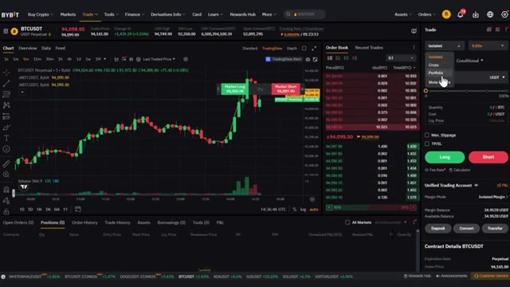
*⏱️ 00:03:12 — Interface de trading de Bybit montrant le graphique du BTCUSDT avec le menu de sélection du type de marge ouvert (Isolated).*

---

### ⏱️ `[00:03:29 - 00:03:51]` | Segment #08

**🔊 Audio (Transcription Intégrale Mot pour Mot en Français) :**
> Une fois votre ordre exécuté, vous pouvez le voir sous l'onglet Positions en bas de l'écran. Maintenant que vous savez comment utiliser les produits dérivés sur Bybit, passons à la stratégie proprement dite qui peut vous faire réaliser des profits importants par jour. Très bien, entrons maintenant directement dans les stratégies. Nous allons utiliser l'indicateur Super Trend, qui est l'un des moyens les plus simples pour trouver les tendances sur le marché.

**👁️ Analyse Visuelle d'Écran (gemini-3.5-flash-lite) :**
**Interface & Outils** : Interface de l'échange de cryptomonnaies Bybit (trading de produits dérivés).

**Contenu textuel & Code** : Graphique du BTCUSDT en unités de 5 minutes, carnet d'ordres (order book) à droite, et onglet "Positions (1)" en bas affichant une position ouverte sur le contrat BTCUSDT Perp avec un effet de levier isolé de 50x.

**Action / Démonstration** : Visualisation d'une position ouverte et active dans le tableau de bord de trading après exécution d'un ordre.

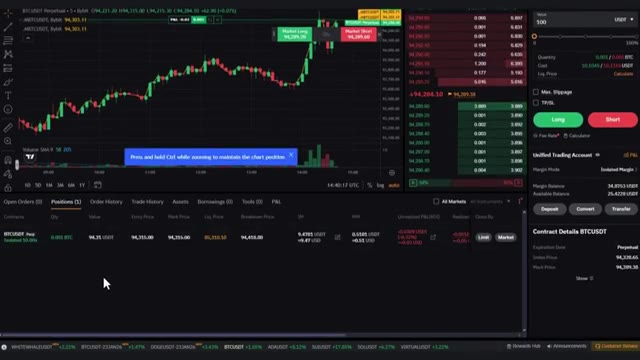
*⏱️ 00:03:34 — Interface de trading de Bybit affichant un graphique en chandeliers du BTCUSDT avec l'onglet des positions ouvertes en bas et le panneau de passage d'ordres à droite.*

---

### ⏱️ `[00:03:52 - 00:04:29]` | Segment #09

**🔊 Audio (Transcription Intégrale Mot pour Mot en Français) :**
> Maintenant, allez sur Trade and View. Vous pouvez utiliser la version gratuite pour cela. Cliquez sur indicateurs, tapez super trend et sélectionnez celui-ci ici, c'est vraiment simple, si la ligne est verte c'est un signal d'achat, mais si la ligne est rouge il est temps d'ouvrir une position short, maintenant il est vrai aussi que l'indicateur super trend a quelques problèmes quand vous l'utilisez seul, l'indicateur identifie les tendances quand le marché a un fort momentum dans une direction, mais il va constamment vous donner des signaux d'achat et de vente même quand le marché évolue en range et manque de momentum significatif et vous pouvez perdre beaucoup d'argent aussi. Donc à cause de cela, allons directement à nos trois

**👁️ Analyse Visuelle d'Écran (gemini-3.5-flash-lite) :**
**Interface & Outils** : TradingView (Graphique de prix crypto)

**Contenu textuel & Code** : Graphique du BTCUSDT Perpetual Contract (Bybit) en unité de temps 30 minutes, avec l'indicateur technique Supertrend (paramètres 10, 3) affichant des zones vertes (signal haussier) et rouges (signal baissier).

**Action / Démonstration** : Le curseur pointe sur le graphique au moment du basculement de l'indicateur Supertrend du vert au rouge, illustrant un signal de vente (short).

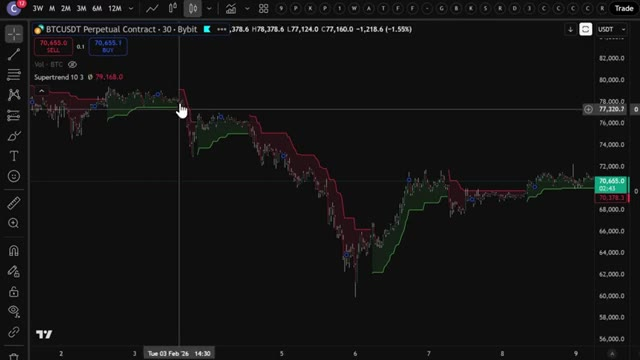
*⏱️ 00:04:01 — Capture d'écran montrant un graphique de trading TradingView avec l'indicateur Supertrend appliqué sur une paire crypto.*

---

### ⏱️ `[00:04:29 - 00:05:05]` | Segment #10

**🔊 Audio (Transcription Intégrale Mot pour Mot en Français) :**
> stratégies qui vont vous aider à ne pas perdre d'argent lorsque vous tradez. La première stratégie est très simple. Vous allez sur votre graphique Bitcoin sur TradingView, vous cliquez sur les indicateurs et vous ajoutez trois indicateurs Supertrend à votre graphique. Oui, vous avez bien entendu, trois fois le même indicateur. Ensuite, allez dans les paramètres du premier et changez la période ATR à 12 et le multiplicateur ATR à 3. Pour le deuxième indicateur, définissez les valeurs à 10 et 1. Et enfin, pour le troisième indicateur, définissez les valeurs à 11 et 2. Le secret est de trader lorsque toutes les lignes de l'indicateur sont de la même couleur. Comme vous pouvez le voir

**👁️ Analyse Visuelle d'Écran (gemini-3.5-flash-lite) :**
**Interface & Outils** : TradingView / Graphique de trading BTCUSDT (Bybit)

**Contenu textuel & Code** : Bougies japonaises (BTCUSDT 30m), prix actuel à 70 637,0 USDT, indicateur Supertrend (10, 3) affichant les bandes de tendance vertes et rouges.

**Action / Démonstration** : Présentation de la configuration initiale du graphique Bitcoin avec le premier indicateur Supertrend.

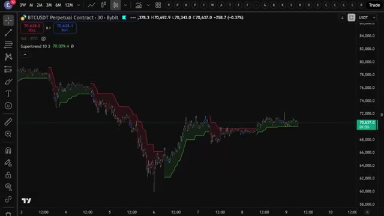
*⏱️ 00:04:38 — Graphique TradingView du contrat perpétuel BTCUSDT en unités 30 minutes avec un premier indicateur Supertrend appliqué.*

---

### ⏱️ `[00:05:05 - 00:05:38]` | Segment #11

**🔊 Audio (Transcription Intégrale Mot pour Mot en Français) :**
> Ici, certaines lignes sont vertes et d'autres sont rouges. Cela montre que le marché n'est pas en plein momentum et qu'il évolue peut-être latéralement. Il est donc préférable d'attendre que toutes les lignes prennent la même couleur avant de trader. Si toutes les lignes deviennent vertes, cela montre que le marché a un fort momentum et vous pouvez prendre une position acheteuse. Mais si toutes les lignes sont rouges, vous pouvez ouvrir une position vendeuse. Si vous suivez cette approche, vous pouvez potentiellement prendre des positions au bon moment et augmenter vos profits. Maintenant, si vous prenez une nouvelle position, il est également important de savoir comment sortir de cette même position. Pour cela, il existe différentes

**👁️ Analyse Visuelle d'Écran (gemini-3.5-flash-lite) :**
**Interface & Outils** : Graphique de trading (TradingView / interface Bybit)

**Contenu textuel & Code** : Paire BTCUSDT Perpetual Contract en unité de temps 30 minutes, indicateur technique à lignes multiples alternant entre le vert et le rouge montrant un marché sans momentum clair.

**Action / Démonstration** : Analyse visuelle du manque de momentum et de l'évolution latérale des prix, en expliquant qu'il faut attendre que toutes les lignes prennent la même couleur avant de trader.

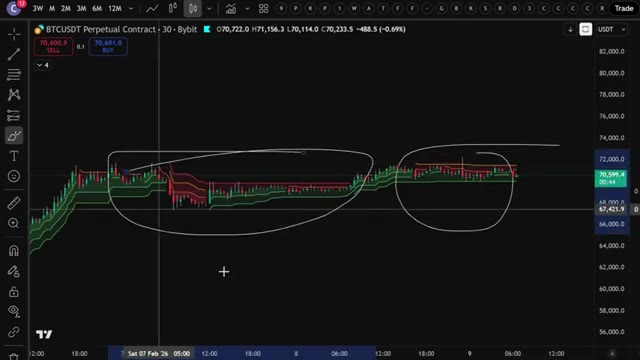
*⏱️ 00:05:13 — Un graphique de trading affichant des bougies japonaises et des lignes d'indicateur mixtes (vertes et rouges) sur le contrat BTCUSDT, avec des annotations entourant les zones de consolidation latérale.*

---

### ⏱️ `[00:05:38 - 00:06:13]` | Segment #12

**🔊 Audio (Transcription Intégrale Mot pour Mot en Français) :**
> façons de le faire. Une méthode consiste à définir un niveau de take profit avec un ratio de 1,5. Vous sortez du trade et sécurisez vos profits lorsque le prix atteint ce niveau. Une autre stratégie de sortie intervient lorsque l'une des lignes change de couleur. Ainsi, comme vous pouvez le voir ici, si vous étiez entré dans un trade lorsque toutes les lignes étaient vertes, vous auriez réalisé un profit significatif et vous sortiriez du trade une fois que l'une des lignes devient rouge. Passons à la deuxième stratégie, celle-ci consiste à associer l'indicateur Supertrend à une moyenne mobile sur 200 jours. Cette stratégie est puissante car l'indicateur Supertrend identifie efficacement les positions courtes

**👁️ Analyse Visuelle d'Écran (gemini-3.5-flash-lite) :**
**Interface & Outils** : TradingView / Bybit

**Contenu textuel & Code** : Graphique de prix BTCUSDT avec indicateur de tendance coloré (lignes rouges et vertes délimitant des canaux).

**Action / Démonstration** : Analyse graphique de la configuration des prix et des changements de couleur des lignes indicatrices pour illustrer la stratégie de sortie de trade.

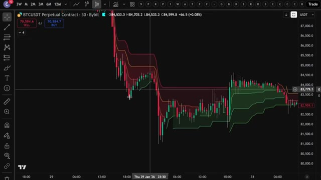
*⏱️ 00:05:47 — Graphique en chandeliers japonais du contrat perpétuel BTCUSDT sur un intervalle de 30 minutes, illustrant un indicateur technique de type canal/bandes avec des zones colorées en rouge et vert.*

---

### ⏱️ `[00:06:13 - 00:06:42]` | Segment #13

**🔊 Audio (Transcription Intégrale Mot pour Mot en Français) :**
> ...tendances à court terme. Bien que vous puissiez facilement identifier des tendances à long terme avec une moyenne mobile à 200 jours, allez dans l'onglet des indicateurs et ajoutez l'indicateur Supertrend au graphique en utilisant les paramètres par défaut. Ensuite, ajoutez une moyenne mobile exponentielle avec une longueur de 200. Pour modifier la longueur, vous pouvez cliquer ici dans les paramètres, cliquer ici sur les données d'entrée et modifier la longueur à 200. Maintenant, vous n'ouvrirez une position acheteuse que lorsque la ligne du Supertrend est verte et que le prix est au-dessus de la moyenne mobile à 200 jours.

**👁️ Analyse Visuelle d'Écran (gemini-3.5-flash-lite) :**
**Interface & Outils** : TradingView intégré à Bybit

**Contenu textuel & Code** : Graphique en chandeliers du contrat perpétuel BTCUSDT en unité de temps 30 minutes, avec la barre d'outils supérieure de TradingView visible.

**Action / Démonstration** : Le curseur se déplace pour cliquer sur l'onglet d'insertion des indicateurs techniques afin d'ajouter le Supertrend.

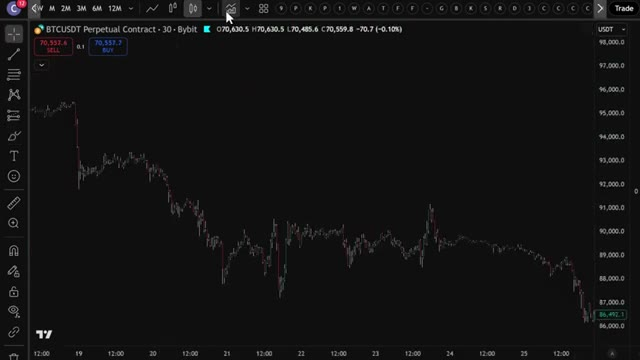
*⏱️ 00:06:21 — Capture d'écran montrant le curseur de la souris pointant vers l'onglet des indicateurs sur un graphique de trading.*

---

### ⏱️ `[00:06:42 - 00:07:15]` | Segment #14

**🔊 Audio (Transcription Intégrale Mot pour Mot en Français) :**
> Et vous n'ouvrirez une position courte que lorsque la ligne de super tendance est rouge et qu'elle se trouve en dessous de la moyenne mobile à 200 jours. Ici, vous pouvez voir que la ligne de super tendance est verte, mais le prix n'est pas au-dessus de la 200, vous pouvez donc attendre que le prix croise au-dessus de la 200 comme ici. Et si la ligne reste verte, c'est le moment idéal pour ouvrir une position longue. Vous pouvez régler le niveau de take profit à un ratio de 1,5, sortir du trade et sécuriser vos profits lorsque le prix atteint ce niveau, ou sortir du trade lorsque la ligne devient rouge comme je vous l'ai dit plus tôt. Un exemple différent est celui-ci où vous pouvez voir

**👁️ Analyse Visuelle d'Écran (gemini-3.5-flash-lite) :**
**Interface & Outils** : TradingView (interface graphique de trading).

**Contenu textuel & Code** : Paire BTCUSDT (Bybit, 30 min), Supertrend (zones colorées rouge/verte), moyenne mobile à 200 périodes (ligne bleue), avec une zone encerclée montrant un changement de signal de tendance.

**Action / Démonstration** : Analyse technique du graphique pour expliquer les conditions d'ouverture d'une position courte (short) en fonction de la position du prix par rapport à la moyenne mobile et à la Supertrend.

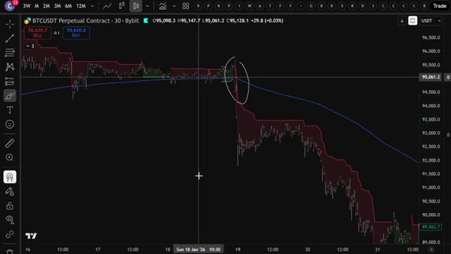
*⏱️ 00:06:50 — Graphique en chandeliers japonais du contrat perpétuel BTCUSDT sur un intervalle de 30 minutes, illustrant une configuration de trading avec la Supertrend et une moyenne mobile.*

---

### ⏱️ `[00:07:15 - 00:07:48]` | Segment #15

**🔊 Audio (Transcription Intégrale Mot pour Mot en Français) :**
> que la ligne super trend est rouge mais vous devez attendre jusqu'à ce que le prix chute en dessous de la moyenne mobile à 200 jours et si la ligne reste rouge c'est le moment d'ouvrir une position short en passant à notre troisième et dernière stratégie cela implique d'utiliser l'indicateur ichimoku donc allez dans l'onglet des indicateurs tapez ichimoku et sélectionnez celui-ci ici ses paramètres par défaut sont désordonnés donc pour faciliter la lecture vous pouvez modifier en décortiquant les cases ici et changer ces arrière-plans de tracé en violet mais comment ça fonctionne cette zone violette est le nuage Kumo vous n'ouvrirez une position long que si le

**👁️ Analyse Visuelle d'Écran (gemini-3.5-flash-lite) :**
**Interface & Outils** : TradingView / Bybit

**Contenu textuel & Code** : Paire BTCUSDT, chandelier en unité de temps 30 minutes, ligne Supertrend rouge, moyenne mobile bleue (200 jours), et zones de positions/backtest (rectangles vert et rouge).

**Action / Démonstration** : Analyse graphique de la stratégie combinant le Supertrend rouge et le passage du prix sous la moyenne mobile pour initier une position short.

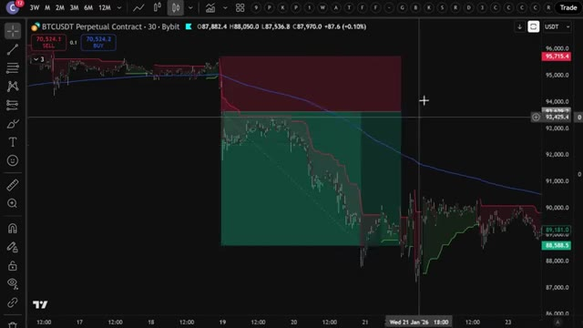
*⏱️ 00:07:23 — Graphique de trading montrant le contrat perpétuel BTCUSDT sur Bybit avec une ligne Supertrend rouge et une moyenne mobile.*

---

### ⏱️ `[00:07:48 - 00:08:22]` | Segment #16

**🔊 Audio (Transcription Intégrale Mot pour Mot en Français) :**
> La ligne Supertrend est verte et le prix est au-dessus du nuage Kumo. Ne prenez pas de position si le prix est à l'intérieur ou en dessous du nuage Kumo, et vous n'ouvrirez une position short que lorsque la ligne Supertrend sera rouge et que le prix sera en dessous du nuage Kumo. Vous pouvez voir ici que la ligne Supertrend est verte mais que le prix est actuellement en dessous du nuage Kumo, vous devez donc patienter. Alors que le prix entre dans le nuage Kumo, je vous recommandes d'attendre qu'il remonte au-dessus du nuage Kumo. Une fois qu'il dépasse le nuage Kumo, assurez-vous que la ligne Supertrend reste verte et vous pourrez alors entrer sur votre

**👁️ Analyse Visuelle d'Écran (gemini-3.5-flash-lite) :**
**Interface & Outils** : TradingView / Bybit

**Contenu textuel & Code** : Supertrend (10, 3), Ichimoku Cloud (9, 26, 52, 26), paires BTCUSDT Perpetual 30 min.

**Action / Démonstration** : Analyse de la position du prix par rapport au nuage Kumo et à la ligne Supertrend pour déterminer les conditions d'achat (long).

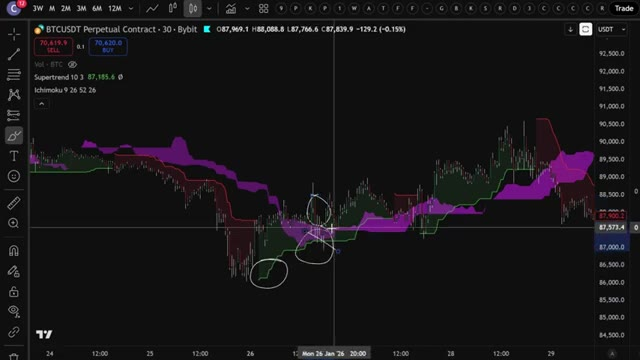
*⏱️ 00:07:56 — Graphique TradingView en unités de 30 minutes montrant le contrat perpétuel BTCUSDT sur Bybit, avec les indicateurs Supertrend et Ichimoku (Kumo) affichés et des zones entourées pour illustrer la stratégie.*

---

### ⏱️ `[00:08:22 - 00:08:49]` | Segment #17

**🔊 Audio (Transcription Intégrale Mot pour Mot en Français) :**
> position longue. Je vais vous montrer un autre exemple. Vous pouvez voir ici que la ligne super trend est rouge. Avant d'entrer dans le trade, vous devez attendre que le prix chute en dessous du nuage Kumo. Pour la stratégie de sortie, vous pouvez également définir un niveau de take profit à un ratio de profit de 1,5 ou sortir du trade une fois que le prix pénètre à l'intérieur du nuage Kumo. Rappelez-vous simplement que cette stratégie fonctionne beaucoup mieux si vous utilisez Bybit ou BingX plutôt que d'autres bourses. Assurez-vous donc de cliquer sur mes liens ci-dessous.

**👁️ Analyse Visuelle d'Écran (gemini-3.5-flash-lite) :**
**Interface & Outils** : Interface graphique de trading (TradingView / Bybit).

**Contenu textuel & Code** : Supertrend, Ichimoku (9, 26, 52, 26), paires BTCUSDT Perpetual Contract.

**Action / Démonstration** : Analyse d'une configuration de vente (short) avec le passage du prix sous le nuage Kumo.

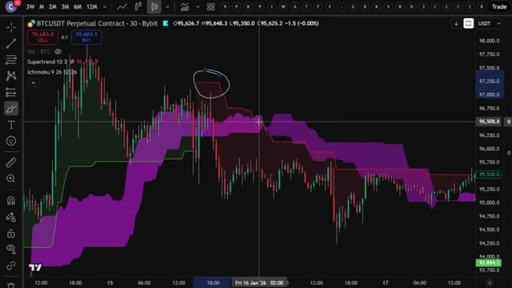
*⏱️ 00:08:29 — Graphique de trading montrant le prix du BTCUSDT avec l'indicateur Supertrend et le nuage Ichimoku (Kumo) sur une interface similaire à TradingView/Bybit.*

---

### ⏱️ `[00:08:50 - 00:09:23]` | Segment #18

**🔊 Audio (Transcription Intégrale Mot pour Mot en Français) :**
> Donc maintenant vous comprenez exactement comment ces trois stratégies fonctionnent manuellement. Mais c'est là que ça devient vraiment intéressant. Au lieu de surveiller des graphiques toute la journée et de faire ça à la main, j'ai donné chacune de ces stratégies exactes à Claude et je lui ai demandé de m'écrire un script Pine complet pour chacune, afin que TradingView puisse détecter automatiquement ces signaux pour moi, peu importe la stratégie que je souhaite utiliser. Commençons par la stratégie numéro une, le triple super trend. Voici le prompt exact que j'ai utilisé. Je vais l'afficher à l'écran dès maintenant pour que vous puissiez le copier exactement. Ce prompt exact

**👁️ Analyse Visuelle d'Écran (gemini-3.5-flash-lite) :**
**Interface & Outils** : TradingView, Windows PowerShell (Claude Code)

**Contenu textuel & Code** : Code Pine Script v5, indicateur Supertrend, EMA 200, règles d'entrée/sortie, paramètres ATR.

**Action / Démonstration** : Génération et configuration d'un script de stratégie de trading via l'assistant IA Claude.

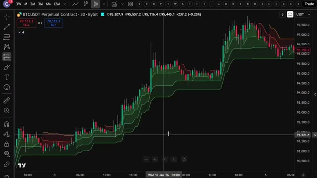
*⏱️ 00:08:58 — Graphique de trading en chandeliers montrant l'indicateur Supertrend sur une paire crypto.*

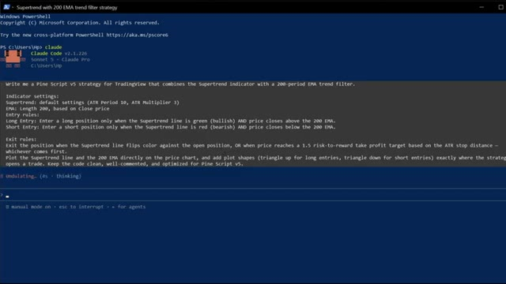
*⏱️ 00:09:07 — Interface de terminal Windows PowerShell affichant l'outil Claude Code en cours d'utilisation avec un prompt de génération de stratégie Pine Script.*

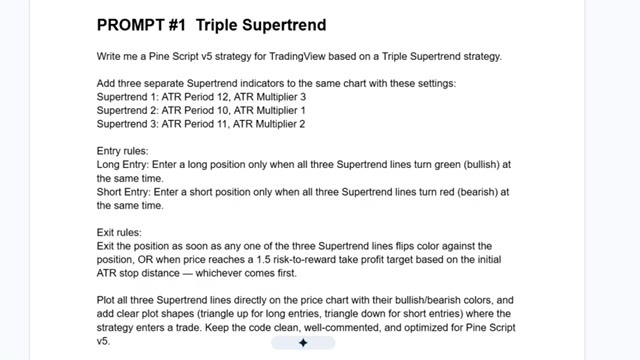
*⏱️ 00:09:15 — Document textuel présentant le prompt #1 pour une stratégie "Triple Supertrend" avec règles d'entrée et de sortie détaillées.*

---

### ⏱️ `[00:09:23 - 00:10:00]` | Segment #19

**🔊 Audio (Transcription Intégrale Mot pour Mot en Français) :**
> ainsi que le script Pine utilisé dans cette vidéo est disponible dans mon groupe privé. Vous trouverez le lien ci-dessous. Ouvrez TradingView, allez sur n'importe quel graphique, je vais utiliser Bitcoin à nouveau et en bas à droite de l'écran, cliquez sur l'onglet Éditeur Pine. Sélectionnez tout le code par défaut, supprimez-le et collez ce script Pine. Cliquez sur "Ajouter au graphique" et, comme par magie, TradingView le compile et trace les trois lignes SuperTrend directement sur les bougies avec des triangles verts et rouges indiquant exactement où la stratégie serait entrée. Maintenant, pour la stratégie numéro deux, le SuperTrend plus l'EMA 200. Même processus. Voici la consigne. Collez ceci dans un

**👁️ Analyse Visuelle d'Écran (gemini-3.5-flash-lite) :**
**Interface & Outils** : TradingView (interface web de graphiques boursiers).

**Contenu textuel & Code** : Graphique de prix du Bitcoin (BTCUSDT Perpetual Contract), unité de temps 2h, affichant les bougies vertes et rouges ainsi que l'histogramme de volume en bas, avec une infobulle indiquant « Change symbol ».

**Action / Démonstration** : Sélection ou survol du symbole du graphique pour choisir une crypto-monnaie (Bitcoin), conformément aux instructions audio.

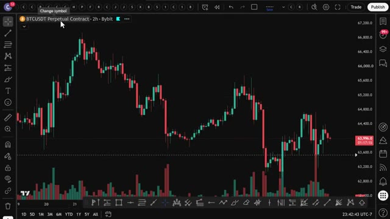
*⏱️ 00:09:32 — Graphique en chandeliers japonais affichant la paire BTCUSDT sur l'unité de temps 2 heures (Bybit) dans l'interface de TradingView.*

---

### ⏱️ `[00:10:00 - 00:10:37]` | Segment #20

**🔊 Audio (Transcription Intégrale Mot pour Mot en Français) :**
> Nouvel onglet de l'éditeur Pine, cliquez sur Ajouter au graphique, et maintenant vous avez la moyenne mobile exponentielle à 200 périodes tracée avec la ligne Super Trend. Et la stratégie marque automatiquement chaque base acheteuse et vendeuse sur ce filtre de tendance. Et enfin, stratégie numéro trois, Super Trend plus nuage Ichimoku. Voici ce script. Collez-le, appuyez sur Ajouter au graphique, et maintenant le nuage Kumo est ombré directement sur votre graphique avec des signaux d'achat et de vente qui se déclenchent dès que le prix passe au-dessus ou en dessous. Maintenant, pour n'importe laquelle de ces trois stratégies, vous pouvez cliquer sur le testeur de stratégie et voir le test rétrospectif complet. Taux de réussite, facteur de profit, courbe de capital, tout y est.

**👁️ Analyse Visuelle d'Écran (gemini-3.5-flash-lite) :**
**Interface & Outils** : TradingView, Explorateur de fichiers Windows

**Contenu textuel & Code** : Paire BTCUSDT.P (2h, Bybit), indicateurs ST+EMA200 et ST+Ichimoku, repères BUY/SELL/TP/SL, fichiers de stratégie (.txt, .py, .pine, .json)

**Action / Démonstration** : Visualisation des signaux générés par la stratégie Supertrend + EMA 200 sur TradingView, navigation dans les scripts de trading, puis test visuel de la stratégie Supertrend + Ichimoku.

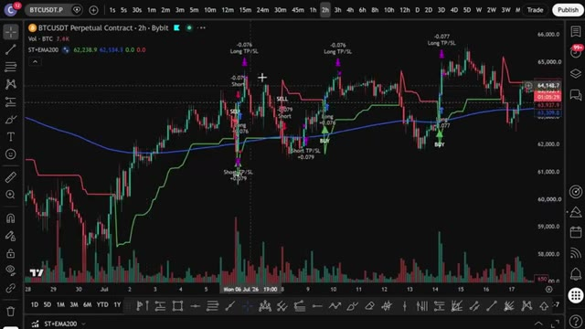
*⏱️ 00:10:10 — Graphique TradingView de BTCUSDT (unité de temps 2h sur Bybit) affichant l'indicateur ST+EMA200 avec le tracé de la moyenne mobile 200, du Supertrend et les repères de signaux Achat/Vente (BUY/SELL) avec TP/SL.*

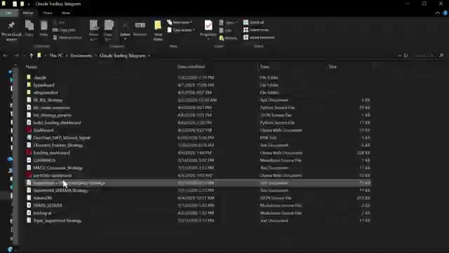
*⏱️ 00:10:19 — Fenêtre de l'explorateur de fichiers Windows montrant le dossier "Claude Trading Telegram" avec les fichiers de stratégies et scripts Python/Pine Script.*

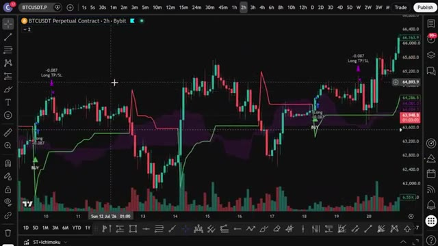
*⏱️ 00:10:28 — Graphique TradingView de BTCUSDT (unité de temps 2h sur Bybit) montrant la stratégie Supertrend associée au nuage Ichimoku (ST+Ichimoku) avec les signaux d'entrée et de sortie affichés.*

---

### ⏱️ `[00:10:37 - 00:11:11]` | Segment #21

**🔊 Audio (Transcription Intégrale Mot pour Mot en Français) :**
> Donc vous savez exactement comment cette stratégie aurait fonctionné historiquement avant de risquer un seul dollar. Et si vous ouvrez le testeur et que vous n'aimez pas ce que vous voyez, peut-être que le taux de réussite n'est pas assez élevé sur la version Ichimoku ou que la courbe de capital sur le triple super trend n'est pas aussi lisse que vous le souhaitez. Ne stressez pas. C'est tout à fait normal. Chaque condition de marché est différente et c'est là que vous la personnalisez. Retournez simplement voir Claude et affinez le prompt. Dites-lui. Ajoutez un filtre RSI pour ne pas entrer quand le marché est suracheté. Réinjectez cela dans Claude, copiez le nouveau code, collez

**👁️ Analyse Visuelle d'Écran (gemini-3.5-flash-lite) :**
**Interface & Outils** : TradingView, Terminal CLI (Claude Code)

**Contenu textuel & Code** : Paire BTCUSDT.P 6h (Bybit), indicateurs Supertrend / Ichimoku, signaux BUY/SELL, prompt CLI : "Add an RSI filter so we don't enter when the market's overbought."

**Action / Démonstration** : Analyse visuelle du comportement des signaux sur le graphique de prix et ajout d'une condition de filtrage RSI dans le code via le terminal de l'assistant IA.

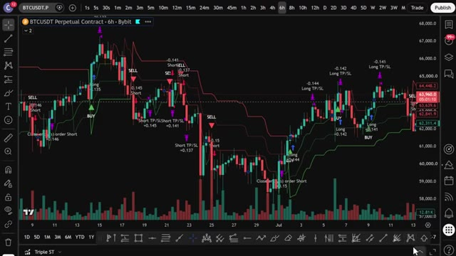
*⏱️ 00:10:46 — Graphique TradingView (BTCUSDT 6h sur Bybit) affichant les signaux d'entrée et de sortie (BUY, SELL, TP/SL) d'une stratégie automatisée.*

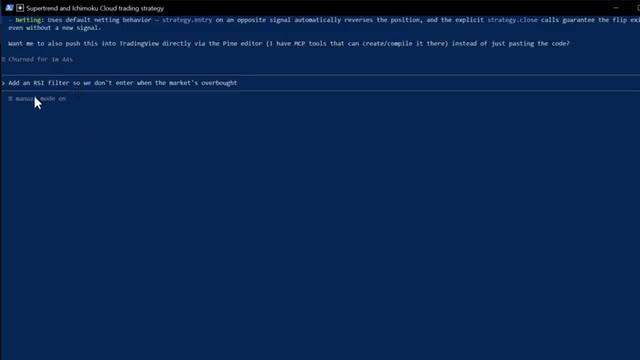
*⏱️ 00:11:02 — Interface terminal CLI de Claude Code recevant un prompt pour ajouter un filtre RSI à la stratégie Supertrend / Ichimoku Cloud.*

---

### ⏱️ `[00:11:11 - 00:11:47]` | Segment #22

**🔊 Audio (Transcription Intégrale Mot pour Mot en Français) :**
> l'intégrer, cliquer sur enregistrer, et continuer à répéter cela jusqu'à ce que la courbe de capital commence à grimper de la manière que vous voulez. Une fois que vous avez affiné la stratégie qui correspond le mieux à votre style, configurez des alertes pour ne jamais manquer un signal. Cliquez sur l'icône du réveil en haut de TradingView ou faites un clic droit sur l'une des formes de signal et sélectionnez "ajouter une alerte", puis définissez vos conditions. TradingView vous avertira à la seconde où l'une de ces trois stratégies émet un signal directement sur votre téléphone. Ainsi, au lieu de rester assis là pendant des heures à attendre que la tendance s'aligne, le code fait tout le travail difficile pour les trois stratégies en même temps. Dès que les conditions sont réunies, boum, vous recevez l'alerte, vous exécutez et vous êtes

**👁️ Analyse Visuelle d'Écran (gemini-3.5-flash-lite) :**
**Interface & Outils** : TradingView

**Contenu textuel & Code** : Paire BTCUSDT.P, indicateurs Supertrend/Ichimoku/RSI/EMA200, métriques de backtesting (Max drawdown 43.49%, CAGR 4.15%).

**Action / Démonstration** : Visualisation des signaux de stratégie sur graphique et analyse des métriques de performance globales.

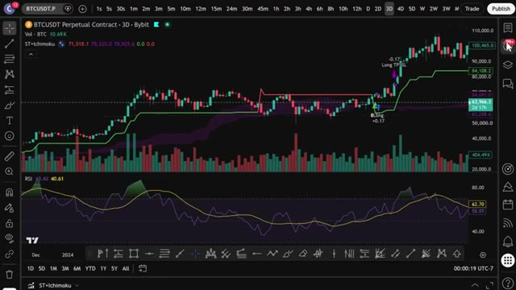
*⏱️ 00:11:20 — Graphique TradingView 3D BTCUSDT affichant les indicateurs Supertrend, Ichimoku et RSI avec signaux d'achat/vente.*

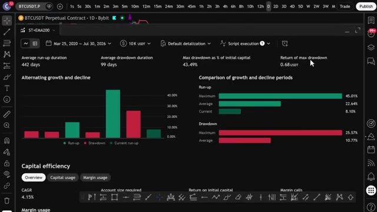
*⏱️ 00:11:38 — Tableau de bord de backtest TradingView affichant les statistiques de performance et de drawdown de la stratégie.*

---

### ⏱️ `[00:11:47 - 00:12:05]` | Segment #23

**🔊 Audio (Transcription Intégrale Mot pour Mot en Français) :**
> C'est fait. Maintenant, si vous voulez aller encore plus loin et faire en sorte qu'un trade s'ouvre automatiquement sur votre exchange dès qu'un signal se déclenche, j'ai ce qu'il vous faut. J'ai mis en place un groupe privé où je partage tous mes cas d'usage de Claude Code, de son intégration avec Telegram et TradingView jusqu'à la recherche de baleines sur Hyperliquid. Tout cela de façon automatique.

**👁️ Analyse Visuelle d'Écran (gemini-3.5-flash-lite) :**
**Interface & Outils** : TradingView, Whop, Telegram (ClaudeTelegramBot)

**Contenu textuel & Code** : - TradingView : Paire BTCUSDT.P (Perpetual Contract 2h sur Bybit), indicateur ST+EMA200, signaux BUY / SELL et niveaux de Take Profit / Stop Loss (Long TP/SL, Short TP/SL).
- Whop : Offre "AI Trade Edge" par Alex Carter ($79.99/month), accès aux bots de trading IA, templates et guides.
- Telegram : Instructions du bot `ClaudeTelegramBot` (`To pair: DM me anything — you'll get a 6-char code`, `/telegram:access pair <code>`), commandes `/start` et `/status`, message de validation "Paired! Say hi to Claude."

**Action / Démonstration** : Démonstration de signaux techniques sur un graphique Bitcoin, présentation du groupe privé sur Whop, puis configuration et appairage d'un bot Telegram lié à Claude Code.

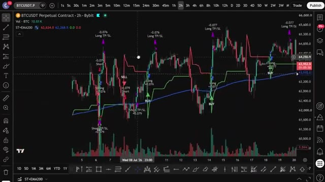
*⏱️ 00:11:52 — Graphique TradingView en unités de temps 2h pour la paire BTCUSDT (Bybit), affichant l'indicateur ST+EMA200 et divers signaux d'achat et de vente.*

*⏱️ 00:11:56 — Page de la plateforme Whop présentant l'espace privé "AI Trade Edge" d'Alex Carter au tarif de 79.99 $/mois.*

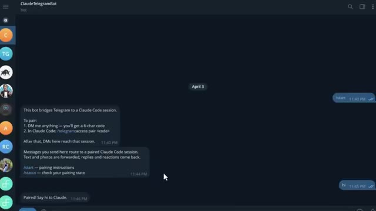
*⏱️ 00:12:01 — Interface Telegram affichant une discussion avec le bot "ClaudeTelegramBot" permettant de connecter Telegram à une session Claude Code.*

---

### ⏱️ `[00:12:06 - 00:12:30]` | Segment #24

**🔊 Audio (Transcription Intégrale Mot pour Mot en Français) :**
> Tout ce que je vous ai montré aujourd'hui, tout est dans le groupe. Et j'ajoute constamment de nouvelles choses, de nouvelles stratégies, de nouveaux prompts, de nouvelles intégrations. Chaque fois que je crée quelque chose de nouveau, cela va directement là-dedans. Le prix est de 79,99 $ par mois. Et honnêtement, quand vous pensez à ce que c'est vraiment, la configuration de trading par IA la plus à la pointe de la technologie disponible pour les traders particuliers en ce moment, constamment mise à jour avec tout d'inclus.

**👁️ Analyse Visuelle d'Écran (gemini-3.5-flash-lite) :**
**Interface & Outils** : Plateforme d'abonnement Whop et pages web de documentation des outils de trading.

**Contenu textuel & Code** : Tarification d'abonnement à 79,99 $/mois et descriptifs de fonctionnalités d'IA pour le trading.

**Action / Démonstration** : Présentation commerciale de la communauté et des outils d'abonnement.

*⏱️ 00:12:18 — Page de la plateforme Whop affichant l'offre "AI Trade Edge" d'Alex Carter au prix de 79,99 $ par mois.*

---

### ⏱️ `[00:12:31 - 00:12:54]` | Segment #25

**🔊 Audio (Transcription Intégrale Mot pour Mot en Français) :**
> À l'intérieur, il y a aussi un cours complet de trading agentique. 2,5 heures. De débutant à expert. Aucune expérience en programmation n'est nécessaire. À la fin, vous aurez votre propre système de trading IA fonctionnant en direct. Quelque chose que la plupart des traders particuliers ne savent même pas être possible à l'heure actuelle. 79,99 $ par mois. Un seul bon trade le rembourse. Et les 100 premiers membres bloquent ce tarif de manière permanente.

**👁️ Analyse Visuelle d'Écran (gemini-3.5-flash-lite) :**
**Interface & Outils** : Interface web de cours en ligne et plateforme de vente Whop

**Contenu textuel & Code** : Liste des modules de formation (Hyperliquid Whale Tracker, TradingView MCP, Firecrawl MCP, Claude Routines, Pine Script backtest, Telegram Control Plane, WEEX Webhook)

**Action / Démonstration** : Présentation du programme du cours complet de trading agentique et des différents modules disponibles pour les utilisateurs.

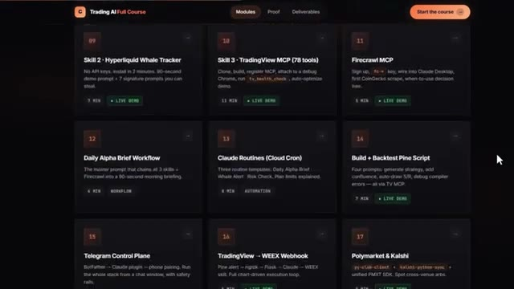
*⏱️ 00:12:37 — Interface de la plateforme montrant les modules de formation du cours "Trading AI Full Course" avec des leçons numérotées sur le trading agentique et l'automatisation.*

---

### ⏱️ `[00:12:54 - 00:13:30]` | Segment #26

**🔊 Audio (Transcription Intégrale Mot pour Mot en Français) :**
> Après cela, le prix augmente. Le lien est dans la description. Vous ne pouvez vraiment pas vous permettre de rater ça. Et c'est exactement comme ça que j'ai automatisé ces trois stratégies super trend en utilisant Claude. Pas de codage, pas de bot Discord à 100 $, juste l'IA qui fait le plus gros du travail. Si vous voulez vraiment les mettre en pratique, assurez-vous d'utiliser Bybit ou BingX. Car ces stratégies y fonctionnent bien plus fluidement que sur la plupart des autres plateformes. Les liens sont ci-dessous et vous pouvez obtenir jusqu'à 30 000 USDT et des bonus sur Bybit. Si vous voulez voir une démonstration complète de la façon dont je trade en utilisant uniquement mon Telegram,

**👁️ Analyse Visuelle d'Écran (gemini-3.5-flash-lite) :**
**Interface & Outils** : TradingView et la plateforme d'échange BingX.

**Contenu textuel & Code** : Graphique de prix cryptographique avec indicateur Super Trend ("Triple ST") et signaux d'exécution (Buy, Sell, TP/SL). Interface d'inscription avec champs email/mot de passe et bonus de bienvenue.

**Action / Démonstration** : Présentation d'un graphique de trading automatisé suivi d'une promotion de la plateforme partenaire BingX.

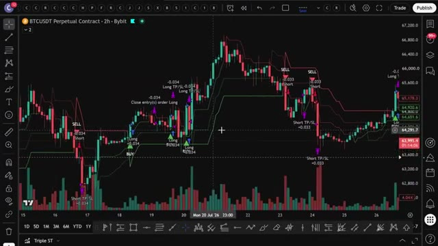
*⏱️ 00:13:03 — Un graphique TradingView affichant le cours BTCUSDT en unités de 2 heures sur Bybit, intégrant une stratégie Super Trend automatisée avec des signaux d'achat et de vente.*

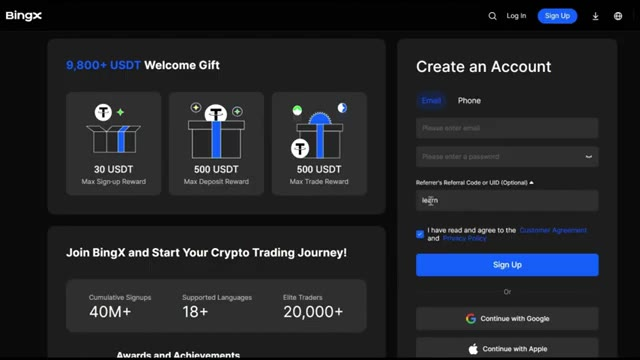
*⏱️ 00:13:21 — La page d'inscription de la plateforme d'échange de cryptomonnaies BingX, mettant en avant un bonus de bienvenue et un formulaire de création de compte.*

---

### ⏱️ `[00:13:30 - 00:13:59]` | Segment #27

**🔊 Audio (Transcription Intégrale Mot pour Mot en Français) :**
> la démo complète de tous les cas d'utilisation sur TradingView, et comment je suis automatiquement les plus gros trades des baleines sur Hyperliquid, cliquez sur la vidéo qui apparaît à l'écran dès maintenant. Et si vous voulez le guide complet étape par étape sur la façon de construire votre propre système de trading agentique avec Claude, cette vidéo apparaît également à l'écran. Allez voir ça ensuite. Si vous avez trouvé cela utile, laissez un pouce bleu. Ça aide vraiment la chaîne. Abonnez-vous si ce n'est pas déjà fait, et je vous vois dans la prochaine.

**👁️ Analyse Visuelle d'Écran (gemini-3.5-flash-lite) :**
**Interface & Outils** : Plateforme de trading décentralisée Hyperliquid.

**Contenu textuel & Code** : Graphique de prix journalier (1D) de la paire HYPE/USDC, carnet d'ordres (Order Book) en temps réel, indicateur de volume (Volume SMA), et données de marché (prix actuel autour de 36.27 USD).

**Action / Démonstration** : Navigation et affichage de l'interface de trading d'Hyperliquid pour analyser les prix et le carnet d'ordres.

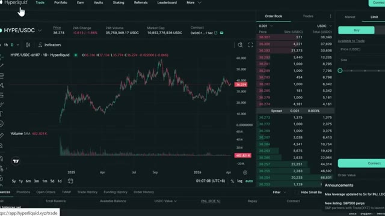
*⏱️ 00:13:37 — Interface de trading de la plateforme Hyperliquid montrant le graphique en chandeliers de la paire HYPE/USDC, avec le carnet d'ordres à droite et les volumes en bas.*

---

