# 🎬 How I Turned My Trading System Into a 24/7 AI Autopilot Using Claude

> **Chaîne** : [Alex Carter](https://www.youtube.com/@AlexCarterTrading)  
> **Lien YouTube** : [https://www.youtube.com/watch?v=bH6QId7TDaQ](https://www.youtube.com/watch?v=bH6QId7TDaQ)  
> **Date de publication** : 20260812  
> **Durée** : 00:11:50  
> **Identifiant vidéo** : `bH6QId7TDaQ`  
> **Transcription & Analyse** : `whisper-v3-large-turbo+gemini-3.5-flash-lite`  

---

## 📌 Synthèse Exécutive & Outils

### 💡 Résumé

Cette vidéo présente une transformation radicale du trading de cryptomonnaies grâce à l'intégration d'une intelligence artificielle avancée, orchestrée par Claude et Claude Code. L'auteur démontre comment automatiser l'intégralité d'un système de trading pour le faire tourner en pilote automatique 24h/24 et 7j/7 sur un serveur cloud distant, s'affranchissant ainsi de la surveillance constante des graphiques et des transactions manquées. Le système combine l'analyse technique automatisée, la génération de scripts de trading, l'exécution d'ordres via des webhooks et le suivi en temps réel du marché.

Au cœur de cette architecture, l'IA interprète l'historique des prix pour tracer instantanément des supports et résistances, rédige et débogue des stratégies en Pine Script, et réalise des analyses de confluence multi-périodes (hebdomadaire, journalier, 4h, 1h). La démonstration en direct prouve la puissance de l'outil : d'un simple prompt textuel ou via une interface Telegram, il est possible d'ouvrir des positions avec effet de levier, de définir des stop-loss et des take-profit, et d'extraire des tableaux de bord financiers complets comprenant courbes de capital, taux de réussite et frais de financement.

Enfin, la vidéo explore des stratégies quantitatives avancées, telles que le *funding rate farming* (capture des taux de financement positifs ou négatifs) et le *whale tracking* (suivi des portefeuilles intelligents). En analysant les données publiques de 33 000 adresses sur la plateforme décentralisée Hyperliquid, l'IA compare les comportements des 20 traders les plus rentables par rapport aux plus perdants. Cette analyse croisée permet d'identifier les divergences de positionnement institutionnel pour générer des signaux à forte conviction, le tout synthétisé dans un rapport alpha matinal automatisé.

### 🛠️ Outils, Modèles & Logiciels Présentés

* **Claude / Claude Code** : Modèle linguistique de pointe et environnement de développement en ligne de commande utilisé pour coder, analyser les marchés, automatiser les bots et interpréter les données on-chain en langage naturel.
* **TradingView** : Plateforme de cartographie financière et d'analyse technique utilisée pour exécuter des scripts Pine Script et relayer des signaux de trading en temps réel via des webhooks.
* **Pine Script** : Langage de programmation propriétaire de TradingView utilisé pour concevoir, tester et automatiser des stratégies et indicateurs techniques personnalisés.
* **Hyperliquid** : Échange perpétuel décentralisé (DEX) fonctionnant sur sa propre blockchain, sans KYC, dont la transparence totale de l'historique des transactions permet d'analyser les portefeuilles des meilleures baleines.
* **Telegram** : Application de messagerie instantanée transformée ici en interface de commande mobile pour exécuter des trades, recevoir des alertes en temps réel et scanner les opportunités de marché à distance.
* **Serveur Cloud (VPS)** : Infrastructure d'hébergement distante assurant l'exécution ininterrompue 24h/24 et 7j/7 des bots de trading, avec des mécanismes de redémarrage automatique en cas de panne.

### 🔑 Points Clés & Enseignements Stratégiques

* **Automatisation complète du cycle de trading** : Le système s'affranchit des contraintes humaines en lisant les graphiques, en exécutant les ordres, en gérant le risque (stop-loss et take-profit) et en envoyant des rapports quotidiens de manière totalement autonome.
* **Réduction drastique du temps d'analyse** : Des tâches chronophages comme le tracé manuel des supports/résistances ou l'analyse multi-période, qui prenaient auparavant des dizaines de minutes, sont exécutées par l'IA en quelques secondes.
* **Interface de commande en langage naturel** : La possibilité d'ouvrir une position (ex: long x5 sur ETH avec gestion du risque) ou d'extraire un tableau de bord financier complet à partir d'une simple phrase simplifie radicalement l'interaction avec les marchés.
* **Exploitation des taux de financement (*Funding Rate Farming*)** : Le scanner automatisé identifie les paires présentant les rendements annualisés les plus élevés (50 % à 100%+) pour permettre aux traders de percevoir des paiements réguliers toutes les huit heures sans spéculer sur la direction des prix.
* **Analyse on-chain et suivi des « baleines » (*Whale Tracking*)** : L'extraction et le classement des 33 000 portefeuilles d'Hyperliquid permettent d'isoler les 20 traders les plus rentables pour copier ou anticiper leurs mouvements d'achat et de vente en temps réel.
* **Détection des divergences de marché** : Le croisement des positions entre les portefeuilles les plus rentables et les plus perdants met en lumière les « trades encombrés » (consensus) et les divergences stratégiques majeures (ex: l'argent intelligent achète ce que les particuliers vendent).
* **Exécution cloud sécurisée et résiliente** : Le bot de trading ne tourne pas sur un ordinateur portable personnel mais sur un serveur cloud distant, garantissant une continuité de service 24/7 même en cas de coupure de courant ou de Wi-Fi.
* **Brief alpha quotidien matinal** : Un rapport automatisé est généré et envoyé chaque matin avant l'ouverture de la session, synthétisant l'état des baleines, l'analyse graphique et la configuration à plus forte conviction dimensionnée selon le profil de risque exact.
* **Intégration transparente via Webhooks** : La liaison directe entre les alertes de stratégies générées sur TradingView et l'exchange permet une exécution instantanée des ordres sans latence humaine.
* **Compression du temps de développement** : Des projets qui prenaient autrefois des semaines ou des mois de codage peuvent désormais être développés et déployés en une seule après-midi grâce aux capacités de programmation de Claude Code.
* **Changement de paradigme sur l'avantage concurrentiel** : En quantitatif, l'avantage ne réside pas dans la détention d'une stratégie parfaite dès le départ, mais dans la capacité à tester itérativement un grand nombre d'idées assez rapidement pour identifier celles qui fonctionnent.

---

## ⏱️ Chronologie & Transcription Complète Audio & Visuelle (Mot pour Mot)

### ⏱️ `[00:00:00 - 00:00:35]` | Segment #01

**🔊 Audio (Transcription Intégrale Mot pour Mot en Français) :**
> Dans cette vidéo, je vais vous montrer exactement comment j'ai transformé tout mon système de trading en un pilote automatique IA 24h/24 et 7j/7 en utilisant Claude. Et je vais vous le prouver dès maintenant, en direct sur mon propre compte, ce qui signifie plus besoin de fixer des graphiques toute la journée et plus de transactions manquées pendant que vous dormez. Maintenant, tout ce système peut lire mes graphiques, exécuter mes transactions, gérer mon risque et m'envoyer un rapport complet chaque matin, entièrement de manière autonome. Je vais vous montrer comment il fonctionne, où l'obtenir et les trois outils exacts que j'utilise pour construire ceci étape par étape afin que vous puissiez construire le même système pour

**👁️ Analyse Visuelle d'Écran (gemini-3.5-flash-lite) :**
**Interface & Outils** : Terminal de commande (Claude Code)

**Contenu textuel & Code** : Informations de version (Claude Code v2.1.91, Opus 4.6, 1M context, Claude Max) et invite de commande active.

**Action / Démonstration** : Affichage du terminal prêt pour la saisie de commandes ou de prompts pour l'automatisation.

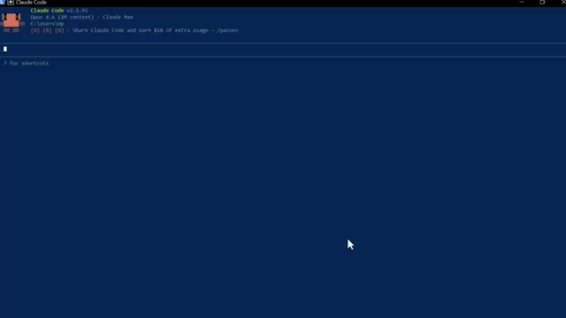
*⏱️ 00:00:09 — Capture d'écran montrant l'interface en ligne de commande de l'outil Claude Code.*

---

### ⏱️ `[00:00:35 - 00:01:09]` | Segment #02

**🔊 Audio (Transcription Intégrale Mot pour Mot en Français) :**
> vous-même donc entrons dans le vif du sujet maintenant avant de vous montrer les outils je veux rapidement vous dire pourquoi je construis réellement ceci je fais du trading de crypto depuis des années je gère une chaîne axée sur les cryptomonnaies je partage des stratégies des guides des comparatifs chaque jour et je m'en sors bien mais j'ai toujours su que les traders qui gagnent vraiment au plus haut niveau ne se contentent pas de lire les graphiques mieux que tout le monde. Ils ont des systèmes, ils ont de l'automatisation, ils ont un avantage qui se compose au fil du temps. Donc ce n'est pas seulement une vidéo sur

**👁️ Analyse Visuelle d'Écran (gemini-3.5-flash-lite) :**
**Interface & Outils** : Interface de trading WEEX, site web "Exchange Comparer".

**Contenu textuel & Code** : Graphiques de prix cryptos, carnet d'ordres, détails de position ETH/USDT, scores d'évaluation d'échange crypto.

**Action / Démonstration** : Navigation sur une plateforme de comparaison d'échanges et consultation d'une interface de trading de crypto-monnaies.

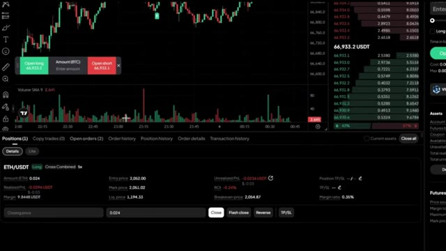
*⏱️ 00:00:43 — Interface de trading affichant un graphique de prix avec des bougies, un carnet d'ordres et une position ouverte sur ETH/USDT.*

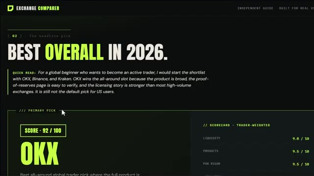
*⏱️ 00:00:52 — Page web d'un comparateur d'échanges de cryptomonnaies présentant le classement et le score de la plateforme OKX.*

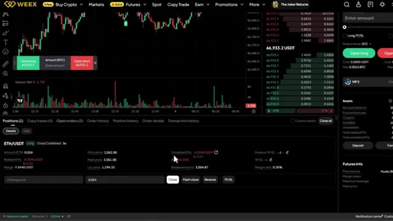
*⏱️ 00:01:00 — Interface de la plateforme de trading WEEX montrant des graphiques de marché et les détails d'une position ouverte.*

---

### ⏱️ `[00:01:09 - 00:01:41]` | Segment #03

**🔊 Audio (Transcription Intégrale Mot pour Mot en Français) :**
> Outils d'IA. C'est moi qui vous montre exactement ce que je suis en train de construire en ce moment et pourquoi je crois sincèrement que c'est ainsi que je vais atteindre mon premier million. Et je veux vous emmener avec moi à chaque étape. Alors laissez-moi vous montrer à quoi cela ressemble exactement. La première chose que je veux vous montrer, et c'est celle qui m'a vraiment époustouflé la première fois que je l'ai vue, Claude lit l'historique des prix, identifie les niveaux les plus significatifs, les trace directement sur votre graphique et vous dit lesquels comptent le plus en ce moment, regardez le graphique, lignes vertes pour le support, lignes rouges pour

**👁️ Analyse Visuelle d'Écran (gemini-3.5-flash-lite) :**
**Interface & Outils** : Plateforme d'échange crypto WEEX et terminal de commande Claude Code.

**Contenu textuel & Code** : Graphique en chandeliers BTC/USDT, indicateurs de volume, carnet d'ordres, informations de funding rate et interface CLI Claude Code.

**Action / Démonstration** : Navigation sur la plateforme de trading et utilisation de l'outil de développement en ligne de commande.

*⏱️ 00:01:17 — Interface de la plateforme de trading WEEX affichant un graphique de prix BTC/USDT, un carnet d'ordres et les détails du compte.*

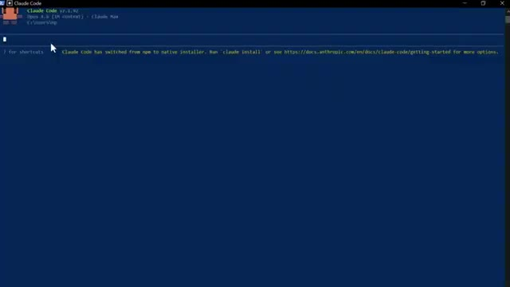
*⏱️ 00:01:25 — Terminal de commande affichant l'interface de Claude Code v1.1.92 avec un message d'installation native.*

---

### ⏱️ `[00:01:41 - 00:02:14]` | Segment #04

**🔊 Audio (Transcription Intégrale Mot pour Mot en Français) :**
> les étiquettes de prix de résistance le nombre de fois que chaque niveau a été testé tout est tracé automatiquement et ensuite il vous indique exactement où se situe le prix en ce moment par rapport à ces niveaux et vous donne un biais directionnel basé sur l'historique de la façon dont le prix a réagi à chacun d'eux. Cela me prenait 20 minutes à tracer manuellement sur chaque graphique. Claude le fait en quelques secondes. Et ce n'est que le point de départ. Vous pouvez également demander à Claude d'écrire des stratégies PineScript complètes à partir d'un anglais simple, de déboguer vos indicateurs existants, d'exécuter une confluence multi-période complète

**👁️ Analyse Visuelle d'Écran (gemini-3.5-flash-lite) :**
**Interface & Outils** : TradingView, WEEX, interface textuelle / terminal d'analyse.

**Contenu textuel & Code** : Niveaux de prix (supports et résistances), nombre de tests par niveau, notes sur le volume et l'historique des prix, règles d'entrée/sortie basées sur les bandes de Bollinger et le RSI.

**Action / Démonstration** : Présentation de l'analyse automatisée des niveaux de support/résistance et du biais directionnel du marché.

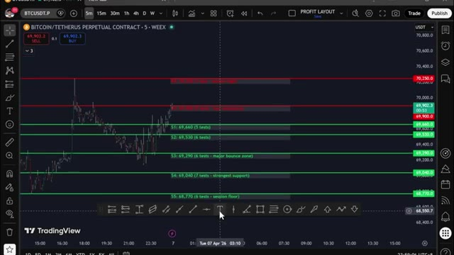
*⏱️ 00:01:50 — Graphique TradingView sur l'interface WEEX affichant le cours du Bitcoin (BTC/USDT) en unités de 5 minutes avec des lignes de support (vertes) et de résistance (rouges) annotées.*

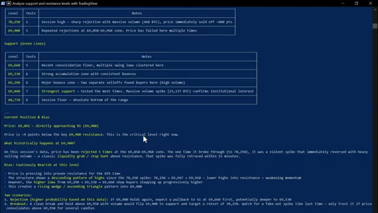
*⏱️ 00:01:58 — Analyse textuelle détaillée sous forme de tableaux et de notes dans une interface en ligne de commande ou un rapport, listant les niveaux de résistance, les supports, la position actuelle du prix et le biais directionnel.*

---

### ⏱️ `[00:02:14 - 00:02:47]` | Segment #05

**🔊 Audio (Transcription Intégrale Mot pour Mot en Français) :**
> analyse sur les graphiques hebdomadaire, journalier, en quatre heures et en une heure simultanément, et obtenez une recommandation de trade spécifique avec un point d'entrée, un stop-loss et un take-profit, le tout à partir d'une seule invite. Mais c'est là que ça devient entièrement mains libres. Vous pouvez connecter n'importe laquelle de ces stratégies directement à votre exchange via un webhook TradingView. Lorsque votre stratégie génère un signal sur TradingView, Claude le reçoit instantanément par le webhook et exécute le trade automatiquement sur votre exchange. Entrée, stop-loss, take-profit, tout est fait. Sans que vous ne touchiez à rien, le signal est arrivé,

**👁️ Analyse Visuelle d'Écran (gemini-3.5-flash-lite) :**
**Interface & Outils** : Terminal de commandes (Claude Code session)

**Contenu textuel & Code** : Tableau de décomposition multi-timeframe (Weekly, Daily, 4-Hour, 1-Hour avec EMA Trend, RSI, MACD Hist, Price vs EMAs et Bias), niveaux clés (résistances et supports journaliers), recommandation de trade LONG (Entry, Stop Loss, Take Profit, R:R), et avertissements importants.

**Action / Démonstration** : Affichage des résultats d'une analyse automatisée multi-timeframe avec génération d'une recommandation de trade spécifique et gestion des risques.

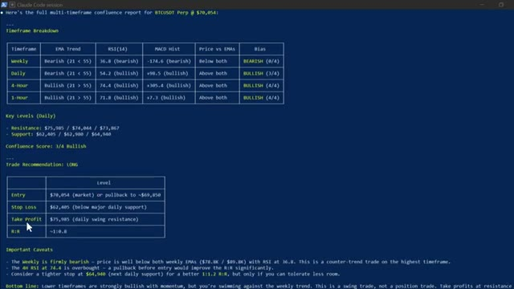
*⏱️ 00:02:23 — Un rapport de confluence multi-timeframe pour BTCUSDT Perp s'affiche dans un terminal, présentant un tableau de décomposition par unité de temps, des niveaux clés, une recommandation de trade LONG et des avertissements importants.*

---

### ⏱️ `[00:02:47 - 00:03:21]` | Segment #06

**🔊 Audio (Transcription Intégrale Mot pour Mot en Français) :**
> Claude l'a traité. Trade ouvert. Confirmation en retour avec chaque détail. Tu construis la stratégie une seule fois, et à partir de ce moment-là, elle tourne toute seule. Maintenant, celui-ci, c'est celui qui a complètement changé ma routine quotidienne. J'ai construit mon propre assistant de trading IA en utilisant Claude et Telegram, et il trouve des trades rentables pour moi en utilisant l'IA la plus puissante disponible actuellement, plus intelligente que n'importe quel humain ne pourrait l'être. Il exécute les trades, gère mes positions, m'envoie des alertes en temps réel et génère des rapports de portefeuille complets. Le tout à partir d'un simple message sur mon téléphone. Ce matin, j'ai placé un trade depuis mon lit, j'ai pris

**👁️ Analyse Visuelle d'Écran (gemini-3.5-flash-lite) :**
**Interface & Outils** : Hyperdash (plateforme d'analyse) et application de messagerie type Telegram / bot Claude.

**Contenu textuel & Code** : Métriques de portefeuilles (Abraxas Capital, Cumberland), valeurs de positions, leviers, biais de marché, et résultats de scan des taux de financement (funding rates) pour des paires futures (ACTUSDT, DOGEUSDT, ADAUSDT, etc.).

**Action / Démonstration** : Navigation et présentation de données analytiques de portefeuilles sur Hyperdash, puis démonstration d'un bot Telegram automatisé propulsé par Claude effectuant un scan de 690 paires futures.

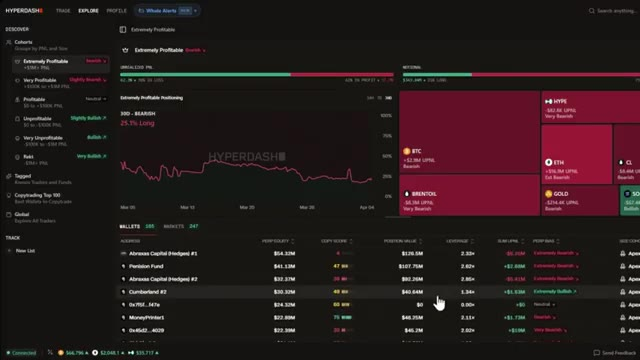
*⏱️ 00:02:56 — Interface Hyperdash affichant le tableau de bord Explore avec des graphiques de positionnement de portefeuilles et de performance de marché.*

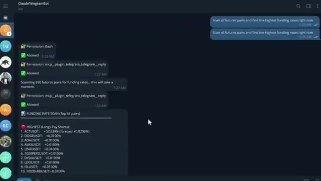
*⏱️ 00:03:13 — Interface de messagerie ClaudeTelegramBot montrant un échange de commandes pour scanner les paires futures et afficher les taux de financement les plus élevés.*

---

### ⏱️ `[00:03:21 - 00:03:53]` | Segment #07

**🔊 Audio (Transcription Intégrale Mot pour Mot en Français) :**
> les bénéfices de la salle de sport, je n'ai touché à aucun graphique. Voici Claude qui s'exécute sur mon ordinateur. Ça a l'air simple. Juste une interface textuelle. Mais regardez ce qu'il peut faire. Vous pouvez pratiquement ouvrir une position de trading avec une seule phrase. Ouvre un long x5 sur ETH avec 10 dollars. Définis un stop-loss à moins 3 % et un take-profit à plus 8 %. Regardez-le réfléchir. Et voilà. Position ouverte. Stop-loss défini. Take-profit défini. Confirmation avec tous les détails. Une seule phrase. C'est fait. Maintenant, laissez-moi vous montrer quelque chose qui vraiment

**👁️ Analyse Visuelle d'Écran (gemini-3.5-flash-lite) :**
**Interface & Outils** : Claude Code (terminal de commande CLI) et la plateforme de trading WEEX.

**Contenu textuel & Code** : Terminal Claude Code avec version et invites de commandes ; interface WEEX avec graphiques en chandeliers, carnet d'ordres et onglet des ordres ouverts ("Open orders").

**Action / Démonstration** : Présentation de l'outil d'IA textuel Claude Code puis bascule sur l'interface de l'échange WEEX pour illustrer l'exécution d'ordres de trading.

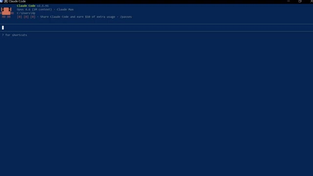
*⏱️ 00:03:29 — Interface textuelle de Claude Code v2.1.91 dans un terminal sur fond bleu.*

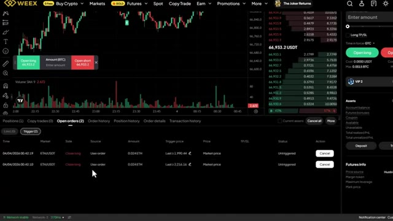
*⏱️ 00:03:45 — Interface de l'échange de cryptomonnaies WEEX montrant un graphique de trading et des ordres ouverts.*

---

### ⏱️ `[00:03:53 - 00:04:23]` | Segment #08

**🔊 Audio (Transcription Intégrale Mot pour Mot en Français) :**
> m'a époustouflé la première fois que j'ai exécuté ceci. Donne-moi un tableau de bord complet de portefeuille. Toutes mes positions, mes profits et pertes, mes frais de financement, ma courbe de capital sous forme de rapport visuel. Regarde-le fonctionner. Il extrait chaque donnée de mon compte en ce moment même. Et voici ce qu'il génère. Un tableau de bord complet en mode sombre. Une courbe de capital. Un taux de réussite. Des revenus de financement ventilés par crypto. Chaque position ouverte avec la distance de liquidation mise en surbrillance. C'est le genre de rapport qu'un desk de trading professionnel produirait.

**👁️ Analyse Visuelle d'Écran (gemini-3.5-flash-lite) :**
**Interface & Outils** : Terminal de commande interactif et tableau de bord web personnalisé (WEEX Portfolio Dashboard).

**Contenu textuel & Code** : Détails de position ETH (Side: LONG, Size: 0.024 ETH, Entry Price: $2,052.00, Leverage: 5x, Take Profit, Stop Loss) et métriques de portefeuille (Margin Allocation, Funding Rate Opportunities).

**Action / Démonstration** : Exécution d'une commande textuelle pour générer un rapport visuel complet du portefeuille en HTML.

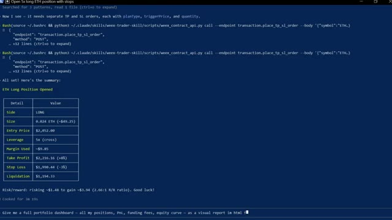
*⏱️ 00:04:01 — Interface de terminal de commande affichant l'exécution d'un script Python pour l'ouverture d'une position longue sur l'ETH avec des ordres de Take Profit et Stop Loss.*

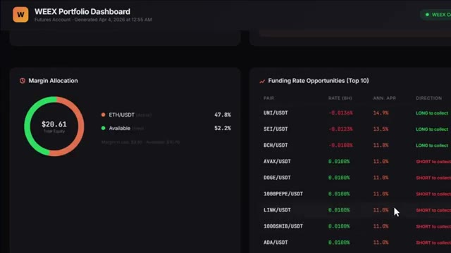
*⏱️ 00:04:16 — Tableau de bord de portefeuille WEEX généré automatiquement montrant l'allocation des marges et les opportunités de taux de financement.*

---

### ⏱️ `[00:04:24 - 00:04:46]` | Segment #09

**🔊 Audio (Transcription Intégrale Mot pour Mot en Français) :**
> Je l'ai obtenu en quelques secondes à partir d'une seule consigne. Et soit dit en passant, si vous trouvez cela utile jusqu'à présent, restez jusqu'à la fin parce que je vais vous montrer comment configurer tout cela vous-même. Continuez à regarder. Très bien, laissez-moi vous en montrer plus. Vous pouvez également connecter ceci à votre Telegram pour envoyer des commandes directement depuis votre téléphone. Vous pouvez taper analyser toutes les paires futures et trouver les taux de financement les plus élevés en ce moment.

**👁️ Analyse Visuelle d'Écran (gemini-3.5-flash-lite) :**
**Interface & Outils** : Page web de documentation et application de messagerie Telegram connectée à Claude Code.

**Contenu textuel & Code** : Section 'Creative Use Cases', description du journal de trading automatisé, et invite (prompt) sur Telegram : 'Scan all futures pairs and find the highest funding rates right now'.

**Action / Démonstration** : Présentation des cas d'utilisation avancés de l'IA en trading et démonstration d'une requête sur un bot Telegram pour analyser les taux de financement des contrats futures.

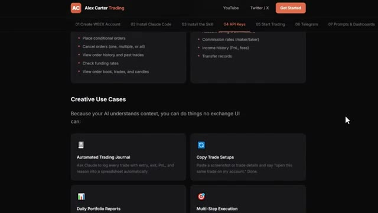
*⏱️ 00:04:29 — Page web de documentation Alex Carter Trading montrant des cas d'utilisation créatifs pour l'IA, comme un journal de trading automatisé et la copie de configurations de trade.*

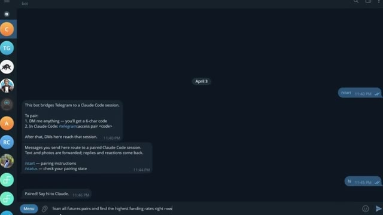
*⏱️ 00:04:41 — Interface d'une application de messagerie (Telegram) montrant un bot connecté à une session Claude Code, avec un utilisateur demandant de scanner les paires futures pour trouver les taux de financement les plus élevés.*

---

### ⏱️ `[00:04:47 - 00:05:06]` | Segment #10

**🔊 Audio (Transcription Intégrale Mot pour Mot en Français) :**
> Il a scanné chaque paire, les a classées par taux de financement, a calculé le rendement annualisé, et m'a dit exactement dans quelle direction me positionner pour récolter ce financement instantanément. Maintenant, si vous ne savez pas ce que sont les taux de financement, c'est essentiellement de l'argent gratuit que la bourse verse toutes les huit heures aux traders qui sont positionnés du bon côté du marché.

**👁️ Analyse Visuelle d'Écran (gemini-3.5-flash-lite) :**
**Interface & Outils** : Application Telegram et échange de cryptomonnaies WEEX.

**Contenu textuel & Code** : Liste de taux de financement avec des pourcentages positifs et négatifs pour diverses cryptomonnaies (ACTUSDT, DOGEUSDT, APTUSDT, etc.), ainsi qu'une interface de trading de contrats perpétuels avec graphique des prix et carnet d'ordres.

**Action / Démonstration** : Présentation des résultats d'un scan automatisé des taux de financement suivi d'une illustration de l'interface d'échange pour illustrer le positionnement sur les marchés dérivés.

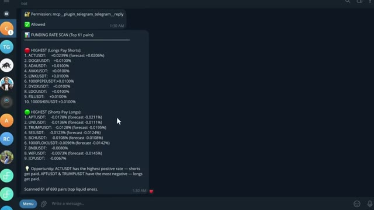
*⏱️ 00:04:52 — Capture d'écran d'un bot Telegram affichant un scan des taux de financement (Funding Rate Scan) pour différentes paires crypto, classées entre les taux les plus élevés où les longs paient les shorts et ceux où les shorts paient les longs.*

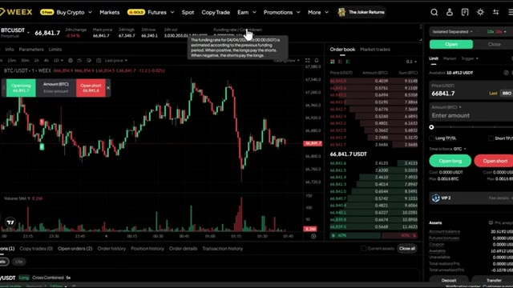
*⏱️ 00:05:01 — Interface de la plateforme de trading WEEX affichant le graphique de la paire BTC/USDT, un carnet d'ordres et les informations de taux de financement (Funding rate / Countdown).*

---

### ⏱️ `[00:05:07 - 00:05:36]` | Segment #11

**🔊 Audio (Transcription Intégrale Mot pour Mot en Français) :**
> Lorsque le financement est positif, les positions longues paient les courtes. Lorsque le financement est négatif, les positions courtes paient les longues. Et certains de ces taux sont extrêmement élevés. Ce que fait ce scanner, c'est trouver les paires où ce taux est le plus élevé, calculer ce que cela donne sur une base annuelle, parfois 50 %, 100 %, voire plus, et vous dire exactement dans quelle direction ouvrir une position pour vous asseoir et percevoir ce paiement toutes les huit heures. Vous n'essayez même pas de prédire la direction des prix. Vous cultivez simplement le taux.

**👁️ Analyse Visuelle d'Écran (gemini-3.5-flash-lite) :**
**Interface & Outils** : Application de messagerie Telegram et plateforme d'échange de cryptomonnaies WEEX.

**Contenu textuel & Code** : Classement des paires crypto par taux de financement (le plus haut où les longs paient les shorts, et le plus bas où les shorts paient les longs) avec pourcentages et prévisions, ainsi qu'un graphique de trading avec carnet d'ordres.

**Action / Démonstration** : Présentation des résultats d'un scan de taux de financement via un bot Telegram et visualisation de l'interface de trading d'un exchange.

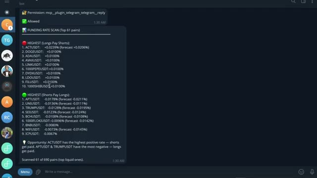
*⏱️ 00:05:14 — Capture d'écran montrant un message Telegram d'un bot de scan des taux de financement (Funding Rate Scan) affichant les paires avec les taux les plus élevés et les plus bas.*

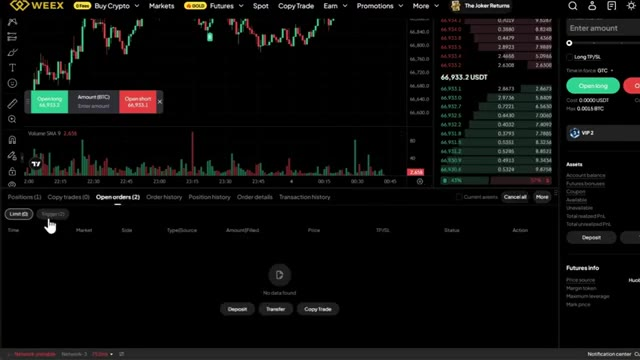
*⏱️ 00:05:29 — Interface de trading de la plateforme WEEX montrant un graphique de prix en chandelier, un carnet d'ordres et les onglets de gestion des ordres ouverts.*

---

### ⏱️ `[00:05:37 - 00:05:58]` | Segment #12

**🔊 Audio (Transcription Intégrale Mot pour Mot en Français) :**
> Et maintenant, au lieu de vérifier manuellement chaque paire vous-même, ce que personne ne fait, Claude le fait en quelques secondes et vous sert l'opportunité sur un plateau. Maintenant, cette prochaine section, c'est là que ça devient vraiment intéressant. Et honnêtement, c'est l'une de mes choses préférées que j'ai construites avec Claude. Et si vous pouviez analyser 33 000 portefeuilles sur Hyperliquid ? Trouver les 20 traders les plus rentables.

**👁️ Analyse Visuelle d'Écran (gemini-3.5-flash-lite) :**
**Interface & Outils** : Terminal de commandes Bash/Python, navigateur web (site web Alex Carter Trading, plateforme Hyperliquid Leaderboard).

**Contenu textuel & Code** : Scripts d'API de trading, informations de position (ETHUSDT, levier 10x), guide de configuration de Whale Tracker, données de portefeuilles de traders sur le leaderboard (valeurs de comptes, PnL, ROI).

**Action / Démonstration** : Exécution de commandes de trading via script, présentation d'un outil de suivi de portefeuilles ("Whale Tracker") et consultation du classement des meilleurs traders.

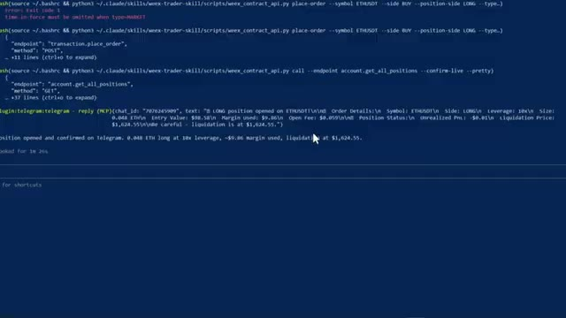
*⏱️ 00:05:42 — Un terminal de commandes affichant des scripts Python et des messages de confirmation de trading (ouverture d'une position LONG ETHUSDT avec effet de levier).*

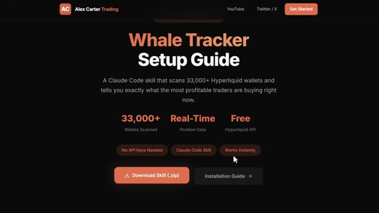
*⏱️ 00:05:48 — Une page web de présentation intitulée "Whale Tracker Setup Guide" proposant le téléchargement d'un outil Claude Code pour scanner plus de 33 000 portefeuilles Hyperliquid.*

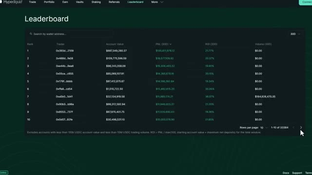
*⏱️ 00:05:53 — Le tableau de classement (Leaderboard) de la plateforme Hyperliquid affichant les portefeuilles de traders avec leurs valeurs de compte, PnL et ROI.*

---

### ⏱️ `[00:05:58 - 00:06:30]` | Segment #13

**🔊 Audio (Transcription Intégrale Mot pour Mot en Français) :**
> voyez exactement ce qu'ils achètent en ce moment leurs prix d'entrée leur effet de levier leur PNL non réalisé et obtenez un plan de négociation complet basé sur tout cela aucune clé API nécessaire pas de code pas de recherche manuelle maintenant Hyperliquid très rapidement c'est un échange perpétuel décentralisé fonctionnant sur sa propre blockchain pas de KYC pas d'intermédiaire et comme c'est entièrement sur la chaîne chaque transaction, chaque position, chaque portefeuille, tout est public. C'est ce qui rend cela possible. Très bien, laissez-moi ouvrir Claude Code et

**👁️ Analyse Visuelle d'Écran (gemini-3.5-flash-lite) :**
**Interface & Outils** : Terminal de commandes CLI et documentation officielle (GitBook / Site Web Hyperliquid Docs).

**Contenu textuel & Code** : Plan de trading XMR (Token: XMR, Direction: LONG, Current Price: ~$328, Entry Zone: $325-330, Stop Loss: $305, Leverage: 5x, Position Size: 15% of account) et documentation de la blockchain Hyperliquid.

**Action / Démonstration** : Présentation d'un plan de trading complet basé sur l'analyse des positions des baleines suivi d'une explication de la plateforme Hyperliquid.

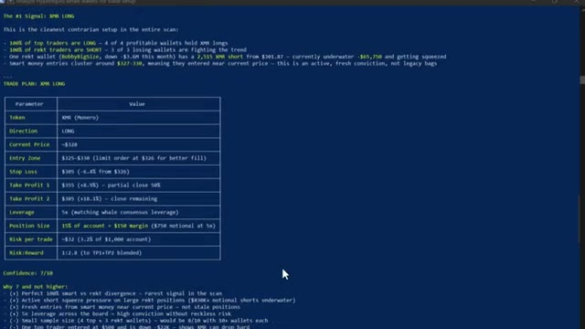
*⏱️ 00:06:06 — Un terminal de commandes affichant un plan de trading détaillé pour XMR Long, incluant les zones d'entrée, le stop loss, le take profit, et le levier.*

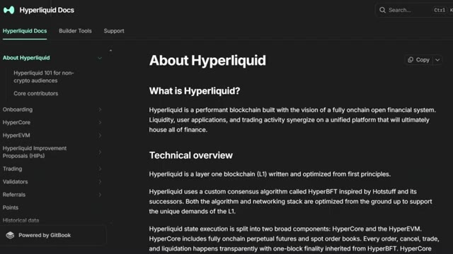
*⏱️ 00:06:14 — La page de documentation officielle d'Hyperliquid ("Hyperliquid Docs") expliquant ce qu'est la plateforme et son architecture technique (Layer 1, HyperBFT).*

---

### ⏱️ `[00:06:30 - 00:06:53]` | Segment #14

**🔊 Audio (Transcription Intégrale Mot pour Mot en Français) :**
> je vous montre ça en direct. Voici la première chose que je veux vous montrer. Claude analyse les 20 portefeuilles les plus rentables sur Hyperliquid en ce moment, extrait toutes les positions ouvertes et les classe par rentabilité totale. Le tout en un seul coup. Regardez ce qui se passe. Claude se connecte aux points de terminaison publics d'Hyperliquid, commence à extraire les données des portefeuilles sur 33 000 adresses, les classe par rentabilité et commence à rédiger le rapport.

**👁️ Analyse Visuelle d'Écran (gemini-3.5-flash-lite) :**
**Interface & Outils** : Terminal de commandes / Script CLI

**Contenu textuel & Code** : Tableau des positions clés (Coin, Direction, Size, Entry, Leverage, uPnL) pour diverses cryptomonnaies (BTC, ETH, SOL, ENA, LINK, FARTCOIN, WLD, AAVE, HYPE, MON, DOGE, PUMP) ainsi que des métriques de PnL mensuel et d'Account Value.

**Action / Démonstration** : Affichage des résultats de l'analyse des portefeuilles de baleines sur Hyperliquid par un script.

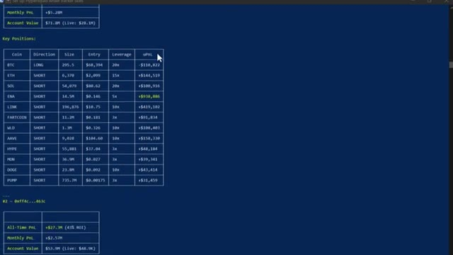
*⏱️ 00:06:36 — Un terminal de commandes affichant les données extraites des portefeuilles les plus rentables sur Hyperliquid, incluant les positions ouvertes et les PnL.*

---

### ⏱️ `[00:06:53 - 00:07:16]` | Segment #15

**🔊 Audio (Transcription Intégrale Mot pour Mot en Français) :**
> Tu peux le voir fonctionner à travers les portefeuilles en temps réel. Les prix d'entrée, l'effet de levier, les profits et pertes non réalisés, tout arrive en direct. Et voici le résultat. Les 20 principales baleines classées, chaque position ouverte listée. Et en bas, le résumé du sentiment global. En ce moment, l'argent intelligent est acheteur net sur le Bitcoin et vendeur net sur presque tout le reste, en particulier Ethereum.

**👁️ Analyse Visuelle d'Écran (gemini-3.5-flash-lite) :**
**Interface & Outils** : Terminal de commandes / console en ligne de commande.

**Contenu textuel & Code** : Données JSON structurées comprenant les clés : "coin", "direction", "size", "entry_price", "unrealized_pnl", "leverage", "liquidation_price" pour différentes cryptomonnaies (WIF, MOODENG, HYPE, VIRTUAL, MORPHO).

**Action / Démonstration** : Affichage en temps réel des données de suivi des portefeuilles et positions des baleines dans la console.

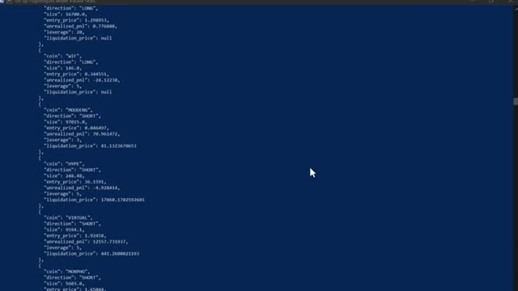
*⏱️ 00:06:59 — Un terminal de commandes affichant des données JSON en direct sur les positions ouvertes de baleines (prix d'entrée, effet de levier, PnL).*

---

### ⏱️ `[00:07:17 - 00:07:51]` | Segment #16

**🔊 Audio (Transcription Intégrale Mot pour Mot en Français) :**
> C'est le genre de signal qui prenait autrefois des heures à être reconstitué manuellement. Claude le fait en moins d'une minute. Maintenant, c'est là que ça devient vraiment intéressant, ce prompt compare les 20 portefeuilles les plus rentables aux 20 portefeuilles qui perdent le plus et trouve chaque jeton où ils se trouvent de chaque côté de la transaction, regardez-le extraire les deux groupes simultanément, les portefeuilles rentables d'un côté, les portefeuilles perdants de l'autre, et ensuite il commence à croiser les positions, voici le résultat, vous pouvez voir là où les deux groupes sont d'accord, ils sont tous les deux acheteurs sur Sui, donc c'est un trade encombré, mais regardez

**👁️ Analyse Visuelle d'Écran (gemini-3.5-flash-lite) :**
**Interface & Outils** : Terminal CLI / Claude Code.

**Contenu textuel & Code** : Tableau comparatif de positions (ETH, FARTCOIN, XMR, etc.) opposant les portefeuilles gagnants (long) aux perdants (short) avec signaux associés.

**Action / Démonstration** : Génération automatique de signaux de trading contrariants via l'analyse de portefeuilles.

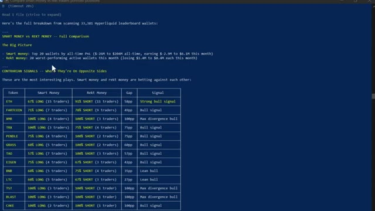
*⏱️ 00:07:25 — Terminal affichant l'analyse comparative ("Smart Money vs Rekt Money") basée sur 33 381 portefeuilles Hyperliquid.*

---

### ⏱️ `[00:07:51 - 00:08:27]` | Segment #17

**🔊 Audio (Transcription Intégrale Mot pour Mot en Français) :**
> alors que l'argent intelligent est massivement acheteur sur XMR, TRX, Pendle et Far coin, tandis que les traders particuliers sont vendeurs sur ces cryptos, cette divergence exacte, c'est le signal, c'est le genre d'analyse que les fonds spéculatifs paient cher, vous l'obtenez grâce à un outil d'IA à 20 dollars et à une API publique gratuite, et si vous voulez la configuration complète d'Hyperliquid, le code des compétences, chaque instruction, le système complet de suivi des baleines, je vais vous dire exactement comment obtenir tout cela dans un instant. Continuez à regarder. Maintenant, si vous êtes prêt à aller encore plus loin, vous pouvez utiliser Claude code pour créer un bot de trading entièrement automatisé du début à la fin.

**👁️ Analyse Visuelle d'Écran (gemini-3.5-flash-lite) :**
**Interface & Outils** : Terminal de commandes et interface web de configuration de compte/API.

**Contenu textuel & Code** : Tableaux statistiques comparatifs entre l'argent intelligent et les particuliers sur Hyperliquid, et liste des capacités de trading via API (Futures, Spot, Account Info).

**Action / Démonstration** : Analyse des divergences de positionnement entre investisseurs professionnels et particuliers, puis présentation des options d'automatisation par API.

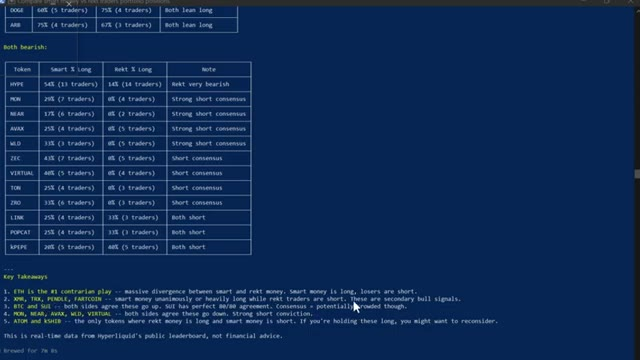
*⏱️ 00:08:00 — Un tableau de données dans un terminal affichant les positions des traders ('Smart' vs 'Rekt') sur différentes cryptomonnaies avec les points clés en bas.*

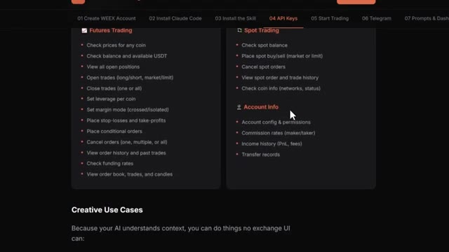
*⏱️ 00:08:18 — Une interface web détaillant les fonctionnalités d'API pour le trading de Futures et Spot (gestion des ordres, positions, effet de levier).*

---

### ⏱️ `[00:08:27 - 00:08:51]` | Segment #18

**🔊 Audio (Transcription Intégrale Mot pour Mot en Français) :**
> pour la crypto, les actions, ou n'importe quel marché que vous tradez. Et honnêtement, c'est ainsi que Claude va changer notre façon de trader pour toujours. Et nous avons déjà fait cela auparavant. Laissez-moi vous montrer à quoi ressemble réellement le résultat final. C'est le tableau de bord, une seule URL, chaque position, votre courbe de capital, l'état de vos bots, vos données sur les baleines, tout en direct, tout en un seul endroit. Fini les multiples onglets de navigateur.

**👁️ Analyse Visuelle d'Écran (gemini-3.5-flash-lite) :**
**Interface & Outils** : WEEX Dashboard

**Contenu textuel & Code** : Métriques de compte (Equity: 19.78, Available: 19.78, Margin Used: 0.00, Unrealized PNL: 0.00), Closed PNL (Today, 7 Days, 30 Days), Equity Curve (Last 90 days), Open Positions, Recent Signals.

**Action / Démonstration** : Présentation du tableau de bord de trading et des métriques de performance du compte.

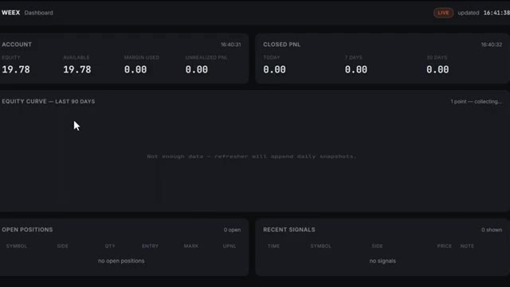
*⏱️ 00:08:45 — Tableau de bord WEEX affichant le compte, la courbe d'équité sur 90 jours, les positions ouvertes et les signaux récents.*

---

### ⏱️ `[00:08:51 - 00:09:26]` | Segment #19

**🔊 Audio (Transcription Intégrale Mot pour Mot en Français) :**
> Fini de douter de vos entrées. Et chaque matin, avant même d'ouvrir votre ordinateur portable, ce brief alpha quotidien est déjà dans votre boîte de réception. Chaque jour, à l'heure et prêt à être lu. Il a déjà scanné les baleines, lu les graphiques, vérifié votre compte et vous a transmis l'unique configuration à la plus forte conviction pour la journée. Dimensionnée selon votre risque exact. Un seul prompt. Toute la stack. Et le bot lui-même n'est pas installé sur votre ordinateur portable. Il tourne 24/7 sur un serveur cloud. S'il plante, il redémarre tout seul. Si votre Wi-Fi coupe, il continue de tourner. Votre ordinateur portable n'est que la télécommande.

**👁️ Analyse Visuelle d'Écran (gemini-3.5-flash-lite) :**
**Interface & Outils** : Terminal CLI

**Contenu textuel & Code** : Tableau de données marché (BTC, ETH, SOL), prix, variations 24h, RSI, distance EMA 200 et zones de réaction.

**Action / Démonstration** : Exécution d'un script d'analyse et affichage d'un rapport quotidien automatisé.

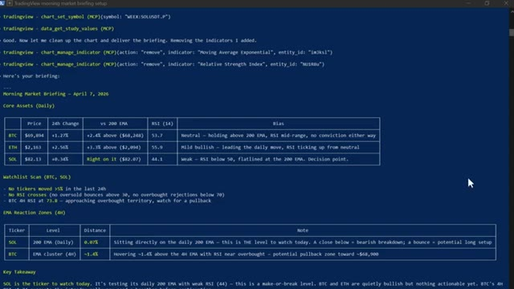
*⏱️ 00:09:00 — Terminal de commande affichant un brief de marché automatisé pour BTC, ETH et SOL avec métriques et analyse technique.*

---

### ⏱️ `[00:09:26 - 00:09:46]` | Segment #20

**🔊 Audio (Transcription Intégrale Mot pour Mot en Français) :**
> Désormais, la barrière mathématique pour construire tout cela a pratiquement disparu. Avant des modèles performants comme CloudCode, cela aurait pris des semaines, voire des mois, à mettre en place. Maintenant, vous pouvez passer d'une idée à un système fonctionnel en une après-midi, et cela a son importance car la plupart des stratégies ne fonctionnent pas. L'avantage ne réside pas dans le fait d'avoir une stratégie parfaite.

**👁️ Analyse Visuelle d'Écran (gemini-3.5-flash-lite) :**
**Interface & Outils** : Page web de cours en ligne (Trading AI) et interface de graphique financier TradingView.

**Contenu textuel & Code** : Image 1 : Statistiques de performance de bots (Sovereign2013 avec $3.3M, Alpha Arena montrant Claude à +31%, et Jake Nesler avec $100K+). Image 2 : Graphique en chandeliers BTCUSDT, bandes de Bollinger (BB 30 SMA close 2), indicateur RSI (14 close) et volumes.

**Action / Démonstration** : Présentation des résultats de trading automatisés par IA, puis analyse technique sur le graphique de prix du Bitcoin avec indicateurs de momentum et de volatilité.

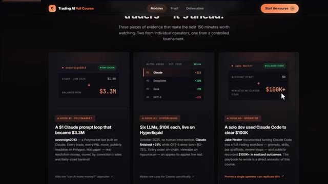
*⏱️ 00:09:31 — Une page web présentant le cours 'Trading AI Full Course' avec trois encadrés de cas pratiques et de performances de bots dopés à l'IA.*

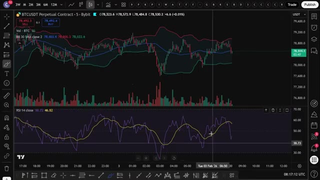
*⏱️ 00:09:41 — Un graphique TradingView affichant le contrat perpétuel BTCUSDT sur Bybit en unité de temps 5 minutes, avec les indicateurs Bollinger Bands et RSI.*

---

### ⏱️ `[00:09:46 - 00:10:08]` | Segment #21

**🔊 Audio (Transcription Intégrale Mot pour Mot en Français) :**
> C'est dans le fait d'être capable de tester suffisamment d'idées assez vite pour trouver celles qui fonctionnent vraiment. D'accord. Et regardez, au cours des prochaines années, deux types de traders existeront. Ceux qui utilisent l'IA et ceux qui font encore tout manuellement. Même marché. Des résultats très différents. Voici comment vous placer du bon côté. J'ai tout rassemblé au sein de la communauté AI Trade Edge.

**👁️ Analyse Visuelle d'Écran (gemini-3.5-flash-lite) :**
**Interface & Outils** : TradingView (intégré / courtier WEEX)

**Contenu textuel & Code** : Paire BTCUSDT.P, unité de temps 5m, chandeliers japonais, cours affiché à 69 894,2 USDT, boutons Buy/Sell WEEX.

**Action / Démonstration** : Affichage et observation du graphique de cours du Bitcoin pour comparer le comportement du marché.

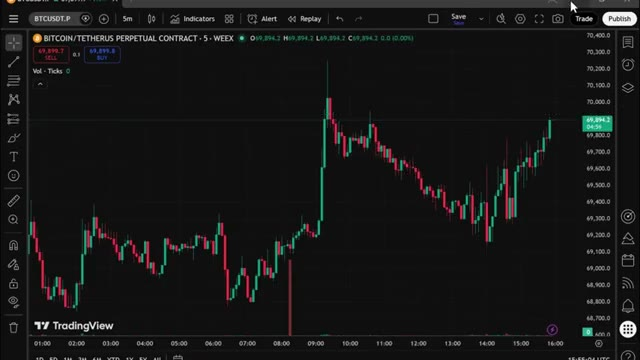
*⏱️ 00:10:02 — Graphique TradingView en chandeliers 5 minutes de la paire BTC/USDT Perpetual Contract sur l'échange WEEX.*

---

### ⏱️ `[00:10:08 - 00:10:44]` | Segment #22

**🔊 Audio (Transcription Intégrale Mot pour Mot en Français) :**
> Chaque prompt, chaque bot, chaque modèle, chaque guide étape par étape que j'utilise personnellement, tout au même endroit, et tout ce que je créerai à l'avenir est ajouté directement dans le groupe dès sa sortie. Nous testons également des stratégies provenant de tout Internet, en les automatisant à l'aide de PineScript, en les exécutant en direct et en partageant exactement ce qui fonctionne et ce qui ne fonctionne pas. Ainsi, vous n'obtenez pas seulement des outils, vous bénéficiez d'une véritable opération de recherche en direct. À l'intérieur, se trouve également un cours complet de trading agentique de 2,5 heures, de débutant à expert, aucune expérience en codage n'est nécessaire, d'ailleurs

**👁️ Analyse Visuelle d'Écran (gemini-3.5-flash-lite) :**
**Interface & Outils** : Documentation web d'intégration WEEX, TradingView (Binance BTC/USD).

**Contenu textuel & Code** : Liste des fonctionnalités de trading automatique WEEX (ordres spot/futures, SL/TP, levier) ; graphique en chandeliers japonais 2h, indicateur RSI-VWAP Indicator %, signaux BUY/SELL et métriques de position (Realized PnL, Unrealized PnL).

**Action / Démonstration** : Explication des capacités de l'agent de trading WEEX suivie d'une démonstration d'analyse technique et de signaux de trading sur TradingView.

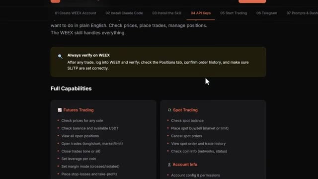
*⏱️ 00:10:17 — Page de documentation et guide d'intégration détaillant les capacités de l'outil de trading automatisé WEEX (Futures, Spot et gestion du compte).*

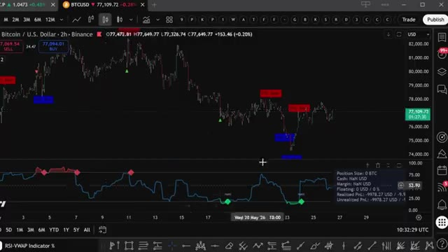
*⏱️ 00:10:35 — Graphique TradingView du cours BTC/USD en données 2h avec l'indicateur RSI-VWAP, des signaux d'achat/vente superposés et une fenêtre de métriques PnL.*

---

### ⏱️ `[00:10:44 - 00:11:18]` | Segment #23

**🔊 Audio (Transcription Intégrale Mot pour Mot en Français) :**
> fin de compte vous aurez votre propre système de trading IA en fonctionnement réel quelque chose que la plupart des traders particuliers ne savent même pas être possible en ce moment 79,99 dollars par mois un seul bon trade couvre ce montant et les 100 premiers membres bloquent ce tarif de façon permanente après cela le prix augmente le lien est dans la description vous ne pouvez vraiment pas vous permettre de rater ça et c'est tout c'est ainsi que je transforme tout mon système de trading en un pilote automatique IA 24h/24 et 7j/7 et comment vous pouvez en faire partie trois outils superposés fonctionnant 24h/24 et 7j/7 effectuant le travail de tout un trading

**👁️ Analyse Visuelle d'Écran (gemini-3.5-flash-lite) :**
**Interface & Outils** : TradingView, plateforme Whop, terminal de commandes (Claude Code)

**Contenu textuel & Code** : Graphique de prix avec indicateurs de zones, interface de vente Whop avec tarif d'abonnement, et invite de commande dans un terminal.

**Action / Démonstration** : Présentation de l'offre commerciale et visualisation d'un graphique de trading couplé à un assistant IA en terminal.

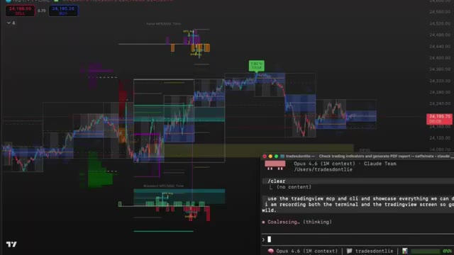
*⏱️ 00:11:09 — Graphique financier TradingView en arrière-plan avec des boîtes de zones et un terminal de commande Claude Code en bas à droite.*

---

### ⏱️ `[00:11:18 - 00:11:51]` | Segment #24

**🔊 Audio (Transcription Intégrale Mot pour Mot en Français) :**
> bureau pendant que vous continuez votre vie. Si vous voulez approfondir l'un de ces sujets individuellement, le guide complet TradingView Telegram et le suivi des baleines Hyperliquid, toutes ces vidéos s'affichent à l'écran en ce moment même, allez les consulter à votre rythme. Et si vous voulez le guide complet étape par étape pour construire votre propre système de trading agentique en utilisant Claude, cette vidéo s'affiche également à l'écran, allez la regarder ensuite. Si vous avez trouvé cela utile, laissez un j'aime, cela aide vraiment la chaîne, abonnez-vous si ce n'est pas déjà fait, et je vous retrouve dans la prochaine vidéo.

**👁️ Analyse Visuelle d'Écran (gemini-3.5-flash-lite) :**
**Interface & Outils** : Plateforme de trading décentralisée Hyperliquid (section Leaderboard).

**Contenu textuel & Code** : Tableau de classement affichant les dix meilleurs traders avec des colonnes : Rank, Trader (adresses de portefeuille masquées), Account Value, PnL (30D), ROI (30D) et Volume (30D).

**Action / Démonstration** : Consultation du classement des baleines et des meilleurs traders sur Hyperliquid.

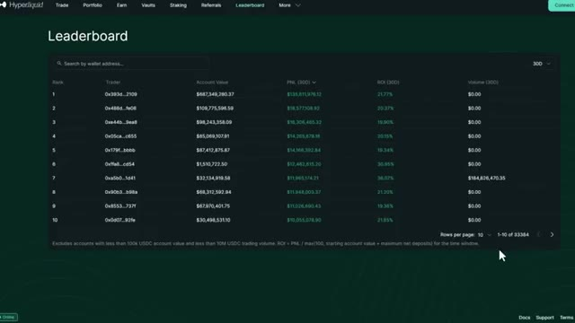
*⏱️ 00:11:26 — Capture d'écran montrant le classement (Leaderboard) de la plateforme Hyperliquid avec les adresses des traders, la valeur du compte, le PnL, le ROI et le volume.*

---

