# 🎬 I Built a Polymarket + Kalshi Arbitrage Bot (7 Day Results)

> **Chaîne** : [Alex Carter](https://www.youtube.com/@AlexCarterTrading)  
> **Lien YouTube** : [https://www.youtube.com/watch?v=CFluN7fne44](https://www.youtube.com/watch?v=CFluN7fne44)  
> **Date de publication** : 20260818  
> **Durée** : 00:10:09  
> **Identifiant vidéo** : `CFluN7fne44`  
> **Transcription & Analyse** : `whisper-v3-large-turbo+gemini-3.5-flash-lite`  

---

## 📌 Synthèse Exécutive & Outils

### 💡 Résumé

Cette vidéo documente l'expérimentation en conditions réelles d'un bot de trading automatisé configuré pour exploiter des inefficiences de prix (arbitrage pur) entre deux géants des marchés de prédiction : Kalshi et Polymarket. Le principe repose sur une faille structurelle inhérente à ces plateformes décentralisées ou régulées : lorsqu'un même événement réel est coté de manière indépendante sur les deux carnets d'ordres, la somme des probabilités inversées (« Oui » sur l'une, « Non » sur l'autre) tombe parfois sous la barre théorique d'un dollar net de frais. Le bot, piloté par intelligence artificielle, surveille ces micro-fenêtres temporelles invisibles à l'œil humain pour verrouiller instantanément un profit mathématiquement garanti, indépendamment de l'issue finale de l'événement.

Au-delà de la théorie, la démonstration expose les résultats d'un test rigoureux mené sur sept jours consécutifs avec un capital initial modeste de 100 dollars. Grâce à l'automatisation intégrale, sans écriture manuelle de code informatique complexe (via des instructions en langage naturel traduites par des agents IA comme Claude), le système a exécuté 37 ordres automatisés, générant un rendement net impressionnant et une courbe de capital ascendante malgré quelques légers retraits. La démonstration détaille également le parcours utilisateur complet : de l'ouverture sécurisée d'un compte sur Kalshi (avec bonus de bienvenue et dépôts instantanés sans frais par carte ou cryptomonnaies), à la génération de clés API, jusqu'au paramétrage des déclencheurs de fenêtres d'analyse.

L'analyse positionne ce type d'approche comme une rupture technologique majeure pour les marchés spéculatifs. L'intervenant démontre qu'à l'avenir, seuls deux types d'intervenants subsisteront : les traders manuels subissant le temps de latence des interfaces web, et les opérateurs augmentés par l'IA capables de déployer des agents de surveillance multi-plateformes en quelques clics. En combinant l'arbitrage statistique à 15 minutes, l'analyse des flux de capitaux (« smart money ») et l'automatisation sans code, cette masterclass met en lumière l'accessibilité nouvelle du trading quantitatif algorithmique pour les investisseurs particuliers.

### 🛠️ Outils, Modèles & Logiciels Présentés

* **Kalshi** : Plateforme régulée de marchés de prédiction et de produits dérivés (perps) permettant de spéculer sur des événements économiques, politiques et géopolitiques mondiaux.
* **Polymarket** : Principal marché de prédiction décentralisé mondial fonctionnant sur la blockchain, servant ici de contre-référence de prix pour l'arbitrage croisé.
* **Claude / Claude Code** : Modèle de langage avancé utilisé sous forme d'agent conversationnel (« Claude bot ») pour concevoir, décrire et déployer des stratégies de trading complexes en langage naturel sans compétences en programmation.
* **Grok Bots** : Assistants conversationnels et agents d'automatisation intégrés pour la surveillance et l'exécution de stratégies de scalping et d'arbitrage.
* **TradingView** : Plateforme de graphisme de référence utilisée pour l'analyse technique, le suivi des indicateurs et le paramétrage des scripts de trading (Pine Script).
* **Pine Script** : Langage de programmation dédié aux graphiques de TradingView permettant de coder des indicateurs personnalisés et des conditions d'alertes algorithmiques.
* **Open Router** : Interface unifiée permettant d'interconnecter différents modèles de grands langages (LLM) aux infrastructures de trading.
* **MetaMask / Phantom / Trust Wallet** : Portefeuilles cryptographiques non-custodiaux utilisés pour alimenter et retirer des fonds en stablecoins sur les bourses de prédiction.

### 🔑 Points Clés & Enseignements Stratégiques

* **Principe mathématique de l'arbitrage croisé** : Sur un marché binaire (« Oui » / « Non »), la somme des prix des deux issues doit théoriquement valoir exactement 1 dollar. Lorsque l'achat simultané d'un « Oui » sur Kalshi et d'un « Non » sur Polymarket (pour un même événement) coûte globalement moins de 1 dollar après déduction des frais, un profit net instantané et sans risque de marché est verrouillé.
* **Suppression de la latence humaine** : Les écarts de prix inter-plateformes ne persistent généralement que durant quelques secondes ou minutes. L'automatisation par bot est indispensable, car aucun opérateur humain ne peut rafraîchir et analyser manuellement deux carnets d'ordres distincts en temps réel avec une telle réactivité.
* **Performances et scalabilité sur 7 jours** : Un capital initial de 100 dollars exposé au bot d'arbitrage a généré 37 ordres fructueux, affichant une progression régulière de la courbe de capital pour atteindre 663,28 dollars de profit net, prouvant la viabilité du modèle à petite échelle.
* **Architecture sans code (« No-Code » IA)** : La création de la stratégie ne requiert aucune maîtrise de Python ou de langages bas niveau ; il suffit de décrire précisément la logique métier en français naturel à un agent intelligent (« Claude bot ») pour qu'il génère, compile et déploie le script opérationnel.
* **Optimisation des coûts de rechargement** : L'utilisation de cartes bancaires ou de solutions comme Google Pay sur Kalshi garantit des frais de traitement nuls (0 %), maximisant ainsi le capital initial disponible pour le trading par rapport aux virements traditionnels plus lents ou soumis à des seuils élevés (minimum 1 000 $).
* **Sécurité et gestion des clés API** : L'accès programmatique aux bourses nécessite la génération de clés API sécurisées (clé publique et clé privée) avec des permissions d'accès complet restreintes aux fonctionnalités de trading automatisé, tout en conservant des mots de passe maîtres stricts.
* **Paramétrage granulaire des bots** : Le contrôle des risques passe par le réglage précis de paramètres clés : le déclencheur de la fenêtre d'analyse, le nombre de contrats par côté, l'intervalle temporel en secondes entre deux analyses, et le capital maximum engagé simultanément sur le marché.
* **Diversification des stratégies automatisées** : Il est recommandé de ne pas se limiter à un seul bot, mais de faire tourner des stratégies complémentaires : arbitrage pur sur 15 minutes, pricing croisé et bots de suivi des portefeuilles institutionnels (« smart money »).
* **Gestion rigoureuse du capital (Risk Management)** : Malgré un taux de réussite élevé, la stratégie intègre des retraits mineurs normaux (« drawdowns ») inhérents à l'exécution en conditions réelles, gérés par une limitation volontaire du capital quotidien alloué aux débutants (maximum 500 $).
* **Avantage compétitif générationnel** : Le marché des prédictions bascule inéluctablement vers une dichotomie entre les traders manuels subissant un retard informationnel permanent et les opérateurs augmentés par l'IA exploitant des inefficiences structurelles 24h/24.

---

## ⏱️ Chronologie & Transcription Complète Audio & Visuelle (Mot pour Mot)

### ⏱️ `[00:00:00 - 00:00:21]` | Segment #01

**🔊 Audio (Transcription Intégrale Mot pour Mot en Français) :**
> Pendant sept jours d'affilée, j'ai eu un bot qui surveillait discrètement deux des plus grandes plateformes de marchés de prédiction de la planète, Kalshi et Polymarket, en attendant une chose précise : un écart de prix qui garantit un profit dès son apparition. Et le truc fou, c'ضai pas écrit une seule ligne de code pour le construire. J'ai juste connecté mon compte Kalshi et dit au bot quoi faire en bon français.

**👁️ Analyse Visuelle d'Écran (gemini-3.5-flash-lite) :**
**Interface & Outils** : Interface web de création de bots et plateforme de prédiction Polymarket.

**Contenu textuel & Code** : Formulaire de configuration de bot ("New bot"), options d'achat de contrats de prédiction (Ken Paxton à 52%), et journaux d'activité de bots d'arbitrage ("Arb bot checked... no trade yet").

**Action / Démonstration** : Configuration d'un bot de trading par IA et surveillance des marchés de prédiction pour détecter des opportunités d'arbitrage.

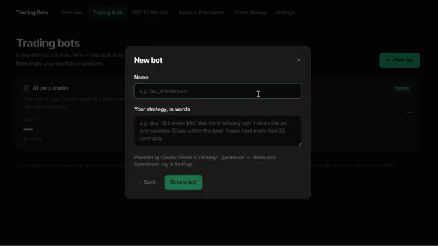
*⏱️ 00:00:05 — Interface de création d'un nouveau bot de trading avec un champ de nom et une description de stratégie en langage naturel.*

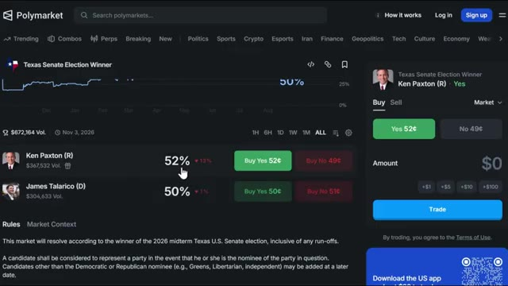
*⏱️ 00:00:10 — Interface de la plateforme de marchés de prédiction Polymarket affichant les pourcentages et les options d'achat pour l'élection sénatoriale au Texas.*

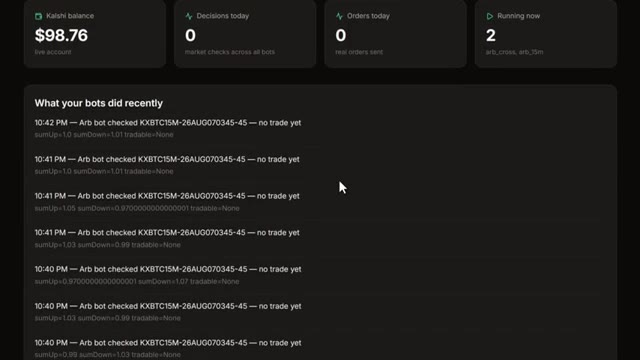
*⏱️ 00:00:15 — Tableau de bord d'une application de trading montrant le solde du compte, les statistiques des bots en cours et un journal d'activité récent.*

---

### ⏱️ `[00:00:21 - 00:00:43]` | Segment #02

**🔊 Audio (Transcription Intégrale Mot pour Mot en Français) :**
> C'est tout. Dans cette vidéo, je vous montre les résultats complets sur sept jours, en expliquant exactement comment fonctionne cet arbitrage entre les deux plateformes, en vous guidant pas à pas dans la configuration de votre propre compte Calci, et enfin en vous montrant précisément comment construire ce même bot vous-même. Entrons dans le vif du sujet. Voici donc le concept, et c'est en réalité bien plus simple que les gens ne le pensent.

**👁️ Analyse Visuelle d'Écran (gemini-3.5-flash-lite) :**
**Interface & Outils** : Navigateur web affichant le site d'Investopedia, la plateforme Kalshi et une application de bots de trading.

**Contenu textuel & Code** : Définition de l'arbitrage, options de création de compte Kalshi, et paramètres de stratégie pour le bot "BTC 15-Min Arb" et "Kalshi x Polymarket Arb".

**Action / Démonstration** : Navigation sur le site d'information, présentation de l'interface d'inscription d'un broker et démonstration des réglages d'un bot d'arbitrage automatisé.

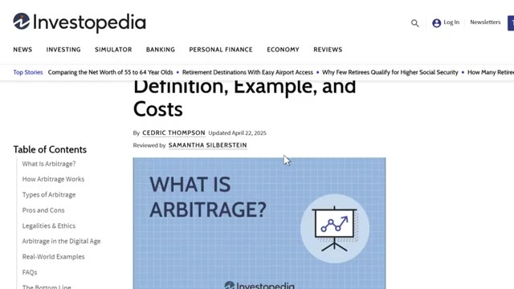
*⏱️ 00:00:27 — Capture d'écran d'un article Investopedia définissant l'arbitrage financier et ses coûts.*

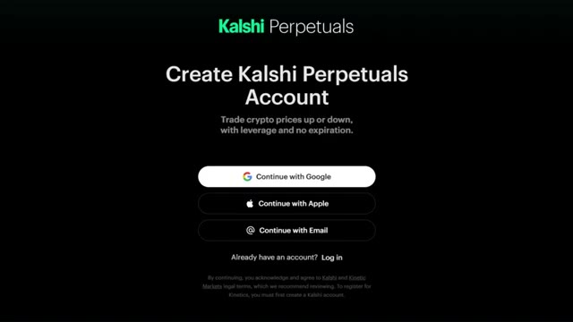
*⏱️ 00:00:32 — Page de création de compte sur la plateforme Kalshi Perpetuals permettant de trader les prix crypto.*

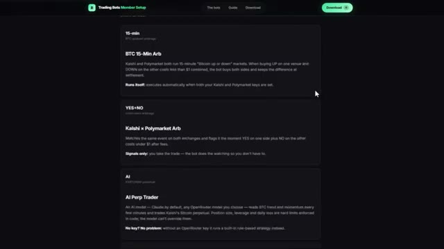
*⏱️ 00:00:38 — Interface de configuration de bots de trading affichant les options d'arbitrage Kalshi x Polymarket.*

---

### ⏱️ `[00:00:44 - 00:01:19]` | Segment #03

**🔊 Audio (Transcription Intégrale Mot pour Mot en Français) :**
> Calci et Polymarket proposent tous deux des marchés sur les mêmes événements du monde réel. Le Bitcoin atteindra-t-il un certain prix ? Une certaine équipe va-t-elle gagner ? Un certain résultat se produira-t-il à une certaine date ? Normalement, le « oui » et le « non » sur un même événement devraient faire un total d'environ 1 dollar puisque l'un d'eux doit nécessairement se produire. Mais comme il s'agit de deux plateformes complètement séparées avec des carnets d'ordres distincts et des traders différents, les prix ne s'alignent pas toujours. Parfois, le « oui » sur Calci se négocie à bas prix et le « non » sur Polymarket pour ce même événement exact se négocie également à bas prix. Et si vous achetez les deux côtés pour moins de

**👁️ Analyse Visuelle d'Écran (gemini-3.5-flash-lite) :**
**Interface & Outils** : Sites web de marchés de prédiction (Polymarket et Kalshi).

**Contenu textuel & Code** : Graphiques de probabilités et d'évolution des cotes pour différents scénarios (températures et résultats sportifs), options d'achat/vente et volumes d'échange.

**Action / Démonstration** : Navigation et présentation des plateformes de marchés prédictifs concurrentes.

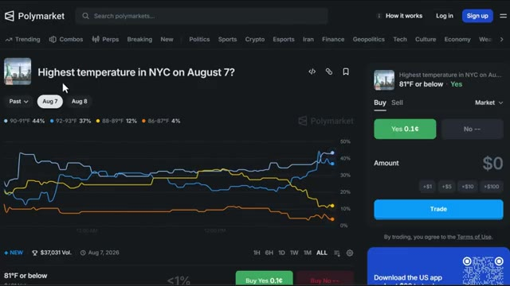
*⏱️ 00:00:52 — Capture d'écran de l'interface du site Polymarket affichant un marché de prédiction météorologique concernant la température la plus élevée à New York.*

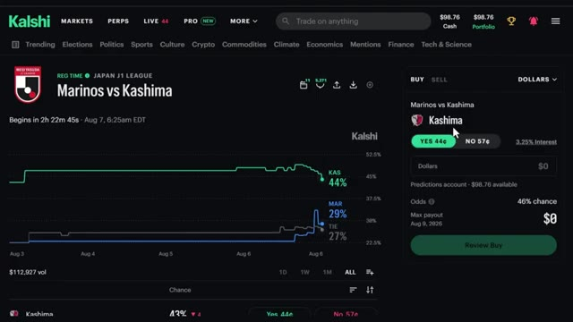
*⏱️ 00:01:10 — Capture d'écran de l'interface du site Kalshi montrant un marché de prédiction sur un match de football entre Marinos et Kashima.*

---

### ⏱️ `[00:01:19 - 00:01:52]` | Segment #04

**🔊 Audio (Transcription Intégrale Mot pour Mot en Français) :**
> un dollar combiné après les frais, vous verrouillez un profit garanti peu importe l'issue réelle de l'événement, cet écart n'existe que pendant quelques secondes ou minutes avant que quelqu'un ne le comble, ce qui explique exactement pourquoi vous voulez qu'un bot le surveille à votre place. Maintenant que vous comprenez les mécanismes derrière tout ça, allons configurer entièrement votre compte Kelsey pour que vous soyez prêt à saisir ces écarts vous-même. Donc, pour commencer, vous allez vouloir créer un compte, vous pouvez vous inscrire avec Google, Apple ou simplement avec votre adresse e-mail. Le lien est juste en bas si vous voulez y aller directement et, soit dit en passant, si

**👁️ Analyse Visuelle d'Écran (gemini-3.5-flash-lite) :**
**Interface & Outils** : Navigateur web, interface de gestion de bots de trading, plateforme Kalshi Perpetuals.

**Contenu textuel & Code** : Définition de l'arbitrage, métriques de bots (décisions, ordres, statut en cours), options de connexion de compte (Google, Apple, Email).

**Action / Démonstration** : Navigation sur une interface de bot de trading et présentation des options de connexion.

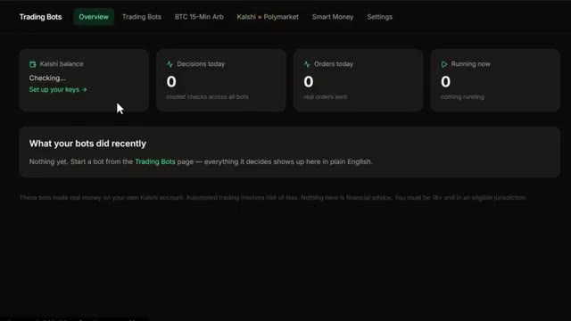
*⏱️ 00:01:35 — Tableau de bord d'interface de bots de trading affichant les métriques de surveillance et la balance Kalshi.*

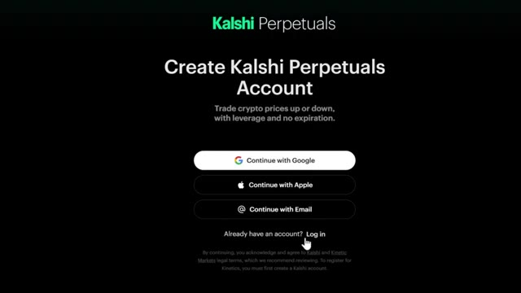
*⏱️ 00:01:44 — Page de connexion et de création de compte pour la plateforme Kalshi Perpetuals.*

---

### ⏱️ `[00:01:52 - 00:02:24]` | Segment #05

**🔊 Audio (Transcription Intégrale Mot pour Mot en Français) :**
> vous vous inscrivez via mon lien sur predictions, vous obtenez jusqu'à 500 dollars de bonus une fois que vous commencez à trader et sur perps, ce nouveau marché crypto à la hausse ou à la baisse de kalshi, vous pouvez obtenir un bonus de 25 dollars rien que pour commencer, donc ça vaut vraiment le coup de saisir ça avant de vous lancer. Si vous ne voyez pas l'invite tout de suite, allez simplement en haut à droite là où il est écrit s'inscrire et vous verrez ces mêmes options. C'est un processus assez classique, ils vous demanderont de vérifier deux ou trois choses, mais une fois que vous y êtes, vous avez pratiquement accès à tout ce que vous voyez sur mon écran en ce moment. Très bien, alors maintenant parlons

**👁️ Analyse Visuelle d'Écran (gemini-3.5-flash-lite) :**
**Interface & Outils** : Plateforme de trading et de prédiction Kalshi.

**Contenu textuel & Code** : Cours des cryptomonnaies, leviers maximaux, volumes sur 24 heures et graphiques de probabilité de marchés de prédiction.
[DESC_IMAGE_1] Navigation sur la liste des marchés de cryptomonnaies perpétuels et affichage des variations de prix.

**Action / Démonstration** : Explications face caméra et analyse conceptuelle des marchés.

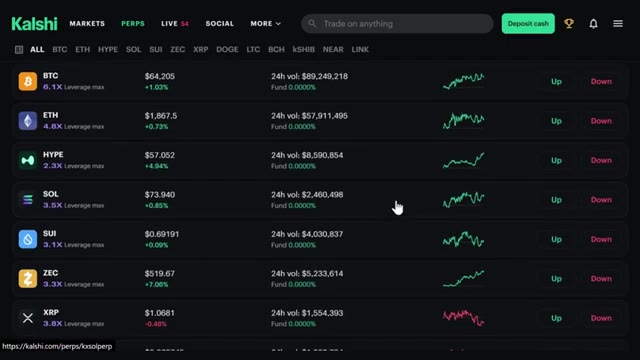
*⏱️ 00:02:00 — Image #1 (@ 00:02:00) : Interface de la plateforme Kalshi montrant la section des contrats perpétuels (perps) avec les cryptomonnaies majeures (BTC, ETH, HYPE, SOL, SUI, ZEC, XRP) et leurs boutons d'achat/vente (Up/Down).*

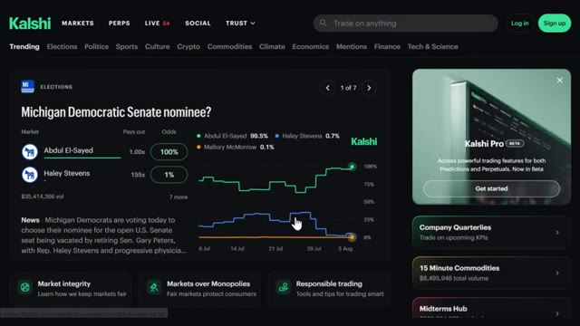
*⏱️ 00:02:08 — Image #2 (@ 00:02:08) : Vue d'ensemble de la plateforme Kalshi affichant un marché de prédiction politique (« Michigan Democratic Senate nominee? ») avec graphiques d'évolution des probabilités.*

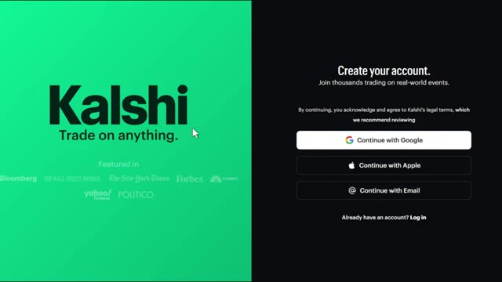
*⏱️ 00:02:16 — Image #3 (@ 00:02:16) : Page d'inscription et de création de compte de la plateforme Kalshi avec les options de connexion rapide (Google, Apple, Email).*

---

### ⏱️ `[00:02:24 - 00:02:57]` | Segment #06

**🔊 Audio (Transcription Intégrale Mot pour Mot en Français) :**
> à propos du rechargement de votre compte, car c'est ici que les gens se trompent un peu. En haut à droite, cliquez sur ces trois lignes et allez dans ajouter des fonds. C'est une première façon de faire. Vous pouvez aussi cliquer sur déposer des espèces directement sur la page d'accueil et vous verrez trois options de virement instantané : carte, Google Pay et crypto. Si vous cliquez sur plus d'options, vous verrez également le virement bancaire, qui prend au moins un jour ouvré et celui-ci a un minimum de 1 000 dollars mais pas de maximum. C'est donc plutôt destiné aux personnes qui transfèrent des montants plus importants. Maintenant, voici quelque chose d'important. Vous savez, si vous connectez votre carte ou Google Pay

**👁️ Analyse Visuelle d'Écran (gemini-3.5-flash-lite) :**
**Interface & Outils** : Kalshi (plateforme de prédictions et de trading)

**Contenu textuel & Code** : Options de dépôt de fonds : "Card" (marqué comme le plus populaire), "Google Pay", "Crypto" et "View more options", avec une mention "Instant transfer - No fees on first deposit".

**Action / Démonstration** : Sélection ou visualisation des différentes méthodes de dépôt de fonds disponibles sur la plateforme.

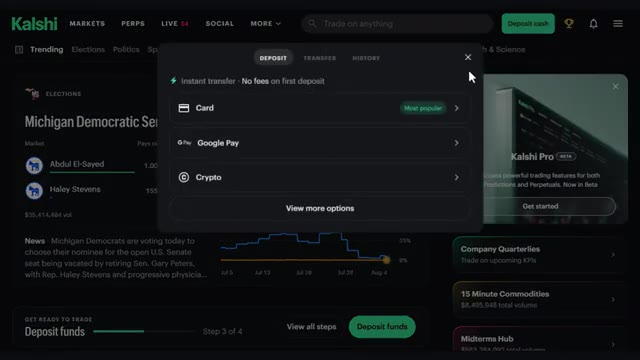
*⏱️ 00:02:32 — Interface de la plateforme Kalshi affichant une fenêtre contextuelle pour le dépôt de fonds avec plusieurs méthodes de paiement (carte, Google Pay, crypto).*

---

### ⏱️ `[00:02:57 - 00:03:32]` | Segment #07

**🔊 Audio (Transcription Intégrale Mot pour Mot en Français) :**
> il y a zéro pour cent de frais de traitement sur ceux-là, ce qui est honnêtement génial. Donc vous ne vous faites pas assommer juste pour un dépôt. Donc personnellement, si vous voulez l'option la plus rapide, je connecte simplement votre carte ou Google Pay directement et vous y êtes en quelques secondes. Mais si vous avez déjà des crypto, vous pouvez emprunter cette voie aussi. Cliquez sur l'option crypto et vous verrez trois choix. Dépôt sécurisé, dépôt standard, et acheter des crypto. Sur dépôt sécurisé, vous pouvez connecter votre compte directement depuis des plateformes comme Coinbase, Uphold, Cash App, et quelques autres. Ou si vous avez des crypto qui patientent dans un portefeuille,

**👁️ Analyse Visuelle d'Écran (gemini-3.5-flash-lite) :**
**Interface & Outils** : Kalshi (plateforme de marché de prédiction / trading)

**Contenu textuel & Code** : Menu de dépôt avec les options "Card" (marquée comme "Most popular" avec "No fees on first deposit"), "Google Pay", "Crypto" et un curseur de souris pointant sur l'option carte.

**Action / Démonstration** : Sélection de la méthode de dépôt par carte ou Google Pay pour effectuer un transfert instantané sans frais.

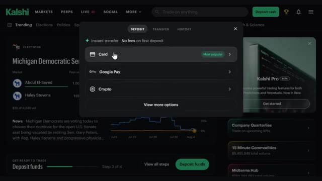
*⏱️ 00:03:06 — Interface de dépôt de la plateforme Kalshi affichant les différentes méthodes de paiement disponibles (carte, Google Pay, crypto).*

---

### ⏱️ `[00:03:32 - 00:04:07]` | Segment #08

**🔊 Audio (Transcription Intégrale Mot pour Mot en Français) :**
> vous pouvez connecter Metamask, Phantom, Trust Wallet, et plus encore. Si votre échange n'est pas répertorié, vous pouvez faire un dépôt standard à la place, tout comme un transfert de crypto normal. Choisissez votre jeton comme l'USDT, choisissez votre réseau, cliquez sur afficher l'adresse, copiez cette adresse, et allez la coller dans votre échange pour l'envoyer. Gardez simplement à l'esprit qu'il y a un minimum de 3 $ sur celui-ci. Et si vous n'avez pas du tout de crypto, vous pouvez simplement l'acheter instantanément en utilisant votre carte par l'intermédiaire de fournisseurs comme Coinbase, Cash App, ou Robinhood directement dans l'application. Si vous ne faites que débuter, je suggère d'avoir un dépôt maximum quotidien

**👁️ Analyse Visuelle d'Écran (gemini-3.5-flash-lite) :**
**Interface & Outils** : Plateforme de trading Kalshi (Interface Web)

**Contenu textuel & Code** : Menu de sélection de jetons de dépôt avec des options populaires (BTC, USDC, USDT) et autres (BNB, CASH).

**Action / Démonstration** : Sélection d'un jeton pour effectuer un dépôt de cryptomonnaie sur la plateforme.

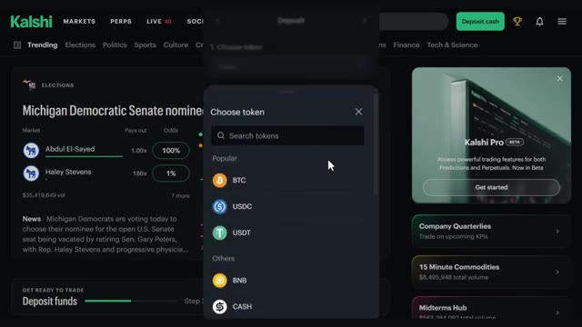
*⏱️ 00:03:41 — Capture d'écran de la plateforme Kalshi affichant une fenêtre modale pour choisir un jeton (comme BTC, USDC, USDT, BNB, CASH) lors d'un dépôt.*

---

### ⏱️ `[00:04:07 - 00:04:41]` | Segment #09

**🔊 Audio (Transcription Intégrale Mot pour Mot en Français) :**
> pas plus de 500 dollars, ce qui, honnêtement, est amplement suffisant pour la plupart des débutants. Et lier votre carte ou votre compte bancaire rend également les retraits beaucoup plus rapides puisque l'argent retourne directement au même endroit. Maintenant, avant de configurer le bot, allons chercher vos clés API d'abord. Cliquez à nouveau sur les trois lignes et cliquez sur compte et sécurité. Faites défiler vers le bas et cliquez sur créer une clé. Donnez-lui un surnom, quelque chose comme CalShe automated trading. Pour qu'il puisse trader pour vous, cliquez sur accès complet, puis cliquez sur créer. Cela vous donnera deux codes. Sauvegardez-les pour plus tard, sur quelque chose comme des notes adhésives.

**👁️ Analyse Visuelle d'Écran (gemini-3.5-flash-lite) :**
**Interface & Outils** : Plateforme de prédiction et de trading Kalshi (Interface Web).

**Contenu textuel & Code** : Menus de dépôt, options de paiement, paramètres de compte et interface de génération de clés API (Read only / Full access).

**Action / Démonstration** : Navigation dans les paramètres de la plateforme pour configurer le compte, ajouter des fonds et créer une clé API pour un bot de trading.

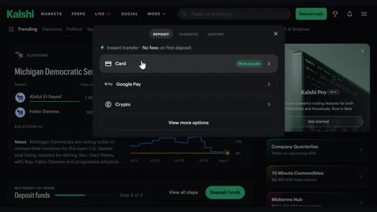
*⏱️ 00:04:16 — Fenêtre contextuelle de dépôt de fonds sur Kalshi affichant les options de paiement par carte, Google Pay et crypto.*

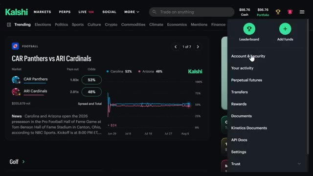
*⏱️ 00:04:24 — Menu déroulant du profil utilisateur sur Kalshi avec les options de sécurité, d'activité et de gestion des comptes.*

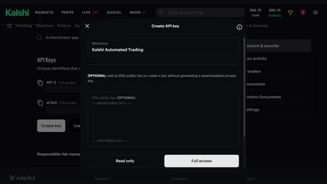
*⏱️ 00:04:32 — Fenêtre de création d'une clé API nommée "Kalshi Automated Trading" avec les permissions d'accès configurées sur la plateforme.*

---

### ⏱️ `[00:04:41 - 00:05:03]` | Segment #10

**🔊 Audio (Transcription Intégrale Mot pour Mot en Français) :**
> ou bloc-notes. Notez que cela ne sera affiché qu'une seule fois, alors copiez-le soigneusement. Maintenant, en passant aux bots, il y aura une demande de mot de passe. Entrez simplement votre mot de passe. Ensuite, entrez simplement votre clé API CalShea et votre clé privée et enregistrez. Vous avez également la possibilité d'inclure votre clé de portefeuille open router et polymarket ici. Maintenant, si vous voulez que tout cela soit déjà construit pour vous, je l'ai sur mon groupe WAP.

**👁️ Analyse Visuelle d'Écran (gemini-3.5-flash-lite) :**
**Interface & Outils** : Kalshi (plateforme de prédiction et de trading)

**Contenu textuel & Code** : Section « API Keys » listant des clés avec accès complet (« Kalshi Automated Trading », « API 2 », « ai bot »), ainsi qu'un menu latéral affichant les options « Account & security », « Your activity », « Transfers », « Documents », etc.

**Action / Démonstration** : Consultation et gestion des clés API dans les paramètres du compte utilisateur Kalshi.

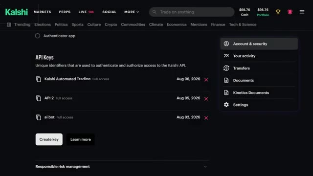
*⏱️ 00:04:46 — Capture d'écran de l'interface de la plateforme Kalshi montrant la section de gestion des clés API avec plusieurs clés créées.*

---

### ⏱️ `[00:05:04 - 00:05:36]` | Segment #11

**🔊 Audio (Transcription Intégrale Mot pour Mot en Français) :**
> Liens ci-dessous. Plus de détails là-dessus dans un instant. Très bien, une fois que vos clés sont connectées, vous arrivez directement ici sur le tableau de bord et c'est en gros votre centre de commande en haut, vous pouvez voir votre solde, le même qui est reflété directement sur votre véritable compte Kalsche, donc tout reste synchronisé en temps réel juste en dessous, vous avez les décisions que votre bot a prises aujourd'hui, les ordres passés aujourd'hui et exactement quels bots sont actuellement en cours d'exécution en direct, et si vous faites défiler vers le bas, vous trouverez les journaux en direct, en gros un compte rendu complet de tout ce que vos bots ont fait récemment, alors

**👁️ Analyse Visuelle d'Écran (gemini-3.5-flash-lite) :**
**Interface & Outils** : Interface web de bots de trading (centre de commande)

**Contenu textuel & Code** : Solde Kalshi à 98,76 $, 0 décisions aujourd'hui, 0 ordres aujourd'hui, 2 bots actifs en cours d'exécution, et un journal d'activité récent des bots.

**Action / Démonstration** : Présentation du tableau de bord principal et du centre de commande des bots de trading.

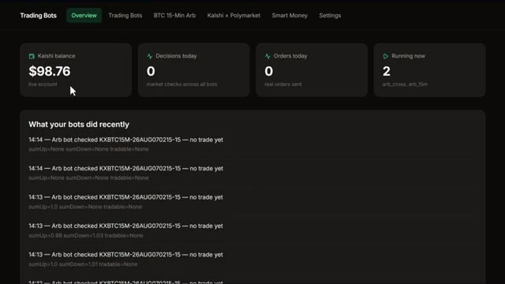
*⏱️ 00:05:12 — Tableau de bord d'une application de trading montrant le solde du compte et l'historique récent des bots d'arbitrage.*

---

### ⏱️ `[00:05:36 - 00:06:12]` | Segment #12

**🔊 Audio (Transcription Intégrale Mot pour Mot en Français) :**
> tu ne te demandes jamais ce qui se passe dans les coulisses. Maintenant, j'ai déjà créé mes propres bots pour que vous puissiez les essayer. Laissez-moi vous les présenter rapidement. Voici l'arbitrage Kalshi X Polymarket. Celui-ci associe le même événement sur les deux bourses et signale le moment où un « oui » d'un côté plus un « non » de l'autre coûte moins de 1 $ après les frais. Celui-ci est uniquement un signal. Vous prenez le trade, le bot fait juste la surveillance pour que vous n'ayez pas à le faire. Et honnêtement, c'est tout l'intérêt. Ce bot fait la seule chose qui est pratiquement impossible pour un humain de faire manuellement, c'est-à-dire surveiller deux entiers

**👁️ Analyse Visuelle d'Écran (gemini-3.5-flash-lite) :**
**Interface & Outils** : Interface web de bot de trading et plateforme Kalshi.

**Contenu textuel & Code** : Tableaux de bord de bots, statistiques de profits/pertes, graphiques de probabilités électorales et carnets d'ordres.

**Action / Démonstration** : Présentation de l'interface de bot d'arbitrage et des marchés prédictifs disponibles sur Kalshi.

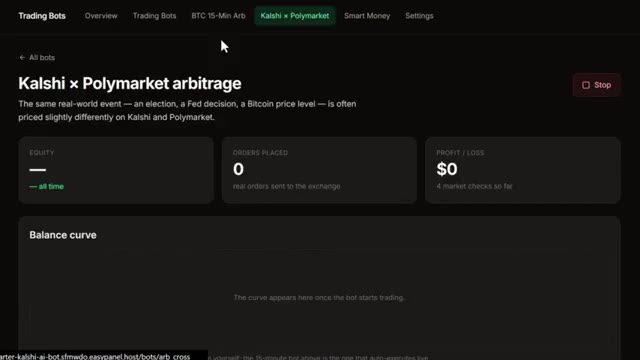
*⏱️ 00:05:45 — Interface du bot de trading affichant l'arbitrage Kalshi x Polymarket avec ses métriques et performances en direct.*

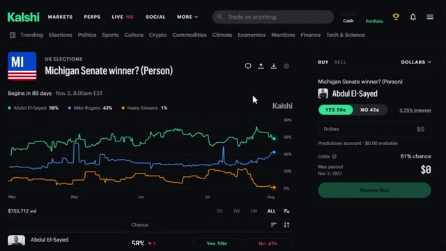
*⏱️ 00:05:54 — Interface de la plateforme Kalshi montrant le marché prédictif sur le gagnant du Sénat du Michigan avec un graphique de probabilités.*

---

### ⏱️ `[00:06:12 - 00:06:44]` | Segment #13

**🔊 Audio (Transcription Intégrale Mot pour Mot en Français) :**
> plateformes en même temps en temps réel pour un écart de prix qui pourrait n'exister que pendant quelques secondes. Vous n'êtes pas là assis à rafraîchir deux onglets toute la journée. Cela signale l'opportunité. Il vous suffit de cliquer sur le trade et cette erreur de prix est verrouillée comme un profit garanti avant qu'elle ne disparaisse. Maintenant, si vous vous intéressez plutôt au trading de perps, rappelez-vous du marché crypto à la hausse ou à la baisse que j'ai mentionné plus tôt, vous n'êtes pas bloqué à utiliser seulement les bots que j'ai créés. Vous pouvez créer votre propre stratégie personnalisée à partir de zéro en français simple, et je vais vous montrer exactement comment faire cela en ce moment même. Cliquez sur bots de trading, cliquez sur nouveau bot, et sélectionnez

**👁️ Analyse Visuelle d'Écran (gemini-3.5-flash-lite) :**
**Interface & Outils** : Polymarket et tableau de bord de bots de trading automatisés.

**Contenu textuel & Code** : Probabilités de marché (Comino à 55¢, Obradovic à 46¢), graphiques d'évolution en pourcentage, et configuration de bots connectés à un compte de trading réel.

**Action / Démonstration** : Navigation sur la plateforme de paris prédictifs Polymarket et présentation des options de bots de trading automatisés.

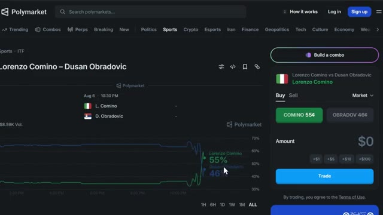
*⏱️ 00:06:20 — Capture d'écran de la plateforme Polymarket montrant un marché de paris sportifs entre Lorenzo Comino et Dusan Obradovic, avec un graphique d'évolution des prix et un panneau de passage d'ordres à droite.*

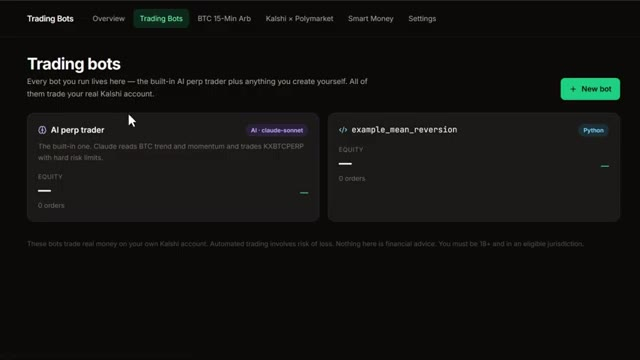
*⏱️ 00:06:36 — Interface de gestion de bots de trading affichant deux strategies configurées, 'AI perp trader' basée sur Claude et un script Python 'example_mean_reversion'.*

---

### ⏱️ `[00:06:44 - 00:07:20]` | Segment #14

**🔊 Audio (Transcription Intégrale Mot pour Mot en Français) :**
> Claude bot. Ici, vous pouvez ajouter un nom et décrire votre stratégie avec des mots. Soyez très détaillé ici. C'est littéralement là que vous lui dites ce que vous voulez que le bot fasse. Après cela, cliquez sur créer le bot, et voilà. Votre bot de trading est prêt à fonctionner. Par exemple, sur l'un des bots que j'ai créés, l'arbitrage Bitcoin sur 15 minutes, vous pouvez voir le nom, la description, les capitaux propres, les ordres passés, les profits et pertes, et la courbe de solde. Tout est ici. Vous pouvez également modifier certains paramètres, le déclencheur de la fenêtre, les contrats par côté, les secondes entre les analyses, et le capital maximum engagé en même temps.

**👁️ Analyse Visuelle d'Écran (gemini-3.5-flash-lite) :**
**Interface & Outils** : Application web de bots de trading, interface de configuration et tableau de bord de suivi (Trading Bots / Kalshi / Polymarket).

**Contenu textuel & Code** : Paramètres de gestion des risques ("Risk no more than 2% of bankroll per trade"), instructions en langage naturel pour l'IA (Claude Sonnet 4.5 via OpenRouter), et métriques de performance à zéro (Equity, Orders Placed, Profit/Loss).

**Action / Démonstration** : Configuration d'une stratégie de trading en langage naturel, nommage du bot ("Edge + Extreme Fade"), puis lancement et affichage du tableau de bord de suivi de l'arbitrage BTC 15-minute.

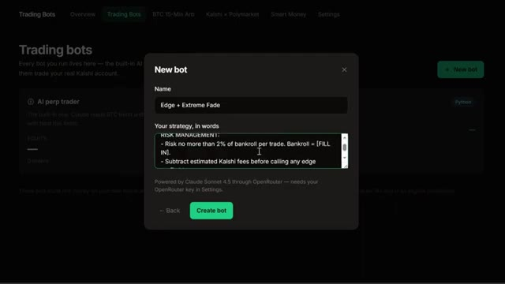
*⏱️ 00:06:53 — Interface de création d'un nouveau bot de trading avec la fenêtre modale permettant de saisir le nom et la stratégie en texte naturel.*

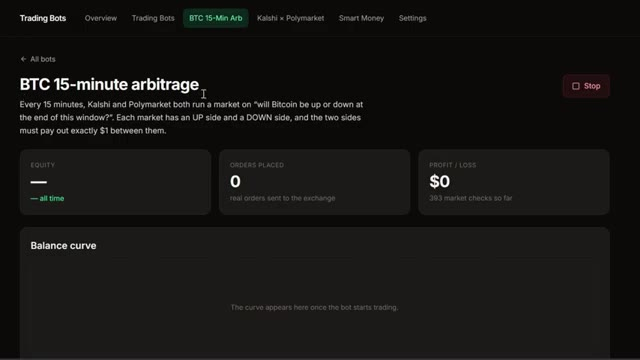
*⏱️ 00:07:02 — Tableau de bord d'un bot de trading actif affichant les performances, les ordres placés et la courbe de balance pour l'arbitrage BTC sur 15 minutes.*

---

### ⏱️ `[00:07:20 - 00:07:53]` | Segment #15

**🔊 Audio (Transcription Intégrale Mot pour Mot en Français) :**
> Une fois que vous avez terminé, cliquez simplement sur Enregistrer les paramètres. Passons maintenant aux résultats. J'ai laissé ce bot d'arbitrage tourner pendant sept jours complets, les mains libres. Donc, comme vous pouvez le voir ici, nous avons commencé avec 100 dollars. Et en regardant la courbe de rebond, c'est une tendance haussière constante avec quelques petits retraits et pertes en cours de route, ce qui est tout à fait normal. Mais il a continué à progresser chaque jour. Les capitaux propres s'établissent à 38 %, 37 ordres passés au total, et le profit et la perte ont atteint 663,28 dollars à la fin des sept jours. Et tout ça grâce à un bot qui

**👁️ Analyse Visuelle d'Écran (gemini-3.5-flash-lite) :**
**Interface & Outils** : Tableau de bord d'une application web de trading (bot d'arbitrage Kalshi x Polymarket).

**Contenu textuel & Code** : Métriques de performance : Equity de 38% (all time), 37 ordres placés, profit/loss de +$663.28 (1111 market checks), et un graphique de la courbe de balance allant d'environ 100$ le 1er août à 663.28$ le 7 août.

**Action / Démonstration** : Présentation des résultats en direct des performances du bot d'arbitrage après sept jours de fonctionnement.

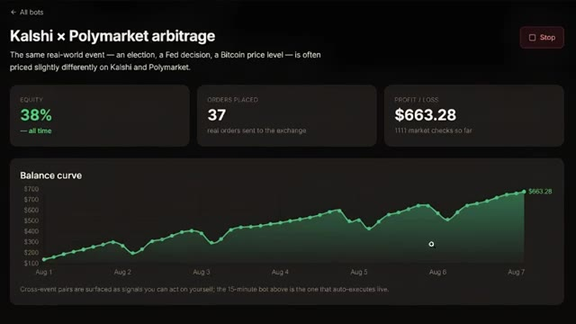
*⏱️ 00:07:28 — Capture d'écran du tableau de bord d'un bot d'arbitrage montrant les performances sur sept jours entre Kalshi et Polymarket.*

---

### ⏱️ `[00:07:53 - 00:08:26]` | Segment #16

**🔊 Audio (Transcription Intégrale Mot pour Mot en Français) :**
> assis là à capter des écarts que j'aurais complètement manqués manuellement. Je n'ai pas touché à un seul trade. Il a fait toute la surveillance, toutes les captures. J'ai juste regardé le chiffre grimper. Et c'est exactement pour ça qu'en faire tourner plusieurs à la fois est important. Plus de bots qui surveillent signifie que davantage de ces véritables écarts sont captés. Très bien, et regardez, pour les prochaines années, deux types de traders sur les marchés de prédiction vont exister. Ceux qui utilisent l'IA et ceux qui font encore tout manuellement. Mêmes marchés, résultats très différents. Voici comment vous placer du bon côté. Au sein de ma communauté AI Trade Edge, j'ai

**👁️ Analyse Visuelle d'Écran (gemini-3.5-flash-lite) :**
**Interface & Outils** : Tableau de bord de bot de trading et plateforme Kalshi

**Contenu textuel & Code** : Métriques de performance, profit/perte de 663,28 $, 37 ordres placés, et graphique d'évolution du solde entre le 1er et le 7 août.

**Action / Démonstration** : Présentation des résultats de performance d'un bot d'arbitrage automatisé et consultation d'un marché sur Kalshi.

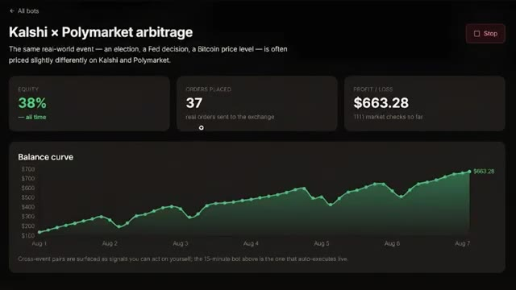
*⏱️ 00:08:01 — Capture d'écran montrant le tableau de bord d'un bot d'arbitrage entre Kalshi et Polymarket, avec une courbe de balance ascendante.*

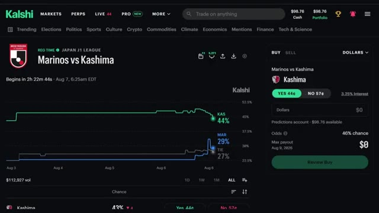
*⏱️ 00:08:09 — Interface de la plateforme Kalshi affichant un marché de prédiction sportif (Marinos vs Kashima) avec graphique de probabilités.*

---

### ⏱️ `[00:08:26 - 00:08:51]` | Segment #17

**🔊 Audio (Transcription Intégrale Mot pour Mot en Français) :**
> chaque prompt, chaque bot, chaque template que j'utilise personnellement, tous réunis au même endroit. Vous vous souvenez de ces bots Kalshi dont j'ai parlé plus tôt ? Vous les avez tous là-dedans. Un bot d'arbitrage Bitcoin 15 minutes, un bot de pricing Kalshi Polymarket et un bot smart money qui suit où se déplacent les gros portefeuilles. De plus, vous pouvez coder le vôtre en utilisant Python, Claude, TradingView ou n'importe quel modèle disponible pour vous dès maintenant.

**👁️ Analyse Visuelle d'Écran (gemini-3.5-flash-lite) :**
**Interface & Outils** : Application Web de gestion de bots de trading (dashboard personnalisé).

**Contenu textuel & Code** : Options de configuration de bots (Python script, Claude bot, Any AI model, TradingView bot) et métriques de performance du bot d'arbitrage BTC (Equity, Orders placed, P&L, Balance curve).

**Action / Démonstration** : Navigation dans l'interface de gestion et affichage des options de création de nouveaux bots de trading.

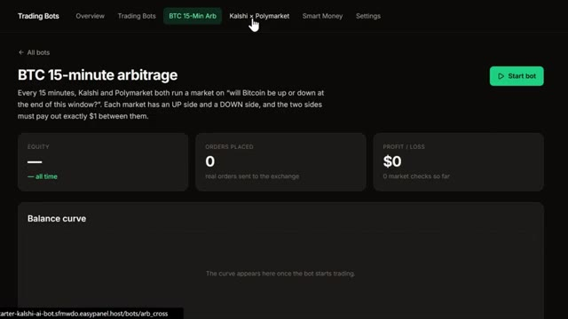
*⏱️ 00:08:32 — Interface de gestion affichant le tableau de bord du bot "BTC 15-minute arbitrage" avec les métriques d'équité et de P&L.*

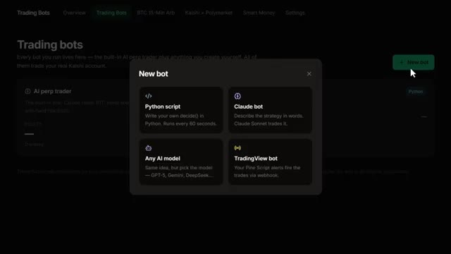
*⏱️ 00:08:45 — Fenêtre contextnelle de création de bot ("New bot") présentant différentes options technologiques : script Python, Claude bot, autre modèle IA et bot TradingView.*

---

### ⏱️ `[00:08:51 - 00:09:28]` | Segment #18

**🔊 Audio (Transcription Intégrale Mot pour Mot en Français) :**
> Il y a aussi une formation complète au trading agentique, 2 heures et demie, de débutant à expert, aucun code nécessaire. À la fin, vous aurez votre propre système de trading par IA qui tourne en direct, pour 79,99 $ par mois. Un seul bon trade le rentabilise. Les 100 premiers membres bloquent ce tarif pour toujours. Liens dans la description. Vous ne pouvez sincèrement pas vous permettre de rater ça. Et c'est exactement tout ce dont vous avez besoin pour passer de zéro au lancement de votre propre bot de marché de prédiction alimenté par l'IA. Au bout de sept jours, ce truc a déjà prouvé que l'arbitrage entre Calci et Polymarket, c'est de l'argent bien réel posé sur la table. Il vous faut juste le

**👁️ Analyse Visuelle d'Écran (gemini-3.5-flash-lite) :**
**Interface & Outils** : Whop, tableau de bord de bot de trading d'arbitrage

**Contenu textuel & Code** : Métriques de performance, courbe de balance, PnL à 663,28 $, taux d'équité à +38%

**Action / Démonstration** : Affichage des statistiques de performance d'un bot de trading en direct

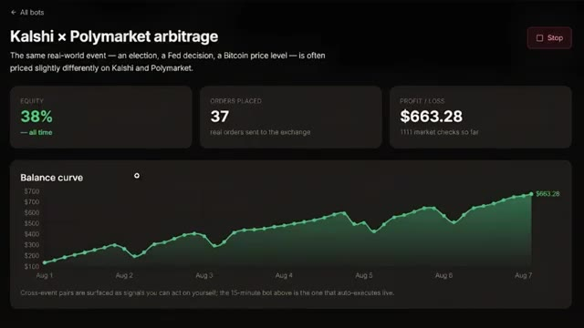
*⏱️ 00:09:19 — Tableau de bord d'un bot de trading montrant une courbe de balance ascendante et des performances de profit/perte.*

---

### ⏱️ `[00:09:28 - 00:10:00]` | Segment #19

**🔊 Audio (Transcription Intégrale Mot pour Mot en Français) :**
> le bon outil pour vraiment le saisir. Deux petites choses avant de partir. Assurez-vous de vous inscrire via le lien ci-dessous pour vraiment obtenir ce bonus de prédictions de 500 $ et le bonus perps de 25 $. C'est de l'argent réel qui travaille pour vous avant même que vous ne passiez un trade. Et deuxièmement, rejoignez le groupe WAP pour pouvoir récupérer ces bots directement ou vibe coder vos propres versions avec Claude. Si vous le souhaitez, regardez le tutoriel complet sur la façon d'utiliser Kalshi, même si vous êtes un débutant complet, jetez un œil à la vidéo qui apparaît à l'écran dès maintenant. Et si vous voulez le guide complet étape par étape sur la façon de construire votre propre

**👁️ Analyse Visuelle d'Écran (gemini-3.5-flash-lite) :**
**Interface & Outils** : Interface web de la plateforme Kalshi / Kalshi Perpetuals

**Contenu textuel & Code** : Options de création de compte, présentation de bots de trading automatisés et graphiques de marchés de prédiction (WTI Oil).

**Action / Démonstration** : Navigation sur la plateforme Kalshi pour présenter l'inscription et les outils de trading.

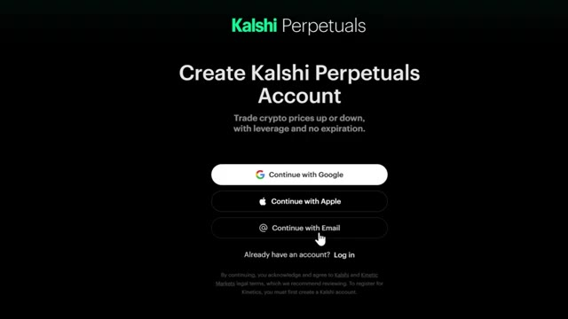
*⏱️ 00:09:36 — Page d'inscription à un compte Kalshi Perpetuals avec des options de connexion Google, Apple ou Email.*

*⏱️ 00:09:44 — Page de configuration de bots de trading affichant les fonctionnalités de self-hosting et un guide d'installation rapide.*

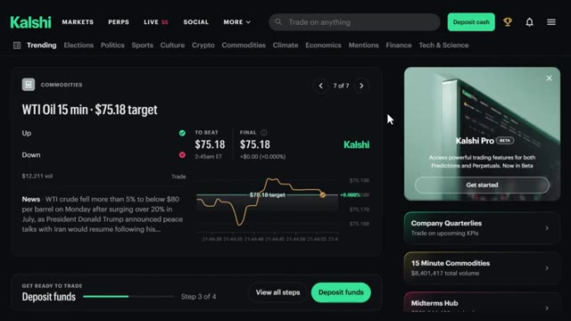
*⏱️ 00:09:52 — Tableau de bord de la plateforme Kalshi montrant les marchés de matières premières, notamment un graphique sur le pétrole WTI.*

---

### ⏱️ `[00:10:00 - 00:10:11]` | Segment #20

**🔊 Audio (Transcription Intégrale Mot pour Mot en Français) :**
> système de trading agentique utilisant Claude, cette vidéo s'affiche également à l'écran, si cela vous a aidé, laissez un like, abonnez-vous pour en voir plus et on se retrouve dans la prochaine

**👁️ Analyse Visuelle d'Écran (gemini-3.5-flash-lite) :**
**Interface & Outils** : Aucune interface visible.

**Contenu textuel & Code** : Aucun contenu, code ou graphique affiché.

**Action / Démonstration** : Aucune action ou manipulation en cours.

---

