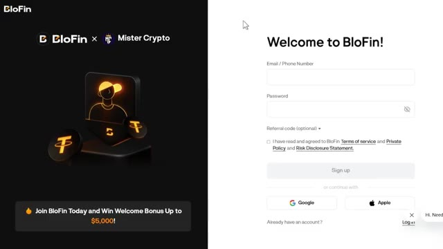
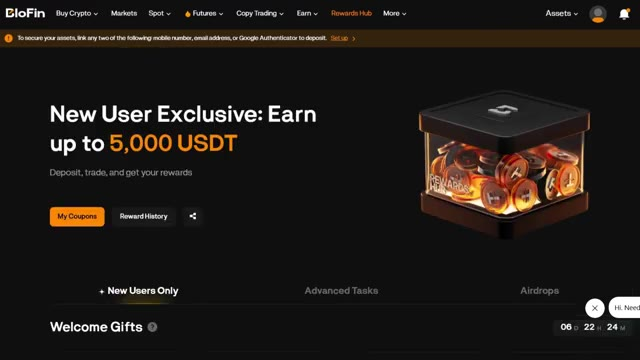

# 🎬 How I Automate My Crypto Research Using BloFin PodX (Full Beginner Tutorial)

> **Chaîne** : [Alex Carter](https://www.youtube.com/@AlexCarterTrading)  
> **Lien YouTube** : [https://www.youtube.com/watch?v=CeVEbWLMiGU](https://www.youtube.com/watch?v=CeVEbWLMiGU)  
> **Date de publication** : 20260821  
> **Durée** : 00:08:32  
> **Identifiant vidéo** : `CeVEbWLMiGU`  
> **Transcription & Analyse** : `whisper-v3-large-turbo+gemini-3.5-flash-lite`  

---

## 📌 Synthèse Exécutive & Outils

### 💡 Résumé
Dans cette vidéo intitulée **Comment j'automatise mes recherches crypto avec BloFin PodX (Tutoriel débutant complet)**, Alex Carter détaille une approche stratégique et pratique du trading et de l'automatisation par agents IA.

### 🛠️ Outils, Modèles & Logiciels Présentés
- **TradingView & Claude Code** : Analyse technique avancée et automatisation algorithmique.

### 🔑 Points Clés & Enseignements Stratégiques
- Respect rigoureux du ratio risque/rendement et du money management.
- Automatisation méthodique des déclencheurs d'ordres via des agents intelligents.

---

## ⏱️ Chronologie & Transcription Complète Audio & Visuelle (Mot pour Mot)

### ⏱️ `[00:00:00 - 00:00:35]` | Segment #01

**🔊 Audio (Transcription Intégrale Mot pour Mot en Français) :**
> Dans cette vidéo, je vais vous donner le tutoriel complet de Blowfin PODX. Je vais vous expliquer exactement ce qu'il fait, où le trouver et comment le configurer en littéralement moins de 60 secondes. Alors voilà le truc. La plupart des gens font encore leurs recherches de marché manuellement. Vérifier les graphiques, scroller sur Twitter pour évaluer le sentiment, suivre les baleines, paramétrer des alertes, tout ça complètement manuellement. Mais Blowfin vient tout juste de sortir un agent IA qui fait absolument chacune de ces choses pour vous, simplement en lui demandant en anglais simple. Pas de code, pas de syntaxe, rien de compliqué. Et restez bien jusqu'à la fin

**👁️ Analyse Visuelle d'Écran (gemini-3.5-flash-lite) :**
**Interface & Outils** : Présentation ou face-caméra explicatif du trader sans interface logicielle partagée.

**Contenu textuel & Code** : Explications orales des stratégies et mise en contexte méthodologique du marché.

**Action / Démonstration** : Explications face caméra et analyse conceptuelle des marchés.

---

### ⏱️ `[00:00:35 - 00:00:56]` | Segment #02

**🔊 Audio (Transcription Intégrale Mot pour Mot en Français) :**
> parce que je vais vous montrer la fonctionnalité d'automatisation qui permet à cette chose de travailler pour vous même pendant que vous dormez. Rien que pour cela, ça vaut la peine de regarder toute cette vidéo. Alors, sans plus attendre, commençons. Une chose importante avant de continuer : assurez-vous toujours de vous inscrire via un lien de confiance. Il y a beaucoup de sites frauduleux qui se font passer pour Blowfin.

**👁️ Analyse Visuelle d'Écran (gemini-3.5-flash-lite) :**
**Interface & Outils** : Présentation ou face-caméra explicatif du trader sans interface logicielle partagée.

**Contenu textuel & Code** : Explications orales des stratégies et mise en contexte méthodologique du marché.

**Action / Démonstration** : Explications face caméra et analyse conceptuelle des marchés.

---

### ⏱️ `[00:00:57 - 00:01:15]` | Segment #03

**🔊 Audio (Transcription Intégrale Mot pour Mot en Français) :**
> Mon lien dans la description vous amène directement sur la plateforme officielle. Et en plus de ça, lorsque vous utilisez mon lien, vous débloquez le meilleur pack de bonus disponible, y compris toutes les campagnes actives que Blowfin propose en ce moment. Alors faites-vous une faveur, utilisez le lien ci-dessous. C'est le moyen le plus sûr et le plus avantageux pour commencer.

**👁️ Analyse Visuelle d'Écran (gemini-3.5-flash-lite) :**
**Interface & Outils** : Plateforme web du courtier BloFin (pages d'enregistrement et Rewards Hub).

**Contenu textuel & Code** : Formulaire d'inscription, mention « Welcome Bonus Up to $5,000! », onglets Rewards Hub (« New Users Only », « Advanced Tasks », « Airdrops ») et détails des bonus USDT.

**Action / Démonstration** : Présentation de la page d'inscription via le lien affilié et des bonus de dépôt disponibles sur la plateforme BloFin.

*⏱️ 00:01:01 — Page d'inscription de BloFin affichant l'offre de bienvenue partenaire jusqu'à 5 000 $.*

*⏱️ 00:01:06 — Page Rewards Hub de BloFin mettant en avant les récompenses pour nouveaux utilisateurs jusqu'à 5 000 USDT.*

---

### ⏱️ `[00:01:15 - 00:01:50]` | Segment #04

**🔊 Audio (Transcription Intégrale Mot pour Mot en Français) :**
> It takes less than a minute to create your account. Once you're logged in, make sure you have funds in your account. If you need to deposit, just go to Assets, click Deposit, select USDT, choose your network, I recommend TRC20 for low fees, and send your funds. They'll arrive in a few minutes. So first, let's talk about what Blowfin PODX actually is. Think of it as one single AI agent that replaces basically your entire research and automation stack. So on the market and insight side, it can pull real-time trading data, track social sentiment, monitor whale activity, and keep

**👁️ Analyse Visuelle d'Écran (gemini-3.5-flash-lite) :**
**Interface & Outils** : Présentation ou face-caméra explicatif du trader sans interface logicielle partagée.

**Contenu textuel & Code** : Explications orales des stratégies et mise en contexte méthodologique du marché.

**Action / Démonstration** : Explications face caméra et analyse conceptuelle des marchés.

---

### ⏱️ `[00:01:50 - 00:02:24]` | Segment #05

**🔊 Audio (Transcription Intégrale Mot pour Mot en Français) :**
> surveille le marché pour vous 24 heures sur 24. Ensuite, du côté de l'analyse et de l'exécution, il peut exécuter une analyse technique, une analyse on-chain, une analyse quantitative, invoquer des outils, générer des rapports complets, et même tester des stratégies pour vous à l'aide d'un bac à sable de code intégré. Et il vous remettra un rapport de performance complet. C'est là que ça devient vraiment intéressant. Le côté automatisation. Vous pouvez configurer des tâches planifiées, des déclencheurs conditionnels, des envois d'alertes et des flux de travail récurrents. Donc, par exemple, vous pourriez lui dire de scanner les 10 principales crypto-monnaies par volume tous les matins à

**👁️ Analyse Visuelle d'Écran (gemini-3.5-flash-lite) :**
**Interface & Outils** : Présentation ou face-caméra explicatif du trader sans interface logicielle partagée.

**Contenu textuel & Code** : Explications orales des stratégies et mise en contexte méthodologique du marché.

**Action / Démonstration** : Explications face caméra et analyse conceptuelle des marchés.

---

### ⏱️ `[00:02:24 - 00:02:58]` | Segment #06

**🔊 Audio (Transcription Intégrale Mot pour Mot en Français) :**
> 8 heures et vous envoie un point sur le marché. Et il fera simplement cela automatiquement chaque jour. En plus de cela, il regroupe des actualité en temps réel, effectue des recherches sur le web, suit les données macroéconomiques et résume le tout à partir de multiples sources. Et comme il se souvient du contexte de votre conversation et de vos préférences, il comprend réellement l'intention et planifie des flux de travail en plusieurs étapes au lieu de simplement répondre à une seule question à la fois. Donc en gros, un seul agent, toutes les capacités d'automatisation. C'est la façon la plus simple de le formuler. Maintenant, parlons de l'endroit où vous trouvez réellement ce truc. Vous allez sur le principal

**👁️ Analyse Visuelle d'Écran (gemini-3.5-flash-lite) :**
**Interface & Outils** : Présentation ou face-caméra explicatif du trader sans interface logicielle partagée.

**Contenu textuel & Code** : Explications orales des stratégies et mise en contexte méthodologique du marché.

**Action / Démonstration** : Explications face caméra et analyse conceptuelle des marchés.

---

### ⏱️ `[00:02:58 - 00:03:19]` | Segment #07

**🔊 Audio (Transcription Intégrale Mot pour Mot en Français) :**
> Blowfin homepage and up top you're going to click on more. Then on the lower left side of that menu you're going to click on Blowfin PODX and that's going to bring you straight to the simple page right here. And that's it. No digging through settings, no hidden menu, nothing complicated. Two clicks and you're there. All right so now that we're on the page let's actually get you set up.

**👁️ Analyse Visuelle d'Écran (gemini-3.5-flash-lite) :**
**Interface & Outils** : Présentation ou face-caméra explicatif du trader sans interface logicielle partagée.

**Contenu textuel & Code** : Explications orales des stratégies et mise en contexte méthodologique du marché.

**Action / Démonstration** : Explications face caméra et analyse conceptuelle des marchés.

---

### ⏱️ `[00:03:19 - 00:03:55]` | Segment #08

**🔊 Audio (Transcription Intégrale Mot pour Mot en Français) :**
> and this genuinely takes about three steps. Step one, you're simply going to click launch on telegram. There's no registration complexity here, no software to install. A window is going to pop up and all you have to do is click start. That's it. You're in. Step two, and this is honestly my favorite part. There's no syntax and no format you need to learn. You just ask it what you want in plain English. So for example, you could type something like scan the top 10 coins by volume every morning at 8 a.m. and send me a market brief. Or give me the price of Bitcoin and what's the

**👁️ Analyse Visuelle d'Écran (gemini-3.5-flash-lite) :**
**Interface & Outils** : Présentation ou face-caméra explicatif du trader sans interface logicielle partagée.

**Contenu textuel & Code** : Explications orales des stratégies et mise en contexte méthodologique du marché.

**Action / Démonstration** : Explications face caméra et analyse conceptuelle des marchés.

---

### ⏱️ `[00:03:55 - 00:04:15]` | Segment #09

**🔊 Audio (Transcription Intégrale Mot pour Mot en Français) :**
> sentiment for the one hour chart. That's literally it. You don't need to know any commands. Step three, Blowfin Pod X takes it from there. It understands your intent, plans out the tasks it needs to do, calls whatever tools it needs, and sends the results directly back to you in Telegram. So really, that's your entire setup. Launch it, ask it what you want, and let it work.

**👁️ Analyse Visuelle d'Écran (gemini-3.5-flash-lite) :**
**Interface & Outils** : Présentation ou face-caméra explicatif du trader sans interface logicielle partagée.

**Contenu textuel & Code** : Explications orales des stratégies et mise en contexte méthodologique du marché.

**Action / Démonstration** : Explications face caméra et analyse conceptuelle des marchés.

---

### ⏱️ `[00:04:15 - 00:04:49]` | Segment #10

**🔊 Audio (Transcription Intégrale Mot pour Mot en Français) :**
> right there inside Telegram, which means you don't even need to open a new app. Now let's go a little deeper into the features because I do think this is where people are going to realize how insane this actually is. On the market and insight side, you've got real-time trading data, social sentiment tracking, whale tracking, and full market monitoring. So you're never trading blind. Then for analysis and execution, it's not just pulling data, it's actually analyzing it. Technical analysis, on-chain analysis, quantitative analysis,

**👁️ Analyse Visuelle d'Écran (gemini-3.5-flash-lite) :**
**Interface & Outils** : Présentation ou face-caméra explicatif du trader sans interface logicielle partagée.

**Contenu textuel & Code** : Explications orales des stratégies et mise en contexte méthodologique du marché.

**Action / Démonstration** : Explications face caméra et analyse conceptuelle des marchés.

---

### ⏱️ `[00:04:49 - 00:05:21]` | Segment #11

**🔊 Audio (Transcription Intégrale Mot pour Mot en Français) :**
> tool invocation, and it generates full reports for you. And this is the part I really like, the backtesting. You can backtest a strategy using its built-in code sandbox, and it'll return an actual performance report so you know if your strategy would have worked before you ever risk real money on it. For automation, you've got scheduled tasks, conditional triggers, alert pushes, task orchestration, and recurring automation, meaning you set it up once and it just keeps running. On the information side, it's pulling real-time news, doing live web searches,

**👁️ Analyse Visuelle d'Écran (gemini-3.5-flash-lite) :**
**Interface & Outils** : Présentation ou face-caméra explicatif du trader sans interface logicielle partagée.

**Contenu textuel & Code** : Explications orales des stratégies et mise en contexte méthodologique du marché.

**Action / Démonstration** : Explications face caméra et analyse conceptuelle des marchés.

---

### ⏱️ `[00:05:22 - 00:05:41]` | Segment #12

**🔊 Audio (Transcription Intégrale Mot pour Mot en Français) :**
> tracking macro trends, aggregating news from multiple sources, and summarizing all of it into something you can actually read in 30 seconds instead of scrolling for an hour. And then finally, memory and context. It remembers the conversation, understands your intent, plans multi-step workflows, and keeps your preferences consistent.

**👁️ Analyse Visuelle d'Écran (gemini-3.5-flash-lite) :**
**Interface & Outils** : Présentation ou face-caméra explicatif du trader sans interface logicielle partagée.

**Contenu textuel & Code** : Explications orales des stratégies et mise en contexte méthodologique du marché.

**Action / Démonstration** : Explications face caméra et analyse conceptuelle des marchés.

---

### ⏱️ `[00:05:42 - 00:06:03]` | Segment #13

**🔊 Audio (Transcription Intégrale Mot pour Mot en Français) :**
> So it genuinely feels like it's learning how you like things done. Now, a few quick things you're probably wondering. Do you need programming skills? No. It's built entirely for natural language, so you just describe what you want. What can it do right now? Real-time trading data, market news, backtesting, and full automation workflows are all already live.

**👁️ Analyse Visuelle d'Écran (gemini-3.5-flash-lite) :**
**Interface & Outils** : Présentation ou face-caméra explicatif du trader sans interface logicielle partagée.

**Contenu textuel & Code** : Explications orales des stratégies et mise en contexte méthodologique du marché.

**Action / Démonstration** : Explications face caméra et analyse conceptuelle des marchés.

---

### ⏱️ `[00:06:03 - 00:06:35]` | Segment #14

**🔊 Audio (Transcription Intégrale Mot pour Mot en Français) :**
> Which platform does it use? Telegram is the main channel right now. And is it free? Yes, currently it's completely free and open to all Blowfin users. So honestly, there's zero reason not to try this. Go to the Blowfin homepage, click more, then Blowfin PodX, click launch on Telegram, hit start and just ask it to do something for you. Anything, even something simple like a morning market brief. All right, and look, for the next few years, two kinds of traders will exist. The ones using AI and the ones

**👁️ Analyse Visuelle d'Écran (gemini-3.5-flash-lite) :**
**Interface & Outils** : Présentation ou face-caméra explicatif du trader sans interface logicielle partagée.

**Contenu textuel & Code** : Explications orales des stratégies et mise en contexte méthodologique du marché.

**Action / Démonstration** : Explications face caméra et analyse conceptuelle des marchés.

---

### ⏱️ `[00:06:35 - 00:07:12]` | Segment #15

**🔊 Audio (Transcription Intégrale Mot pour Mot en Français) :**
> still doing everything manually same market very different outcomes here is how you get on the right side of that i have put together everything inside the ai trade edge community every prompt every bot every template every step-by-step guide i personally use all in one place and everything i build going forward gets added straight into the group the moment it drops we are also testing strategies from all over the internet automating them using pine script running them live and sharing exactly what works and what does not so you are not just getting tools you are getting a

**👁️ Analyse Visuelle d'Écran (gemini-3.5-flash-lite) :**
**Interface & Outils** : Présentation ou face-caméra explicatif du trader sans interface logicielle partagée.

**Contenu textuel & Code** : Explications orales des stratégies et mise en contexte méthodologique du marché.

**Action / Démonstration** : Explications face caméra et analyse conceptuelle des marchés.

---

### ⏱️ `[00:07:12 - 00:07:44]` | Segment #16

**🔊 Audio (Transcription Intégrale Mot pour Mot en Français) :**
> live research operation inside there is also a full agentic trading course 2.5 hours beginner to expert no coding background needed by the end of it you will have your own ai trading system running live something most retail traders do not even know is possible right now 79.99 a month one good trade covers it and the first 100 members lock in that rate permanently after that the price goes up the link is in the description you genuinely cannot afford to miss this anyways that's really all there

**👁️ Analyse Visuelle d'Écran (gemini-3.5-flash-lite) :**
**Interface & Outils** : Présentation ou face-caméra explicatif du trader sans interface logicielle partagée.

**Contenu textuel & Code** : Explications orales des stratégies et mise en contexte méthodologique du marché.

**Action / Démonstration** : Explications face caméra et analyse conceptuelle des marchés.

---

### ⏱️ `[00:07:44 - 00:08:19]` | Segment #17

**🔊 Audio (Transcription Intégrale Mot pour Mot en Français) :**
> is to it one agent doing basically every automation and research task you'd normally do manually market insights analysis execution automation and memory all in one place all through telegram all for free right now if you want to watch the full walkthrough on how to trade manually on blowfin even if you're a complete beginner click on the video popping on screen right now and if you want the full step-by-step guide on how to build your own agentic trading system using claude that video is popping up on screen as well go and check that out next if this video helped you out

**👁️ Analyse Visuelle d'Écran (gemini-3.5-flash-lite) :**
**Interface & Outils** : Présentation ou face-caméra explicatif du trader sans interface logicielle partagée.

**Contenu textuel & Code** : Explications orales des stratégies et mise en contexte méthodologique du marché.

**Action / Démonstration** : Explications face caméra et analyse conceptuelle des marchés.

---

### ⏱️ `[00:08:19 - 00:08:32]` | Segment #18

**🔊 Audio (Transcription Intégrale Mot pour Mot en Français) :**
> definitely drop a like, subscribe, and let me know down in the comments what's the first automation you're going to set up with PodX. I'm genuinely curious to see what you guys come up with. Anyways, I'll see you in the next video.

**👁️ Analyse Visuelle d'Écran (gemini-3.5-flash-lite) :**
**Interface & Outils** : Présentation ou face-caméra explicatif du trader sans interface logicielle partagée.

**Contenu textuel & Code** : Explications orales des stratégies et mise en contexte méthodologique du marché.

**Action / Démonstration** : Explications face caméra et analyse conceptuelle des marchés.

---

