# 🎬 How I Automated a Bollinger Bands + RSI Range Strategy Using Claude Code (Full Beginner Tutorial)

> **Chaîne** : [Alex Carter](https://www.youtube.com/@AlexCarterTrading)  
> **Lien YouTube** : [https://www.youtube.com/watch?v=6GP5_oezJhg](https://www.youtube.com/watch?v=6GP5_oezJhg)  
> **Date de publication** : 20260915  
> **Durée** : 00:10:20  
> **Identifiant vidéo** : `6GP5_oezJhg`  
> **Transcription & Analyse** : `whisper-v3-large-turbo+gemini-3.5-flash-lite`  

---

## 📌 Synthèse Exécutive & Outils

### 💡 Résumé
Dans cette vidéo intitulée **Comment j'ai automatisé une stratégie de range Bandes de Bollinger + RSI avec Claude Code (Tutoriel débutant complet)**, Alex Carter détaille une approche stratégique et pratique du trading et de l'automatisation par agents IA.

### 🛠️ Outils, Modèles & Logiciels Présentés
- **TradingView & Claude Code** : Analyse technique avancée et automatisation algorithmique.

### 🔑 Points Clés & Enseignements Stratégiques
- Respect rigoureux du ratio risque/rendement et du money management.
- Automatisation méthodique des déclencheurs d'ordres via des agents intelligents.

---

## ⏱️ Chronologie & Transcription Complète Audio & Visuelle (Mot pour Mot)

### ⏱️ `[00:00:00 - 00:00:21]` | Segment #01

**🔊 Audio (Transcription Intégrale Mot pour Mot en Français) :**
> Les marchés peuvent être stables ou évoluer dans un range pendant quelques jours ou quelques semaines. Et si votre principal revenu provient du trading, avoir une stratégie pour ce type de marché n'est pas optionnel. C'est essentiel. Donc, dans la vidéo d'aujourd'hui, je vais vous donner une stratégie de range complète que vous pouvez commencer à utiliser dès maintenant. En utilisant deux indicateurs que vous avez probablement déjà sur votre graphique.

**👁️ Analyse Visuelle d'Écran (gemini-3.5-flash-lite) :**
**Interface & Outils** : Plateforme de graphiques TradingView intégrée avec des courtiers (BloFin, Bybit).

**Contenu textuel & Code** : Graphique crypto (Bitcoin), unités de temps (8h, 30m), indicateur RSI, zones de range surlignées et outil de gestion du risque (Risk/Reward ratio).

**Action / Démonstration** : Analyse graphique de zones de range et illustration d'une stratégie de trading avec un ratio gain/risque mesuré.

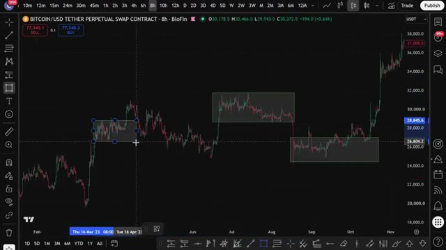
*⏱️ 00:00:05 — Graphique en chandeliers japonais sur BloFin montrant l'actif BITCOIN/USD avec des zones de prix encadrées pour illustrer les phases de consolidation (range).*

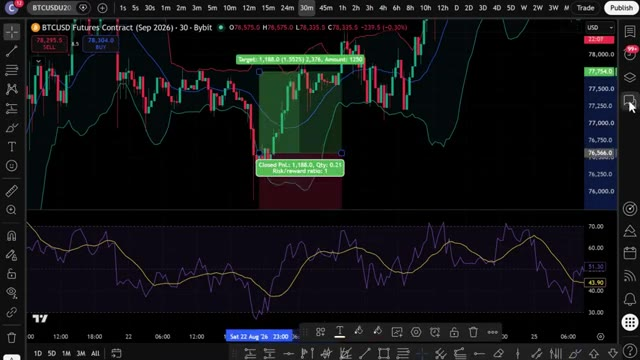
*⏱️ 00:00:10 — Graphique de trading sur Bybit en unité de temps 30 minutes affichant un indicateur technique de type RSI en bas et un outil de mesure de position (Risk/Reward).*

---

### ⏱️ `[00:00:21 - 00:00:43]` | Segment #02

**🔊 Audio (Transcription Intégrale Mot pour Mot en Français) :**
> Je vais vous montrer exactement quoi chercher, comment entrer, comment sortir. Et ensuite, je vais vous montrer le prompt exact que j'ai utilisé pour transformer toute cette stratégie manuelle en un PineScript entièrement automatisé qui trace tout pour vous sur TradingView. Maintenant, le meilleur côté de cette stratégie, c'est qu'elle n'est pas seulement pour la crypto, que vous négociez des actions, du Forex, ou des contrats à terme.

**👁️ Analyse Visuelle d'Écran (gemini-3.5-flash-lite) :**
**Interface & Outils** : TradingView

**Contenu textuel & Code** : Graphique de prix BTCUSD (bougies vertes et rouges), bandes de Bollinger ou indicateur de volatilité superposé, et un oscillateur en panneau inférieur avec des lignes de surachat/survente. Des cercles tracés à la main entourent un point d'inflexion sur le graphique de prix et un pic sur l'oscillateur.

**Action / Démonstration** : Analyse visuelle manuelle de la stratégie de trading, ciblant un point d'entrée ou de retournement potentiel basé sur le croisement ou la sortie de zone de l'oscillateur.

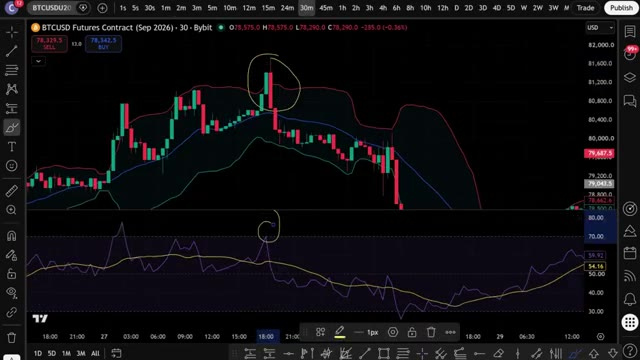
*⏱️ 00:00:27 — Graphique en chandeliers japonais sur TradingView montrant le contrat Futures BTCUSD (Bybit) en unité de temps 30 minutes, avec des annotations manuelles entourant un chandelier et un indicateur technique de type RSI ou oscillateur en bas.*

---

### ⏱️ `[00:00:44 - 00:01:04]` | Segment #03

**🔊 Audio (Transcription Intégrale Mot pour Mot en Français) :**
> Cela fonctionne exactement de la même manière parce que les marchés sans tendance se produisent dans toutes les classes d'actifs. Donc, sans plus tarder, entrons dans le vif du sujet. Très bien, les gars. Première étape, inscrivez-vous sur une plateforme d'échange. Pour cette stratégie, nous allons utiliser Bybit. C'est l'une de mes principales plateformes pour le trading de dérivés, et ils proposent des bonus incroyables en ce moment.

**👁️ Analyse Visuelle d'Écran (gemini-3.5-flash-lite) :**
**Interface & Outils** : Plateforme d'échange Bybit et interface TradingView.

**Contenu textuel & Code** : Formulaire d'inscription, code de parrainage 17185, récompenses de bienvenue jusqu'à 30 000 $, volume de trading de 28,4 milliards de dollars.

**Action / Démonstration** : Présentation de la plateforme d'échange recommandée pour suivre la stratégie de trading.

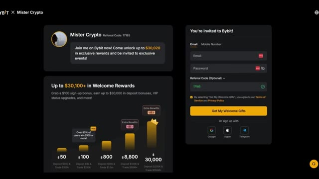
*⏱️ 00:00:54 — Page d'inscription de la plateforme d'échange Bybit avec les récompenses de bienvenue et le code de parrainage de Mister Crypto.*

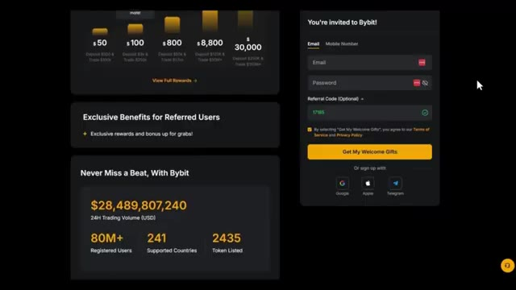
*⏱️ 00:00:59 — Suite de la page d'inscription de Bybit montrant les statistiques de la plateforme, notamment le volume de trading sur 24 heures.*

---

### ⏱️ `[00:01:04 - 00:01:23]` | Segment #04

**🔊 Audio (Transcription Intégrale Mot pour Mot en Français) :**
> Maintenant, voici la partie importante. Si Bybit n'est pas disponible dans votre pays ou si vous ne voulez pas faire de KYC, vous pouvez utiliser BingX comme alternative. Et le meilleur ? BingX ne requiert pas de vérification KYC obligatoire pour le trading de base. BingX offre également jusqu'à 9 800 USDT de bonus de bienvenue.

**👁️ Analyse Visuelle d'Écran (gemini-3.5-flash-lite) :**
**Interface & Outils** : Bybit, BingX (plateformes d'échange de cryptomonnaies)

**Contenu textuel & Code** : Offres de bonus, récompenses de dépôt et formulaire d'inscription avec code de parrainage.

**Action / Démonstration** : Navigation sur les sites internet des courtiers pour présenter les alternatives de trading.

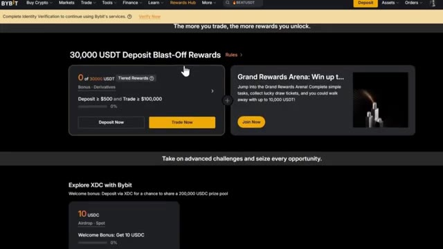
*⏱️ 00:01:09 — Capture d'écran de l'interface de l'échange Bybit montrant le centre de récompenses et les bonus de dépôt.*

*⏱️ 00:01:13 — Page d'accueil de la plateforme BingX affichant des promotions et actualités sur les cryptomonnaies.*

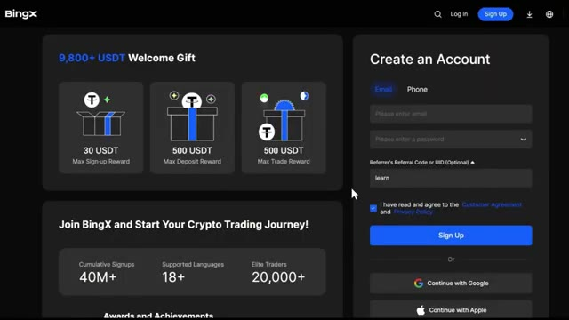
*⏱️ 00:01:18 — Page d'inscription de l'échange BingX mettant en avant un bonus de bienvenue de 9800 USDT.*

---

### ⏱️ `[00:01:23 - 00:01:45]` | Segment #05

**🔊 Audio (Transcription Intégrale Mot pour Mot en Français) :**
> Je mettrai les deux liens en description. Mais pour cette vidéo, nous utiliserons Bybit. Pour vous inscrire sur Bybit et réclamer jusqu'à 30 000 $ USDT de bonus, cliquez sur le lien tout en haut de la description. Vous serez redirigé vers la page d'inscription où il vous suffit d'entrer vos informations et de créer un compte. Vous devrez effectuer la vérification KYC sur Bybit pour profiter de tous les services de leur plateforme.

**👁️ Analyse Visuelle d'Écran (gemini-3.5-flash-lite) :**
**Interface & Outils** : Interface web de l'échangeur de cryptomonnaies Bybit.

**Contenu textuel & Code** : Offres de bonus de bienvenue allant jusqu'à 30 000 $ USDT, champs pour email/mot de passe, code de parrainage et statistiques de la plateforme.

**Action / Démonstration** : Présentation du processus d'inscription et des bonus sur Bybit via le lien d'affiliation.

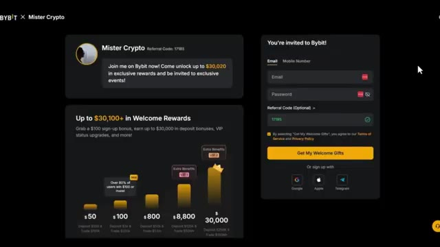
*⏱️ 00:01:29 — Page d'inscription de l'échangeur Bybit affichant les bonus de bienvenue et le formulaire de création de compte.*

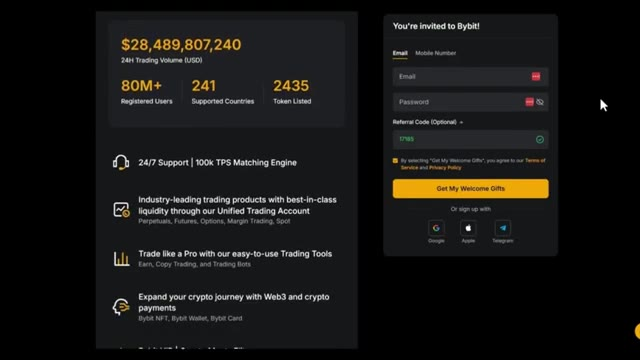
*⏱️ 00:01:34 — Page d'inscription Bybit mettant en avant les statistiques de la plateforme (volume, utilisateurs enregistrés) et le formulaire.*

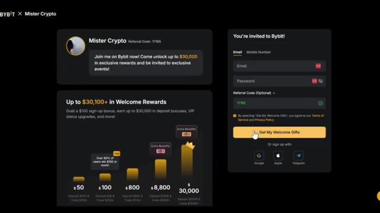
*⏱️ 00:01:39 — Page d'inscription Bybit montrant le curseur de la souris sur le bouton d'inscription pour réclamer les cadeaux de bienvenue.*

---

### ⏱️ `[00:01:45 - 00:02:07]` | Segment #06

**🔊 Audio (Transcription Intégrale Mot pour Mot en Français) :**
> Personnellement, je n'aucun problème avec le KYC. C'est rapide et sécurisé. Mais si vous préférez une option KYC non obligatoire, c'est pourquoi j'ai fourni BingX comme alternative ci-dessous. L'étape 2 consiste à déposer des fonds. Laissez-moi vous montrer comment déposer des fonds avant que nous ne plongions dans la stratégie. Une fois que vous êtes connecté à Bybit, cliquez sur Actifs dans le coin supérieur droit, puis cliquez sur Dépôt.

**👁️ Analyse Visuelle d'Écran (gemini-3.5-flash-lite) :**
**Interface & Outils** : Sites web des courtiers BingX et Bybit.

**Contenu textuel & Code** : Offres promotionnelles de bienvenue (USDT Welcome Gift), statistiques de la plateforme BingX, et options d'investissement On-Chain Earn sur Bybit.

**Action / Démonstration** : Navigation et présentation des interfaces des plateformes d'échange BingX et Bybit.

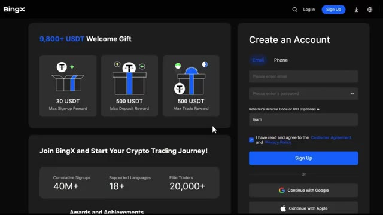
*⏱️ 00:01:51 — Interface d'inscription de l'échange de cryptomonnaies BingX montrant les bonus de bienvenue et le formulaire de création de compte.*

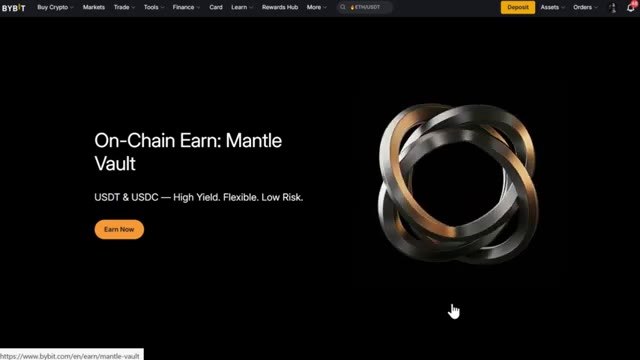
*⏱️ 00:02:01 — Page d'accueil de la plateforme Bybit mettant en avant le service On-Chain Earn: Mantle Vault.*

---

### ⏱️ `[00:02:07 - 00:02:31]` | Segment #07

**🔊 Audio (Transcription Intégrale Mot pour Mot en Français) :**
> Choisissez la pièce que vous souhaitez déposer. Je recommande l'USDT et sélectionnez le réseau de blockchain correct. Assurez-vous de choisir le bon réseau pour éviter de perdre vos fonds. Nous confirmerons les détails, puis scannez le code QR ou copiez l'adresse de dépôt pour transférer vos fonds depuis votre portefeuille ou un autre échange. Si vous souhaitez déposer en monnaie fiat, cliquez sur Acheter des cryptos en haut du menu, puis sélectionnez Dépôt fiat.

**👁️ Analyse Visuelle d'Écran (gemini-3.5-flash-lite) :**
**Interface & Outils** : Bybit (échange de cryptomonnaies)

**Contenu textuel & Code** : Page de dépôt avec la sélection de l'USDT (Tether), le menu déroulant du choix de la chaîne (TRON TRC20, Ethereum ERC20, Mantle Network) et un avertissement de sécurité sur le choix du réseau.

**Action / Démonstration** : Sélection du réseau de blockchain TRC20 pour effectuer un dépôt d'USDT sur Bybit.

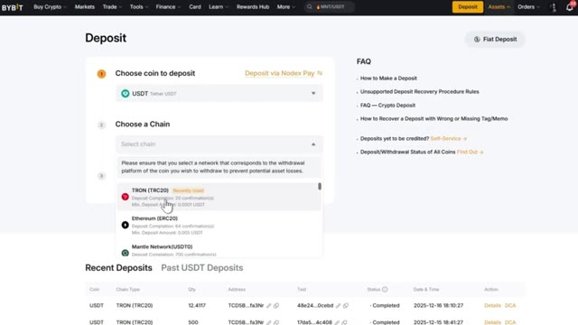
*⏱️ 00:02:13 — Interface de dépôt de la plateforme d'échange Bybit montrant la sélection de la crypto USDT et du réseau blockchain TRON (TRC20).*

---

### ⏱️ `[00:02:32 - 00:02:50]` | Segment #08

**🔊 Audio (Transcription Intégrale Mot pour Mot en Français) :**
> Choisissez votre devise, entrez le montant, sélectionnez votre mode de paiement et cliquez sur Continuer. Une fois vos fonds déposés, il est temps d'ouvrir une position. La troisième étape consiste à ouvrir votre première position. Cliquez sur « trade » dans le menu supérieur, puis sélectionnez « futures ». Cela vous mènera à l'interface de trading.

**👁️ Analyse Visuelle d'Écran (gemini-3.5-flash-lite) :**
**Interface & Outils** : Interface de la plateforme d'échange de cryptomonnaies Bybit.

**Contenu textuel & Code** : Options de paiement (cartes bancaires, Apple Pay, virements) et cours des paires de cryptomonnaies (BTC/USDT, SOL/USDT, ETH/USDT, etc.).

**Action / Démonstration** : Sélection d'un mode de paiement et navigation sur la page d'accueil de Bybit.

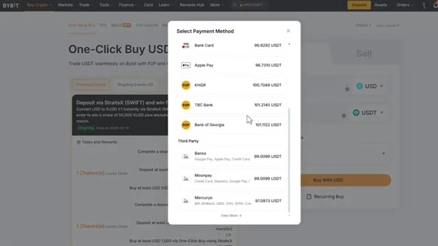
*⏱️ 00:02:37 — Fenêtre contextuelle sur la plateforme Bybit affichant la sélection du mode de paiement pour l'achat de cryptomonnaies.*

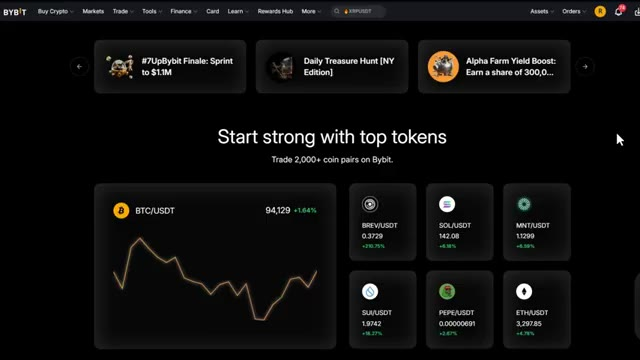
*⏱️ 00:02:41 — Page d'accueil de la plateforme Bybit affichant les paires de tokens principaux et leurs graphiques de prix.*

---

### ⏱️ `[00:02:51 - 00:03:09]` | Segment #09

**🔊 Audio (Transcription Intégrale Mot pour Mot en Français) :**
> Choisissez l'actif que vous souhaitez échanger dans le coin supérieur gauche. Pour cet exemple, j'utiliserai Bitcoin. Sélectionnez votre type d'ordre. Limite, au marché ou conditionnel. Pour les débutants, je recommande de commencer par des ordres au marché pour une exécution instantanée. Saisissez les détails de votre transaction, tels que la quantité et le prix. Ensuite, choisissez votre type de levier.

**👁️ Analyse Visuelle d'Écran (gemini-3.5-flash-lite) :**
**Interface & Outils** : Interface de l'échange de cryptomonnaies Bybit (TradingView intégré).

**Contenu textuel & Code** : Graphique en chandeliers japonais de BTCUSDT (5s), volume, carnet d'ordres, et panneau de configuration des ordres (Limit, Market, Conditional).

**Action / Démonstration** : Sélection de la paire BTCUSDT et explication de la sélection du type d'ordre pour débuter le trading.

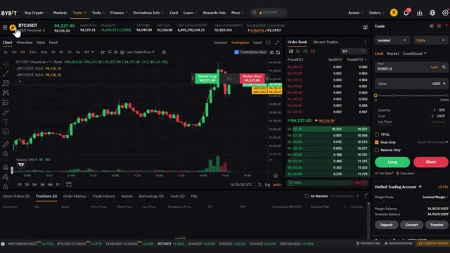
*⏱️ 00:02:56 — Capture d'écran de l'interface de trading Bybit montrant le graphique du Bitcoin (BTCUSDT) en timeframe de 5 secondes, avec le panneau de passage d'ordres à droite et le carnet d'ordres.*

---

### ⏱️ `[00:03:09 - 00:03:44]` | Segment #10

**🔊 Audio (Transcription Intégrale Mot pour Mot en Français) :**
> Vous pouvez utiliser la marge croisée ou la marge isolée. Personnellement, j'utilise la marge isolée car elle limite votre risque à cette position spécifique uniquement. Vous pouvez utiliser jusqu'à 100 fois de effet de levier sur Bybit, mais pour les débutants, je recommande de commencer avec cinq à dix fois de effet de levier jusqu'à ce que vous soyez à l'aise. Confirmez les détails de votre ordre, puis cliquez sur acheter slash long ou vendre slash short pour ouvrir votre position. Une fois votre ordre exécuté, vous pouvez le visualiser sous l'onglet des positions en bas de l'écran. Maintenant que vous savez comment utiliser les produits dérivés sur Bybit, passons à la stratégie réelle qui peut vous faire des profits importants par jour.

**👁️ Analyse Visuelle d'Écran (gemini-3.5-flash-lite) :**
**Interface & Outils** : Échange de cryptomonnaies Bybit (Interface Web).

**Contenu textuel & Code** : Graphique en chandeliers BTCUSDT, carnet d'ordres, panneau de configuration des ordres à droite avec un menu ouvert affichant "Isolated", "Cross", "Portfolio" et le sélecteur de levier réglé sur 5.00x.

**Action / Démonstration** : Sélection du mode de marge (marge isolée) dans le panneau de commande de la plateforme de trading.

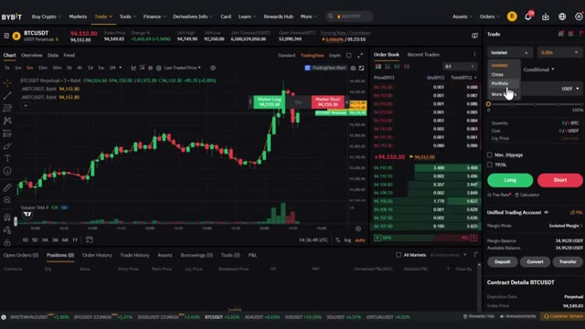
*⏱️ 00:03:18 — Interface de trading de Bybit montrant le graphique du Bitcoin avec un menu déroulant pour sélectionner la marge isolée ou croisée.*

---

### ⏱️ `[00:03:45 - 00:04:04]` | Segment #11

**🔊 Audio (Transcription Intégrale Mot pour Mot en Français) :**
> Très bien, alors maintenant entrons dans les indicateurs que nous allons réellement utiliser pour cette stratégie de range. Et je garde ça on ne peut plus simple. Juste deux indicateurs que la plupart d'entre vous ont probablement déjà utilisés, mais rarement combinés correctement. Tout d'abord, les bandes de Bollinger. Cela trace une bande supérieure, une bande médiane et une bande inférieure basées sur la volatilité des prix.

**👁️ Analyse Visuelle d'Écran (gemini-3.5-flash-lite) :**
**Interface & Outils** : TradingView

**Contenu textuel & Code** : Graphique de prix BTCUSD Futures Contract (Sep 2026) sur Bybit en unité de temps 1h, affichant les bougies en chandeliers japonais.

**Action / Démonstration** : Présentation du graphique de prix avant l'ajout des indicateurs techniques de la stratégie de range.

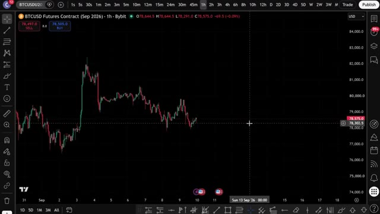
*⏱️ 00:03:50 — Graphique en chandeliers japonais affichant le cours du contrat futures Bitcoin (BTCUSD) sur une unité de temps d'une heure.*

---

### ⏱️ `[00:04:04 - 00:04:24]` | Segment #12

**🔊 Audio (Transcription Intégrale Mot pour Mot en Français) :**
> When the market is ranging, price tends to bounce between that upper and lower band like walls of a box, which makes it perfect for spotting our entries and exits. Second, RSI, the Relative Strength Index. This measures momentum on a scale of 0 to 100 and tells us when price is overbought or oversold.

**👁️ Analyse Visuelle d'Écran (gemini-3.5-flash-lite) :**
**Interface & Outils** : TradingView / Bybit

**Contenu textuel & Code** : Indicateur des bandes de Bollinger (BB 20 SMA close 2) avec lignes supérieure rouge, médiane bleue et inférieure verte.

**Action / Démonstration** : Analyse visuelle du comportement des prix oscillant entre les bandes de Bollinger en période de marché en range.

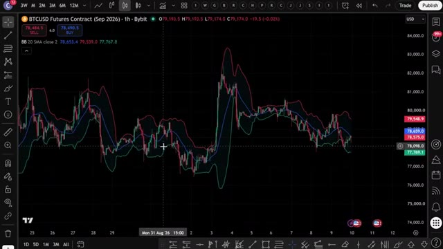
*⏱️ 00:04:09 — Graphique en chandeliers japonais illustrant les bandes de Bollinger sur BTCUSD Futures.*

---

### ⏱️ `[00:04:25 - 00:04:45]` | Segment #13

**🔊 Audio (Transcription Intégrale Mot pour Mot en Français) :**
> À elles seules, les bandes de Bollinger vous donneront de faux signaux. Le prix peut longer la bande lors d'une vraie tendance. Un RSI seul vous fera entrer bien trop tôt sur les mouvements puissants, mais en combinant les deux, vous obtenez un filtre simple. Ne prenez le trade que lorsque le prix est à un niveau extrême et que le momentum confirme qu'il est épuisé. Très bien, c'est la partie qui intéresse la plupart d'entre vous.

**👁️ Analyse Visuelle d'Écran (gemini-3.5-flash-lite) :**
**Interface & Outils** : TradingView / Bybit

**Contenu textuel & Code** : Graphique de prix BTCUSD (chandeliers) et indicateur RSI (14 périodes) avec une ligne de signal jaune, montrant les fluctuations entre les niveaux 30 et 70.

**Action / Démonstration** : Analyse de l'oscillateur RSI sous le graphique des prix pour illustrer l'entrée trop hâtive sur les mouvements puissants.

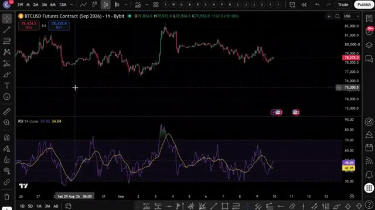
*⏱️ 00:04:30 — Graphique en chandeliers japonais du contrat BTCUSD Futures (1h, Bybit) avec l'indicateur RSI 14 affiché en bas.*

---

### ⏱️ `[00:04:45 - 00:05:17]` | Segment #14

**🔊 Audio (Transcription Intégrale Mot pour Mot en Français) :**
> Laissez-moi vous montrer exactement comment fonctionne cette stratégie. D'abord, vous avez besoin de TradingView. Le lien est dans la description si vous ne l'avez pas encore. Allez dans les indicateurs, recherchez les bandes de Bollinger et ajoutez-les avec les paramètres par défaut. Période de 20, deux déviations standard. Cela vous donne votre bande supérieure, votre bande du milieu et votre bande inférieure. Ensuite, ajoutez le RSI avec la période de 14 par défaut. Nous allons surveiller les niveaux classiques de 30 et 70. En dessous de 30, c'est une zone de survente, au-dessus de 70, c'est une zone de surachat. Maintenant, voici comment

**👁️ Analyse Visuelle d'Écran (gemini-3.5-flash-lite) :**
**Interface & Outils** : TradingView (interface graphique intégrée ou version Web).

**Contenu textuel & Code** : Graphique de prix du Bitcoin (BTCUSD Futures Contract, 1h, Bybit) affichant des mouvements haussiers et baissiers.

**Action / Démonstration** : Visualisation du graphique de prix avant l'ajout des indicateurs techniques (bandes de Bollinger).

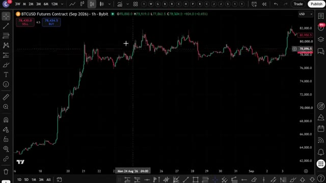
*⏱️ 00:04:53 — Un graphique en chandeliers japonais montrant le contrat futures BTCUSD sur l'échange Bybit en unité de temps 1h.*

---

### ⏱️ `[00:05:17 - 00:05:35]` | Segment #15

**🔊 Audio (Transcription Intégrale Mot pour Mot en Français) :**
> vous l'échangez réellement. Pour une entrée longue, le prix doit toucher ou clôturer en dessous de la bande de Bollinger inférieure et le RSI doit être inférieur à 30. Cette combinaison vous indique que le prix est étiré vers le bas de la range et que les vendeurs confirmés par le momentum s'essoufflent. C'est votre entrée longue.

**👁️ Analyse Visuelle d'Écran (gemini-3.5-flash-lite) :**
**Interface & Outils** : TradingView (plateforme de graphiques boursiers)

**Contenu textuel & Code** : Graphique en chandeliers japonais, Bandes de Bollinger (lignes verte et bleue), et indicateur RSI en bas avec ses niveaux de survente/surachat.

**Action / Démonstration** : Analyse technique illustrant une condition d'entrée longue basée sur le croisement ou le contact des bandes de Bollinger et le niveau du RSI.

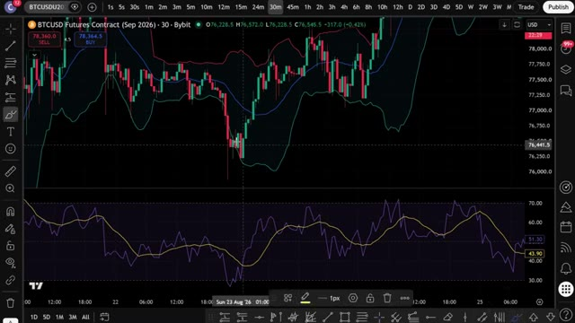
*⏱️ 00:05:22 — Graphique TradingView en unité de temps 30 minutes affichant le contrat Futures BTCUSD sur Bybit, avec les bandes de Bollinger et un oscillateur RSI en sous-fenêtre.*

---

### ⏱️ `[00:05:36 - 00:06:01]` | Segment #16

**🔊 Audio (Transcription Intégrale Mot pour Mot en Français) :**
> Pour une entrée à la vente, le prix touche ou clôture au-dessus de la bande de Bollinger supérieure et le RSI doit être supérieur à 70. Le prix est étiré vers le haut du range et les acheteurs confirmés par le momentum sont épuisés. C'est votre entrée à la vente. Pour la prise de profit, visez d'abord la bande du milieu et si le range est suffisamment large, vous pouvez laisser courir une partie vers la bande opposée. Pour le stop-loss, vous devez le placer juste au-delà de la bande de Bollinger par laquelle vous êtes entré.

**👁️ Analyse Visuelle d'Écran (gemini-3.5-flash-lite) :**
**Interface & Outils** : TradingView (Graphique BTCUSD Futures sur Bybit en unités de 30 minutes).

**Contenu textuel & Code** : Bandes de Bollinger (supérieure, médiane, inférieure) et indicateur RSI sous le graphique principal avec des annotations manuscrites jaunes encerclant un pic de prix et un pic de RSI au-dessus de 70.

**Action / Démonstration** : Analyse technique démontrant l'entrée en position courte (vente) lorsque le prix touche la bande supérieure et que le RSI dépasse 70.

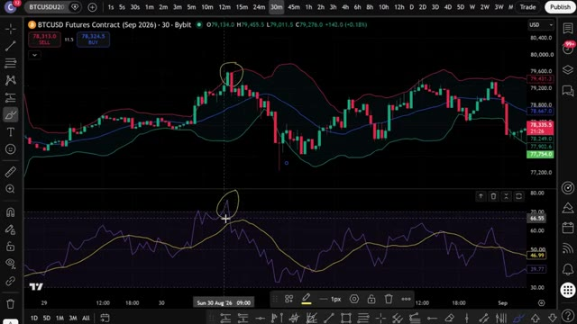
*⏱️ 00:05:42 — Graphique en chandeliers japonais illustrant un signal de vente avec les bandes de Bollinger et le RSI.*

---

### ⏱️ `[00:06:01 - 00:06:19]` | Segment #17

**🔊 Audio (Transcription Intégrale Mot pour Mot en Français) :**
> Une petite marge, donc si le prix sort réellement de la plage, au lieu de s'inverser, vous sortez avec une petite perte contrôlée. Maintenant, si le prix clôture clairement en dehors des bandes avec un fort momentum au lieu de rebondir, c'est généralement le signe que le marché passe à une vraie tendance, et non à une plage.

**👁️ Analyse Visuelle d'Écran (gemini-3.5-flash-lite) :**
**Interface & Outils** : TradingView (Graphique de prix et indicateurs techniques)

**Contenu textuel & Code** : Graphique BTCUSD Futures Contract (Sep 2026) sur l'exchange Bybit, unité de temps 30m, avec des bandes de Bollinger et un oscillateur de type RSI en sous-fenêtre.

**Action / Démonstration** : Analyse graphique de la sortie de prix hors des bandes de Bollinger et de la gestion du risque avec une petite perte contrôlée.

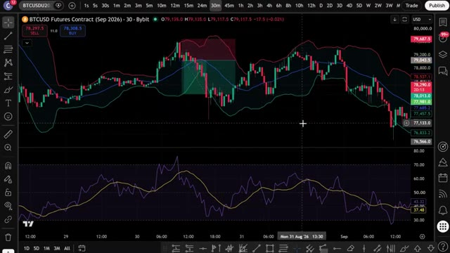
*⏱️ 00:06:06 — Graphique TradingView en unités de 30 minutes montrant le contrat futures BTCUSD avec des bandes de Bollinger et un indicateur de momentum en bas.*

---

### ⏱️ `[00:06:20 - 00:06:53]` | Segment #18

**🔊 Audio (Transcription Intégrale Mot pour Mot en Français) :**
> Donc, mettez cette stratégie en pause jusqu'à ce que le prix revienne à l'intérieur des bandes. C'est tout. Deux indicateurs que presque tout le monde connaît déjà et un ensemble de règles simples et claires conçu spécifiquement pour les jours de marché en range et sans direction claire. Maintenant, vous comprenez exactement comment fonctionne cette stratégie de range manuellement. Mais c'est là que ça devient vraiment intéressant. Au lieu de rester assis à regarder les bandes et à vérifier le RSI toutes les quelques minutes, j'ai confié cette stratégie exacte à Claude et je lui ai demandé de m'écrire un script PineScript complet. Ainsi, TradingView peut détecter automatiquement ces signaux pour moi. Voici le prompt exact que je the utilisé. Je vais l'afficher à l'écran.

**👁️ Analyse Visuelle d'Écran (gemini-3.5-flash-lite) :**
**Interface & Outils** : TradingView, Terminal Claude Code (CLI)

**Contenu textuel & Code** : Bandes de Bollinger, RSI (14), code Pine Script v5 pour stratégie de trading en range sur BTC/USDT.

**Action / Démonstration** : Présentation de la stratégie de trading basée sur la conjonction des bandes de Bollinger et du RSI, et génération du code associé via l'assistant Claude Code.

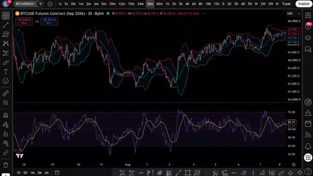
*⏱️ 00:06:28 — Graphique TradingView affichant un graphique de prix BTCUSD en unité 30 minutes avec des bandes de Bollinger et un oscillateur RSI en sous-fenêtre.*

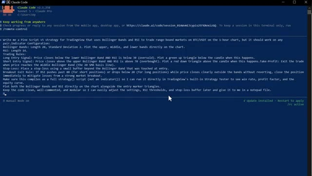
*⏱️ 00:06:45 — Interface de terminal Claude Code affichant un prompt détaillé pour la création d'un script Pine Script v5 combinant les bandes de Bollinger et le RSI.*

---

### ⏱️ `[00:06:53 - 00:07:31]` | Segment #19

**🔊 Audio (Transcription Intégrale Mot pour Mot en Français) :**
> maintenant pour que vous puissiez le copier exactement. C'est tout. C'est le prompt complet. Vous collez ça dans Claude. J'utilise Claude Code ici. Et en quelques secondes, il crache un script Pine complet et fonctionnel dans un fichier Bloc-notes. Maintenant, ce prompt exact, ainsi que le script Pine utilisé dans cette vidéo, est disponible dans mon groupe privé. Vous pouvez trouver le lien ci-dessous. Ouvrez le fichier Bloc-notes, appuyez sur Contrôle + A pour sélectionner tout le code, puis sur Contrôle + C pour le copier, c'est tout ce dont vous avez besoin. Maintenant, allons mettre ça dans TradingView, ouvrez TradingView, allez sur votre graphique Bitcoin USDT ou n'importe quel marché que vous tradez et à

**👁️ Analyse Visuelle d'Écran (gemini-3.5-flash-lite) :**
**Interface & Outils** : Claude Code, Bloc-notes (Notepad), Interface YouTube

**Contenu textuel & Code** : Code source Pine Script v5 complet pour TradingView, incluant les paramètres des bandes de Bollinger (Length 20, StdDev 2), le RSI (Length 14), les règles d'entrée/sortie, et un guide de réglage rapide.

**Action / Démonstration** : Génération et affichage d'un prompt pour coder une stratégie de trading automatisée et consultation du code source brut dans un éditeur de texte.

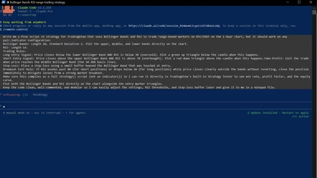
*⏱️ 00:07:03 — Interface Claude Code affichant un prompt détaillé pour générer une stratégie de trading Pine Script basée sur les bandes de Bollinger et le RSI.*

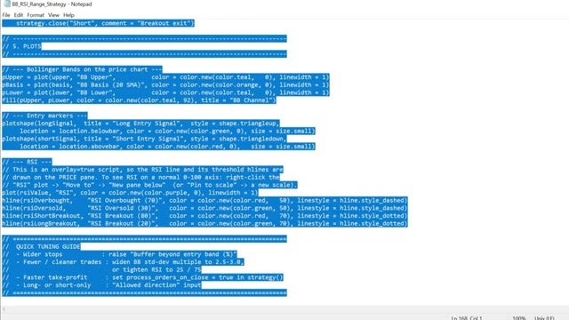
*⏱️ 00:07:22 — Fichier Bloc-notes affichant du code source Pine Script (Pine Script v5) sélectionné, avec des fonctions de tracé et de gestion des signaux.*

---

### ⏱️ `[00:07:31 - 00:07:52]` | Segment #20

**🔊 Audio (Transcription Intégrale Mot pour Mot en Français) :**
> en bas à droite de l'écran, cliquez sur l'onglet de l'éditeur Pine, sélectionnez tout le code par défaut, supprimez-le et collez ce script Pine, cliquez sur "Ajouter au graphique" et, comme par magie, TradingView le compile et trace vos bandes de Bollinger directement sur les bougies, avec le RSI dans un panneau séparé en dessous et des triangles marquant exactement où la stratégie serait entrée, en position acheteuse ou vendeuse.

**👁️ Analyse Visuelle d'Écran (gemini-3.5-flash-lite) :**
**Interface & Outils** : TradingView (Graphique de trading et Éditeur Pine)

**Contenu textuel & Code** : Graphique en chandelier BTCUSD Futurs Contract sur l'unité de temps 30m, et l'éditeur de code Pine Script vide ("Untitled script").

**Action / Démonstration** : Préparation de l'éditeur Pine pour coller et compiler un nouveau script d'indicateur technique.

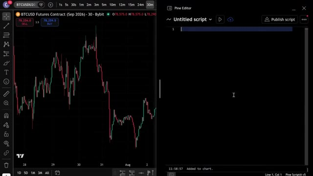
*⏱️ 00:07:36 — Capture d'écran montrant TradingView avec un graphique de prix à gauche (BTCUSD) et l'éditeur Pine Script vide ouvert à droite.*

---

### ⏱️ `[00:07:53 - 00:08:27]` | Segment #21

**🔊 Audio (Transcription Intégrale Mot pour Mot en Français) :**
> Une fois que vous l'avez bien configuré, paramétrez des alertes pour ne jamais manquer un signal. Cliquez sur l'icône de réveil en haut de TradingView, ou faites un clic droit sur l'une des formes de signal et sélectionnez Ajouter une alerte, puis définissez vos conditions. TradingView vous avertira à la seconde où cette stratégie déclenchera un signal, directement sur votre téléphone. Donc au lieu de rester assis là à actualiser le graphique toute la journée, à surveiller les bandes et le RSI, c'est le code qui fait tout le travail difficile. Dès que les conditions sont réunies, boum, vous recevez l'alerte, vous exécutez, et c'est terminé. Maintenant, si vous voulez aller encore plus loin et faire en sorte qu'un trade s'ouvre automatiquement sur votre exchange dès qu'un signal est déclenché,

**👁️ Analyse Visuelle d'Écran (gemini-3.5-flash-lite) :**
**Interface & Outils** : TradingView (Graphique des contrats futures BTCUSD sur Bybit)

**Contenu textuel & Code** : Boîte de dialogue "Create alert on BTCUSDU2026", condition "BB+RSI Range (20, 2, close, 14, 30, 7...)", intervalle "30 minutes", message et options de notification (App, Webhook, Sound).
[ISSUE/ACTION] Configuration et paramétrage d'une alerte sur une stratégie technique (BB+RSI Range) directement depuis l'interface du graphique.

**Action / Démonstration** : Explications face caméra et analyse conceptuelle des marchés.

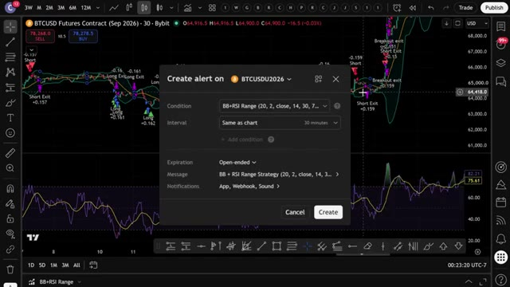
*⏱️ 00:08:01 — Fenêtre de création d'alerte TradingView pour le contrat BTCUSD Futures sur 30 minutes, configurée avec la stratégie BB+RSI Range.*

---

### ⏱️ `[00:08:28 - 00:08:46]` | Segment #22

**🔊 Audio (Transcription Intégrale Mot pour Mot en Français) :**
> Je m'occupe de tout. J'ai créé un groupe privé où je partage tous mes cas d'usage pour Claude Code, qu'il s'agisse de l'intégrer à Telegram, à TradingView, ou de rechercher des baleines sur Hyperliquid. Tout cela de manière entièrement automatisée. Tout ce que je vous ai montré aujourd'hui, tout se trouve dans le groupe. Et j'ajoute constamment de nouvelles choses, de nouvelles stratégies, de nouveaux prompts, de nouvelles intégrations.

**👁️ Analyse Visuelle d'Écran (gemini-3.5-flash-lite) :**
**Interface & Outils** : Interface web de la plateforme Hyperliquid (Leaderboard) et pages web de documentation d'Alex Carter.

**Contenu textuel & Code** : Classement des comptes sur Hyperliquid avec données de PNL, valeur de compte et volume de transactions.

**Action / Démonstration** : Navigation sur le tableau de classement pour analyser les performances des portefeuilles et baleines sur Hyperliquid.

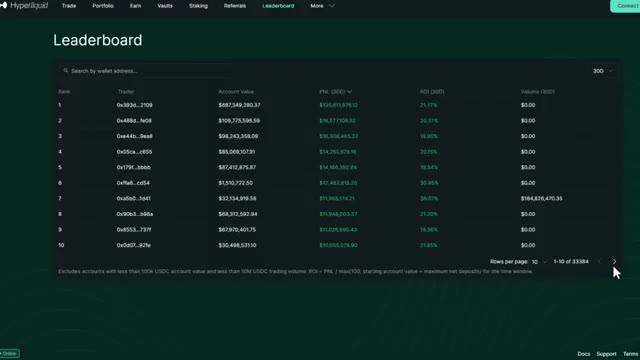
*⏱️ 00:08:37 — Tableau de classement (Leaderboard) de la plateforme Hyperliquid affichant les adresses de portefeuille, valeurs de compte, PNL et ROI.*

---

### ⏱️ `[00:08:47 - 00:09:07]` | Segment #23

**🔊 Audio (Transcription Intégrale Mot pour Mot en Français) :**
> Chaque fois que je construis quelque chose de nouveau, ça va directement là-dedans. Le prix est de 79,99 $ par mois. Et honnêtement, quand on y pense, c'est-à-dire ce que c'est réellement, la configuration de trading par IA la plus avancée disponible pour les traders particuliers en ce moment, constamment mise à jour avec tout inclus. À l'intérieur, il y a aussi un cours complet de trading agentique.

**👁️ Analyse Visuelle d'Écran (gemini-3.5-flash-lite) :**
**Interface & Outils** : Navigateur web affichant la plateforme d'hébergement de communauté Whop et une interface de cours/documentation en ligne.

**Contenu textuel & Code** : Tarification d'abonnement (79,99 $ / mois) et listes de fonctionnalités techniques incluant l'analyse de graphiques, les données OHLCV, et le contrôle de TradingView par IA.

**Action / Démonstration** : Présentation commerciale de la plateforme et explication des fonctionnalités offertes aux membres abonnés.

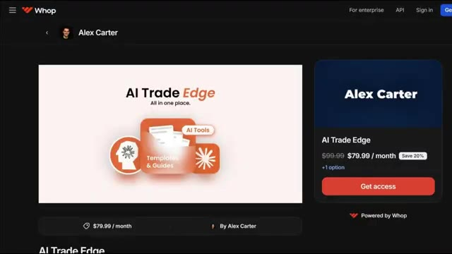
*⏱️ 00:08:52 — Capture d'écran montrant la page d'abonnement Whop pour le programme 'AI Trade Edge' d'Alex Carter au prix de 79,99 $ par mois.*

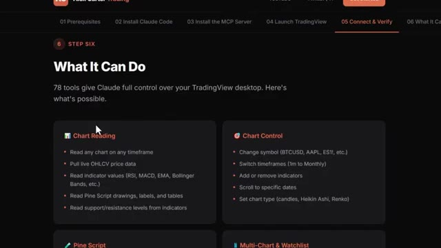
*⏱️ 00:08:57 — Capture d'écran présentant les fonctionnalités détaillées de l'outil 'AI Trade Edge', notamment les capacités de lecture et de contrôle des graphiques via l'intégration de Claude.*

---

### ⏱️ `[00:09:07 - 00:09:27]` | Segment #24

**🔊 Audio (Transcription Intégrale Mot pour Mot en Français) :**
> 2,5 heures. De débutant à expert. Aucune expérience en programmation requise. À la fin, vous aurez votre propre système de trading par IA en direct, ce que la plupart des traders particuliers ne savent même pas être possible actuellement. 79,99 $ par mois. Un seul bon trade suffit pour le rembourser. Et les 100 premiers membres bloquent ce tarif de manière permanente.

**👁️ Analyse Visuelle d'Écran (gemini-3.5-flash-lite) :**
**Interface & Outils** : Interface web de cours en ligne et plateforme de paiement Whop.

**Contenu textuel & Code** : Titres des modules du cours (OpenClaw, Agentic Bots, Build Your Own Python Bot, Deploy to Hostinger VPS, Live-Ops Dashboard) et détails tarifaires.
[DESC_IMAGE_1] Défilement à travers le programme et les différents modules pédagogiques de la formation de trading par IA.

**Action / Démonstration** : Explications face caméra et analyse conceptuelle des marchés.

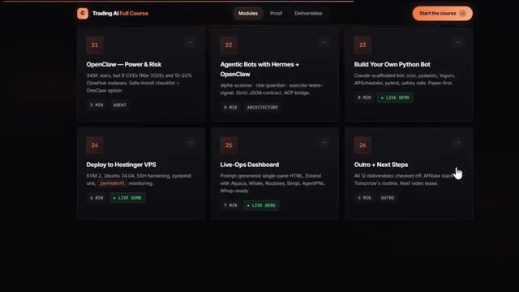
*⏱️ 00:09:12 — Aperçu de l'interface du cours de trading montrant les modules de formation numérotés de 21 à 26 avec leurs descriptions et durées.*

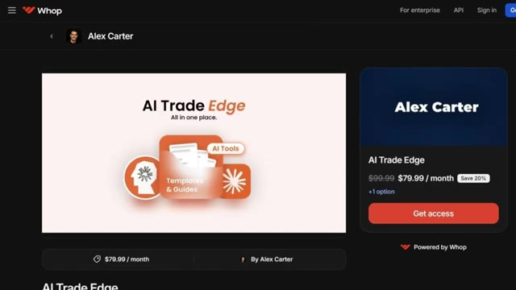
*⏱️ 00:09:22 — Page de vente de la plateforme Whop pour le programme "AI Trade Edge" d'Alex Carter affichant le tarif de 79,99 $ par mois.*

---

### ⏱️ `[00:09:27 - 00:09:47]` | Segment #25

**🔊 Audio (Transcription Intégrale Mot pour Mot en Français) :**
> Après cela, le prix augmente. Le lien est dans la description. Vous ne pouvez vraiment pas vous permettre de rater ça. Et c'est exactement comme ça que j'ai automatisé cette stratégie de range en utilisant Claude. Si vous voulez vraiment mettre cela en pratique, assurez-vous d'utiliser Bybit ou Bingix. Vu que ce genre de configuration fonctionne beaucoup plus fluidement là-bas que sur la plupart des autres plateformes, les liens sont en bas.

**👁️ Analyse Visuelle d'Écran (gemini-3.5-flash-lite) :**
**Interface & Outils** : Whop, TradingView, site web de l'échange BingX

**Contenu textuel & Code** : Tarification d'abonnement (AI Trade Edge à 79.99$/mois), graphique de prix BTCUSD avec signaux d'achat/vente (Long/Short Exit) et indicateur RSI, formulaire d'inscription et bonus de bienvenue BingX (jusqu'à 9,800+ USDT).

**Action / Démonstration** : Présentation de l'offre payante de formation/outils, affichage d'un graphique technique avec stratégie de range automatisée, et promotion des plateformes de trading partenaires.

*⏱️ 00:09:32 — Page web de la plateforme Whop affichant le produit "AI Trade Edge" par Alex Carter au prix promotionnel de 79,99 $/mois.*

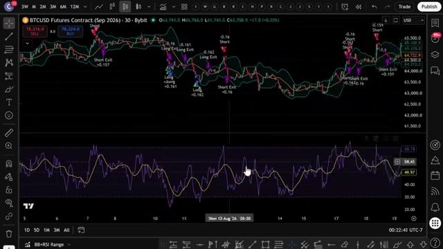
*⏱️ 00:09:37 — Graphique de trading TradingView montrant le contrat futures BTCUSD sur Bybit avec des bandes de Bollinger et un indicateur RSI en bas.*

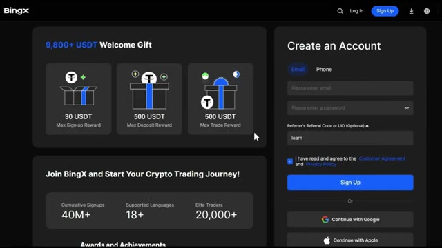
*⏱️ 00:09:42 — Page d'inscription de l'échange de cryptomonnaies BingX mettant en avant des bonus de bienvenue et un formulaire de création de compte.*

---

### ⏱️ `[00:09:47 - 00:10:20]` | Segment #26

**🔊 Audio (Transcription Intégrale Mot pour Mot en Français) :**
> Si vous voulez voir une démonstration complète de la façon dont je trade en utilisant uniquement mon Telegram, la démo complète de tous les cas d'utilisation sur TradingView, et comment je tracke automatiquement les plus gros trades des baleines sur Hyperliquid, cliquez sur la vidéo qui apparaît à l'écran dès maintenant. Et si vous voulez le guide complet étape par étape sur la façon de construire votre propre système de trading agentique en utilisant Claude, cette vidéo apparaît à l'écran également. Allez voir ça ensuite. Si vous avez trouvé cela utile, laissez un pouce bleu. Ça aide vraiment la chaîne. Abonnez-vous si ce n'est pas déjà fait, et je vous vois dans la prochaine.

**👁️ Analyse Visuelle d'Écran (gemini-3.5-flash-lite) :**
**Interface & Outils** : Interface web de la plateforme Hyperliquid (Leaderboard).

**Contenu textuel & Code** : Classement des traders (Rank, Trader address, Account Value, PNL, ROI, Volume) sur Hyperliquid.

**Action / Démonstration** : Navigation ou affichage du classement des plus gros traders de la plateforme.

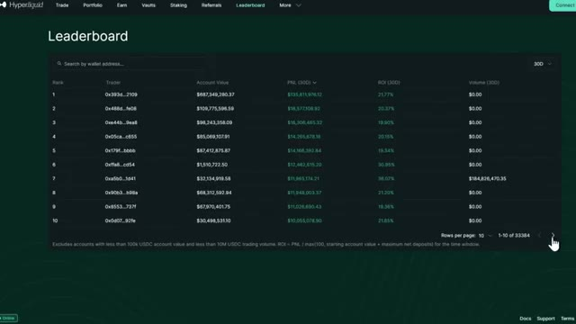
*⏱️ 00:09:55 — Capture d'écran montrant le classement (Leaderboard) de la plateforme Hyperliquid avec les adresses de portefeuille, la valeur des comptes et les PNL.*

---

