# 🎬 3 Secret Claude Tools That Changed How I Automate My Crypto Trading

> **Chaîne** : [Alex Carter](https://www.youtube.com/@AlexCarterTrading)  
> **Lien YouTube** : [https://www.youtube.com/watch?v=G9veDBbr4vg](https://www.youtube.com/watch?v=G9veDBbr4vg)  
> **Date de publication** : 20260917  
> **Durée** : 00:11:11  
> **Identifiant vidéo** : `G9veDBbr4vg`  
> **Transcription & Analyse** : `whisper-v3-large-turbo+gemini-3.5-flash-lite`  

---

## 📌 Synthèse Exécutive & Outils

### 💡 Résumé

Cette vidéo dévoile une mutation radicale du trading algorithmique particulier, portée par l'intégration d'agents conversationnels et d'assistants de code avancés au sein d'infrastructures décentralisées. En s'appuyant sur des interfaces textuelles et des agents autonomes fonctionnant en langage naturel, des traders individuels peuvent désormais rivaliser avec les capacités opérationnelles de desks institutionnels. L'approche présentée repose sur l'automatisation intégrale du cycle de trading : analyse technique automatisée des graphiques, extraction et recoupement en temps réel des positions de milliers de portefeuilles on-chain, génération de scripts de stratégie, et exécution d'ordres via des passerelles de messagerie ou des webhooks. 

Au cœur de cette démonstration, l'utilisation d'outils d'intelligence artificielle permet d'extraire instantanément la structure des marchés à partir de données brutes. Qu'il s'agisse de cartographier des zones de support et de résistance, d'exécuter du *scalping* basé sur des anomalies de taux de financement ou de répliquer l'avantage statistique des portefeuilles les plus performants, la barrière technique de la programmation est entièrement effacée. Le trader se positionne non plus comme un exécutant rivé à ses écrans, mais comme un pilote stratégique supervisant un système autonome déployé 24h/24 sur le cloud.

Cette automatisation redéfinit l'avantage compétitif sur les marchés cryptographiques. En réduisant drastiquement le temps nécessaire pour passer d'une idée théorique à un bot déployé et testé en conditions réelles, les traders peuvent multiplier les itérations, exploiter les inefficiences structurelles (telles que le *funding rate farming*) et éliminer le biais émotionnel. La division du marché est claire : d'un côté, les opérateurs manuels soumis à la fatigue cognitive ; de l'autre, les architectes de systèmes pilotés par l'IA capables d'exploiter la complexité des données on-chain en un clin d'œil.

---

### 🛠️ Outils, Modèles & Logiciels Présentés

* **Claude / Claude Code** : Assistant conversationnel et environnement de développement par l'IA utilisé pour rédiger du code en langage naturel, analyser des données de marché complexes, générer des scripts Pine Script et piloter des opérations de trading en temps réel.
* **Hyperliquid** : Échange perpétuel décentralisé basé sur sa propre blockchain, dépourvu de KYC et offrant des points de terminaison publics transparents permettant l'analyse on-chain des positions et portefeuilles.
* **TradingView** : Plateforme de graphisme et d'analyse technique connectée aux stratégies de trading via des webhooks pour exécuter automatiquement des ordres d'entrée, de stop loss et de take profit.
* **Telegram** : Interface de messagerie mobile transformée en télécommande sécurisée pour interagir avec le bot de trading, lancer des ordres, recevoir des alertes en direct et consulter des tableaux de bord de performance.
* **Pine Script** : Langage de programmation dédié à TradingView, entièrement généré et débogué par l'intelligence artificielle pour concevoir des indicateurs et des stratégies automatisées sans compétences initiales en codage.
* **Serveur Cloud (VPS)** : Infrastructure d'hébergement distante assurant l'exécution ininterrompue 24h/24 et 7j/7 des bots de trading indépendamment de la machine locale ou de la connexion Internet de l'utilisateur.

---

### 🔑 Points Clés & Enseignements Stratégiques

* **Cartographie technique instantanée** : L'intelligence artificielle est capable d'analyser l'historique des prix pour tracer automatiquement des lignes de support (vertes) et de résistance (rouges), d'indiquer le nombre de tests de chaque niveau et de fournir un biais directionnel en quelques secondes.
* **Génération et correction de Pine Script** : Les traders peuvent concevoir, modifier et déboguer des stratégies de trading complexes sur TradingView en décrivant simplement leurs règles en langage naturel à l'assistant IA.
* **Analyse de confluence multi-timeframe** : Un seul signal textuel permet d'exécuter une analyse croisée simultanée sur les unités de temps hebdomadaire, journalière, 4 heures et 1 heure afin d'émettre des recommandations d'entrée, de stop loss et de take profit hautement filtrées.
* **Automatisation par Webhooks** : La liaison directe entre les alertes de TradingView et l'échange permet une exécution instantanée des transactions sans intervention humaine, garantissant une réactivité maximale dès qu'un signal est validé.
* **Tracking on-chain des *Whales*** : L'aspiration des données publiques de 33 000 portefeuilles sur Hyperliquid permet d'isoler instantanément les 20 traders les plus rentables pour auditer leurs positions ouvertes, leurs effets de levier et leurs prix d'entrée en temps réel.
* **Exploitation des divergences de marché** : Le croisement des positions entre les 20 portefeuilles les plus performants et les 20 plus perdants met en lumière les "trades encombrés" (consensus de foule) par opposition aux paris de l'argent intelligent, constituant un signal de trading puissant.
* **Trading conversationnel via Telegram** : L'envoi d'une simple phrase textuelle depuis un appareil mobile suffit à ouvrir une position directionnelle (ex: long x5 sur l'ETH), à paramétrer le risque et à confirmer l'exécution de l'ordre sans ouvrir de graphique.
* **Reporting de portefeuille institutionnel** : La génération à la demande de tableaux de bord visuels en mode sombre inclut la courbe de capital, le taux de réussite, les revenus de financement ventilés et la distance de liquidation de chaque position.
* **Stratégie de *Funding Rate Farming*** : Plutôt que de spéculer sur la direction des prix, l'automatisation permet de scanner l'ensemble des paires futures pour identifier les taux de financement annualisés les plus élevés et se positionner du bon côté pour percevoir des paiements réguliers toutes les huit heures.
* **Déploiement cloud hautement résilient** : L'architecture des bots repose sur un serveur distant fonctionnant 24h/24 et 7j/7 avec des protocoles de redémarrage automatique en cas de panne, transformant l'ordinateur personnel de l'utilisateur en simple terminal de contrôle.
* **Compression du temps de développement** : Les outils d'IA moderne permettent de passer d'une hypothèse de trading à un système opérationnel et testé en un seul après-midi, réduisant un processus qui prenait autrefois des semaines ou des mois.
* **Avantage de l'itération rapide** : L'alpha ne réside pas dans la recherche d'une stratégie parfaite unique, mais dans la capacité à tester, automatiser et éliminer rapidement un grand volume d'idées de trading pour ne conserver que celles qui démontrent une rentabilité statistique avérée.

---

## ⏱️ Chronologie & Transcription Complète Audio & Visuelle (Mot pour Mot)

### ⏱️ `[00:00:00 - 00:00:35]` | Segment #01

**🔊 Audio (Transcription Intégrale Mot pour Mot en Français) :**
> These are the three secret clawed tools that change how I automate my trading. And one of them is already running trades while I sleep. Not a bot I bought. Not a signal group I'm paying for. Something I built myself, in plain English, with zero coding background. It's scanning 33,000 wallets on Hyperliquid, reading my trading view charts, and executing trades off a text message on my phone. This isn't AI hype. It's happening right now, and most traders have no idea it's even possible. While everyone's still glued to charts trying to catch the next move manually, a small group of solo traders have quietly built systems that do

**👁️ Analyse Visuelle d'Écran (gemini-3.5-flash-lite) :**
**Interface & Outils** : TradingView, terminal de commandes (Claude Code), et navigateur web (Medium).

**Contenu textuel & Code** : Graphique de trading avec indicateurs et boîtes de prix, interface CLI avec un prompt demandant d'utiliser le MCP TradingView, et un article de blog illustré.

**Action / Démonstration** : Utilisation d'un assistant IA via le terminal en conjonction avec des graphiques de trading pour automatiser des analyses.

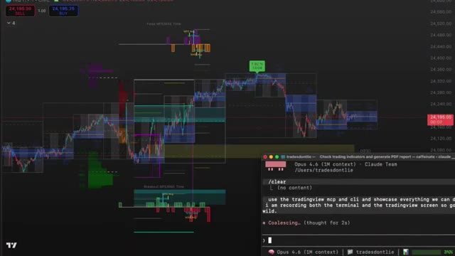
*⏱️ 00:00:09 — Capture d'écran montrant un graphique TradingView en arrière-plan et un terminal de commande Claude Code en bas à droite.*

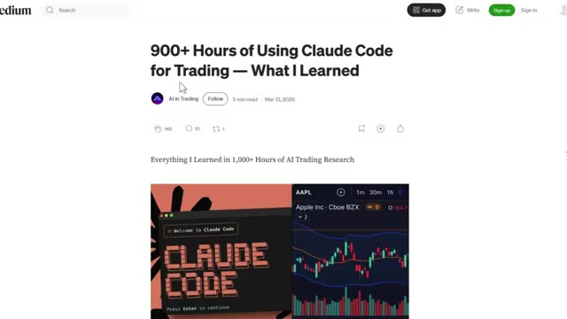
*⏱️ 00:00:26 — Capture d'écran d'un article Medium intitulé "900+ Hours of Using Claude Code for Trading — What I Learned".*

---

### ⏱️ `[00:00:35 - 00:01:06]` | Segment #02

**🔊 Audio (Transcription Intégrale Mot pour Mot en Français) :**
> it for them 24-7 without ever getting tired or emotional, and I'm one of them. So in this video, I'm breaking down the exact three Claude tools running my entire trading operation on autopilot. By the end, you'll know exactly how to build the same system yourself. Let's get into it. The first thing I want to show you, and this is the one that genuinely blew my mind the first time I saw it. Claude reads the price history, identifies the most significant levels, draws them directly on your chart, and tells you which ones matter most right now.

**👁️ Analyse Visuelle d'Écran (gemini-3.5-flash-lite) :**
**Interface & Outils** : Terminal de commandes Claude Code et interface de graphiques boursiers TradingView.

**Contenu textuel & Code** : Interface CLI Claude Code et graphique des prix du contrat perpétuel BTCUSDT.

**Action / Démonstration** : Exécution d'un outil de ligne de commande et visualisation de graphiques de trading.

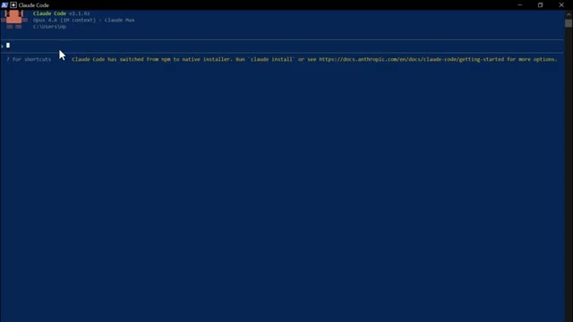
*⏱️ 00:00:43 — Interface en ligne de commande affichant l'outil Claude Code v2.1.92 sur fond bleu foncé.*

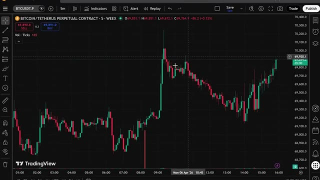
*⏱️ 00:00:59 — Graphique en chandeliers japonais de TradingView affichant la paire Bitcoin/Tether en unité de temps 5 minutes.*

---

### ⏱️ `[00:01:07 - 00:01:34]` | Segment #03

**🔊 Audio (Transcription Intégrale Mot pour Mot en Français) :**
> Watch the chart. Green lines for support, red lines for resistance, price labels. Number of times each level has been tested, all drawn automatically, and then it tells you exactly where price is sitting right now relative to those levels and gives you a directional bias based on the history of how price has reacted at each one. This used to take me 20 minutes to map out manually on every chart. Claude does it in seconds. And that is just the starting point.

**👁️ Analyse Visuelle d'Écran (gemini-3.5-flash-lite) :**
**Interface & Outils** : TradingView, Terminal de commande / Interface CLI.

**Contenu textuel & Code** : Lignes de support (S1 à S5) et de résistance, nombre de tests par niveau, prix actuel (69,899), et analyse textuelle du biais prudent (cautiously bearish).

**Action / Démonstration** : Analyse technique automatisée des niveaux de prix et affichage des scénarios potentiels de rebond ou de cassure.

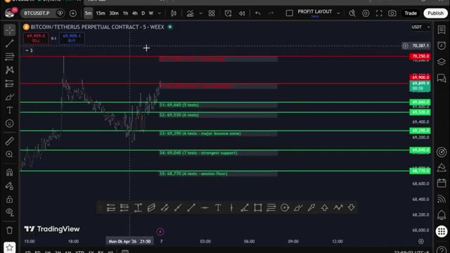
*⏱️ 00:01:14 — Graphique TradingView affichant le contrat perpétuel BITCOIN/TETHERUS avec des lignes vertes de support et rouges de résistance.*

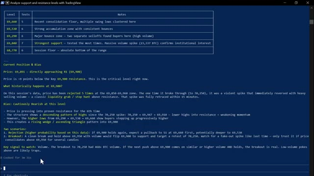
*⏱️ 00:01:21 — Interface de terminal (CLI) affichant une analyse textuelle détaillée des niveaux de support et de résistance ainsi qu'un biais directionnel.*

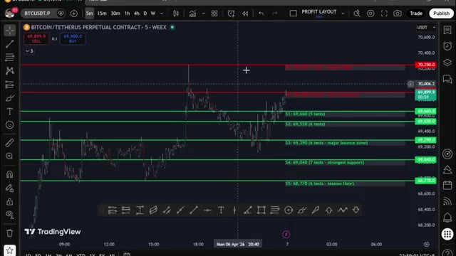
*⏱️ 00:01:28 — Vue rapprochée du graphique TradingView montrant l'évolution du prix par rapport aux niveaux tracés automatiquement.*

---

### ⏱️ `[00:01:35 - 00:02:10]` | Segment #04

**🔊 Audio (Transcription Intégrale Mot pour Mot en Français) :**
> You can also have Claude write full PineScript strategies from plain English, debug your existing indicators, run a full multi-timeframe confluence analysis across the weekly, daily, four-hour, and one-hour simultaneously, and get a specific trade recommendation with entry, stop loss, and take profit, all from one prompt. But here is where it becomes fully hands-free. You can connect any of these strategies directly to your exchange through a trading view webhook. When your strategy fires a signal on trading view, Claude receives it instantly through the webhook and executes the trade automatically on your

**👁️ Analyse Visuelle d'Écran (gemini-3.5-flash-lite) :**
**Interface & Outils** : Terminal de commandes (Claude Code session / Bash)

**Contenu textuel & Code** : Un tableau de ventilation multi-timeframe (Weekly, Daily, 4-Hour, 1-Hour) détaillant l'EMA Trend, le RSI(14), le MACD Hist, le prix par rapport aux EMA et le biais global. Sont également affichés les niveaux clés (résistances et supports journaliers), le score de confluence (3/4 Bullish) et une recommandation de trade LONG avec les niveaux d'entrée, de stop loss, de take profit et le ratio R:R.

**Action / Démonstration** : Exécution d'un script d'analyse technique multi-timeframe (mtf_analysis.py) affichant les résultats et recommandations de trade directement dans le terminal.

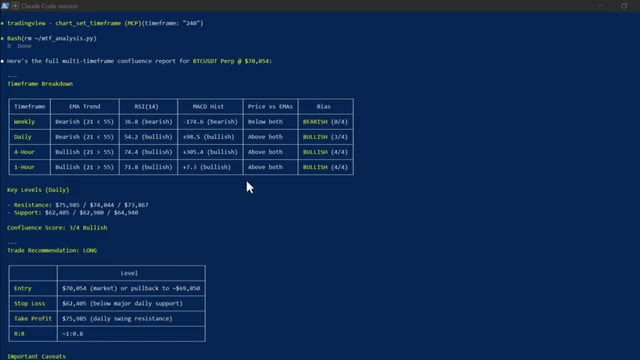
*⏱️ 00:01:44 — Capture d'écran d'un terminal de commande affichant un rapport complet d'analyse multi-timeframe pour BTCUSDT Perp généré par un script Python via Claude Code.*

---

### ⏱️ `[00:02:10 - 00:02:46]` | Segment #05

**🔊 Audio (Transcription Intégrale Mot pour Mot en Français) :**
> exchange. Entry, stop loss, take profit, all done. Without you touching anything, signal came in. Claude processed it trade open confirm back with every detail you build the strategy once and from that point it runs itself now This next section. This is where it gets really interesting. And honestly, this is one of my favorite things I have built with Claude. What if you could scan 33,000 wallets on hyperliquid find the top 20 most profitable traders see exactly what they're buying right now Their entry prices their leverage their unrealized P&L and get a complete trade plan based on all of it

**👁️ Analyse Visuelle d'Écran (gemini-3.5-flash-lite) :**
**Interface & Outils** : Terminal de commandes (CLI) exécutant des scripts Python d'interaction avec l'API WEEX.

**Contenu textuel & Code** : Commandes Bash exécutant `weex_contract_api.py`, suivies d'un tableau récapitulatif pour une position LONG sur ETH (Side: LONG, Size: 0.024 ETH, Entry Price: $2,052.00, Leverage: 5x, Take Profit: $2,216.16, Stop Loss: $1,990.44).

**Action / Démonstration** : Exécution automatisée d'un ordre de trading via l'assistant Claude, plaçant une position LONG avec niveaux de take profit et stop loss configurés.

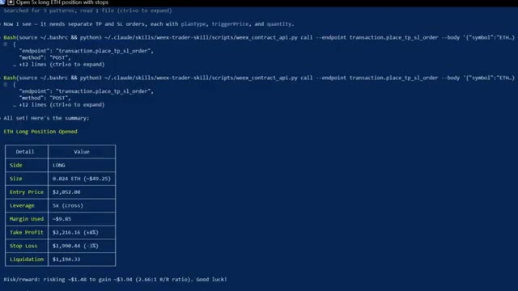
*⏱️ 00:02:19 — Capture d'écran montrant un terminal de commandes avec des scripts Python et un tableau de résumé de position ouverte sur l'exchange WEEX.*

---

### ⏱️ `[00:02:46 - 00:03:19]` | Segment #06

**🔊 Audio (Transcription Intégrale Mot pour Mot en Français) :**
> pas besoin de clés API, pas de code, pas de recherche manuelle. Maintenant, Hyperliquid, très rapidement, c'est un échange perpétuel décentralisé qui fonctionne sur sa propre blockchain. Pas de KYC, pas d'intermédiaire. Et comme c'est entièrement sur la chaîne, chaque transaction, chaque position, chaque portefeuille, tout est public. C'est ce qui rend cela possible. Très bien, laissez-moi ouvrir Claude Code et vous montrer cela en direct. Voici la première chose que je veux vous montrer. Claude analyse les 20 portefeuilles les plus rentables sur Hyperliquid en ce moment, extrait chaque position ouverte et les classe par rentabilité totale.

**👁️ Analyse Visuelle d'Écran (gemini-3.5-flash-lite) :**
**Interface & Outils** : Application Web Hyperliquid (app.hyperliquid.xyz/trade)

**Contenu textuel & Code** : Graphique en chandeliers japonais de la paire HYPE/USDC avec indicateur de volume, carnet d'ordres (Order Book) en temps réel, panneau de passage d'ordres (Limit/Market) et onglets de navigation (Trade, Portfolio, Earn, Vaults, Staking).

**Action / Démonstration** : Navigation et présentation de l'interface de trading décentralisée de la plateforme Hyperliquid.

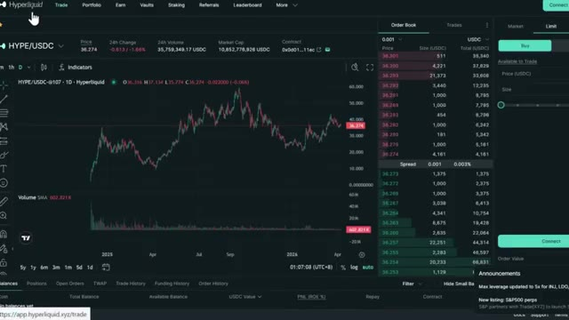
*⏱️ 00:02:54 — Capture d'écran de l'interface de l'échange décentralisé Hyperliquid montrant le graphique de prix de la paire HYPE/USDC, un carnet d'ordres et les options de trading.*

---

### ⏱️ `[00:03:19 - 00:03:44]` | Segment #07

**🔊 Audio (Transcription Intégrale Mot pour Mot en Français) :**
> Tout en un seul coup. Regardez ce qui se passe. Claude interroge les points de terminaison publics d'Hyperliquid, commence à extraire les données de portefeuilles de 33 000 adresses, les classe par rentabilité et commence à rédiger le rapport. Vous pouvez le voir traiter les portefeuilles en temps réel. Les prix d'entrée, l'effet de levier, les profits et pertes non réalisés, tout arrive en direct. Et voici le résultat. Les 20 principales « whales », ou baleines, classées, chaque position ouverte répertoriée.

**👁️ Analyse Visuelle d'Écran (gemini-3.5-flash-lite) :**
**Interface & Outils** : Terminal de commandes (CLI) / Fenêtre de script.

**Contenu textuel & Code** : Données JSON au format texte brut montrant des informations de portefeuilles (adresse, display_name, account_value, pnl_alltime, roi_alltime, positions sur BTC, ETH, SOL, LTC avec direction SHORT/LONG, taille, prix d'entrée, PnL non réalisé, effet de levier et prix de liquidation).

**Action / Démonstration** : Extraction et affichage en temps réel des données des portefeuilles et de leurs positions par le script de traçage de baleines Hyperliquid.

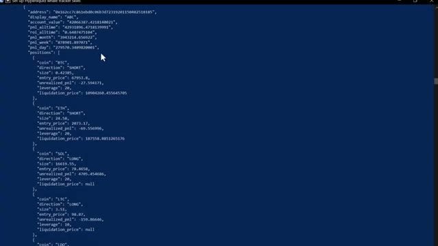
*⏱️ 00:03:26 — Un terminal de commandes affichant des données JSON structurées extraites des portefeuilles Hyperliquid.*

---

### ⏱️ `[00:03:45 - 00:04:20]` | Segment #08

**🔊 Audio (Transcription Intégrale Mot pour Mot en Français) :**
> Et tout en bas, le résumé du sentiment global. En ce moment, l'argent intelligent est acheteur net sur Bitcoin et vendeur net sur presque tout le reste, en particulier Ethereum. C'est le genre de signal qui prenait autrefois des heures à assembler manuellement. Claude le fait en moins d'une minute. Maintenant, c'est là que ça devient vraiment intéressant. Ce prompt compare les 20 portefeuilles les plus rentables aux 20 portefeuilles les plus perdants et trouve chaque jeton sur lequel ils se trouvent de part et d'autre de la transaction. Regardez-le extraire les deux groupes simultanément. Les portefeuilles rentables d'un côté, les portefeuilles perdants de l'autre, et puis il

**👁️ Analyse Visuelle d'Écran (gemini-3.5-flash-lite) :**
**Interface & Outils** : Terminal de commandes CLI (fenêtre de type PowerShell ou invite de commandes sur fond bleu).

**Contenu textuel & Code** : Listes textuelles détaillant les positions (Strong Bearish / Strong Bullish Consensus) sur des cryptomonnaies comme APT, TRX, LIT, KPEPE, XRP, SUI, ainsi qu'une section de résumé intitulée 'Overall Net Direction' indiquant que les positions majeures sont short sur ETH et long sur BTC.

**Action / Démonstration** : Affichage des résultats d'analyse synthétique générés par un script de suivi des baleines (Hyperliquid whale tracker).

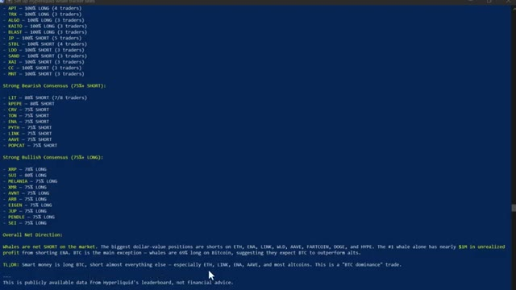
*⏱️ 00:03:54 — Capture d'écran d'un terminal en ligne de commande affichant un résumé textuel du sentiment des baleines et de l'argent intelligent sur diverses cryptomonnaies.*

---

### ⏱️ `[00:04:20 - 00:04:56]` | Segment #09

**🔊 Audio (Transcription Intégrale Mot pour Mot en Français) :**
> commence à croiser les positions. Voici le résultat. Vous pouvez voir là où les deux groupes sont d'accord. Ils sont tous les deux acheteurs sur suey, donc c'est un trade encombré. Mais regardez ça. L'argent intelligent est massivement acheteur sur XMR, TRX, Pendle et Farcoin, tandis que les traders particuliers sont vendeurs sur ces cryptos. Cette divergence exacte, c'est le signal. C'est le genre d'analyse pour laquelle les hedge funds paient. Vous l'obtenez grâce à un outil d'IA à 20 dollars et une API publique gratuite. Et si vous voulez la configuration hyperliquid complète, le code de compétence, chaque prompt, le système complet de suivi des baleines, je vais vous dire exactement comment obtenir tout cela dans

**👁️ Analyse Visuelle d'Écran (gemini-3.5-flash-lite) :**
**Interface & Outils** : Interface de terminal informatique affichant des données textuelles et tabulaires formatées.

**Contenu textuel & Code** : Tableaux avec colonnes Token, Smart % Long, Rekt % Long et Note, incluant des actifs comme BTC, SUI, SOL, XRP, DOGE, ARB, HYPE, MON, NEAR, AVAX, WLD, ZEC, VIRTUAL, TON, ZRO. Un curseur de souris est visible sur la ligne SUI indiquant 'Perfect agreement'.

**Action / Démonstration** : Analyse comparative des positions des portefeuilles 'Smart Money' versus 'Rekt' pour illustrer les accords et désaccords de marché.

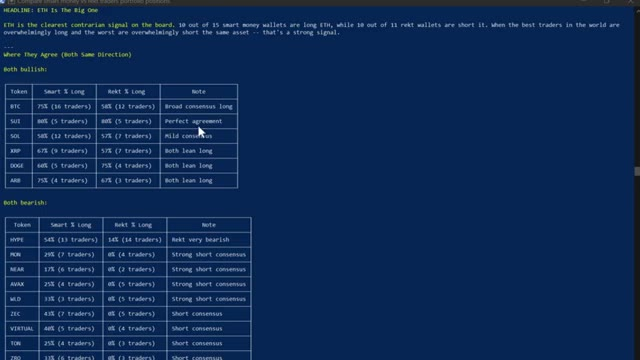
*⏱️ 00:04:29 — Capture d'écran montrant un terminal avec des tableaux comparatifs des positions de l'argent intelligent par rapport aux traders perdants (Rekt).*

---

### ⏱️ `[00:04:56 - 00:05:29]` | Segment #10

**🔊 Audio (Transcription Intégrale Mot pour Mot en Français) :**
> Un instant. Continuez à regarder. Maintenant, celui-ci, c'est celui qui a complètement changé ma routine quotidienne. J'ai créé mon propre assistant de trading IA en utilisant Claude et Telegram, et il trouve des transactions rentables pour moi en utilisant l'IA la plus puissante disponible actuellement, plus intelligente que n'importe quel humain ne pourrait l'être. Il exécute des transactions, gère mes positions, m'envoie des alertes en temps réel et génère des rapports de portefeuille complets, le tout à partir d'un simple message sur mon téléphone. Ce matin, j'ai passé un ordre depuis mon lit, j'ai pris mes bénéfices depuis la salle de sport, sans toucher à un seul graphique. C'est Claude qui tourne sur mon ordinateur. Il

**👁️ Analyse Visuelle d'Écran (gemini-3.5-flash-lite) :**
**Interface & Outils** : Présentation ou face-caméra explicatif du trader sans interface logicielle partagée.

**Contenu textuel & Code** : Explications orales des stratégies et mise en contexte méthodologique du marché.

**Action / Démonstration** : Explications face caméra et analyse conceptuelle des marchés.

---

### ⏱️ `[00:05:29 - 00:05:49]` | Segment #11

**🔊 Audio (Transcription Intégrale Mot pour Mot en Français) :**
> Ça a l'air simple. Juste une interface textuelle. Mais regardez ce que ça peut faire. Vous pouvez pratiquement ouvrir une position de trading avec une seule phrase. Ouvrir un long fois cinq sur l'ETH avec 10 dollars. Définissez un stop loss à moins trois pour cent et un take profit à plus huit pour cent. Regardez-le réfléchir. Et voilà. Position ouverte. Stop loss défini.

**👁️ Analyse Visuelle d'Écran (gemini-3.5-flash-lite) :**
**Interface & Outils** : Terminal de commandes (Claude Code v2.1.91)

**Contenu textuel & Code** : En-tête du terminal affichant "Claude Code v2.1.91", le modèle "Opus 4.6 (1M context) - Claude Max", le répertoire utilisateur et un champ de saisie de texte avec un curseur actif.

**Action / Démonstration** : Saisie en cours dans l'interface textuelle pour exécuter des commandes ou rédiger un ordre de trading via un prompt.

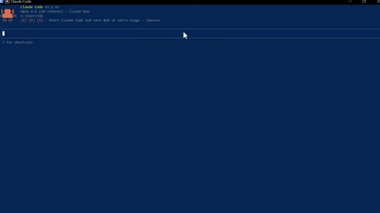
*⏱️ 00:05:34 — Interface en ligne de commande de l'outil Claude Code affichant un terminal interactif avec le prompt vide.*

---

### ⏱️ `[00:05:49 - 00:06:08]` | Segment #12

**🔊 Audio (Transcription Intégrale Mot pour Mot en Français) :**
> Prise de bénéfices configurée. Confirme le retour avec chaque détail. Une phrase. Terminé. Maintenant, laisse-moi te montrer quelque chose qui m'a vraiment époustouflé la première fois que j'ai exécuté ceci. Donne-moi un tableau de bord complet de portefeuille. Toutes mes positions, profits et pertes, frais de financement, courbe de capital sous forme de rapport visuel. Regarde-le agir.

**👁️ Analyse Visuelle d'Écran (gemini-3.5-flash-lite) :**
**Interface & Outils** : Interface de courtier en cryptomonnaies (WEEX) et terminal de commandes (CLI / Claude Code).

**Contenu textuel & Code** : Paire ETH/USDT, position longue avec levier 5x, prix d'entrée à 2052.00$, Take Profit à 2,216.16$ (+8%), Stop Loss à 1,990.44$ (-3%), ratio R/R de 2.66:1, et invite de commande demandant un tableau de bord complet du portefeuille.

**Action / Démonstration** : Configuration d'ordres de prise de bénéfices (TP/SL) et exécution de requêtes via le terminal de commande pour afficher les détails du portefeuille.

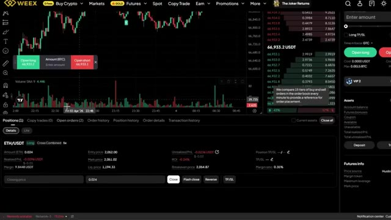
*⏱️ 00:05:54 — Interface de la plateforme de trading WEEX montrant un graphique de prix en haut et une position ouverte ETH/USDT en bas.*

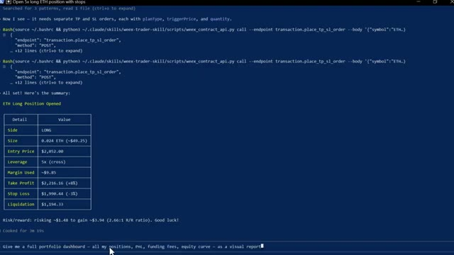
*⏱️ 00:05:59 — Terminal de commande affichant un résumé des détails d'une position longue ETH ouverte avec un tableau récapitulatif (prix d'entrée, take profit, stop loss) et un prompt utilisateur.*

---

### ⏱️ `[00:06:08 - 00:06:40]` | Segment #13

**🔊 Audio (Transcription Intégrale Mot pour Mot en Français) :**
> Il extrait toutes les données de mon compte en ce moment même. Et voici ce qu'il génère. Un tableau de bord complet en mode sombre. Une courbe de capital. Le taux de réussite. Le revenu de financement ventilé par pièce, chaque position ouverte avec la distance de liquidation mise en surbrillance, c'est le genre de rapport qu'un desk de trading professionnel produirait, je l'ai obtenu en quelques secondes à partir d'une seule consigne et, soit dit en passant, si vous trouvez cela utile jusqu'à présent, restez jusqu'à la fin parce que je vais vous montrer comment configurer tout cela vous-même, continuez à regarder, très bien, laissez-moi vous montrer

**👁️ Analyse Visuelle d'Écran (gemini-3.5-flash-lite) :**
**Interface & Outils** : Tableau de bord personnalisé "WEEX Portfolio Dashboard" en mode sombre.

**Contenu textuel & Code** : Métriques de portefeuille ($20.61 d'équité, PnL non réalisé de -$0.021, taux de réussite de 25%), graphiques de PnL et de capital, répartition de marge et tableau des opportunités de taux de financement (UNI/USDT, SEI/USDT, BCH/USDT, etc.).

**Action / Démonstration** : Présentation et explication détaillée des performances du compte de trading et des données extraites par l'outil automatisé.

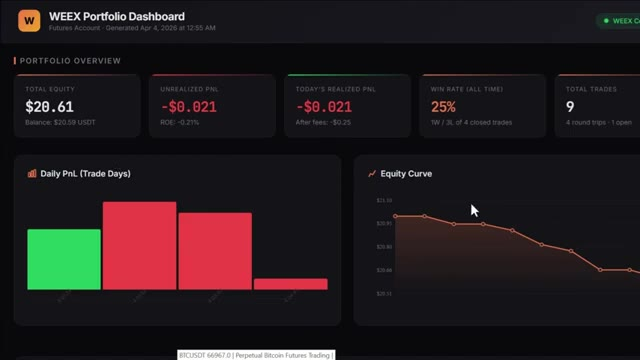
*⏱️ 00:06:16 — Tableau de bord WEEX Portfolio Dashboard affichant les métriques globales du compte Futures : Total Equity ($20.61), Unrealized PnL, Win Rate (25%), Total Trades (9), un graphique de PnL journalier et une courbe de capital (Equity Curve) en baisse.*

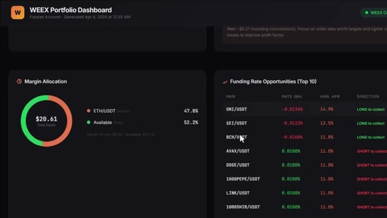
*⏱️ 00:06:24 — Suite du tableau de bord WEEX montrant l'allocation de marge (Margin Allocation) avec la répartition ETH/USDT (47.8%) et les opportunités de taux de financement (Funding Rate Opportunities) pour différentes paires de crypto-monnaies.*

---

### ⏱️ `[00:06:40 - 00:07:13]` | Segment #14

**🔊 Audio (Transcription Intégrale Mot pour Mot en Français) :**
> De plus, vous pouvez également connecter ceci à votre Telegram pour envoyer des commandes directement depuis votre téléphone. Vous pouvez taper : analyser toutes les paires futures et trouver les taux de financement les plus élevés en ce moment. Il a analysé chaque paire, les a classées par taux de financement, a calculé le rendement annualisé, et m'a indiqué exactement dans quelle direction me positionner pour percevoir ce financement instantanément. Maintenant, si vous ne savez pas ce que sont les taux de financement, il s'agit essentiellement d'argent gratuit que l'échange verse toutes les huit heures aux traders positionnés du bon côté du marché. Lorsque le financement est positif, les acheteurs paient les vendeurs. Lorsque

**👁️ Analyse Visuelle d'Écran (gemini-3.5-flash-lite) :**
**Interface & Outils** : Présentation ou face-caméra explicatif du trader sans interface logicielle partagée.

**Contenu textuel & Code** : Explications orales des stratégies et mise en contexte méthodologique du marché.

**Action / Démonstration** : Explications face caméra et analyse conceptuelle des marchés.

---

### ⏱️ `[00:07:13 - 00:07:38]` | Segment #15

**🔊 Audio (Transcription Intégrale Mot pour Mot en Français) :**
> Le financement est négatif, les positions courtes paient les positions longues. Et certains de ces taux sont extrêmement élevés. Ce que fait ce scanner, c'est trouver les paires où ce taux est le plus élevé, calculer ce que cela donne sur une base annuelle, parfois 50 %, 100 %, voire plus, et vous dire exactement dans quelle direction ouvrir une position pour vous asseoir et percevoir ce paiement toutes les huit heures. Vous n'essayez même pas de prédire la direction du prix.

**👁️ Analyse Visuelle d'Écran (gemini-3.5-flash-lite) :**
**Interface & Outils** : Application de messagerie Telegram et plateforme d'échange de cryptomonnaies WEEX.

**Contenu textuel & Code** : Liste des taux de financement pour les paires de futures (ACTUSDT, DOGEUSDT, APTUSDT, UNIUSDT, etc.) avec leurs pourcentages respectifs, ainsi que des graphiques de trading avec carnet d'ordres et indicateurs de volume (SMA 9).

**Action / Démonstration** : Présentation des résultats du scanner de taux de financement sur Telegram, puis transition vers l'interface de l'exchange WEEX pour illustrer le placement des ordres ou le suivi des positions.

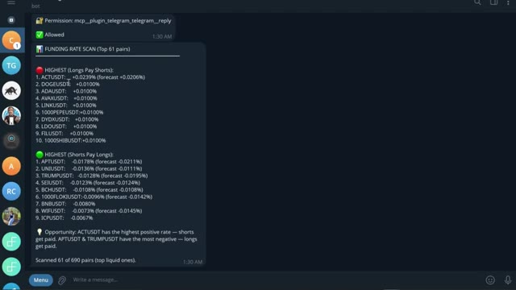
*⏱️ 00:07:19 — Capture d'écran d'un bot Telegram affichant un rapport de scan des taux de financement (Funding Rate Scan) pour différentes paires crypto, classées par taux les plus hauts (Longs Pay Shorts) et taux les plus négatifs (Shorts Pay Longs).*

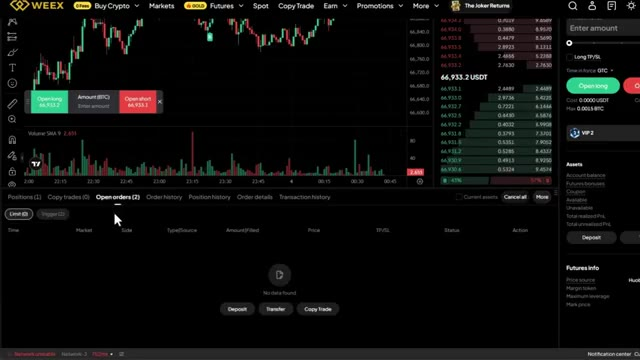
*⏱️ 00:07:32 — Interface de trading de la bourse WEEX montrant un graphique de prix en chandeliers, un carnet d'ordres à droite et le panneau de gestion des ordres et positions en bas.*

---

### ⏱️ `[00:07:38 - 00:08:00]` | Segment #16

**🔊 Audio (Transcription Intégrale Mot pour Mot en Français) :**
> You are just farming the rate. And now instead of manually checking every single pair yourself, which nobody does, Claude does it in seconds and hands you the opportunity on a plate. Now, if you're ready to take this even further, you can use Claude code to build a fully automated trading bot from start to finish for crypto, stocks, or whatever market you are trading.

**👁️ Analyse Visuelle d'Écran (gemini-3.5-flash-lite) :**
**Interface & Outils** : Plateforme d'échange WEEX et terminal de commande Claude Code

**Contenu textuel & Code** : Liste de paires de trading USDT-M (XRPUSDT, TRXUSDT, BNBUSDT, NEARUSDT, etc.), graphiques en chandeliers, carnet d'ordres et interface CLI Claude Code Opus 4.6

**Action / Démonstration** : Navigation dans la liste des paires de cryptomonnaies sur l'échange et affichage du terminal de développement Claude Code

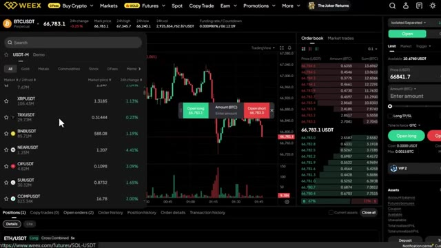
*⏱️ 00:07:43 — Interface de trading de la plateforme WEEX montrant un graphique des prix du BTCUSDT, une liste de paires de cryptomonnaies à gauche et un carnet d'ordres à droite.*

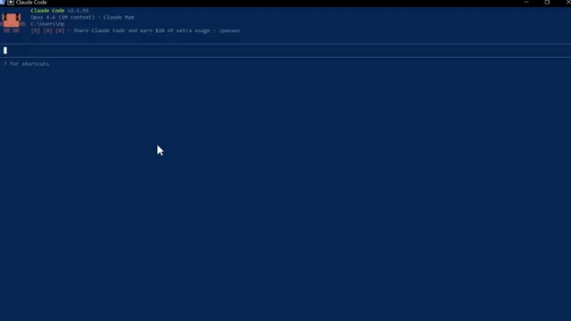
*⏱️ 00:07:49 — Terminal de commande affichant l'interface de Claude Code (v2.1.91) avec une invite de commande vide en arrière-plan bleu.*

---

### ⏱️ `[00:08:00 - 00:08:20]` | Segment #17

**🔊 Audio (Transcription Intégrale Mot pour Mot en Français) :**
> Et honnêtement, c'est ainsi que Claude va changer notre façon de trader pour toujours. Et nous avons déjà fait cela auparavant. Laissez-moi vous montrer à quoi ressemble réellement le résultat final. Voici le tableau de bord, une seule URL, chaque position, votre courbe de capital, l'état de vos bots, vos données sur les baleines, le tout en direct, en un seul endroit. Fini les multiples onglets de navigateur.

**👁️ Analyse Visuelle d'Écran (gemini-3.5-flash-lite) :**
**Interface & Outils** : Page web promotionnelle et tableau de bord de trading WEEX.

**Contenu textuel & Code** : Métriques de compte (Equity : 19.78, PnL), courbe de capital sur 90 jours et sections pour les positions ouvertes et signaux récents.

**Action / Démonstration** : Présentation du tableau de bord de trading complet en direct.

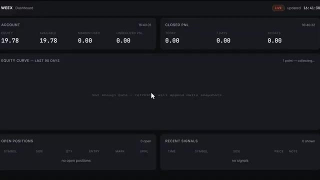
*⏱️ 00:08:10 — Tableau de bord de trading WEEX affichant les métriques de compte, la courbe de capital et les positions ouvertes.*

---

### ⏱️ `[00:08:21 - 00:08:40]` | Segment #18

**🔊 Audio (Transcription Intégrale Mot pour Mot en Français) :**
> Fini les doutes sur les points d'entrée. Et chaque matin, avant même d'ouvrir votre ordinateur portable, ce briefing alpha quotidien est déjà dans votre boîte de réception, tous les jours à l'heure et prêt à être lu. Il a déjà analysé les transactions des baleines, examiné les graphiques, vérifié votre compte, et vous a remis la configuration avec la plus forte conviction de la journée, dimensionnée selon votre risque exact.

**👁️ Analyse Visuelle d'Écran (gemini-3.5-flash-lite) :**
**Interface & Outils** : Terminal de commande et interface graphique TradingView.

**Contenu textuel & Code** : Tableaux de données de marché (BTC, ETH, SOL), prix, variations 24h, distances par rapport à la moyenne mobile à 200 périodes et RSI. Graphique de prix cryptographique.

**Action / Démonstration** : Présentation du briefing alpha quotidien automatisé et affichage des graphiques et données techniques associés.

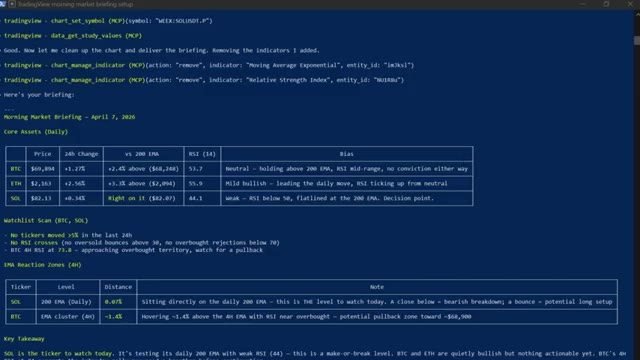
*⏱️ 00:08:25 — Terminal affichant un briefing de marché matinal structuré en tableaux (prix, variation, EMA, RSI) et notes d'analyse pour BTC, ETH et SOL.*

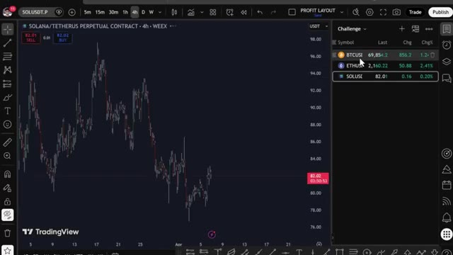
*⏱️ 00:08:35 — Interface TradingView affichant le graphique en chandeliers de SOL/USDT en unité de temps 4h, avec une liste de surveillance à droite.*

---

### ⏱️ `[00:08:40 - 00:08:59]` | Segment #19

**🔊 Audio (Transcription Intégrale Mot pour Mot en Français) :**
> Un seul prompt. Toute la pile technologique. Et le bot lui-même ne se trouve pas sur votre ordinateur portable. Il tourne 24 heures sur 24 et 7 jours sur 7 sur un serveur cloud. S'il plante, il redémarre tout seul. Si votre Wi-Fi se coupe, il continue. Votre ordinateur portable n'est que la télécommande. Désormais, la barrière mathématique pour construire tout cela a pour ainsi dire disparu.

**👁️ Analyse Visuelle d'Écran (gemini-3.5-flash-lite) :**
**Interface & Outils** : Interface web Hostinger, Terminal de commandes / éditeur GNU nano.

**Contenu textuel & Code** : Sélection de serveurs cloud géographiques et fichier de configuration sshd_config pour un serveur distant.
[DESC_ACTION] Configuration d'un serveur cloud distant (VPS) pour héberger le bot de trading 24h/24 et 7j/7.

**Action / Démonstration** : Explications face caméra et analyse conceptuelle des marchés.

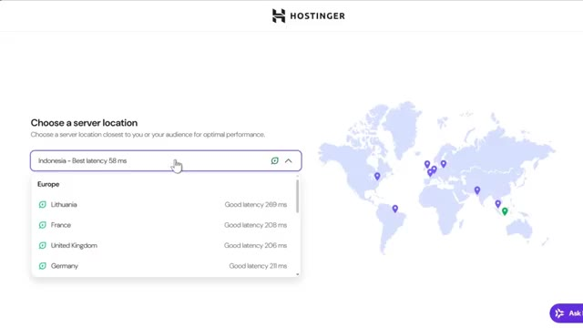
*⏱️ 00:08:45 — Interface de configuration Hostinger montrant le choix de l'emplacement d'un serveur cloud avec les différentes latences.*

*⏱️ 00:08:50 — Terminal de commande affichant un éditeur GNU nano 7.2 avec le fichier de configuration SSH (`/etc/ssh/sshd_config`).*

---

### ⏱️ `[00:08:59 - 00:09:33]` | Segment #20

**🔊 Audio (Transcription Intégrale Mot pour Mot en Français) :**
> avant des modèles capables comme Claude Code, cela aurait pris des semaines, voire des mois à mettre en place, maintenant vous pouvez passer d'une idée à un système fonctionnel en un après-midi et cela compte parce que la plupart des stratégies ne fonctionnent pas, l'avantage n'est pas d'avoir une seule stratégie parfaite, c'est d'être capable de tester assez d'idées assez rapidement pour trouver celles qui fonctionnent vraiment, très bien, et regardez, pour les prochaines années, deux types de traders existeront : ceux qui utilisent l'IA et ceux qui font encore tout manuellement, même marché, des résultats très différents, voici comment vous mettre du bon côté.

**👁️ Analyse Visuelle d'Écran (gemini-3.5-flash-lite) :**
**Interface & Outils** : TradingView, éditeur Pine Editor, interface de graphique de trading.

**Contenu textuel & Code** : Code source en Pine Script visible dans l'éditeur (fonctions de gestion des stops ATR, variables de position et signaux d'achat/vente), ainsi qu'un graphique de prix BTCUSDT en unités 4h.

**Action / Démonstration** : Consultation et écriture de code de stratégie de trading automatisé sur Pine Script avec affichage graphique des signaux d'entrée.

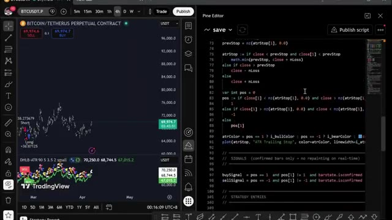
*⏱️ 00:09:16 — Écran partagé montrant à gauche un graphique de prix sur TradingView et à droite l'éditeur Pine Script avec du code source de stratégie.*

---

### ⏱️ `[00:09:33 - 00:10:11]` | Segment #21

**🔊 Audio (Transcription Intégrale Mot pour Mot en Français) :**
> j'ai rassemblé tout ce qui se trouve à l'intérieur de la communauté ai trade edge chaque invite chaque bot chaque modèle chaque guide étape par étape que j'utilise personnellement tout en un seul endroit et tout ce que je construis à l'avenir est ajouté directement dans le groupe au moment où il sort nous testons également des stratégies provenant de tout l'internet en les automatisant à l'aide de pine script en les exécutant en direct et en partageant exactement ce qui fonctionne et ce qui ne fonctionne pas afin que vous n'obteniez pas seulement des outils vous obtenez une opération de recherche en direct à l'intérieur il y a aussi un cours complet de trading agentique de 2,5 heures du débutant à l'expert non

**👁️ Analyse Visuelle d'Écran (gemini-3.5-flash-lite) :**
**Interface & Outils** : TradingView, graphique en chandeliers (2h), indicateur RSI-VWAP.

**Contenu textuel & Code** : Prix du Bitcoin autour de 77,109 USD, indicateur RSI-VWAP en sous-fenêtre avec signaux d'achat/vente (losanges verts et rouges), encadré de position avec taille, marge et PnL.

**Action / Démonstration** : Présentation d'un setup de trading et analyse des signaux techniques sur le graphique Bitcoin.

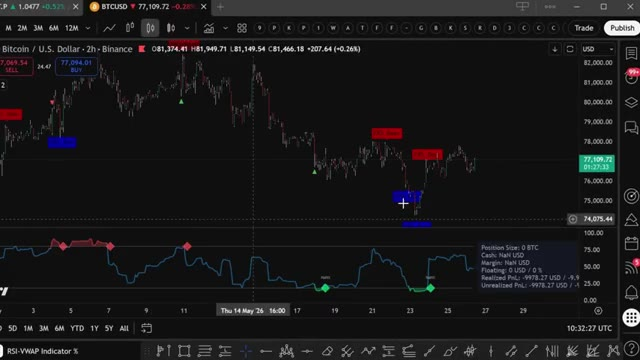
*⏱️ 00:10:02 — Graphique TradingView sur l'unité de temps 2h pour Bitcoin (BTCUSD, Binance) avec un indicateur RSI-VWAP en bas et des signaux de trading.*

---

### ⏱️ `[00:10:11 - 00:10:30]` | Segment #22

**🔊 Audio (Transcription Intégrale Mot pour Mot en Français) :**
> aucune expérience en programmation n'est requise, à la fin, vous aurez votre propre système de trading par IA en direct, ce que la plupart des traders particuliers ne savent même pas être possible actuellement. 79,99 $ par mois. Un seul bon trade suffit pour le rentabiliser. Et les 100 premiers membres bloquent ce tarif définitivement. Après cela, le prix augmentera.

**👁️ Analyse Visuelle d'Écran (gemini-3.5-flash-lite) :**
**Interface & Outils** : Interface web de la plateforme Whop et page de cours hébergée.

**Contenu textuel & Code** : Offre d'abonnement "AI Trade Edge" à 79,99 $ par mois (réduction de 20 %), description des bots de trading IA inclus, guides et FAQ concernant les marchés actions et crypto via WEEX.

**Action / Démonstration** : Présentation de l'offre commerciale du cours de trading par IA et des conditions d'abonnement pour les premiers membres.

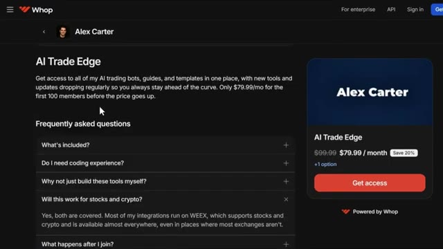
*⏱️ 00:10:25 — Page de vente de la plateforme Whop pour "AI Trade Edge" d'Alex Carter affichant le tarif de 79,99 $/mois et la section FAQ.*

---

### ⏱️ `[00:10:30 - 00:11:06]` | Segment #23

**🔊 Audio (Transcription Intégrale Mot pour Mot en Français) :**
> Le lien est dans la description. Vous ne pouvez vraiment pas vous permettre de rater ça. Et c'est tout. C'est ainsi que Claude change le trading pour toujours et comment vous pouvez en faire partie. Si vous voulez approfondir chacun de ces sujets individuellement, la visite guidée complète de TradingView sur Telegram et le suivi des baleines sur Hyperliquid, toutes ces vidéos s'affichent à l'écran en ce moment même, allez les voir à votre rythme et si vous voulez le guide complet étape par étape sur la façon de construire votre propre système de trading agentique en utilisant Claude, cette vidéo s'affiche à l'écran également, allez la voir ensuite, si vous avez trouvé cela utile, laissez un pouce bleu, cela aide vraiment

**👁️ Analyse Visuelle d'Écran (gemini-3.5-flash-lite) :**
**Interface & Outils** : Grand View Research website, Hyperliquid platform leaderboard.

**Contenu textuel & Code** : Statistiques de croissance du marché du trading algorithmique (taille estimée à 21,06 milliards USD en 2024, projection à 42,99 milliards USD en 2030) et métriques de performance de traders sur Hyperliquid (valeur de compte, PNL en USD, ROI).
[DESC_IMAGE_3] Navigation et consultation de données de marché et de classements de traders.

**Action / Démonstration** : Explications face caméra et analyse conceptuelle des marchés.

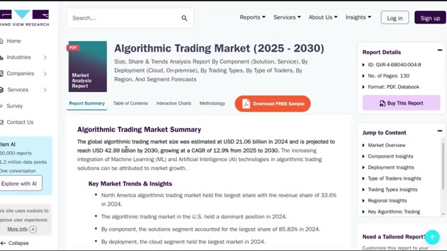
*⏱️ 00:10:39 — Rapport de marché Grand View Research sur l'Algorithmic Trading Market (2025-2030).*

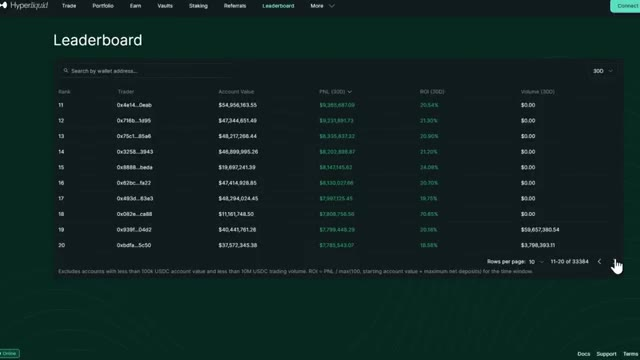
*⏱️ 00:10:48 — Classement (Leaderboard) de la plateforme de trading Hyperliquid montrant les adresses de portefeuilles, valeurs de compte, PNL et ROI.*

---

### ⏱️ `[00:11:06 - 00:11:10]` | Segment #24

**🔊 Audio (Transcription Intégrale Mot pour Mot en Français) :**
> aidez la chaîne abonnez-vous si vous ne l'avez pas déjà fait et je vous vois dans la prochaine

**👁️ Analyse Visuelle d'Écran (gemini-3.5-flash-lite) :**
**Interface & Outils** : Aucun.

**Contenu textuel & Code** : Aucun.

**Action / Démonstration** : Aucune.

---

