# 🎬 How I Built an Automated 1-Minute Scalping Indicator Using Claude Code (Beginner Tutorial)

> **Chaîne** : [Alex Carter](https://www.youtube.com/@AlexCarterTrading)  
> **Lien YouTube** : [https://www.youtube.com/watch?v=fFxyTba-fEQ](https://www.youtube.com/watch?v=fFxyTba-fEQ)  
> **Date de publication** : 20260919  
> **Durée** : 00:10:57  
> **Identifiant vidéo** : `fFxyTba-fEQ`  
> **Transcription & Analyse** : `whisper-v3-large-turbo+gemini-3.5-flash-lite`  

---

## 📌 Synthèse Exécutive & Outils

### 💡 Résumé
Dans cette vidéo intitulée **How I Built an Automated 1-Minute Scalping Indicator Using Claude Code (Beginner Tutorial)**, Alex Carter détaille une approche stratégique et pratique du trading et de l'automatisation par agents IA.

### 🛠️ Outils, Modèles & Logiciels Présentés
- **TradingView & Claude Code** : Analyse technique avancée et automatisation algorithmique.

### 🔑 Points Clés & Enseignements Stratégiques
- Respect rigoureux du ratio risque/rendement et du money management.
- Automatisation méthodique des déclencheurs d'ordres via des agents intelligents.

---

## ⏱️ Chronologie & Transcription Complète Audio & Visuelle (Mot pour Mot)

### ⏱️ `[00:00:00 - 00:00:35]` | Segment #01

**🔊 Audio (Transcription Intégrale Mot pour Mot en Français) :**
> Si vous ne supportez pas d'attendre des heures, voire des jours, qu'une configuration se produise enfin, et que vous préférez entrer et sortir d'un trade en quelques secondes seulement au lieu de surveiller un graphique toute la journée, alors cette vidéo est pour vous, car aujourd'hui je vais vous montrer une stratégie de scalping complète en une minute, une stratégie conçue pour les personnes qui veulent de la vitesse. Et le meilleur, c'est que je ne vais pas seulement vous enseigner la stratégie manuellement. Je vais vous montrer comment j'ai pris cette stratégie exacte, je l'ai transmise à Claude, et je lui ai fait construire un script PineScript entièrement automatisé qui trace chaque signal pour moi sur TradingView. Fini de fixer les bougies pendant des heures. Fini les incertitudes. Et restez

**👁️ Analyse Visuelle d'Écran (gemini-3.5-flash-lite) :**
**Interface & Outils** : TradingView, Pine Editor

**Contenu textuel & Code** : Bandes de Bollinger, volume, Stochastique RSI et code source Pine Script v5 pour des règles d'entrée Long/Short et des alertes.

**Action / Démonstration** : Présentation d'un indicateur de trading personnalisé basé sur le retour à la moyenne et écriture/visualisation du script associé.

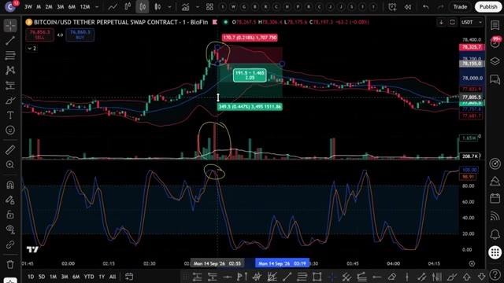
*⏱️ 00:00:09 — Graphique en chandeliers (Bitcoin/USD) avec indicateurs techniques annotés de cercles jaunes.*

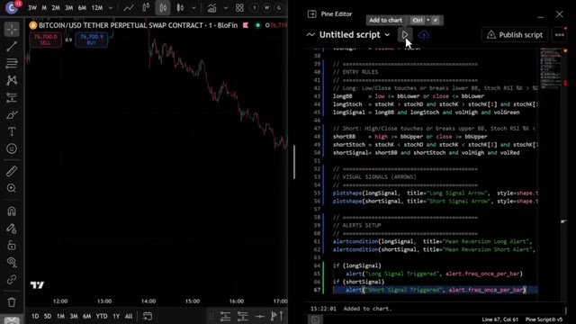
*⏱️ 00:00:27 — Interface double affichant à gauche un graphique de prix et à droite l'éditeur Pine Script de TradingView avec du code source.*

---

### ⏱️ `[00:00:35 - 00:01:12]` | Segment #02

**🔊 Audio (Transcription Intégrale Mot pour Mot en Français) :**
> jusqu'à la fin parce que je vais vous montrer comment obtenir tous mes prompts, stratégies et configurations, et comment créer votre propre bot de trading agentique avec Claude qui peut trader des cryptos, des actions, des indices, et plus encore. Passons donc aux choses sérieuses. Très bien les gars, étape numéro une, inscrivez-vous sur un échange. Pour cette stratégie, nous allons utiliser UBIT. C'est l'un de mes échanges préférés pour le trading de contrats à terme en ce moment, et ils ont des bonus très importants pour les nouveaux utilisateurs. Jusqu'à 50 000 dollars de bonus rien qu'en vous inscrivant et en tradant via mon lien ci-dessous. Si UBIT ne vous convient pas, vous pouvez utiliser Blofen en tant que

**👁️ Analyse Visuelle d'Écran (gemini-3.5-flash-lite) :**
**Interface & Outils** : Plateforme de cours en ligne et interface web de la plateforme de trading YUBIT.

**Contenu textuel & Code** : Liste des modules de formation (ex: Daily Alpha Brief Workflow, Claude Routines, Build + Backtest Pine Script, TradingView Webhook) et interface d'inscription/récompenses YUBIT.
[DESC_IMAGE_3_BIS] (Non applicable)

**Action / Démonstration** : Navigation dans le programme du cours et présentation de la plateforme partenaire.

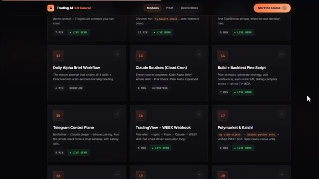
*⏱️ 00:00:45 — Interface du cours 'Trading AI Full Course' montrant une grille de modules de formation sur l'automatisation du trading.*

---

### ⏱️ `[00:01:12 - 00:01:50]` | Segment #03

**🔊 Audio (Transcription Intégrale Mot pour Mot en Français) :**
> alternative. Blofen ne requiert pas de vérification KYC obligatoire pour le trading de base, ce qui signifie que vous pouvez commencer à trader immédiatement. De plus, les nouveaux utilisateurs peuvent gagner jusqu'à 5 000 USDT grâce à des bonus sur les dépôts et le volume de trading. Je mettrai les deux liens en bas. Une fois sur la page d'UBIT, vous pouvez vous inscrire avec votre adresse e-mail, votre numéro de téléphone, ou vous connecter via Google ou Apple ID. Pour ce tutoriel, j'utiliserai l'e-mail. Entrez simplement vos informations, créez un mot de passe fort, acceptez les conditions d'utilisation, et cliquez sur s'inscrire. Entrez le code de vérification reçu par e-mail et votre compte est prêt. Tout le processus prend

**👁️ Analyse Visuelle d'Écran (gemini-3.5-flash-lite) :**
**Interface & Outils** : Interfaces de sites web de courtiers/échanges crypto (BloFin et Yubit).

**Contenu textuel & Code** : Offres promotionnelles et bonus de bienvenue affichés : « New User Exclusive: Earn up to 5,000 USDT », sections « New Users Only », « Advanced Tasks », « Airdrops », et formulaire d'inscription avec le code de parrainage « ALEX ».

**Action / Démonstration** : Présentation des bonus de bienvenue offerts aux nouveaux utilisateurs sur les plateformes de trading pour illustrer les avantages de l'inscription.

*⏱️ 00:01:22 — Capture d'écran du site web de l'échange BloFin montrant la page des bonus pour les nouveaux utilisateurs (« New User Exclusive: Earn up to 5,000 USDT »).*

*⏱️ 00:01:31 — Capture d'écran de la page d'inscription de la plateforme Yubit avec un visuel de récompense et un champ de code de parrainage pré-rempli « ALEX ».*

---

### ⏱️ `[00:01:50 - 00:02:13]` | Segment #04

**🔊 Audio (Transcription Intégrale Mot pour Mot en Français) :**
> moins de 30 secondes. Et gardez à l'esprit que UBIT est une plateforme sans KYC. Vous n'avez pas besoin de compléter la vérification d'identité pour commencer à trader. Cela la rend accessible même dans les régions restreintes, et cela signifie que vous pouvez commencer à trader presque instantanément après vous être inscrit. Allez dans votre portefeuille et cliquez sur dépôt. Sélectionnez la cryptomonnaie que vous souhaitez déposer. L'USDT est idéal pour le trading.

**👁️ Analyse Visuelle d'Écran (gemini-3.5-flash-lite) :**
**Interface & Outils** : Site web de la plateforme d'échange UBIT.

**Contenu textuel & Code** : Menus de navigation de la plateforme UBIT, options de dépôt, de retrait et de gestion des différents types de comptes (Spot, Futures, TradFi, Earn).

**Action / Démonstration** : Navigation sur le site de la plateforme UBIT et affichage du menu des actifs et des portefeuilles.

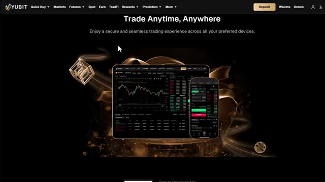
*⏱️ 00:02:01 — Page d'accueil du site web UBIT mettant en avant le slogan « Trade Anytime, Anywhere » avec des mockups d'appareils affichant la plateforme.*

*⏱️ 00:02:07 — Page d'accueil de la plateforme UBIT avec le menu des portefeuilles et des comptes déployé à droite.*

---

### ⏱️ `[00:02:13 - 00:02:36]` | Segment #05

**🔊 Audio (Transcription Intégrale Mot pour Mot en Français) :**
> ensuite, sélectionnez votre réseau de dépôt. Je recommande TRC20. C'est rapide et les frais sont très bas. Vous verrez alors votre adresse de dépôt personnelle. Copiez-la soigneusement. Allez sur votre échange ou portefeuille actuel. Collez l'adresse et envoyez vos fonds. Envoyez toujours un petit montant de test d'abord, peut-être 10 à 20 dollars, juste pour confirmer que tout arrive correctement avant d'envoyer le montant total.

**👁️ Analyse Visuelle d'Écran (gemini-3.5-flash-lite) :**
**Interface & Outils** : Interface web d'un échange de cryptomonnaies (pages de dépôt et de retrait).

**Contenu textuel & Code** : Formulaires de dépôt et de retrait d'USDT, sélection de réseau TRON (TRC20), adresses de portefeuille et frais de transaction (1 USDT).

**Action / Démonstration** : Configuration d'un dépôt, saisie d'une adresse de retrait et confirmation de l'envoi de fonds.

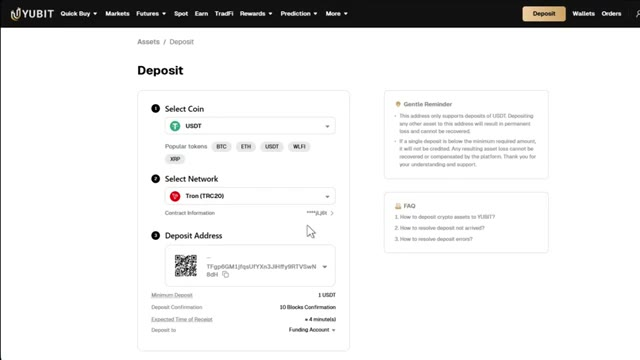
*⏱️ 00:02:19 — Interface de dépôt de la plateforme montrant la sélection du réseau TRC20 et l'adresse de dépôt USDT.*

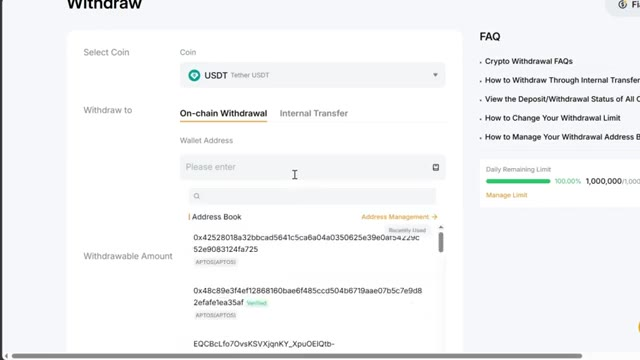
*⏱️ 00:02:25 — Interface de retrait sur un échange montrant les champs pour entrer l'adresse du portefeuille et le carnet d'adresses.*

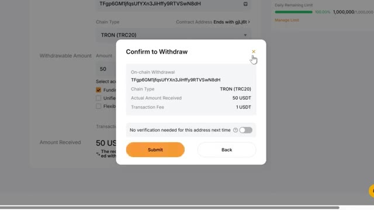
*⏱️ 00:02:30 — Fenêtre modale de confirmation de retrait affichant les détails de la transaction en TRON (TRC20) avec les frais et le montant.*

---

### ⏱️ `[00:02:37 - 00:02:55]` | Segment #06

**🔊 Audio (Transcription Intégrale Mot pour Mot en Français) :**
> C'est très important. Envoyer sur le mauvais réseau peut signifier perdre vos fonds. Si vous n'avez pas encore de crypto et que vous voulez en acheter directement sur UBIT, c'est également possible. Mais pour cela, vous devrez d'abord compléter la KYC. Allez sur l'icône de votre profil sur la page d'accueil et cliquez sur KYC. Cliquez sur Vérifier maintenant.

**👁️ Analyse Visuelle d'Écran (gemini-3.5-flash-lite) :**
**Interface & Outils** : Site web de la plateforme d'échange UBIT.

**Contenu textuel & Code** : Interface utilisateur de courtage crypto, options d'achat rapide, menu de profil avec options 'Account & Security', 'Settings', 'KYC' et 'Logout'.
[DESC_IMAGE_1] Navigation sur la section d'achat direct et survol du menu utilisateur pour montrer la procédure de vérification KYC.

**Action / Démonstration** : Explications face caméra et analyse conceptuelle des marchés.

*⏱️ 00:02:41 — Interface d'achat rapide (Quick Buy) de la plateforme UBIT, permettant d'acheter des USDT avec des monnaies fiat.*

*⏱️ 00:02:51 — Page d'accueil de la plateforme UBIT montrant le menu du profil utilisateur ouvert avec l'option KYC affichée comme non vérifiée (Unverified).*

---

### ⏱️ `[00:02:56 - 00:03:17]` | Segment #07

**🔊 Audio (Transcription Intégrale Mot pour Mot en Français) :**
> Fournissez votre adresse e-mail, vos informations personnelles, vos documents de vérification et un selfie. Une fois que c'est approuvé, vous pouvez utiliser l'option d'achat rapide sur UBIT pour acheter des cryptos directement avec une monnaie fiduciaire en utilisant une carte de crédit ou de débit. Si vous avez déjà des cryptos sur un autre échangeur ou portefeuille, vous pouvez ignorer entièrement la procédure KYC et déposer directement, ce qui est l'option la plus rapide pour la plupart des gens.

**👁️ Analyse Visuelle d'Écran (gemini-3.5-flash-lite) :**
**Interface & Outils** : Plateforme d'échange de cryptomonnaies UBIT (pages de vérification d'identité, d'achat rapide et de dépôt).

**Contenu textuel & Code** : Formulaires d'achat rapide (Pay/Receive en USD/USDT), options de paiement (Alchemy Pay), sélection de pièces et de réseaux pour les dépôts, et statuts de vérification d'identité (Sumsub).

**Action / Démonstration** : Navigation à travers les fonctionnalités de vérification d'identité, d'achat instantané de cryptos par monnaie fiduciaire et de gestion des dépôts.

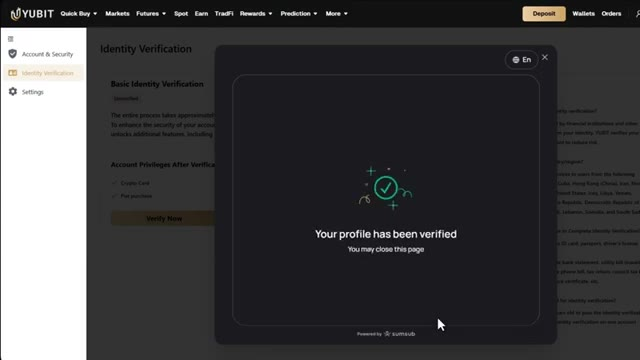
*⏱️ 00:03:01 — L'écran de la plateforme UBIT affichant une pop-up de confirmation de vérification d'identité réussie (KYC validé).*

*⏱️ 00:03:06 — L'interface d'achat rapide de cryptomonnaies sur UBIT montrant les options pour convertir des USD en USDT via Alchemy Pay.*

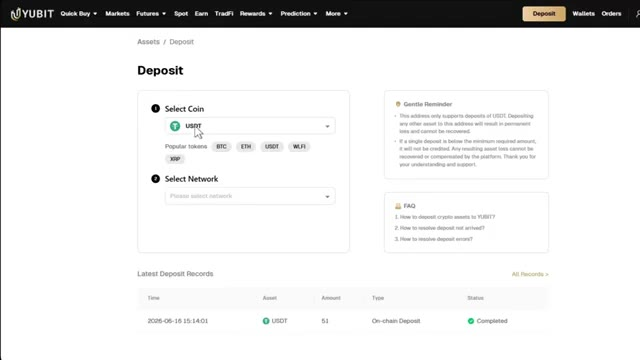
*⏱️ 00:03:12 — L'écran de dépôt de la plateforme UBIT permettant de sélectionner une cryptomonnaie (USDT) et un réseau blockchain.*

---

### ⏱️ `[00:03:17 - 00:03:36]` | Segment #08

**🔊 Audio (Transcription Intégrale Mot pour Mot en Français) :**
> Cliquez sur contrats à terme dans la barre de navigation supérieure et cliquez sur USDT-M. Cela vous amènera à l'interface de trading de contrats à terme UBIT. Maintenant, cela peut sembler un peu intimidant au début, mais je vais décomposer chaque section pour que cela devienne parfaitement clair. En haut à gauche, vous avez le sélecteur de paires de trading. C'est ici que vous choisissez quel actif trader.

**👁️ Analyse Visuelle d'Écran (gemini-3.5-flash-lite) :**
**Interface & Outils** : Plateforme de trading YUBIT (interface de contrats à terme).

**Contenu textuel & Code** : Graphique de prix BTCUSDT (en unité 15m), carnet d'ordres en temps réel, prix du marché, options d'effet de levier (10x) et boutons d'achat/vente (Open Long / Open Short).

**Action / Démonstration** : Navigation dans les menus pour accéder aux contrats à terme USDT-M puis affichage de l'interface de trading complète.

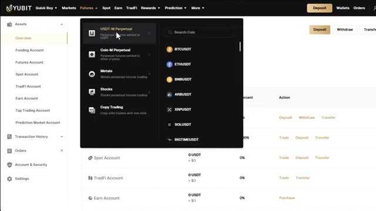
*⏱️ 00:03:22 — Capture d'écran montrant le menu déroulant sur la plateforme YUBIT avec les options de contrats à terme et la liste des cryptomonnaies disponibles.*

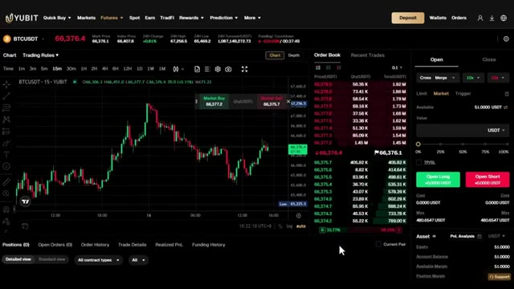
*⏱️ 00:03:27 — Capture d'écran montrant l'interface complète de trading de contrats à terme UBIT avec un graphique des prix du Bitcoin, le carnet d'ordres et les options de passage d'ordres.*

---

### ⏱️ `[00:03:36 - 00:04:12]` | Segment #09

**🔊 Audio (Transcription Intégrale Mot pour Mot en Français) :**
> Ubit propose plus de 500 paires de trading, allant du Bitcoin et de l'Ethereum jusqu'aux memecoins et aux principales altcoins. Vous pouvez choisir entre des perpétuels sur marge USDT et des perpétuels sur marge de coin, qui sont des transactions réglées dans votre propre cryptomonnaie au lieu de l'USDT. Au centre se trouve le graphique des prix, propulsé par TradingView, avec tous les outils de dessin et les indicateurs techniques dont vous avez carnet d'ordres, qui affiche tous les ordres d'achat et de vente en direct sur le marché. Et en bas se trouve votre panneau de gestion des ordres. C'est ici que vous suivez vos positions ouvertes, vos ordres ouverts et votre historique de trading.

**👁️ Analyse Visuelle d'Écran (gemini-3.5-flash-lite) :**
**Interface & Outils** : Interface Web de l'échange Yubit (section Futures).

**Contenu textuel & Code** : Liste des paires de trading (ETHUSDT, BTCUSDT, SOLUSDT, etc.), prix en direct, variations sur 24h, graphique des prix du BTCUSDT, carnet d'ordres et panneau de passage d'ordres (Market/Limit, levier 10x, onglets USDT-M et Coin-M).

**Action / Démonstration** : Sélection de la catégorie de futures USDT-M dans le panneau latéral gauche de la plateforme Yubit.

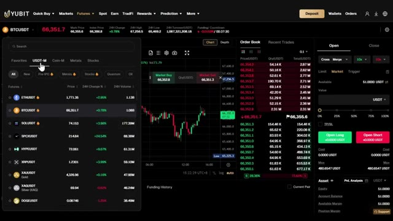
*⏱️ 00:03:45 — Interface de trading Futures de la plateforme Yubit affichant la liste des paires de crypto-monnaies avec les options de marge USDT-M et Coin-M.*

---

### ⏱️ `[00:04:13 - 00:04:45]` | Segment #10

**🔊 Audio (Transcription Intégrale Mot pour Mot en Français) :**
> Tout ce dont vous avez besoin est juste ici sur un seul écran. Très bien, maintenant voici la partie pour laquelle la plupart d'entre vous sont réellement venus, la stratégie elle-même. D'abord, vous avez besoin de TradingView. Le lien est dans la description. Si vous ne l'avez pas encore, utilisez mon lien ci-dessous. Nous vous offrons une réduction si vous achetez la version payante. Ouvrez maintenant TradingView et affichez Bitcoin USDT. C'est ce que j'utiliserai tout au long de cette vidéo. Mais cette configuration exacte fonctionne sur n'importe quelle paire liquide avec suffisamment de volume comme Ethereum ou Solana ou n'importe quel marché que vous tradez. Cliquez sur le sélecteur d'unité de temps et passez sur le graphique d'une minute.

**👁️ Analyse Visuelle d'Écran (gemini-3.5-flash-lite) :**
**Interface & Outils** : TradingView, plateforme de graphiques boursiers et interface de courtage BloFin.

**Contenu textuel & Code** : Paires de trading crypto (BTCUSDT.P), chandeliers en unité 30m, tarifs d'abonnement TradingView ($12.95 à $199.95/mois).

**Action / Démonstration** : Présentation de la plateforme TradingView et affichage de l'historique des prix du Bitcoin.

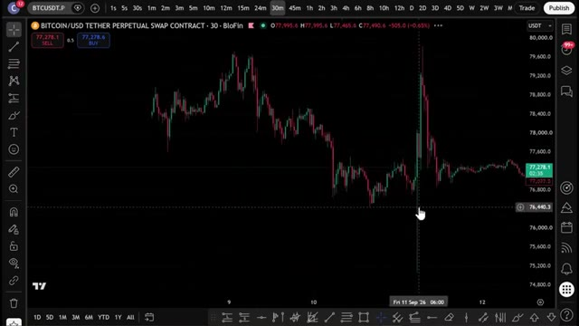
*⏱️ 00:04:21 — Graphique en chandeliers japonais du Bitcoin en unité 30 minutes sur TradingView via BloFin.*

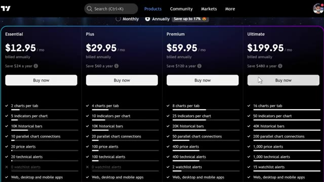
*⏱️ 00:04:29 — Page de tarification des abonnements TradingView montrant les formules Essential, Plus, Premium et Ultimate.*

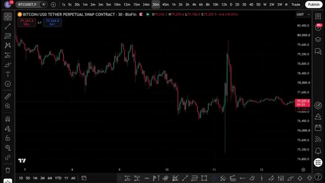
*⏱️ 00:04:37 — Vue rapprochée du graphique du Bitcoin sur TradingView affichant les mouvements de prix récents.*

---

### ⏱️ `[00:04:45 - 00:05:03]` | Segment #11

**🔊 Audio (Transcription Intégrale Mot pour Mot en Français) :**
> C'est une stratégie de scalping pur, ce qui signifie que vous entrerez et sortirez rapidement. Maintenant, ajoutons les trois indicateurs. Cliquez sur indicateurs, tapez Bollinger Bands et sélectionnez-le. Allez dans les paramètres, définissez la longueur à 20 et l'écart type à 2. Allez dans le style et définissez les bandes supérieure et inférieure en rouge. Voici comment cela fonctionne.

**👁️ Analyse Visuelle d'Écran (gemini-3.5-flash-lite) :**
**Interface & Outils** : Interface de trading TradingView intégrée (graphique perpétuel Bitcoin/USD BloFin).

**Contenu textuel & Code** : Barres de temps, outils de dessin, barres de recherche d'indicateurs ("Bollinger Bands").

**Action / Démonstration** : Navigation sur le graphique de scalping en unité de temps 1 minute et recherche de l'indicateur des Bandes de Bollinger.

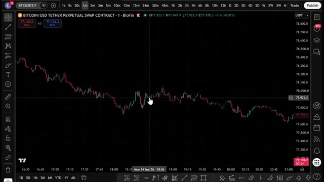
*⏱️ 00:04:50 — Graphique en chandeliers japonais du Bitcoin (BTC/USD) sur un graphique en unité de temps de 1 minute.*

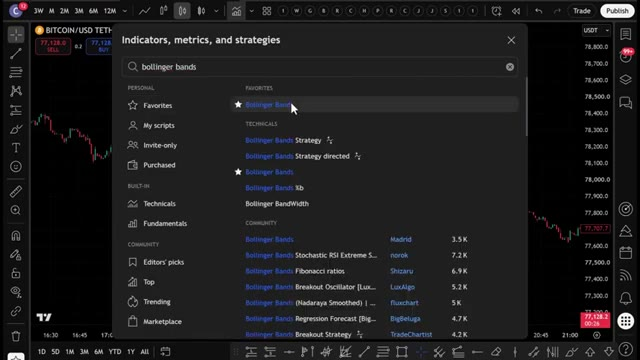
*⏱️ 00:04:54 — Fenêtre de recherche des indicateurs de TradingView avec "bollinger bands" saisi dans la barre de recherche.*

---

### ⏱️ `[00:05:04 - 00:05:26]` | Segment #12

**🔊 Audio (Transcription Intégrale Mot pour Mot en Français) :**
> Les bandes supérieure et inférieure agissent comme nos zones de cassure sur le graphique rapide d'une minute, et la ligne de base centrale agit comme notre point de retour à la moyenne. Pour le second indicateur, cliquez à nouveau sur les indicateurs et tapez RSI stochastique, puis sélectionnez-le. Allez dans les paramètres et définissez la liaison K sur 3, la liaison D sur 3, la liaison RSI sur 14 et la liaison stochastique sur 14.

**👁️ Analyse Visuelle d'Écran (gemini-3.5-flash-lite) :**
**Interface & Outils** : Interface de la plateforme de graphiques TradingView.

**Contenu textuel & Code** : Bandes de Bollinger (BB 20 SMA close 2) et indicateur RSI stochastique (Stoch RSI avec K=3, D=3, Longueur RSI=14, Longueur stochastique=14).

**Action / Démonstration** : Sélection et configuration des indicateurs techniques (Bandes de Bollinger et RSI stochastique) sur le graphique de trading.

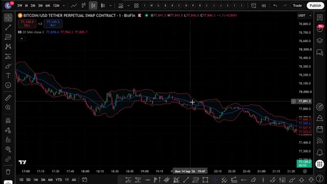
*⏱️ 00:05:09 — Graphique TradingView affichant le cours du Bitcoin avec les bandes de Bollinger configurées.*

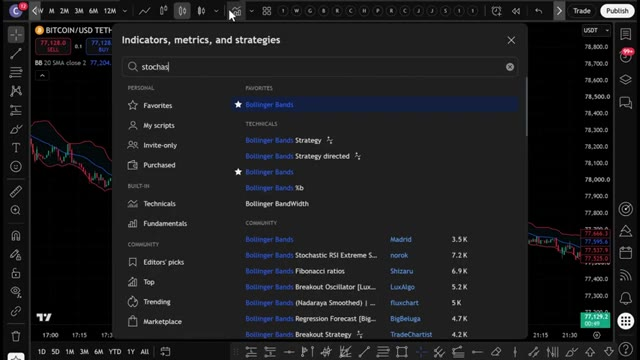
*⏱️ 00:05:15 — Fenêtre de recherche d'indicateurs de TradingView avec le terme "stochas" saisi.*

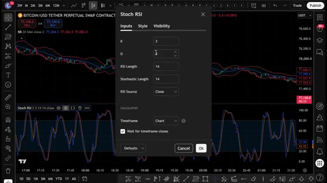
*⏱️ 00:05:21 — Fenêtre des paramètres de configuration du Stoch RSI sur le graphique TradingView.*

---

### ⏱️ `[00:05:27 - 00:06:00]` | Segment #13

**🔊 Audio (Transcription Intégrale Mot pour Mot en Français) :**
> When the K line is above the D line and rising out of oversold territory, meaning below 20, that's bullish momentum. When K is below D and falling out of overbought territory, meaning above 80, that's bearish momentum. This tells us whether real momentum is behind the breakout, not just noise. Now for the last indicator, click on indicators, type volume, select the standard indicator, go to inputs and set the MA length to 15. Go to style, enable the volume moving average, set it to white. Same roll as before, confirms there's actual aggression

**👁️ Analyse Visuelle d'Écran (gemini-3.5-flash-lite) :**
**Interface & Outils** : TradingView / BioFin

**Contenu textuel & Code** : Bitcoin/USD Tether Perpetual Swap Contract, indicateur Bollinger Bands (BB 20, 2, SMA), indicateur Stochastic RSI (Stoch RSI 3, 3, 14, 14).

**Action / Démonstration** : Analyse technique du momentum du prix du Bitcoin à l'aide du Stoch RSI et des bandes de Bollinger pour identifier les zones de surachat et de survente.

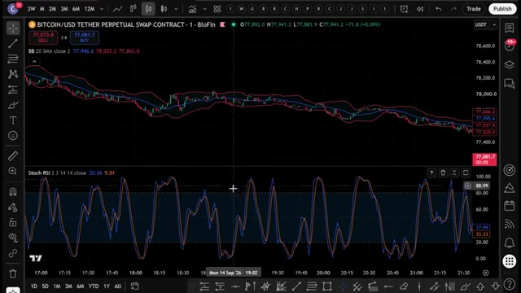
*⏱️ 00:05:35 — Graphique de prix du Bitcoin avec les bandes de Bollinger et l'oscillateur Stochastique RSI en sous-fenêtre.*

---

### ⏱️ `[00:06:00 - 00:06:34]` | Segment #14

**🔊 Audio (Transcription Intégrale Mot pour Mot en Français) :**
> derrière ce mouvement, et pas juste une bougie aléatoire d'une minute. C'est la configuration complète, les bandes de Bollinger, le stochastique, le RSI et le volume, tous réglés pour une vitesse de scalping d'une minute. Pour une position acheteuse, vous avez besoin de trois choses. Le prix touche ou passe sous la bande de Bollinger rouge inférieure. La ligne K du RSI stochastique doit être au dessus de D et sortir de la zone de survente. Et la barre de volume actuelle doit être au-dessus de la ligne de moyenne mobile blanche et verte une fois que les trois sont alignées, entrez à l'achat. Stop loss juste en dessous de la bande de Bollinger rouge inférieure. Take profit à un ratio risque/rendement de deux pour un. Pour une position vendeuse, c'est

**👁️ Analyse Visuelle d'Écran (gemini-3.5-flash-lite) :**
**Interface & Outils** : Interface de trading TradingView intégrée à la plateforme BioFin.

**Contenu textuel & Code** : Graphique de Bitcoin (BITCOIN/USD TETHER PERPETUAL SWAP CONTRACT) en 1 minute, avec les Bandes de Bollinger (BB 20 SMA close 2), le volume, et le Stochastic RSI (réglé sur 3, 3, 14, 14).

**Action / Démonstration** : Présentation de la configuration technique complète pour une stratégie de scalping sur une minute intégrant les bandes de Bollinger, le volume et le Stochastic RSI.

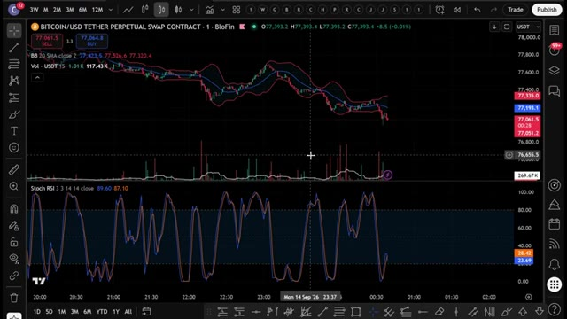
*⏱️ 00:06:09 — Graphique TradingView sur l'interface BioFin montrant le cours du Bitcoin en unité de temps de 1 minute avec les indicateurs techniques (Bandes de Bollinger, Volume et Stochastic RSI).*

---

### ⏱️ `[00:06:34 - 00:07:10]` | Segment #15

**🔊 Audio (Transcription Intégrale Mot pour Mot en Français) :**
> inversé. Le prix doit toucher ou dépasser la bande de Bollinger rouge supérieure. Le K du RSI stochastique est inférieur à D et sort de la zone de surachat. Le volume est au dessus de la ligne blanche et est rouge. Entrez en position vendeuse avec un stop loss juste au dessus de la ligne du milieu. Prenez vos bénéfices à deux pour un. Sur le graphique d'une minute, vous verrez ces signaux se déclencher constamment tout au long de la journée. Exactement ce que vous voulez si vous faites du scalping au lieu d'attendre une seule configuration. Et si vous voulez commencer à utiliser ceci dès maintenant, assurez-vous de vous inscrire en utilisant mon lien dans la description pour obtenir ce pack de bonus complet. C'est entièrement gratuit et vous pouvez l'utiliser

**👁️ Analyse Visuelle d'Écran (gemini-3.5-flash-lite) :**
**Interface & Outils** : TradingView, BloFin, plateforme d'échange YUBIT (Futures)

**Contenu textuel & Code** : Bandes de Bollinger, volume avec ligne de moyenne mobile blanche, RSI stochastique, carnet d'ordres, prix du BTCUSDT et options d'effet de levier.

**Action / Démonstration** : Analyse technique des conditions d'entrée en position vendeuse (short) selon les indicateurs et passage sur l'interface de trading pour l'exécution.

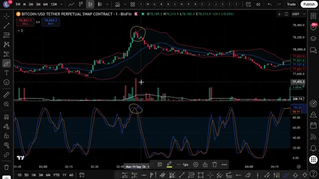
*⏱️ 00:06:43 — Graphique TradingView sur BloFin montrant Bitcoin avec les bandes de Bollinger, les volumes et le RSI stochastique, avec des cercles jaunes soulignant les points d'entrée de la stratégie.*

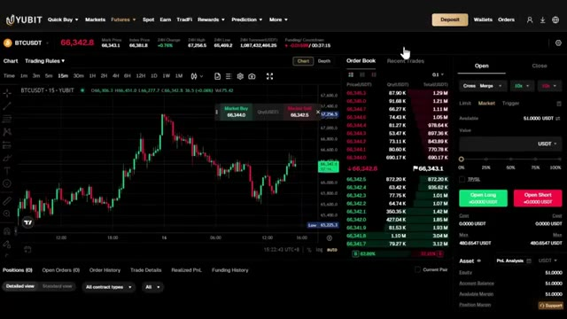
*⏱️ 00:07:01 — Interface de la plateforme d'échange YUBIT affichant le graphique des contrats futures BTCUSDT, le carnet d'ordres et les boutons d'exécution d'ordres (Open Long / Open Short).*

---

### ⏱️ `[00:07:10 - 00:07:44]` | Segment #16

**🔊 Audio (Transcription Intégrale Mot pour Mot en Français) :**
> pour commencer à trader avec plus de capital. Donc maintenant vous comprenez exactement comment la version d'une minute de cette stratégie fonctionne manuellement. Au lieu de regarder un graphique d'une minute toute la journée, j'ai donné cette stratégie exacte à Claude et je lui ai demandé de me construire un script Pine qui détecte ces signaux automatiquement. Voici le prompt que j'utilise. Je vais l'afficher à l'écran en ce moment même. C'est le prompt complet. Collez ça dans Claude. J'utilise Claude code ici et en quelques secondes, il crache un script Pine complet et fonctionnel dans un fichier bloc-notes. Maintenant, ce prompt exact ainsi que le script Pine utilisé dans cette vidéo est disponible dans

**👁️ Analyse Visuelle d'Écran (gemini-3.5-flash-lite) :**
**Interface & Outils** : TradingView, interface d'un éditeur de texte/prompt, explorateur de fichiers Windows.

**Contenu textuel & Code** : Bandes de Bollinger, Stochastic RSI, indicateur de volume, règles de trading pour les signaux long et short, fichiers de stratégies de trading (.txt, .py, .pine).
[DESC_ACTION_1] Analyse d'un graphique de trading pour illustrer le fonctionnement manuel de la stratégie.
[DESC_ACTION_2] Affichage du prompt textuel soumis à l'intelligence artificielle pour concevoir l'indicateur.
[DESC_ACTION_3] Navigation dans les dossiers pour montrer les fichiers de code générés et stockés.

**Action / Démonstration** : Explications face caméra et analyse conceptuelle des marchés.

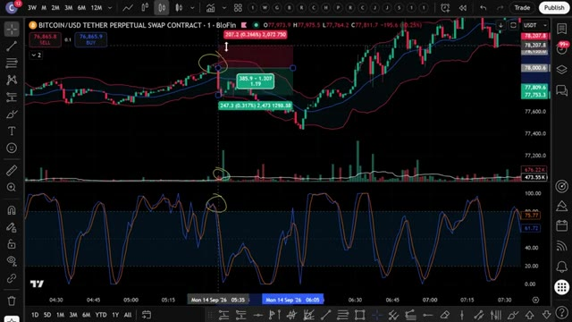
*⏱️ 00:07:18 — Graphique TradingView en unité de 1 minute pour le Bitcoin montrant les bandes de Bollinger, le volume et le Stochastic RSI.*

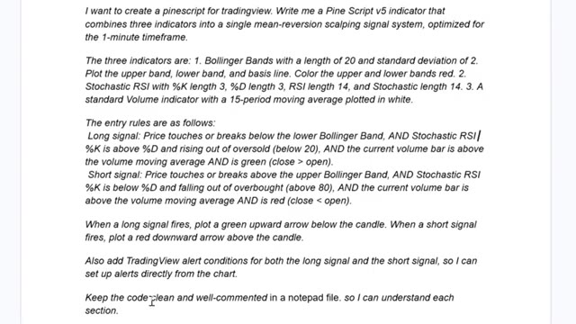
*⏱️ 00:07:27 — Texte du prompt détaillé rédigé pour demander à l'IA Claude de créer un indicateur Pine Script combinant les bandes de Bollinger, le Stoch RSI et le volume.*

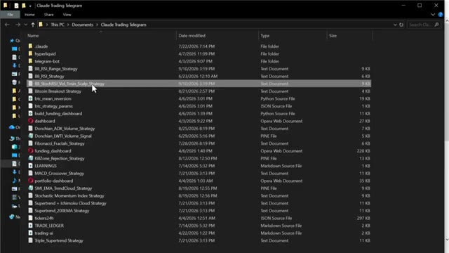
*⏱️ 00:07:35 — Explorateur de fichiers Windows affichant le dossier contenant les différents scripts et stratégies de trading, dont BB_StochRSI_Vol_1min_Scalp_Strategy.*

---

### ⏱️ `[00:07:44 - 00:08:18]` | Segment #17

**🔊 Audio (Transcription Intégrale Mot pour Mot en Français) :**
> mon groupe privé. Vous pouvez trouver le lien en bas. Ouvrez ce fichier, appuyez sur ctrl plus a pour sélectionner tout le code, puis sur ctrl plus c pour le copier. C'est tout ce dont vous avez besoin. Maintenant, mettons-le dans TradingView. Ouvrez TradingView et allez sur n'importe quel graphique. Je vais utiliser à nouveau Bitcoin. En bas de l'écran, cliquez sur l'onglet Éditeur Pine Script. Si vous ne le voyez pas, allez dans la barre d'outils inférieure et cliquez sur Éditeur Pine Script. Une fois l'éditeur ouvert, vous y verrez du code par défaut. Sélectionnez-le entièrement et supprimez-le. Collez ensuite le code que Claude vient de vous donner. Cliquez maintenant sur Ajouter au graphique. C'est le

**👁️ Analyse Visuelle d'Écran (gemini-3.5-flash-lite) :**
**Interface & Outils** : Bloc-notes Windows et interface de graphique TradingView (BloFin).

**Contenu textuel & Code** : Code source Pine Script d'une stratégie de scalpage basée sur les Bandes de Bollinger, le Stoch RSI et le volume (entrée, signaux visuels, alertes) ; graphique de prix en chandeliers japonais.

**Action / Démonstration** : Sélection de tout le code source pour copie et affichage d'un graphique vierge de indicateurs sur TradingView avant l'intégration du script.

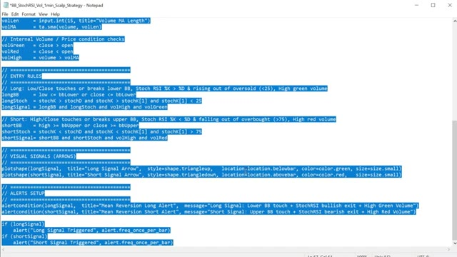
*⏱️ 00:07:52 — Un éditeur de texte (Notepad) affichant le code source d'une stratégie de trading en Pine Script, entièrement sélectionné en surbrillance bleue.*

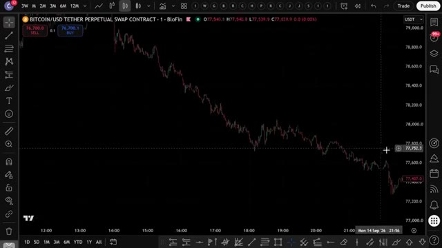
*⏱️ 00:08:01 — Un graphique TradingView affichant la paire BITCOIN/USD TETHER PERPETUAL SWAP CONTRACT sur la plateforme BloFin.*

---

### ⏱️ `[00:08:18 - 00:08:51]` | Segment #18

**🔊 Audio (Transcription Intégrale Mot pour Mot en Français) :**
> bouton en haut à droite de l'éditeur PineScript. TradingView va compiler le script et l'appliquer directement sur votre graphique. Et voilà. Vous pouvez voir les bandes de Bollinger sur le graphique, le panneau RSI stochastique en dessous, l'indicateur de volume et les signaux d'achat et de vente tracés automatiquement. Des flèches vertes pour les achats, des flèches rouges pour les ventes. Tout se déclenche exactement de la manière dont nous l'avons configuré manuellement. Mais maintenant, cela se fait pour vous automatiquement. Maintenant, pour configurer les alertes. Cliquez sur l'icône du réveil en haut de TradingView, sélectionnez créer une alerte, et dans le menu déroulant des conditions

**👁️ Analyse Visuelle d'Écran (gemini-3.5-flash-lite) :**
**Interface & Outils** : TradingView / BloFin

**Contenu textuel & Code** : Bandes de Bollinger sur le prix, indicateur de volume au milieu, RSI stochastique en bas, et signaux d'achat/vente (triangles verts et rouges).

**Action / Démonstration** : Visualisation des indicateurs techniques appliqués au graphique après compilation du script PineScript.

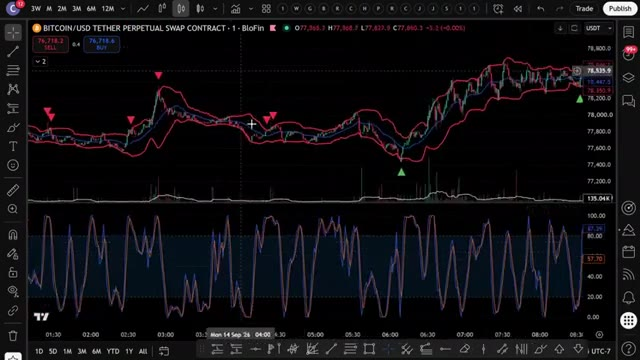
*⏱️ 00:08:26 — Graphique de trading TradingView affichant les bandes de Bollinger, l'indicateur de volume et le RSI stochastique pour la paire Bitcoin/USD.*

---

### ⏱️ `[00:08:51 - 00:09:24]` | Segment #19

**🔊 Audio (Transcription Intégrale Mot pour Mot en Français) :**
> en bas, vous verrez les conditions d'alerte que Claude a ajoutées. Signal long et signal court. Configurez-les et TradingView vous avertira dès qu'un signal se déclenche, directement sur votre téléphone. Donc, au lieu de surveiller le graphique manuellement, surtout sur une unité de temps d'une minute qui évolue rapidement, TradingView fait tout le travail pour vous. Dès que les trois conditions sont réunies, vous recevez une alerte. Vous vérifiez, vous exécutez sur UBIT, et c'est terminé. Maintenant, si vous voulez aller encore plus loin et faire en sorte qu'il trade s'ouvre automatiquement sur votre exchange dès qu'un signal se déclenche, j'ai ce qu'il vous faut.

**👁️ Analyse Visuelle d'Écran (gemini-3.5-flash-lite) :**
**Interface & Outils** : TradingView (Graphique de trading en ligne)

**Contenu textuel & Code** : Paire BITCOIN/USD (BloFin), Bandes de Bollinger, indicateur technique de momentum/oscillateur en bas, liste des alertes actives configurées sur le panneau latéral droit.

**Action / Démonstration** : Configuration et visualisation des signaux d'alerte techniques sur le graphique.

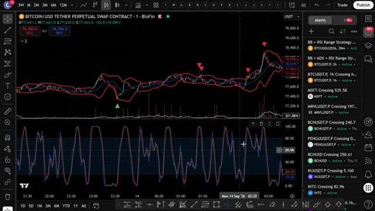
*⏱️ 00:09:00 — Graphique TradingView affichant la paire BITCOIN/USD avec des bandes de Bollinger, des signaux d'achat (triangle vert) et de vente (triangles rouges), ainsi qu'un oscillateur stochastique ou RSI en sous-fenêtre, et le panneau des alertes actives à droite.*

---

### ⏱️ `[00:09:24 - 00:09:58]` | Segment #20

**🔊 Audio (Transcription Intégrale Mot pour Mot en Français) :**
> J'ai créé un groupe privé où je partage tous mes cas d'utilisation pour Claude Code, de son intégration avec Telegram, TradingView, à la recherche de baleines sur Hyperliquid. Tout cela de manière automatique. Tout ce que je vous ai montré aujourd'hui, c'est entièrement dans le groupe. Et j'ajoute constamment de nouvelles choses. De nouvelles stratégies, de nouveaux prompts, de nouvelles intégrations. Chaque fois que je construis quelque chose de nouveau, ça va directement là-dedans. Le prix est de 79,99 $ par mois. Et honnêtement, quand on pense à ce que la configuration de trading disponible pour les traders particuliers en ce moment met constamment à jour avec

**👁️ Analyse Visuelle d'Écran (gemini-3.5-flash-lite) :**
**Interface & Outils** : Hyperliquid Leaderboard, page web de documentation et plateforme d'abonnement Whop.

**Contenu textuel & Code** : Adresses de portefeuilles, valeurs de comptes, PNL, ROI, et descriptions des fonctionnalités de scan de baleines et d'analyse de sentiment.
[DESC_IMAGE_3] Présentation de l'offre commerciale et des outils IA du groupe privé.

**Action / Démonstration** : Explications face caméra et analyse conceptuelle des marchés.

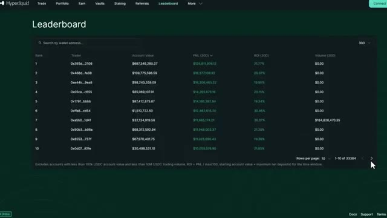
*⏱️ 00:09:33 — Capture montrant le classement (Leaderboard) de la plateforme Hyperliquid affichant les portefeuilles les plus performants.*

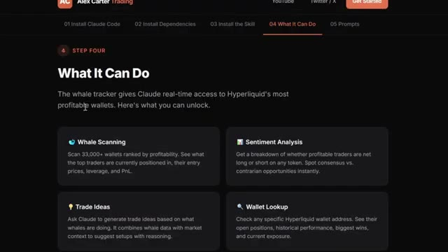
*⏱️ 00:09:41 — Page web de documentation montrant les fonctionnalités du traqueur de baleines ("What It Can Do").*

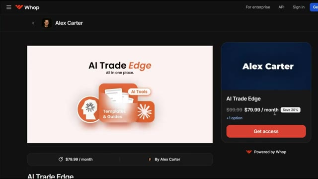
*⏱️ 00:09:50 — Page de la plateforme Whop montrant l'abonnement au groupe privé "AI Trade Edge" d'Alex Carter à 79.99$ par mois.*

---

### ⏱️ `[00:09:58 - 00:10:29]` | Segment #21

**🔊 Audio (Transcription Intégrale Mot pour Mot en Français) :**
> tout ce qui est inclus à l'intérieur est également un cours complet de trading agentique de 2,5 heures, du débutant à l'expert, sans aucune base en programmation nécessaire, à la fin, vous aurez votre propre système de trading par IA fonctionnant en direct, quelque chose que la plupart des traders particuliers ne savent même pas être possible en ce moment, 79,99 $ par mois, un bon trade le couvre et les 100 premiers membres bloquent ce tarif de façon permanente, après cela, le prix augmente. Le lien est dans la description. Vous ne pouvez vraiment pas vous permettre de rater ça.

**👁️ Analyse Visuelle d'Écran (gemini-3.5-flash-lite) :**
**Interface & Outils** : Interface web de cours en ligne et plateforme de vente Whop.

**Contenu textuel & Code** : Listes des modules de formation (Skill 2, MCP TradingView, Firecrawl MCP, Backtest Pine Script, Webhook WEEX, etc.) et section FAQ sur les bots de trading IA.

**Action / Démonstration** : Navigation à travers les modules du cours de trading agentique et présentation de l'offre d'abonnement.

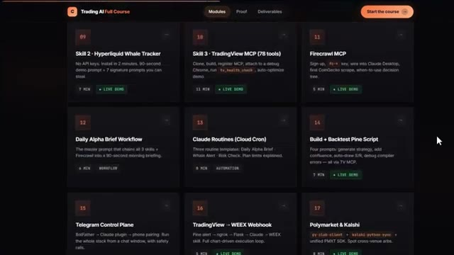
*⏱️ 00:10:06 — Capture d'écran montrant l'interface des modules de cours de trading AI avec une grille de leçons détaillées.*

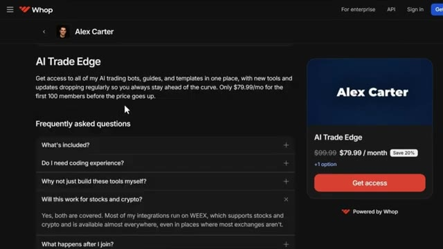
*⏱️ 00:10:21 — Page de présentation de la plateforme Whop d'Alex Carter pour le programme AI Trade Edge avec la tarification et la FAQ.*

---

### ⏱️ `[00:10:29 - 00:10:56]` | Segment #22

**🔊 Audio (Transcription Intégrale Mot pour Mot en Français) :**
> Et c'est tout les gars. C'est comme ça qu'on prend une stratégie sur internet, qu'on la confie à Claude, et qu'on obtient un script Pine fonctionnel sur TradingView. Pas de codage, pas de surveillance manuelle des graphiques. Si vous voulez voir une démonstration complète de la façon dont je trade en utilisant uniquement mon Telegram et la démonstration complète de tous les cas d'utilisation sur TradingView, cliquez sur la vidéo qui apparaît à l'écran dès maintenant. Si vous avez trouvé cela utile, laissez un pouce bleu. Ça aide vraiment la chaîne. Abonnez-vous si ce n'est pas déjà fait et je vous vois dans la prochaine.

**👁️ Analyse Visuelle d'Écran (gemini-3.5-flash-lite) :**
**Interface & Outils** : Présentation ou face-caméra explicatif du trader sans interface logicielle partagée.

**Contenu textuel & Code** : Explications orales des stratégies et mise en contexte méthodologique du marché.

**Action / Démonstration** : Explications face caméra et analyse conceptuelle des marchés.

---

