# 🎬 I Built 3 Claude Tools That Automated 90% Of My Trading

> **Chaîne** : [Alex Carter](https://www.youtube.com/@AlexCarterTrading)  
> **Lien YouTube** : [https://www.youtube.com/watch?v=PX_quKtZVFE](https://www.youtube.com/watch?v=PX_quKtZVFE)  
> **Date de publication** : 20260921  
> **Durée** : 00:11:40  
> **Identifiant vidéo** : `PX_quKtZVFE`  
> **Transcription & Analyse** : `whisper-v3-large-turbo+gemini-3.5-flash-lite`  

---

## 📌 Synthèse Exécutive & Outils

### 💡 Résumé
Dans cette vidéo intitulée **J'ai créé 3 outils Claude qui ont automatisé 90 % de mon trading**, Alex Carter détaille une approche stratégique et pratique du trading et de l'automatisation par agents IA.

### 🛠️ Outils, Modèles & Logiciels Présentés
- **TradingView & Claude Code** : Analyse technique avancée et automatisation algorithmique.

### 🔑 Points Clés & Enseignements Stratégiques
- Respect rigoureux du ratio risque/rendement et du money management.
- Automatisation méthodique des déclencheurs d'ordres via des agents intelligents.

---

## ⏱️ Chronologie & Transcription Complète Audio & Visuelle (Mot pour Mot)

### ⏱️ `[00:00:00 - 00:00:19]` | Segment #01

**🔊 Audio (Transcription Intégrale Mot pour Mot en Français) :**
> These are the three clawed tools that automated 90% in my trading. That's not clickbait. That's literally where I'm at right now. And by the end of this video, you're going to have the exact same setup running for yourself. Whether you're trading crypto, forex, stocks, futures, or literally any market you can think of.

**👁️ Analyse Visuelle d'Écran (gemini-3.5-flash-lite) :**
**Interface & Outils** : Application Telegram, interface web éducative/dashboard de trading, et graphique TradingView.

**Contenu textuel & Code** : Commandes de trading automatisé avec effet de levier (BTC, SOL, DOGE), stop-loss et take-profit, ainsi que des paires Forex (EURUSD, GBPUSD, USDJPY).

**Action / Démonstration** : Exécution d'ordres de trading via un bot et recherche de symboles sur une plateforme de graphiques.

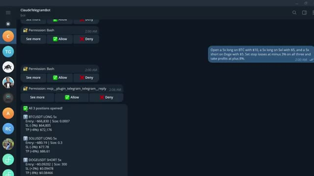
*⏱️ 00:00:05 — Interface de discussion d'un bot Telegram affichant l'exécution automatisée de positions de trading multiples.*

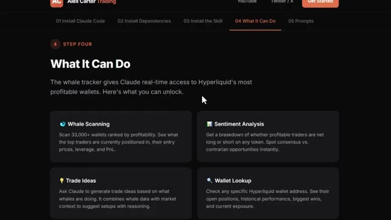
*⏱️ 00:00:09 — Page web explicative présentant les fonctionnalités d'un outil de suivi de portefeuilles de baleines (Whale Tracker).*

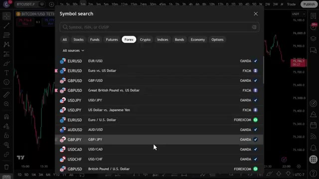
*⏱️ 00:00:14 — Interface de graphique boursier (TradingView) avec la fenêtre de recherche de symboles activée pour le marché des changes (Forex).*

---

### ⏱️ `[00:00:19 - 00:00:41]` | Segment #02

**🔊 Audio (Transcription Intégrale Mot pour Mot en Français) :**
> Je vais vous montrer ce que sont réellement ces outils, à quoi cela ressemble en pratique, comment cela a changé ma façon de trader, et exactement comment vous pouvez mettre la main dessus dès maintenant. Je vais personnellement vous guider sur la façon dont j'utilise chacun d'eux chaque jour pour gérer mon trading sans rester assis devant des graphiques pendant des heures. Maintenant, laissez-moi prouver mes dires, car je sais que 90 % automatisé, cela semble être une grande promesse.

**👁️ Analyse Visuelle d'Écran (gemini-3.5-flash-lite) :**
**Interface & Outils** : Présentation ou face-caméra explicatif du trader sans interface logicielle partagée.

**Contenu textuel & Code** : Explications orales des stratégies et mise en contexte méthodologique du marché.

**Action / Démonstration** : Explications face caméra et analyse conceptuelle des marchés.

---

### ⏱️ `[00:00:41 - 00:01:04]` | Segment #03

**🔊 Audio (Transcription Intégrale Mot pour Mot en Français) :**
> En ce moment, j'ai un agent qui analyse 33 000 baleines Hyperliquid, suit ce qu'elles achètent ou vendent pendant la nuit, et signale tout ce qui sort de sa plage normale. J'en ai un deuxième connecté directement à mes graphiques qui trace automatiquement les supports et résistances, en plus de m'indiquer le meilleur prix pour acheter et vendre. Et un troisième qui me permet de passer un ordre en utilisant un anglais simple presque instantanément.

**👁️ Analyse Visuelle d'Écran (gemini-3.5-flash-lite) :**
**Interface & Outils** : Présentation ou face-caméra explicatif du trader sans interface logicielle partagée.

**Contenu textuel & Code** : Explications orales des stratégies et mise en contexte méthodologique du marché.

**Action / Démonstration** : Explications face caméra et analyse conceptuelle des marchés.

---

### ⏱️ `[00:01:04 - 00:01:27]` | Segment #04

**🔊 Audio (Transcription Intégrale Mot pour Mot en Français) :**
> Ça fait trois agents qui tournent en parallèle 24 heures sur 24, 7 jours sur 7, pendant que je dors, que je tourne ou, littéralement, en train de vous parler en ce moment même sur cette chaîne. Je n'ai pas écrit une seule ligne de code pour configurer tout ça. Et si un non-développeur comme moi peut construire ça en un week-end, vous le pouvez aussi. Bon, voyons exactement comment. La première chose que je veux vous montrer, et c'est celle qui m'a vraiment scotché la première fois que je l'ai vue.

**👁️ Analyse Visuelle d'Écran (gemini-3.5-flash-lite) :**
**Interface & Outils** : Présentation ou face-caméra explicatif du trader sans interface logicielle partagée.

**Contenu textuel & Code** : Explications orales des stratégies et mise en contexte méthodologique du marché.

**Action / Démonstration** : Explications face caméra et analyse conceptuelle des marchés.

---

### ⏱️ `[00:01:27 - 00:02:04]` | Segment #05

**🔊 Audio (Transcription Intégrale Mot pour Mot en Français) :**
> Claude lit, l'historique des prix identifie les niveaux les plus significatifs, les trace directement sur votre graphique, et vous indique lesquels comptent le plus en ce moment. Regardez le graphique. Lignes vertes pour le support, lignes rouges pour la résistance, étiquettes de prix. Le nombre de fois que chaque niveau a été testé, tout est tracé automatiquement, et ensuite il vous indique exactement où se situe le prix en ce moment par rapport à ces niveaux et vous donne un biais directionnel basé sur l'historique de la façon dont le prix a réagi à chacun d'eux. Cela me prenait 20 minutes à tracer manuellement sur chaque graphique. Claude le fait en quelques secondes. Et ce n'est que le point de départ.

**👁️ Analyse Visuelle d'Écran (gemini-3.5-flash-lite) :**
**Interface & Outils** : Présentation ou face-caméra explicatif du trader sans interface logicielle partagée.

**Contenu textuel & Code** : Explications orales des stratégies et mise en contexte méthodologique du marché.

**Action / Démonstration** : Explications face caméra et analyse conceptuelle des marchés.

---

### ⏱️ `[00:02:04 - 00:02:39]` | Segment #06

**🔊 Audio (Transcription Intégrale Mot pour Mot en Français) :**
> Tu peux aussi demander à Claude d'écrire des stratégies PineScript complètes à partir de simple texte en anglais, de déboguer tes indicateurs existants, d'exécuter une analyse complète de confluence multi-périodes sur le graphique hebdomadaire, journalier, en quatre heures et en une heure simultanément, et d'obtenir une recommandation de trade spécifique avec un point d'entrée, un stop loss et un take profit, le tout à partir d'une seule consigne. Mais voici où cela devient entièrement automatisé. Tu peux connecter n'importe laquelle de ces stratégies directement à ton exchange via un webhook TradingView. Lorsque ta stratégie déclenche un signal sur TradingView, Claude le reçoit instantanément par le webhook et exécute le trade automatiquement sur ton

**👁️ Analyse Visuelle d'Écran (gemini-3.5-flash-lite) :**
**Interface & Outils** : Terminal de commandes (Claude Code session, Bash)

**Contenu textuel & Code** : Un tableau de ventilation par unité de temps (Weekly, Daily, 4-Hour, 1-Hour) incluant les indicateurs EMA Trend, RSI(14), MACD Hist, Price vs EMAs et Bias. Des niveaux clés (Résistances et Supports), un score de confluence global (3/4 Bullish), ainsi qu'une recommandation de trade LONG avec les prix d'entrée, Stop Loss, Take Profit et ratio R:R.

**Action / Démonstration** : Exécution d'un script Python d'analyse multi-périodes (`mtf_analysis.py`) affichant les résultats détaillés et les recommandations de trading.

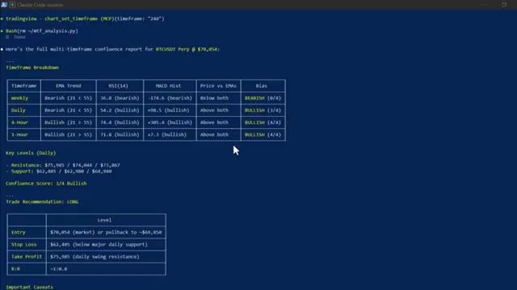
*⏱️ 00:02:13 — Un terminal de commande affichant un rapport complet d'analyse de confluence multi-périodes généré par Claude Code pour BTCUSDT Perp.*

---

### ⏱️ `[00:02:39 - 00:02:59]` | Segment #07

**🔊 Audio (Transcription Intégrale Mot pour Mot en Français) :**
> échange. Entrée, stop loss, take profit. Tout est fait. Sans que vous ne touchiez à rien, le signal est arrivé. Claude l'a traité. Trade ouvert. Confirmation en retour avec chaque détail. Vous construisez la stratégie une seule fois, et à partir de ce moment-là, elle tourne toute seule. Maintenant, cette prochaine section, c'est là que ça devient vraiment intéressant, et honnêtement, c'est l'une de mes choses préférées que j'ai construites avec Claude.

**👁️ Analyse Visuelle d'Écran (gemini-3.5-flash-lite) :**
**Interface & Outils** : TradingView, terminal de commandes Bash, site web personnel d'Alex Carter Trading.

**Contenu textuel & Code** : Graphiques de chandeliers, indicateur technique, lignes de code d'API d'échange, tableau récapitulatif d'un trade ouvert (Side: LONG, Size: 0.024 ETH, Entry Price: $2052.00, Leverage: 5x, Take Profit: $2216.16, Stop Loss: $1990.44).

**Action / Démonstration** : Présentation d'un graphique technique suivi d'une démonstration d'exécution automatisée d'un ordre de trading via un assistant de code.

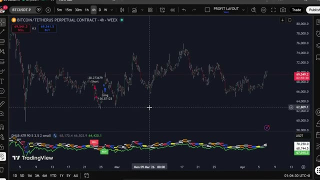
*⏱️ 00:02:44 — Graphique TradingView affichant le contrat perpétuel Bitcoin/Tether sur 4 heures avec des indicateurs techniques et des signaux d'achat/vente.*

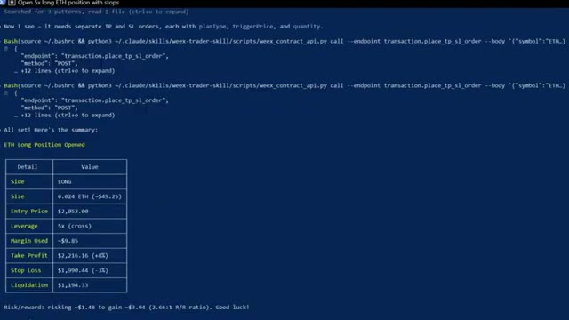
*⏱️ 00:02:49 — Terminal de commande affichant les détails d'exécution d'un ordre d'achat (LONG) sur ETH avec l'entrée, le levier, le TP et le SL.*

---

### ⏱️ `[00:02:59 - 00:03:33]` | Segment #08

**🔊 Audio (Transcription Intégrale Mot pour Mot en Français) :**
> Et si vous pouviez analyser 33 000 portefeuilles sur Hyperliquid ? Trouver les 20 meilleurs traders les plus rentables, voir exactement ce qu'ils achètent en ce moment, leurs prix d'entrée, leur effet de levier, leur PnL non réalisé, et obtenir un plan de trading complet basé sur tout cela, sans clés API nécessaires, sans codage, sans recherche manuelle. Maintenant, Hyperliquid, très rapidement, c'est un échange perpétuel décentralisé fonctionnant sur sa propre blockchain, sans KYC, sans intermédiaire, et comme il est entièrement sur la chaîne, chaque transaction, chaque position, chaque

**👁️ Analyse Visuelle d'Écran (gemini-3.5-flash-lite) :**
**Interface & Outils** : Interface de terminal CLI / script Python personnalisé

**Contenu textuel & Code** : Tableau des positions clés avec les colonnes Coin, Direction, Size, Entry, Leverage et uPnL (BTC, ETH, SOL, ENA, LINK, etc.), ainsi que les valeurs globales du compte et l'historique PnL.

**Action / Démonstration** : Visualisation des positions ouvertes et des performances des meilleurs traders suivis par le script.

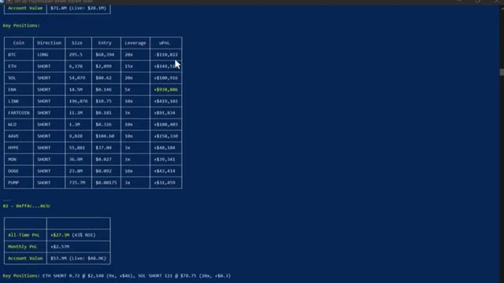
*⏱️ 00:03:08 — Capture d'écran montrant une interface de terminal affichant les positions clés, l'effet de levier et le PnL non réalisé de portefeuilles trackés sur Hyperliquid.*

---

### ⏱️ `[00:03:33 - 00:04:00]` | Segment #09

**🔊 Audio (Transcription Intégrale Mot pour Mot en Français) :**
> portefeuille, c’est entièrement public. C’est ce qui rend cela possible. Très bien, laissez-moi ouvrir Claude Code et vous montrer cela en direct. Voici la première chose que je veux vous montrer. Claude analyse les 20 portefeuilles les plus rentables sur Hyperliquid en ce moment, récupère chaque position ouverte et les classe par rentabilité totale. Tout en un seul coup. Regardez ce qui se passe. Claude se connecte aux points de terminaison publics d'Hyperliquid, commence à extraire les données des portefeuilles parmi 33 000 adresses, les classe par rentabilité et commence à rédiger le rapport.

**👁️ Analyse Visuelle d'Écran (gemini-3.5-flash-lite) :**
**Interface & Outils** : Terminal de commande (Claude Code)

**Contenu textuel & Code** : Texte affichant « Claude Code v2.1.92 », « Opus 4.6 (1M context) - Claude Max » et le chemin d'accès « C:\Users\np ».

**Action / Démonstration** : Ouverture du terminal Claude Code pour préparer l'analyse en direct des portefeuilles rentables.

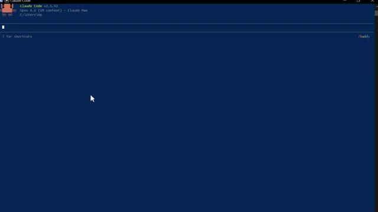
*⏱️ 00:03:40 — Interface en ligne de commande de l'outil Claude Code affichant une invite vide et des informations de version.*

---

### ⏱️ `[00:04:01 - 00:04:24]` | Segment #10

**🔊 Audio (Transcription Intégrale Mot pour Mot en Français) :**
> Tu peux le voir fonctionner à travers les portefeuilles en temps réel. Les prix d'entrée, l'effet de levier, les profits et pertes non réalisés, tout arrive en direct. Et voici le résultat. Les 20 principales baleines classées, chaque position ouverte répertoriée. Et en bas, le résumé du sentiment global. En ce moment, l'argent intelligent est net acheteur sur Bitcoin et net vendeur sur presque tout le reste, en particulier Ethereum.

**👁️ Analyse Visuelle d'Écran (gemini-3.5-flash-lite) :**
**Interface & Outils** : Terminal de commande ou console affichant du code brut.

**Contenu textuel & Code** : Données JSON structurées avec des clés telles que "coin", "direction" (SHORT), "size", "entry_price", "unrealized_pnl", "leverage" (5) et "liquidation_price" pour différentes cryptomonnaies (MOODENG, HYPE, VIRTUAL, MORPHO, IP).

**Action / Démonstration** : Affichage des données de portefeuilles de baleines et de leurs positions ouvertes en direct.

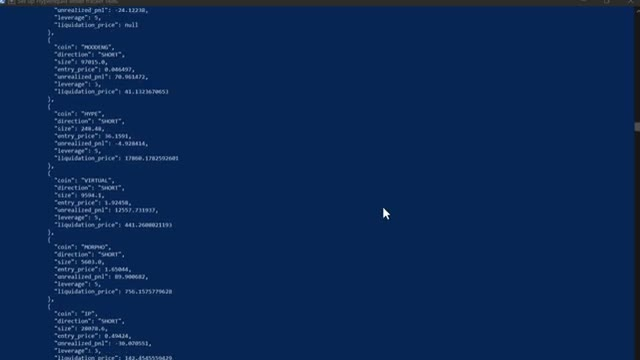
*⏱️ 00:04:07 — Capture d'écran montrant un terminal affichant des données JSON en temps réel avec des informations sur les positions des baleines.*

---

### ⏱️ `[00:04:24 - 00:05:03]` | Segment #11

**🔊 Audio (Transcription Intégrale Mot pour Mot en Français) :**
> C'est le genre de signal qui prenait autrefois des heures à reconstituer manuellement. Claude le fait en moins d'une minute. Maintenant, c'est là que ça devient vraiment intéressant. Ce prompt compare les 20 portefeuilles les plus rentables aux 20 portefeuilles les plus perdants et trouve chaque token où ils se trouvent des côtés opposés du trade. Regardez-le extraire les deux groupes simultanément. Les portefeuilles rentables d'un côté, les portefeuilles perdants de l'autre, et ensuite il commence à recouper les positions. Voici le résultat. Vous pouvez voir là où les deux groupes sont d'accord. Ils sont tous les deux acheteurs sur suey, donc c'est un trade encombré, mais regardez ça, l'argent intelligent est massivement acheteur sur xmr, trx, pendle.

**👁️ Analyse Visuelle d'Écran (gemini-3.5-flash-lite) :**
**Interface & Outils** : Terminal de commandes (CLI) / Interface textuelle

**Contenu textuel & Code** : Analyse comparative détaillée portant sur 33 381 portefeuilles Hyperliquid, incluant un tableau récapitulatif des positions par token (ETH, FARTCOIN, XMR, TRX, PENDLE, etc.) avec les métriques Smart Money vs Rekt Money, les écarts (Gap) et les signaux associés (Strong bull signal, Max divergence bull).

**Action / Démonstration** : Affichage des résultats d'analyse et du tableau comparatif des positions de trading entre les meilleurs et pires portefeuilles.

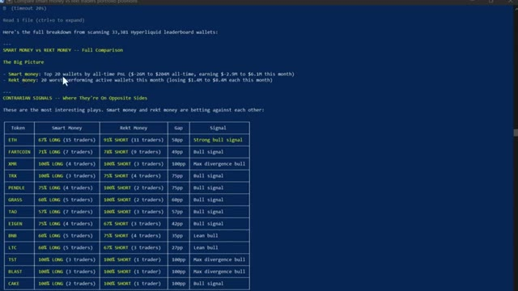
*⏱️ 00:04:34 — Un terminal de commandes affichant l'analyse comparative entre les portefeuilles les plus rentables (Smart money) et les plus perdants (Rekt money) du leaderboard Hyperliquid.*

---

### ⏱️ `[00:05:03 - 00:05:26]` | Segment #12

**🔊 Audio (Transcription Intégrale Mot pour Mot en Français) :**
> Et pour ces altcoins, alors que les traders particuliers sont à découvert sur ces cryptos, cette divergence juste là, c'est le signal. C'est le genre d'analyse que les fonds spéculatifs payent cher, et vous l'obtenez grâce à un outil d'IA à vingt dollars et une API publique gratuite. Et si vous voulez la configuration complète d'Hyperliquid, le code de compétence, chaque prompt, le système complet de suivi des baleines, je vais vous dire exactement comment obtenir tout cela dans un instant.

**👁️ Analyse Visuelle d'Écran (gemini-3.5-flash-lite) :**
**Interface & Outils** : Terminal de commandes et interface web d'Alex Carter Trading.

**Contenu textuel & Code** : Tableaux de données de trading en temps réel sur les positions des portefeuilles, pourcentages long/short, analyses de sentiment et fonctionnalités de suivi de portefeuilles de baleines via API Hyperliquid.

**Action / Démonstration** : Présentation des données d'analyse des divergences de positionnement entre traders particuliers et 'smart money', mise en avant d'un outil d'IA à vingt dollars.

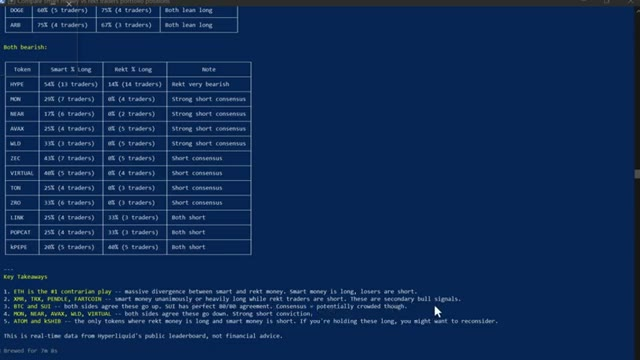
*⏱️ 00:05:09 — Image 1 : Tableau affiché dans un terminal montrant l'analyse des positions des traders 'Smart' vs 'Rekt' sur différents altcoins avec des prises de position long/short.*

*⏱️ 00:05:20 — Image 3 : Interface du site web d'Alex Carter Trading montrant la section 'What It Can Do' avec les fonctionnalités de suivi des baleines et d'analyse de sentiment.*

---

### ⏱️ `[00:05:26 - 00:05:59]` | Segment #13

**🔊 Audio (Transcription Intégrale Mot pour Mot en Français) :**
> Continuez à regarder. Maintenant, celui-ci, c'est celui qui a complètement changé ma routine quotidienne. J'ai construit mon propre assistant de trading IA en utilisant Claude et Telegram, et il trouve des transactions rentables pour moi en utilisant l'IA la plus puissante disponible en ce moment, plus intelligente que n'importe quel humain ne pourrait l'être. Il exécute des transactions, gère mes positions, m'envoie des alertes en temps réel et génère des rapports de portefeuille complets, le tout à partir d'un simple message sur mon téléphone. Ce matin, j'ai passé un ordre depuis mon lit, j'ai pris mes bénéfices depuis la salle de sport, je n'ai touché à aucun graphique. C'est Claude qui tourne sur mon ordinateur. Il

**👁️ Analyse Visuelle d'Écran (gemini-3.5-flash-lite) :**
**Interface & Outils** : Terminal de commande Claude Code, interface de courtier crypto WEEX et application de messagerie Telegram.

**Contenu textuel & Code** : Lignes de commande Claude Code, graphiques de bougies TradingView, carnet d'ordres (order book), et listes de taux de financement (Funding Rate Scan) pour diverses paires crypto avec prévisions et suggestions d'opportunités de trading.
[DESC_IMAGE_1] Navigation et utilisation du terminal de développement Claude Code.
[DESC_IMAGE_2] Visualisation d'un graphique de trading et des outils d'exécution d'ordres sur la plateforme WEEX.
[DESC_IMAGE_3] Analyse des taux de financement et exécution de commandes de trading via le bot Telegram.

**Action / Démonstration** : Explications face caméra et analyse conceptuelle des marchés.

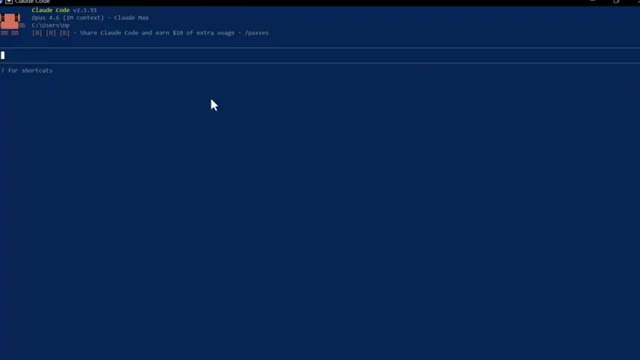
*⏱️ 00:05:34 — Capture d'écran montrant le terminal Claude Code (v2.1.91) avec une interface en ligne de commande.*

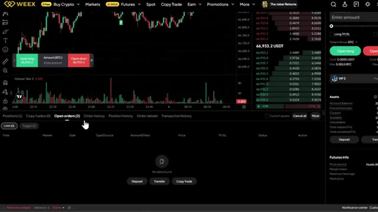
*⏱️ 00:05:43 — Interface de la plateforme de trading WEEX affichant un graphique de prix crypto, un carnet d'ordres et les onglets de gestion des positions.*

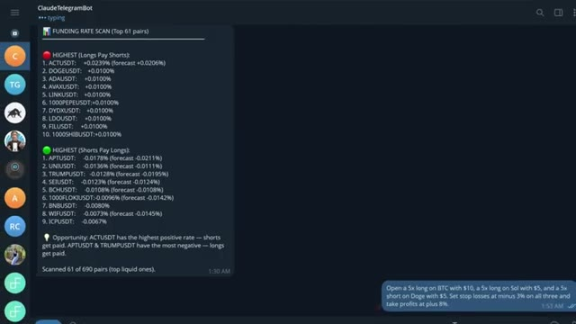
*⏱️ 00:05:51 — Interface de l'application Telegram montrant un bot de trading nommé ClaudeTelegramBot affichant un rapport de scan des taux de financement (funding rates) pour différentes cryptomonnaies.*

---

### ⏱️ `[00:05:59 - 00:06:30]` | Segment #14

**🔊 Audio (Transcription Intégrale Mot pour Mot en Français) :**
> Ça a l'air simple, juste une interface textuelle. Mais regardez ce que ça peut faire. Vous pouvez pratiquement ouvrir une position de trading avec une seule phrase. Ouvrez un long x5 sur l'ETH avec 10 dollars. Définissez un stop loss à moins 3 % et un take profit à plus 8 %. Regardez-le réfléchir. Et voilà. Position ouverte. Stop loss défini. Take profit défini. Confirmation avec tous les détails. Une seule phrase. C'est fait. Maintenant, laissez-moi vous montrer quelque chose qui m'a vraiment scotché la première fois que j'ai testé ça. Donnez-moi un tableau de bord complet de portefeuille.

**👁️ Analyse Visuelle d'Écran (gemini-3.5-flash-lite) :**
**Interface & Outils** : Présentation ou face-caméra explicatif du trader sans interface logicielle partagée.

**Contenu textuel & Code** : Explications orales des stratégies et mise en contexte méthodologique du marché.

**Action / Démonstration** : Explications face caméra et analyse conceptuelle des marchés.

---

### ⏱️ `[00:06:30 - 00:07:08]` | Segment #15

**🔊 Audio (Transcription Intégrale Mot pour Mot en Français) :**
> Toutes mes positions, profits et pertes, frais de financement, courbe de capital sous forme de rapport visuel. Regardez-le fonctionner. Il extrait chaque donnée de mon compte en ce moment même. Et voici ce qu'il génère. Un tableau de bord complet au thème sombre, une courbe de capital, un taux de réussite, des revenus de financement ventilés par crypto-monnaie, chaque position ouverte avec la distance de liquidation mise en surbrillance. C'est le genre de rapport qu'un bureau de trading professionnel produirait. Je l'ai obtenu en quelques secondes à partir d'une seule invite. Et soit dit en passant, si vous trouvez cela utile jusqu'à présent, restez jusqu'à la fin parce que je vais vous montrer comment configurer tout cela vous-même.

**👁️ Analyse Visuelle d'Écran (gemini-3.5-flash-lite) :**
**Interface & Outils** : Terminal de commandes (Bash/Claude Code) et tableau de bord web WEEX Portfolio Dashboard.

**Contenu textuel & Code** : Commandes API Python (`weex-contract_api.py`), requêtes sur les taux de financement et l'open interest (BTC, ETH, SOL, DOGE, etc.), et métriques de portefeuille au format sombre.

**Action / Démonstration** : Exécution de scripts d'extraction de données de compte et affichage dynamique des résultats dans un tableau de bord de trading.

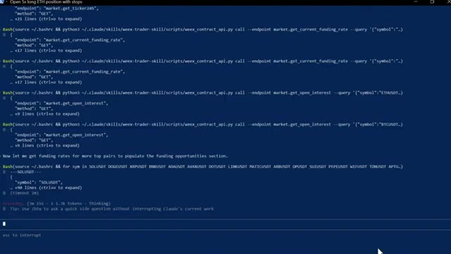
*⏱️ 00:06:40 — Un terminal de commandes bleu affichant des requêtes Bash et des appels d'API Python pour récupérer des taux de financement et des intérêts ouverts.*

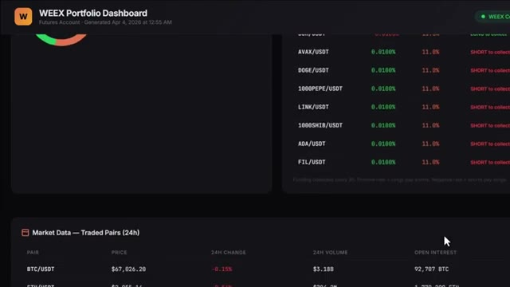
*⏱️ 00:06:49 — Un tableau de bord de portefeuille WEEX au thème sombre montrant des graphiques, des données de marché et des paires tradées.*

---

### ⏱️ `[00:07:08 - 00:07:39]` | Segment #16

**🔊 Audio (Transcription Intégrale Mot pour Mot en Français) :**
> Keep watching. All right, let me show you more. You can also connect this to your telegram to send commands directly from your phone. You can type scan all futures pairs and find the highest funding rates right now. It scanned every single pair, ranked them by funding rate, calculated the annualized yield, and told me exactly which direction to position to collect that funding instantly. Now if you do not know what funding rates are, this is essentially free money that the exchange pays out every eight hours to traders who are positioned on the right side of the market.

**👁️ Analyse Visuelle d'Écran (gemini-3.5-flash-lite) :**
**Interface & Outils** : Application Telegram et site web de l'échange de cryptomonnaies WEEX.

**Contenu textuel & Code** : Commandes de bot Telegram (liaison avec Claude Code) et tableau de taux de financement sur WEEX avec les heures de règlement et les pourcentages associés.

**Action / Démonstration** : Saisie d'une commande textuelle pour scanner les taux de financement des paires futures et consultation des données de funding rates sur WEEX.

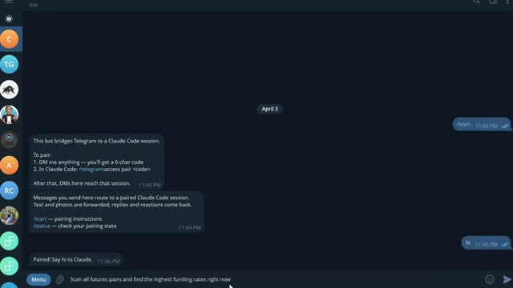
*⏱️ 00:07:16 — Interface Telegram montrant une conversation avec un bot connecté à Claude Code, avec un message de commande en cours de saisie.*

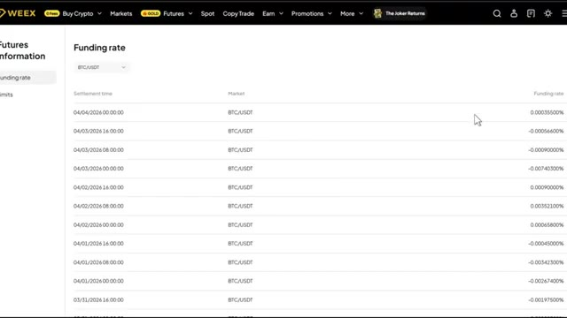
*⏱️ 00:07:31 — Page Web de la plateforme WEEX affichant les informations de taux de financement (Funding rate) pour le marché futures BTC/USDT.*

---

### ⏱️ `[00:07:39 - 00:08:14]` | Segment #17

**🔊 Audio (Transcription Intégrale Mot pour Mot en Français) :**
> Quand le financement est positif, les acheteurs paient les vendeurs. Quand le financement est négatif, les vendeurs paient les acheteurs. Et certains de ces taux sont extrêmement élevés. Ce que fait ce scanner, c'est trouver les paires où ce taux est le plus élevé, calculer ce que cela donne sur une base annuelle, parfois 50 %, 100 %, voire plus, et vous dire exactement dans quelle direction ouvrir une position pour vous asseoir et récolter ce paiement toutes les huit heures. Vous n'essayez même pas de prédire la direction du prix. Vous cultivez simplement le taux. Et maintenant, au lieu de vérifier manuellement chaque paire vous-même, ce que personne

**👁️ Analyse Visuelle d'Écran (gemini-3.5-flash-lite) :**
**Interface & Outils** : Application Telegram (bot de notification) et plateforme d'échange de cryptomonnaies WEEX.

**Contenu textuel & Code** : Listes de paires de cryptomonnaies avec leurs taux de financement actuels et prévisionnels (ex: ACTUSDT, APTUSDT, BTCUSDT), graphiques de prix et carnets d'ordres.

**Action / Démonstration** : Présentation des résultats du scanner de taux de financement et explication de leur fonctionnement sur une interface de courtier.

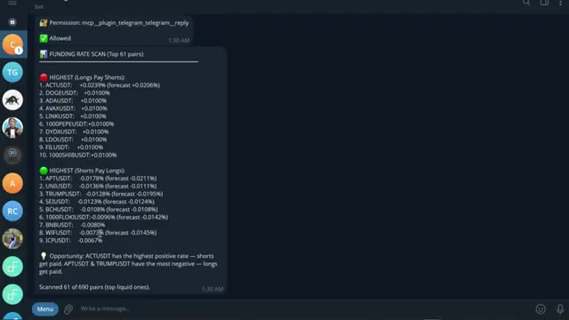
*⏱️ 00:07:47 — Capture d'écran d'une application de messagerie (Telegram) affichant un bot de scan des taux de financement (Funding Rate Scan) pour différentes paires de cryptomonnaies.*

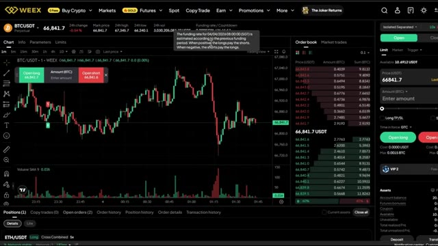
*⏱️ 00:08:05 — Interface de trading de la bourse WEEX montrant un graphique en chandelier pour la paire BTC/USDT ainsi qu'un carnet d'ordres et une infobulle explicative sur le taux de financement.*

---

### ⏱️ `[00:08:14 - 00:08:49]` | Segment #18

**🔊 Audio (Transcription Intégrale Mot pour Mot en Français) :**
> le fait, Claude le fait en quelques secondes et vous sert l'opportunité sur un plateau. Maintenant, si vous êtes prêts à aller encore plus loin, vous pouvez utiliser Claude Code pour créer un bot de trading entièrement automatisé du début à la fin pour les cryptos, les actions, ou n'importe quel marché sur lequel vous tradez. Et honnêtement, c'est ainsi que Claude va changer notre façon de trader pour toujours. Et nous avons déjà fait cela auparavant. Laissez-moi vous montrer à quoi ressemble réellement le résultat final. Voici le tableau de bord, une seule URL, chaque position, votre courbe de capital, l'état de votre bot, vos données sur les baleines, le tout en direct, le tout au même endroit. Fini les onglets de navigateur multiples,

**👁️ Analyse Visuelle d'Écran (gemini-3.5-flash-lite) :**
**Interface & Outils** : Terminal de commande Claude Code, site Web d'Interactive Brokers, tableau de bord WEEX Dashboard.

**Contenu textuel & Code** : Informations sur Claude Code v2.1.91, descriptions textuelles des fonctionnalités d'Interactive Brokers, métriques de compte (Equity: 19.78), courbe de capital et carnets de positions vides sur WEEX.

**Action / Démonstration** : Présentation des outils de développement de bot de trading avec Claude Code et consultation des plateformes et tableaux de bord de courtage.

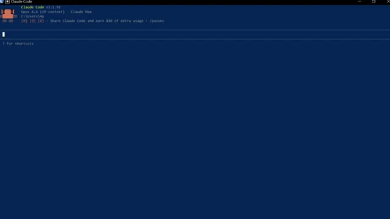
*⏱️ 00:08:23 — Interface du terminal Claude Code affichant sa version 2.1.91 avec le contexte Opus 4.6.*

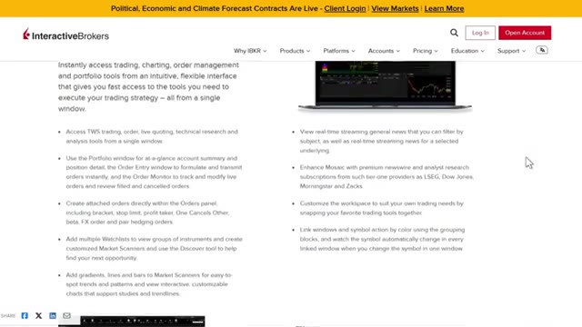
*⏱️ 00:08:32 — Page Web officielle du courtier Interactive Brokers présentant ses fonctionnalités de trading et de gestion de portefeuille.*

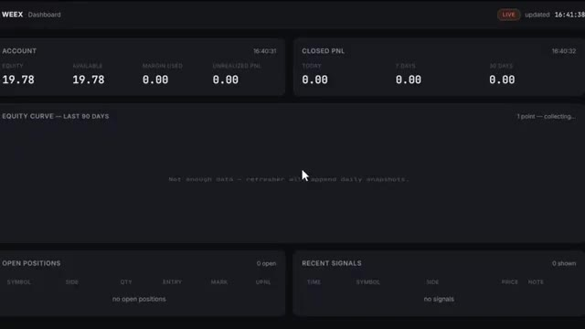
*⏱️ 00:08:41 — Tableau de bord WEEX affichant le solde du compte, la courbe de capital et les positions ouvertes pour le trading automatisé.*

---

### ⏱️ `[00:08:50 - 00:09:10]` | Segment #19

**🔊 Audio (Transcription Intégrale Mot pour Mot en Français) :**
> Fini les doutes sur les points d'entrée. Et chaque matin, avant même d'ouvrir votre ordinateur portable, ce briefing alpha quotidien est déjà dans votre boîte de réception, tous les jours à l'heure et prêt à être lu. Il a déjà analysé les baleines, examiné les graphiques, vérifié votre compte, et vous a préparé la configuration de trading la plus convaincante de la journée, dimensionnée selon votre risque exact.

**👁️ Analyse Visuelle d'Écran (gemini-3.5-flash-lite) :**
**Interface & Outils** : Présentation ou face-caméra explicatif du trader sans interface logicielle partagée.

**Contenu textuel & Code** : Explications orales des stratégies et mise en contexte méthodologique du marché.

**Action / Démonstration** : Explications face caméra et analyse conceptuelle des marchés.

---

### ⏱️ `[00:09:10 - 00:09:28]` | Segment #20

**🔊 Audio (Transcription Intégrale Mot pour Mot en Français) :**
> Un seul prompt, toute la pile. Et le bot lui-même n'est pas installé sur votre ordinateur portable. Il tourne 24 heures sur 24 et 7 jours sur 7 sur un serveur cloud. S'il plante, il redémarre tout seul. Si votre Wi-Fi se coupe, il continue. Votre ordinateur portable n'est que la télécommande. Désormais, la barrière mathématique pour construire tout cela a pour ainsi dire disparu.

**👁️ Analyse Visuelle d'Écran (gemini-3.5-flash-lite) :**
**Interface & Outils** : Interface web Hostinger et terminal de commande Linux (GNU nano).

**Contenu textuel & Code** : Paramètres de configuration SSH, options 'PermitRootLogin yes' et variables d'environnement AcceptEnv.

**Action / Démonstration** : Modification des configurations du serveur cloud et de l'accès SSH distant.

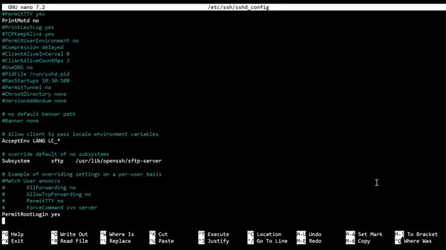
*⏱️ 00:09:19 — Terminal de commande Linux affichant l'éditeur GNU nano 7.2 pour modifier le fichier de configuration SSH '/etc/ssh/sshd_config'.*

---

### ⏱️ `[00:09:29 - 00:09:49]` | Segment #21

**🔊 Audio (Transcription Intégrale Mot pour Mot en Français) :**
> Avant des modèles performants comme Cloud Code, cela aurait pris des semaines, sinon des mois, à assembler. Maintenant, vous pouvez passer d'une idée à un système opérationnel en un après-midi. Et c'est important parce que la plupart des stratégies ne fonctionnent pas. L'avantage concurrentiel ne réside pas dans le fait d'avoir une stratégie parfaite. Il réside dans la capacité à tester suffisamment d'idées assez rapidement pour trouver celles qui fonctionnent vraiment.

**👁️ Analyse Visuelle d'Écran (gemini-3.5-flash-lite) :**
**Interface & Outils** : Interface web de cours, plateforme TradingView et éditeur de texte/code source.

**Contenu textuel & Code** : Modules de formation, graphique de prix BTCUSDT Perpetual Contract, bandes de Bollinger, indicateur RSI 14 et code source Pine Script (conditions de signal long/short, labels, barstate).
[HONOR] Navigation dans les modules, analyse technique sur graphique et visualisation de code de stratégie de trading.

**Action / Démonstration** : Explications face caméra et analyse conceptuelle des marchés.

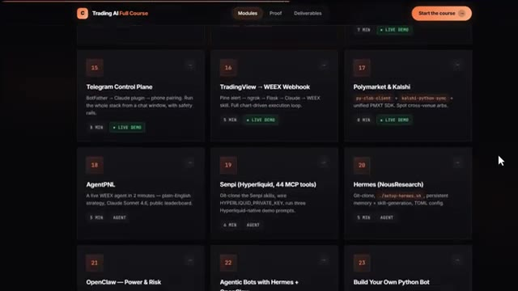
*⏱️ 00:09:34 — Interface de cours en ligne montrant divers modules sur le trading IA.*

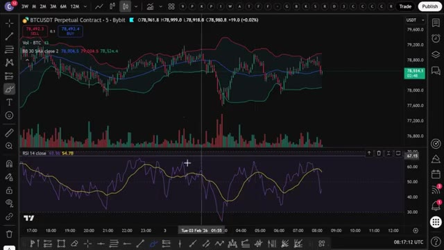
*⏱️ 00:09:39 — Graphique TradingView en chandelier japonais avec indicateurs de bandes de Bollinger et RSI pour BTCUSDT.*

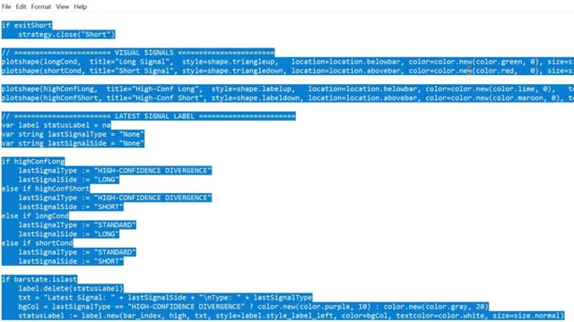
*⏱️ 00:09:44 — Éditeur de code affichant un script Pine pour la gestion des signaux d'achat et de vente.*

---

### ⏱️ `[00:09:50 - 00:10:14]` | Segment #22

**🔊 Audio (Transcription Intégrale Mot pour Mot en Français) :**
> Très bien, et écoutez, pendant les prochaines années, deux sortes de traders existeront. Ceux qui utilisent l'intelligence artificielle et ceux qui font encore tout manuellement. Même marché. Des résultats très différents. Voici comment vous mettez du bon côté de cela. J'ai rassemblé tout ce qui se trouve à l'intérieur de la communauté AI Trade Edge. Chaque invite, chaque robot, chaque modèle, chaque guide étape par étape que j'utilise personnellement, le tout en un seul endroit.

**👁️ Analyse Visuelle d'Écran (gemini-3.5-flash-lite) :**
**Interface & Outils** : Réseau social X, graphique de trading TradingView et site web pédagogique Alex Carter Trading.

**Contenu textuel & Code** : Publication sur l'IA en trading sur X, graphique des prix BTCUSDT avec bougies vertes et rouges, et liste de 78 outils permettant à Claude de contrôler TradingView (lecture de graphiques OHLCV, indicateurs RSI/MACD/EMA, changement de symboles et d'unités de temps).
[DESC_ACTION_1] Navigation sur le fil d'actualité X.
[DESC_ACTION_2] Visualisation d'un graphique de prix en temps réel sur TradingView.
[DESC_ACTION_3] Présentation des capacités d'automatisation et de contrôle de TradingView par l'intelligence artificielle.

**Action / Démonstration** : Explications face caméra et analyse conceptuelle des marchés.

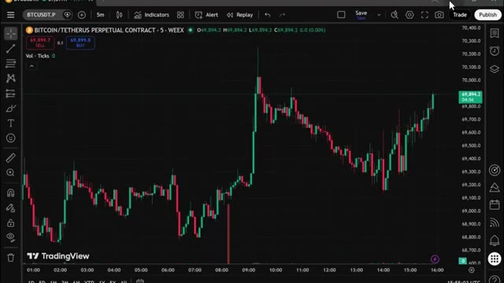
*⏱️ 00:10:02 — Graphique en chandeliers japonais de TradingView affichant le contrat perpétuel BTC/USDT sur l'exchange WEEX en unité de temps 5 minutes.*

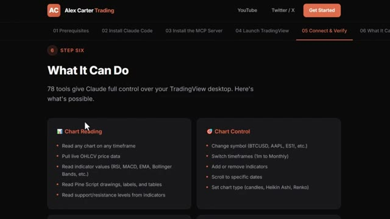
*⏱️ 00:10:08 — Page web de la formation d'Alex Carter intitulée "Alex Carter Trading" détaillant les fonctionnalités de contrôle de TradingView par Claude ("What It Can Do").*

---

### ⏱️ `[00:10:15 - 00:10:50]` | Segment #23

**🔊 Audio (Transcription Intégrale Mot pour Mot en Français) :**
> Et tout ce que je construis à l'avenir est ajouté directement dans le groupe dès sa sortie. Nous testons également des stratégies provenant de tout l'internet, en les automatisant grâce à PineScript, en les faisant tourner en direct, et en partageant exactement ce qui fonctionne et ce qui ne fonctionne pas. Vous n'obtenez donc pas seulement des outils. Vous obtenez une opération de recherche en direct à l'intérieur, il y a aussi un cours complet de trading agentique de 2,5 heures, du débutant à l'expert, sans aucune base en programmation nécessaire, à la fin duquel vous aurez votre propre système de trading IA fonctionnant en direct, quelque chose que la plupart des traders particuliers ne savent même pas être possible en ce moment

**👁️ Analyse Visuelle d'Écran (gemini-3.5-flash-lite) :**
**Interface & Outils** : Présentation ou face-caméra explicatif du trader sans interface logicielle partagée.

**Contenu textuel & Code** : Explications orales des stratégies et mise en contexte méthodologique du marché.

**Action / Démonstration** : Explications face caméra et analyse conceptuelle des marchés.

---

### ⏱️ `[00:10:50 - 00:11:26]` | Segment #24

**🔊 Audio (Transcription Intégrale Mot pour Mot en Français) :**
> 79,99 par mois, un seul bon trade suffit à couvrir ce montant, et les 100 premiers membres bloquent ce tarif de façon permanente, après quoi le prix augmentera. Le lien est dans la description, vous ne pouvez sincèrement pas vous permettre de rater ça, et voilà, c'est ainsi que Claude change le trading pour toujours et que vous pouvez en faire partie. Si vous voulez approfondir chacun de ces sujets individuellement, la visite guidée complète de TradingView sur Telegram et le suivi des baleines sur Hyperliquid, toutes ces vidéos s'affichent à l'écran en ce moment même, allez les voir à votre rythme, et si vous voulez le guide étape par étape complet sur la façon de construire votre propre

**👁️ Analyse Visuelle d'Écran (gemini-3.5-flash-lite) :**
**Interface & Outils** : Whop (plateforme d'adhésion) et terminal de commandes Claude Code (CLI).

**Contenu textuel & Code** : Tarifs d'abonnement à 79,99 $/mois, FAQ sur le trading d'actions et de crypto via WEEX, et interface de ligne de commande Claude Code avec le modèle Opus 4.6.

**Action / Démonstration** : Présentation de l'offre commerciale de la communauté de trading et lancement d'un outil de développement en ligne de commande.

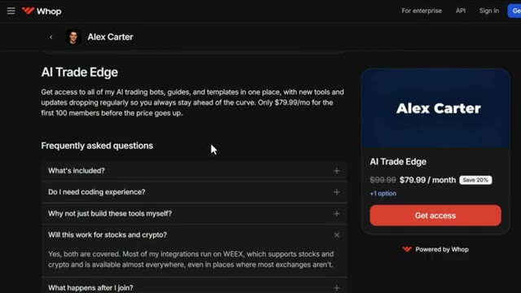
*⏱️ 00:10:59 — Page de vente de la plateforme Whop montrant l'offre 'AI Trade Edge' d'Alex Carter à 79,99 $ par mois.*

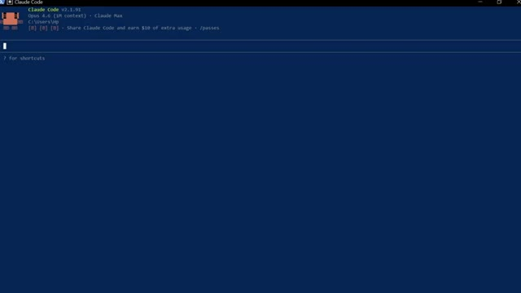
*⏱️ 00:11:08 — Terminal de commande affichant l'interface CLI de Claude Code v2.1.91.*

---

### ⏱️ `[00:11:26 - 00:11:40]` | Segment #25

**🔊 Audio (Transcription Intégrale Mot pour Mot en Français) :**
> système de trading autonome utilisant Claude, cette vidéo s'affiche également à l'écran. Allez la voir ensuite. Si vous avez trouvé cela utile, laissez un pouce bleu. Cela aide vraiment la chaîne. Abonnez-vous si ce n'est pas déjà fait, et je vous dis à la prochaine.

**👁️ Analyse Visuelle d'Écran (gemini-3.5-flash-lite) :**
**Interface & Outils** : Aucune interface visible.

**Contenu textuel & Code** : Aucun contenu technique, indicateur ou code source affiché.

**Action / Démonstration** : Aucune action ou démonstration en cours.

---

