# 🎬 Grok 4.7 Just Released! (What Every AI Trader Needs to Know)

> **Chaîne** : [Alex Carter](https://www.youtube.com/@AlexCarterTrading)  
> **Lien YouTube** : [https://www.youtube.com/watch?v=qUQH4XXWnTo](https://www.youtube.com/watch?v=qUQH4XXWnTo)  
> **Date de publication** : 20260922  
> **Durée** : 00:10:07  
> **Identifiant vidéo** : `qUQH4XXWnTo`  
> **Transcription & Analyse** : `whisper-v3-large-turbo+gemini-3.5-flash-lite`  

---

## 📌 Synthèse Exécutive & Outils

### 💡 Résumé
Cette intervention d'Alex Carter décortique en profondeur le lancement de Grok 4.7 par xAI, présenté comme un tournant majeur pour l'automatisation des stratégies et le trading quantitatif. Le modèle redéfinit le rapport performance/coût en s'alignant sur les tarifs des versions précédentes tout en offrant des capacités de raisonnement accrues, un cycle d'apprentissage par renforcement renforcé et une vitesse d'exécution doublée. Pour les acteurs des marchés financiers et de la cryptographie, cette mise à niveau s'accompagne d'une réduction drastique des coûts de back-end et d'une démocratisation des outils analytiques de pointe autrefois réservés aux fonds institutionnels.

Au-delà de la simple programmation, la vidéo met en lumière l'impact direct des performances de Grok 4.7 sur l'analyse fondamentale et technique, notamment à travers le traitement de rapports de bénéfices complexes, l'agrégation de données *on-chain* et la génération de scripts de trading automatisés. En combinant ces capacités de traitement multi-heures avec des écosystèmes d'agents conversationnels et de routage d'API, les traders particuliers disposent désormais d'un avantage comparatif inédit pour concevoir, backtester et déployer des systèmes algorithmiques en direct sans dépendre d'infrastructures lourdes.

Enfin, l'analyse aborde la transition vers le trading agentique et la structuration d'opérations de recherche algorithmique au sein de communautés spécialisées. En s'appuyant sur des outils d'assistance au code comme Claude Code et des environnements de développement intégrés, l'approche démontre comment transformer des concepts théoriques de scalping et de gestion rigoureuse du risque en pipelines exécutables. L'objectif affiché est clair : automatiser l'analyse de marché pour distancer les opérateurs manuels et s'adapter aux exigences de rapidité des marchés algorithmiques modernes.

### 🛠️ Outils, Modèles & Logiciels Présentés
- **Grok 4.7** : Modèle de pointe de xAI optimisé pour le codage avancé, le raisonnement long et l'analyse financière multi-heures à coût réduit.
- **Grok 4.6** : Version précédente du modèle de xAI servant de référence comparative sur les benchmarks de vitesse et de coût.
- **GrokBot** : Harnais conversationnel et écosystème d'agents de xAI conçu pour orchestrer des tâches complexes de recherche et de programmation.
- **Claude Code** : Environnement et assistant de développement avancé utilisé pour la génération et l'optimisation de scripts de trading.
- **TradingView / Pine Script** : Plateforme de graphitage et langage de programmation incontournable pour le backtesting et l'exécution automatisée de stratégies.
- **Cursor** : Éditeur de code assisté par IA intégrant nativement les nouveaux modèles pour accélérer le développement d'outils de trading.
- **CursorBench 4.0** : Benchmark de référence évaluant les performances des modèles sur des tâches de programmation de longue durée.
- **Deep SWEV 1.1** : Indicateur de performance évaluant la résolution de problèmes logiciels complexes et d'ingénierie.
- **eBench** : Benchmark spécialisé mesurant les capacités d'ingénierie et de résolution technique des modèles.
- **AA Briefcase / GDPVAL** : Bancs d'essai simulant des flux de travail professionnels multi-heures pour analystes, avocats et gestionnaires de portefeuilles.
- **Terminal Bench 4.0** : Évaluation standardisée des agents IA dans les environnements de ligne de commande et de terminaux informatiques.
- **Harvey Legal Agent** : Benchmark mesurant l'efficacité des modèles dans l'analyse de documents juridiques et réglementaires complexes.
- **LatchBio Biosécurité & HackerBench V0.3** : Protocoles et classeurs de tests mesurant la robustesse des gardes-fous et la résistance aux contournements malveillants.

### 🔑 Points Clés & Enseignements Stratégiques
- **Réduction structurelle des coûts opérationnels** : L'arrivée de Grok 4.7 à deux dollars par million de jetons d'entrée et six dollars en sortie permet de diviser par deux les coûts de calcul par rapport aux solutions concurrentes, rendant les infrastructures d'analyse quantitative viables pour les structures indépendantes.
- **Démocratisation des outils institutionnels** : Les performances accrues sur les tâches d'analyse multi-heures permettent aux traders particuliers d'exploiter des assistants capables de traiter des flux de données massifs, rivalisant avec les capacités d'analyse des grands fonds.
- **Optimisation des pipelines de backtesting** : Grâce à une vitesse d'exécution doublée, le développement, la correction et l'optimisation itérative des stratégies de trading écrites en Pine Script sur TradingView se trouvent considérablement accélérés.
- **Impact macroéconomique sur les narratifs cryptos** : Les innovations en matière de prix et de rapidité dans l'infrastructure des grands modèles d'intelligence artificielle agissent comme des catalyseurs directs pour le sentiment de marché des jetons et des écosystèmes décentralisés liés à l'IA.
- **Fiabilité accrue pour le traitement des données financières** : Les scores élevés obtenus sur les benchmarks professionnels garantissent une meilleure exactitude dans la synthèse des rapports de bénéfices, la lecture des indicateurs on-chain et la modélisation des risques.
- **Intégration d'agents conversationnels autonomes** : L'utilisation conjointe de GrokBot et de Claude Code facilite la création d'assistants de recherche de marché capables d'interagir dynamiquement avec les flux de prix en temps réel.
- **Sécurité et robustesse opérationnelle** : Les nouveaux gardes-fous intégrés garantissent une réduction drastique des comportements erronés ou des failles exploitables lors de la génération automatisée de code financier critique.
- **Transition vers le trading agentique** : L'automatisation complète de la chaîne de valeur — de la génération d'hypothèses de trading à l'exécution de scripts en direct — s'impose comme la distinction fondamentale entre les traders rentables et les opérateurs manuels.
- **Flexibilité et interopérabilité des accès** : La disponibilité immédiate du modèle via l'API officielle, l'IDE Cursor et des routeurs tiers offre une liberté totale d'architecture pour les développeurs de bots de scalping.
- **Gestion rigoureuse du risque algorithmique** : L'automatisation des stratégies via l'IA doit impérativement s'accompagner de règles de *risk management* strictes codées en dur pour neutraliser l'aléa comportemental et les dérives des algorithmes en période de forte volatilité.
- **Transformation de la recherche quantitative** : Le passage d'invites ponctuelles à des cycles de raisonnement longs permet d'analyser des configurations graphiques complexes et des corrélations multi-marchés avec une précision analytique supérieure.
- **Avantage compétitif par l'automatisation en continu** : L'adhésion à des cellules de recherche opérationnelle et à des communautés d'échange de stratégies permet d'itérer rapidement sur les configurations gagnantes et d'éliminer les inefficacités de marché en temps réel.

---

## ⏱️ Chronologie & Transcription Complète Audio & Visuelle (Mot pour Mot)

### ⏱️ `[00:00:00 - 00:00:34]` | Segment #01

**🔊 Audio (Transcription Intégrale Mot pour Mot en Français) :**
> xAI vient tout juste de sortir Grok 4.7 et Elon Musk affirme littéralement que cet outil est deux fois plus rapide que les autres modèles d'IA comparables et qu'il ne coûte que deux fois moins cher. Donc, dans la vidéo d'aujourd'hui, nous allons passer en revue littéralement tout ce que vous devez savoir sur Grok 4.7, les benchmarks, la tarification, et ce qui change réellement sous le capot. Et je vais également analyser en détail pourquoi c'est réellement important si vous vous intéressez au trading et à la crypto, et honnêtement, pourquoi c'est important pour à peu près tout le monde aussi. Maintenant, voici le problème. Les gens sont déjà en train de tester la toute dernière mise à jour de Grok et juste

**👁️ Analyse Visuelle d'Écran (gemini-3.5-flash-lite) :**
**Interface & Outils** : Interface web de X (Twitter) et tableau comparatif de spécifications techniques de modèles d'IA.

**Contenu textuel & Code** : Graphiques de performance (Artificial Analysis Intelligence Index, Coding Agent Index) et tableau de prix (Input/Output token price, CursorBench, DeepSWE, EEBench, Terminal-Bench).

**Action / Démonstration** : Présentation des benchmarks de performance et des coûts des différents modèles d'intelligence artificielle.

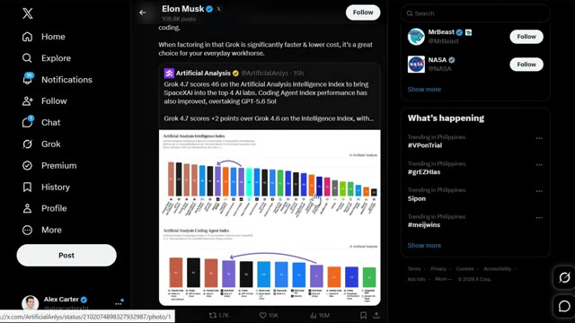
*⏱️ 00:00:08 — Capture d'écran du réseau social X montrant un tweet d'Elon Musk relayant un rapport d'Artificial Analysis sur les performances de Grok 4.7.*

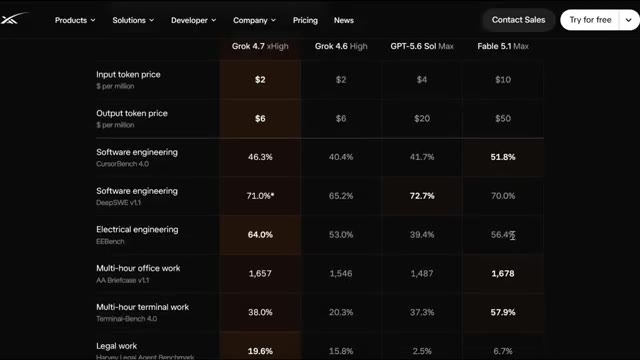
*⏱️ 00:00:17 — Tableau comparatif détaillé des performances et des coûts par token entre Grok 4.7, Grok 4.6, GPT-5.6 Sol et Fable 5.1.*

---

### ⏱️ `[00:00:34 - 00:01:01]` | Segment #02

**🔊 Audio (Transcription Intégrale Mot pour Mot en Français) :**
> Maintenant, la communauté est plutôt divisée sur la question de savoir s'il s'agit réellement d'une bonne sortie ou si c'est juste un battage médiatique de plus. Et cela arrive juste après le lancement réussi de GrokBot, il y a tout juste quelques semaines. Donc, xAI est clairement sur une lancée en ce moment et Elon essaie fondamentalement de faire de Grok le modèle incontournable pour le code et le travail intellectuel. Et restez bien jusqu'à la fin, car je vais vous montrer la seule chose concernant cette sortie dont personne ne parle vraiment pour l'instant. Donc, sans plus attendre, commençons.

**👁️ Analyse Visuelle d'Écran (gemini-3.5-flash-lite) :**
**Interface & Outils** : Navigateur web affichant les plateformes X (Twitter) et le site officiel xAI.

**Contenu textuel & Code** : Publications sur les réseaux sociaux (X), tweets d'Elon Musk, graphiques d'analyse comparative des performances des modèles IA (Artificial Analysis) et descriptions textuelles des fonctionnalités xAI.
[DESC_IMAGE_3] Navigation et lecture de publications communautaires et officielles sur xAI et ses derniers lancements.

**Action / Démonstration** : Explications face caméra et analyse conceptuelle des marchés.

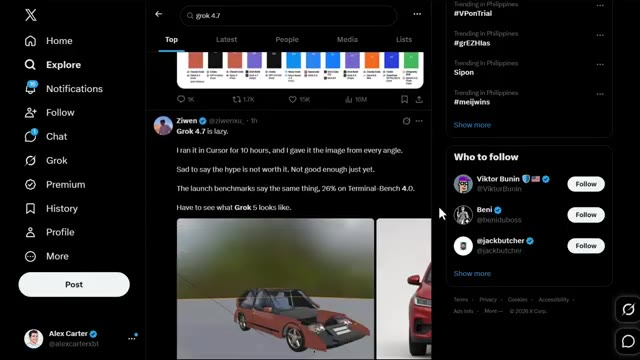
*⏱️ 00:00:41 — Une capture d'écran montrant le fil d'actualité X (Twitter) avec un post critique concernant les performances de Grok 4.7.*

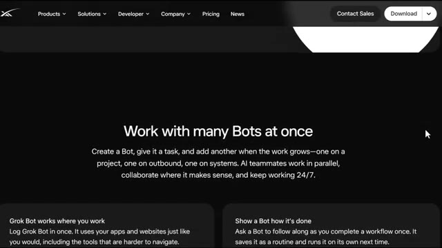
*⏱️ 00:00:47 — Une page de présentation web du site xAI mettant en avant les fonctionnalités multi-bots (« Work with many Bots at once »).*

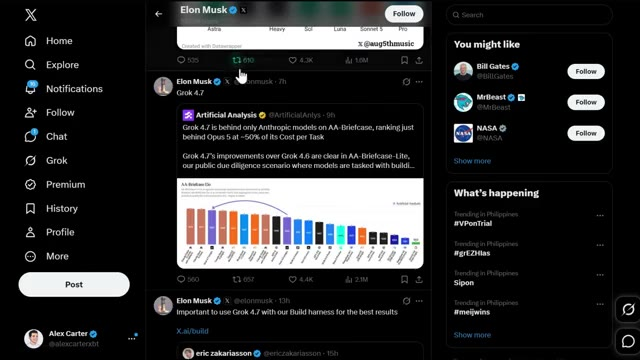
*⏱️ 00:00:54 — Une capture d'écran de X montrant un tweet officiel d'Elon Musk au sujet de Grok 4.7 avec un graphique d'analyse comparative (Artificial Analysis).*

---

### ⏱️ `[00:01:02 - 00:01:36]` | Segment #03

**🔊 Audio (Transcription Intégrale Mot pour Mot en Français) :**
> Donc, première chose à faire, qu'est-ce que c'est réellement que Grok 4.7 ? XAI le présente comme leur modèle le plus performant à ce jour pour la programmation et le travail intellectuel. Il travaille plus longtemps sur les tâches difficiles, il vérifie son propre travail avec plus d'attention, et il est doté de ce qu'ils appellent leurs gardes-fous les mieux calibrés à ce jour. Et voici le truc fou. Il est proposé exactement au même prix et à la même vitesse que Grok 4.6, donc vous bénéficiez en gros d'une mise à niveau gratuite. Si vous aviez l'impression que chaque IA que je sors ces derniers temps n'est qu'une mise à jour mineure avec un nouveau numéro collé dessus, vous n'avez pas tort d'être sceptique.

**👁️ Analyse Visuelle d'Écran (gemini-3.5-flash-lite) :**
**Interface & Outils** : Navigateur web affichant la page d'annonce officielle de xAI ("Introducing Grok 4.7").

**Contenu textuel & Code** : Titre "Introducing Grok 4.7", texte de présentation décrivant le modèle comme le plus performant pour le code et le travail intellectuel ("most capable model for coding and knowledge work"), avec des boutons "Try for free" et "Start building".

**Action / Démonstration** : Sélection de texte à la souris par l'utilisateur sur la description du modèle.

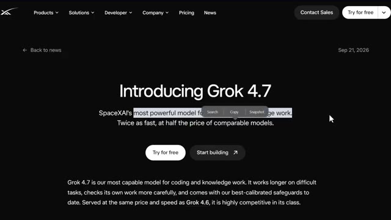
*⏱️ 00:01:10 — Capture d'écran de la page de présentation officielle de Grok 4.7 sur le site web de xAI.*

---

### ⏱️ `[00:01:36 - 00:02:09]` | Segment #04

**🔊 Audio (Transcription Intégrale Mot pour Mot en Français) :**
> Mais celui-ci est vraiment différent. Sous le capot, Grok 4.7 utilise un nouveau modèle de base plus grand par rapport au 4.6. Ils l'ont entraîné avec un cycle d'apprentissage par renforcement plus long sur un mélange de tâches plus difficile. Et je veux dire orienté vers des problèmes qui prennent littéralement des heures à résoudre, et pas seulement des invites rapides et ponctuelles. En plus de cela, le modèle est bien meilleur pour vérifier son propre travail et gérer des contextes plus longs. Et ils l'ont également entraîné à comprendre nativement le harnais GrokBot, il est donc nettement meilleur pour les tâches conversationnelles et le travail de connaissances générales également. Maintenant, vous pourriez

**👁️ Analyse Visuelle d'Écran (gemini-3.5-flash-lite) :**
**Interface & Outils** : Page web officielle de présentation des modèles d'IA (xAI/Grok) avec tableau de benchmarks et spécifications techniques.

**Contenu textuel & Code** : Tableaux de benchmarks (CursorBench 4.0, DeepSWE v1.1, EEBench, etc.), prix des tokens d'entrée ($2) et de sortie ($6), et texte explicatif sur l'entraînement par renforcement de Grok 4.7.

**Action / Démonstration** : Présentation et analyse comparative des performances et des tarifs des modèles Grok 4.7 face à la concurrence (Grok 4.6, GPT-5.6, Fable 5.1).

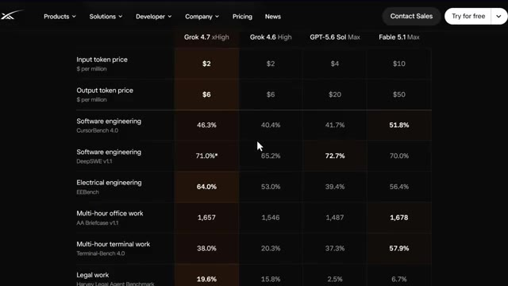
*⏱️ 00:01:45 — Tableau comparatif détaillé des performances et des coûts des différents modèles d'IA, mettant en évidence Grok 4.7 xHigh.*

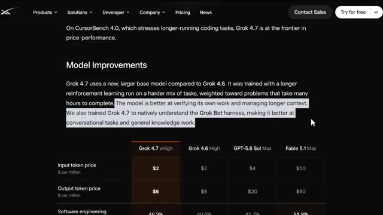
*⏱️ 00:02:01 — Section explicative sur les améliorations du modèle Grok 4.7 avec du texte en surbrillance, au-dessus du tableau comparatif.*

---

### ⏱️ `[00:02:09 - 00:02:48]` | Segment #05

**🔊 Audio (Transcription Intégrale Mot pour Mot en Français) :**
> en train de se dire, ok, super, mais est-ce que tout cela se traduit réellement par de vraies performances ? Jetons un œil aux chiffres réels. Donc sur CursorBench 4.0, qui met à l'épreuve ces tâches de codage de plus longue durée, Grok 4.7 se situe exactement à la pointe en matière de rapport qualité-prix, fondamentalement pour ce que vous payez, rien d'autre ne rivalise vraiment à ce niveau. Passons en revue le tableau comparatif, car c'est là que ça devient intéressant : Grok 4.7 en mode élevé est tarifé à deux dollars par million de jetons d'entrée et six dollars par million de jetons de sortie, comparez cela à Grok 4.6 au même tarif de deux et six.

**👁️ Analyse Visuelle d'Écran (gemini-3.5-flash-lite) :**
**Interface & Outils** : Navigateur web affichant une page de documentation ou de présentation officielle (style xAI).

**Contenu textuel & Code** : Graphique montrant les courbes de performance pour divers modèles : Fable 5.1 (jaune), Opus 5 (bleu), Grok 4.7 (blanc), Sonnet 5 (vert) et GPT-5.5 (rouge), avec le curseur de la souris pointant sur le texte "CursorBench 4.0 score".

**Action / Démonstration** : Le présentateur commente le graphique de performance et met en avant la position de Grok 4.7 sur CursorBench 4.0.

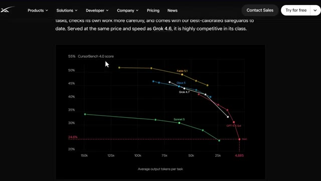
*⏱️ 00:02:19 — Un graphique comparatif des performances de différents modèles d'IA sur le benchmark CursorBench 4.0, affichant les scores en pourcentage en fonction du nombre moyen de tokens de sortie par tâche.*

---

### ⏱️ `[00:02:48 - 00:03:13]` | Segment #06

**🔊 Audio (Transcription Intégrale Mot pour Mot en Français) :**
> dollars, GPT 5.6 Sol Max à 4 et 20 dollars, et Fable 5.1 Max qui se situe bien plus haut, à 10 dollars en entrée et 50 dollars en sortie. Donc Grok 4.7 fonctionne littéralement à une fraction du coût de ces autres modèles de pointe. Maintenant, concernant les performances réelles, sur Cursor Bench, Grok 4.7 a obtenu un score de 46,3 %, en hausse par rapport aux 40,4 % de Grok 4.6.

**👁️ Analyse Visuelle d'Écran (gemini-3.5-flash-lite) :**
**Interface & Outils** : Présentation ou face-caméra explicatif du trader sans interface logicielle partagée.

**Contenu textuel & Code** : Explications orales des stratégies et mise en contexte méthodologique du marché.

**Action / Démonstration** : Explications face caméra et analyse conceptuelle des marchés.

---

### ⏱️ `[00:03:13 - 00:03:41]` | Segment #07

**🔊 Audio (Transcription Intégrale Mot pour Mot en Français) :**
> Et ça bat en fait les 41,7 % de GPT 5.6 Sol. Sur Deep SWEV 1.1, il a atteint 71,0 % à effort élevé. Sur eBench, qui concerne des tâches de génie électrique, il a obtenu 64,0 %, largement en avance sur la concurrence. Sur le travail de bureau multi-heures, AA Briefcase, il a obtenu 1 657. Sur Terminal Bench 4.0, il a atterri à 38,0 %.

**👁️ Analyse Visuelle d'Écran (gemini-3.5-flash-lite) :**
**Interface & Outils** : Page web de présentation avec tableau de spécifications et de performances.

**Contenu textuel & Code** : Tarifs des tokens (Input/Output) et scores de benchmarks : Software engineering (CursorBench 4.0, DeepSWE v1.1), Electrical engineering (EEBench), et Multi-hour office work (AA Briefcase v1.1).

**Action / Démonstration** : Affichage des résultats de performance du modèle Grok 4.7 xHigh en comparaison avec la concurrence.

*⏱️ 00:03:20 — Tableau comparatif des performances de différents modèles d'IA (Grok 4.7 xHigh, Grok 4.6 High, GPT-5.6 Sol Max, Fable 5.1 Max) sur plusieurs benchmarks techniques.*

---

### ⏱️ `[00:03:41 - 00:04:01]` | Segment #08

**🔊 Audio (Transcription Intégrale Mot pour Mot en Français) :**
> Et sur le benchmark Harvey Legal Agent, il a obtenu 19,6 %, ce qui est en fait le score le plus élevé du groupe. Et dans une minute, je vais vous montrer pourquoi c'est réellement important bien au-delà de la simple programmation, y compris pour les professionnels du trading et de la finance. Donc, Grok 4.7 est également nettement meilleur pour créer des documents et des présentations.

**👁️ Analyse Visuelle d'Écran (gemini-3.5-flash-lite) :**
**Interface & Outils** : Tableau web de benchmarks de performance de modèles d'IA sur fond sombre.

**Contenu textuel & Code** : Scores de benchmarks pour différents domaines : Software engineering, Electrical engineering, Multi-hour office work, Multi-hour terminal work, Legal work (19,6%), et Clinical reasoning.

**Action / Démonstration** : Le curseur de la souris pointe sur le score de 19,6% du benchmark légal pendant que le présentateur commente les résultats.

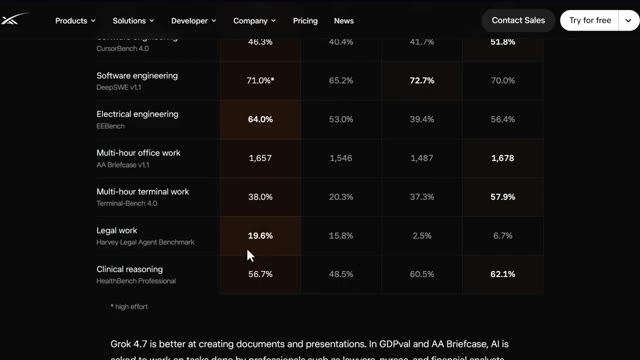
*⏱️ 00:03:46 — Tableau comparatif de benchmarks montrant les performances des modèles d'IA, avec un focus sur la ligne 'Legal work / Harvey Legal Agent Benchmark' affichant 19,6%.*

---

### ⏱️ `[00:04:01 - 00:04:19]` | Segment #09

**🔊 Audio (Transcription Intégrale Mot pour Mot en Français) :**
> Dans GDPVAL et AA Briefcase, il est fondamentalement demandé à l'IA d'exécuter des tâches que de vrais professionnels font. Des avocats, des infirmières, des analystes financiers, ce genre de choses. Et Grok 4.7 surpasse Grok 4.6 sur ces deux bancs d'essai, en affichant des performances comparables à d'autres modèles de pointe.

**👁️ Analyse Visuelle d'Écran (gemini-3.5-flash-lite) :**
**Interface & Outils** : Page web officielle de présentation des modèles d'IA (xAI) avec graphiques de performance.

**Contenu textuel & Code** : Scores Elo pour différents modèles sur le benchmark GDPval : Fable 5.1 (1678), Grok 4.7 x(high) (1857, mis en valeur en orange), GPT & Astra (1568), Grok 4.6 (1546). Texte explicatif sur les améliorations de Grok 4.7.

**Action / Démonstration** : Navigation ou présentation des résultats de performance sur le banc d'essai GDPval illustrant la supériorité de Grok 4.7.

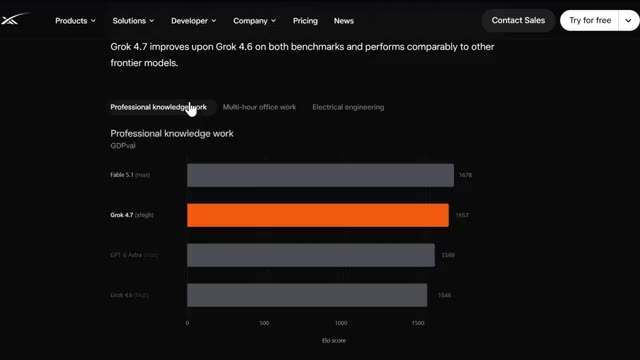
*⏱️ 00:04:06 — Capture d'écran montrant les résultats de benchmarks de Grok 4.7 sur des tâches de travail professionnel (GDPval), avec des graphiques à barres comparant différents modèles d'IA.*

---

### ⏱️ `[00:04:20 - 00:04:40]` | Segment #10

**🔊 Audio (Transcription Intégrale Mot pour Mot en Français) :**
> En regardant les scores ELO du GDPVAL, Fable 5.1 atteint un maximum de 1 735. Grok 4.7 en mode X-High est à 1 695. Grok 4.6 High est à 1 605. Et GPT-6 Astra Max est à 1 542.

**👁️ Analyse Visuelle d'Écran (gemini-3.5-flash-lite) :**
**Interface & Outils** : Présentation ou face-caméra explicatif du trader sans interface logicielle partagée.

**Contenu textuel & Code** : Explications orales des stratégies et mise en contexte méthodologique du marché.

**Action / Démonstration** : Explications face caméra et analyse conceptuelle des marchés.

---

### ⏱️ `[00:04:40 - 00:05:00]` | Segment #11

**🔊 Audio (Transcription Intégrale Mot pour Mot en Français) :**
> Donc Grok se positionne directement aux côtés des meilleurs modèles actuellement disponibles, même s'il n'est pas le leader incontesté sur cette mesure spécifique. Maintenant, voici quelque chose qui m'a honnêtement surpris. Grok 4.7 a été conçu avec une toute nouvelle pile de mesures de sécurité. Et xAI affirme qu'il s'agit du modèle le plus robuste qu'ils aient testé en matière de refus et de résistance au contournement de sécurité.

**👁️ Analyse Visuelle d'Écran (gemini-3.5-flash-lite) :**
**Interface & Outils** : Page web officielle de présentation du modèle Grok (site xAI).

**Contenu textuel & Code** : Graphique de performance Elo (Grok 4.7 à 1695) et texte explicatif sur la pile de mesures de sécurité et la résistance au jailbreak.

**Action / Démonstration** : Présentation des performances comparatives et des mesures de sécurité de Grok 4.7.

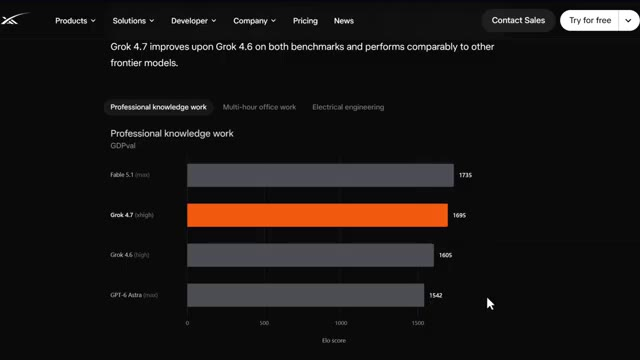
*⏱️ 00:04:45 — Capture d'écran montrant un graphique de benchmark de performance "Professional knowledge work" comparant Grok 4.7 à d'autres modèles d'IA avec leurs scores Elo.*

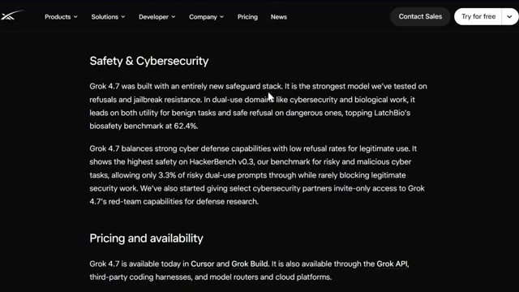
*⏱️ 00:04:50 — Capture d'écran textuelle montrant la section "Safety & Cybersecurity" détaillant la nouvelle pile de mesures de sécurité de Grok 4.7.*

---

### ⏱️ `[00:05:01 - 00:05:23]` | Segment #12

**🔊 Audio (Transcription Intégrale Mot pour Mot en Français) :**
> Et dans les domaines à double usage comme la cybersécurité et la recherche biologique, il est en tête à la fois pour son utilité dans les tâches légitimes et son refus de répondre aux tâches dangereuses. Il est actuellement en tête du classement de biosécurité de LatchBio avec 62,4 %. Évidemment, on pourrait penser qu'un modèle plus performant implique plus de risques. Mais curieusement, Grok 4.7 est en fait la version la plus sûre qu'ils aient publiée.

**👁️ Analyse Visuelle d'Écran (gemini-3.5-flash-lite) :**
**Interface & Outils** : Navigateur web affichant un site officiel de documentation et de spécifications techniques.

**Contenu textuel & Code** : Texte descriptif sur la sécurité, les taux de refus, et tableau de métriques comparatives (prix des tokens, software engineering, electrical engineering, clinical reasoning).

**Action / Démonstration** : Présentation des spécifications de sécurité et du tableau comparatif des performances des modèles d'intelligence artificielle.

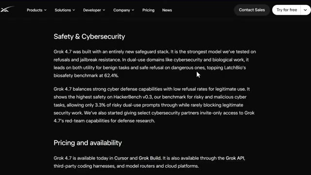
*⏱️ 00:05:06 — Capture d'écran affichant une page web avec le texte sur la sécurité et la cybersécurité, détaillant les performances de Grok 4.7 et son score au benchmark de biosécurité LatchBio.*

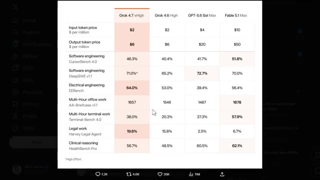
*⏱️ 00:05:18 — Tableau comparatif des performances et des coûts des différents modèles d'IA, incluant Grok 4.7, Grok 4.6, GPT-5.6 et Fable 5.1 sur divers benchmarks.*

---

### ⏱️ `[00:05:23 - 00:05:57]` | Segment #13

**🔊 Audio (Transcription Intégrale Mot pour Mot en Français) :**
> Sur HackerBench V0.3, leur benchmark pour les tâches cybernétiques malveillantes à haut risque, il ne laisse passer que 3,3 % des invites à double usage risquées, tout en bloquant à peine le moindre travail de sécurité légitime. Ils ont même commencé à donner à certains partenaires en cybersécurité un accès sur invitation aux capacités de Red Team de Grok 4.7 pour de la recherche en défense réelle. Bon, alors maintenant, parlons de la raison pour laquelle cela compte vraiment si vous vous intéressez au trading, à la finance ou à la crypto, car il ne s'agit pas juste d'une simple mise à jour de code. D'abord, le fait que Grok 4.7 soit

**👁️ Analyse Visuelle d'Écran (gemini-3.5-flash-lite) :**
**Interface & Outils** : Navigateur web affichant la documentation technique et tarifaire d'un modèle d'intelligence artificielle (xAI / Grok).

**Contenu textuel & Code** : Texte descriptif sur la sécurité, scores HackerBench v0.3 (3,3 %), et tableau de performances (CursorBench, DeepSWE, EEBench) avec les coûts des tokens d'entrée/sortie.

**Action / Démonstration** : Survol et sélection de lignes de texte et de tableaux de performances comparatives par un curseur de souris.

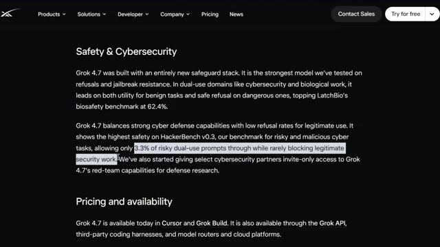
*⏱️ 00:05:32 — Page web présentant les sections 'Safety & Cybersecurity' et 'Pricing and availability', avec du texte surligné concernant HackerBench v0.3.*

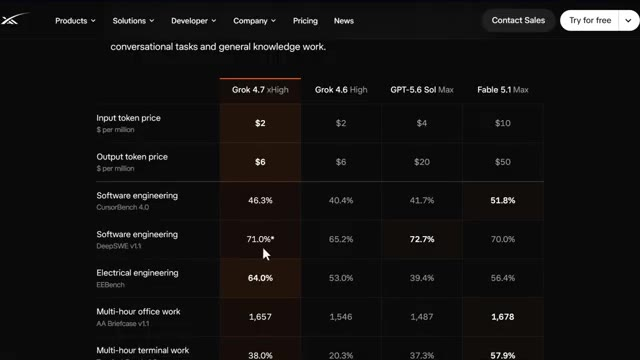
*⏱️ 00:05:49 — Tableau comparatif des performances et des prix des différents modèles d'IA (Grok 4.7 xHigh, Grok 4.6 High, GPT-5.6 Sol Max, Fable 5.1 Max).*

---

### ⏱️ `[00:05:57 - 00:06:31]` | Segment #14

**🔊 Audio (Transcription Intégrale Mot pour Mot en Français) :**
> deux fois plus vite et à moitié prix par rapport aux modèles comparables, cela signifie que les outils de trading, les bots et les plateformes d'analyse propulsés par l'IA viennent de devenir beaucoup moins chers à faire fonctionner. Si vous êtes quelqu'un qui construit ou utilise l'IA pour analyser des graphiques, automatiser des stratégies ou traiter des données de marché, il s'agit d'une réduction directe des coûts de back-end et cela signifie que les petits traders et les petites équipes peuvent désormais rivaliser avec des outils qui n'étaient auparavant accessibles qu'aux grands fonds. Deuxièmement, avec de meilleures performances sur le travail de bureau de plusieurs heures et les tâches de type analyste financier dans un portefeuille AA. Cela signifie que l'IA devient véritablement utile pour

**👁️ Analyse Visuelle d'Écran (gemini-3.5-flash-lite) :**
**Interface & Outils** : Navigateur web affichant CoinDesk et un tableau comparatif de modèles d'IA.

**Contenu textuel & Code** : Prix des tokens d'entrée/sortie ($2 et $6 pour Grok 4.7) et benchmarks de performance en ingénierie logicielle.

**Action / Démonstration** : Présentation des données tarifaires et comparatives illustrant la baisse des coûts des outils d'IA.

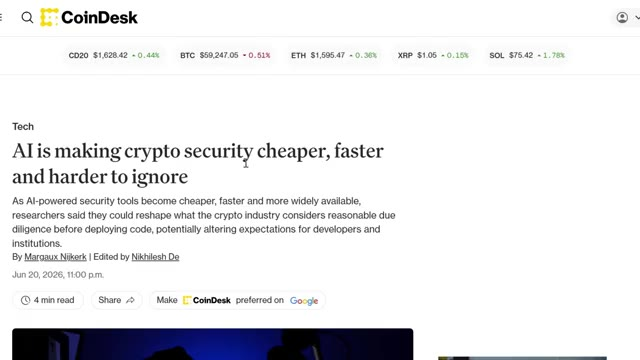
*⏱️ 00:06:06 — Capture d'écran d'un article de CoinDesk titré "AI is making crypto security cheaper, faster and harder to ignore".*

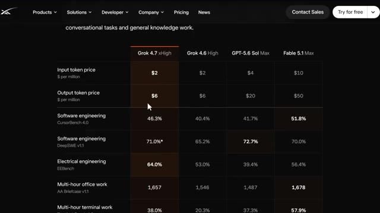
*⏱️ 00:06:14 — Tableau comparatif des performances et des coûts par token de différents modèles d'IA, incluant Grok 4.7 xHigh.*

---

### ⏱️ `[00:06:31 - 00:06:56]` | Segment #15

**🔊 Audio (Transcription Intégrale Mot pour Mot en Français) :**
> des choses comme lire des rapports de bénéfices, résumer des données on-chain, ou même vous aider à élaborer des modèles de trading plus rapidement qu'avant. Et troisièmement, c'est honnêtement un signal pour le marché de l'IA au sens large également. Chaque fois qu'un grand laboratoire lance un modèle qui est moins cher et plus rapide que la génération précédente, cela exerce une pression sur les jetons liés à l'IA, les acteurs de l'infrastructure de l'IA, et même le narratif du calcul informatique et des GPU dans la crypto.

**👁️ Analyse Visuelle d'Écran (gemini-3.5-flash-lite) :**
**Interface & Outils** : Navigateur web affichant des rapports et benchmarks de modèles d'IA sur le site d'Anthropic.

**Contenu textuel & Code** : Graphiques de performance comparative des modèles d'IA (taux de réussite sur SWE-Bench Pro et FrontierCode) et texte décrivant les capacités en analyse financière.

**Action / Démonstration** : Présentation des résultats de benchmarks et des performances des nouveaux modèles d'IA pour l'analyse de données financières.

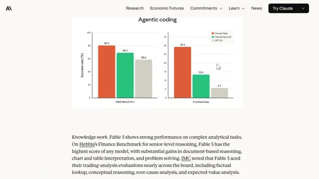
*⏱️ 00:06:50 — Graphiques de performance (Agentic coding) comparant les modèles Claude Fable 5, Claude Opus 4.6 et GPT-5 sur SWE-Bench Pro et FrontierCode.*

---

### ⏱️ `[00:06:56 - 00:07:18]` | Segment #16

**🔊 Audio (Transcription Intégrale Mot pour Mot en Français) :**
> Donc si vous surveillez les cryptomonnaies liées à l'IA, des sorties comme celle-ci sont exactement le genre de catalyseur qui peut faire évoluer le sentiment. Imaginez faire tourner vos propres outils d'analyse de trading sur un modèle qui coûte deux fois moins cher et fonctionne deux fois plus vite. C'est l'impact réel et concret d'une sortie de ce genre, au-delà des simples titres de actualités. Alors passons en revue la disponibilité étape par étape, car c'est là que beaucoup de gens s'embrouillent.

**👁️ Analyse Visuelle d'Écran (gemini-3.5-flash-lite) :**
**Interface & Outils** : Page web de tarification/spécifications de modèle d'IA et interface du réseau social X (Twitter).

**Contenu textuel & Code** : Tarifs des tokens d'entrée et de sortie (ex: 2$ et 6$), scores de performance sur différents benchmarks (CursorBench, DeepSWE, EEBench) et publications sur le lancement de Grok 4.7.

**Action / Démonstration** : Présentation des spécifications techniques, des coûts réduits et des réactions du marché sur les réseaux sociaux concernant un nouveau modèle d'intelligence artificielle.

*⏱️ 00:07:02 — Un tableau comparatif des performances et des coûts de différents modèles d'IA, montrant notamment Grok 4.7 xHigh.*

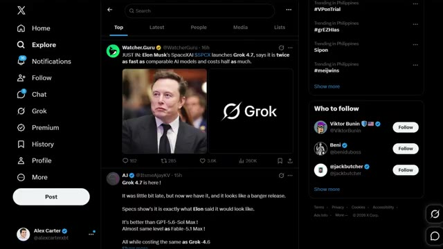
*⏱️ 00:07:13 — Une capture d'écran du réseau social X (Twitter) montrant un fil d'actualité avec une publication de Watcher.Guru concernant le lancement de Grok 4.7 par Elon Musk.*

---

### ⏱️ `[00:07:19 - 00:07:39]` | Segment #17

**🔊 Audio (Transcription Intégrale Mot pour Mot en Français) :**
> Premièrement, Grok 4.7 est disponible dès aujourd'hui directement dans Curzor et Grok Build. Deuxièmement, il est également disponible via l'API Grok, donc si vous construisez vos propres outils, vous pouvez vous y brancher directement. Troisièmement, il fonctionne par le biais de harnais de codage tiers ainsi que de routeurs de modèles et de plateformes cloud, de sorte que vous n'êtes pas enfermé dans un seul endroit pour y accéder.

**👁️ Analyse Visuelle d'Écran (gemini-3.5-flash-lite) :**
**Interface & Outils** : Navigateur web affichant la page de téléchargement et d'installation de l'agent de codage Grok.

**Contenu textuel & Code** : Commande d'installation en ligne de commande : `irm https://x.ai/cli/install.ps1 | iex` visible dans un encadré PowerShell.

**Action / Démonstration** : Présentation de la méthode d'installation de l'outil de codage Grok sur l'ordinateur de l'utilisateur.

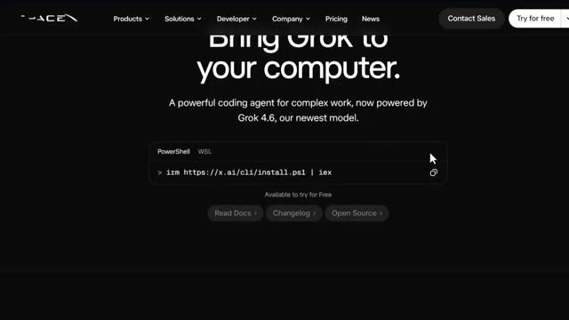
*⏱️ 00:07:24 — Capture d'écran montrant le site web officiel de xAI avec le slogan "Bring Grok to your computer" et une commande d'installation PowerShell.*

---

### ⏱️ `[00:07:39 - 00:07:59]` | Segment #18

**🔊 Audio (Transcription Intégrale Mot pour Mot en Français) :**
> Sur les prix, cela commence à 2 dollars par million de jetons en entrée et 6 dollars par million de jetons en sortie. Et si vous en avez besoin encore plus rapidement, ils proposent également une variante rapide avec deux fois la vitesse de sortie pour deux fois le prix. Très bien, et regardez, au cours des deux prochaines années, deux types de traders existeront. Ceux qui utilisent l'IA et ceux qui font encore tout manuellement.

**👁️ Analyse Visuelle d'Écran (gemini-3.5-flash-lite) :**
**Interface & Outils** : Navigateur web affichant la documentation technique et tarifaire d'un modèle d'intelligence artificielle.

**Contenu textuel & Code** : Texte descriptif de la tarification du modèle, mentionnant le coût par million de jetons en entrée et en sortie.

**Action / Démonstration** : Sélection et surbrillance du texte sur la tarification dans la page web officielle.

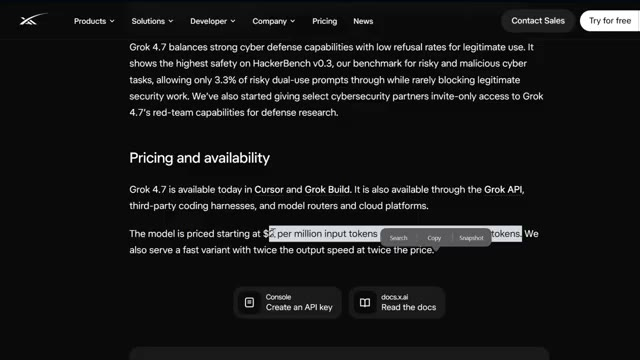
*⏱️ 00:07:44 — Capture d'écran montrant la page web officielle avec les détails de tarification et de disponibilité de Grok 4.7.*

---

### ⏱️ `[00:07:59 - 00:08:34]` | Segment #19

**🔊 Audio (Transcription Intégrale Mot pour Mot en Français) :**
> Même marché, résultats très différents. Voici comment vous vous mettez du bon côté de cela. J'ai regroupé tout cela au sein de la communauté AI Trade Edge, chaque invite, chaque bot, chaque modèle, chaque guide étape par étape que j'utilise personnellement, le tout en un seul endroit, et tout ce que je construirai à l'avenir sera ajouté directement dans le groupe dès sa sortie. Nous testons également des stratégies provenant de tout Internet, en les automatisant à l'aide de PineScript, en les exécutant en direct et en partageant exactement ce qui fonctionne et ce qui ne fonctionne pas, de sorte que vous n'obtenez pas seulement des outils, vous

**👁️ Analyse Visuelle d'Écran (gemini-3.5-flash-lite) :**
**Interface & Outils** : Navigateur web affichant la plateforme Whop et le portail de formation/communauté d'Alex Carter.

**Contenu textuel & Code** : Instructions étape par étape pour configurer le trading automatisé (compte WEEX, installation de Claude Code, clés API, gestion des positions Futures et Spot).

**Action / Démonstration** : Présentation des modules et des fonctionnalités de la communauté payante pour automatiser le trading via des bots IA.

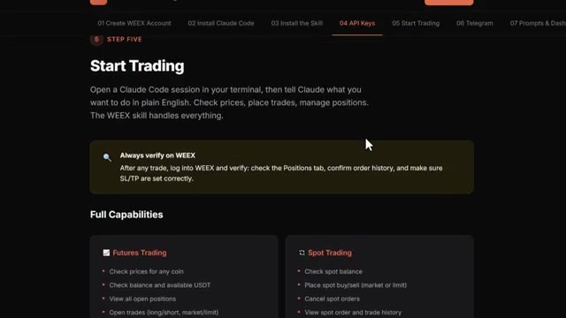
*⏱️ 00:08:17 — Interface de la plateforme montrant les étapes d'intégration, avec la section "Start Trading" détaillant l'utilisation de Claude Code et WEEX.*

---

### ⏱️ `[00:08:34 - 00:09:10]` | Segment #20

**🔊 Audio (Transcription Intégrale Mot pour Mot en Français) :**
> obtenir une opération de recherche en direct à l'intérieur, il y a aussi un cours de trading agentique complet de 2,5 heures, du débutant à l'expert, sans aucune base en programmation, à la fin de celui-ci, vous aurez votre propre système de trading par IA fonctionnant en direct, quelque chose que la plupart des traders particuliers ne savent même pas être possible en ce moment, 79,99 $ par mois, un bon trade couvre les frais et les 100 premiers membres bloquent ce tarif définitivement, après quoi le prix augmentera. Le lien est dans la description. Vous ne pouvez vraiment pas vous permettre de rater ça. C'est donc littéralement tout ce que vous devez savoir sur Grok 4.7. Les améliorations du modèle,

**👁️ Analyse Visuelle d'Écran (gemini-3.5-flash-lite) :**
**Interface & Outils** : Interface web de cours en ligne et plateforme de e-commerce Whop.

**Contenu textuel & Code** : Liste des modules de formation (Telegram Control Plane, TradingView -> WEEX Webhook, Polymarket, AgentPNL, Senpi, Hermes) et détails tarifaires de l'offre.

**Action / Démonstration** : Navigation et présentation des différents modules et outils inclus dans la formation de trading par IA.

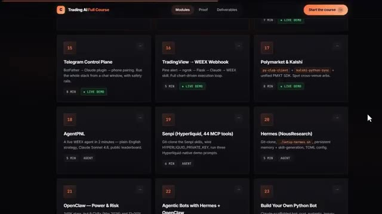
*⏱️ 00:08:43 — Capture d'écran montrant l'interface des modules du cours "Trading AI Full Course" avec des leçons numérotées sur le trading algorithmique et l'intégration d'API.*

---

### ⏱️ `[00:09:11 - 00:09:46]` | Segment #21

**🔊 Audio (Transcription Intégrale Mot pour Mot en Français) :**
> les repères, les améliorations de sécurité, et pourquoi cela importe vraiment que vous soyez un trader, un développeur, ou que vous utilisiez simplement l'IA au quotidien. Honnêtement, cette sortie est bien plus importante que ce que les gens veulent bien admettre pour l'instant, surtout avec le fait qu'elle soit tellement moins chère et plus rapide que la concurrence. Dites-moi donc dans les commentaires ce que vous en pensez les gars. Est-ce que Grok 4.7 est réellement le meilleur modèle en ce moment ou est-ce qu'il est encore en train de rattraper son retard ? Et si vous voulez garder une longueur d'avance sur la direction que prend le marché, assurez-vous de vous abonner et d'activer la cloche de notification pour ne rien manquer. Si vous voulez voir comment j'ai construit mon propre assistant de recherche en trading en utilisant

**👁️ Analyse Visuelle d'Écran (gemini-3.5-flash-lite) :**
**Interface & Outils** : Interface web de X (Twitter) et page de présentation de xAI.

**Contenu textuel & Code** : Graphiques de performance (CursorBench 4.0 score), tweets sur les prix des modèles (Grok 4.7 vs GPT-5.6) et recommandations d'utilisation (Build harness).

**Action / Démonstration** : Navigation sur le fil d'actualité X pour illustrer la sortie de Grok 4.7 et les retours de la communauté.

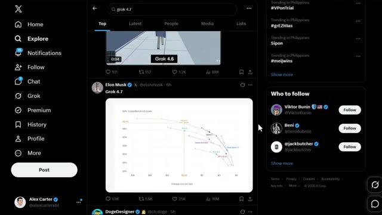
*⏱️ 00:09:28 — Fil d'actualité X (Twitter) montrant un tweet d'Elon Musk avec un graphique de performance comparatif pour Grok 4.7.*

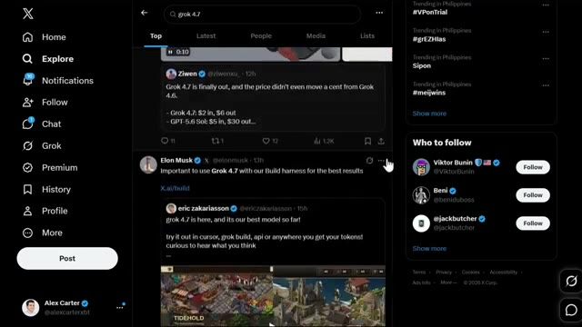
*⏱️ 00:09:37 — Fil d'actualité X (Twitter) affichant des tweets sur Grok 4.7, incluant des détails sur l'utilisation du "Build harness".*

---

### ⏱️ `[00:09:46 - 00:10:07]` | Segment #22

**🔊 Audio (Transcription Intégrale Mot pour Mot en Français) :**
> GrokBot, regarde la vidéo qui s'affiche à l'écran en ce moment même. Et si tu veux le guide complet étape par étape sur la façon de construire ton propre système de trading agentique avec Claude, cette vidéo s'affiche également à l'écran. Va voir ça ensuite. Si tu as trouvé cela utile, laisse un pouce bleu. Ça aide vraiment la chaîne. Abonne-toi si ce n'est pas déjà fait, et je te vois dans la prochaine.

**👁️ Analyse Visuelle d'Écran (gemini-3.5-flash-lite) :**
**Interface & Outils** : Aucun

**Contenu textuel & Code** : Aucun

**Action / Démonstration** : Aucune

---

