# 🎬 I Let Jev Scalp Bitcoin... It's Insane

> **Chaîne** : [Alex Carter](https://www.youtube.com/@AlexCarterTrading)  
> **Lien YouTube** : [https://www.youtube.com/watch?v=SUkqUmMhyok](https://www.youtube.com/watch?v=SUkqUmMhyok)  
> **Date de publication** : 20260923  
> **Durée** : 00:10:02  
> **Identifiant vidéo** : `SUkqUmMhyok`  
> **Transcription & Analyse** : `whisper-v3-large-turbo+gemini-3.5-flash-lite`  

---

## 📌 Synthèse Exécutive & Outils

### 💡 Résumé
Dans cette vidéo intitulée **J'ai laissé Jev scalper Bitcoin... Le résultat est hallucinant**, Alex Carter détaille une approche stratégique et pratique du trading et de l'automatisation par agents IA.

### 🛠️ Outils, Modèles & Logiciels Présentés
- **TradingView & Claude Code** : Analyse technique avancée et automatisation algorithmique.

### 🔑 Points Clés & Enseignements Stratégiques
- Respect rigoureux du ratio risque/rendement et du money management.
- Automatisation méthodique des déclencheurs d'ordres via des agents intelligents.

---

## ⏱️ Chronologie & Transcription Complète Audio & Visuelle (Mot pour Mot)

### ⏱️ `[00:00:00 - 00:00:25]` | Segment #01

**🔊 Audio (Transcription Intégrale Mot pour Mot en Français) :**
> Dans cette vidéo, je vais vous montrer comment j'ai laissé JEV, le nouveau modèle d'IA de TypeSafe, analyser le Bitcoin, et je peux vous dire que c'est absolument insensé. Ce que vous voyez en ce moment est un robot IA qui trade en direct du Bitcoin, de l'or et des contrats à terme du NASDAQ de manière totalement autonome, prenant une décision toutes les 30 secondes grâce à JEV. Je lui ai donné 100 000 dollars de capital fictif, je l'ai laissé tourner pendant 24 heures d'affilée, et les résultats m'ont réellement surpris.

**👁️ Analyse Visuelle d'Écran (gemini-3.5-flash-lite) :**
**Interface & Outils** : Tableau de bord de trading algorithmique et plateforme de suivi en direct.

**Contenu textuel & Code** : Graphique de prix principal (Micro E-mini Nasdaq 100), métriques globales en haut (Equity, Profit, Trades, Max Drawdown), et panneau latéral des positions ouvertes (Nasdaq, Bitcoin, Gold).

**Action / Démonstration** : Suivi en temps réel des trades exécutés et des performances du robot de trading IA.

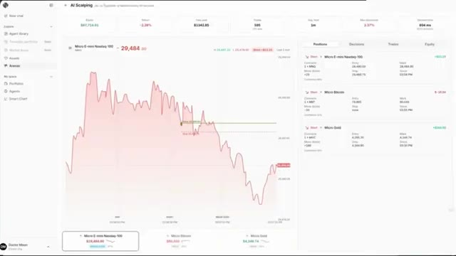
*⏱️ 00:00:06 — Interface de trading en direct d'un bot IA affichant des graphiques de performance et des positions ouvertes.*

---

### ⏱️ `[00:00:25 - 00:01:00]` | Segment #02

**🔊 Audio (Transcription Intégrale Mot pour Mot en Français) :**
> Je vais vous montrer littéralement tout dans cette vidéo. les victoires, les défaites, les frais qui la rongent, absolument tout. Mais d'abord, vous devez vraiment comprendre ce qu'est JEV, car c'est un type d'IA complètement différent de ce que vous avez l'habitude d'utiliser. Donc, JEV est ce qu'on appelle un modèle de Système 1. Il vient juste de sortir par une entreprise appelée TypeSafe AI, et il est très différent des grands modèles de langage comme ChatGPT. Et pour comprendre pourquoi cette chose est réellement importante, vous devez d'abord comprendre le problème qu'elle résout. Donc, en gros, lorsque vous construisez un agent IA, comme quelque chose censé prendre des décisions et agir de son

**👁️ Analyse Visuelle d'Écran (gemini-3.5-flash-lite) :**
**Interface & Outils** : Site web / documentation technique de TypeSafe (Meet Jev).

**Contenu textuel & Code** : Métriques comparatives : vitesse de réponse (70ms-500ms vs 3-329s), coût des tokens ($0.042 / MTok vs $0.20-$10 / MTok), architecture RLCD (Reinforcement Learning for Calibrated Decisions) et échantillonnage parallèle.

**Action / Démonstration** : Présentation théorique et comparaison des performances techniques de l'architecture IA Jev par rapport aux LLM traditionnels.

*⏱️ 00:00:34 — Page de présentation du modèle Jev par TypeSafe détaillant ses propriétés, limites et son fonctionnement de type « System One ».*

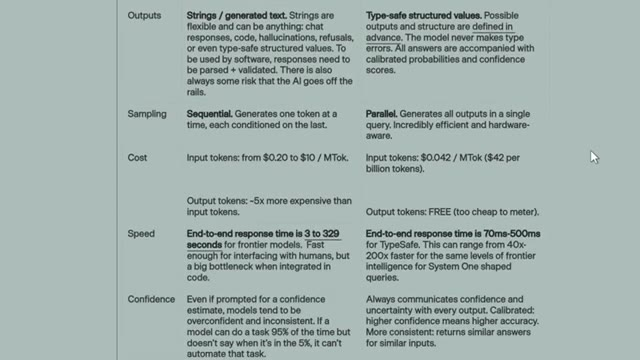
*⏱️ 00:00:51 — Tableau comparatif technique entre les LLM génératifs classiques et le modèle TypeSafe (outputs, sampling, coût, vitesse et confiance).*

---

### ⏱️ `[00:01:00 - 00:01:18]` | Segment #03

**🔊 Audio (Transcription Intégrale Mot pour Mot en Français) :**
> seul, il fonctionne dans cette boucle. L'IA décide quoi faire, un outil s'exécute et le fait, l'IA regarde le résultat, puis elle décide à nouveau. Et cette boucle continue jusqu'à ce que la tâche soit terminée. Le problème est que chacune de ces décisions nécessite un appel complet au modèle, ce qui est lent et coûteux.

**👁️ Analyse Visuelle d'Écran (gemini-3.5-flash-lite) :**
**Interface & Outils** : Interface de chat avec IA / Navigateur web sur le site de LangChain.

**Contenu textuel & Code** : Texte de prompt d'analyse de trading avec fichier CSV et article technique sur les boucles d'agents et les appels de modèles.

**Action / Démonstration** : Illustration d'un cas d'usage d'agent IA pour l'analyse de données de trading et lecture d'un article explicatif.

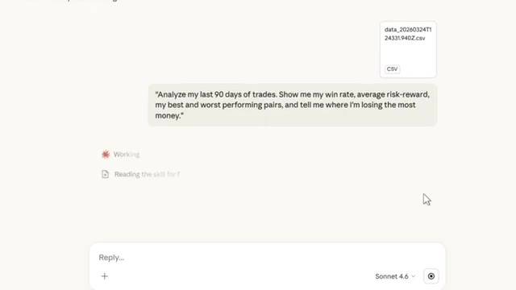
*⏱️ 00:01:04 — Interface d'un assistant IA montrant un prompt utilisateur demandant l'analyse de 90 jours de trades, avec un fichier CSV joint.*

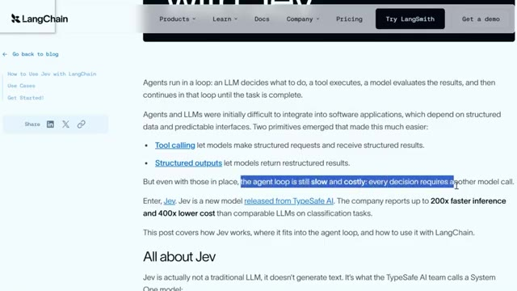
*⏱️ 00:01:13 — Page web de LangChain présentant un article sur le fonctionnement des agents et les limites de la boucle d'agent avec les LLM.*

---

### ⏱️ `[00:01:18 - 00:01:41]` | Segment #04

**🔊 Audio (Transcription Intégrale Mot pour Mot en Français) :**
> Donc si vous essayez de construire quelque chose comme un bot de scalping qui doit prendre des décisions rapidement, un LLM normal n'est tout simplement pas fait pour ça. Jeff évite tout ça. Au lieu de générer du texte, il examine un état, comme des données de marché en direct, et répond instantanément à des questions structurées avec des probabilités associées, entraîné en utilisant quelque chose appelé l'apprentissage par renforcement pour des décisions calibrées, ou RLCD.

**👁️ Analyse Visuelle d'Écran (gemini-3.5-flash-lite) :**
**Interface & Outils** : Interface ChatGPT, graphique TradingView (BloFin), et tableau de bord de trading d'IA.

**Contenu textuel & Code** : Graphiques de prix du Bitcoin (BTCUSDT.P), chandeliers japonais, données de marché en direct, métriques de performance, et journal de décisions de scalping.

**Action / Démonstration** : Visualisation des mouvements de prix sur le marché des cryptomonnaies et présentation d'un tableau de bord de bot de scalping intelligent.

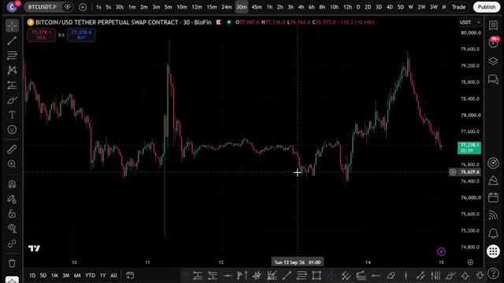
*⏱️ 00:01:30 — Graphique TradingView en chandeliers montrant l'évolution du contrat perpétuel BITCOIN/USD Tether (BloFin) en unité de temps 30 minutes.*

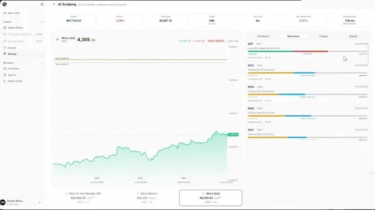
*⏱️ 00:01:35 — Tableau de bord d'une application de trading algorithmique et d'IA (AI Scalping) affichant des graphiques de performance et des métriques de décision en direct (Micro Gold, etc.).*

---

### ⏱️ `[00:01:41 - 00:02:01]` | Segment #05

**🔊 Audio (Transcription Intégrale Mot pour Mot en Français) :**
> Donc ces probabilités signifient réellement quelque chose. Et le plus fou ? TypeSafe affirme que c'est jusqu'à 200 fois plus rapide et 400 fois moins cher qu'un LLM normal pour ce type de prise de décision. Donc pour ce bot, toutes les 30 secondes, je réussis fondamentalement une question Jev1. Long, court, attendre, ou rentabiliser. Et il renvoie instantanément les probabilités pour chacune.

**👁️ Analyse Visuelle d'Écran (gemini-3.5-flash-lite) :**
**Interface & Outils** : Interface web de TypeSafe / plateforme de trading algorithmique avec graphiques de prix et journal des décisions.

**Contenu textuel & Code** : Graphique de l'actif Micro E-mini Nasdaq-100 (MNQ) à 29,490.30, métriques de performance et panneau latéral affichant des probabilités de décision ("Decisions").

**Action / Démonstration** : Présentation visuelle du bot de trading automatisé exécutant des décisions basées sur les probabilités du modèle Jev.

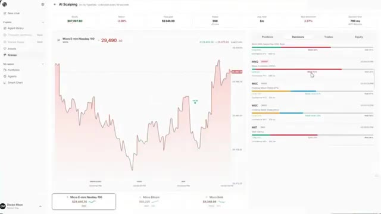
*⏱️ 00:01:56 — Interface de trading algorithmique affichant un graphique de prix en bas à gauche et un panneau de prises de décision en temps réel sur la droite.*

---

### ⏱️ `[00:02:02 - 00:02:27]` | Segment #06

**🔊 Audio (Transcription Intégrale Mot pour Mot en Français) :**
> C'est tout le moteur derrière ce que vous êtes sur le point de voir. Donc, si vous voulez vérifier cela par vous-même, allez sur console.typesafe.ai. Vous pouvez vous connecter avec Google ou simplement utiliser votre propre e-mail. Super simple. Vous devrez examiner les conditions et accepter. Ensuite, cliquez sur continuer. Une fois que vous y êtes, vous arriverez sur cette page juste ici où vous pourrez voir exactement ce qu'est JEV, ses propriétés, ses limites et ses avantages, le tout présenté pour vous.

**👁️ Analyse Visuelle d'Écran (gemini-3.5-flash-lite) :**
**Interface & Outils** : Site web TypeSafe (console.typesafe.ai)

**Contenu textuel & Code** : Interface de connexion et page de présentation du modèle d'IA Jev avec ses spécifications techniques (RLCD, performances).

**Action / Démonstration** : Navigation sur le site de TypeSafe pour présenter la plateforme et se connecter.

*⏱️ 00:02:08 — Page de connexion de TypeSafe montrant les options de connexion avec Google ou par e-mail.*

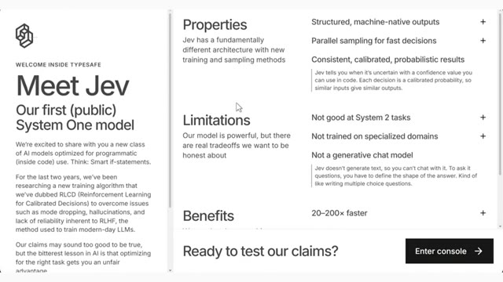
*⏱️ 00:02:21 — Présentation du modèle "Jev" sur le site de TypeSafe avec ses propriétés, limitations et bénéfices.*

---

### ⏱️ `[00:02:27 - 00:03:02]` | Segment #07

**🔊 Audio (Transcription Intégrale Mot pour Mot en Français) :**
> Donc, pour faire très vite sur les propriétés, JEV a une architecture fondamentalement différente avec de nouvelles méthodes d'entraînement et d'échantillonnage. Il fournit des résultats structurés natifs pour la machine au lieu de réponses textuelles, et il utilise l'échantillonnage parallèle, ce qui signifie qu'il peut évaluer plusieurs questions en même temps sans attendre la précédente, le tout avec une latence inférieure à une seconde. Et les résultats sont cohérents et calibrés, ce qui signifie que les probabilités qu'il vous donne ont réellement un sens. Maintenant, concernant les limites, et je respecte le fait qu'ils soient honnêtes à ce sujet, Jev n'est pas bon pour les tâches de système deux, donc tout ce qui nécessite un raisonnement approfondi étape par étape. Il n'est pas non plus entraîné sur des données spécialisées.

**👁️ Analyse Visuelle d'Écran (gemini-3.5-flash-lite) :**
**Interface & Outils** : Navigateur web affichant la documentation et la page d'accueil de TypeSafe / Jev.

**Contenu textuel & Code** : Texte descriptif sur les propriétés du modèle : "Structured, machine-native outputs", "Parallel sampling for fast decisions", "20-200x faster", ainsi que les limitations ("Not a generative chat model").

**Action / Démonstration** : Présentation visuelle des caractéristiques techniques et architecturales du modèle Jev à l'écran.

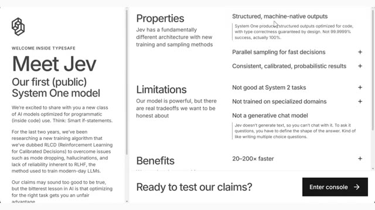
*⏱️ 00:02:36 — Capture d'écran de la page de présentation du modèle Jev (System One), détaillant ses propriétés, limitations et bénéfices.*

---

### ⏱️ `[00:03:02 - 00:03:36]` | Segment #08

**🔊 Audio (Transcription Intégrale Mot pour Mot en Français) :**
> domaines, et ce n'est pas un modèle de chat génératif, ce qui signifie que vous ne pouvez pas juste lui parler comme à ChatGPT. Vous devez définir la forme de la réponse que vous voulez, un peu comme si vous écriviez un questionnaire à choix multiples, et ensuite sur les avantages, ils revendiquent 20 à 200 fois plus rapide, 40 à 1 000 fois moins cher et une intelligence de niveau frontalier spécifiquement pour ces tâches de type décision rapide de système un, de grandes affirmations mais c'est exactement ce que nous testons aujourd'hui. Maintenant, pour accéder réellement à la plateforme, il suffit de cliquer sur le bouton dans le coin inférieur droit ici qui dit "entrer dans la console" et boum, vous y êtes. Maintenant, quand

**👁️ Analyse Visuelle d'Écran (gemini-3.5-flash-lite) :**
**Interface & Outils** : Navigateur web présentant la page de présentation du modèle Jev par Typesafe.

**Contenu textuel & Code** : Texte descriptif détaillant le modèle System One, l'algorithme RLCD, ainsi que des sections sur les limitations (not a generative chat model) et les avantages (20–200x plus rapide, 40–1 000x moins cher).

**Action / Démonstration** : Présentation des caractéristiques techniques, des limitations et des avantages commerciaux du modèle d'IA Jev à l'écran.

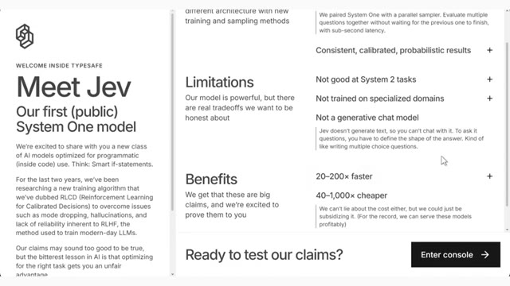
*⏱️ 00:03:11 — Capture d'écran d'une page web présentant le modèle "Jev", un modèle System One axé sur l'utilisation programmatique, avec ses limitations et ses avantages chiffrés.*

---

### ⏱️ `[00:03:36 - 00:04:03]` | Segment #09

**🔊 Audio (Transcription Intégrale Mot pour Mot en Français) :**
> vous vous connectez pour la première fois, ce questionnaire apparaîtra donc pour que vous sachiez à quoi vous attendre lors de l'utilisation de JEV. Maintenant, passons au tableau de bord de scalping. C'est le tableau de bord réel que j'ai créé où tout se passe en direct. Vous avez des graphiques en temps réel, des journaux de décision en direct, des courbes de capitaux propres, le tout se mettant à jour en temps réel pendant que JEV traite le marché. C'est vraiment l'une des choses les plus cool que j'aie jamais vues faire par un modèle d'IA, parce qu'on le regarde penser en temps réel.

**👁️ Analyse Visuelle d'Écran (gemini-3.5-flash-lite) :**
**Interface & Outils** : Interface Web TypeSafe AI et tableau de bord de trading JEV

**Contenu textuel & Code** : Graphiques de prix en direct, métriques de portefeuille (Equity, PnL, Trades), et configurations d'agents IA.

**Action / Démonstration** : Présentation de l'interface utilisateur de JEV et transition vers le tableau de bord de scalping en direct.

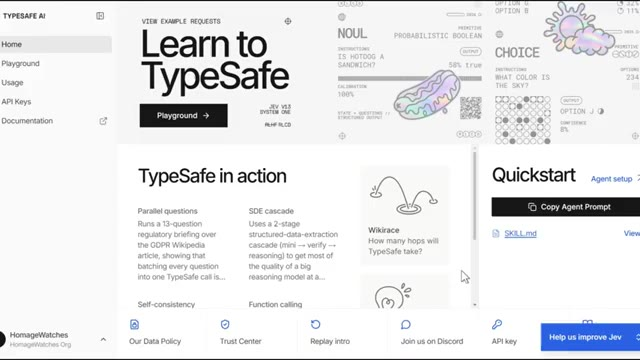
*⏱️ 00:03:43 — Interface Web de TypeSafe AI montrant un tableau de bord d'apprentissage et de configuration avec des options comme 'Learn to TypeSafe' et 'Quickstart'.*

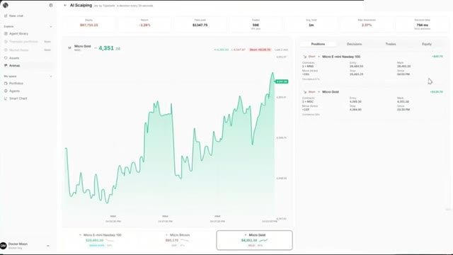
*⏱️ 00:03:50 — Tableau de bord de scalping en direct affichant des graphiques de trading, des positions en cours et des métriques de performance sur l'interface JEV.*

---

### ⏱️ `[00:04:03 - 00:04:36]` | Segment #10

**🔊 Audio (Transcription Intégrale Mot pour Mot en Français) :**
> Chaque actif, chaque décision étalée juste devant vous. Maintenant, voici comment cela fonctionne réellement sous le capot. Lorsque vous donnez une tâche à Jev, vous devez lui donner un ensemble d'actions possibles, et chacune se voit attribuer des probabilités. Pour ce bot de scalping, je lui ai donné cinq actions possibles. Prendre une position acheteuse, prendre une position vendeuse, attendre et ne rien faire, déplacer le stop pour atteindre l'équilibre s'il est déjà dans un trade, ou fermer complètement la position. C'est tout. Ce sont les seuls mouvements qu'il est autorisé à faire, et toutes les 30 secondes, il doit en choisir un. Donc voici le processus. Toutes les 30 secondes,

**👁️ Analyse Visuelle d'Écran (gemini-3.5-flash-lite) :**
**Interface & Outils** : Application de trading web ("AI Scalping" par Jev / Typeface) avec graphiques et panneaux de suivi des décisions.

**Contenu textuel & Code** : Métriques de performance globales (Equity à 97 700 $, Return -2,30%, Total profit, Trades, Max drawdown, Decision time de 790 ms) et panneau latéral droit affichant des listes d'actions possibles avec leurs probabilités de confiance (Long, Short, Hold).

**Action / Démonstration** : Présentation et explication du fonctionnement interne du bot de scalping affichant les ensembles d'actions possibles et leurs probabilités associées pour chaque décision.

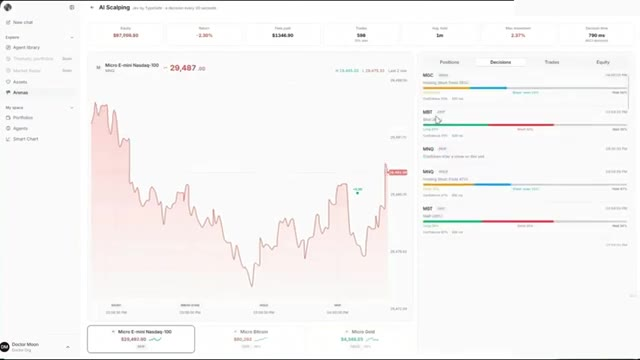
*⏱️ 00:04:11 — Interface de l'application montrant un tableau de bord de trading algorithmique avec un graphique de prix principal à gauche et un panneau de décisions probabilistes à droite.*

---

### ⏱️ `[00:04:36 - 00:04:54]` | Segment #11

**🔊 Audio (Transcription Intégrale Mot pour Mot en Français) :**
> Nous envoyons à JEV les chandeliers intrajournaliers pour le Bitcoin, le Nasdaq et les micro-contrats à terme sur l'or, y compris le chandelier actuel qui n'a même pas encore clôturé. Il traite toutes ces données et évalue ce qu'il pense que le prix est le plus susceptible de faire ensuite. Sur cette base, il décide d'acheter, de vendre à découvert ou de ne rien faire.

**👁️ Analyse Visuelle d'Écran (gemini-3.5-flash-lite) :**
**Interface & Outils** : Tableau de bord d'agent de trading IA (« AI Scalping » / TypeSafe) avec graphiques de performance et gestion de positions.

**Contenu textuel & Code** : Métriques de trading (Solde 97 723,25 $, Rendement -2,28 %, Profit total 1 342,85 $, 595 trades), graphique de prix du Nasdaq-100 (MNQ à 29 481,70), et liste des positions en cours sur le Micro E-mini Nasdaq, le Micro Bitcoin (MBT) et le Micro Gold (MGC).

**Action / Démonstration** : Suivi en temps réel des positions automatisées et des décisions prises par l'intelligence artificielle sur plusieurs actifs (Nasdaq, Bitcoin, Or).

*⏱️ 00:04:40 — Interface de trading algorithmique « AI Scalping » affichant les performances globales, un graphique de prix en aire verte pour le contrat Micro E-mini Nasdaq-100 ainsi qu'un panneau latéral détaillant les positions ouvertes sur le Nasdaq, le Bitcoin et l'or.*

---

### ⏱️ `[00:04:54 - 00:05:31]` | Segment #12

**🔊 Audio (Transcription Intégrale Mot pour Mot en Français) :**
> Et s'il est déjà dans une position, il peut déplacer son stop pour atteindre l'équilibre. Nous avons lancé ceci hier avec 100 000 dollars de capital simulé. Ce n'est pas un vrai compte, pour être clair. Et eh bien, il est déjà en baisse et je vais vous expliquer exactement pourquoi dans une seconde, car la raison pourrait vous surprendre, alors laissez-moi vous montrer à quoi ressemble réellement une décision pour les micro-contrats à terme sur le Bitcoin. À un moment donné, les probabilités étaient de 29 % à l'achat, 35 % à la vente et d'attente à 36 %. Quelle que soit l'action qui présente la probabilité la plus élevée, c'est celle que le bot suit. Donc, dans ce cas, il aurait attendu, mais un peu plus tôt sur les micro-contrats à terme du Nasdaq, le

**👁️ Analyse Visuelle d'Écran (gemini-3.5-flash-lite) :**
**Interface & Outils** : Interface web de trading algorithmique et de gestion de portefeuille (Typeface / bot IA).

**Contenu textuel & Code** : Métriques du compte (Solde : 97 716,25 $, Rendement : -2,38 %), graphique des prix du Micro E-mini Nasdaq-100 avec des bougies rouges, et panneau latéral affichant les positions ouvertes (Micro E-mini Nasdaq-100 et Micro Gold).

**Action / Démonstration** : Présentation des performances du compte simulé et des positions de trading en cours.

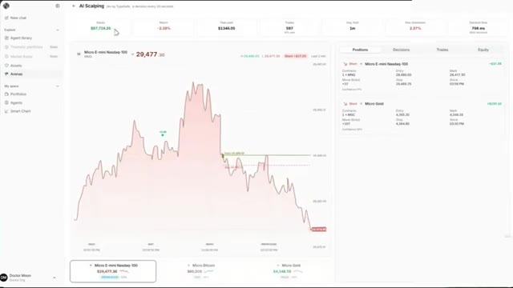
*⏱️ 00:05:03 — Capture d'écran montrant l'interface de trading d'un bot de scalping par IA avec des graphiques de performance et des positions ouvertes.*

---

### ⏱️ `[00:05:31 - 00:06:04]` | Segment #13

**🔊 Audio (Transcription Intégrale Mot pour Mot en Français) :**
> les cotes courtes étaient les plus élevées. Il a donc ouvert une position courte avec un contrat. Chacune des décisions prises par Jeb est instantanément copiée par le bot. Toujours un contrat à la fois, à l'achat ou à la vente. Maintenant, c'est là que ça se complique. Après 24 heures, le bot est en baisse de 2,3 %. Et sur ces environ 2 300 dollars de pertes, figurez-vous que 1 300 dollars proviennent uniquement des frais. Cela inclut les frais de compensation, les commissions de trading, tous les coûts réels que vous paieriez réellement sur une plateforme de trading. J'ai intégré ces frais réels

**👁️ Analyse Visuelle d'Écran (gemini-3.5-flash-lite) :**
**Interface & Outils** : Présentation ou face-caméra explicatif du trader sans interface logicielle partagée.

**Contenu textuel & Code** : Explications orales des stratégies et mise en contexte méthodologique du marché.

**Action / Démonstration** : Explications face caméra et analyse conceptuelle des marchés.

---

### ⏱️ `[00:06:04 - 00:06:36]` | Segment #14

**🔊 Audio (Transcription Intégrale Mot pour Mot en Français) :**
> directement dans cette simulation. Et oui, ce n'est pas beau à voir jusqu'à présent. En ce moment, le bot est en fait positionné sur une vente à découvert assez solide sur l'or. Et toutes les 30 secondes, il va réévaluer s'il doit la maintenir ou déplacer le stop pour atteindre l'équilibre. Mais si on fait un zoom arrière sur la courbe d'équité, cela raconte pratiquement toute l'histoire. Nous avons commencé avec 100 000 dollars de capital fictif, et ça n'a fait que glisser vers le bas presque tout ce temps. Principalement, encore une fois, à cause des frais. Et voici le chiffre qui remet vraiment les choses en perspective. En seulement 24 heures, ce bot a pris près de 600 trades,

**👁️ Analyse Visuelle d'Écran (gemini-3.5-flash-lite) :**
**Interface & Outils** : Présentation ou face-caméra explicatif du trader sans interface logicielle partagée.

**Contenu textuel & Code** : Explications orales des stratégies et mise en contexte méthodologique du marché.

**Action / Démonstration** : Explications face caméra et analyse conceptuelle des marchés.

---

### ⏱️ `[00:06:37 - 00:07:13]` | Segment #15

**🔊 Audio (Transcription Intégrale Mot pour Mot en Français) :**
> et après les frais, seulement 18 % d'entre eux étaient réellement rentables. La durée de détention moyenne est d'environ une minute, ce qui, honnêtement, est logique pour une stratégie de scalping. Mais prendre une décision toutes les 30 secondes conduit clairement à un sur-trading important, et cela coûte une fortune. Donc ensuite, je veux réellement tester de ralentir la fréquence des décisons et voir si cela change quelque chose. Maintenant, voici ce qui est vraiment impressionnant avec JEPTO. Au moment où il reçoit les données, il nous renvoie une décision en 779 millisecondes. Moins d'une seconde. C'est tout le argument de vente d'un modèle de Système 1 et c'est exactement

**👁️ Analyse Visuelle d'Écran (gemini-3.5-flash-lite) :**
**Interface & Outils** : Interface web de plateforme de trading IA (Typeface / Arena)

**Contenu textuel & Code** : Métriques clés en haut (Equity $87,720.55, Return -2.28%, Total profit $1,347.75, Trades 599, Avg. hold 1m, Max drawdown 2.37%, Decision time 721 ms), un graphique principal de prix (Micro Gold) et des courbes d'équité décroissantes sur le panneau de droite.

**Action / Démonstration** : Analyse des performances de la stratégie de scalping avec mise en évidence de la durée de détention moyenne (1m) et du nombre élevé de transactions.

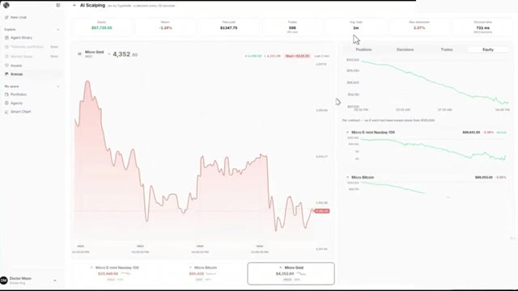
*⏱️ 00:06:46 — Capture d'écran montrant une interface de backtest de trading algorithmique affichant des métriques de performance et des graphiques de l'actif Micro Gold.*

---

### ⏱️ `[00:07:13 - 00:07:47]` | Segment #16

**🔊 Audio (Transcription Intégrale Mot pour Mot en Français) :**
> why people are excited about using this for trading. But here's the catch. Being fast doesn't matter if the decision itself isn't actually good. Speed is only an edge if what you're deciding on is relevant and that's the part I still need to dig into way deeper. So the early conclusion here, scalping with Jeb every 30 seconds, at least the way I've set it up, doesn't look profitable right now. I literally just gave it raw intraday candles and let it choose between long, short, or wait. No extra context, no custom rules. And I think that's exactly what's missing.

**👁️ Analyse Visuelle d'Écran (gemini-3.5-flash-lite) :**
**Interface & Outils** : Présentation ou face-caméra explicatif du trader sans interface logicielle partagée.

**Contenu textuel & Code** : Explications orales des stratégies et mise en contexte méthodologique du marché.

**Action / Démonstration** : Explications face caméra et analyse conceptuelle des marchés.

---

### ⏱️ `[00:07:48 - 00:08:22]` | Segment #17

**🔊 Audio (Transcription Intégrale Mot pour Mot en Français) :**
> Il a probablement besoin de beaucoup plus de règles définies par l'utilisateur avant que cela ne devienne quelque chose qui puisse réellement fonctionner. Très bien, et écoutez, au cours des prochaines années, deux types de traders existeront : ceux qui utilisent l'IA et ceux qui font encore tout manuellement. Même marché, des résultats très différents. Voici comment vous mettre du bon côté. J'ai rassemblé tout ce qui se trouve à l'intérieur de la communauté AI Trade Edge, chaque prompt, chaque bot, chaque modèle, chaque guide étape par étape que j'utilise personnellement, le tout au même endroit, et tout ce que je construirai à l'avenir sera ajouté directement dans le groupe dès sa sortie.

**👁️ Analyse Visuelle d'Écran (gemini-3.5-flash-lite) :**
**Interface & Outils** : Présentation ou face-caméra explicatif du trader sans interface logicielle partagée.

**Contenu textuel & Code** : Explications orales des stratégies et mise en contexte méthodologique du marché.

**Action / Démonstration** : Explications face caméra et analyse conceptuelle des marchés.

---

### ⏱️ `[00:08:22 - 00:08:42]` | Segment #18

**🔊 Audio (Transcription Intégrale Mot pour Mot en Français) :**
> Nous testons également des stratégies provenant de tout l'internet, en les automatisant à l'aide de PineScript, en les exécutant en direct et en partageant exactement ce qui fonctionne et ce qui ne fonctionne pas. Vous n'obtenez donc pas seulement des outils. Vous obtenez une opération de recherche en direct. À l'intérieur, il y a également un cours complet de trading agentique. 2,5 heures.

**👁️ Analyse Visuelle d'Écran (gemini-3.5-flash-lite) :**
**Interface & Outils** : Présentation ou face-caméra explicatif du trader sans interface logicielle partagée.

**Contenu textuel & Code** : Explications orales des stratégies et mise en contexte méthodologique du marché.

**Action / Démonstration** : Explications face caméra et analyse conceptuelle des marchés.

---

### ⏱️ `[00:08:42 - 00:09:11]` | Segment #19

**🔊 Audio (Transcription Intégrale Mot pour Mot en Français) :**
> Débutant à expert. Aucun bagage en programmation n'est nécessaire. D'ici la fin, vous aurez votre propre système de trading par IA opérationnel en direct. Quelque chose que la plupart des traders particuliers ne savent même pas être possible en ce moment. 79,99 $ par mois. Un seul bon trade le couvre et les 100 premiers membres bloquent ce tarif de façon permanente. Après cela, le prix augmente. Le lien est dans la description. Vous ne pouvez vraiment pas vous permettre de rater ça. Mais écoutez, c'est une expérience vraiment passionnante et je vais continuer à la mener et à tester différentes configurations.

**👁️ Analyse Visuelle d'Écran (gemini-3.5-flash-lite) :**
**Interface & Outils** : Interface web de formation (plateforme personnalisée) et plateforme de vente Whop.

**Contenu textuel & Code** : Texte récapitulatif de fin de cours listant les éléments construits (cerveau de recherche, courtiers, bot Python, VPS, tableau de bord) et page d'abonnement à 79,99 $/mois.

**Action / Démonstration** : Présentation finale du contenu du cours et affichage de la page d'abonnement commerciale du service.

*⏱️ 00:08:49 — Interface du cours 'Trading AI Full Course' affichant le Module 26 (Outro) avec le titre 'You did it — now go build' et le récapitulatif des livrables.*

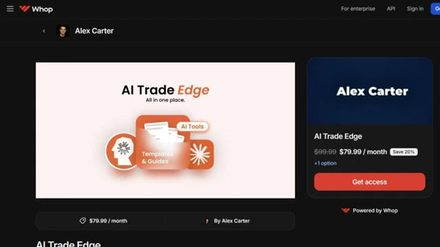
*⏱️ 00:08:57 — Page de vente sur la plateforme Whop pour le produit 'AI Trade Edge' d'Alex Carter au prix de 79,99 $ par mois (réduction de 20%).*

---

### ⏱️ `[00:09:12 - 00:09:48]` | Segment #20

**🔊 Audio (Transcription Intégrale Mot pour Mot en Français) :**
> Si vous voulez suivre ce nouveau modèle d'IA et les autres modèles d'IA qui vont sortir à l'avenir, assurez-vous de vous abonner et d'activer la cloche de notification pour ne rien manquer. Et si vous voulez approfondir l'un des outils CLAWD que j'utilise pour le trading, le trading view complet, la visite guidée de Telegram et le suivi des baleines sur Hyperliquid, toutes ces vidéos s'affichent à l'écran en ce moment. Allez les voir à votre rythme. Et si vous voulez le guide complet étape par étape sur la façon de construire votre propre système de trading agentique en utilisant CLAWD, cette vidéo s'affiche également à l'écran, allez la voir ensuite. Si vous avez trouvé cela utile, laissez un pouce bleu, cela aide vraiment.

**👁️ Analyse Visuelle d'Écran (gemini-3.5-flash-lite) :**
**Interface & Outils** : Présentation ou face-caméra explicatif du trader sans interface logicielle partagée.

**Contenu textuel & Code** : Explications orales des stratégies et mise en contexte méthodologique du marché.

**Action / Démonstration** : Explications face caméra et analyse conceptuelle des marchés.

---

### ⏱️ `[00:09:48 - 00:09:53]` | Segment #21

**🔊 Audio (Transcription Intégrale Mot pour Mot en Français) :**
> la chaîne abonnez-vous si vous ne l'avez pas déjà fait et je vous vois dans le prochain

**👁️ Analyse Visuelle d'Écran (gemini-3.5-flash-lite) :**
**Interface & Outils** : Aucune interface visible.

**Contenu textuel & Code** : Aucun contenu technique, graphique ou textuel affiché.

**Action / Démonstration** : Aucune action ou démonstration en cours.

---

