# 🎬 How To Automate Your Trading Research Strategy Using Grok Bot (Step-by-Step)

> **Chaîne** : [Alex Carter](https://www.youtube.com/@AlexCarterTrading)  
> **Lien YouTube** : [https://www.youtube.com/watch?v=fNnd7JZtgNs](https://www.youtube.com/watch?v=fNnd7JZtgNs)  
> **Date de publication** : 20260926  
> **Durée** : 00:13:10  
> **Identifiant vidéo** : `fNnd7JZtgNs`  
> **Transcription & Analyse** : `whisper-v3-large-turbo+gemini-3.5-flash-lite`  

---

## 📌 Synthèse Exécutive & Outils

### 💡 Résumé
Cette vidéo de la chaîne Alex Carter propose une immersion stratégique et technique dans l'automatisation complète de la recherche en trading grâce à l'utilisation de GrokBots. L'analyse démontre que l'échec des traders constants ne provient pas d'une mauvaise maîtrise des stratégies, mais de l'impossibilité physique de surveiller les marchés 24h/24 et 7j/7. Le système présenté s'affranchit des contraintes des IA conversationnelles traditionnelles (ChatGPT, Gemini, Claude) qui nécessitent des configurations complexes via API ou des serveurs VPS dédiés, en introduisant des agents autonomes dotés de leur propre environnement informatique virtuel pour scanner les marchés, analyser les portefeuilles et exécuter des routines de surveillance en arrière-plan.

L'approche méthodologique repose sur le déploiement de trois agents spécialisés : un agent de scan du marché pour identifier les variations de prix et les ruptures de structure, un agent de portefeuille connecté pour auditer les positions et détecter les dérives d'allocation, et un agent de recherche pour compiler l'actualité pertinente. Bien que l'automatisation de la recherche et du reporting soit pleinement validée pour optimiser le flux de travail des traders, l'analyste insiste sur la plus stricte prudence concernant l'exécution automatisée des ordres, exigeant une évaluation minutieuse des risques avant toute connexion directe aux plateformes d'échange.

Enfin, la vidéo aborde le comparatif économique et fonctionnel des solutions d'intelligence artificielle disponibles sur le marché. En confrontant les modèles de raisonnement de pointe facturés entre 100 et 300 dollars par mois (ChatGPT Pro, Claude, Gemini Ultra), l'analyste démontre que GrokBot se distingue par son architecture d'agent autonome persistant, éliminant la friction opérationnelle et transformant un simple outil de discussion en un véritable assistant de trading opérationnel permanent.

### 🛠️ Outils, Modèles & Logiciels Présentés
* **GrokBot (par xAI)** : Agent IA autonome doté de son propre ordinateur virtuel, conçu pour exécuter des routines de surveillance, scanner les graphiques et analyser les portefeuilles 24h/24 et 7j/7 sans configuration complexe de VPS.
* **Claude (Anthropic)** : Modèle de langage de référence, particulièrement performant pour le raisonnement et l'écriture, nécessitant toutefois la construction manuelle de structures d'agents et de fichiers de mémoire.
* **ChatGPT (OpenAI)** : Outil conversationnel polyvalent (proposé de versions standard à des niveaux Pro à 200 $/mois), limité par son incapacité à agir en arrière-plan sans sollicitation active de l'utilisateur.
* **Google Gemini** : Modèle d'intelligence artificielle intégré aux écosystèmes Workspace et Search, fonctionnant sur un mode réactif similaire à ChatGPT.
* **Google Sheets** : Tableur utilisé via des plugins et des requêtes API en direct pour centraliser les données de portefeuille et les rapports de performance.
* **Slack / Gmail** : Outils de communication et de messagerie intégrés via des plugins pour automatiser la réception des résumés de marché et des alertes de trading.

### 🔑 Points Clés & Enseignements Stratégiques
* **Surmontabilité de l'obstacle temporel** : La difficulté majeure des traders réside dans l'incapacité biologique à surveiller les graphiques en continu, un problème structurel résolu par l'utilisation d'agents d'IA autonomes fonctionnant en permanence.
* **Architecture multi-agents spécialisée** : Configuration de trois agents distincts pour optimiser le flux de travail : le scan de marché (surveillance des listes de suivi), l'agent de portefeuille (récapitulatif des positions et des risques) et l'agent de recherche (veille actualité ciblée).
* **Indépendance vis-à-vis des infrastructures lourdes** : Suppression totale de la nécessité de configurer des serveurs virtuels privés (VPS) ou des fichiers de mémoire complexes pour maintenir les scripts et les agents actifs en arrière-plan.
* **Séparation stricte analyse/exécution** : Distinction fondamentale entre l'automatisation de l'analyse, de la recherche et du reporting (vivement encouragée) et l'exécution automatisée des ordres sur les marchés, qui nécessite une évaluation rigoureuse du risque.
* **Récapitulatif automatisé du marché de nuit** : Automatisation des bilans quotidiens sur les actifs majeurs (Bitcoin, Ethereum) pour détecter immédiatement les chasses à la liquidité et les ruptures de structure survenues pendant le sommeil du trader.
* **Détection proactive des valeurs aberrantes** : Configuration de seuils d'alerte pour identifier instantanément les volumes inhabituels et les actifs sortant de leurs plages de fluctuation habituelles.
* **Gestion dynamique du risque de portefeuille** : Surveillance automatisée des positions avec alertes immédiates dès qu'un actif s'écarte de plus de 10 % de l'allocation cible fixée dans la stratégie de trading.
* **Apprentissage comportemental des workflows** : Capacité pour l'agent d'IA d'apprendre et de reproduire progressivement les processus d'analyse technique personnels du trader à force d'enregistrements et d'itérations.
* **Veille sectorielle et partenariats** : Utilisation des agents pour scanner en continu les tendances du marché, identifier les projets à fort investissement publicitaire et optimiser le développement d'une activité liée à la cryptographie.
* **Analyse comparative de la rentabilité des IA** : Évaluation du coût des abonnements haut de gamme (100 à 300 $ par mois pour ChatGPT Pro, Claude ou GrokBot) démontrant la supériorité des agents persistants face aux simples interfaces conversationnelles réactives.

---

## ⏱️ Chronologie & Transcription Complète Audio & Visuelle (Mot pour Mot)

### ⏱️ `[00:00:00 - 00:00:28]` | Segment #01

**🔊 Audio (Transcription Intégrale Mot pour Mot en Français) :**
> Dans cette vidéo, je vais vous montrer exactement comment construire et automatiser un système de trading complet en utilisant des GrokBots. Et écoutez, ce n'est pas seulement pour la crypto. Cela peut être intégré à littéralement n'importe quel marché que vous tradez, qu'il s'agisse de futures, d'actions, de forex, peu importe ce qui vous intéresse. Et le truc fou, c'est que vous pouvez configurer tout cela en quelques minutes seulement, sans la prise de tête des autres modèles d'IA où vous avez besoin d'une API séparée pour pratiquement chaque outil que vous voulez connecter.

**👁️ Analyse Visuelle d'Écran (gemini-3.5-flash-lite) :**
**Interface & Outils** : TradingView (pour l'image 2) et navigateur web présentant la plateforme Grok Bot.

**Contenu textuel & Code** : Liste de symboles boursiers et financiers (Stocks, Funds, Futures, Forex, etc.) sur TradingView.

**Action / Démonstration** : Sélection d'un actif financier (Tesla) dans l'interface de recherche de symboles de TradingView.

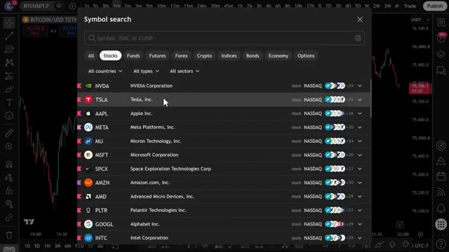
*⏱️ 00:00:14 — Fenêtre de recherche de symboles sur TradingView listant des actions majeures (NVDA, TSLA, AAPL, etc.).*

---

### ⏱️ `[00:00:28 - 00:01:02]` | Segment #02

**🔊 Audio (Transcription Intégrale Mot pour Mot en Français) :**
> Je vais vous montrer comment j'ai construit mon propre système GrokBot qui analyse le marché pour moi et vérifie mon portefeuille pour d'éventuels ajustements. Je vais littéralement vous montrer les trois agents que j'ai personnellement configurés et comment vous pouvez construire exactement le même système pour vous-même, étape par étape. Donc sans plus attendre, entrons dans le vif du sujet. Maintenant, avant de passer à la configuration proprement dite, je veux vous montrer pourquoi cela a vraiment de l'importance en ce moment. Parce que ce que j'ai découvert après avoir discuté avec une tonne de traders dans mon groupe, c'est que la plupart des gens qui ont du mal à rester constants sur ce marché n'échouent pas à cause d'une mauvaise stratégie.

**👁️ Analyse Visuelle d'Écran (gemini-3.5-flash-lite) :**
**Interface & Outils** : Application de bureau et site web Grok Bot.

**Contenu textuel & Code** : Prompts de configuration d'agent d'investissement, instructions de suivi d'allocation de portefeuille et identification de dérive ("Drift Identification").

**Action / Démonstration** : Présentation de la configuration des différents agents automatisés (Portfolio Agent, Market Scanner, Research Agent).

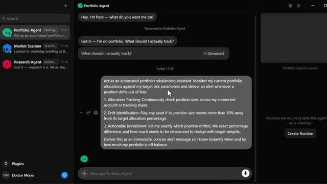
*⏱️ 00:00:37 — Interface de l'application Grok Bot affichant le panneau de configuration du "Portfolio Agent" avec un prompt détaillé pour le rééquilibrage automatisé des allocations.*

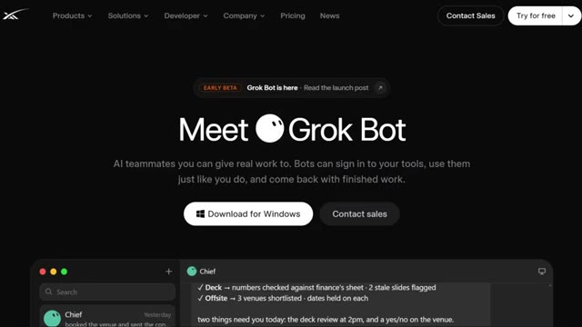
*⏱️ 00:00:45 — Page web de présentation officielle de Grok Bot montrant les fonctionnalités des agents IA et le bouton de téléchargement pour Windows.*

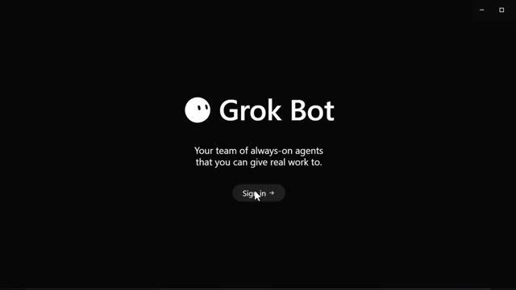
*⏱️ 00:00:53 — Écran de connexion de l'application de bureau Grok Bot avec le bouton "Sign in".*

---

### ⏱️ `[00:01:02 - 00:01:22]` | Segment #03

**🔊 Audio (Transcription Intégrale Mot pour Mot en Français) :**
> C'est parce qu'ils ne peuvent physiquement pas surveiller les graphiques 24/7 comme le marché l'exige. Vous dormez, le marché ne dort pas. Vous avez une vie, le marché s'en fiche. Et c'est exactement ce fossé que cela vient combler. Je vais vous guider à travers les agents autonomes que j'ai créés, de la même manière que je décortique les choses sur ma chaîne de tutoriels, pour que vous puissiez littéralement copier cela aujourd'hui.

**👁️ Analyse Visuelle d'Écran (gemini-3.5-flash-lite) :**
**Interface & Outils** : TradingView, application d'agent IA, page web promotionnelle (Grok Bot).

**Contenu textuel & Code** : Indicateur technique MACD (close 12 26 9), paramètres et description d'un agent de scan de marché automatisé ("Market Scanner"), texte de présentation de Grok Bot.

**Action / Démonstration** : Présentation visuelle des agents autonomes et des outils de surveillance du marché évoqués dans le commentaire audio.

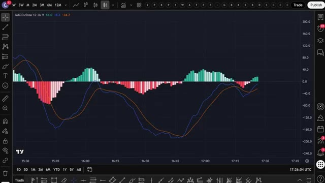
*⏱️ 00:01:07 — Graphique TradingView affichant un indicateur MACD avec des barres d'histogramme et des lignes de signal.*

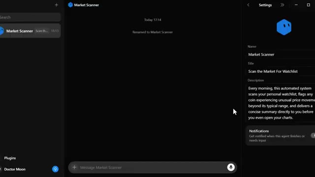
*⏱️ 00:01:12 — Interface de configuration d'un agent autonome nommé 'Market Scanner' avec une description détaillée de ses fonctionnalités de surveillance.*

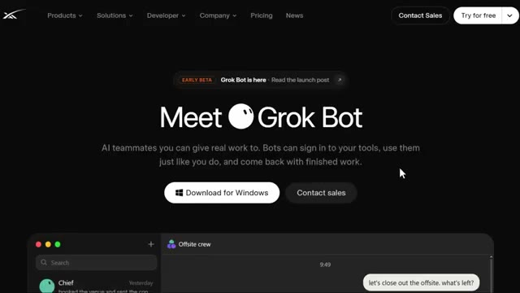
*⏱️ 00:01:17 — Page de présentation web de 'Grok Bot' mettant en avant des coéquipiers IA capables d'exécuter des tâches autonomes.*

---

### ⏱️ `[00:01:22 - 00:01:46]` | Segment #04

**🔊 Audio (Transcription Intégrale Mot pour Mot en Français) :**
> Mais d'abord, laissez-moi vous montrer ce qu'est réellement cet outil et pourquoi il fonctionne d'une manière complètement différente de tout ce que vous avez probablement utilisé auparavant. Il s'agit donc de GrokBot, créé par XAI. L'entreprise d'Elon Musk, qui est également derrière SpaceX et Tesla, et honnêtement, le qualifier simplement d'outil d'IA ne lui rend même pas justice. C'est fondamentalement toute une équipe d'agents qui ne pointent jamais, n'ont jamais besoin de rappels, et continuent simplement à bosser en arrière-plan 24 heures sur 24, 7 jours sur 7.

**👁️ Analyse Visuelle d'Écran (gemini-3.5-flash-lite) :**
**Interface & Outils** : Navigateur web affichant l'interface de l'application GrokBot (xAI).

**Contenu textuel & Code** : Liste d'agents IA (Chief, Sales Outbound, Inbox Manager, Account Manager, Talent Scout, Expense Manager, Offsite crew) et historique de chat interactif gérant des recrutements.

**Action / Démonstration** : Navigation et démonstration de l'interface des agents IA de GrokBot.

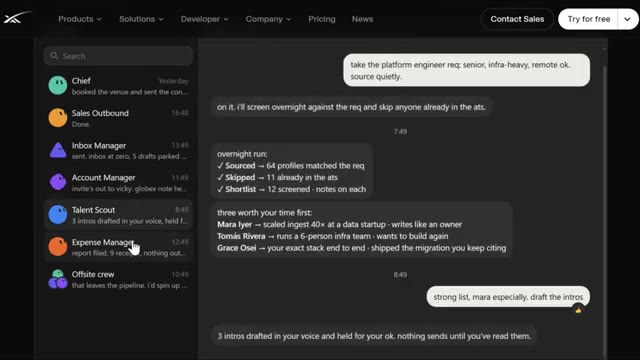
*⏱️ 00:01:40 — Interface de l'outil GrokBot de xAI montrant un panneau latéral avec différents agents IA et une conversation textuelle de gestion de talents.*

---

### ⏱️ `[00:01:46 - 00:02:07]` | Segment #05

**🔊 Audio (Transcription Intégrale Mot pour Mot en Français) :**
> Vous n'avez pas besoin d'un VPS qui tourne 24 heures sur 24. Vous n'avez pas besoin de configurer des fichiers de mémoire pendant des heures. Vous le téléchargez, vous vous connectez à un compte, et vous avez déjà une équipe d'agents prête à travailler. Si vous vous êtes déjà senti dépassé en essayant de mettre en place un système d'IA actif en permanence pour votre trading, vous n'êtes pas seul. Et ce n'est pas de votre faute. La plupart de ces outils ont beaucoup trop de friction.

**👁️ Analyse Visuelle d'Écran (gemini-3.5-flash-lite) :**
**Interface & Outils** : Terminal de commandes SSH, Interface de gestion de bots et plugins Marketplace.

**Contenu textuel & Code** : Commandes Linux de configuration de serveur VPS (adduser, ufw enable, status active, sshd_config, etc.) et listes de plugins logiciels.
[DESC_IMAGE_3] Configuration et sécurisation d'un serveur VPS distant via un terminal de commandes en ligne de commande.

**Action / Démonstration** : Exécution de scripts de configuration système sur un serveur distant pour préparer un environnement d'exécution.

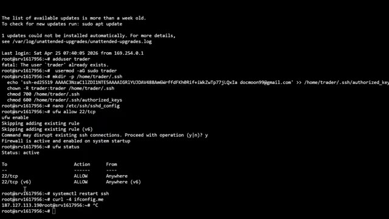
*⏱️ 00:02:02 — Terminal de commandes Linux distant (SSH) montrant la configuration d'un serveur VPS (création d'utilisateur, clés SSH, règles de firewall UFW).*

---

### ⏱️ `[00:02:07 - 00:02:29]` | Segment #06

**🔊 Audio (Transcription Intégrale Mot pour Mot en Français) :**
> Il peut se connecter à pratiquement n'importe quel modèle. Grok, Opus, GPT, Gemini, peu importe ce que vous voulez faire tourner en arrière-plan. Et comme il possède son propre ordinateur, il peut parcourir des graphiques, extraire des données, exécuter des scripts et continuer à travailler pendant que vous dormez littéralement ou que vous regardez une autre vidéo sur cette chaîne. Maintenant, la plupart d'entre vous paient déjà pour ChatGPT, Gemini ou Claude.

**👁️ Analyse Visuelle d'Écran (gemini-3.5-flash-lite) :**
**Interface & Outils** : Interface de l'assistant Gemini (Image 1) et plateforme de graphiques boursiers TradingView (Image 2).

**Contenu textuel & Code** : Interface utilisateur de l'IA (Image 1) ; graphique en chandeliers du Bitcoin, volumes de transactions et oscillateur MACD avec ses lignes de signal (Image 2).

**Action / Démonstration** : Présentation de l'interface d'intelligence artificielle Gemini puis démonstration de l'analyse technique d'un graphique financier sur TradingView.

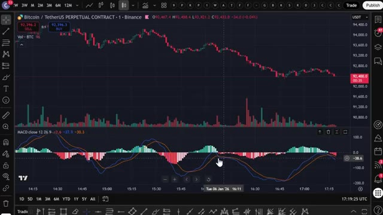
*⏱️ 00:02:18 — Graphique TradingView affichant le cours du Bitcoin (BTC/USDT Perpetual) avec des indicateurs de volume et le MACD.*

---

### ⏱️ `[00:02:29 - 00:02:50]` | Segment #07

**🔊 Audio (Transcription Intégrale Mot pour Mot en Français) :**
> Donc soyons honnêtes sur les raisons pour lesquelles c'est différent. ChatGPT est formidable pour une analyse rapide, mais dès que vous fermez l'onglet, il s'arrête de fonctionner. Il ne surveille pas vos positions à 3 heures du matin et ne scanne pas votre liste de surveillance pendant que vous dormez. C' والشعار même chose pour Gemini, mais simplement enveloppé dans Google Search et Workspace. Vous demandez, il répond, puis c'est terminé.

**👁️ Analyse Visuelle d'Écran (gemini-3.5-flash-lite) :**
**Interface & Outils** : ChatGPT (OpenAI), plateforme d'échange crypto Toobit (graphique en chandeliers et module de futures).

**Contenu textuel & Code** : Image 1 : analyse de cycle post-halving, estimation cible 2027 ($90K–$180K). Image 2 : paire BTC/USDT, cours à ~68 238 USDT, position Long isolée 7x à un prix d'entrée moyen de 68 247,2 USDT, carnet d'ordres et notification d'ordre exécuté.

**Action / Démonstration** : Démonstration comparative entre une analyse statique générée sur ChatGPT et la gestion active d'une position ouverte sur un exchange crypto.

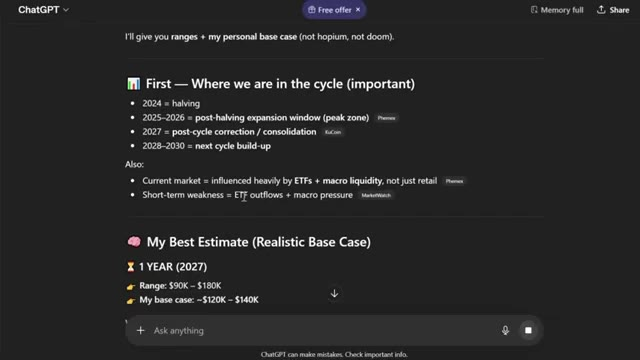
*⏱️ 00:02:34 — Interface ChatGPT présentant une analyse du cycle de marché crypto avec estimations de prix et phases de halving.*

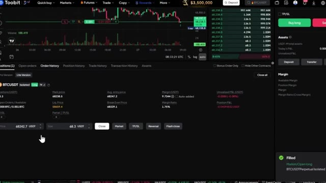
*⏱️ 00:02:39 — Interface de la plateforme de trading Toobit affichant le graphique BTC/USDT, le carnet d'ordres et une position Long 7x active.*

---

### ⏱️ `[00:02:50 - 00:03:12]` | Segment #08

**🔊 Audio (Transcription Intégrale Mot pour Mot en Français) :**
> Et Claude, que j'utilise toujours pour l'écriture et la recherche parce que le raisonnement est excellent, vous oblige à construire votre propre structure d'agent à partir de zéro, en connectant vos propres serveurs, en gérant vos propres fichiers de mémoire. Ça prend des jours de configuration pour la plupart des gens. Très bien, passons maintenant à la configuration, car je sais que beaucoup d'entre vous apprennent le mieux en voyant les choses étape par étape, tout comme je le fais sur ma chaîne de tutoriels.

**👁️ Analyse Visuelle d'Écran (gemini-3.5-flash-lite) :**
**Interface & Outils** : Claude Code (CLI), Claude Cowork (Web), xAI Grok Bot.

**Contenu textuel & Code** : Commandes de configuration de plugins dans le terminal Claude Code (ex: /telegram:configure).

**Action / Démonstration** : Configuration et exécution de commandes dans un terminal de développement.

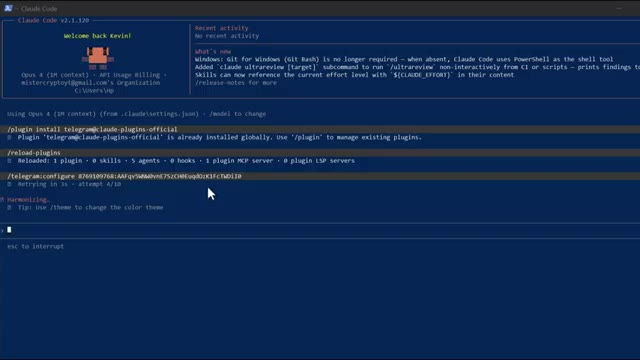
*⏱️ 00:02:56 — Interface du terminal Claude Code affichant des commandes de configuration et des plugins.*

---

### ⏱️ `[00:03:12 - 00:03:30]` | Segment #09

**🔊 Audio (Transcription Intégrale Mot pour Mot en Français) :**
> Première étape, allez sur la page d'inscription de GrokBot. Vous pouvez consulter le lien ci-dessous dans la description. Vous serez redirigé vers cette page où vous pouvez voir qu'il est en version bêta anticipée. Vous pouvez voir la publication de lancement ici. Lorsque vous faites défiler vers le bas, vous pouvez voir le bouton de téléchargement ici. Maintenant, cela dépend si vous avez un Mac ou Windows.

**👁️ Analyse Visuelle d'Écran (gemini-3.5-flash-lite) :**
**Interface & Outils** : Navigateur web présentant le site officiel de Grok Bot (Grok Bots / CLI)

**Contenu textuel & Code** : Page de présentation affichant 'Meet Grok Bot' avec le statut 'Early Beta' et un lien vers la publication de lancement.

**Action / Démonstration** : Présentation de la page d'inscription et de téléchargement de Grok Bot pour Windows.

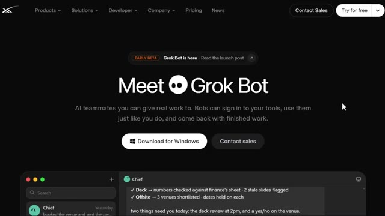
*⏱️ 00:03:17 — Page web de présentation de Grok Bot en version bêta anticipée avec les options de téléchargement.*

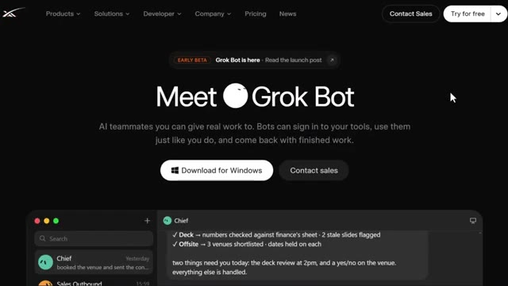
*⏱️ 00:03:26 — Page web de présentation de Grok Bot montrant l'interface utilisateur et le bouton de téléchargement pour Windows.*

---

### ⏱️ `[00:03:30 - 00:03:49]` | Segment #10

**🔊 Audio (Transcription Intégrale Mot pour Mot en Français) :**
> Mais pour cela, nous allons utiliser Windows. Puisque c'est ce que nous utilisons, cliquez dessus et une fenêtre de téléchargement apparaîtra. Suivez simplement l'installation sur votre appareil, attendez quelques minutes, et vous êtes prêts. Une fois que vous ouvrez l'application, une fenêtre de connexion apparaîtra, cliquez dessus, et suivez les instructions. Vous pouvez activer votre essai gratuit ici.

**👁️ Analyse Visuelle d'Écran (gemini-3.5-flash-lite) :**
**Interface & Outils** : Site web de Grok Bot / application de bureau

**Contenu textuel & Code** : Bouton de téléchargement Windows, lien vers un fichier d'installation exécutable et différentes formules d'abonnement (One Week Trial, Get Ultra, SuperGrok Heavy).

**Action / Démonstration** : Clic sur le bouton de téléchargement pour Windows afin d'initier le téléchargement du fichier d'installation de l'application Grok Bot.

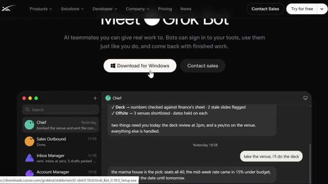
*⏱️ 00:03:35 — Page web de téléchargement de Grok Bot montrant le bouton 'Download for Windows' avec un curseur pointant dessus et un aperçu de l'interface en bas.*

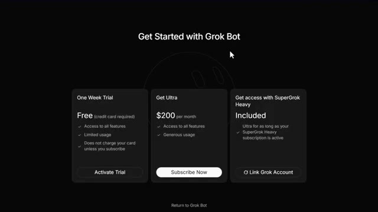
*⏱️ 00:03:44 — Page web de tarification et d'abonnement 'Get Started with Grok Bot' présentant trois options : un essai gratuit d'une semaine, l'offre Ultra à 200 $ par mois et l'accès via SuperGrok Heavy.*

---

### ⏱️ `[00:03:49 - 00:04:07]` | Segment #11

**🔊 Audio (Transcription Intégrale Mot pour Mot en Français) :**
> Une fois que c'est configuré, vous retournerez sur l'application de bureau. Deuxième étape, une fois que vous arrivez sur votre tableau de bord, c'est votre centre de contrôle. C'est ici que vous allez lancer vos agents. Troisième étape, cliquez sur nouveau bot ou cliquez sur l'icône plus et attribuez-lui un rôle. Pour le trading de crypto, voici exactement ce que je configurerais. Un agent de scan du marché.

**👁️ Analyse Visuelle d'Écran (gemini-3.5-flash-lite) :**
**Interface & Outils** : Application de bureau d'agents IA (interface de chat/bot en mode sombre).

**Contenu textuel & Code** : Menu latéral avec la liste des bots ("New Bot"), un bouton de recherche, l'icône "+", l'accès aux "Plugins", le profil utilisateur "Doctor Moon", et un champ central de saisie de prompt ("Message New Bot").

**Action / Démonstration** : Navigation sur le tableau de bord pour initialiser et configurer un nouvel agent IA.

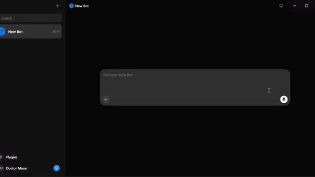
*⏱️ 00:03:54 — Interface d'application de bureau affichant le tableau de bord de création d'un nouveau bot IA ("New Bot") avec un champ de saisie de message.*

---

### ⏱️ `[00:04:07 - 00:04:28]` | Segment #12

**🔊 Audio (Transcription Intégrale Mot pour Mot en Français) :**
> Chaque matin, il vérifie votre liste de suivi, signale toute crypto qui évolue en dehors de sa plage habituelle, et vous envoie un résumé avant même que vous n'ouvriez vos graphiques. Un agent de portefeuille. Avec ce bot, vous pouvez le connecter à votre plateforme d'échange, qu'il s'agisse de votre feuille de calcul avec des requêtes API en direct ou d'une connexion en lecture directe à votre compte. Et chaque matin, il vous donne un récapitulatif de la nuit.

**👁️ Analyse Visuelle d'Écran (gemini-3.5-flash-lite) :**
**Interface & Outils** : Application logicielle de type agent IA ou assistant de trading (Market Scanner).

**Contenu textuel & Code** : Panneau de configuration affichant le nom "Market Scanner", le titre "Scan the Market For WatchList", et une description détaillée de la fonctionnalité de scan matinal des cryptos.

**Action / Démonstration** : Visualisation des paramètres de configuration et de la description textuelle d'un bot de surveillance de marché.

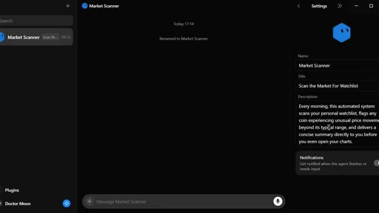
*⏱️ 00:04:13 — Interface d'un agent de trading ou d'un bot nommé "Market Scanner", affichant ses paramètres et sa description.*

---

### ⏱️ `[00:04:29 - 00:04:51]` | Segment #13

**🔊 Audio (Transcription Intégrale Mot pour Mot en Français) :**
> Qu'est-ce qui a bougé ? Qu'y a-t-il sur le calendrier aujourd'hui ? Et est-ce que quelque chose dans vos positions nécessite de l'attention. Un agent de recherche que vous pouvez configurer pour analyser l'actualité crypto et X toutes les quelques heures et compiler uniquement ce qui est réellement pertinent pour les pièces que vous détenez ou surveillez. Quatrième étape, sous plugins, vous pouvez le connecter à Google Sheets, Gmail, Slack et d'autres outils.

**👁️ Analyse Visuelle d'Écran (gemini-3.5-flash-lite) :**
**Interface & Outils** : Application de type agent conversationnel pour le trading et la gestion de portefeuille.

**Contenu textuel & Code** : Panneau de configuration affichant le titre 'Overnight Portfolio & Position Recap' et une description détaillée de la connexion aux comptes d'échange ou feuilles de calcul API en direct pour générer des rapports de marché matinaux automatisés, des événements du calendrier et des alertes sur les positions.

**Action / Démonstration** : Configuration et présentation d'un agent de recherche automatisé pour le suivi des portefeuilles et des positions.

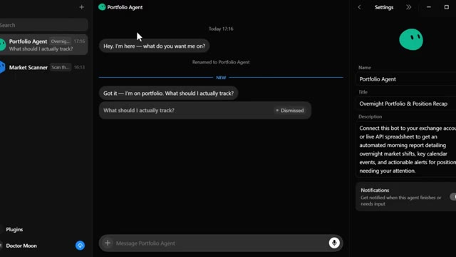
*⏱️ 00:04:34 — Interface d'un assistant de trading virtuel nommé 'Portfolio Agent', affichant un panneau de configuration des paramètres à droite et une conversation interactive au centre.*

---

### ⏱️ `[00:04:51 - 00:05:23]` | Segment #14

**🔊 Audio (Transcription Intégrale Mot pour Mot en Français) :**
> De la même manière que vous connectez un MCP dans Claude. C'est là que ça devient puissant pour le trading en particulier, parce que vous pouvez littéralement lui donner un accès en lecture à vos données d'échange et lui faire vous faire un rapport comme le ferait un analyste. Note importante, et je le dis à chaque fois que je parle d'automatisation et d'argent : lorsqu'il s'agit de l'exécution réelle des transactions, soyez beaucoup plus prudent ; les rapports et l'analyse, aucun problème ; lui permettre de placer de vraies transactions en votre nom est une conversation différente et quelque chose que vous devriez sérieusement évaluer avant de le connecter. Maintenant, laissez-moi vous montrer exactement comment je le ferais

**👁️ Analyse Visuelle d'Écran (gemini-3.5-flash-lite) :**
**Interface & Outils** : Interface logicielle de type assistant IA / plateforme de gestion d'agents.

**Contenu textuel & Code** : Liste de plugins (Mobbin, Docusign, X, Amazon Location Service) et description d'un agent de scan de marché.

**Action / Démonstration** : Navigation dans le market de plugins et configuration des paramètres d'un agent automatisé.

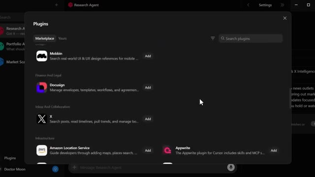
*⏱️ 00:04:59 — Fenêtre de paramètres affichant la liste des plugins disponibles avec une barre de recherche.*

*⏱️ 00:05:07 — Interface de configuration d'un agent nommé "Market Scanner" avec description et options de notification.*

---

### ⏱️ `[00:05:23 - 00:05:57]` | Segment #15

**🔊 Audio (Transcription Intégrale Mot pour Mot en Français) :**
> Utilisez ceci pour le trading et l'investissement parce que c'est là que ça devient réellement précieux et pas seulement un jouet sympa. Un, récapitulatif du marché de nuit : au lieu de vous réveiller et de faire défiler 15 onglets, vous ouvrez un seul chat et il vous dit ce que Bitcoin et Ethereum ont fait pendant la nuit, s'il y a eu des chasses à la liquidité, et si les cryptos de votre liste de surveillance ont déclenché des alertes. Deux, suggestions de rééquilibrage de portefeuille. Si vous êtes comme beaucoup de traders qui oublient de rééquilibrer, vous pouvez littéralement dire : signalez-moi si une position s'écarte de plus de 10 % de l'allocation cible,

**👁️ Analyse Visuelle d'Écran (gemini-3.5-flash-lite) :**
**Interface & Outils** : Application de messagerie et d'agents IA pour le trading (Market Scanner et Portfolio Agent).

**Contenu textuel & Code** : Prompts de configuration d'agents IA pour le récapitulatif nocturne des prix (BTC, ETH), la détection de liquidité et le suivi du portefeuille.

**Action / Démonstration** : Configuration et programmation de routines d'automatisation par agent conversationnel pour l'analyse des marchés de crypto-monnaies.

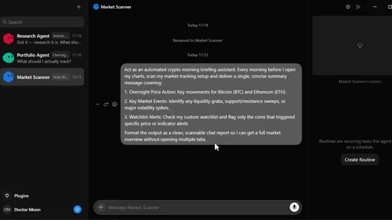
*⏱️ 00:05:32 — Interface de chat avec un assistant automatisé de scan du marché crypto configuré pour résumer les mouvements du Bitcoin et de l'Ethereum.*

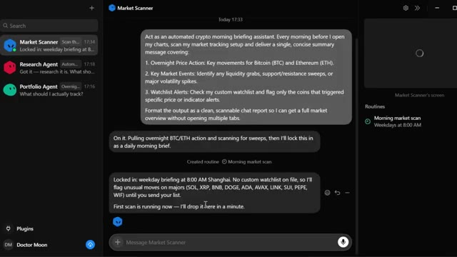
*⏱️ 00:05:40 — Conversation active avec l'agent Market Scanner confirmant la planification d'un briefing matinal automatisé à 8h00.*

*⏱️ 00:05:49 — Interface de l'agent de portefeuille configuré pour surveiller les allocations d'actifs et détecter les dérives de risque.*

---

### ⏱️ `[00:05:57 - 00:06:28]` | Segment #16

**🔊 Audio (Transcription Intégrale Mot pour Mot en Français) :**
> et il te dira exactement quand et de combien. Trois, la détection des valeurs aberrantes. De la même manière que j'utilise ce concept sur ma chaîne d'analyse technique. Tu peux le configurer pour scanner les cryptos qui montrent un volume inhabituel ou qui cassent une structure clé, comme ça tu ne passes pas ta journée à vérifier des graphiques manuellement. Quatre, la recherche de partenariats et de projets. Si tu gères une page ou une chaîne crypto comme je le fais, tu peux littéralement lui demander de scanner quels projets dépensent le plus en publicité en ce moment, pour savoir vers qui te tourner.

**👁️ Analyse Visuelle d'Écran (gemini-3.5-flash-lite) :**
**Interface & Outils** : Interface de type messagerie/agent IA (Market Scanner et Research Agent) avec panneau de configuration des routines.

**Contenu textuel & Code** : Prompts de configuration pour l'analyse technique automatisée : détection d'anomalies de volume (Volume Anomaly Detection), cassures de structure (Market Structure Breaks: BOS/CHoCH) et livraison de signaux.

**Action / Démonstration** : Présentation de la configuration d'un agent IA spécialisé dans l'analyse technique et le scan automatisé des cryptomonnaies.

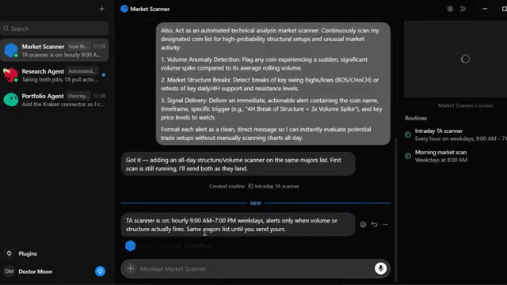
*⏱️ 00:06:05 — Interface d'un agent de scan de marché montrant une conversation configurée pour détecter les anomalies de volume et les cassures de structure de marché (Market Structure Breaks).*

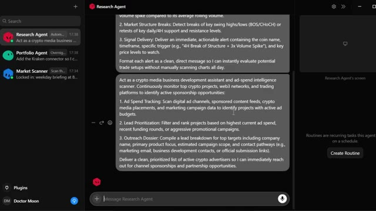
*⏱️ 00:06:20 — Interface d'un agent de recherche (Research Agent) affichant des instructions pour surveiller les projets crypto et analyser les opportunités de parrainage et de publicité.*

---

### ⏱️ `[00:06:28 - 00:07:01]` | Segment #17

**🔊 Audio (Transcription Intégrale Mot pour Mot en Français) :**
> Cinq, apprentissage et formation au flux de travail. Vous pouvez vous enregistrer en train d'effectuer votre propre processus d'analyse technique et il apprendra réellement à en reproduire des parties pour vous avec le temps. Mais voici le point, GrokBot n'est pas seulement conçu pour le trading de crypto. Si vous avez d'autres tâches pour gérer votre entreprise ou votre vie, GrokBot peut aussi s'en charger. Vous pouvez le configurer pour les ventes, la prospection, le recrutement de talents, la gestion des médias payants, la gestion des dépenses, le suivi des performances des produits, la reproduction de bugs, la surveillance de la santé des comptes, et même pour un rôle complet de chef de cabinet. GrokBot peut

**👁️ Analyse Visuelle d'Écran (gemini-3.5-flash-lite) :**
**Interface & Outils** : Application de type agent conversationnel (Portfolio Agent) et site web promotionnel.

**Contenu textuel & Code** : Instructions textuelles pour configurer l'assistant en tant qu'analyste technique (process extraction, rule codification, strategy replication).

**Action / Démonstration** : Interaction avec l'agent textuel pour automatiser l'analyse de sessions de graphiques et créer des checklists de trading.

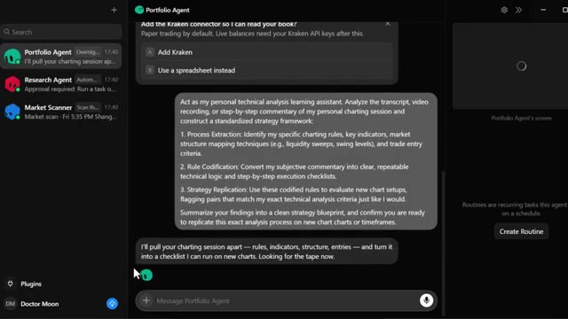
*⏱️ 00:06:37 — Interface sombre de Portfolio Agent affichant une conversation avec un assistant d'analyse technique et de gestion de portefeuille.*

---

### ⏱️ `[00:07:01 - 00:07:35]` | Segment #18

**🔊 Audio (Transcription Intégrale Mot pour Mot en Français) :**
> vraiment tout faire. Les cas d'usage de la cryptographie ne sont que ce sur quoi je me concentre en ce moment parce que c'est ce qui est pertinent pour vous et moi. Très bien, parlons des prix parce que je sais que c'est là que beaucoup d'entre vous vont avoir des avis. Cursor Ultra coûte 200 dollars par mois facturés mensuellement. Cela inclut le propre ordinateur de GrokBot, il se connecte à vos outils, exécute des routines selon un calendrier, fonctionne partout sur ordinateur, mobile et plus encore, et vous donne des limites étendues sur les jetons AE. Supergirl Heavy coûte 300 dollars par mois facturés mensuellement, et cela comprend tout ce qu'il y a dans Supergirl plus l'utilisation la plus élevée au rythme le plus rapide

**👁️ Analyse Visuelle d'Écran (gemini-3.5-flash-lite) :**
**Interface & Outils** : Page web de tarification et de présentation de services IA.

**Contenu textuel & Code** : Grille de tarification affichant les plans Cursor Ultra ($200/mois), SuperGrok Heavy ($300/mois) et Cursor Premium Teams ($120/siège/mois) avec leurs fonctionnalités respectives.

**Action / Démonstration** : Présentation et comparaison des différentes offres de tarification des abonnements IA.

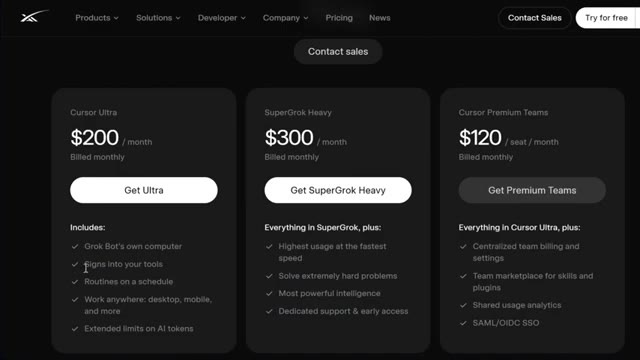
*⏱️ 00:07:18 — Page de tarification présentant les différentes offres (Cursor Ultra à 200 $ / mois, SuperGrok Heavy à 300 $ / mois et Cursor Premium Teams à 120 $ / mois).*

---

### ⏱️ `[00:07:35 - 00:08:01]` | Segment #19

**🔊 Audio (Transcription Intégrale Mot pour Mot en Français) :**
> vitesse, la capacité de résoudre des problèmes extrêmement difficiles, l'intelligence la plus puissante, et un support dédié en accès anticipé. Cursor Premium Teams coûte 120 dollars par utilisateur et par mois, facturé mensuellement, et cela comprend tout ce qui est dans Cursor Ultra, plus la facturation et les paramètres d'équipe centralisés. Un marché d'équipe pour les compétences et les modules d'extension, des analyses d'utilisation partagées, et SAML, ou O-I-D-C-S-S-O.

**👁️ Analyse Visuelle d'Écran (gemini-3.5-flash-lite) :**
**Interface & Outils** : Navigateur web affichant une page de tarification (pricing) sur fond sombre.

**Contenu textuel & Code** : Tarifs des abonnements : Cursor Ultra ($200), SuperGrok Heavy ($300 avec les options de vitesse et résolution de problèmes complexes) et Cursor Premium Teams ($120 par utilisateur et par mois).

**Action / Démonstration** : Présentation comparative des différentes formules d'abonnement et de leurs fonctionnalités respectives.

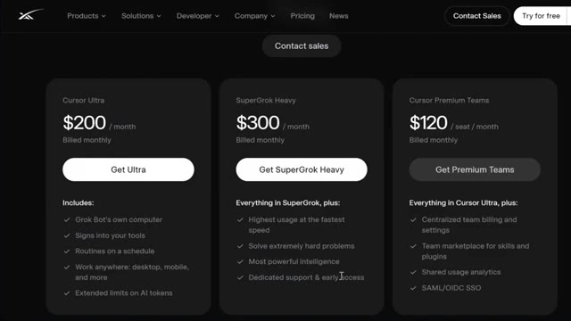
*⏱️ 00:07:42 — Capture d'écran montrant la page des tarifs avec les offres Cursor Ultra ($200/mois), SuperGrok Heavy ($300/mois) et Cursor Premium Teams ($120/siège/mois).*

---

### ⏱️ `[00:08:01 - 00:08:25]` | Segment #20

**🔊 Audio (Transcription Intégrale Mot pour Mot en Français) :**
> Maintenant, comparez la tarification à d'autres modèles comme ChatGPT, Google Gemini et Claude d'Anthropic. ChatGPT Plus coûte 20 dollars par mois, ce qui vous donne l'expérience standard à laquelle la plupart des gens sont habitués. Mais si vous voulez leur modèle de raisonnement de premier plan, ChatGPT Pro coûte 200 dollars par mois. Donc, dès<bos>1, vous payez la même chose que pour le niveau supérieur de GrokBot, mais vous obtenez toujours simplement une conversation, et non un agent toujours actif doté de son propre ordinateur.

**👁️ Analyse Visuelle d'Écran (gemini-3.5-flash-lite) :**
**Interface & Outils** : Interface web de tarification et de comparaison de modèles d'IA.

**Contenu textuel & Code** : Tarifs des abonnements IA (ChatGPT Free, Go, Plus à 20$, Pro à 100$ et 200$) et détails des limites d'utilisation (volume, fonctionnalités).

**Action / Démonstration** : Présentation comparative des différents modèles de tarification des assistants IA.

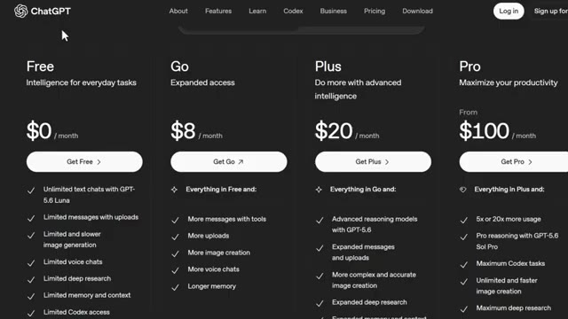
*⏱️ 00:08:07 — Capture d'écran affichant la grille tarifaire de ChatGPT avec différentes formules : Free (0$), Go (8$), Plus (20$) et Pro (100$).*

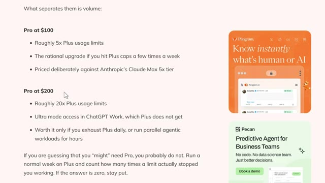
*⏱️ 00:08:19 — Page web comparant les offres Pro à 100$ et 200$ avec les limites d'utilisation et les fonctionnalités associées.*

---

### ⏱️ `[00:08:26 - 00:08:51]` | Segment #21

**🔊 Audio (Transcription Intégrale Mot pour Mot en Français) :**
> Gemini est similaire. Google AI Pro, qui s'appelait auparavant Gemini Advance, coûte 19,99 dollars par mois pour la formule standard. Mais si vous voulez leur formule ultra dotée du maximum de capacités, cela passe à 99,99 dollars par mois. Et il y a une formule encore plus élevée à 199,99 dollars par mois. Encore une fois, c'est une somme importante pour un modèle qui ne fonctionne toujours que lorsque vous le sollicitez activement.

**👁️ Analyse Visuelle d'Écran (gemini-3.5-flash-lite) :**
**Interface & Outils** : Page web officielle de Gemini (Google AI)

**Contenu textuel & Code** : Tarifs des abonnements : Free ($0), Google AI Plus ($4.99/month), Google AI Pro ($19.99/month), Google AI Ultra (Starting at $99.99/month, avec mention de $199.99/month pour les limites d'utilisation maximales).

**Action / Démonstration** : Présentation visuelle des différentes formules d'abonnement et de leurs tarifs respectifs.

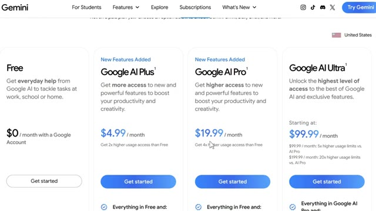
*⏱️ 00:08:32 — Capture d'écran de la page de tarification des abonnements Gemini affichant les différentes formules (Free, Google AI Plus à 4,99 $, Google AI Pro à 19,99 $ et Google AI Ultra à partir de 99,99 $).*

---

### ⏱️ `[00:08:51 - 00:09:23]` | Segment #22

**🔊 Audio (Transcription Intégrale Mot pour Mot en Français) :**
> Et Claude, maximum cinq fois, c'est 100 dollars par mois et maximum 20 fois. Leur niveau le plus élevé est à 200 dollars par mois. Donc, vous payez le prix de GrokBot pour l'intelligence de Claude, sauf que vous devez quand même le surveiller, ouvrir le chat et faire avancer la conversation vous-même. Donc, quand on met tout bout à bout, 20 à 300 dollars pour ChatGPT, 20 à 200 dollars pour Gemini, 100 à 200 dollars pour Claude, vous dépensez déjà de vraies sommes pour les niveaux supérieurs de n'importe lequel d'entre eux. La différence avec GrokBot à ce même tarif de 200 à 300

**👁️ Analyse Visuelle d'Écran (gemini-3.5-flash-lite) :**
**Interface & Outils** : Navigateur web affichant les pages de tarification officielles de Claude et de ChatGPT.

**Contenu textuel & Code** : Tableaux de prix et listes de fonctionnalités des abonnements d'intelligence artificielle (Claude Max 5x et Max 20x, ChatGPT Free, Go, Plus et Pro).

**Action / Démonstration** : Comparaison des tarifs et des multiplicateurs d'utilisation des différents abonnements IA présentés à l'écran.

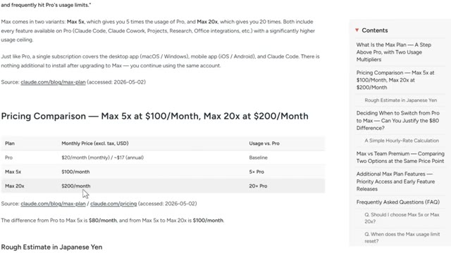
*⏱️ 00:08:59 — Capture d'écran montrant un tableau comparatif des tarifs de Claude avec les forfaits Max 5x à 100 $ par mois et Max 20x à 200 $ par mois.*

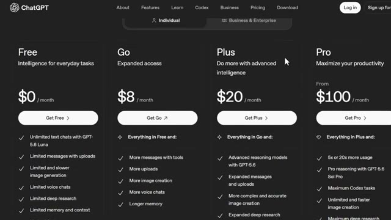
*⏱️ 00:09:07 — Page de tarification de ChatGPT présentant les différentes offres (Free à 0 $, Go à 8 $, Plus à 20 $ et Pro à partir de 100 $ par mois).*

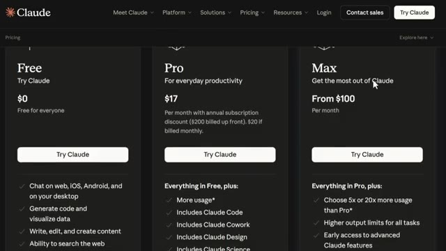
*⏱️ 00:09:15 — Page des tarifs officiels de Claude affichant les offres Free, Pro et Max à partir de 100 $ par mois.*

---

### ⏱️ `[00:09:23 - 00:09:58]` | Segment #23

**🔊 Audio (Transcription Intégrale Mot pour Mot en Français) :**
> le prix, c'est que vous ne payez pas pour une conversation plus intelligente. Vous payez pour quelque chose qui fonctionne 24h/24 et 7j/7 sans vous. Écoutez, 200 dollars, c'est beaucoup, et je ne vais pas prétendre le contraire. Ce n'est pas pour quelqu'un qui se contente de mettre un orteil dans la crypto avec un abonnement à 20 dollars. C'est pour les personnes qui dépensent déjà de vrais argent en crédits API ou en plusieurs abonnements d'IA et qui veulent les regrouper en un seul système toujours actif. Si ce n'est pas encore votre cas, c'est tout à fait normal. Vous pouvez tirer énormément de valeur des outils gratuits et trader intelligemment. Maintenant, avant de conclure, laissez-moi passer rapidement en revue un

**👁️ Analyse Visuelle d'Écran (gemini-3.5-flash-lite) :**
**Interface & Outils** : Page web de tarification et d'abonnement (interface de tarification logicielle).

**Contenu textuel & Code** : Tableaux de prix affichant 200 $/mois, 300 $/mois et 120 $/siège/mois, avec les fonctionnalités incluses comme Grok Bot's own computer, routines on a schedule, et extended limits on AI tokens.

**Action / Démonstration** : Présentation des grilles tarifaires et des différentes formules d'abonnement disponibles pour les outils d'IA.

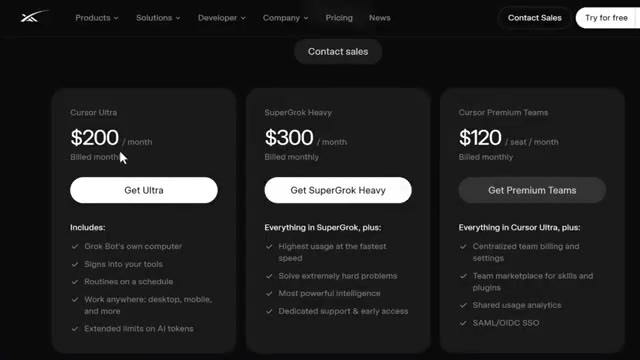
*⏱️ 00:09:32 — Page de tarification présentant les offres Cursor Ultra à 200 $ par mois, SuperGrok Heavy à 300 $ par mois et Cursor Premium Teams à 120 $ par siège et par mois.*

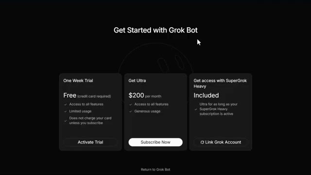
*⏱️ 00:09:50 — Page d'inscription pour Grok Bot affichant les options : essai gratuit d'une semaine, abonnement Ultra à 200 $ par mois et accès SuperGrok Heavy inclus.*

---

### ⏱️ `[00:09:58 - 00:10:31]` | Segment #24

**🔊 Audio (Transcription Intégrale Mot pour Mot en Français) :**
> FAQ parce que je sais que beaucoup d'entre vous vont avoir exactement ces questions dans les commentaires. En quoi GrokBot est-il différent des assistants IA ? Les bots ont leur propre ordinateur pour pouvoir travailler à l'intérieur de vos applications et de vos outils. Ils fonctionnent également en parallèle 24h/24 et 7j/7, même lorsque votre ordinateur portable est fermé. Pour qui GrokBot est-il disponible aujourd'hui ? GrokBot est accessible dès aujourd'hui pour les abonnés à Cursor Ultra, Super Grok Heavy et Cursor Premium Team. GrokBot sera-t-il bientôt disponible pour les entreprises ? Nous prévoyons d'ouvrir GrokBot aux équipes et aux entreprises dans les semaines à venir. Pour l'instant,

**👁️ Analyse Visuelle d'Écran (gemini-3.5-flash-lite) :**
**Interface & Outils** : Page web officielle (site web au design sombre avec menu supérieur).

**Contenu textuel & Code** : Texte de la FAQ : « How is Grok Bot different from AI assistants? » avec la réponse expliquant que les bots possèdent leur propre ordinateur pour travailler dans les applications et tourner 24h/24 et 7j/7, ainsi que d'autres questions fréquentes listées en dessous.

**Action / Démonstration** : Présentation visuelle de la foire aux questions sur Grok Bot à l'écran.

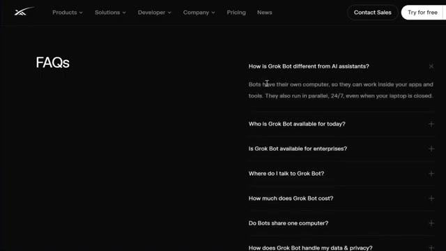
*⏱️ 00:10:06 — Capture d'écran montrant la section FAQ d'un site web, abordant la différence entre Grok Bot et les assistants IA.*

---

### ⏱️ `[00:10:31 - 00:11:05]` | Segment #25

**🔊 Audio (Transcription Intégrale Mot pour Mot en Français) :**
> vous pouvez rejoindre la liste d'attente. Je mettrai le lien ci-dessous. Où est-ce que je parle à GrokBot ? Travaillez avec GrokBot depuis votre bureau, macOS ou Windows, ou votre téléphone avec l'application iOS. Les bots partagent-ils un seul ordinateur ? Oui, chaque GrokBot partage un seul ordinateur cloud persistant. Vos bots partagent cette machine, les fichiers, le navigateur, les identifiants, afin de pouvoir se transmettre le travail et conserver le contexte. L'isolation se fait par utilisateur, et non par GrokBot. Comment Grokbot gère-t-il mes données et ma vie privée ? Grokbot utilise le même SSO, la même authentification et le même mode de confidentialité de Cursor auxquels vous faites déjà confiance. Votre ordinateur cloud est chiffré en transit et au repos

**👁️ Analyse Visuelle d'Écran (gemini-3.5-flash-lite) :**
**Interface & Outils** : Navigateur web affichant le site officiel de Grok Bot / xAI.

**Contenu textuel & Code** : Section FAQ listant plusieurs questions, notamment : 'How is Grok Bot different from AI assistants?', 'Where do I talk to Grok Bot?' avec la réponse 'Work with Grok Bot from your desktop (macOS or Windows) or your phone with the iOS app.', ainsi que 'Do Bots share one computer?'.

**Action / Démonstration** : Le curseur de la souris survole la section FAQ du site pour illustrer les différentes questions et réponses abordées dans la vidéo.

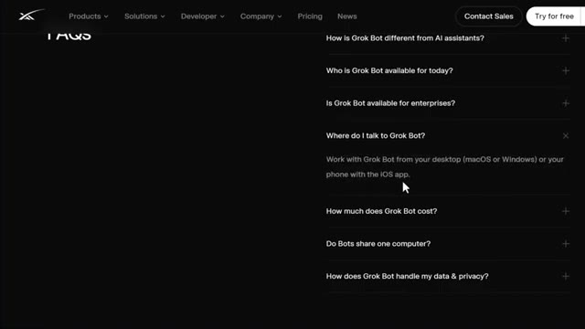
*⏱️ 00:10:39 — Capture d'écran montrant la page web de la FAQ de Grok Bot avec la question 'Where do I talk to Grok Bot?' développée.*

---

### ⏱️ `[00:11:05 - 00:11:41]` | Segment #26

**🔊 Audio (Transcription Intégrale Mot pour Mot en Français) :**
> avec l'option de refus de l'entraînement. Les actions sensibles peuvent passer par une vérification automatique avant de s'exécuter. Les administrateurs d'entreprise peuvent configurer la DLP, les certificats, les proxys et les contrôles réseau au démarrage. Très bien, et regardez, au cours des prochaines années, deux types de traders vont exister. Ceux qui utilisent l'IA et ceux qui continuent de tout faire manuellement. Même marché, des résultats très différents. Voici comment vous placer du bon côté. J'ai tout rassemblé au sein de la communauté AI Trade Edge. Chaque prompt, chaque bot, chaque modèle, chaque guide étape par étape que j'utilise personnellement, le tout réuni au même endroit. Et

**👁️ Analyse Visuelle d'Écran (gemini-3.5-flash-lite) :**
**Interface & Outils** : Navigateur web (plateforme Whop et réseau social X)

**Contenu textuel & Code** : Texte marketing, FAQ sur la sécurité et les abonnements payants de trading par IA.
[DESC_IMAGE_1] Page web informative sur les paramètres de sécurité et de confidentialité de Grok Bot.
[DESC_IMAGE_2] Post Twitter/X argumentant les avantages du trading automatisé par IA.
[DESC_IMAGE_3] Interface de vente Whop pour un service d'outils de trading basés sur l'intelligence artificielle.

**Action / Démonstration** : Explications face caméra et analyse conceptuelle des marchés.

---

### ⏱️ `[00:11:41 - 00:12:00]` | Segment #27

**🔊 Audio (Transcription Intégrale Mot pour Mot en Français) :**
> Tout ce que je construis à l'avenir est ajouté directement dans le groupe dès sa sortie. Nous testons également des stratégies provenant de tout Internet, en les automatisant à l'aide de PineScript, en les exécutant en direct et en partageant exactement ce qui fonctionne et ce qui ne fonctionne pas. Vous n'obtenez donc pas seulement des outils. Vous obtenez une opération de recherche en direct.

**👁️ Analyse Visuelle d'Écran (gemini-3.5-flash-lite) :**
**Interface & Outils** : Interface web de configuration et plateforme de graphiques financiers TradingView.

**Contenu textuel & Code** : Cartes de fonctionnalités d'automatisation IA, graphiques en chandeliers japonais, indicateurs de momentum et de tendance (STC Combo).

**Action / Démonstration** : Présentation des cas d'usage de l'IA pour le trading automatisé et visualisation d'un graphique de cryptomonnaie avec indicateurs.

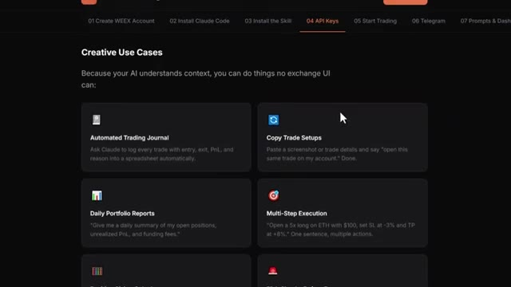
*⏱️ 00:11:45 — Interface web sombre présentant des cas d'usage créatifs pour l'automatisation du trading par IA (journal de trading, copy trade, rapports de portefeuille, exécution multi-étapes).*

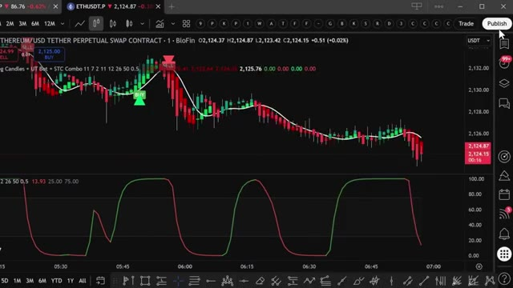
*⏱️ 00:11:55 — Graphique TradingView affichant le cours de l'ETH/USD avec des indicateurs techniques (UT Bot, STC Combo) et des signaux d'achat/vente (Buy/Sell).*

---

### ⏱️ `[00:12:00 - 00:12:20]` | Segment #28

**🔊 Audio (Transcription Intégrale Mot pour Mot en Français) :**
> À l'intérieur, il y a aussi un cours complet de trading agentique. 2,5 heures. Du débutant à l'expert. Aucune base en programmation n'est nécessaire. D'ici la fin, vous aurez votre propre système de trading par IA fonctionnant en direct. Quelque chose que la plupart des traders particuliers ne savent même pas être possible en ce moment. 79,99 $ par mois. Un seul bon trade suffit à couvrir le coût.

**👁️ Analyse Visuelle d'Écran (gemini-3.5-flash-lite) :**
**Interface & Outils** : Interface web de cours en ligne, plateforme de e-learning personnalisée.

**Contenu textuel & Code** : Titres et descriptions des modules (Setup Your Workstation, Install Claude + OpenRouter, WEEX, Alpaca, Interactive Brokers, WEEX Trading Assistant, Hyperliquid Whale Tracker, TradingView MCP, Firecrawl MCP), durées estimées et badges "LIVE DEMO".

**Action / Démonstration** : Présentation du programme du cours de trading agentique détaillant les outils et intégrations nécessaires (Claude, WEEX, Alpaca, Interactive Brokers, TradingView).

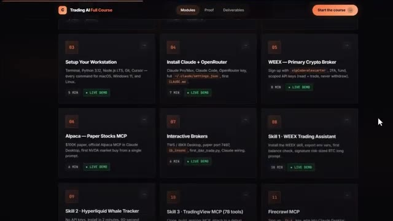
*⏱️ 00:12:05 — Capture d'écran de l'interface du cours en ligne "Trading AI Full Course" montrant la grille des différents modules pédagogiques (de Setup Your Workstation à WEEX et Interactive Brokers).*

---

### ⏱️ `[00:12:20 - 00:12:41]` | Segment #29

**🔊 Audio (Transcription Intégrale Mot pour Mot en Français) :**
> et les 100 premiers membres bloquent ce tarif de façon permanente. Après cela, le prix augmente. Le lien est dans la description. Vous ne pouvez vraiment pas vous permettre de rater ça. C'est donc GrokBot. Ce que c'est, pourquoi je pense qu'il surpasse actuellement les alternatives pour un travail en continu, exactement comment le configurer, et comment vous pouvez le pointer directement vers votre trading et vos investissements en crypto.

**👁️ Analyse Visuelle d'Écran (gemini-3.5-flash-lite) :**
**Interface & Outils** : Site web de présentation de Grok Bot (interface officielle de l'outil d'IA).

**Contenu textuel & Code** : Présentation du logiciel Grok Bot, capacités des bots IA autonomes, fonctionnalités de travail en arrière-plan, automatisations de tâches.

**Action / Démonstration** : Navigation et présentation des fonctionnalités de l'outil Grok Bot par le présentateur.

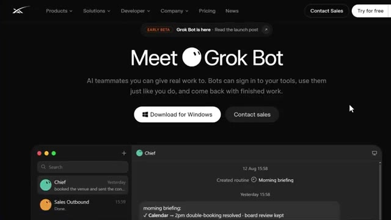
*⏱️ 00:12:30 — Page d'accueil officielle 'Meet Grok Bot' présentant l'assistant IA et ses fonctionnalités sur Windows.*

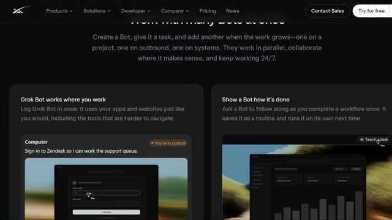
*⏱️ 00:12:36 — Section du site détaillant le fonctionnement de Grok Bot, montrant l'intégration avec les applications et l'option 'Teach a task'.*

---

### ⏱️ `[00:12:41 - 00:13:02]` | Segment #30

**🔊 Audio (Transcription Intégrale Mot pour Mot en Français) :**
> Je vais continuer à tester cela au cours des prochaines semaines et voir comment cela tient face aux conditions réelles du marché. Assurez-vous donc d'être abonnés et d'avoir activé les notifications car je partagerai des mises à jour au fur et à mesure. Et si vous voulez le guide complet étape par étape sur la façon de construire votre propre système de trading agentique en utilisant Claude, cette vidéo apparaît également à l'écran. Allez voir ça ensuite.

**👁️ Analyse Visuelle d'Écran (gemini-3.5-flash-lite) :**
**Interface & Outils** : Interface de chat d'un agent IA et page web de cours en ligne.

**Contenu textuel & Code** : Alertes de marché automatisées, détection d'anomalies de volume, cassures de structure (BOS/ChoCH) et plan de cours de trading par IA.

**Action / Démonstration** : Présentation des résultats du scanner de marché automatisé et promotion du guide complet.

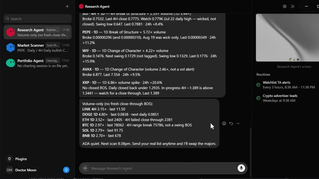
*⏱️ 00:12:47 — Interface d'un agent de recherche affichant des résultats de scan technique sur diverses cryptomonnaies (SUI, PEPE, WIF, AVAX, XRP, LINK, DOGE, ETH, BTC, SOL, BNB).*

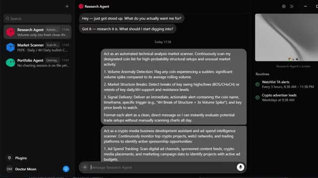
*⏱️ 00:12:52 — Interface de configuration d'un agent IA avec des instructions textuelles pour automatiser l'analyse technique et le scan des marchés.*

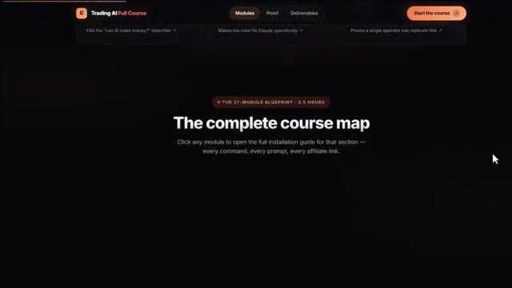
*⏱️ 00:12:57 — Page web du cours "Trading AI Full Course" affichant le plan complet de la formation en 27 modules.*

---

### ⏱️ `[00:13:02 - 00:13:10]` | Segment #31

**🔊 Audio (Transcription Intégrale Mot pour Mot en Français) :**
> Si vous avez trouvé cela utile, laissez un pouce bleu. Cela aide vraiment la chaîne. Abonnez-vous si ce n'est pas déjà fait, et je vous vois dans la prochaine.

**👁️ Analyse Visuelle d'Écran (gemini-3.5-flash-lite) :**
**Interface & Outils** : Aucune

**Contenu textuel & Code** : Aucun

**Action / Démonstration** : Aucune

---

