# 🎬 Claude Sonnet 5.5 Just Outperforms Opus 5.5 (What It Means for AI Trading)

> **Chaîne** : [Alex Carter](https://www.youtube.com/@AlexCarterTrading)  
> **Lien YouTube** : [https://www.youtube.com/watch?v=k1Kz6F2UI10](https://www.youtube.com/watch?v=k1Kz6F2UI10)  
> **Date de publication** : 20260929  
> **Durée** : 00:09:28  
> **Identifiant vidéo** : `k1Kz6F2UI10`  
> **Transcription & Analyse** : `whisper-v3-large-turbo+gemini-3.5-flash-lite`  

---

## 📌 Synthèse Exécutive & Outils

### 💡 Résumé
Anthropic redéfinit les standards du marché avec le lancement de **Claude Sonnet 5.5**, un modèle de milieu de gamme qui bouscule la hiérarchie en surclassant, dans certains benchmarks majeurs, le puissant modèle amiral **Opus 5.5**, tout en affichant une rapidité accrue et des coûts d'utilisation réduits. Cette percée technologique intervient stratégiquement juste avant les annonces d'OpenAI, illustrant une volonté manifeste de s'imposer sur le segment du codage agentique et des tâches structurées à fort volume. Sur le plan technique, Sonnet 5.5 enregistre un score spectaculaire de 70,6 % sur Terminal Bench 4.0, devançant son aîné Opus 5.5 (66,4 %) à son réglage d'effort maximal, tout en s'approchant à seulement deux points de ce dernier sur le benchmark GDP Val AA et CursorBench 4.0. Ces performances se traduisent par une compréhension optimisée des bases de code complexes et un regroupement plus efficace des appels d'outils, validé par des retours industriels majeurs issus d'acteurs comme Epic Games et Slack.

Pour les acteurs du trading quantitatif et du développement algorithmique, cette transition marque un tournant économique et opérationnel décisif. Qu'il s'agisse de concevoir des bots de scalping, d'automatiser des scripts de backtesting ou de structurer des feuilles de calcul pour le suivi de portefeuilles, Sonnet 5.5 offre des performances proches d'Opus pour une fraction du coût, bien que son utilisation intensive de tokens à l'effort maximum (notée par *Artificial Analysis*) nécessite un calibrage précis. L'analyse démontre que l'utilisation de réglages à effort faible ou moyen permet de maximiser la rentabilité opérationnelle, avec une vitesse d'exécution supérieure de 30 % par rapport à la génération précédente. Couplé à des environnements de développement intégrés et à des langages de script dédiés, ce modèle s'impose comme un catalyseur pour l'industrialisation des stratégies de trading autonomes et la gestion rigoureuse du risque.

Face à l'évolution rapide des marchés financiers, la dichotomie entre les traders utilisant l'intelligence artificielle et ceux s'appuyant exclusivement sur des méthodes manuelles ne cesse de se creuser. L'approche présentée démontre qu'une automatisation bien architecturée — intégrant la génération de code en **Pine Script**, le déploiement de **Grok Bots** et le paramétrage de règles strictes de *Risk Management* sur des plateformes comme **TradingView** — confère un avantage compétitif asymétrique. L'utilisation conjointe des écosystèmes d'IA permet non seulement de concevoir, déboguer et optimiser des systèmes de trading agentiques de bout en bout, mais aussi d'abaisser drastiquement la barrière à l'entrée technique pour les opérateurs cherchant à industrialiser leurs prises de décision en temps réel.

### 🛠️ Outils, Modèles & Logiciels Présentés
* **Claude Sonnet 5.5** : Modèle de langage intermédiaire d'Anthropic optimisé pour les tâches bien définies, la correction de bugs et le codage agentique, offrant des performances proches d'Opus à une vitesse supérieure et pour un coût réduit.
* **Claude Opus 5.5** : Modèle amiral d'Anthropic haut de gamme, réservé aux tâches complexes et à forte intensité de jugement stratégique nécessitant un raisonnement ouvert approfondi.
* **Claude Code** : Environnement de développement et d'assistance au codage propulsé par les modèles Claude pour la génération, la refactorisation et l'automatisation de scripts et de bases de code complexes.
* **Terminal Bench 4.0** : Benchmark de référence évaluant les capacités de codage agentique et l'autonomie des modèles dans l'exécution de tâches techniques complexes.
* **CursorBench 4.0** : Outil d'évaluation testant l'efficacité des modèles au cours de sessions de développement réelles et l'optimisation des appels d'outils.
* **Grok Bots** : Assistants conversationnels et agents automatisés utilisés pour la surveillance des flux de marché, l'exécution de stratégies et l'interaction avec des écosystèmes décentralisés.
* **TradingView** : Plateforme de graphisme et d'analyse technique de référence, utilisée pour le déploiement, le test et l'optimisation de stratégies via des scripts dédiés.
* **Pine Script** : Langage de programmation propriétaire de TradingView permettant de coder, backtester et automatiser des indicateurs techniques et des stratégies de trading sur mesure.
* **Hyperliquid** : Protocole de finance décentralisée (DeFi) et plateforme de dérivés, intégrée pour le suivi des grands flux de capitaux (*whale tracking*) et l'exécution de transactions.
* **AI Trade Edge** : Communauté et écosystème de recherche quantitative regroupant des prompts spécialisés, des bots de trading automatisés, des cours de formation agentique et des retours de tests en direct.

### 🔑 Points Clés & Enseignements Stratégiques
1. **Arbitrage de performance entre Sonnet 5.5 et Opus 5.5** : Sonnet 5.5 surpasse Opus 5.5 sur Terminal Bench 4.0 (70,6 % contre 66,4 %) à l'effort maximal, tout en restant légèrement en retrait sur Frontier Code 1.1 (46,2 % contre 54,4 %), imposant une sélection rigoureuse du modèle selon la complexité cognitive requise.
2. **Optimisation des coûts de tokens en production** : Bien que Sonnet 5.5 soit affiché à un tarif unitaire divisé par deux par rapport à Opus, son efficacité réelle varie ; les tests d' *Artificial Analysis* révèlent une consommation de tokens de sortie accrue de 60 % à l'effort maximum, nécessitant l'usage de réglages bas ou moyens pour préserver l'avantage budgétaire.
3. **Gain de vélocité opérationnelle** : Avec une vitesse d'exécution supérieure de 30 % par rapport à la génération précédente et une réduction du nombre d'appels d'outils, Sonnet 5.5 accélère drastiquement l'itération dans la création et le test de scripts de trading.
4. **Industrialisation du code Pine Script** : L'utilisation de Claude Sonnet 5.5 pour générer, auditer et corriger des scripts sur TradingView permet de traduire rapidement des concepts théoriques de trading en algorithmes exécutables et backtestables.
5. **Automatisation du scalping et des bots** : La rapidité de traitement des bases de code complexes favorise le développement et le déploiement de Grok Bots et de systèmes de scalping réactifs capables d'interagir avec des exchanges ou des protocoles décentralisés.
6. **Architecture du Risk Management pilotée par l'IA** : L'intégration de garde-fous stricts dans la génération de code par IA garantit le respect des limites de pertes maximales, du dimensionnement des positions et des ratios risque/rendement avant toute mise en production.
7. **Suivi des flux institutionnels (*Whale Tracking*)** : L'interfaçage des modèles avec des plateformes comme Hyperliquid permet d'analyser en temps réel les mouvements de capitaux importants pour anticiper les retournements de tendance ou les cassures de niveaux clés.
8. **Sécurité et robustesse des déploiements** : Les mesures de protection intégrées par Anthropic (basculement automatique des tâches cybernétiques à hauts risques vers des structures sécurisées et classifieurs anti-distillation) garantissent l'intégrité des infrastructures de trading connectées.
9. **Méthodologie de trading agentique** : L'apprentissage de l'automatisation de bout en bout (de la formulation du prompt stratégique au déploiement en direct sans prérequis en programmation) démocratise l'accès aux stratégies quantitatives autrefois réservées aux fonds professionnels.
10. **Gestion tactique de l'infrastructure technologique** : À l'instar d'une allocation entre actifs au comptant et contrats à terme, la stratégie optimale consiste à basculer dynamiquement entre Sonnet 5.5 (pour les tâches quotidiennes, itérations rapides et corrections de code) et Opus 5.5 (pour les analyses structurelles profondes et le jugement à hauts risques).

---

## ⏱️ Chronologie & Transcription Complète Audio & Visuelle (Mot pour Mot)

### ⏱️ `[00:00:00 - 00:00:26]` | Segment #01

**🔊 Audio (Transcription Intégrale Mot pour Mot en Français) :**
> Anthropic vient de lancer Claude Sonate 5.5 et il bat déjà le plus puissant Opus 5.5 sur certains benchmarks. Et il est moins cher et plus rapide. Donc oui, c'est un événement assez important. Dans cette vidéo, je vais vous montrer tout ce que vous devez savoir sur Sonate 5.5, comment il se compare réellement à Opus 5.5, et pourquoi c'est important si vous utilisez l'IA pour la recherche, l'automatisation, ou pour créer des outils de trading.

**👁️ Analyse Visuelle d'Écran (gemini-3.5-flash-lite) :**
**Interface & Outils** : Site web officiel d'Anthropic (page de présentation de Claude Sonnet 5.5, tableaux et graphiques de benchmarks de performance).

**Contenu textuel & Code** : Scores et métriques de performance sur des benchmarks (Terminal-Bench 4.0, FrontierCode 1.1, CursorBench 4.0, GDPval-AA v2.1, OSWorld 2.1) et courbes de coût par tâche en USD (log scale).

**Action / Démonstration** : Présentation et analyse comparative des performances et des coûts des différents modèles d'intelligence artificielle d'Anthropic.

*⏱️ 00:00:07 — Tableau comparatif des performances de Claude Sonnet 5.5 face à Sonnet 5, Opus 5.5 et GPT-6 Sol sur différents benchmarks d'IA.*

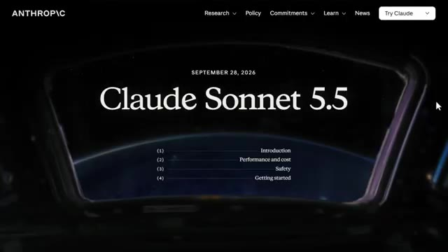
*⏱️ 00:00:13 — Page d'accueil officielle d'Anthropic annonçant le lancement de Claude Sonnet 5.5 en date du 28 septembre 2026.*

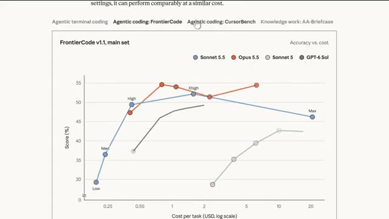
*⏱️ 00:00:19 — Graphique comparatif 'Accuracy vs cost' (Précision par rapport au coût) pour différents modèles de langage sur le benchmark FrontierCode v1.1.*

---

### ⏱️ `[00:00:26 - 00:00:46]` | Segment #02

**🔊 Audio (Transcription Intégrale Mot pour Mot en Français) :**
> Il y a en fait un résultat de test de référence ici qui m'a vraiment surpris. Et je vous montrerai ça dans quelques minutes. Mais d'abord, commençons par ce qui est réellement nouveau. Donc Sonnet 5.5 est le deuxième modèle de la famille Claude 5.5, juste après Opus 5.5. Anthropic positionne celui-ci comme le modèle de tous les jours.

**👁️ Analyse Visuelle d'Écran (gemini-3.5-flash-lite) :**
**Interface & Outils** : Navigateur web affichant un graphique de benchmark de performance et le réseau social X.

**Contenu textuel & Code** : Courbes de performance (Elo vs coût par tâche) comparant Sonnet 5.5, Opus 5.5, Sonnet 5 et GPT-6 Sol ; tweet d'annonce de Claude 5.5.

**Action / Démonstration** : Présentation des résultats de benchmarks et consultation du fil d'actualité concernant le lancement du modèle.

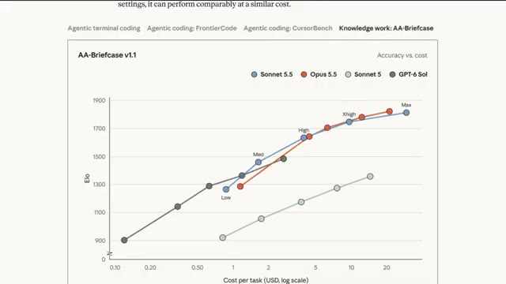
*⏱️ 00:00:31 — Graphique comparatif de performance (AA-Briefcase v1.1) illustrant l'exactitude en fonction du coût pour différents modèles d'IA dont Sonnet 5.5 et Opus 5.5.*

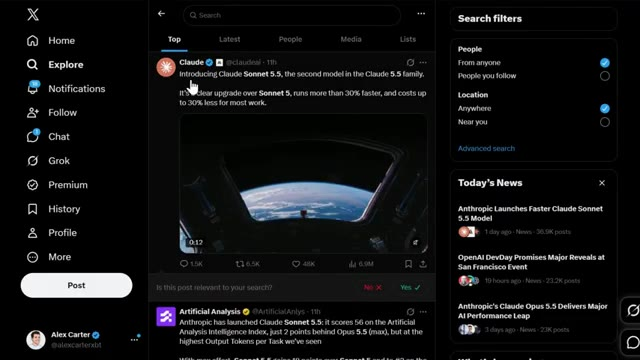
*⏱️ 00:00:36 — Interface du réseau social X montrant une publication officielle du compte Claude (@claudeai) introduisant le nouveau modèle Sonnet 5.5.*

---

### ⏱️ `[00:00:47 - 00:01:12]` | Segment #03

**🔊 Audio (Transcription Intégrale Mot pour Mot en Français) :**
> Opus 5.5 gère le travail complexe qui demande beaucoup de jugement. Et Sonnet 5.5 est conçu pour les tâches bien définies, la correction de bugs, et la création de documents, diaporamas et feuilles de calcul soignés. C'est vraiment un coup fort dans la gamme ici, parce que maintenant vous avez une option moins chère qui ne donne pas l'impression d'être une rétrogradation. Voici le résumé. Il tourne plus de 30 % plus vite que Sonnet 5 et il coûte jusqu'à 30 % moins cher pour la plupart des tâches.

**👁️ Analyse Visuelle d'Écran (gemini-3.5-flash-lite) :**
**Interface & Outils** : Page web de documentation ou d'annonce officielle.

**Contenu textuel & Code** : Texte descriptif introduisant Claude Sonnet 5.5, détaillant ses performances (70.6% sur Terminal-Bench 4.0) et sa complémentarité avec Claude Opus 5.5.

**Action / Démonstration** : Le curseur ou la sélection met en valeur les points clés des capacités du modèle pour l'audience.

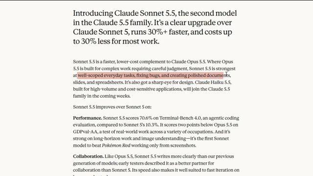
*⏱️ 00:00:54 — Capture d'écran montrant la page de présentation textuelle de Claude Sonnet 5.5, avec une phrase en surbrillance rouge décrivant ses cas d'usage.*

---

### ⏱️ `[00:01:13 - 00:01:34]` | Segment #04

**🔊 Audio (Transcription Intégrale Mot pour Mot en Français) :**
> C'est un saut assez agressif. Et je pense vraiment qu'il s'agit d'Anthropic essayant de garder une longueur d'avance avant les propres annonces d'OpenAI. Mais nous aborderons l'angle concurrentiel un peu plus tard. Première chose, regardons les chiffres parce que c'est là que ça devient intéressant. Sur Terminal Bench 4.0, qui est une évaluation du codage agentique, Sonnet 5,5 obtient un score de 70,6 %.

**👁️ Analyse Visuelle d'Écran (gemini-3.5-flash-lite) :**
**Interface & Outils** : Site web de benchmarks et page d'annonces OpenAI DevDay.

**Contenu textuel & Code** : Tableau de métriques comparatives incluant des scores en pourcentage et en points (Terminal-Bench 4.0, FrontierCode 1.1, CursorBench 4.0, GDPval-AA v2.1, OSWorld 2.1).

**Action / Démonstration** : Présentation des chiffres et des performances comparées des modèles concurrents.

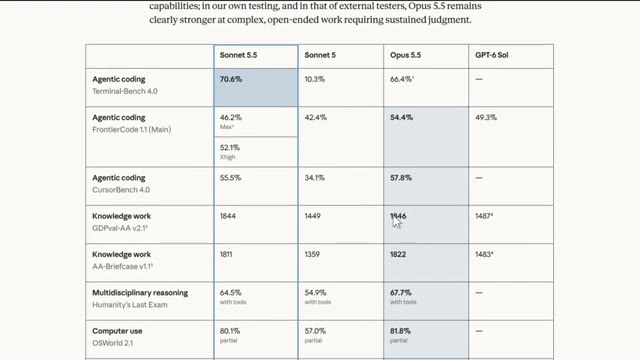
*⏱️ 00:01:24 — Tableau comparatif des performances de différents modèles d'IA (Sonnet 5.5, Sonnet 5, Opus 5.5, GPT-6 Sol) sur divers benchmarks (Agentic coding, Knowledge work, Multidisciplinary reasoning, Computer use).*

---

### ⏱️ `[00:01:35 - 00:02:11]` | Segment #05

**🔊 Audio (Transcription Intégrale Mot pour Mot en Français) :**
> Comparez cela au Sonnet 5, qui se situait à seulement 10,3 %. Ce n'est pas un petit bond. C'est un bond massif. Maintenant, voici la partie surprenante. Opus 5.5 obtient un score de 66,4 % sur ce même étalon de mesure à son réglage d'effort le plus élevé. Donc, sur ce test spécifique, le Sonnet 5.5, le modèle le moins cher, surpasse en réalité l'Opus 5.5. Je ne m'attendais vraiment pas à cela quand je l'ai vu pour la première fois. Mais avant de vous emballer trop, ce n'est qu'un étalon de mesure. Sur Frontier Code 1.1, le Sonnet 5.5 obtient 46,2 %,

**👁️ Analyse Visuelle d'Écran (gemini-3.5-flash-lite) :**
**Interface & Outils** : Document textuel / tableau de benchmarks de performance.

**Contenu textuel & Code** : Scores chiffrés : Sonnet 5.5 (70.6% sur Terminal-Bench 4.0), Sonnet 5 (10.3%), Opus 5.5 (66.4%).

**Action / Démonstration** : Présentation des résultats comparatifs des différents modèles d'IA.

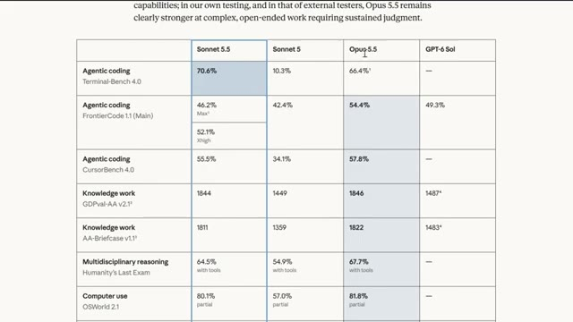
*⏱️ 00:01:44 — Tableau comparatif des performances de différents modèles d'IA (Sonnet 5.5, Sonnet 5, Opus 5.5, GPT-6 Sol) sur divers benchmarks (Agentic coding, Knowledge work, etc.).*

---

### ⏱️ `[00:02:11 - 00:02:29]` | Segment #06

**🔊 Audio (Transcription Intégrale Mot pour Mot en Français) :**
> pendant qu'Opus 5.5 se situe à 54,4 %. Et sur le GDP Val AA, qui évalue le travail du monde réel à travers 44 professions, Sonnet 5.5 arrive à seulement deux points derrière Opus 5.5, avec 1 844 contre 1 846.

**👁️ Analyse Visuelle d'Écran (gemini-3.5-flash-lite) :**
**Interface & Outils** : Document de benchmark ou rapport d'évaluation technique affiché à l'écran.

**Contenu textuel & Code** : Tableau de données montrant des scores de performance en pourcentage et en points (ex. FrontierCode 1.1 à 54,4 % pour Opus 5.5, GDPval-AA v2.1 à 1844 pour Sonnet 5.5 et 1846 pour Opus 5.5).

**Action / Démonstration** : Présentation visuelle et comparaison des résultats de performance des modèles d'intelligence artificielle.

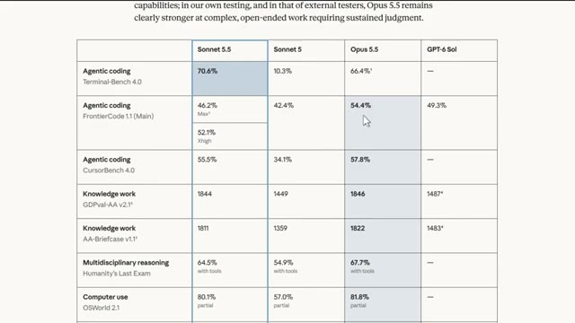
*⏱️ 00:02:15 — Un tableau comparatif des performances de différents modèles d'IA (Sonnet 5.5, Sonnet 5, Opus 5.5, GPT-6 Sol) sur divers benchmarks, notamment Agentic coding, Knowledge work et Computer use.*

---

### ⏱️ `[00:02:30 - 00:02:57]` | Segment #07

**🔊 Audio (Transcription Intégrale Mot pour Mot en Français) :**
> Alors ouais, dans la plupart des domaines, Opus reste le modèle globalement le plus puissant, mais Sonnet 5.5 comble l'écart d'une manière qui compte vraiment pour les utilisateurs soucieux de leur budget. Ensuite, parlons codage, car c'est là qu'une grande partie de l'amélioration se voit vraiment. Sur CursorBench 4.0, qui teste de vraies sessions de codage, Sonnet 5.5 obtient un score de 55,5 %, ce qui se trouve à environ deux points des 57,8 % d'Opus 5.5.

**👁️ Analyse Visuelle d'Écran (gemini-3.5-flash-lite) :**
**Interface & Outils** : Interface web de présentation des benchmarks d'intelligence artificielle (type Anthropic/Claude).

**Contenu textuel & Code** : Tableau de métriques avec des scores sur des benchmarks tels que Agentic coding (FrontierCode 1.1, CursorBench 4.0), Knowledge work, Multidisciplinary reasoning, Computer use et Visual chart recognition. Les valeurs affichées incluent des pourcentages et des scores numériques (ex: Sonnet 5.5 à 46.2%, 55.5%, 1844, etc.).

**Action / Démonstration** : Présentation comparative des performances des modèles d'IA pour illustrer les progrès de Sonnet 5.5 par rapport à Opus 5.5.

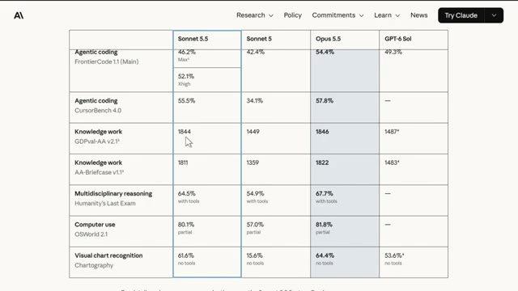
*⏱️ 00:02:37 — Tableau comparatif des performances de différents modèles d'IA incluant Sonnet 5.5, Sonnet 5, Opus 5.5 et GPT-6 Sol.*

---

### ⏱️ `[00:02:58 - 00:03:16]` | Segment #08

**🔊 Audio (Transcription Intégrale Mot pour Mot en Français) :**
> Les premiers testeurs ont noté qu'il comprend les bases de code plus rapidement et groupe les appels d'outils plus efficacement que Sonnet 5, ce qui signifie moins d'étapes et des coûts inférieurs par tâche. Epic Games a effectivement testé ce modèle en avant-première, et leur directeur des opérations a déclaré qu'il atteignait le même niveau de qualité que l'on attend d'un modèle de catégorie supérieure.

**👁️ Analyse Visuelle d'Écran (gemini-3.5-flash-lite) :**
**Interface & Outils** : Navigateur web affichant une page d'évaluation ou un rapport sur les performances du modèle d'IA Sonnet 5.5.

**Contenu textuel & Code** : Texte descriptif sur Sonnet 5.5, scores de performance, et citation d'Epic Games concernant son utilisation sur l'architecture de jeux vidéo.

**Action / Démonstration** : Défilement de la page web pour mettre en évidence les retours des testeurs et des entreprises partenaires (Epic Games).

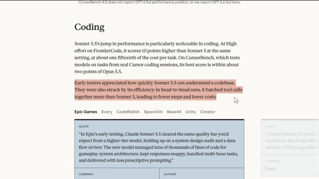
*⏱️ 00:03:03 — Capture d'écran d'un article montrant un paragraphe sur les performances de codage de Sonnet 5.5, avec une phrase surlignée en rouge, suivie d'une citation d'Epic Games.*

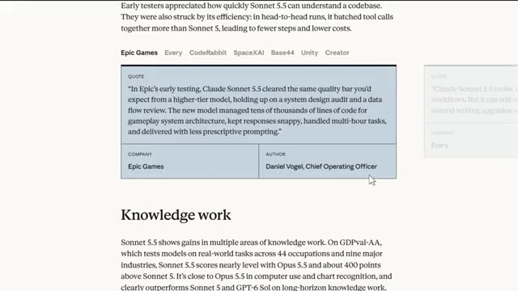
*⏱️ 00:03:12 — Suite de l'article affichant la citation complète d'Epic Games attribuée à Daniel Vogel, Chief Operating Officer, avec la section 'Knowledge work' en dessous.*

---

### ⏱️ `[00:03:16 - 00:03:54]` | Segment #09

**🔊 Audio (Transcription Intégrale Mot pour Mot en Français) :**
> gérer des dizaines de milliers de lignes de code pour l'architecture du jeu tout en gardant des réponses rapides. Slack l'a testé aussi, et sans changer aucun de leurs prompts, Sonnet 5.5 a surpassé Sonnet 5 sur presque toutes leurs évaluations hors ligne en utilisant environ 14 % de tokens de sortie en moins. Donc si vous utilisez l'IA pour vous aider à créer des bots de trading, à automatiser des scripts ou à nettoyer des feuilles de calcul pour le suivi de votre portefeuille, c'est directement pertinent, vous obtenez des résultats proches du niveau d'Opus sans le prix d'Opus. Maintenant, passons aux tarifs parce que c'est là que ça devient encore mieux, Sonnet 5.5 est tarifé

**👁️ Analyse Visuelle d'Écran (gemini-3.5-flash-lite) :**
**Interface & Outils** : Page web de documentation ou de présentation officielle d'Anthropic (Claude AI).

**Contenu textuel & Code** : Témoignage de Curtis Allen (Principal Engineer chez Slack) et tableau comparatif chiffré des performances par benchmark (Terminal-Bench 4.0, FrontierCode, OSWorld 2.1).

**Action / Démonstration** : Présentation des résultats d'évaluations et des retours d'expérience d'entreprises partenaires sur Claude Sonnet 5.5.

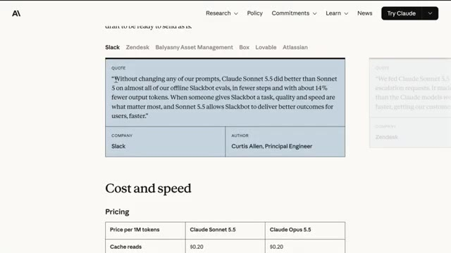
*⏱️ 00:03:26 — Capture d'écran affichant une citation de Slack concernant les performances de Claude Sonnet 5.5, ainsi qu'un tableau des coûts et de la vitesse.*

*⏱️ 00:03:45 — Tableau comparatif des performances de différents modèles d'IA (Sonnet 5.5, Sonnet 5, Opus 5.5, GPT-6 Sol) sur divers benchmarks comme Agentic coding et Knowledge work.*

---

### ⏱️ `[00:03:54 - 00:04:21]` | Segment #10

**🔊 Audio (Transcription Intégrale Mot pour Mot en Français) :**
> exactement la même chose que Sonnet 5, deux dollars par million de jetons en entrée, dix dollars par million de jetons en sortie, et vingt centimes par million de jetons pour les lectures en cache. Comparez cela à Opus 5.5, qui coûte quatre dollars en entrée, vingt dollars en sortie. Donc, Sonnet 5.5 coûte littéralement moitié moins cher qu'Opus 5.5 sur le papier. Mais voici le hic, et je veux être honnête avec vous à ce sujet : l'efficacité des jetons n'est pas aussi simple qu'elle en a l'air.

**👁️ Analyse Visuelle d'Écran (gemini-3.5-flash-lite) :**
**Interface & Outils** : Navigateur web affichant une page de documentation textuelle et tarifaire.

**Contenu textuel & Code** : Tableau tarifaire affichant les coûts pour Cache reads ($0.20), Cache writes ($2.50 pour Sonnet, $5 pour Opus), Input tokens ($2 pour Sonnet, $4 pour Opus) et Output tokens ($10 pour Sonnet, $20 pour Opus), ainsi qu'un texte explicatif sur la rapidité et l'efficacité.

**Action / Démonstration** : Présentation des tarifs comparatifs des différents modèles d'IA pour appuyer l'analyse économique du présentateur.

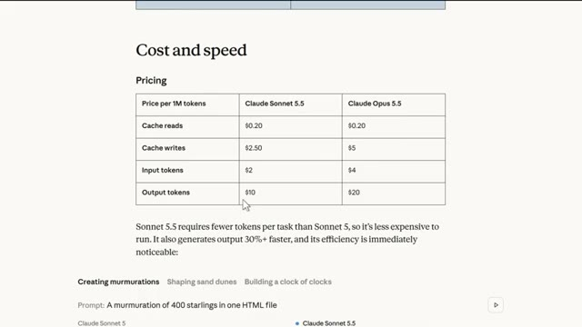
*⏱️ 00:04:01 — Tableau comparatif des coûts par million de jetons entre Claude Sonnet 5.5 et Claude Opus 5.5, avec le curseur de la souris sur la cellule à 10 $.*

---

### ⏱️ `[00:04:22 - 00:04:56]` | Segment #11

**🔊 Audio (Transcription Intégrale Mot pour Mot en Français) :**
> Artificial Analysis a effectivement signalé que Sonnet 5.5 a l'utilisation de jetons la plus lourde qu'ils aient mesurée à l'effort maximum, utilisant 193 000 jetons de sortie par tâche d'indice d'intelligence, soit environ 60 % de plus qu'Opus 5.5 au maximum. Donc, pour égaler les performances du niveau d'Opus, Sonnet 5.5 doit parfois réfléchir beaucoup plus longtemps, ce qui grignote cet avantage de coût en production. C'est vraiment quelque chose à garder à l'esprit avant de supposer qu'il est toujours moins cher en utilisation réelle. Cela dit, à effort faible ou moyen, ce qui est le paramètre par défaut

**👁️ Analyse Visuelle d'Écran (gemini-3.5-flash-lite) :**
**Interface & Outils** : Interface web X (Twitter) et graphique analytique d'Artificial Analysis.

**Contenu textuel & Code** : Graphique comparatif de l'utilisation des jetons par modèle d'IA (ex: Claude Sonnet 5.5, Opus 5.5, Qwen 3.8, etc.) avec des valeurs chiffrées.

**Action / Démonstration** : Présentation et analyse comparative de la consommation de jetons des modèles d'IA.

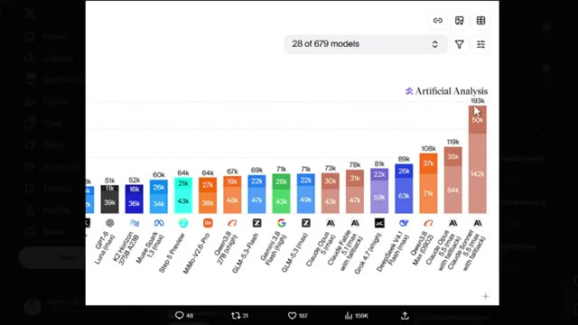
*⏱️ 00:04:30 — Un graphique en barres d'Artificial Analysis montrant l'utilisation des jetons par différents modèles d'IA, avec Claude Sonnet 5.5 au sommet à 193k jetons.*

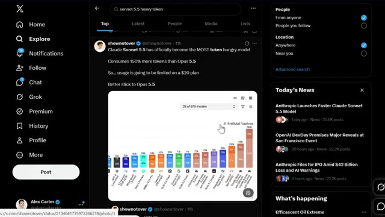
*⏱️ 00:04:47 — Une capture d'écran de l'interface de recherche X (Twitter) affichant un tweet sur la consommation élevée de jetons de Claude Sonnet 5.5.*

---

### ⏱️ `[00:04:56 - 00:05:28]` | Segment #12

**🔊 Audio (Transcription Intégrale Mot pour Mot en Français) :**
> le paramètre que la plupart des gens utilisent réellement, Sonnet 5.5 bat le meilleur score de Sonnet 5 pour environ un dixième du coût par tâche. Donc pour la plupart du travail de tous les jours, vous économisez vraiment de l'argent. Sur la vitesse brute, Sonnet 5.5 génère des résultats plus de 30 % plus rapidement que Sonnet 5, ce qui en fait le modèle Sonnet d'Anthropik le plus rapide à ce jour. Lors de tests comparatifs, pour créer des choses comme des commémorations, des animations, ou une horloge faite d'horloges dans un seul fichier HTML, Sonnet 5.5 finit toujours de manière visiblement plus rapide, tout en utilisant moins

**👁️ Analyse Visuelle d'Écran (gemini-3.5-flash-lite) :**
**Interface & Outils** : Page web de documentation ou de présentation des benchmarks officiels d'Anthropic pour Claude Sonnet 5.5.

**Contenu textuel & Code** : Tableaux de benchmarks chiffrés (pourcentages de réussite et scores) et comparatif visuel en temps réel de génération de code HTML/JavaScript.

**Action / Démonstration** : Présentation des performances comparées et du fonctionnement des différents niveaux d'effort des modèles d'IA.

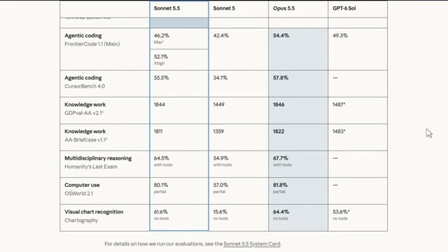
*⏱️ 00:05:04 — Tableau comparatif des performances de différents modèles d'IA (Sonnet 5.5, Sonnet 5, Opus 5.5, GPT-6 Sol) sur plusieurs tâches comme l'agentic coding, le knowledge work, et la reconnaissance visuelle.*

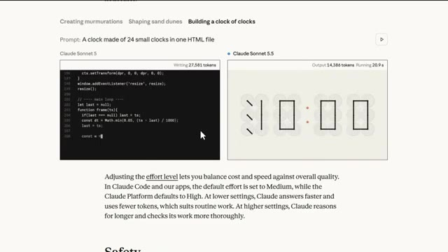
*⏱️ 00:05:20 — Démonstration comparative côte à côte de Claude Sonnet 5 et Claude Sonnet 5.5 générant du code et un rendu visuel interactif basé sur un prompt de création d'horloge.*

---

### ⏱️ `[00:05:28 - 00:06:03]` | Segment #13

**🔊 Audio (Transcription Intégrale Mot pour Mot en Français) :**
> de jetons que Sonnet 5. Donc oui, si vous êtes quelqu'un qui privilégie une itération rapide à de longues chaînes de raisonnement complexes, cela va ressembler à une vraie mise à niveau. Ensuite, nous avons le côté sécurité. Parce que les capacités cybernétiques de Sonnet 5.5 font un bond si important par rapport à Sonnet 5, Anthropik le déploie avec le même genre de mesures de protection utilisées sur Opus 5.5. Les tâches de cybersécurité à haut risque basculeront en fait automatiquement vers Sonnet 5. Les mesures de protection en biologie restent les mêmes qu'avant, et la plupart des recherches de routine, de l'éducation et du travail clinique ne sont pas affectées. C'est aussi le premier modèle Sonnet

**👁️ Analyse Visuelle d'Écran (gemini-3.5-flash-lite) :**
**Interface & Outils** : Tableau de benchmarks et de métriques comparatives affiché à l'écran.

**Contenu textuel & Code** : Scores de performance pour des catégories telles que 'Agentic coding' (Terminal-Bench 4.0, FrontierCode 1.1, CursorBench 4.0), 'Knowledge work', 'Multidisciplinary reasoning', 'Computer use' et 'Visual chart recognition'. Les scores incluent 70.6% pour Sonnet 5.5 contre 10.3% pour Sonnet 5 en codage agentique.

**Action / Démonstration** : Présentation et analyse comparative des résultats de performance des modèles d'IA.

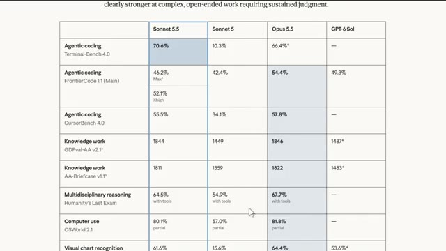
*⏱️ 00:05:36 — Un tableau comparatif des performances de différents modèles d'IA (Sonnet 5.5, Sonnet 5, Opus 5.5, GPT-6 Sol) sur diverses tâches.*

---

### ⏱️ `[00:06:03 - 00:06:26]` | Segment #14

**🔊 Audio (Transcription Intégrale Mot pour Mot en Français) :**
> pour être lancé avec des classifieurs de sécurité contre les attaques par distillation, ce qui représente une sacrée avancée dans le sérieux avec lequel ils traitent ce modèle. Quant à l'accès, Sonnet 5.5 est déjà en ligne sur toutes les plateformes, y compris AWS, Google Cloud et Microsoft Azure. Et vous pouvez commencer dès maintenant avec Claude Sonnet 5.5 sur la plateforme Claude. Voici maintenant la partie qui, selon moi, importe le plus.

**👁️ Analyse Visuelle d'Écran (gemini-3.5-flash-lite) :**
**Interface & Outils** : Navigateur Web affichant la documentation d'Anthropic, la page d'annonce d'AWS et le blog Microsoft Foundry.

**Contenu textuel & Code** : Texte officiel décrivant les classifieurs de sécurité contre la distillation et l'intégration de Sonnet 5.5 sur AWS et Microsoft Foundry.

**Action / Démonstration** : Navigation à l'écran à travers les annonces de lancement et la documentation officielle de Sonnet 5.5 sur différentes plateformes Cloud.

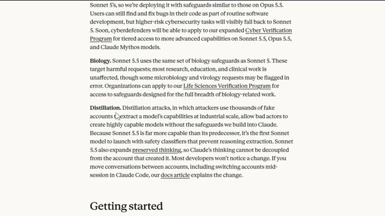
*⏱️ 00:06:09 — Documentation technique d'Anthropic détaillant les protections de sécurité contre les attaques par distillation et l'extraction de raisonnement pour Sonnet 5.5.*

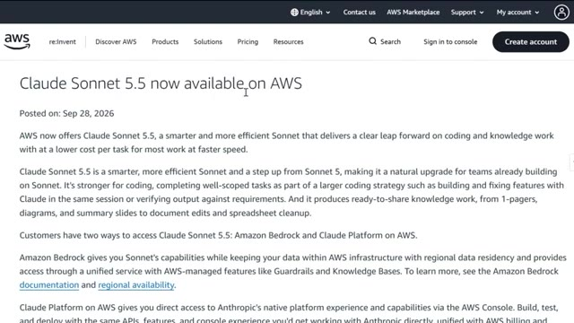
*⏱️ 00:06:15 — Page Web officielle d'AWS annonçant la disponibilité de Claude Sonnet 5.5 sur Amazon Bedrock et la plateforme AWS.*

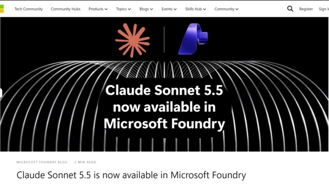
*⏱️ 00:06:21 — Article de blog officiel de Microsoft Foundry annonçant la disponibilité de Claude Sonnet 5.5 sur sa plateforme.*

---

### ⏱️ `[00:06:27 - 00:06:47]` | Segment #15

**🔊 Audio (Transcription Intégrale Mot pour Mot en Français) :**
> Cette sortie arrive juste avant la journée des développeurs d'OpenAI, et honnêtement, je ne pense pas que ce soit une coïncidence. Anthropic est sur une lancée ces derniers temps, et placer Sonnet 5.5 juste avant la grande annonce d'un concurrent est une démonstration de force assez claire. Sonnet 5.5 se positionne actuellement à la 56e place sur l'indice d'intelligence d'Artificial Analysis.

**👁️ Analyse Visuelle d'Écran (gemini-3.5-flash-lite) :**
**Interface & Outils** : Navigateur web affichant le réseau social X (Twitter) et le site d'analyse de modèles d'IA Artificial Analysis.

**Contenu textuel & Code** : Annonce officielle de Claude Sonnet 5.5, comparaisons de performances, scores sur l'Intelligence Index, tarification et métriques d'utilisation des tokens.
[DESC_IMAGE_1] Page d'annonce officielle de l'événement OpenAI DevDay 2026.
[DESC_IMAGE_2] Tweet de l'entreprise Anthropic présentant la sortie de Claude Sonnet 5.5.
[DESC_IMAGE_3] Rapport détaillé d'Artificial Analysis sur les capacités, l'efficacité et les coûts de Claude Sonnet 5.5.

**Action / Démonstration** : Explications face caméra et analyse conceptuelle des marchés.

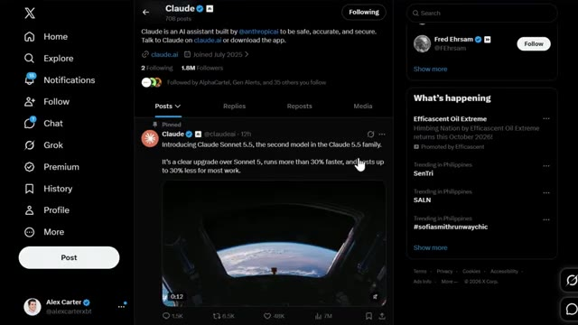
*⏱️ 00:06:37 — Capture du réseau social X (Twitter) montrant le profil officiel de Claude et un tweet épinglé annonçant le lancement de Claude Sonnet 5.5.*

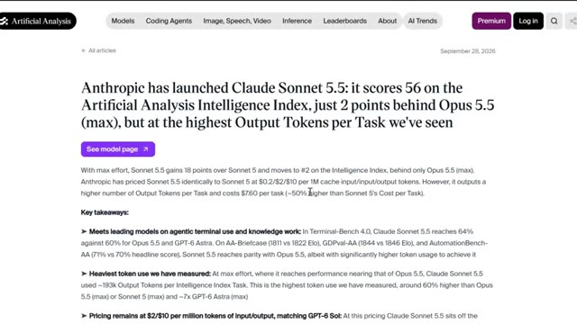
*⏱️ 00:06:42 — Article du site Artificial Analysis analysant les performances et les scores du modèle Claude Sonnet 5.5.*

---

### ⏱️ `[00:06:47 - 00:07:07]` | Segment #16

**🔊 Audio (Transcription Intégrale Mot pour Mot en Français) :**
> C'est la deuxième place au classement général, juste derrière l'Opus 5.5 et trois points devant le Claude Sine 5.1. Il devance aussi le GPT-6 SOL sur presque tous les tests comparatifs présentés ici, pour un prix pratiquement identique. Donc, à l'heure actuelle, selon moi, Anthropic prend clairement la tête dans cette catégorie de poids spécifique.

**👁️ Analyse Visuelle d'Écran (gemini-3.5-flash-lite) :**
**Interface & Outils** : Site web Artificial Analysis (tableaux de bord et graphiques de benchmarks de modèles d'IA).

**Contenu textuel & Code** : Scores de performance, indices d'intelligence, coûts par tâche (USD), et graphiques comparatifs entre modèles (Claude Sonnet 5.5, GPT-6 Astra, etc.).

**Action / Démonstration** : Présentation et analyse des performances comparatives des modèles d'IA sur différents benchmarks et axes de coût.

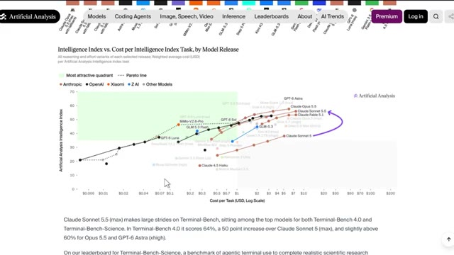
*⏱️ 00:06:52 — Graphique d'analyse comparative comparant l'indice d'intelligence au coût par tâche des différents modèles d'IA sur le site Artificial Analysis.*

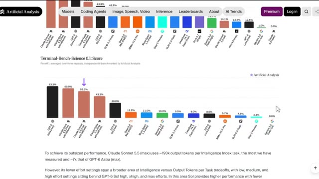
*⏱️ 00:06:57 — Graphique en barres montrant les scores des modèles sur le benchmark Terminal-Bench-Science 0.1, avec des pourcentages de réussite.*

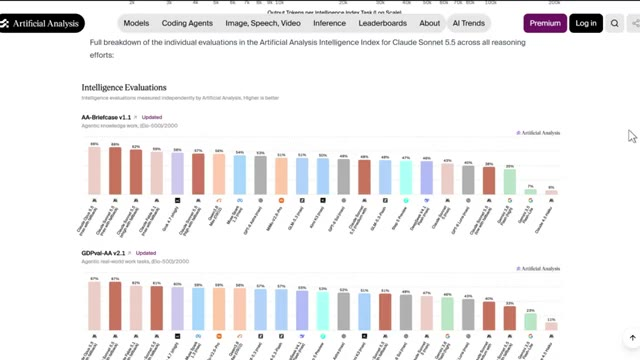
*⏱️ 00:07:02 — Graphiques en barres détaillant les évaluations d'intelligence (AA-Briefcase v1.1 et GDPval-AA v2.1) pour différents modèles de langage.*

---

### ⏱️ `[00:07:07 - 00:07:31]` | Segment #17

**🔊 Audio (Transcription Intégrale Mot pour Mot en Français) :**
> Très bien, et écoutez, pendant les prochaines années, deux types de traders existeront. Ceux qui utilisent l'IA et ceux qui font encore tout manuellement. Même marché, des résultats très différents. Voici comment vous mettre du bon côté. J'ai regroupé tout cela au sein de la communauté AI Trade Edge. Chaque prompt, chaque bot, chaque modèle, chaque guide étape par étape que j'utilise personnellement, le tout en un seul endroit.

**👁️ Analyse Visuelle d'Écran (gemini-3.5-flash-lite) :**
**Interface & Outils** : TradingView, site web de formation Alex Carter Trading (interface sombre avec navigation par étapes).

**Contenu textuel & Code** : Graphique de prix BTCUSDT en bougies japonaises (vertes et rouges), volumes en bas de page, et liste des 78 outils permettant à Claude de contrôler TradingView (lecture de graphiques, données OHLCV, indicateurs techniques, changement de symboles et d'unités de temps).

**Action / Démonstration** : Visualisation du cours du Bitcoin sur un graphique en chandeliers et présentation des capacités d'intégration de l'IA sur TradingView.

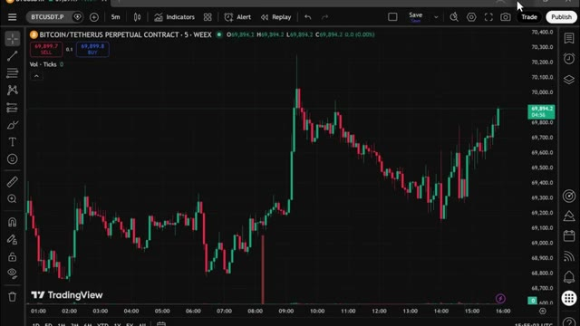
*⏱️ 00:07:19 — Graphique TradingView en chandelier japonais pour le contrat perpétuel BTCUSDT sur l'exchange WEEX en timeframe 5 minutes.*

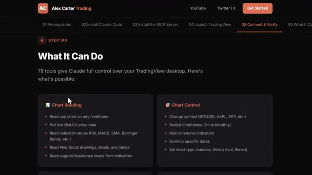
*⏱️ 00:07:25 — Page web de la formation Alex Carter Trading présentant les fonctionnalités de contrôle de TradingView par Claude ("What It Can Do").*

---

### ⏱️ `[00:07:32 - 00:08:07]` | Segment #18

**🔊 Audio (Transcription Intégrale Mot pour Mot en Français) :**
> Et tout ce que je construis à l'avenir est ajouté directement dans le groupe dès sa sortie. Nous testons également des stratégies provenant de tout l'internet, en les automatisant à l'aide de PineScript, en les exécutant en direct, et en partageant exactement ce qui fonctionne et ce qui ne fonctionne pas. Vous n'obtenez donc pas seulement des outils, vous obtenez une opération de recherche en direct à l'intérieur. Il y a aussi un cours complet de trading agentique de 2,5 heures, du débutant à l'expert, sans aucune base en programmation nécessaire. D'ici la fin, vous aurez votre propre système de trading par IA fonctionnant en direct, quelque chose que la plupart des traders particuliers ne savent même pas être possible en ce moment.

**👁️ Analyse Visuelle d'Écran (gemini-3.5-flash-lite) :**
**Interface & Outils** : TradingView, interface web de cours et éditeur Pine Script.

**Contenu textuel & Code** : Graphique de prix BTCUSD, indicateur RSI-VWAP, signaux d'achat/vente colorés et métriques de PnL.
[DESC_IMAGE_2] Analyse de la configuration technique et des signaux de trading sur l'actif Bitcoin.

**Action / Démonstration** : Explications face caméra et analyse conceptuelle des marchés.

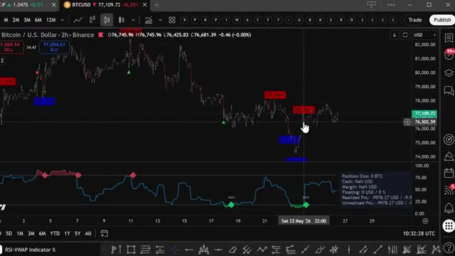
*⏱️ 00:07:49 — Graphique TradingView affichant le cours du Bitcoin (BTCUSD) sur une période de 2 heures avec indicateur technique et signaux d'achat/vente.*

---

### ⏱️ `[00:08:07 - 00:08:41]` | Segment #19

**🔊 Audio (Transcription Intégrale Mot pour Mot en Français) :**
> 79,99 par mois, un seul bon trade suffit à couvrir les frais, et les 100 premiers membres bloquent ce tarif définitivement, après quoi le prix augmentera. Le lien est dans la description. Vous ne pouvez vraiment pas vous permettre de rater ça. Alors, devriez-vous passer d'Opus 5.5 à Sonnet 5.5 ? Définitivement pour les tâches quotidiennes, les corrections de code rapides, le travail sur documents, et tout ce où la vitesse importe plus qu'un raisonnement ouvert et approfondi. Oui, absolument. Mais si vous faites du travail complexe à hauts risques qui nécessite un véritable jugement, Opus 5.5 reste

**👁️ Analyse Visuelle d'Écran (gemini-3.5-flash-lite) :**
**Interface & Outils** : Navigateur web affichant des pages de documentation et de tarification (Whop et Anthropic).

**Contenu textuel & Code** : Tarifs d'abonnement (79,99 $/mois au lieu de 99,99 $), spécifications du modèle Claude Sonnet 5.5, score de 70,6 % sur Terminal-Bench 4.0 et comparaisons avec Opus 5.5.

**Action / Démonstration** : Présentation comparative des modèles d'IA et affichage de l'offre commerciale du formateur.

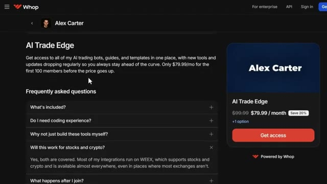
*⏱️ 00:08:15 — Page de tarification Whop montrant l'offre 'AI Trade Edge' d'Alex Carter à 79,99 $/mois.*

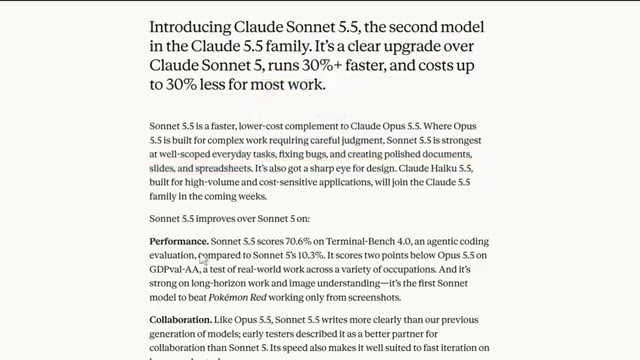
*⏱️ 00:08:33 — Article de présentation de Claude Sonnet 5.5 détaillant ses performances, ses coûts et sa comparaison avec Opus 5.5.*

---

### ⏱️ `[00:08:41 - 00:09:09]` | Segment #20

**🔊 Audio (Transcription Intégrale Mot pour Mot en Français) :**
> clairement la meilleure option. Ce n'est pas vraiment un choix entre l'un ou l'autre. Il s'agit de savoir quand utiliser l'un ou l'autre. Un peu comme savoir quand utiliser le comptant par rapport aux contrats à terme, vous utilisez le bon outil pour la tâche spécifique qui se présente à vous. Quoi qu'il en soit, si vous souhaitez approfondir l'un des outils de Claude que j'ai conçus spécifiquement pour le trading, avec une vue complète des transactions, une visite guidée de Telegram et le suivi des baleines sur Hyperliquid, toutes ces vidéos s'affichent à l'écran en ce moment même. Allez les voir à votre rythme.

**👁️ Analyse Visuelle d'Écran (gemini-3.5-flash-lite) :**
**Interface & Outils** : Page web d'annonce d'Anthropic (Claude), interface de discussion/messagerie et plateforme X (Twitter).

**Contenu textuel & Code** : Texte descriptif de Claude Sonnet 5.5, spécifications de performance (Terminal-Bench 4.0), et logs d'exécution de transactions de trading avec niveaux d'entrée, Stop Loss et Take Profit.

**Action / Démonstration** : Navigation sur la page de documentation de l'IA et visualisation de scripts de trading automatisés exécutant des ordres via une API.

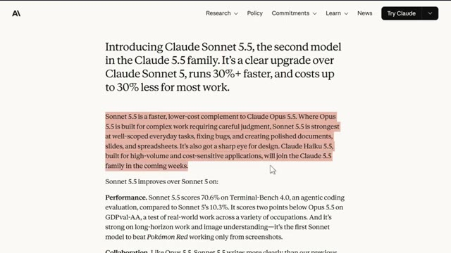
*⏱️ 00:08:55 — Page web de présentation de Claude Sonnet 5.5 décrivant ses performances et ses coûts réduits.*

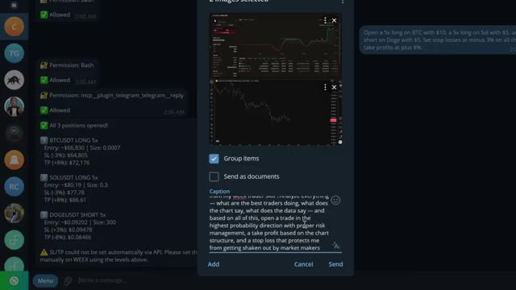
*⏱️ 00:09:02 — Interface de messagerie (type Telegram ou Discord) affichant des ordres de trading automatisés avec des positions en cours sur BTCUSDT, SOLUSDT et DOGEUSDT.*

---

### ⏱️ `[00:09:09 - 00:09:27]` | Segment #21

**🔊 Audio (Transcription Intégrale Mot pour Mot en Français) :**
> Et si vous voulez le guide complet étape par étape sur la façon de construire votre propre système de trading agentique en utilisant Claude, cette vidéo apparaît également à l'écran. Allez la voir ensuite. Si vous avez trouvé cela utile, laissez un pouce bleu. Cela aide vraiment la chaîne. Abonnez-vous si ce n'est pas déjà fait et je vous vois dans la prochaine.

**👁️ Analyse Visuelle d'Écran (gemini-3.5-flash-lite) :**
**Interface & Outils** : Aucune

**Contenu textuel & Code** : Aucun

**Action / Démonstration** : Aucune

---

