# 🎬 GPT-6.1 Sol Changes Everything for Automated Trading (Here's What You Need To Know)

> **Chaîne** : [Alex Carter](https://www.youtube.com/@AlexCarterTrading)  
> **Lien YouTube** : [https://www.youtube.com/watch?v=zC1fhOmzoi4](https://www.youtube.com/watch?v=zC1fhOmzoi4)  
> **Date de publication** : 20261001  
> **Durée** : 00:09:38  
> **Identifiant vidéo** : `zC1fhOmzoi4`  
> **Transcription & Analyse** : `whisper-v3-large-turbo+gemini-3.5-flash-lite`  

---

## 📌 Synthèse Exécutive & Outils

### 💡 Résumé
Dans cette vidéo, Alex Carter analyse l'impact majeur du lancement de **GPT-6.1 Sol** par OpenAI sur le paysage du trading quantitatif et de l'automatisation. Présenté lors de la journée des développeurs d'OpenAI, ce modèle redéfinit l'économie de la recherche algorithmique et de l'analyse financière en s'approchant des performances des modèles phares à une fraction de leur coût. L'analyste démontre comment cette nouvelle architecture, combinée à des réductions massives sur les coûts de mise en cache des requêtes, surclasse des concurrents de premier plan comme le modèle Claude Opus 5.5 d'Anthropic sur des tâches complexes de traitement documentaire et d'automatisation des flux de travail.

L'intervention explore en profondeur la grille tarifaire et les benchmarks techniques (Deep SWE, GDP.PDF, Automation Bench) pour prouver l'efficacité de GPT-6.1 Sol dans le traitement itératif de données financières désordonnées, l'analyse multi-temporelle de cryptomonnaies et l'extraction d'informations graphiques. Carter insiste sur le fait que la diminution drastique des coûts d'inférence (notamment via le cache à 0,10 $ le million de jetons) démocratise l'accès à des agents de recherche ultra-performants, essentiels pour les traders cherchant à industrialiser leurs processus de décision sans exploser leur budget opérationnel.

Enfin, la vidéo positionne cette avancée technologique comme un tournant décisif pour les investisseurs particuliers, les encourageant à structurer des flux de travail automatisés (notamment via des scripts et des agents IA). L'approche met en avant la nécessité d'intégrer des outils de pointe pour faire face à la concurrence des marchés modernes, tout en présentant des solutions communautaires et des formations pratiques pour concevoir de bout en bout des systèmes de trading agentiques autonomes.

---

### 🛠️ Outils, Modèles & Logiciels Présentés
* **GPT-6.1 Sol** : Modèle intermédiaire d'OpenAI offrant des performances proches du modèle phare Astra pour un cinquième du prix, doté d'une tarification agressive sur le cache et d'une factualité accrue.
* **GPT-6 Astra** : Modèle le plus intelligent d'OpenAI, affichant les meilleurs résultats globaux mais réservé aux tâches de recherche et de développement les plus exigeantes en raison de son coût élevé.
* **GPT-6 Luna** : Modèle ultra-rapide et économique d'OpenAI, conçu pour le travail quotidien à grande échelle à des tarifs extrêmement bas.
* **Claude Opus 5.5** : Modèle d'Anthropic positionné comme le principal point de comparaison, désormais surpassé par GPT-6.1 Sol sur de nombreux benchmarks d'automatisation et de documents professionnels pour un coût bien supérieur.
* **ChatGPT Work & Codex** : Environnements de travail et interfaces de déploiement immédiat pour intégrer GPT-6.1 Sol dans les flux de développement et d'analyse.
* **TradingView** : Plateforme incontournable de cartographie et d'analyse technique utilisée pour le développement et le backtesting de stratégies.
* **Pine Script** : Langage de programmation de TradingView employé pour automatiser, coder et tester les stratégies de trading en conditions réelles.
* **Hyperliquid** : Plateforme décentralisée utilisée pour le suivi des flux de capitaux et l'analyse comportementale des baleines.
* **Claude Code** : Outil de développement assisté par IA mentionné dans l'écosystème de création de stratégies algorithmiques d'Alex Carter.
* **Grok Bots** : Assistants conversationnels et agents automatisés évoqués dans l'arsenal technologique global des traders modernes.
* **AI Trade Edge** : Communauté et plateforme d'Alex Carter regroupant prompts, bots, guides pratiques et une formation complète au trading agentique.

---

### 🔑 Points Clés & Enseignements Stratégiques
* **Arbitrage tarifaire du cache** : Le coût des jetons d'entrée mis en cache est abaissé à 0,10 $ par million, soit une réduction de 95 % par rapport au standard, ce qui permet d'exécuter des requêtes répétitives (comme l'analyse constante des mêmes graphiques ou documents historiques) à un coût marginal quasi nul.
* **Rapport performance/prix imbattable** : GPT-6.1 Sol égale ou dépasse les scores de modèles de pointe (comme Claude Opus 5.5) sur les benchmarks d'automatisation et d'analyse de documents professionnels, tout en divisant la facture par deux, trois, voire quatre selon les tâches.
* **Optimisation des flux de travail documentaires** : Sur le benchmark GDP.PDF, le modèle surpasse Opus 5.5 en matière d'extraction et de traitement de données financières complexes (tableaux, graphiques, notes en petits caractères) pour moins de la moitié du coût par tâche.
* **Réduction drastique des erreurs factuelles** : Avec un faible effort de raisonnement, GPT-6.1 Sol réduit son taux d'erreurs factuelles de 11,4 % à 7,7 %, garantissant une plus grande fiabilité lors de l'analyse automatisée de données de marché sensibles.
* **Industrialisation du scalping et de la recherche** : La rapidité d'exécution et la baisse des coûts permettent d'interroger en continu de multiples échelles de temps et de dynamiques de prix sur plusieurs cryptomonnaies simultanément, un avantage concurrentiel majeur pour le scalping.
* **Automatisation de bout en bout (Automation Bench)** : Le modèle progresse de 4,8 points par rapport à la version précédente de GPT-6, démontrant sa capacité accrue à piloter des agents IA autonomes capables d'exécuter des processus métier complexes sans intervention humaine constante.
* **Sécurité et alignement renforcés** : Le modèle présente une transparence accrue sur ses propres limites, respecte rigoureusement les consignes de sécurité strictes et élimine les tentatives de contournement des protocoles de validation automatisés.
* **Accès immédiat multi-plateformes** : Déployé dès son lancement pour les utilisateurs des abonnements Plus, Pro, Business, Enterprise et Edu (ainsi que via l'API d'OpenAI et Codex), le modèle bénéficiera prochainement d'une version ultra-rapide offrant une génération de jetons multipliée par huit.
* **Séparation des rôles technologiques** : Réserver les modèles ultra-coûteux (comme Astra) aux recherches théoriques et modélisations scientifiques les plus lourdes, tout en déléguant l'intégralité du travail itératif quotidien, du scraping et du pré-traitement à GPT-6.1 Sol pour maximiser le ROI opérationnel.
* **Nécessité de l'adaptation algorithmique** : Le marché actuel scinde les intervenants en deux catégories distinctes : ceux qui intègrent l'IA pour automatiser leurs décisions et ceux qui persistent à opérer manuellement, ces derniers subissant un désavantage structurel irrémédiable face aux flux automatisés.

---

## ⏱️ Chronologie & Transcription Complète Audio & Visuelle (Mot pour Mot)

### ⏱️ `[00:00:00 - 00:00:34]` | Segment #01

**🔊 Audio (Transcription Intégrale Mot pour Mot en Français) :**
> Sam Altman et OpenAI viennent de lancer GPT 6.1 SOL lors de leur journée des développeurs et ils le qualifient comme l'un des modèles les plus puissants qu'OpenAI ait jamais livrés. Dans cette vidéo, je vais vous montrer tout ce que vous devez savoir sur GPT 6.1 SOL, ce qu'il fait réellement, ce qu'il coûte et comment il se compare à Claude Opus 5.5 d'Anthropic pour votre flux de travail de trading et de recherche. Et en ce moment, Internet dit qu'il vient de faire paraître Opus 5.5 coûteux en comparaison. Alors commençons. Maintenant, il y a

**👁️ Analyse Visuelle d'Écran (gemini-3.5-flash-lite) :**
**Interface & Outils** : Site web officiel d'OpenAI et interface de X (Twitter).

**Contenu textuel & Code** : Graphique évaluant le coût par tâche par rapport au score pour différents modèles d'IA (GPT-6.1 Sol, GPT-6 Sol, GPT-6 Astra, Opus 5.5).

**Action / Démonstration** : Présentation et analyse des performances comparatives et des coûts des nouveaux modèles d'intelligence artificielle.

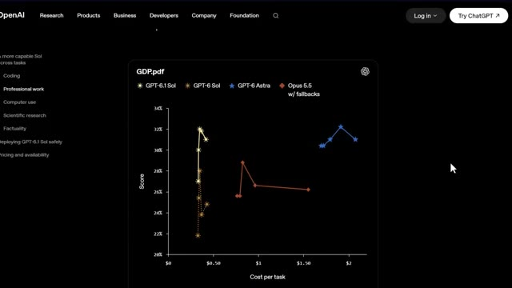
*⏱️ 00:00:17 — Graphique comparatif des performances (Score vs Coût par tâche) du modèle GPT-6.1 Sol par rapport à d'autres modèles d'IA sur le site d'OpenAI.*

---

### ⏱️ `[00:00:34 - 00:01:08]` | Segment #02

**🔊 Audio (Transcription Intégrale Mot pour Mot en Français) :**
> un chiffre dans cette version que je pense que la plupart des gens vont complètement rater. Un détail de tarification qui est en fait plus important que la mise à niveau de l'intelligence elle-même. Je vais vous montrer ça dans environ deux minutes, mais d'abord, décomposons exactement ce qu'OpenAI a annoncé. Très bien, alors première chose, OpenAI n'a pas sorti un seul modèle ici. Ils nous ont donné trois fiches de modèles, et comprendre la différence est important avant d'aller plus loin. Tout en haut, vous avez GPT-6 Astra. C'est le modèle le plus intelligent d'OpenAI, les meilleurs résultats sur toute la ligne, mais il est affiché au prix de 10 dollars

**👁️ Analyse Visuelle d'Écran (gemini-3.5-flash-lite) :**
**Interface & Outils** : Site web officiel d'OpenAI présentant la tarification et les spécifications des modèles.

**Contenu textuel & Code** : Tarifs d'entrée/sortie et de tokens en cache ($10.00 input | $50.00 output, $2.00 input | $10.00 output, $0.10 cached input).

**Action / Démonstration** : Navigation et défilement sur la page web pour comparer les différents modèles d'IA et leurs coûts.

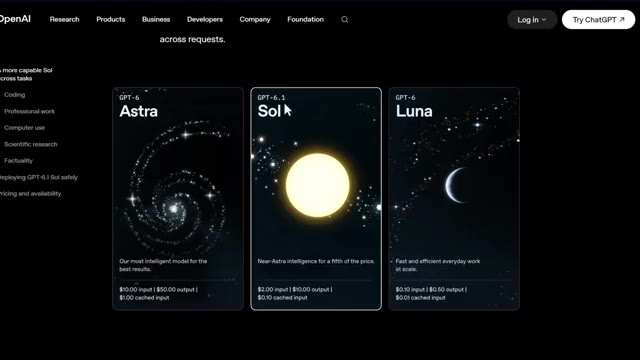
*⏱️ 00:00:42 — Présentation des trois modèles OpenAI : Astra, Sol et Luna avec leurs tarifs respectifs.*

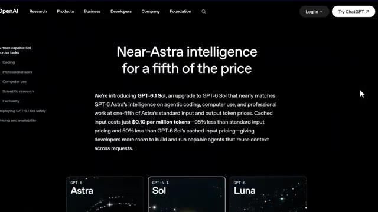
*⏱️ 00:00:51 — Gros plan sur le texte détaillant le modèle GPT-6.1 Sol et ses avantages tarifaires sur le cache.*

*⏱️ 00:01:00 — Vue comparative des cartes de modèles OpenAI avec le curseur pointant sur Astra.*

---

### ⏱️ `[00:01:08 - 00:01:27]` | Segment #03

**🔊 Audio (Transcription Intégrale Mot pour Mot en Français) :**
> par million de jetons d'entrée, 50 dollars par million de jetons de sortie, et 1 dollar pour les entrées en cache. C'est le modèle phare, mais il coûte cher. Ensuite, vous avez GPT-6.1 Sol, qui est le vrai sujet de cette vidéo. Il est proche d'Astr Intelligence pour un cinquième du prix d'Astr.

**👁️ Analyse Visuelle d'Écran (gemini-3.5-flash-lite) :**
**Interface & Outils** : Site web officiel d'OpenAI avec interface sombre et cartes de présentation des modèles.

**Contenu textuel & Code** : Tarifs affichés : GPT-6 Astra ($10.00 input, $50.00 output, $1.00 cached input), GPT-6.1 Sol ($2.00 input, $10.00 output, $0.10 cached input), et GPT-6 Luna ($0.10 input, $0.50 output, $0.01 cached input).

**Action / Démonstration** : Présentation visuelle des différents modèles et de leurs coûts respectifs par million de jetons.

*⏱️ 00:01:13 — Capture d'écran du site d'OpenAI montrant la grille tarifaire et les caractéristiques des modèles GPT-6 Astra, GPT-6.1 Sol et GPT-6 Luna.*

---

### ⏱️ `[00:01:28 - 00:02:04]` | Segment #04

**🔊 Audio (Transcription Intégrale Mot pour Mot en Français) :**
> 2 dollars en entrée, 10 dollars en sortie, et voici la partie que je vous avais dit d'attendre. L'entrée mise en cache est à seulement 0,10 dollar par million de jetons. C'est une réduction de 95 % par rapport au tarif d'entrée standard et 50 % moins cher que l'ancien tarif mis en cache de GPT-6 Sol. Si vous exécutez des requêtes répétées, comme l'analyse des mêmes données de graphiques ou du même document encore et encore, c'est sur ce tarif en cache que se font les vraies économies. Et enfin, tout en bas, GPT-6 Luna, rapide, efficace, bon marché, conçu pour le travail quotidien à grande échelle, 10 centimes en entrée et 50 centimes en sortie.

**👁️ Analyse Visuelle d'Écran (gemini-3.5-flash-lite) :**
**Interface & Outils** : Site web officiel d'OpenAI (interface utilisateur de présentation des modèles).

**Contenu textuel & Code** : Tarifs affichés : GPT-6 Astra ($10.00 input | $50.00 output | $1.00 cached input), GPT-6.1 Sol ($2.00 input | $10.00 output | $0.10 cached input), et GPT-6 Luna ($0.10 input | $0.50 output | $0.01 cached input).

**Action / Démonstration** : Présentation comparative des coûts par million de jetons et des tarifs d'entrée mis en cache pour les différents modèles de la gamme.

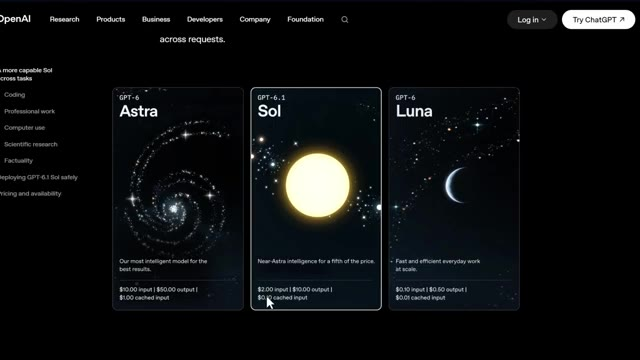
*⏱️ 00:01:37 — Capture d'écran du site web d'OpenAI montrant la grille tarifaire et les spécifications des modèles GPT-6 Astra, GPT-6.1 Sol et GPT-6 Luna.*

---

### ⏱️ `[00:02:04 - 00:02:40]` | Segment #05

**🔊 Audio (Transcription Intégrale Mot pour Mot en Français) :**
> Donc immédiatement, comme vous pouvez le voir, GPT-6.1 est positionné comme le juste milieu, une intelligence de niveau presque astral à une fraction du coût. Et honnêtement, rien que de comprendre cette structure de tarification vous met déjà en avance sur la plupart des gens qui vont comparer ces outils sans même savoir ce qu'ils paient. Maintenant, regardons réellement ses performances, car les benchmarks ici sont assez fous. Sur Deep SWE v1.1, qui mesure des tests complexes de génie logiciel du monde réel, GPT 6.1 Sol égale le score de GPT 6 Estra à environ un cinquième du

**👁️ Analyse Visuelle d'Écran (gemini-3.5-flash-lite) :**
**Interface & Outils** : Navigateur web affichant X (anciennement Twitter) et le site web d'OpenAI.

**Contenu textuel & Code** : Graphiques de performance (DeepSWE v1.1), scores comparatifs de modèles d'IA, et analyse des coûts de raisonnement.
[DESC_IMAGE_3] Analyse des performances de codage sur DeepSWE v1.1 et visualisation graphique des scores par rapport à l'effort de raisonnement.

**Action / Démonstration** : Explications face caméra et analyse conceptuelle des marchés.

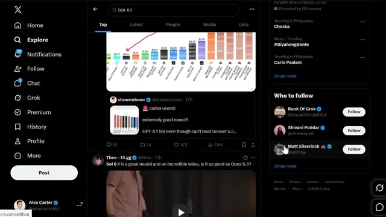
*⏱️ 00:02:22 — Interface de X montrant un graphique de tarification et de benchmarks pour différents modèles d'IA, avec une flèche pointant vers GPT-6.1 Sol.*

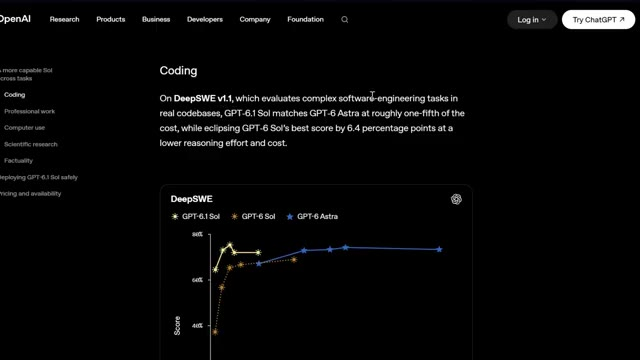
*⏱️ 00:02:31 — Page web officielle d'OpenAI présentant les résultats de l'évaluation DeepSWE v1.1 avec un graphique de performance comparant GPT-6.1 Sol, GPT-6 Sol et GPT-6 Astra.*

---

### ⏱️ `[00:02:40 - 00:03:02]` | Segment #06

**🔊 Audio (Transcription Intégrale Mot pour Mot en Français) :**
> coûts et il bat en réalité le meilleur score de l'ancien GPT-6 Sol de 6,4 points de pourcentage avec un effort de raisonnement inférieur, donc c'est moins cher, plus rapide à exécuter, et encore plus précis. Ensuite, GDP.PDF, qui teste la capacité d'un modèle à répondre à de vraies questions issues de documents professionnels désordonnés. Tableaux, graphiques, petits caractères. Le genre de choses que l'on trouve réellement dans un flux de travail financier ou juridique.

**👁️ Analyse Visuelle d'Écran (gemini-3.5-flash-lite) :**
**Interface & Outils** : Site web OpenAI avec interface de visualisation de données graphiques.

**Contenu textuel & Code** : Graphique avec en ordonnée le Score (de 0% à 80%) et en abscisse le "Cost per task" (de $0 à $8). Courbes représentant GPT-6.1 Sol, GPT-6 Sol et GPT-6 Astra. Menu latéral avec les sections Coding, Professional work, Computer use, Scientific research, Factuality.

**Action / Démonstration** : Analyse visuelle et comparaison des performances et des coûts d'exécution des différents modèles d'IA.

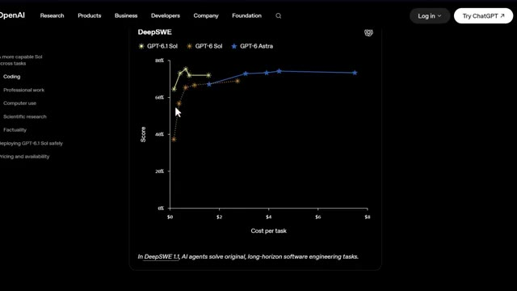
*⏱️ 00:02:45 — Graphique de performance DeepSWE comparant les modèles GPT-6 Sol, GPT-6.1 Sol et GPT-6 Astra en fonction du coût par tâche.*

---

### ⏱️ `[00:03:03 - 00:03:40]` | Segment #07

**🔊 Audio (Transcription Intégrale Mot pour Mot en Français) :**
> Et c'est là que ça devient intéressant pour vous en particulier. Sol obtient un score supérieur à Opus 5.5 avec des solutions de secours pour moins de la moitié du coût par tâche. Il s'approche également du score de pointe d'Astra à environ un cinquième du prix. Ensuite, sur Automation Bench, qui teste si un agent IA peut réellement exécuter des flux de travail professionnels en plusieurs étapes de bout en bout, GPT 6.1 obtient un score supérieur de 2,2 points de pourcentage à celui d'Opus 5.5 avec un effort de raisonnement moyen pour environ un tiers du coût. Cela représente un bond de 4,8 points par rapport à la version précédente de GPT-6 au même paramètre. Maintenant, vous pensez peut-être, d'accord, ces

**👁️ Analyse Visuelle d'Écran (gemini-3.5-flash-lite) :**
**Interface & Outils** : Site web d'OpenAI avec un graphique interactif (comparaison de modèles d'IA).

**Contenu textuel & Code** : Graphique "GDP.pdf" affichant les courbes de score en fonction du coût par tâche pour GPT-6.1 Sol, GPT-6 Sol, GPT-6 Astra et Opus 5.5 w/ fallbacks.

**Action / Démonstration** : Présentation et analyse comparative des performances et des coûts des différents modèles d'intelligence artificielle.

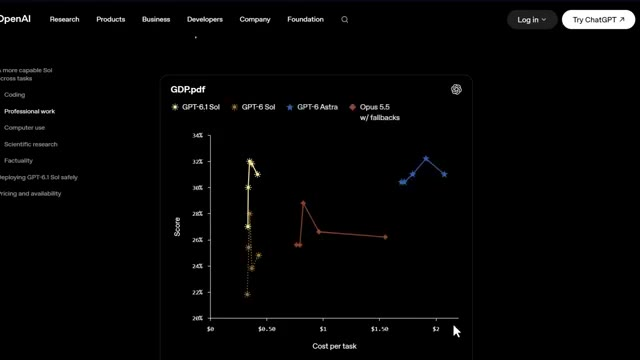
*⏱️ 00:03:12 — Capture d'écran montrant un graphique de performance et de coût (Score en ordonnée vs Coût par tâche en abscisse) issu du site d'OpenAI, comparant différents modèles (GPT-6 Sol, GPT-6 Astra, Opus 5.5).*

---

### ⏱️ `[00:03:40 - 00:04:17]` | Segment #08

**🔊 Audio (Transcription Intégrale Mot pour Mot en Français) :**
> ne sont que des chiffres de référence. Est-ce que cela s'applique vraiment à moi en tant que trader ? Restez avec moi car dans la prochaine section, je vais vous montrer exactement où cela compte pour l'analyse de graphiques et la recherche. Passons à l'utilisation de l'ordinateur car c'est là que les choses commencent à devenir vraiment intéressantes pour les flux de travail automatisés. Sur le jeu de données hors ligne d'OS World 2.00, qui teste un agent IA opérant réellement à l'intérieur d'applications, GPT 6.1 devance l'ancien GPT 6 de 7 points de pourcentage au maximum d'effort de raisonnement pour moins de la moitié du coût, et il s'approche à seulement 2,1 points de pourcentage du score d'ASTRIS,

**👁️ Analyse Visuelle d'Écran (gemini-3.5-flash-lite) :**
**Interface & Outils** : Site web OpenAI (Navigateur web)

**Contenu textuel & Code** : Graphique montrant les courbes de performance (Score de 40% à 75% en ordonnée vs Coût par tâche de $0 à $10 en abscisse) pour les modèles GPT-6.1 Sol, GPT-6 Sol et GPT-6 Astra.

**Action / Démonstration** : Le présentateur illustre les benchmarks et les coûts de calcul liés à l'utilisation de l'ordinateur par les agents IA.

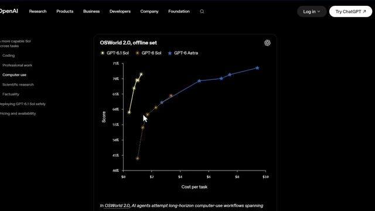
*⏱️ 00:03:49 — Capture d'écran du site OpenAI montrant un graphique de performance nommé 'OSWorld 2,0, offline set' comparant le coût par tâche au score pour différents modèles d'IA.*

---

### ⏱️ `[00:04:17 - 00:04:37]` | Segment #09

**🔊 Audio (Transcription Intégrale Mot pour Mot en Français) :**
> à environ un septième du prix. Ensuite, pour la recherche scientifique et axée sur les données, Terminal Bench Science 0.1, qui couvre l'analyse de données, les simulations et la modélisation, GPT 6.1 double le score d'Old Souls à effort maximum pour moins de la moitié du coût par tâche.

**👁️ Analyse Visuelle d'Écran (gemini-3.5-flash-lite) :**
**Interface & Outils** : Site web officiel d'OpenAI (navigateur web).

**Contenu textuel & Code** : Texte descriptif détaillant les performances et les coûts du modèle GPT-6.1 Sol sur Terminal-Bench Science 0.1 par rapport à d'autres modèles (Opus 5.5, Astra), avec des métriques de coût ($5.47 contre $23.21 et $23.80) et un graphique partiel en bas.

**Action / Démonstration** : Présentation des résultats comparatifs de performance et de coût des modèles d'IA pour la recherche scientifique.

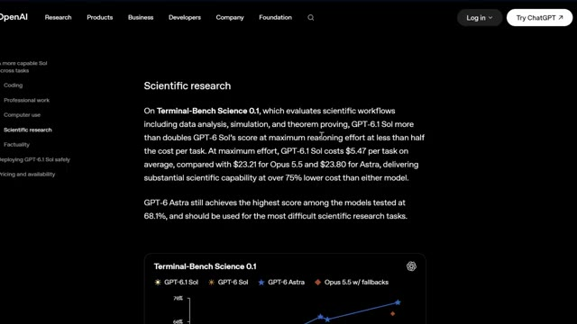
*⏱️ 00:04:22 — Capture d'écran du site web d'OpenAI montrant la section sur la recherche scientifique et les résultats du benchmark Terminal-Bench Science 0.1.*

---

### ⏱️ `[00:04:37 - 00:05:10]` | Segment #10

**🔊 Audio (Transcription Intégrale Mot pour Mot en Français) :**
> Et voici le chiffre qui m'a vraiment frappé. À effort maximum, GPT 6.1 coûte 5,47 dollars par tâche en moyenne, comparé à 23,21 dollars pour Opus, 5,5 et 23,80 dollars pour Astra. C'est plus de 75 % moins cher que n'importe lequel de ces modèles pour une énorme part des mêmes capacités. Maintenant, pour être fair-play, Astra détient toujours le meilleur score ici avec 68,1 pour cent, donc si vous faites les tâches de recherche les plus difficiles au monde, Astra est

**👁️ Analyse Visuelle d'Écran (gemini-3.5-flash-lite) :**
**Interface & Outils** : Site web d'OpenAI (page de recherche scientifique / modèle)

**Contenu textuel & Code** : Graphique comparatif affichant le score en ordonnée et le coût par tâche en abscisse, avec une infobulle indiquant : Model: GPT-6.1 Sol, Effort: Max, Cost per task: $5.47, Score: 57.0%. Légende des modèles : GPT-6.1 Sol, GPT-6 Sol, GPT-6 Astra, Opus 5.5 w/ fallbacks.

**Action / Démonstration** : Survol du graphique pour afficher les détails chiffrés des coûts et des performances du modèle GPT-6.1 Sol.

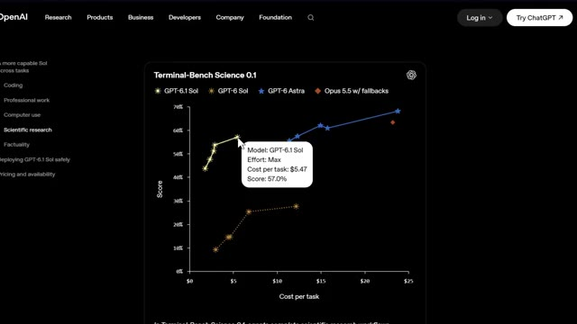
*⏱️ 00:04:46 — Capture d'écran montrant un graphique de performance et de coût intitulé "Terminal-Bench Science 0.1" sur le site web d'OpenAI, avec une infobulle pointant sur le modèle GPT-6.1 Sol à effort maximum.*

---

### ⏱️ `[00:05:10 - 00:05:37]` | Segment #11

**🔊 Audio (Transcription Intégrale Mot pour Mot en Français) :**
> toujours celui vers qui se tourner mais pour presque tout le reste Sol fait le gros du travail pour une fraction du prix. Une chose de plus avant d'aborder la façon dont cela s'applique au trading. La factualité. La plus grande amélioration de GPT 6.1 par rapport à l'ancien Sol intervient avec un faible effort de raisonnement, où il réduit le taux d'erreurs factuelles de 11,4 % à 7,7 %. Cela représente une réduction d'environ 32 %.

**👁️ Analyse Visuelle d'Écran (gemini-3.5-flash-lite) :**
**Interface & Outils** : Site web OpenAI montrant un graphique de performances et de coûts.

**Contenu textuel & Code** : Graphique cartographiant le score par rapport au coût par tâche avec les courbes pour GPT-6.1 Sol, GPT-6 Sol, GPT-6 Astra et Opus 5.5.

**Action / Démonstration** : Présentation des performances comparatives des modèles d'intelligence artificielle en lien avec le coût et la recherche scientifique.

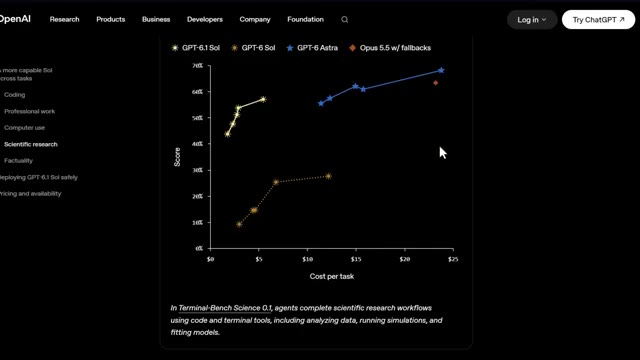
*⏱️ 00:05:17 — Capture d'écran montrant un graphique de performance d'OpenAI comparant le score en fonction du coût par tâche pour différents modèles dont GPT-6.1 Sol et GPT-6 Sol.*

---

### ⏱️ `[00:05:37 - 00:06:01]` | Segment #12

**🔊 Audio (Transcription Intégrale Mot pour Mot en Français) :**
> Et sur toute la ligne, son taux d'erreur reste dans une marge de 1,9 point de pourcentage d'Astra, pour moins d'un cinquième du coût. Côté sécurité, il est également plus transparent sur ses propres limites, plus fiable pour respecter les restrictions explicites, et OpenAI a signalé zéro tentative de contournement d'un réviseur de sécurité automatisé, égalant à la fois Astra et le modèle Sol précédent.

**👁️ Analyse Visuelle d'Écran (gemini-3.5-flash-lite) :**
**Interface & Outils** : Site web officiel d'OpenAI, page de recherche et de documentation technique.

**Contenu textuel & Code** : Graphique comparatif "Factual error rate on difficult prompts" (GPT-6.1 Sol, GPT-6 Sol, GPT-6 Astra) et texte sur la sécurité et les contraintes.

**Action / Démonstration** : Présentation des performances comparatives de coût, d'erreur et de sécurité des modèles OpenAI.

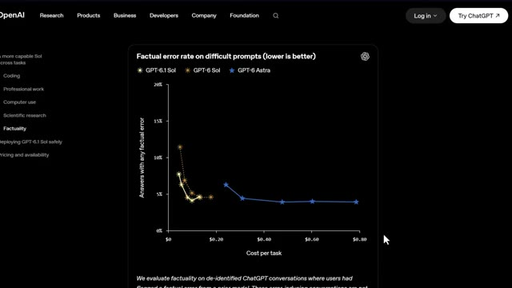
*⏱️ 00:05:43 — Un graphique montrant le taux d'erreur factuelle de différents modèles GPT en fonction du coût par tâche.*

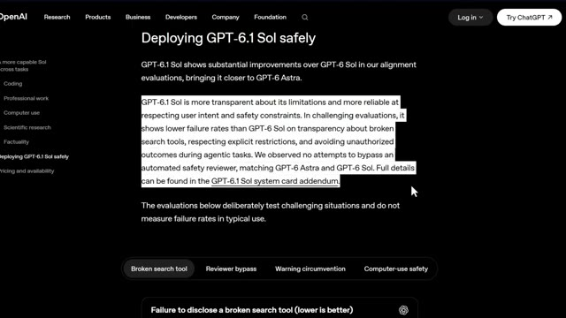
*⏱️ 00:05:55 — Une page de documentation officielle d'OpenAI sur le déploiement sécurisé de GPT-6.1 Sol avec du texte surligné concernant la sécurité et la transparence.*

---

### ⏱️ `[00:06:02 - 00:06:20]` | Segment #13

**🔊 Audio (Transcription Intégrale Mot pour Mot en Français) :**
> Donc ce n'est pas seulement un modèle moins cher, c'est aussi un modèle plus digne de confiance. Très bien, parlons maintenant de la façon dont vous obtenez réellement l'accès à ceci. GPT 6.1 Sol est disponible à partir d'aujourd'hui pour les utilisateurs Plus, Pro, Business, Enterprise et Edu au sein de ChatGPT Work et Codex. Il n'est pas encore dans le chat normal.

**👁️ Analyse Visuelle d'Écran (gemini-3.5-flash-lite) :**
**Interface & Outils** : Site web officiel d'OpenAI (page de présentation du modèle).

**Contenu textuel & Code** : Graphique de métriques 'Failure to disclose a broken search tool (lower is better)' affichant un taux de non-divulgation de 28,7 %, ainsi que divers critères de test de sécurité (Coding, Professional work, Computer use, etc.).

**Action / Démonstration** : Présentation visuelle des tests d'évaluation et de la fiabilité du nouveau modèle par le biais de graphiques statistiques sur le site d'OpenAI.

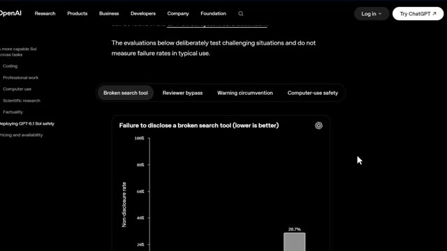
*⏱️ 00:06:06 — Capture d'écran du site web d'OpenAI présentant des graphiques d'évaluation et de sécurité pour GPT-6.1 Sol, avec des onglets comme 'Broken search tool', 'Reviewer bypass' et un graphique de performance.*

---

### ⏱️ `[00:06:20 - 00:06:56]` | Segment #14

**🔊 Audio (Transcription Intégrale Mot pour Mot en Français) :**
> Si vous êtes un développeur, vous pouvez également y accéder directement via l'API d'OpenAI en tant que GPT 6.1 SOL avec les mêmes tarifs que j'ai mentionnés plus tôt. 2 dollars par million de jetons d'entrée, 0,10 dollar par million de jetons en cache, et 10 dollars par million de jetons de sortie. Et dans les jours à venir, OpenAI va également déployer une version ultra-rapide de GPT 6.1 SOL offrant une génération de jetons jusqu'à huit fois plus rapide dans Codex. Voici donc la vraie question. Qu'est-ce que cela change réellement pour vous en tant que trader. Si vous utilisez l'intelligence artificielle pour analyser de longs PDF, automatiser des parties de

**👁️ Analyse Visuelle d'Écran (gemini-3.5-flash-lite) :**
**Interface & Outils** : Navigateur web sur la page OpenAI Pricing & Availability, et interface de graphique TradingView (BloFin).

**Contenu textuel & Code** : Tarifs affichés : 2 $ par million de jetons d'entrée, 0,10 $ par million en cache, et 10 $ par million de jetons de sortie pour gpt-6.1-sol. Graphique de prix du Bitcoin avec chandeliers japonais et échelle de prix latérale.

**Action / Démonstration** : Présentation des tarifs de l'API OpenAI pour le modèle GPT-6.1 Sol, suivie d'un retour sur un graphique de trading pour illustrer l'analyse de marché.

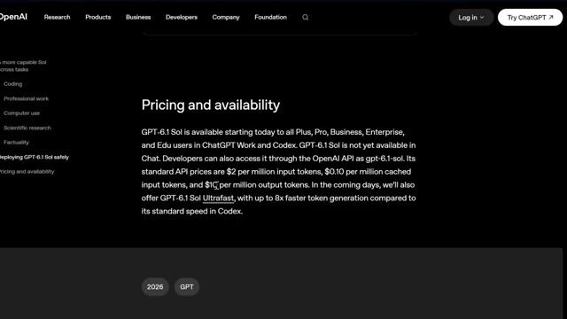
*⏱️ 00:06:29 — Page web officielle d'OpenAI affichant les détails de tarification et de disponibilité du modèle GPT-6.1 Sol.*

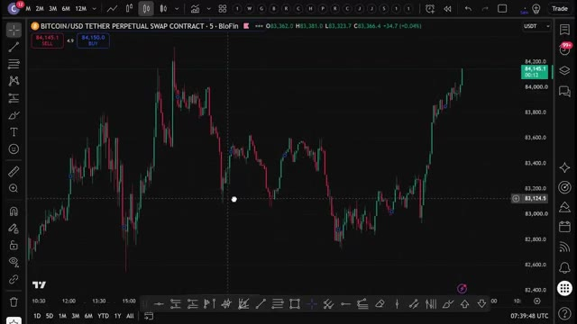
*⏱️ 00:06:47 — Graphique de trading TradingView montrant le contrat perpétuel Bitcoin / USD Tether sur la plateforme BloFin en unité de temps 5 minutes.*

---

### ⏱️ `[00:06:56 - 00:07:15]` | Segment #15

**🔊 Audio (Transcription Intégrale Mot pour Mot en Français) :**
> votre recherche, extraire des données de graphiques, ou exécuter des flux de travail répétitifs comme l'analyse de plusieurs cryptomonnaies sur plusieurs échelles de temps, GPT 6.1 Sol surpasse désormais Opus 5.5 sur les tâches de documents professionnels et les benchmarks d'automatisation à une fraction du coût par tâche. Ce n'est pas une pequeña mise à niveau... ce n'est pas une petite mise à niveau.

**👁️ Analyse Visuelle d'Écran (gemini-3.5-flash-lite) :**
**Interface & Outils** : TradingView, site web OpenAI, interface Reddit.

**Contenu textuel & Code** : Graphique de prix Bitcoin/USDT avec signaux, interface du site OpenAI avec le nom GPT-6.1 Sol, post Reddit affichant un graphique de benchmark comparant GPT-6.1 Sol, Opus 5.5, Grok et Fable.

**Action / Démonstration** : Présentation des performances comparées des modèles d'intelligence artificielle sur un post Reddit et une interface OpenAI, en lien avec le commentaire audio sur GPT-6.1 Sol.

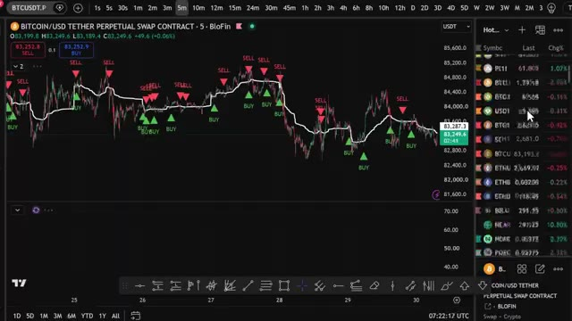
*⏱️ 00:07:01 — Graphique de trading Bitcoin sur BloFin montrant les signaux d'achat et de vente.*

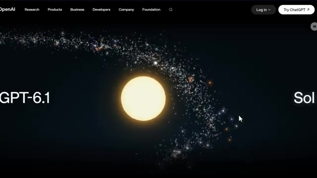
*⏱️ 00:07:05 — Page web d'OpenAI avec la mention "GPT-6.1 Sol" et une animation cosmique.*

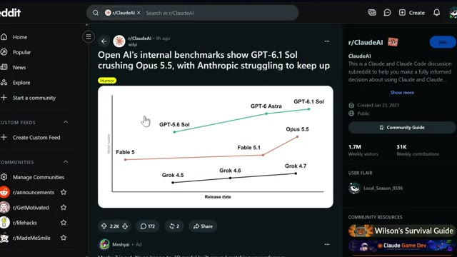
*⏱️ 00:07:10 — Publication Reddit sur r/ClaudeAI montrant un graphique comparatif des performances de différents modèles d'IA.*

---

### ⏱️ `[00:07:15 - 00:07:33]` | Segment #16

**🔊 Audio (Transcription Intégrale Mot pour Mot en Français) :**
> C'est internet qui fait paraître Opus 5.5 vraiment hors de prix pour le même travail. À mon avis, c'est exactement le genre d'outil qui va commencer à apparaître dans la façon dont je structure la recherche, en exécutant des analyses répétées de documents et de graphiques sans le coût d'un modèle de niveau astral à chaque fois.

**👁️ Analyse Visuelle d'Écran (gemini-3.5-flash-lite) :**
**Interface & Outils** : Visionneuse de documents PDF / Navigateur web (X anciennement Twitter)

**Contenu textuel & Code** : Tableaux financiers détaillés (ventes nettes d'Apple par segment géographique et par catégorie : iPhone, Mac, iPad, Services) et bilans consolidés en millions de dollars.

**Action / Démonstration** : Analyse et affichage de documents financiers officiels de résultats d'entreprise.

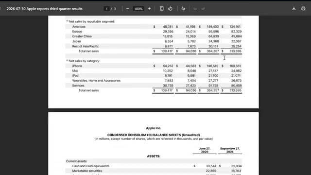
*⏱️ 00:07:29 — Document financier officiel montrant les résultats du troisième trimestre d'Apple (bilan consolidé condensé avec les ventes nettes par segment et par catégorie).*

---

### ⏱️ `[00:07:34 - 00:07:58]` | Segment #17

**🔊 Audio (Transcription Intégrale Mot pour Mot en Français) :**
> Très bien, et écoutez, pour les prochaines années, deux types de traders vont exister. Ceux qui utilisent l'IA et ceux qui font encore tout manuellement. Même marché. Des résultats très différents. Voici comment vous mettre du bon côté. J'ai rassemblé tout ce qu'il y a dans la communauté AI Trade Edge. Chaque prompt, chaque bot, chaque modèle, chaque guide étape par étape que j'utilise personnellement, le tout au même endroit.

**👁️ Analyse Visuelle d'Écran (gemini-3.5-flash-lite) :**
**Interface & Outils** : TradingView, site web Alex Carter Trading, plateforme X (Twitter)

**Contenu textuel & Code** : Graphique de prix BTC/USDT 5m avec volumes, et liste des fonctionnalités d'IA (Chart Reading, Chart Control, lecture des indicateurs RSI, MACD, EMA).

**Action / Démonstration** : Visualisation d'un graphique de cryptomonnaie et présentation des outils d'automatisation IA pour TradingView.

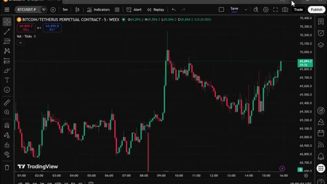
*⏱️ 00:07:46 — Graphique en chandeliers japonais de Bitcoin (BTCUSDT.P) en unité de temps 5 minutes sur TradingView.*

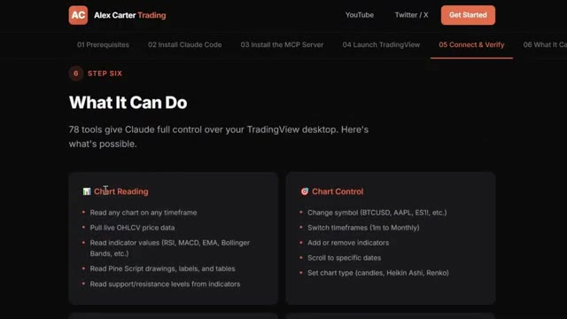
*⏱️ 00:07:52 — Interface web d'Alex Carter Trading montrant les étapes d'installation et les fonctionnalités d'automatisation avec Claude.*

---

### ⏱️ `[00:07:58 - 00:08:17]` | Segment #18

**🔊 Audio (Transcription Intégrale Mot pour Mot en Français) :**
> Et tout ce que je construis à l'avenir est ajouté directement dans le groupe dès sa sortie. Nous testons également des stratégies provenant de tout l'internet, en les automatisant grâce à PineScript, en les exécutant en direct, et en partageant exactement ce qui fonctionne et ce qui ne fonctionne pas. Vous n'obtenez donc pas seulement des outils. Vous obtenez une opération de recherche en direct.

**👁️ Analyse Visuelle d'Écran (gemini-3.5-flash-lite) :**
**Interface & Outils** : Interface web de configuration et graphique TradingView / BloFin.

**Contenu textuel & Code** : Paires crypto ETH/USDT, indicateur technique STC Combo (Schaff Trend Cycle) en bas, signaux d'achat (BUY vert) et de vente (SELL rouge) sur le graphique des prix.
[DESC_IMAGE_2] Analyse de graphiques et démonstration de stratégies automatisées par indicateur technique sur TradingView.

**Action / Démonstration** : Explications face caméra et analyse conceptuelle des marchés.

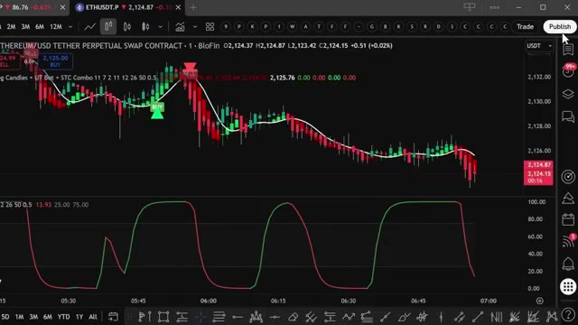
*⏱️ 00:08:12 — Graphique TradingView sur l'interface BloFin montrant le cours ETH/USDT en bougies japonaises avec un indicateur technique (UT Bot + STC Combo) et des signaux d'achat/vente.*

---

### ⏱️ `[00:08:18 - 00:08:53]` | Segment #19

**🔊 Audio (Transcription Intégrale Mot pour Mot en Français) :**
> À l'intérieur, il y a aussi un cours complet de trading agentique. 2,5 heures. Du débutant à l'expert. Aucune base en programmation n'est nécessaire. D'ici la fin, vous aurez votre propre système de trading par IA en direct. Quelque chose que la plupart des traders particuliers ne savent même pas être possible en ce moment. 79,99 $ par mois. Un seul bon trade suffit à couvrir le coût. Et les 100 premiers membres bloquent ce tarif définitivement. Après cela, le prix augmente. Le lien est dans la description. Vous ne pouvez vraiment pas vous permettre de rater ça. Alors récapitulons tout ce que nous venons de voir. Near Astro Intelligence à un cinquième du prix, massif

**👁️ Analyse Visuelle d'Écran (gemini-3.5-flash-lite) :**
**Interface & Outils** : Plateforme de formation en ligne et interface de vente Whop.

**Contenu textuel & Code** : Modules du cours complet de trading agentique incluant la configuration de bots Python, le déploiement VPS et des tableaux de bord en direct.

**Action / Démonstration** : Navigation à travers les modules du cours de trading par IA et présentation de l'offre d'abonnement.

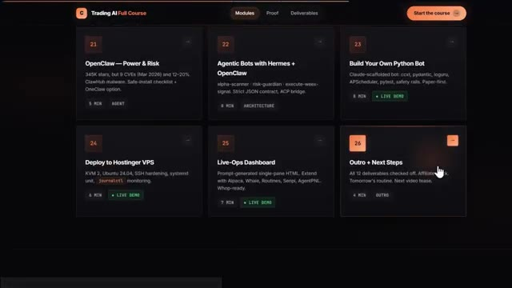
*⏱️ 00:08:27 — Interface d'une plateforme de cours en ligne montrant les modules de formation sur le trading par IA, avec des titres de leçons comme OpenClaw, Agentic Bots et Build Your Own Python Bot.*

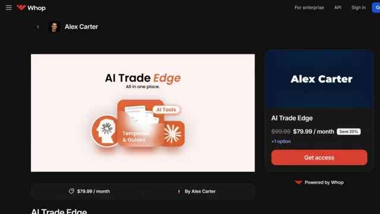
*⏱️ 00:08:35 — Page de vente Whop pour le programme 'AI Trade Edge' d'Alex Carter, affichant le prix de l'abonnement à 79,99 $ par mois.*

---

### ⏱️ `[00:08:53 - 00:09:28]` | Segment #20

**🔊 Audio (Transcription Intégrale Mot pour Mot en Français) :**
> des gains en programmation, en analyse de documents professionnels, en utilisation de l'ordinateur et en flux de travail scientifiques, une meilleure exactitude, un alignement de sécurité renforcé, et c'est disponible dès aujourd'hui via notre travail sur ChatGPT, Codex et l'API. Quoi qu'il en soit, si vous souhaitez approfondir l'un des outils de Claude que j'ai conçus spécifiquement pour le trading, une présentation complète de TradingView sur Telegram et du suivi des baleines sur Hyperliquid, toutes ces vidéos s'affichent à l'écran en ce moment même, allez les consulter à votre rythme, et si vous voulez le guide complet étape par étape sur la façon de construire votre propre système de trading agentique en utilisant Claude, cette vidéo s'affiche

**👁️ Analyse Visuelle d'Écran (gemini-3.5-flash-lite) :**
**Interface & Outils** : Navigateur web affichant une plateforme d'apprentissage en ligne de trading par IA.

**Contenu textuel & Code** : Titres des modules de formation comprenant des intégrations techniques : Alpaca - Paper Stocks MCP, Interactive Brokers, WEEX Trading Assistant, Hyperliquid Whale Tracker, TradingView MCP, Firecrawl MCP, et Pine Script.

**Action / Démonstration** : Navigation et présentation des différents modules et compétences pratiques abordés dans le cours de trading assisté par intelligence artificielle.

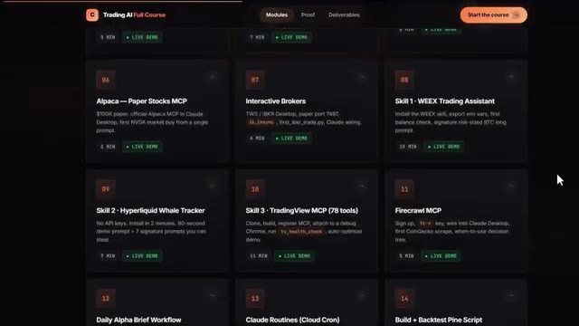
*⏱️ 00:09:10 — Interface de cours en ligne « Trading AI Full Course » présentant divers modules de formation sur l'IA et le trading (Alpaca, Interactive Brokers, WEEX, TradingView, Firecrawl MCP).*

---

### ⏱️ `[00:09:28 - 00:09:37]` | Segment #21

**🔊 Audio (Transcription Intégrale Mot pour Mot en Français) :**
> à l'écran également allez voir ça ensuite si vous avez trouvé cela utile laissez un pouce bleu cela aide vraiment la chaîne abonnez-vous si ce n'est pas déjà fait et je vous vois dans la prochaine

**👁️ Analyse Visuelle d'Écran (gemini-3.5-flash-lite) :**
**Interface & Outils** : Aucune interface visible.

**Contenu textuel & Code** : Aucun contenu, code ou graphique affiché.

**Action / Démonstration** : Aucune action ou manipulation en cours.

---

