# 🎬 How I Built an Automated 5-Minute Intraday Indicator Using Claude Code (Beginner Tutorial)

> **Chaîne** : [Alex Carter](https://www.youtube.com/@AlexCarterTrading)  
> **Lien YouTube** : [https://www.youtube.com/watch?v=hScSXKPRbyw](https://www.youtube.com/watch?v=hScSXKPRbyw)  
> **Date de publication** : 20261003  
> **Durée** : 00:10:17  
> **Identifiant vidéo** : `hScSXKPRbyw`  
> **Transcription & Analyse** : `whisper-v3-large-turbo+gemini-3.5-flash-lite`  

---

## 📌 Synthèse Exécutive & Outils

### 💡 Résumé
Cette vidéo de la chaîne Alex Carter propose une méthode de day trading intraday sur un horizon de 5 minutes, conçue pour combler l'écart entre l'attente prolongée des placements à long terme et le stress intense du scalping à court terme. La stratégie repose sur la synergie de trois indicateurs techniques universels et accessibles : le VWAP (Volume Weighted Average Price) pour identifier le prix de juste valeur et repérer les extensions de marché, le RSI (14) agissant comme filtre de momentum pour confirmer les zones de surachat (>70) ou de survente (<30), et l'indicateur de volume couplé à une moyenne mobile sur 30 périodes pour valider la force institutionnelle du mouvement. Qu'il s'agisse de cryptomonnaies (Bitcoin, Ethereum, Solana), d'actions, de forex ou de contrats à terme, la configuration cherche à exploiter les retournements de tendance lorsque le prix casse le VWAP en direction opposée à son extension, appuyé par un volume significatif et un RSI sortant des extrêmes.

Au-delà de l'approche discrétionnaire manuelle, le cœur de la démonstration réside dans l'automatisation de cette stratégie sans aucune compétence en programmation. Grâce à l'utilisation de l'assistant IA Claude Code, l'auteur traduit la logique mathématique des indicateurs en un script Pine Script complet et fonctionnel pour TradingView. Le code généré permet de tracer automatiquement des triangles de signal (verts pour l'achat, rouges pour la vente) directement sur les bougies du graphique. En configurant des alertes automatisées, le trader s'affranchit de la surveillance constante des écrans, transformant une méthode technique classique en un système d'alerte ou d'exécution prêt pour le trading algorithmique.

Pour exécuter ces stratégies dans des conditions optimales, la vidéo met en avant des plateformes d'échange adaptées aux contrats à terme USDT-M, telles que Blowfin (sans KYC obligatoire pour le trading de base et généreux bonus de dépôt) et Mexi (alternatives aux paires variées avec un KYC rapide). L'architecture de la méthode intègre une gestion des risques rigoureuse basée sur une marge isolée pour limiter l'exposition, des leviers modérés de 5x à 10x pour les débutants, un placement de stop-loss au-delà du récent pivot déclencheur, et un ratio risque/rendement fixé entre 1:1,5 et 1:2. L'écosystème présenté débouche ainsi sur une transition fluide entre analyse technique, prototypage par intelligence artificielle et mise en place opérationnelle sur les marchés.

### 🛠️ Outils, Modèles & Logiciels Présentés
* **Claude Code** : Assistant de développement par intelligence artificielle utilisé pour traduire une stratégie de trading en langage Pine Script prêt à l'emploi.
* **TradingView** : Plateforme de graphisme boursier incontournable servant à l'analyse technique, au test des indicateurs et à l'exécution du code Pine Script via l'éditeur dédié.
* **Pine Script** : Langage de programmation propriétaire de TradingView permettant de créer des indicateurs personnalisés, des scripts de backtesting et des alertes automatisées.
* **Blowfin** : Échangeur de cryptomonnaies orienté contrats à terme, privilégié pour son absence de KYC obligatoire pour le trading de base et ses bonus de dépôt.
* **Mexi** : Plateforme d'échange alternative offrant une grande profondeur de paires de trading, la bascule entre services centralisés et dérivés décentralisés, et des avantages pour les nouveaux utilisateurs.
* **VWAP (Volume Weighted Average Price)** : Indicateur technique de référence mesurant le prix moyen pondéré par le volume pour identifier la juste valeur institutionnelle de la session.
* **RSI (Relative Strength Index)** : Oscillateur de momentum standard paramétré sur une longueur de 14, utilisé pour filtrer les zones de surachat et de survente extrêmes.
* **Indicateur de Volume avec Moyenne Mobile (30 périodes)** : Outil de confirmation de tendance mesurant l'intensité des flux financiers par rapport à leur moyenne historique.

### 🔑 Points Clés & Enseignements Stratégiques
* **Horizon temporel optimal** : L'utilisation d'unités de temps de 5 minutes offre un juste milieu idéal en day trading, permettant d'entrer et sortir de positions rapidement sans subir la pression psychologique et la réactivité extrême du scalping pur.
* **Universalité des marchés** : La configuration technique présentée ne se limite pas à un seul actif ; elle s'applique avec la même efficacité au Bitcoin, à l'Ethereum, à Solana, ainsi qu'aux marchés traditionnels du forex, des actions et des contrats à terme.
* **Logique du VWAP** : Le VWAP sert de boussole de juste valeur quotidienne. Lorsque le prix s'en écarte de manière significative, il se trouve en zone d'extension, préparant le terrain pour un retour opportun vers la moyenne.
* **Filtrage par le RSI** : Le RSI (14) confirme la validité du mouvement en s'assurant que le prix ne dessine pas une simple mèche aléatoire, mais qu'il atteint des seuils de survente (<30) ou de surachat (>70) avant d'amorcer son retournement.
* **Validation par le volume** : Aucune entrée n'est considérée comme valide sans l'approbation du volume ; la barre active doit obligatoirement dépasser la moyenne mobile des volumes sur 30 périodes dans la direction de la bougie pour attester d'une réelle implication des gros capitaux.
* **Configuration d'achat (Long)** : Un signal haussier est validé lorsque le prix évolue sous le VWAP puis le traverse à la hausse, que le RSI sort de la zone de survente (<30) en repartant vers le haut, et que le volume dépasse sa moyenne avec une bougie verte.
* **Configuration de vente (Short)** : Un signal baissier requiert un prix évoluant au-dessus du VWAP qui redescend en le traversant, un RSI sortant de la zone de surachat (>70) vers le bas, et un volume supérieur à sa moyenne couplé à une bougie rouge.
* **Gestion rigoureuse du risque** : L'utilisation exclusive de la marge isolée est fortement recommandée pour les débutants afin de compartimenter le risque et d'interdire toute contamination des pertes à l'ensemble du portefeuille.
* **Contrôle de l'effet de levier** : Pour préserver le capital lors de l'apprentissage, un effet de levier modéré compris entre 5x et 10x est conseillé sur les contrats à terme USDT-M, en attendant de maîtriser parfaitement la volatilité du sous-jacent.
* **Placement des stops et ratio R:R** : Le stop-loss doit être placé méthodiquement juste au-delà du récent point haut ou point bas déclencheur, en visant systématiquement un ratio risque/rendement minimal compris entre 1:1,5 et 1:2.
* **Prototypage par IA sans code** : L'intégration de Claude Code permet d'automatiser la traduction d'une stratégie textuelle en code Pine Script fonctionnel en quelques secondes, éliminant la barrière de la programmation informatique pour les traders particuliers.
* **Optimisation du temps par les alertes** : L'automatisation du traçage des signaux graphiques (triangles verts et rouges) couplée au système d'alertes de TradingView libère le trader de la surveillance obsessionnelle des écrans, garantissant une réactivité immédiate dès que toutes les conditions du setup sont réunies.

---

## ⏱️ Chronologie & Transcription Complète Audio & Visuelle (Mot pour Mot)

### ⏱️ `[00:00:00 - 00:00:33]` | Segment #01

**🔊 Audio (Transcription Intégrale Mot pour Mot en Français) :**
> Si vous ne supportez pas d'attendre des jours qu'un placement se concrétise, mais que vous ne voulez pas non plus du stress d'être un spéculateur à court terme invétéré, il y a en fait un juste milieu. Cela s'appelle le day trading, où vous entrez et sortez en quelques minutes, et non en quelques jours, mais sans la pression du temps de réaction d'un scalpeur. Donc, dans cette vidéo, je vais vous donner une stratégie de day trading de cinq minutes utilisant seulement trois indicateurs auxquels vous avez probablement déjà accès. Cette stratégie fonctionne sur n'importe quel marché. Donc, que vous fassiez du crypto, des actions, du forex ou des contrats à terme, celle-ci est pour vous. Et restez

**👁️ Analyse Visuelle d'Écran (gemini-3.5-flash-lite) :**
**Interface & Outils** : Interface de trading BloFin intégrée avec les graphiques TradingView.

**Contenu textuel & Code** : Graphique en chandeliers du Bitcoin/USDT montrant l'évolution des prix sur une période intrajournalière avec des fluctuations baissières puis haussières, affichant les prix en temps réel (autour de 83 675.5 USDT) et la barre d'outils graphique en bas.

**Action / Démonstration** : Visualisation et analyse d'un graphique en chandeliers sur l'unité de temps de 5 minutes pour illustrer le concept de day trading.

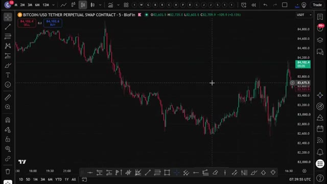
*⏱️ 00:00:08 — Capture d'écran montrant un graphique de trading en chandeliers japonais pour le contrat perpetual Bitcoin/USDT sur l'exchange BloFin, avec une unité de temps à 5 minutes.*

---

### ⏱️ `[00:00:33 - 00:01:09]` | Segment #02

**🔊 Audio (Transcription Intégrale Mot pour Mot en Français) :**
> autour parce que à la fin je vais vous montrer comment transformer toute cette stratégie manuelle en un système entièrement automatisé qui trace vos entrées pour vous. Aucun codage requis. Donc sans plus attendre, entrons dans le vif du sujet. Très bien les gars, étape numéro une, choisir le bon échangeur crypto. Pour cette stratégie, nous allons utiliser Blowfin comme notre plateforme principale. Blowfin n'exige pas de vérification KYC obligatoire pour le trading de base, ce qui signifie que vous pouvez commencer à trader immédiatement. De plus, les nouveaux utilisateurs peuvent gagner jusqu'à 5 000 USDT grâce à des bonus de dépôt et de volume de trading. Maintenant, si vous voulez un

**👁️ Analyse Visuelle d'Écran (gemini-3.5-flash-lite) :**
**Interface & Outils** : TradingView (Pine Editor, graphique de prix), plateforme d'échange BloFin, site web informatif Crypto Vanguards.

**Contenu textuel & Code** : Code source Pine Script v5 pour l'automatisation des entrées et alertes de trading, formulaire d'inscription BloFin, article informatif sur les règles KYC.

**Action / Démonstration** : Affichage du code de script de trading et présentation des interfaces d'échange et de documentation.

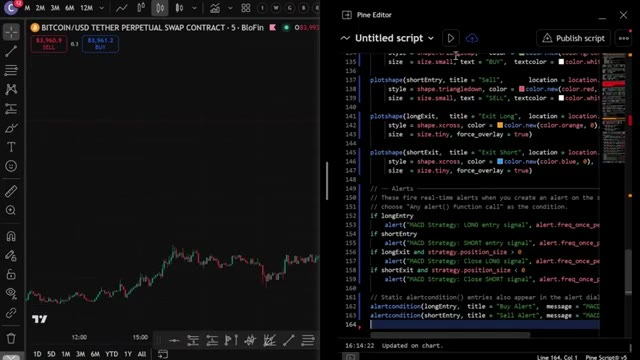
*⏱️ 00:00:42 — Écran divisé montrant un graphique des prix Bitcoin/USD à gauche et l'éditeur Pine Script de TradingView à droite avec du code de stratégie de trading.*

*⏱️ 00:00:51 — Page d'inscription de l'échange de cryptomonnaies BloFin avec une offre de bonus de bienvenue.*

---

### ⏱️ `[00:01:09 - 00:01:38]` | Segment #03

**🔊 Audio (Transcription Intégrale Mot pour Mot en Français) :**
> alternative avec encore plus de paires de trading et la possibilité de basculer entre les fonctionnalités d'un échange centralisé et le trading de contrats perpétuels décentralisés, vous pouvez utiliser Mexi. Ils offrent jusqu'à 10 000 USDT de bonus pour les nouveaux utilisateurs en ce moment. Les deux plateformes fonctionnent parfaitement pour cette stratégie, alors choisissez celle qui correspond le mieux à vos besoins. Pour vous inscrire sur Blofen, cliquez sur le premier lien dans la description. Vous serez redirigé vers la page d'inscription où il vous suffit d'entrer vos informations et de créer un compte. Aucun KYC n'est nécessaire.

**👁️ Analyse Visuelle d'Écran (gemini-3.5-flash-lite) :**
**Interface & Outils** : MEXC, BloFin

**Contenu textuel & Code** : Paires de trading, capitalisation boursière, graphique des prix BTCUSDT (Timeframe 5m), carnet d'ordres, formulaire d'inscription.

**Action / Démonstration** : Navigation sur les plateformes de cryptomonnaies MEXC et BloFin, présentation des paires de trading et des bonus d'inscription.

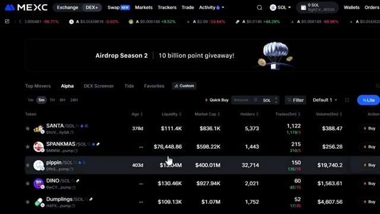
*⏱️ 00:01:16 — Interface de la plateforme MEXC affichant le tableau des paires de trading et le marché des tokens (Alpha).*

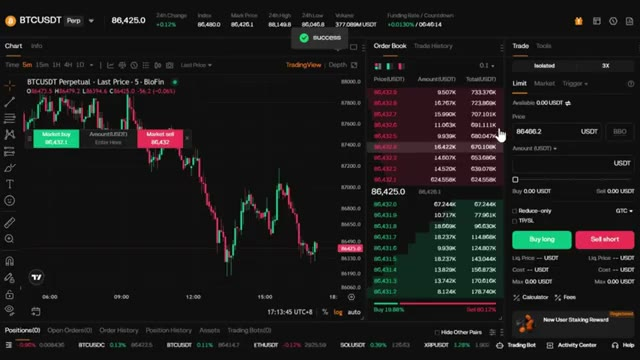
*⏱️ 00:01:24 — Interface de trading de la plateforme BloFin avec un graphique des prix BTCUSDT en bougies japonaises et le carnet d'ordres.*

*⏱️ 00:01:31 — Page d'inscription de la plateforme BloFin avec une offre de bonus de bienvenue en partenariat avec Mister Crypto.*

---

### ⏱️ `[00:01:38 - 00:02:12]` | Segment #04

**🔊 Audio (Transcription Intégrale Mot pour Mot en Français) :**
> Vous pouvez commencer à trader immédiatement. Si vous préférez Mexi, utilisez le deuxième lien ci-dessous. Vous devrez effectuer une vérification KYC rapide sur Mexi, mais c'est rapide et sécurisé. Personnellement, j'ai des comptes sur les deux plateformes selon ce que je trade. L'étape numéro deux consiste à déposer des fonds. Laissez-moi vous montrer comment faire cela rapidement avant de passer à la stratégie. Une fois connecté à votre plateforme, cliquez sur actifs en haut à droite, puis choisissez aperçu. Une fois sur la page d'aperçu, cliquez sur dépôt. Choisissez la coin que vous souhaitez déposer. Je recommande l'USDT et sélectionnez la bonne

**👁️ Analyse Visuelle d'Écran (gemini-3.5-flash-lite) :**
**Interface & Outils** : Échanges de cryptomonnaies MEXC et BloFin (interfaces web).

**Contenu textuel & Code** : Formulaires d'inscription, liens de parrainage, offres de bonus de bienvenue (10 000 USDT) et bannières promotionnelles de plateformes de trading.

**Action / Démonstration** : Présentation des plateformes partenaires mentionnées dans le segment audio (Mexi/MEXC et BloFin) pour l'ouverture de comptes de trading.

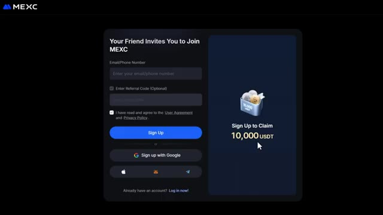
*⏱️ 00:01:47 — Interface d'inscription de la plateforme d'échange MEXC montrant un formulaire avec des options de connexion par email, téléphone ou services tiers, ainsi qu'une offre promotionnelle de 10 000 USDT.*

*⏱️ 00:01:55 — Page d'accueil de la plateforme BloFin intitulée "BloFin - Where Whales are Made", affichant les menus de navigation (Buy Crypto, Markets, Futures, Copy Trading) et un bouton "Trade Now".*

---

### ⏱️ `[00:02:12 - 00:02:45]` | Segment #05

**🔊 Audio (Transcription Intégrale Mot pour Mot en Français) :**
> réseau blockchain. Assurez-vous de choisir le bon réseau pour éviter de perdre vos fonds. Confirmez les détails, puis scannez le code QR ou copiez l'adresse de dépôt pour transférer vos fonds depuis votre portefeuille ou un autre échange. Si vous souhaitez déposer en monnaie fiat, cherchez l'option d'achat de crypto en haut du menu, puis sélectionnez l'achat rapide. Choisissez votre devise, entrez le montant, sélectionnez votre mode de paiement et cliquez sur continuer. Une fois vos fonds déposés, il est temps d'ouvrir une position. L'étape numéro trois consiste à ouvrir votre première position. Survolez les contrats à terme

**👁️ Analyse Visuelle d'Écran (gemini-3.5-flash-lite) :**
**Interface & Outils** : Plateforme d'échange de cryptomonnaies Blofin (interface web).

**Contenu textuel & Code** : Options de dépôt de cryptomonnaies (Réseau TRC20, adresse de dépôt, code QR) et options de paiement en monnaie fiat (Google Pay, SEPA, SWIFT, Simplex, Alchemy).

**Action / Démonstration** : Navigation dans les menus de dépôt de cryptomonnaies et de sélection des options de paiement en monnaie fiat sur l'échange Blofin.

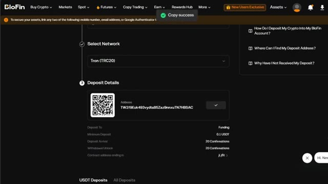
*⏱️ 00:02:21 — Interface de la plateforme Blofin montrant les détails d'un dépôt de cryptomonnaie avec le réseau Tron (TRC20), un code QR et l'adresse de dépôt, ainsi qu'une notification de succès de copie.*

*⏱️ 00:02:29 — Page d'accueil de la plateforme Blofin avec un menu déroulant ouvert sous l'onglet "Buy Crypto", proposant les options "Quick Buy", "Bank Transfer" et "Crypto Deposit".*

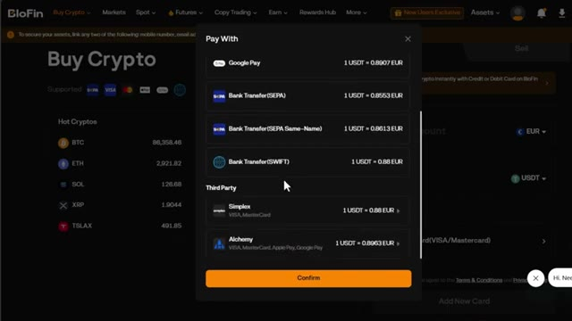
*⏱️ 00:02:37 — Fenêtre de sélection des méthodes de paiement fiat sur Blofin, affichant Google Pay, les virements bancaires (SEPA, SWIFT) et des options de tiers comme Simplex ou Alchemy.*

---

### ⏱️ `[00:02:45 - 00:03:21]` | Segment #06

**🔊 Audio (Transcription Intégrale Mot pour Mot en Français) :**
> dans le menu supérieur, puis sélectionnez les contrats futures USDT-M. Cela vous mènera à l'interface de trading où toute la magie opère. Choisissez l'actif que vous souhaitez négocier dans le coin supérieur gauche. Pour cet exemple, j'utiliserai Bitcoin, BTC slash USDT, mais cette stratégie fonctionne sur n'importe quelle paire crypto. Après cela, sélectionnez votre type d'ordre, limite ou marché. Pour les débutants, je recommande de commencer par des ordres au marché pour une exécution instantanée. Ensuite, choisissez votre type de effet de levier. Vous pouvez utiliser la marge croisée ou la marge isolée. Personnellement, j'utilise toujours la marge isolée car elle limite votre risque uniquement à cette spécifique

**👁️ Analyse Visuelle d'Écran (gemini-3.5-flash-lite) :**
**Interface & Outils** : Échange de cryptomonnaies BloFin (interface Futures USDT-M)

**Contenu textuel & Code** : Graphique en chandeliers japonais BTC/USDT Perpetuel (unité de temps 5m), carnet d'ordres en temps réel, panneau de passage d'ordres (Limit/Market/Trigger, effet de levier 5x, mode Isolé)

**Action / Démonstration** : Navigation sur la plateforme et sélection de la paire BTC/USDT pour préparer la stratégie de trading futures.

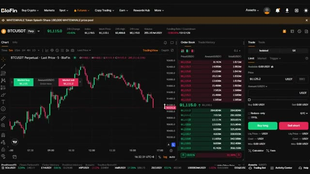
*⏱️ 00:02:54 — Capture d'écran de l'interface de trading de l'échange BloFin montrant le graphique du Bitcoin (BTC/USDT) en unités de 5 minutes, avec le carnet d'ordres à droite.*

---

### ⏱️ `[00:03:21 - 00:03:58]` | Segment #07

**🔊 Audio (Transcription Intégrale Mot pour Mot en Français) :**
> position. Si le trade tourne mal, vous ne perdez que ce que vous avez mis dans le trade. Vous pouvez utiliser un effet de levier élevé sur ces plateformes, mais pour les débutants, je recommande de commencer par un effet de levier de cinq à dix fois jusqu'à ce que vous soyez à l'aise avec les mouvements du marché. Entrez les détails de votre trade, vérifiez que tout est correct, puis cliquez sur acheter à long terme ou vendre à découvert pour ouvrir votre position. Une fois votre ordre exécuté, vous pouvez le voir sous l'onglet des positions au bas de l'écran. Maintenant que vous savez comment naviguer sur la plateforme, passons à la stratégie proprement dite qui peut vous faire gagner 100 dollars par jour. Très bien, voici donc la stratégie elle-même et je veux vous montrer exactement quoi ajouter à votre graphique et

**👁️ Analyse Visuelle d'Écran (gemini-3.5-flash-lite) :**
**Interface & Outils** : BloFin (plateforme d'échange crypto) et graphique TradingView intégré.

**Contenu textuel & Code** : Paire BTCUSDT Perpétuel, effet de levier 5x, carnet d'ordres, panneau de gestion des positions (marge isolée, prix d'entrée, PnL).

**Action / Démonstration** : Ajustement de l'effet de levier à 5x, puis ouverture d'une position longue ("Buy long") sur le BTCUSDT.

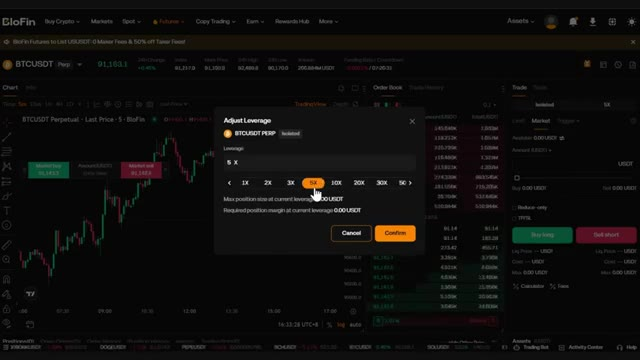
*⏱️ 00:03:31 — Fenêtre de réglage de l'effet de levier sur la plateforme BloFin, positionnée sur 5x.*

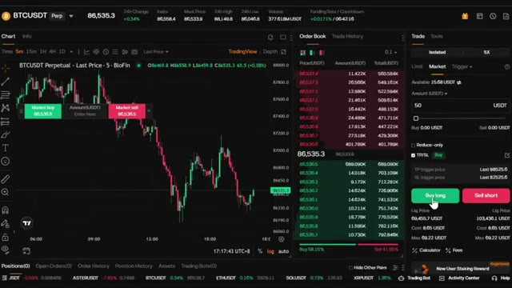
*⏱️ 00:03:40 — Interface de trading de BloFin montrant le graphique du BTCUSDT et le panneau de passage d'ordre avec le bouton "Buy long".*

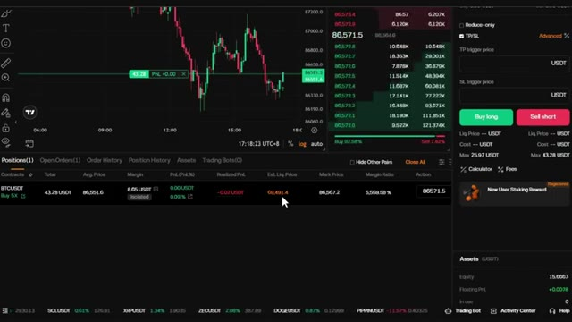
*⏱️ 00:03:49 — Tableau des positions ouvertes sur BloFin affichant un contrat BTCUSDT actif avec un effet de levier de 5x.*

---

### ⏱️ `[00:03:58 - 00:04:30]` | Segment #08

**🔊 Audio (Transcription Intégrale Mot pour Mot en Français) :**
> ce que vous recherchez avant d'automatiser quoi que ce soit. Nous utilisons trois indicateurs ensemble. Tous existent déjà sur TradingView, vous n'avez encore besoin de rien de personnalisé. C'est une version manuelle et une fois que vous l'aurez comprise, l'automatiser avec Claude aura beaucoup plus de sens. Donc si vous n'avez pas encore TradingView, cliquez sur le lien dans la description ci-dessous. Si vous achetez la version pro, vous obtiendrez une réduction et cela aidera grandement la chaîne. Le premier indicateur est le prix moyen pondéré par le volume. Recherchez VWAP dans la bibliothèque d'indicateurs de TradingView et ajoutez-le à votre

**👁️ Analyse Visuelle d'Écran (gemini-3.5-flash-lite) :**
**Interface & Outils** : TradingView, Blofin, YouTube.

**Contenu textuel & Code** : Graphiques de prix du Bitcoin (BTC/USDT perpétuel en timeframe 5 minutes), indicateurs techniques standards sur TradingView.

**Action / Démonstration** : Analyse visuelle des graphiques de trading et présentation de la configuration des indicateurs avant automatisation.

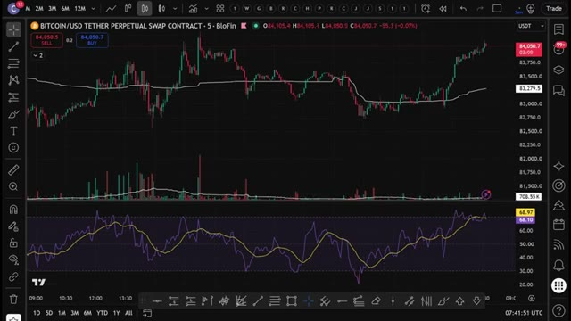
*⏱️ 00:04:06 — Graphique TradingView affichant Bitcoin/USD Tether sur l'exchange Blofin avec des indicateurs de volume et de momentum (RSI) dans les sous-fenêtres.*

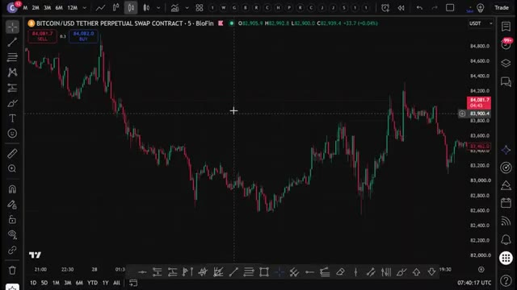
*⏱️ 00:04:22 — Graphique TradingView en chandeliers japonais centré sur les mouvements de prix récents du Bitcoin/USD Tether avec curseur réticule.*

---

### ⏱️ `[00:04:30 - 00:05:08]` | Segment #09

**🔊 Audio (Transcription Intégrale Mot pour Mot en Français) :**
> graphique. Laissez-le sur les paramètres de session ou ancré pour qu'il se réinitialise chaque jour. Le VWAP vous indique le prix de juste valeur pour la journée basé sur le volume. Lorsque le prix se négocie bien au-dessus ou en dessous du VWAP, il est étiré, et c'est exactement le genre d'extrême contre lequel nous voulons trader sur un graphique de cinq minutes. Ensuite, ajoutez le RSI standard avec une longueur de 14. C'est notre filtre de momentum. Nous cherchons à ce que le RSI soit suracheté au-dessus de 70 ou oversold en dessous de 30 pour confirmer que le mouvement est étiré et pas seulement une mèche aléatoire loin du VWAP. Ensuite, ajoutez l'indicateur de volume standard avec une moyenne mobile sur 30 périodes tracée.

**👁️ Analyse Visuelle d'Écran (gemini-3.5-flash-lite) :**
**Interface & Outils** : Interface de trading BloFin (graphique TradingView intégré)

**Contenu textuel & Code** : Paire BITCOIN/USD TETHER PERPETUAL SWAP CONTRACT en unité de temps 5 minutes, indicateur VWAP Session (ligne blanche), prix actuel autour de 84 062,9 USDT.

**Action / Démonstration** : Analyse graphique de l'action des prix par rapport au VWAP journalier pour identifier les zones de juste valeur et les écarts de prix.

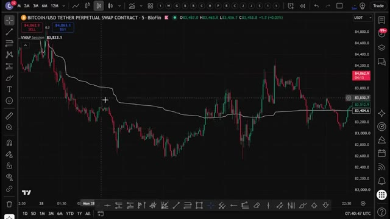
*⏱️ 00:04:40 — Graphique en chandeliers japonais du contrat perpétuel Bitcoin/USDT sur l'interface de trading BloFin avec l'indicateur VWAP affiché.*

---

### ⏱️ `[00:05:08 - 00:05:30]` | Segment #10

**🔊 Audio (Transcription Intégrale Mot pour Mot en Français) :**
> en blanc. Tout comme avant, nous ne cherchons pas un volume élevé en général. Nous voulons un volume supérieur à cette moyenne de 30 périodes et qui correspond à la direction de la bougie. Ainsi, nous savons que de l'argent réel soutient le mouvement et qu'il ne s'agit pas seulement de bruit. Pour une configuration acheteuse, vous devez vérifier si le prix se négocie en dessous du VWAP et s'il remonte à travers celui-ci. Et un RSI qui sort de la zone de survente, c'est-à-dire en dessous de 30, et qui repart à la hausse.

**👁️ Analyse Visuelle d'Écran (gemini-3.5-flash-lite) :**
**Interface & Outils** : Interface de trading TradingView intégrée à la plateforme d'échange BloFin.

**Contenu textuel & Code** : Graphique de prix Bitcoin (BTC/USD Perpétuel) en unités de 5 minutes, indicateur VWAP, histogramme de volume avec moyenne mobile sur 30 périodes, et oscillateur RSI (14 périodes).

**Action / Démonstration** : Explication de la corrélation entre les mouvements de prix, la direction des bougies et les pics de volume supérieurs à la moyenne mobile.

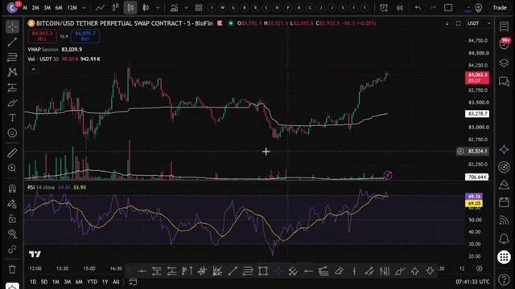
*⏱️ 00:05:13 — Graphique en chandeliers japonais illustrant l'analyse du volume de trading et du RSI sur l'actif Bitcoin.*

---

### ⏱️ `[00:05:30 - 00:06:03]` | Segment #11

**🔊 Audio (Transcription Intégrale Mot pour Mot en Français) :**
> La barre de volume actuelle doit être au-dessus de la moyenne mobile du volume et la bougie est verte. Pour un scénario de vente à découvert, le prix doit évoluer au-dessus du VWAP et redescendre en le traversant. Un RSI sort de la zone de surachat, c'est-à-dire au-dessus de 70, et redescend. Et la barre de volume actuelle est au-dessus de la moyenne mobile du volume et la bougie est rouge. Lorsque ces trois éléments s'alignent en même temps, c'est votre signal. J'utilise Bitcoin USDT pour cet exemple car c'est la paire la plus liquide et les données de volume sont propres, mais cette configuration exacte fonctionne sur Ethereum, Solana, ou vraiment n'importe quel

**👁️ Analyse Visuelle d'Écran (gemini-3.5-flash-lite) :**
**Interface & Outils** : Interface de trading (plateforme BloFin / TradingView)

**Contenu textuel & Code** : Graphique en chandeliers (Bitcoin/USD Tether Perpetual Swap), indicateur de volume avec moyenne mobile, indicateur RSI dans le panneau inférieur, et lignes de VWAP.

**Action / Démonstration** : Analyse technique illustrant le scénario de vente à découvert avec le croisement du VWAP et le RSI sortant de la zone de surachat.

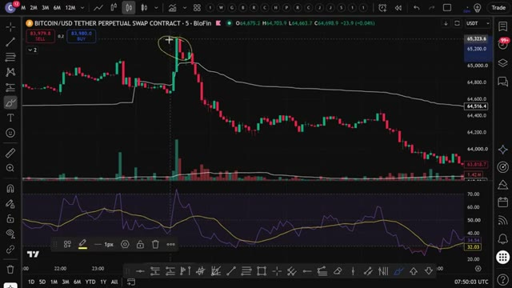
*⏱️ 00:05:39 — Un graphique de trading montrant les prix du Bitcoin, les volumes et un indicateur RSI sur une interface de type TradingView / BloFin, avec une zone cerclée au niveau d'un sommet de prix.*

---

### ⏱️ `[00:06:03 - 00:06:21]` | Segment #12

**🔊 Audio (Transcription Intégrale Mot pour Mot en Français) :**
> paire liquide. La logique ne change pas. Pour la gestion des risques, je fais simple. Un stop loss juste au-delà du récent plus haut ou plus bas qui a déclenché la configuration. Et je cherche un ratio risque/rendement d'au moins 1 pour 1,5 à 1 pour 2. Donc maintenant, vous comprenez exactement comment cette stratégie fonctionne manuellement.

**👁️ Analyse Visuelle d'Écran (gemini-3.5-flash-lite) :**
**Interface & Outils** : Graphique de trading intégré (interface type TradingView / BloFin)

**Contenu textuel & Code** : Paire BITCOIN/USD TETHER PERPETUAL SWAP CONTRACT (intervalle 5m), outils de gestion du risque (stop-loss et take-profit avec ratio RR affiché à 1:1.68 ou similaire), histogrammes de volume, et oscillateur RSI en sous-fenêtre.

**Action / Démonstration** : Configuration et visualisation d'un trade avec placement du stop loss au-delà du récent plus haut et définition d'un ratio risque/rendement cible.

*⏱️ 00:06:08 — Un graphique en chandeliers japonais montrant la paire Bitcoin/USD (contrat perpétuel Tether) sur l'exchange BloFin, avec un outil de position (long/short) affichant un ratio risque/rendement, ainsi que des volumes et un indicateur technique de type RSI en bas.*

---

### ⏱️ `[00:06:22 - 00:06:40]` | Segment #13

**🔊 Audio (Transcription Intégrale Mot pour Mot en Français) :**
> Mais c'est là que ça devient vraiment intéressant. Au lieu de regarder des graphiques toute la journée et de faire ça manuellement, j'ai donné cette stratégie exacte à Claude et je lui ai demandé de m'écrire un PineScript complet. Comme ça, TradingView peut détecter automatiquement ces signaux pour moi. Et voici le prompt que j'utilise. Je vais l'afficher à l'écran dès maintenant pour que vous puissiez le copier exactement.

**👁️ Analyse Visuelle d'Écran (gemini-3.5-flash-lite) :**
**Interface & Outils** : TradingView, BloFin, interface CLI Claude Code (terminal).

**Contenu textuel & Code** : Contrat perpétuel BTC/USDT, indicateur VWAP, RSI (période 14), volume avec moyenne mobile, code Pine Script généré via un prompt IA combinant plusieurs conditions techniques (VWAP, RSI suracheté/survendu, volume).

**Action / Démonstration** : Passage d'une analyse technique manuelle à l'utilisation de l'assistant IA Claude pour rédiger un script Pine personnalisé, puis visualisation du résultat avec les signaux d'achat et de vente automatiques sur le graphique TradingView.

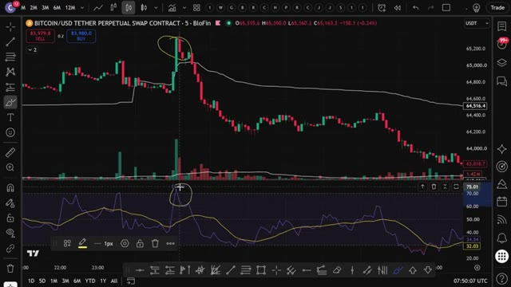
*⏱️ 00:06:26 — Graphique TradingView (Bitcoin / USD Tether Perpetual Swap Contract sur BloFin en unité 5 minutes) montrant les chandeliers, le volume et le RSI inférieur avec des annotations jaunes manuscrites.*

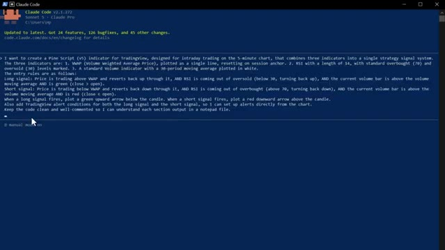
*⏱️ 00:06:31 — Interface en ligne de commande de l'outil "Claude Code" (version v2.1.272, Claude Pro) affichant un prompt détaillé pour la génération d'un indicateur Pine Script v5 combinant VWAP, RSI et Volume.*

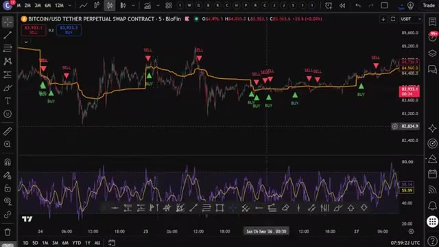
*⏱️ 00:06:36 — Graphique TradingView sur l'unité 5 minutes affichant désormais la stratégie automatisée avec des indicateurs visuels d'achat (triangles verts "BUY") et de vente (triangles rouges "SELL") générés par le script Pine personnalisé.*

---

### ⏱️ `[00:06:41 - 00:07:00]` | Segment #14

**🔊 Audio (Transcription Intégrale Mot pour Mot en Français) :**
> C'est tout. C'est le prompt complet. Vous collez ça dans Claude. J'utilise Claude Code ici. Et en quelques secondes, il crache un PineScript complet et fonctionnel dans un fichier Bloc-notes. Maintenant, ce prompt exact, ainsi que le script Pine utilisé dans cette vidéo, est disponible dans mon groupe privé. Vous trouverez le lien ci-dessous.

**👁️ Analyse Visuelle d'Écran (gemini-3.5-flash-lite) :**
**Interface & Outils** : Claude Code (CLI), Explorateur de fichiers Windows, Navigateur web (site Alex Carter Trading).

**Contenu textuel & Code** : Prompt complet pour un indicateur Pine Script (v5) combinant VWAP, RSI (14) et Volume, liste de fichiers de stratégie de trading, et explications textuelles sur le site web.
[DESC_ACTION] Présentation du prompt utilisé dans Claude Code, de l'arborescence des fichiers générés et de la plateforme web de la communauté.

**Action / Démonstration** : Explications face caméra et analyse conceptuelle des marchés.

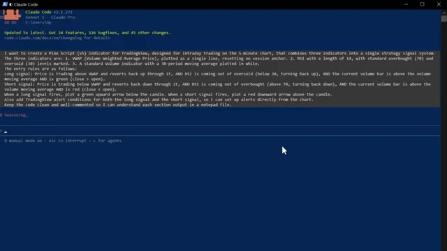
*⏱️ 00:06:46 — Capture d'un terminal de commande affichant Claude Code avec un prompt détaillé pour créer un indicateur Pine Script combinant VWAP, RSI et Volume.*

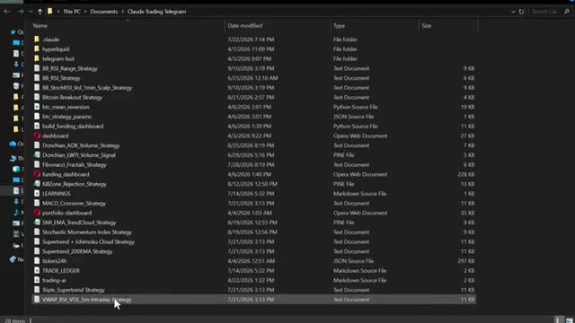
*⏱️ 00:06:50 — Explorateur de fichiers Windows montrant le dossier 'Claude Trading Telegram' contenant divers scripts de stratégie de trading et documents texte (ex. VWAP_RSI_VOL_5m Intraday Strategy).*

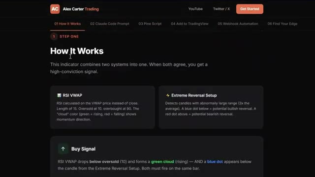
*⏱️ 00:06:55 — Capture du site web 'Alex Carter Trading' montrant la section 'How It Works' expliquant la logique des indicateurs (RSI VWAP, Extreme Reversal Setup, Buy Signal).*

---

### ⏱️ `[00:07:00 - 00:07:18]` | Segment #15

**🔊 Audio (Transcription Intégrale Mot pour Mot en Français) :**
> Ouvrez le fichier bloc-notes, appuyez sur Ctrl plus A pour sélectionner tout le code, puis sur Ctrl plus C pour le copier. C'est tout ce dont vous avez besoin. Maintenant, mettons-le dans TradingView. Ouvrez TradingView et allez sur n'importe quel graphique. Je vais utiliser à nouveau le Bitcoin. En bas à droite de l'écran, cliquez sur l'onglet Éditeur Pine.

**👁️ Analyse Visuelle d'Écran (gemini-3.5-flash-lite) :**
**Interface & Outils** : Bloc-notes Windows et plateforme de graphiques financiers TradingView.

**Contenu textuel & Code** : Code source en langage Pine Script (ou similaire) dans le Bloc-notes, et graphique de prix en chandeliers pour Bitcoin (BTC/USDT) sur TradingView.

**Action / Démonstration** : Sélection du code source dans le Bloc-notes pour le copier, puis affichage du graphique vierge de Bitcoin sur TradingView pour y intégrer le script.

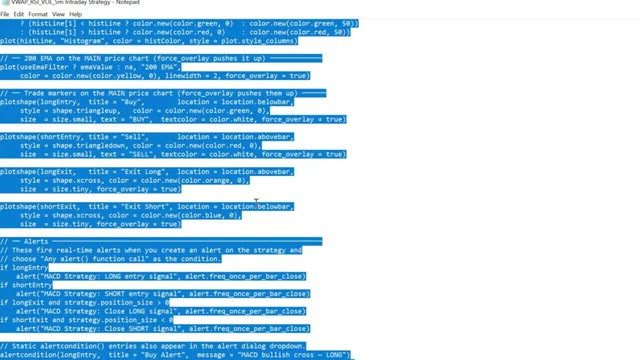
*⏱️ 00:07:04 — Image montrant un fichier Bloc-notes ouvert avec du code source en cours de sélection (surligné en bleu).*

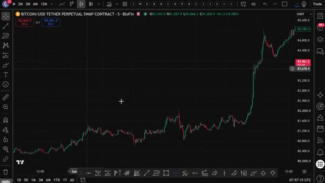
*⏱️ 00:07:13 — Image montrant l'interface d'un graphique TradingView avec une paire de trading Bitcoin sur un échange.*

---

### ⏱️ `[00:07:18 - 00:07:53]` | Segment #16

**🔊 Audio (Transcription Intégrale Mot pour Mot en Français) :**
> Une fois que l'éditeur est ouvert, vous y verrez du code par défaut. Sélectionnez tout, supprimez-le, et collez ce code de script Pine. Cliquez maintenant sur Ajouter au graphique. C'est le bouton tout en haut de l'éditeur Pine. TradingView va compiler le script et l'appliquer directement sur votre graphique. Et voilà. Vous pouvez voir les signaux d'achat et de vente tracés automatiquement directement sur les bougies. Des triangles verts pour les positions acheteuses, des triangles rouges pour les positions vendeuses, tout se déclenche exactement de la manière dont nous l'avons configuré manuellement. Maintenant, une fois que vous l'avez réglé et que vous êtes prêt à configurer une alerte pour ne jamais rater un mouvement, cliquez sur l'icône du réveil tout en haut de TradingView.

**👁️ Analyse Visuelle d'Écran (gemini-3.5-flash-lite) :**
**Interface & Outils** : TradingView, éditeur Pine Script, graphique de trading Blofin (Bitcoin/USD Tether Perpetual Swap).

**Contenu textuel & Code** : Code source Pine Script affichant des fonctions de stratégie, des conditions d'entrée/sortie (longEntry, shortEntry) et des configurations d'alertes.

**Action / Démonstration** : Le curseur clique sur le bouton "Ajouter au graphique" ("Add to chart") pour compiler et appliquer la stratégie au graphique.

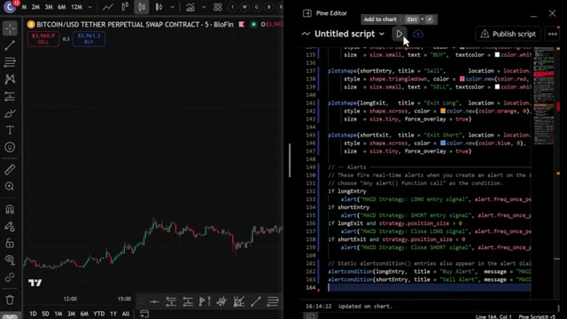
*⏱️ 00:07:27 — Interface divisée en deux montrant un graphique de prix Bitcoin à gauche et l'éditeur Pine Script de TradingView à droite avec du code source.*

---

### ⏱️ `[00:07:53 - 00:08:29]` | Segment #17

**🔊 Audio (Transcription Intégrale Mot pour Mot en Français) :**
> vue ou faites un clic droit sur l'une des formes de signal, sélectionnez "ajouter une alerte" et définissez vos conditions. TradingView vous avertira dès qu'un signal se déclenche, directement sur votre téléphone. Donc, au lieu de fixer l'écran pendant des heures en attendant un croisement, le code fait tout le travail difficile pour vous. Dès que toutes vos conditions s'alignent parfaitement, boum, vous recevez une alerte, vous exécutez et c'est tout. Maintenant, si vous voulez aller encore plus loin et faire en sorte qu'il s'exécute et ouvre des trades automatiquement sur votre exchange dès qu'un signal se déclenche, je m'occupe de vous. J'ai créé un groupe privé où je partage tous mes cas d'utilisation.

**👁️ Analyse Visuelle d'Écran (gemini-3.5-flash-lite) :**
**Interface & Outils** : TradingView (Graphique de trading en ligne).

**Contenu textuel & Code** : Graphique en chandeliers du Bitcoin affichant des signaux d'achat (triangles verts) et de vente (triangles rouges), ainsi qu'une liste d'alertes actives dans le panneau latéral droit.

**Action / Démonstration** : Configuration et visualisation des alertes de trading pour automatiser la surveillance des signaux sur le graphique.

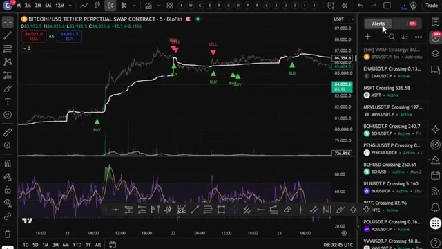
*⏱️ 00:08:02 — Capture d'écran d'un graphique TradingView sur la paire BITCOIN/USD avec un panneau d'alertes ouvert sur le côté droit.*

---

### ⏱️ `[00:08:29 - 00:09:03]` | Segment #18

**🔊 Audio (Transcription Intégrale Mot pour Mot en Français) :**
> pour Claude Code, de son intégration avec Telegram, TradingView, et de la recherche de baleines sur Hyperliquid. Le tout automatiquement. Tout ce que je vous ai montré aujourd'hui, tout est dans le groupe. Et j'ajoute constamment de nouvelles choses, de nouvelles stratégies, de nouveaux prompts, de nouvelles intégrations. Chaque fois que je construis quelque chose de nouveau, ça va directement là-dedans. Le prix est de 79,99 $ par mois. Et honnêtement, quand on y pense, ce que c'est vraiment, la configuration de trading par IA la plus avancée disponible pour les traders particuliers en ce moment, constamment mise à jour avec tout inclus. À l'intérieur, il y a aussi un cours complet de trading agentique.

**👁️ Analyse Visuelle d'Écran (gemini-3.5-flash-lite) :**
**Interface & Outils** : Navigateur web affichant des pages de documentation et de vente (Whop).

**Contenu textuel & Code** : Textes décrivant les fonctionnalités (Chart Reading, Chart Control, Pine Script, Multi-Chart & Watchlist) et offre d'abonnement.

**Action / Démonstration** : Présentation commerciale de la communauté et des fonctionnalités du système d'IA.

---

### ⏱️ `[00:09:04 - 00:09:24]` | Segment #19

**🔊 Audio (Transcription Intégrale Mot pour Mot en Français) :**
> 2 heures et demie. Du niveau débutant à expert. Aucune expérience en programmation requise. À la fin, vous aurez votre propre système de trading par IA opérationnel en direct. Quelque chose que la plupart des traders particuliers ne savent même pas être possible actuellement. 79,99 $ par mois. Un seul bon trade le rentabilise. Et les 100 premiers membres bloquent ce tarif définitivement.

**👁️ Analyse Visuelle d'Écran (gemini-3.5-flash-lite) :**
**Interface & Outils** : Plateforme de formation en ligne et interface de vente Whop.

**Contenu textuel & Code** : Intitulés des modules de formation sur l'IA et le trading, descriptions techniques des leçons, et tarifs de l'abonnement.

**Action / Démonstration** : Présentation du programme complet du cours de trading par IA et de l'offre d'abonnement mensuel.

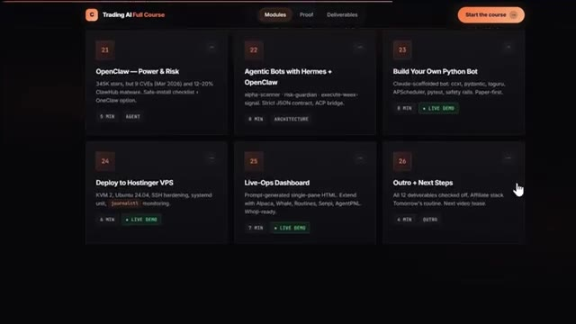
*⏱️ 00:09:09 — Capture d'écran montrant l'interface des modules de cours "Trading AI Full Course", avec les modules numérotés 21 à 26 détaillant des sujets comme OpenClaw, les bots agentiques, Python, le déploiement sur VPS Hostinger, et un tableau de bord Live-Ops.*

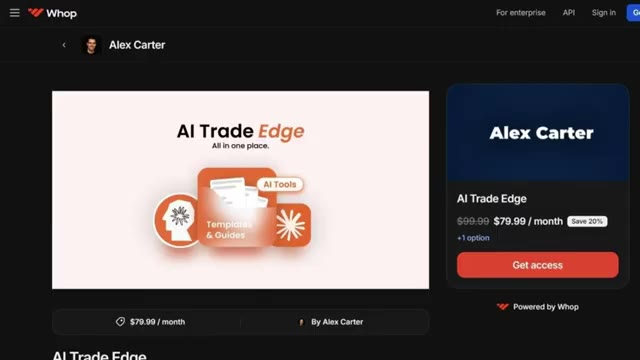
*⏱️ 00:09:19 — Capture d'écran de la plateforme de vente Whop affichant la page du créateur Alex Carter pour le programme "AI Trade Edge" tarifé à 79,99 $ par mois.*

---

### ⏱️ `[00:09:24 - 00:09:58]` | Segment #20

**🔊 Audio (Transcription Intégrale Mot pour Mot en Français) :**
> Après cela, le prix augmente. Le lien est dans la description. Vous ne pouvez vraiment pas vous permettre de rater ça. Et c'est exactement comme ça que j'ai automatisé cette stratégie en utilisant Claude. Si vous voulez vraiment mettre cela en pratique, assurez-vous d'utiliser Blofin ou Mexi. Puisque ce genre de configuration fonctionne beaucoup plus fluidement là-bas que sur la plupart des autres plateformes d'échange, les liens sont plus bas si vous voulez voir une démonstration complète de la façon dont je trade en utilisant uniquement mon Telegram, la démonstration complète de tous les cas d'utilisation sur TradingView et de la façon dont je tracke automatiquement les plus gros trades des baleines sur Hyperliquid, cliquez sur la vidéo qui apparaît à l'écran.

**👁️ Analyse Visuelle d'Écran (gemini-3.5-flash-lite) :**
**Interface & Outils** : TradingView, BloFin, MEXC, Terminal de commande (Claude Code / Script CLI)

**Contenu textuel & Code** : Graphique de prix Bitcoin (perpétuel), indicateurs techniques (RSI, moyennes mobiles), page de parrainage MEXC (10 000 USDT), tableau d'analyse multi-timeframe (Weekly, Daily, 4H, 1H) avec niveaux clés (Supports, Résistances) et recommandations d'entrées (LONG, Stop Loss, Take Profit).

**Action / Démonstration** : Présentation d'un graphique de trading, affichage d'un lien d'inscription affilié et démonstration d'un rapport d'analyse automatisé multi-timeframe dans un terminal.

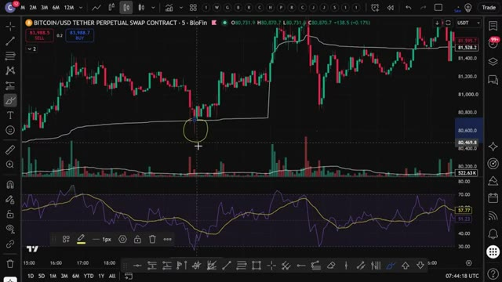
*⏱️ 00:09:32 — Graphique en chandeliers japonais de Bitcoin sur BloFin montrant l'évolution des prix et des indicateurs techniques.*

*⏱️ 00:09:41 — Page d'inscription de la plateforme d'échange MEXC proposant une offre de bonus de bienvenue de 10 000 USDT.*

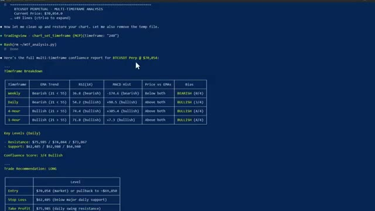
*⏱️ 00:09:49 — Rapport d'analyse multi-timeframe pour BTCUSDT affiché dans un terminal de commande, incluant EMA, RSI, MACD et recommandations de trade.*

---

### ⏱️ `[00:09:58 - 00:10:16]` | Segment #21

**🔊 Audio (Transcription Intégrale Mot pour Mot en Français) :**
> dès maintenant et si vous voulez le guide complet étape par étape sur la façon de construire votre propre système de trading agentique en utilisant Claude. Cette vidéo s'affiche également à l'écran. Allez la voir ensuite. Si vous avez trouvé cela utile, laissez un pouce bleu. Cela aide vraiment la chaîne. Abonnez-vous si ce n'est pas déjà fait, et je vous vois dans la prochaine.

**👁️ Analyse Visuelle d'Écran (gemini-3.5-flash-lite) :**
**Interface & Outils** : Aucun

**Contenu textuel & Code** : Aucun

**Action / Démonstration** : Aucune

---

