# 🎬 How To Actually Build A Trading Agent Using Grok Bot (Beginner Tutorial)

> **Chaîne** : [Alex Carter](https://www.youtube.com/@AlexCarterTrading)  
> **Lien YouTube** : [https://www.youtube.com/watch?v=hbdwsIUDojg](https://www.youtube.com/watch?v=hbdwsIUDojg)  
> **Date de publication** : 20261007  
> **Durée** : 00:15:21  
> **Identifiant vidéo** : `hbdwsIUDojg`  
> **Transcription & Analyse** : `whisper-v3-large-turbo+gemini-3.5-flash-lite`  

---

## 📌 Synthèse Exécutive & Outils

### 💡 Résumé

Cette vidéo présentée par la chaîne Alex Carter propose un guide complet pour automatiser son flux de travail en trading (crypto, forex, actions et contrats à terme) grâce à l'utilisation des agents autonomes et de **GrokBot**. Le constat de départ est universel pour tout trader : l'impossibilité de surveiller les marchés 24h/24 conduit inévitablement à rater des mouvements majeurs de 5 à 10 %. L'approche présentée ne repose pas sur un énième indicateur technique ou un groupe de signaux obsolète, mais sur l'implémentation d'une infrastructure d'agents IA capables de travailler en arrière-plan sans nécessiter de compétences en programmation ni la configuration complexe de serveurs virtuels (VPS) ou de fichiers mémoire. 

Au-delà des assistants conversationnels traditionnels (ChatGPT ou Gemini) qui exigent une sollicitation manuelle et s'interrompent dès la fermeture de l'onglet, **GrokBot** intègre un environnement persistant ("son propre ordinateur") capable de consulter des graphiques, d'analyser des flux de données en direct et d'exécuter des routines selon un calendrier défini. L'analyse démontre comment configurer des agents spécifiques — scanner de marché, agent de portefeuille et agent de recherche — connectés via des plugins à des outils comme Google Sheets ou à des flux d'échange en lecture seule. L'objectif est d'éliminer la friction opérationnelle du trader tout en maintenant une vigilance permanente sur les listes de surveillance et les seuils de risque.

Enfin, l'intervenant aborde la dimension économique et stratégique de ces nouveaux outils, comparant les coûts des abonnements aux modèles de pointe comme Claude Opus ou les nouvelles versions de xAI (**Grok 4.6**). Si l'analyse, le reporting automatisé et le scan d'opportunités (détection de volumes inhabituels, ruptures de structure, rééquilibrage de portefeuille) s'avèrent des cas d'usage immédiatement rentables, la plus grande prudence est exigée quant à l'automatisation totale de l'exécution des ordres, soulignant la nécessité d'une validation humaine rigoureuse avant de confier la gestion directe du capital à un agent autonome.

### 🛠️ Outils, Modèles & Logiciels Présentés

* **GrokBot** : Application de bureau autonome basée sur un cadre d'agents intelligents, permettant d'exécuter des tâches de surveillance, de recherche et d'analyse 24h/24 sans nécessiter de compétences en codage ni de VPS.
* **Grok (xAI)** : Modèle de langage développé par xAI (versions successives jusqu'à Grok 4.6), conçu pour rivaliser avec OpenAI et Claude tout en offrant une intégration native avec les données en temps réel.
* **Claude (et Claude Opus)** : Modèle de raisonnement avancé d'Anthropic, dont la puissance cognitive peut être exploitée en arrière-plan via GrokBot sans les contraintes de configuration manuelle des connexions MCP.
* **ChatGPT (OpenAI)** : Assistant conversationnel généraliste performant pour la rédaction et les questions rapides, mais limité par son incapacité à assurer un travail persistant en arrière-plan sans interaction humaine.
* **Gemini (Google)** : Modèle d'IA particulièrement efficace pour la recherche ancrée et le croisement de données en direct, mais souffrant de la même absence d'ordinateur persistant que les chatbots classiques.
* **TradingView** : Plateforme de référence pour l'analyse technique et le suivi des graphiques, souvent couplée aux scripts Pine Script pour l'identification des configurations de marché.
* **Pine Script** : Langage de programmation propriétaire de TradingView permettant de développer des indicateurs personnalisés et des stratégies de trading algorithmique.
* **Claude Code** : Outil de développement assisté par IA mentionné dans le contexte de l'automatisation avancée et de la conception de workflows techniques.
* **Google Sheets** : Tableur cloud connecté via des plugins aux agents de trading pour centraliser les rapports de portefeuille et automatiser le suivi des performances.
* **Telegram** : Messagerie instantanée utilisée pour relayer les résumés de marché, les alertes de volatilité et les rapports d'agents au sein de communautés de trading.

### 🔑 Points Clés & Enseignements Stratégiques

1. **Dépassement du paradigme conversationnel** : Contrairement aux chatbots traditionnels qui exigent une interaction humaine constante pour fonctionner, l'architecture par agent de GrokBot déploie un système persistant qui travaille en continu, même pendant le sommeil du trader.
2. **Élimination de la friction technique** : Le système s'affranchit de la configuration complexe de serveurs virtuels privés (VPS), de la gestion de fichiers de mémoire ou de compétences en programmation, rendant l'automatisation accessible aux traders débutants.
3. **Architecture multi-agents spécialisée** : La configuration optimale repose sur la division des tâches : un agent scanner de marché pour la veille des listes de surveillance, un agent de portefeuille pour le suivi des positions et un agent de recherche pour l'analyse des actualités.
4. **Sécurité et cloisonnement de l'exécution** : Si l'utilisation des agents pour l'analyse, le reporting, le résumé nocturne et la recherche est fortement encouragée, l'automatisation de l'exécution des transactions boursières nécessite une prudence extrême et un audit rigoureux des accès aux exchanges.
5. **Automatisation du rééquilibrage du risque** : Il est possible de programmer des alertes comportementales et des instructions de portefeuille pour détecter instantanément lorsqu'une position s'écarte de plus de 10 % de l'allocation cible fixée par le plan de trading.
6. **Détection des valeurs aberrantes (Outliers)** : Les agents peuvent être configurés pour scanner en permanence les marchés à la recherche de volumes anormaux, de ruptures de structures clés ou de chasses à la liquidité sur le Bitcoin et les altcoins.
7. **Optimisation budgétaire des abonnements IA** : L'utilisation de Grok 4.6 et de ses frameworks intégrés permet d'accéder à des capacités de raisonnement de pointe (comparables à Opus) sans avoir à cumuler de multiples abonnements logiciels onéreux.
8. **Intégration écosystémique via plugins** : La connexion transparente de l'agent aux outils du quotidien (Google Sheets, Gmail, Slack) permet d'injecter des données de marché en direct et d'obtenir des synthèses structurées comparables aux rapports d'un analyste financier.
9. **Réduction de la charge cognitive** : En déléguant le filtrage des bruits de marché et la compilation des actualités nocturnes à l'IA, le trader évite la fatigue décisionnelle causée par la consultation simultanée de multiples onglets et flux d'informations.
10. **Réplication des processus d'analyse technique** : En enregistrant et documentant ses propres routines d'analyse graphique, le trader peut apprendre progressivement à l'agent à reproduire tout ou partie de sa méthodologie discrétionnaire.
11. **Veille fondamentale et narrative** : L'agent de recherche peut être paramétré pour analyser en continu les flux d'actualités et les réseaux sociaux (comme X) afin d'isoler uniquement les informations pertinentes pour les actifs effectivement détenus ou surveillés.
12. **Approche agnostique des marchés** : Bien que l'démonstration se concentre principalement sur le marché des cryptomonnaies, l'architecture des agents et les routines présentées s'appliquent avec la même rigueur méthodologique au Forex, aux actions et aux contrats à terme.

---

## ⏱️ Chronologie & Transcription Complète Audio & Visuelle (Mot pour Mot)

### ⏱️ `[00:00:00 - 00:00:29]` | Segment #01

**🔊 Audio (Transcription Intégrale Mot pour Mot en Français) :**
> Ceci est votre guide complet pour débutants sur la façon de construire réellement un agent de trading en utilisant GrokBot. Et écoutez, que vous fassiez du trading de crypto comme moi, du Forex, des actions, des contrats à terme, peu importe le marché qui vous intéresse, ce système exact fonctionne de la même manière pour tous. Alors voici le problème, peu importe à quelle heure je me réveille, peu importe le nombre d'onglets que j'ai ouverts, je rate toujours des mouvements. Au moment où je repère enfin quelque chose, ça a déjà bougé de 5 à 10 %. Et écoutez, j'ai trouvé quelque chose qui résout vraiment ce problème.

**👁️ Analyse Visuelle d'Écran (gemini-3.5-flash-lite) :**
**Interface & Outils** : TradingView, application de chatbot GrokBot

**Contenu textuel & Code** : Paires de devises Forex (EURUSD, GBPUSD, USDJPY, etc.), prompt détaillé pour configurer un assistant automatisé de brief matinal crypto, et graphique des prix BTC/USDT.

**Action / Démonstration** : Navigation et sélection de symboles de marché, puis configuration d'un agent de trading automatisé.

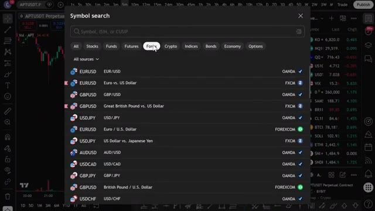
*⏱️ 00:00:07 — Fenêtre de recherche de symboles sur TradingView montrant différentes paires du Forex.*

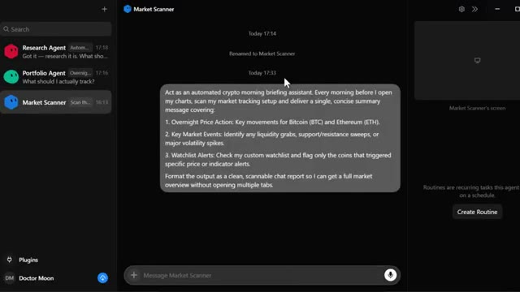
*⏱️ 00:00:15 — Interface de l'application GrokBot affichant un prompt de configuration pour un agent de scan de marché.*

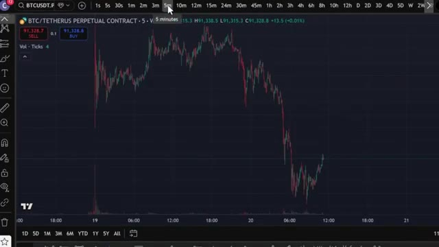
*⏱️ 00:00:22 — Graphique TradingView en chandeliers sur l'unité de temps 5 minutes d'un contrat perpétuel Bitcoin (BTCUSDT).*

---

### ⏱️ `[00:00:29 - 00:00:50]` | Segment #02

**🔊 Audio (Transcription Intégrale Mot pour Mot en Français) :**
> Ce n’est pas un autre indicateur. Ce n’est pas un autre groupe de signaux. C’est une IA qui travaille littéralement pour vous 24h/24 et 7j/7, même pendant que vous dormez. Donc, dans la vidéo d’aujourd’hui, je vous donne la présentation complète. Premièrement, ce que Grok et GrokBot sont réellement et d'où ils viennent. Deuxièmement, comment l'installer étape par étape. Exactement de la même manière que je vous guide à travers les choses sur ma chaîne.

**👁️ Analyse Visuelle d'Écran (gemini-3.5-flash-lite) :**
**Interface & Outils** : Interface web et application logicielle de Grok Bot.

**Contenu textuel & Code** : Présentation marketing de Grok Bot, description des agents IA autonomes et boutons de téléchargement ou de connexion.

**Action / Démonstration** : Présentation de l'interface de présentation et de connexion de Grok Bot.

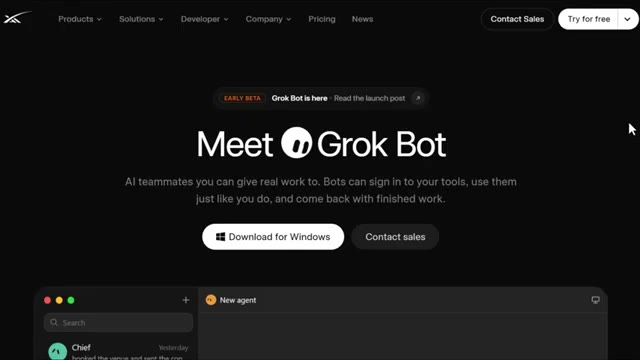
*⏱️ 00:00:34 — Page de présentation web de Grok Bot, mettant en avant ses fonctionnalités d'agents IA autonomes.*

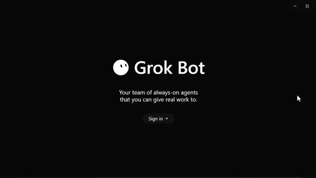
*⏱️ 00:00:39 — Écran de connexion de l'application Grok Bot invitant à accéder à l'équipe d'agents autonomes.*

---

### ⏱️ `[00:00:50 - 00:01:23]` | Segment #03

**🔊 Audio (Transcription Intégrale Mot pour Mot en Français) :**
> Troisièmement, comment il se compare à tous les modèles d'IA que vous payez probablement déjà en ce moment et la vraie différence de prix. et quatrièmement les trois cas d'usage que je configurerais personnellement aujourd'hui si je faisais tourner ça pour mon propre trading de crypto dans mon groupe telegram à la fin de cette vidéo vous allez comprendre pourquoi je pense sincèrement que c'est l'un des meilleurs outils sortis cette année parce qu'il supprime pratiquement toute la friction qui empêchait les traders réguliers des gens comme vous et moi de faire tourner notre propre système toujours actif vous n'avez pas besoin d'être un développeur vous n'avez pas besoin de connaître un seul

**👁️ Analyse Visuelle d'Écran (gemini-3.5-flash-lite) :**
**Interface & Outils** : Application de messagerie/agent IA (Market Scanner), réseau social X (Twitter), terminal Linux (GNU nano).

**Contenu textuel & Code** : Prompts d'analyse technique automatisée (détection d'anomalies de volume, ruptures de structure de marché) et analyse de prix de logiciels d'IA.

**Action / Démonstration** : Navigation et affichage des messages d'un agent de trading et lecture d'un tweet d'évaluation comparative de l'IA.

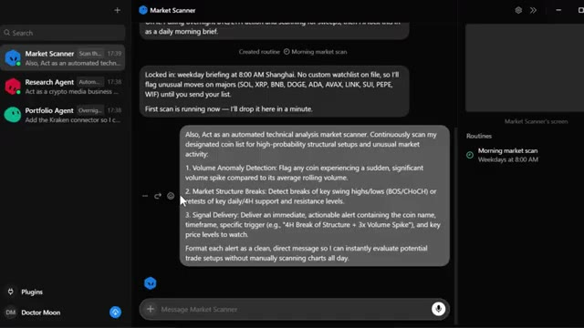
*⏱️ 00:00:58 — Interface d'un agent conversationnel de type scanner de marché crypto avec des consignes de détection de volume et de structures.*

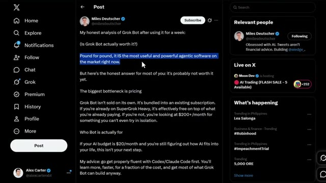
*⏱️ 00:01:07 — Publication sur le réseau X de Miles Deutscher analysant le coût et la valeur de Grok Bot.*

---

### ⏱️ `[00:01:23 - 00:01:58]` | Segment #04

**🔊 Audio (Transcription Intégrale Mot pour Mot en Français) :**
> ligne de code. Suivez simplement avec moi étape par étape. Donc sans plus attendre, entrons dans le vif du sujet. Maintenant, avant d'aborder le bot lui-même, parlons de d'où tout cela vient. Parce que beaucoup d'entre vous connaissent le nom de Grok, mais ne connaissent pas vraiment l'histoire. Grok a été créé par XAI, qu'Elon Musk a lancé en 2023 avec essentiellement un seul objectif, construire une IA capable de rivaliser avec OpenAI et de réellement comprendre le monde, et pas seulement de répondre à des questions. La première version, Grok1, est sortie en novembre 2023 et a été intégrée directement dans X. Donc si vous aviez X Premium, vous l'aviez déjà

**👁️ Analyse Visuelle d'Écran (gemini-3.5-flash-lite) :**
**Interface & Outils** : Application de chat/agent IA et page web d'actualités/documentation technique (xAI).

**Contenu textuel & Code** : Prompt de Market Scanner pour l'analyse technique automatisée et texte descriptif des performances du modèle Grok-1 (HumanEval, MMLU, GSM8k).

**Action / Démonstration** : Navigation et présentation des origines de Grok et de sa configuration d'agent de scan de marché.

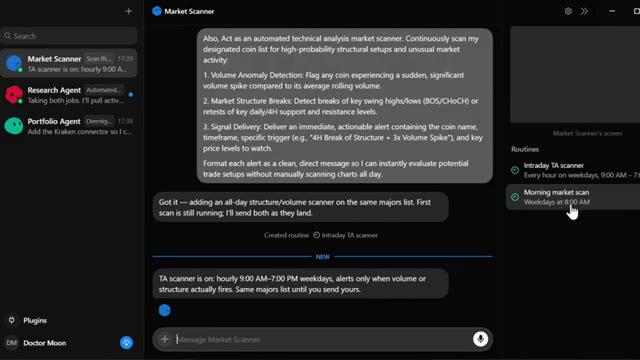
*⏱️ 00:01:32 — Interface de type chat assistant avec un prompt automatisé de Market Scanner pour la détection d'anomalies de volume.*

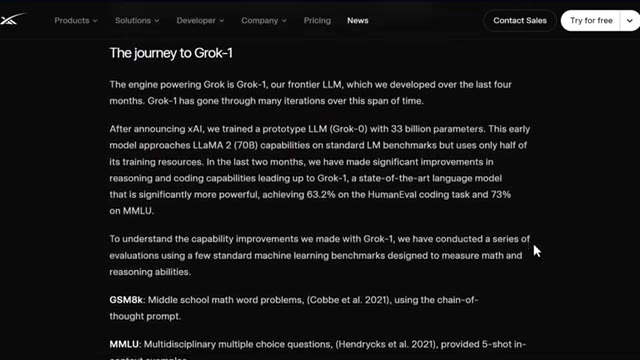
*⏱️ 00:01:49 — Page web officielle expliquant l'histoire et les performances techniques du modèle de langage Grok-1 de xAI.*

---

### ⏱️ `[00:01:58 - 00:02:23]` | Segment #05

**🔊 Audio (Transcription Intégrale Mot pour Mot en Français) :**
> accès à celui-ci sans même réaliser ce que vous utilisiez. À partir de là, tout est allé très vite. Grok 2, puis Grok 3, puis Grok 4, chacun réduisant l'écart avec GPT et Claude. Et honnêtement, dès Grok 3, les gens ont arrêté de l'appeler l'IA de Twitter et ont commencé à le prendre au sérieux en tant que véritable modèle de pointe. Et maintenant, plus récemment, ils ont lancé Grok 4.6, dont je parlerai plus en détail plus tard, car cela compte vraiment pour la tarification.

**👁️ Analyse Visuelle d'Écran (gemini-3.5-flash-lite) :**
**Interface & Outils** : Site web officiel de xAI (section News et benchmarks).

**Contenu textuel & Code** : Annonce officielle "Grok 3 Beta — The Age of Reasoning Agents" et graphiques de performance comparative face aux modèles concurrents (DeepSeek, OpenAI o1, Gemini).

**Action / Démonstration** : Présentation des capacités et des scores de raisonnement des nouveaux modèles xAI.

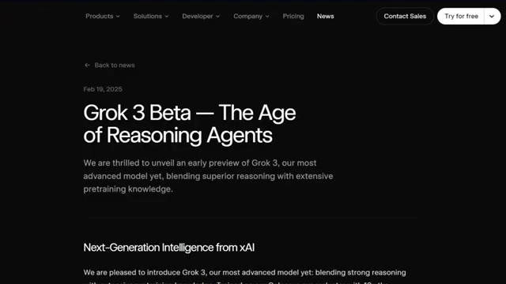
*⏱️ 00:02:04 — Capture d'écran du site xAI présentant la page d'actualités sur le lancement de Grok 3 Beta.*

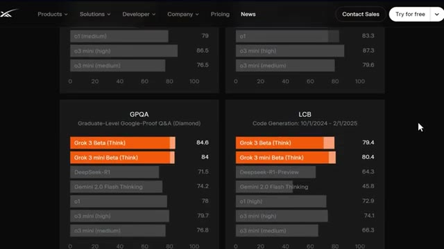
*⏱️ 00:02:17 — Graphiques comparatifs des performances de Grok 3 Beta et Grok 3 mini Beta sur différents benchmarks (GPQA, LCB).*

---

### ⏱️ `[00:02:23 - 00:02:48]` | Segment #06

**🔊 Audio (Transcription Intégrale Mot pour Mot en Français) :**
> Mais voici la partie que la plupart des gens ratent. Grok a cessé d'être juste un chatbot il y a un moment. xAI a pris ce même modèle et a construit un cadre d'agents autour. C'est de ça qu'on est vraiment là pour parler aujourd'hui. Donc c'est Grokbot, et honnêtement, l'appeler juste un outil d'IA ne lui rend même pas justice. C'est fondamentalement une équipe complète d'agents qui ne pointent jamais, n'ont jamais besoin de rappels, et continuent simplement de bosser en arrière-plan 24h/24 et 7j/7.

**👁️ Analyse Visuelle d'Écran (gemini-3.5-flash-lite) :**
**Interface & Outils** : Interface Web de X (Twitter) et plateforme xAI Grok Bot.

**Contenu textuel & Code** : Menus de navigation Grok, bannières 'Meet Grok Bot', agents d'IA conversationnels (Chief, Sales Outbound, Talent Scout, Expense Manager, etc.), historiques de tâches automatisées et flux de discussion.

**Action / Démonstration** : Navigation à travers l'interface de présentation de Grok Bot et visualisation des différents agents autonomes et de leurs rapports d'activité.

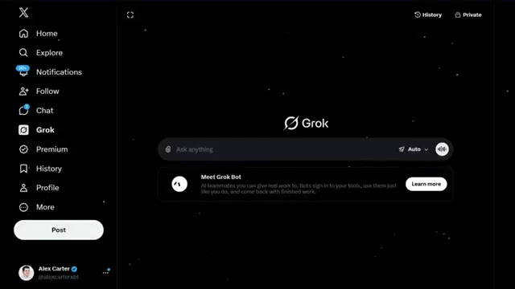
*⏱️ 00:02:30 — Interface de l'application X présentant l'option 'Meet Grok Bot' dans le menu de navigation latéral de Grok.*

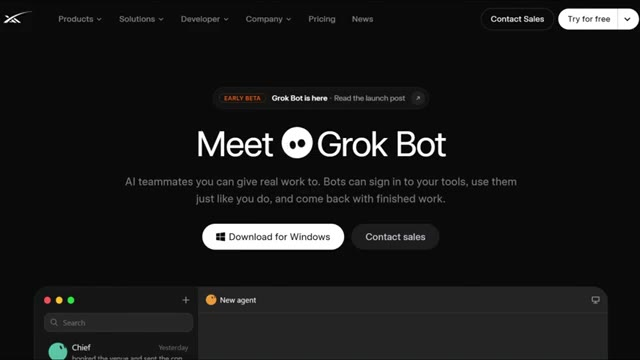
*⏱️ 00:02:36 — Page Web officielle de présentation de 'Meet Grok Bot' par xAI avec option de téléchargement et aperçu d'interface agent.*

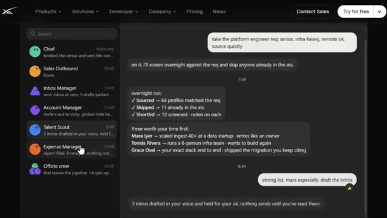
*⏱️ 00:02:42 — Interface détaillée du tableau de bord Grok Bot montrant différents agents spécialisés (Chief, Sales Outbound, Talent Scout, Expense Manager) et des exemples d'interactions textuelles.*

---

### ⏱️ `[00:02:49 - 00:03:07]` | Segment #07

**🔊 Audio (Transcription Intégrale Mot pour Mot en Français) :**
> Tu n'as pas besoin d'un VPS qui tourne 24 heures sur 24. Tu n'as pas besoin de configurer des fichiers mémoire pendant des heures. Tu le télécharges, tu te connectes à un compte, et tu as déjà une équipe d'agents prêts à travailler. Si tu t'es déjà senti dépassé en essayant de configurer un système d'IA toujours actif pour ton trading, tu n'es pas seul. Et ce n'est pas ta faute.

**👁️ Analyse Visuelle d'Écran (gemini-3.5-flash-lite) :**
**Interface & Outils** : GNU nano, terminal de commande SSH, éditeur de configuration système.

**Contenu textuel & Code** : Fichier de configuration '/etc/ssh/sshd_config' ouvert dans nano avec des paramètres SSH tels que PermitRootLogin et PermitTTY.

**Action / Démonstration** : Modification des configurations serveur et édition de scripts de configuration système via un terminal SSH.

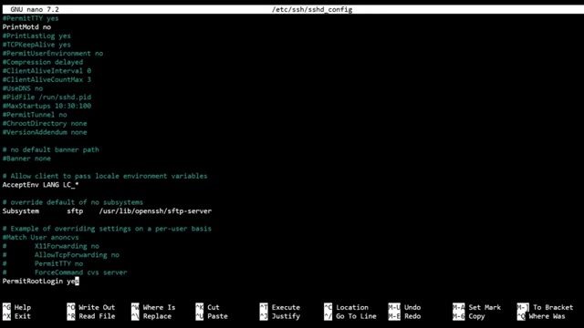
*⏱️ 00:03:02 — Terminal de commande Linux affichant l'éditeur GNU nano 7.2 avec le fichier de configuration SSH '/etc/ssh/sshd_config'.*

---

### ⏱️ `[00:03:07 - 00:03:26]` | Segment #08

**🔊 Audio (Transcription Intégrale Mot pour Mot en Français) :**
> La plupart de ces outils ont bien trop de friction. Il peut se connecter à pratiquement n'importe quel modèle, Grok, Opus, GPT, Gemini, peu importe ce que vous voulez faire tourner en arrière-plan. Et comme il possède son propre ordinateur, il peut consulter des graphiques, extraire des données, exécuter des scripts et continuer à travailler pendant que vous dormez littéralement ou que vous regardez une autre vidéo sur cette chaîne.

**👁️ Analyse Visuelle d'Écran (gemini-3.5-flash-lite) :**
**Interface & Outils** : Documentation technique, marketplace de plugins, interface TradingView.

**Contenu textuel & Code** : Commandes de contrôle de graphiques, listes de plugins d'intégration financière, métriques de performance de stratégie de trading.

**Action / Démonstration** : Présentation des outils d'intégration de modèles et de contrôle automatisé de graphiques.

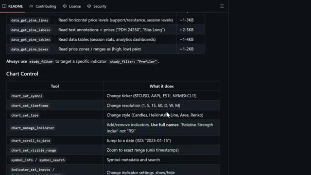
*⏱️ 00:03:12 — Documentation technique listant les fonctions de contrôle de graphiques et d'extraction de données (Pine Script).*

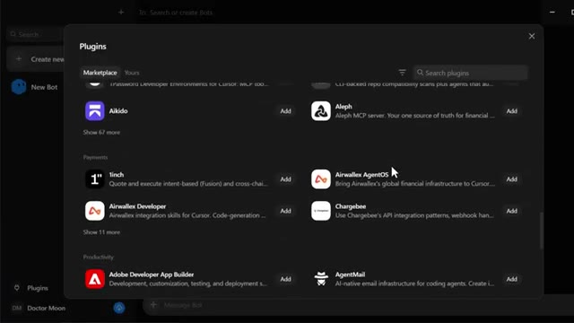
*⏱️ 00:03:16 — Fenêtre de marketplace de plugins affichant différentes extensions logicielles (Aikido, Aleph, Airwallex, etc.).*

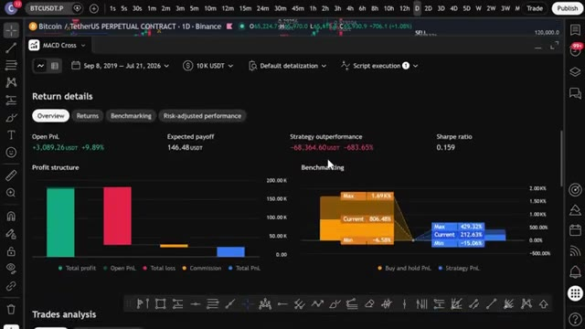
*⏱️ 00:03:21 — Tableau de bord de performances de trading et de backtest sur TradingView montrant le détail des rendements (Open PnL, ratio de Sharpe).*

---

### ⏱️ `[00:03:27 - 00:03:48]` | Segment #09

**🔊 Audio (Transcription Intégrale Mot pour Mot en Français) :**
> Maintenant, la plupart d'entre vous paient déjà pour ChatGPT, Gemini ou Claude. Soyons donc réalistes sur la raison pour laquelle c'est différent. ChatGPT est probablement encore le meilleur assistant conversationnel généraliste sur le marché. Idéal pour les questions rapides, pour expliquer une configuration, pour rédiger quelque chose rapidement. Mais dès que vous voulez qu'il vérifie les prix pendant la nuit, qu'il analyse votre liste de surveillance pendant que vous dormez, il craque.

**👁️ Analyse Visuelle d'Écran (gemini-3.5-flash-lite) :**
**Interface & Outils** : Interfaces web de Claude (Anthropic) et de ChatGPT (OpenAI).

**Contenu textuel & Code** : Texte conversationnel, options de prompts (Write, Learn, Code), actualités OpenAI et prévisions de prix de marché structurées par points.

**Action / Démonstration** : Navigation et présentation des interfaces des principaux assistants conversationnels du marché (ChatGPT et Claude).

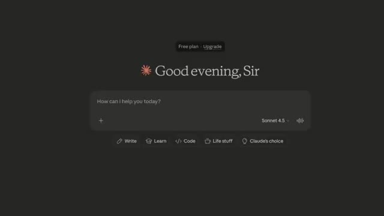
*⏱️ 00:03:32 — Interface de l'assistant Claude d'Anthropic avec le message de bienvenue "Good evening, Sir" et la barre de saisie.*

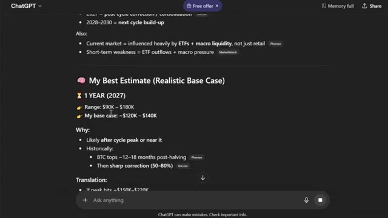
*⏱️ 00:03:43 — Interface de ChatGPT affichant une analyse de marché structurée avec des estimations de prix (Range: $90K - $180K pour 2027).*

---

### ⏱️ `[00:03:49 - 00:04:08]` | Segment #10

**🔊 Audio (Transcription Intégrale Mot pour Mot en Français) :**
> Because it's not an agent, it's a conversation. It answers when you ask. It doesn't work when you don't. Gemini actually holds up really well for search grounded stuff. Pulling in live data, cross-referencing news. But same problem. No persistent computer. No memory that carries a task forward on its own. The second you close the tab, the work stops.

**👁️ Analyse Visuelle d'Écran (gemini-3.5-flash-lite) :**
**Interface & Outils** : Interfaces Web de ChatGPT et Google Gemini.

**Contenu textuel & Code** : Prévisions de prix du Bitcoin, analyses de cycles de marché et estimations macroéconomiques générées par les IA.

**Action / Démonstration** : Comparaison des réponses et des estimations de prix fournies par ChatGPT et Gemini concernant les tendances futures du Bitcoin.

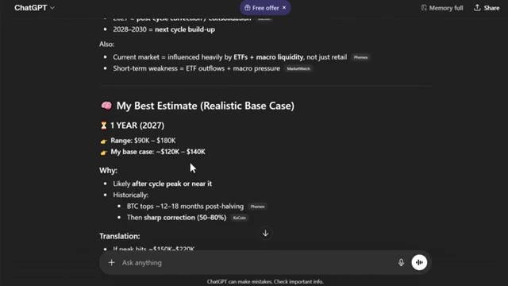
*⏱️ 00:03:54 — Interface ChatGPT affichant des estimations de prix pour le Bitcoin sur un horizon d'un an (2027) avec des fourchettes chiffrées.*

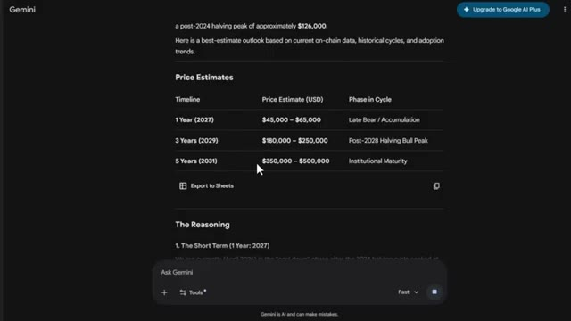
*⏱️ 00:03:58 — Interface Gemini affichant un tableau d'estimations de prix sur plusieurs horizons temporels (2027, 2029, 2031) et les phases de cycle correspondantes.*

---

### ⏱️ `[00:04:09 - 00:04:33]` | Segment #11

**🔊 Audio (Transcription Intégrale Mot pour Mot en Français) :**
> Claude, et plus particulièrement Opus, est généralement le modèle de raisonnement le plus puissant des trois, selon moi. Et voici le point important : GrokBot peut en fait faire tourner Opus en arrière-plan. Ce n'est donc pas vraiment GrokBot contre Claude. C'est l'intelligence de Claude, en moins les jours de configuration manuelle qu'il faut normalement pour connecter soi-même l'utilisation de l'ordinateur, les fichiers de mémoire et les connexions MCP.

**👁️ Analyse Visuelle d'Écran (gemini-3.5-flash-lite) :**
**Interface & Outils** : Navigateur web affichant une interface X (Twitter) et terminal Linux SSH.

**Contenu textuel & Code** : Publication X indiquant 'Grok Bot (@bot) currently uses Claude Opus internally' et logs montrant des appels vers 'claude-opus-0.19.0', ainsi que des commandes root dans le terminal.

**Action / Démonstration** : Navigation sur les réseaux sociaux pour analyser le fonctionnement interne d'un bot IA et administration système via terminal.

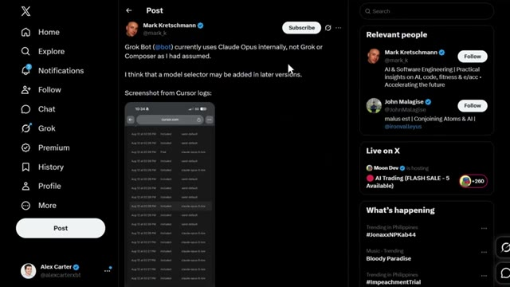
*⏱️ 00:04:21 — Publication sur le réseau X de Mark Kretschmann montrant que Grok Bot utilise Claude Opus en interne.*

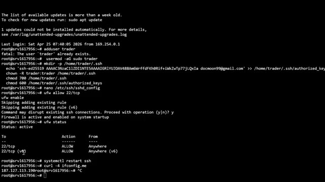
*⏱️ 00:04:27 — Terminal de commandes Linux affichant des instructions de configuration SSH et de gestion des accès utilisateur.*

---

### ⏱️ `[00:04:33 - 00:04:57]` | Segment #12

**🔊 Audio (Transcription Intégrale Mot pour Mot en Français) :**
> Vous pensez peut-être que votre configuration actuelle d'IA vous offre déjà une analyse solide. Pourquoi aurais-je besoin d'une structure d'agent en plus ? Mais les données montrent quelque chose de différent. Un modèle de conversation répond quand vous posez la question. Une structure d'agent comme GrokBot fonctionne que vous demandiez ou non. Et le dernier élément concerne le coût et la vitesse. L'équipe d'Elon vient de sortir Grok 4.6, qui est moins cher qu'Opus, mais qui atteint un grand nombre des mêmes capacités.

**👁️ Analyse Visuelle d'Écran (gemini-3.5-flash-lite) :**
**Interface & Outils** : Interface web d'IA et navigateur.

**Contenu textuel & Code** : Texte de présentation de Grok 4.6 et listes d'agents conversationnels.

**Action / Démonstration** : Navigation et présentation des fonctionnalités multi-agents.

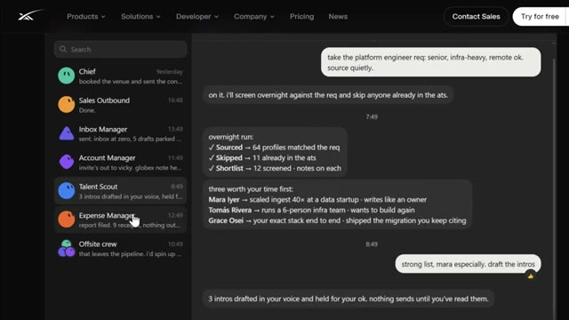
*⏱️ 00:04:45 — Interface de gestion d'agents multiples avec des discussions automatisées sur le recrutement.*

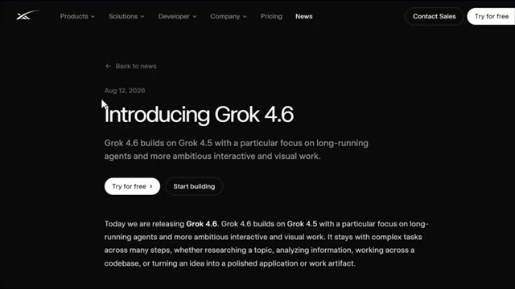
*⏱️ 00:04:51 — Page web d'annonce présentant le lancement de Grok 4.6.*

---

### ⏱️ `[00:04:57 - 00:05:30]` | Segment #13

**🔊 Audio (Transcription Intégrale Mot pour Mot en Français) :**
> Donc, vous obtenez une intelligence de niveau pionnier sans avoir à faire tourner cinq abonnements en parallèle. C'est vraiment ça, la lacune. Ce n'est pas que GrokBot est plus intelligent que ChatGPT, Gemini ou Claude dans tous les cas. C'est qu'il est toujours actif. C'est du prêt-à-l'emploi et ça ne vous pénalise pas pour le fait de n'être pas un développeur. Très bien, entrons maintenant dans le vif de la configuration, car je sais qu'un grand nombre d'entre vous apprennent le mieux en voyant les choses étape par étape, tout comme je le fais sur ma chaîne de tutoriels. Étape 1, allez sur la page d'inscription de GrokBot. Vous pouvez vérifier le lien ci-dessous dans la description. Vous serez amenés

**👁️ Analyse Visuelle d'Écran (gemini-3.5-flash-lite) :**
**Interface & Outils** : Interface logicielle de bot et site web de présentation de Grok Bot.

**Contenu textuel & Code** : Marketplace de plugins, intégrations d'agents IA (AWS SageMaker, Atlan, Arize) et interface de téléchargement de l'application Grok Bot.

**Action / Démonstration** : Navigation dans la marketplace des plugins et présentation de la plateforme Grok Bot.

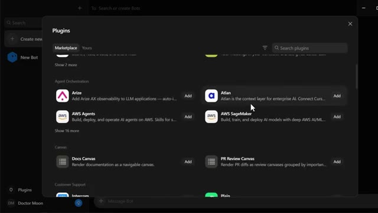
*⏱️ 00:05:05 — Interface de gestion des plugins d'un bot montrant une marketplace d'intégrations (Arize, Atlan, AWS Agents).*

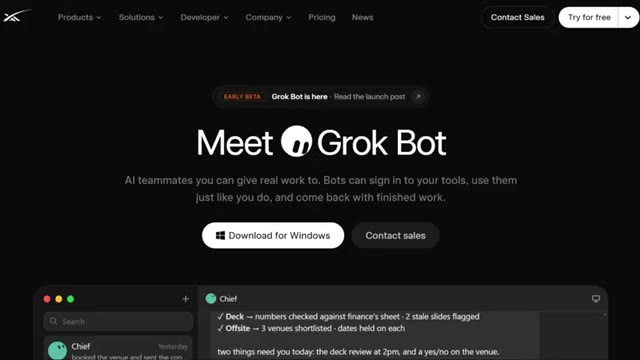
*⏱️ 00:05:14 — Page web de présentation de 'Meet Grok Bot' avec le slogan 'AI teammates you can give real work to' et les options de téléchargement.*

---

### ⏱️ `[00:05:30 - 00:06:04]` | Segment #14

**🔊 Audio (Transcription Intégrale Mot pour Mot en Français) :**
> sur cette page où vous pouvez voir que c'est en version bêta anticipée. Vous pouvez voir l'annonce de lancement ici. Quand vous faites défiler vers le bas, vous pouvez voir le bouton de téléchargement ici. Maintenant, cela dépend si vous avez un Mac ou Windows, mais pour ceci nous allons utiliser Windows. Puisque c'est ce que nous utilisons, cliquez dessus et une fenêtre de téléchargement apparaîtra. Suivez simplement l'installation sur votre appareil, attendez quelques minutes, et vous êtes prêts. Une fois que vous ouvrez l'application, une fenêtre de connexion apparaîtra, cliquez dessus, et suivez les instructions. Vous pouvez activer votre essai gratuit ici. Une fois que c'est configuré, vous retournerez sur l'application de bureau. Deuxième étape, une fois que vous arrivez sur votre

**👁️ Analyse Visuelle d'Écran (gemini-3.5-flash-lite) :**
**Interface & Outils** : Site web officiel de Grok Bot et interface utilisateur du logiciel.

**Contenu textuel & Code** : Options de téléchargement pour Windows, tarifs d'abonnement (One Week Trial, Get Ultra à 200 $ par mois) et fonctionnalités incluses.

**Action / Démonstration** : Navigation sur le site web et survol des boutons de téléchargement et d'abonnement.

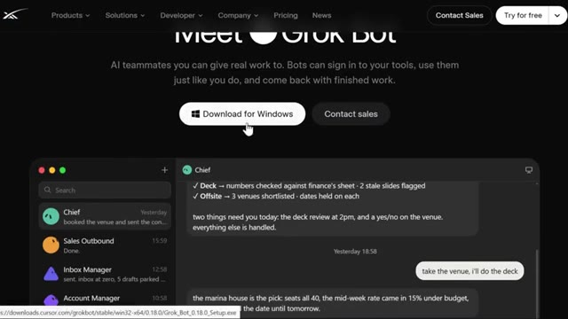
*⏱️ 00:05:38 — Page de téléchargement de Grok Bot avec un bouton pour Windows et un aperçu de l'interface en bas.*

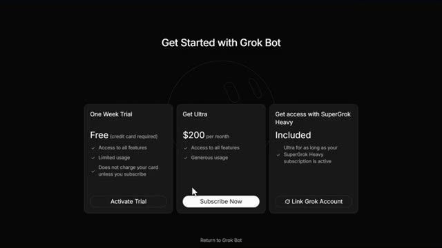
*⏱️ 00:05:56 — Page de tarification de Grok Bot présentant différentes options d'abonnement et d'essai.*

---

### ⏱️ `[00:06:04 - 00:06:26]` | Segment #15

**🔊 Audio (Transcription Intégrale Mot pour Mot en Français) :**
> tableau de bord, c'est votre centre de contrôle. C'est ici que vous allez lancer vos agents. Troisième étape, cliquez sur nouveau bot ou sur l'icône plus et attribuez-lui un rôle. Pour le trading de crypto, voici exactement ce que je configurerais. Un agent scanner de marché. Chaque matin, il vérifie votre liste de surveillance, signale toute crypto qui sort de sa plage normale et vous envoie un résumé avant même que vous n'ouvriez vos graphiques.

**👁️ Analyse Visuelle d'Écran (gemini-3.5-flash-lite) :**
**Interface & Outils** : Application de gestion de bots / agents conversationnels (interface sombre)

**Contenu textuel & Code** : Barre de recherche, liste des bots avec un élément sélectionné ("New Bot"), champ de saisie central ("Message New Bot"), boutons d'interaction (icône plus et micro).

**Action / Démonstration** : Sélection d'un bot existant ou création d'un nouveau bot dans l'interface de contrôle pour attribuer un rôle.

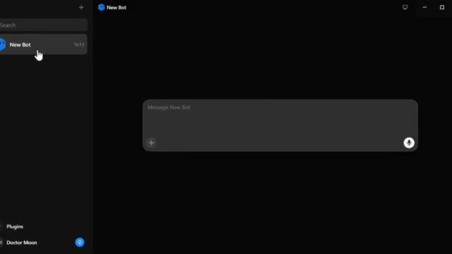
*⏱️ 00:06:10 — Interface du centre de contrôle montrant le panneau latéral gauche avec un bot sélectionné et la zone de chat centrale pour interagir avec le bot.*

---

### ⏱️ `[00:06:26 - 00:06:45]` | Segment #16

**🔊 Audio (Transcription Intégrale Mot pour Mot en Français) :**
> Un agent de portefeuille. Avec ce bot, vous pouvez le connecter à votre échange, qu'il s'agisse de votre tableur avec des interrogations d'API en direct ou d'une connexion de lecture directe à votre compte. Et chaque matin, il vous donne un récapitulatif de la nuit. Qu'est-ce qui a bougé ? Qu'y a-t-il au calendrier aujourd'hui ? Et si quelque chose dans vos positions nécessite de l'attention.

**👁️ Analyse Visuelle d'Écran (gemini-3.5-flash-lite) :**
**Interface & Outils** : Application de messagerie de type chatbot / assistant IA avec paramètres de configuration.

**Contenu textuel & Code** : Description de l'agent ("Connect this bot to your exchange account or live API spreadsheet to get an automated morning report..."), historique des conversations et paramètres.

**Action / Démonstration** : Présentation de l'interface et des fonctionnalités de configuration de l'agent de portefeuille automatisé.

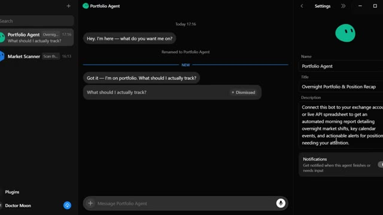
*⏱️ 00:06:31 — Interface de discussion d'un agent conversationnel nommé "Portfolio Agent" avec un panneau de configuration sur la droite.*

---

### ⏱️ `[00:06:45 - 00:07:04]` | Segment #17

**🔊 Audio (Transcription Intégrale Mot pour Mot en Français) :**
> Un agent de recherche que vous pouvez configurer pour analyser les actualités crypto et X toutes les quelques heures et compiler uniquement ce qui est réellement pertinent pour les pièces que vous détenez ou surveillez. Quatrième étape, sous les plugins, vous pouvez le connecter à Google Sheets, Gmail, Slack et d'autres outils. De la même manière que vous connectez un MCP dans Claude.

**👁️ Analyse Visuelle d'Écran (gemini-3.5-flash-lite) :**
**Interface & Outils** : Application de chat et de gestion d'agents IA (Interface personnalisée avec panneau de configuration et plugins).

**Contenu textuel & Code** : Paramètres de l'agent de recherche (« Research Agent », « Automated Crypto News & X Intelligence ») et liste des plugins disponibles (« AWS Agents », « Docs Canvas », « Intercom », etc.).

**Action / Démonstration** : Configuration des paramètres de l'agent de recherche et exploration du catalogue de plugins.

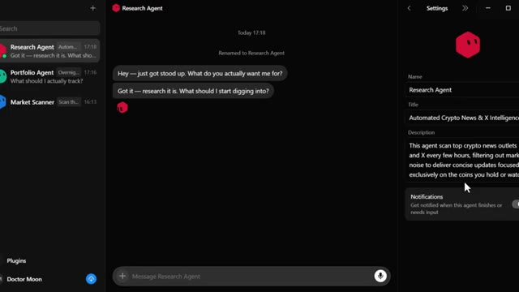
*⏱️ 00:06:50 — Interface de l'agent de recherche montrant les paramètres de configuration avec la description de l'agent crypto.*

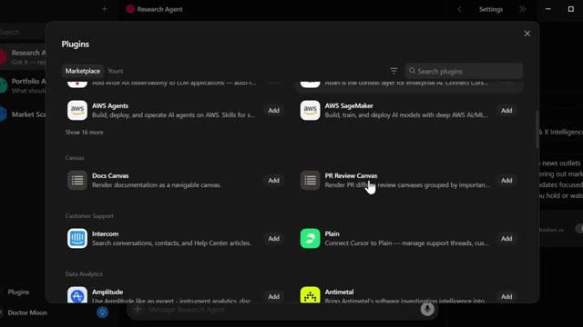
*⏱️ 00:07:00 — Fenêtre de la marketplace des plugins affichant différentes intégrations et outils disponibles.*

---

### ⏱️ `[00:07:05 - 00:07:24]` | Segment #18

**🔊 Audio (Transcription Intégrale Mot pour Mot en Français) :**
> C'est là que ça devient puissant pour le trading en particulier, car vous pouvez littéralement lui donner un accès en lecture à vos données d'échange et lui demander de vous faire un rapport comme le ferait un analyste. Remarque importante, et je le dis à chaque fois que je parle d'automatisation et d'argent, lorsqu'il s'agit de l'exécution réelle des transactions, soyez beaucoup plus prudent. Le reporting et l'analyse, aucun problème.

**👁️ Analyse Visuelle d'Écran (gemini-3.5-flash-lite) :**
**Interface & Outils** : Interface logicielle d'agent conversationnel IA (Marketplace et panneau de configuration Market Scanner).

**Contenu textuel & Code** : Catalogue de plugins (Amplitude, Apify, Antimetal, Astronomer, Mobbin, Docusign) et configuration d'un agent automatisé de scan de marché.

**Action / Démonstration** : Navigation et présentation des extensions et des paramètres d'un agent de trading automatisé.

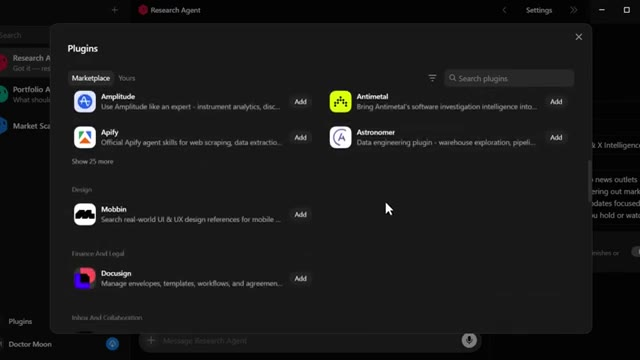
*⏱️ 00:07:10 — Fenêtre contextuelle affichant le catalogue des plugins d'une interface d'agent IA (Marketplace).*

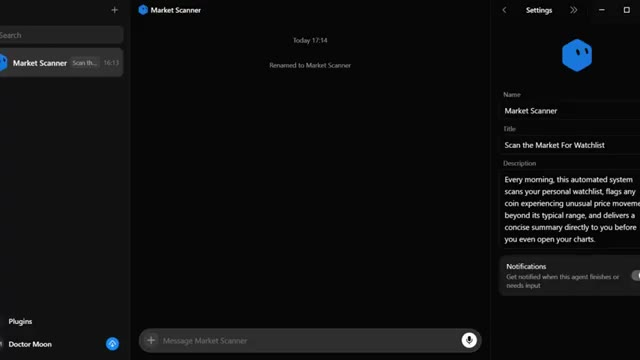
*⏱️ 00:07:14 — Interface de configuration d'un agent de trading nommé "Market Scanner" avec sa description et ses paramètres de notification.*

---

### ⏱️ `[00:07:24 - 00:07:55]` | Segment #19

**🔊 Audio (Transcription Intégrale Mot pour Mot en Français) :**
> lui permettre de passer de vrais trades en votre nom est une autre discussion et quelque chose que vous devez vérifier sérieusement avant de le connecter, maintenant laissez-moi vous montrer exactement comment j'utiliserais ceci pour le trading et l'investissement parce que c'est là que ça devient réellement utile et pas seulement un jouet cool : un récapitulatif du marché nocturne, au lieu de vous réveiller et de faire défiler 15 onglets, vous ouvrez un seul chat et il vous dit ce que Bitcoin et Ethereum ont fait pendant la nuit, s'il y a eu des chasses à la liquidité et si les cryptos de votre liste de surveillance ont déclenché des alertes.

**👁️ Analyse Visuelle d'Écran (gemini-3.5-flash-lite) :**
**Interface & Outils** : Interface de type messagerie/agent IA personnalisable (style application de bureau ou web app) avec panneau latéral de gestion des agents et des conversations.

**Contenu textuel & Code** : Textes de configuration d'agents IA ("Research Agent" et "Market Scanner") incluant des descriptions de tâches automatisées pour l'analyse des actualités crypto, le suivi des prix (Bitcoin, Ethereum) et la détection d'événements de marché.

**Action / Démonstration** : Présentation de la configuration et des cas d'usage pratiques de différents agents IA dédiés au trading et à l'investissement en cryptomonnaies.

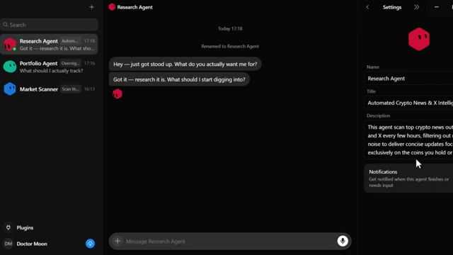
*⏱️ 00:07:32 — Interface d'un agent conversationnel configuré pour la recherche crypto, affichant les détails de l'agent "Research Agent" avec ses paramètres à droite.*

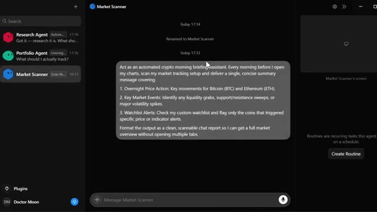
*⏱️ 00:07:40 — Interface d'un agent conversationnel configuré en tant que "Market Scanner", montrant un prompt détaillé pour un assistant de point matinal sur les cryptomonnaies.*

---

### ⏱️ `[00:07:56 - 00:08:18]` | Segment #20

**🔊 Audio (Transcription Intégrale Mot pour Mot en Français) :**
> Deux, des rappels pour le rééquilibrage de portefeuille. Si vous êtes comme beaucoup de traders qui oublient de rééquilibrer, vous pouvez littéralement dire : signalez-moi si une position s'écarte de plus de 10 % de l'allocation cible, et cela vous dira exactement quand et de combien. Trois, la recherche de valeurs aberrantes. De la même manière que j'utilise ce concept sur ma chaîne d'analyse technique.

**👁️ Analyse Visuelle d'Écran (gemini-3.5-flash-lite) :**
**Interface & Outils** : Interface de chat avec un assistant IA spécialisé dans la gestion de portefeuille (Portfolio Agent).

**Contenu textuel & Code** : Prompt détaillé de l'utilisateur pour le suivi des allocations, l'identification des déviations de plus de 10 % et la génération d'alertes actionnables.

**Action / Démonstration** : Configuration d'un agent IA pour le suivi automatisé et le rééquilibrage du portefeuille de trading.

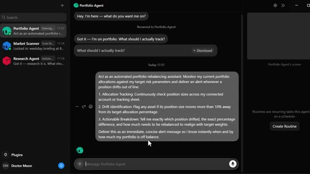
*⏱️ 00:08:01 — Interface d'un agent conversationnel montrant un prompt demandant d'agir comme un assistant automatisé de rééquilibrage de portefeuille avec un seuil de déviation de 10 %.*

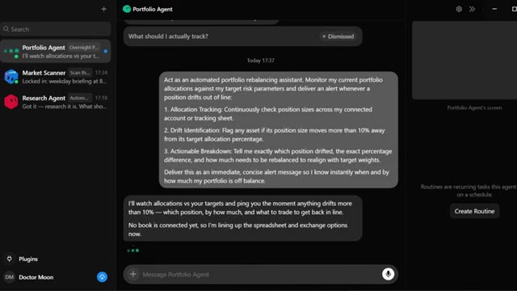
*⏱️ 00:08:12 — Suite de la conversation avec la réponse de l'agent confirmant qu'il surveillera les allocations par rapport aux cibles et alertera en cas de déviation supérieure à 10 %.*

---

### ⏱️ `[00:08:18 - 00:08:37]` | Segment #21

**🔊 Audio (Transcription Intégrale Mot pour Mot en Français) :**
> Vous pouvez le faire scanner pour détecter des pièces, montrant un volume inhabituel ou brisant une structure clé. Ainsi, vous ne vérifiez pas manuellement les graphiques toute la journée. Quatrièmement, le parrainage et la recherche de projets. Si vous gérez une page ou une chaîne crypto comme je le fais, vous pouvez littéralement lui faire scanner quels projets dépensent le plus en publicité en ce moment.

**👁️ Analyse Visuelle d'Écran (gemini-3.5-flash-lite) :**
**Interface & Outils** : Application de type agent conversationnel et d'automatisation (interface sombre avec panneau latéral pour les agents Market Scanner, Research Agent, Portfolio Agent).

**Contenu textuel & Code** : Prompts de configuration d'un agent de scan technique (détection de pics de volume, ruptures de structure de marché BOS/CHoCH) et liste de prospects publicitaires crypto (Polymarket, Toobit, MEXC, Kraken).

**Action / Démonstration** : Navigation et démonstration des routines automatisées configurées pour le scan des marchés et la recherche de sponsors.

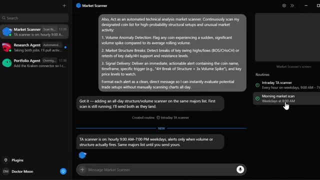
*⏱️ 00:08:23 — Interface d'un assistant de marché automatisé affichant la configuration des scans de structure de marché et de détection d'anomalies de volume.*

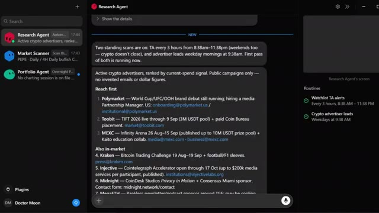
*⏱️ 00:08:32 — Interface de recherche montrant une liste d'annonceurs crypto actifs et de pistes de partenariats potentiels classés par signal de dépenses.*

---

### ⏱️ `[00:08:37 - 00:09:10]` | Segment #22

**🔊 Audio (Transcription Intégrale Mot pour Mot en Français) :**
> Donc vous savez qui contacter. Cinq, la formation à l'apprentissage et aux flux de travail. Vous pouvez vous enregistrer en train de faire votre propre processus d'analyse technique et il va réellement apprendre à en répliquer des parties pour vous avec le temps. Mais voici le point. GrokBot n'est pas seulement conçu pour le trading de crypto. Si vous avez d'autres tâches pour gérer votre entreprise ou votre vie, GrokBot peut aussi s'en charger. Vous pouvez le configurer pour les ventes, la prospection, la recherche de talents, la gestion des médias payants, la gestion des dépenses, le suivi des performances des produits, la reproduction de bugs, la surveillance de la santé des comptes, et même un chef complet

**👁️ Analyse Visuelle d'Écran (gemini-3.5-flash-lite) :**
**Interface & Outils** : Application de chat type agent IA (Portfolio Agent) et site web promotionnel de Grok Bot.

**Contenu textuel & Code** : Prompt utilisateur structuré en trois étapes (Process Extraction, Rule Codification, Strategy Replication) pour analyser des sessions de trading et automatiser une stratégie.

**Action / Démonstration** : Configuration et démonstration d'un prompt d'apprentissage d'analyse technique et sélection de rôles de bots sur une interface web.

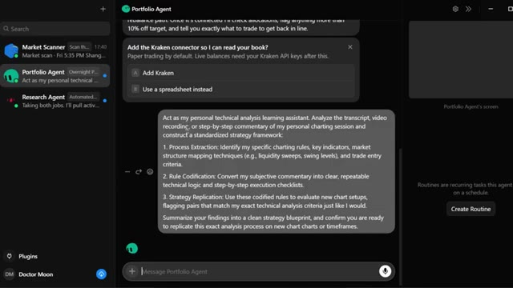
*⏱️ 00:08:45 — Interface d'un agent conversationnel affichant un prompt détaillé pour configurer un assistant d'apprentissage à l'analyse technique.*

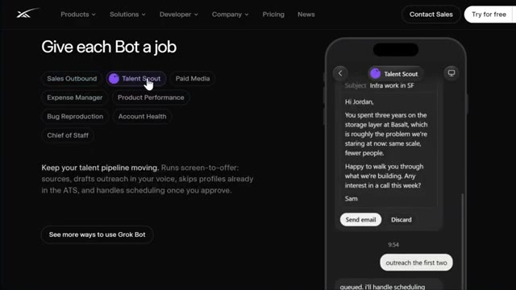
*⏱️ 00:09:02 — Page web promotionnelle de Grok Bot montrant la fonctionnalité d'attribution de rôles aux bots avec un aperçu sur smartphone.*

---

### ⏱️ `[00:09:10 - 00:09:45]` | Segment #23

**🔊 Audio (Transcription Intégrale Mot pour Mot en Français) :**
> de rôle. GrokBot peut vraiment tout faire. Les cas d'usage crypto, c'est juste là-dessus que je me penche en ce moment parce que c'est ce qui est pertinent pour vous et moi. Bon, parlons des prix, parce que je sais que c'est là-dessus que beaucoup d'entre vous vont avoir des avis. Cursor Ultra coûte 200 dollars par mois, facturé mensuellement, cela inclut le propre ordinateur de GrokBot, il se connecte à vos outils, exécute des routines selon un calendrier, fonctionne partout sur ordinateur, mobile et plus encore, et vous donne des limites étendues sur les jetons. Supergirl Heavy coûte 300 dollars par mois, facturé mensuellement, et cela comprend tout ce qu'il y a dans Supergirl plus le niveau le plus

**👁️ Analyse Visuelle d'Écran (gemini-3.5-flash-lite) :**
**Interface & Outils** : Navigateur web affichant la page officielle du produit Grok Bot et sa grille tarifaire.

**Contenu textuel & Code** : Tarifs des abonnements : Cursor Ultra ($200/month), SuperGrok Heavy ($300/month) et Cursor Premium Teams ($120/seat/month) ainsi que la liste de leurs fonctionnalités respectives.

**Action / Démonstration** : Navigation sur la page de tarification des services d'intelligence artificielle pour illustrer les coûts présentés dans la vidéo.

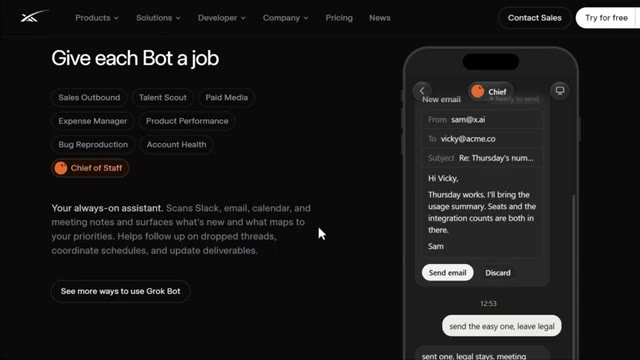
*⏱️ 00:09:19 — Présentation du site web montrant l'interface utilisateur de Grok Bot et ses différentes fonctionnalités professionnelles.*

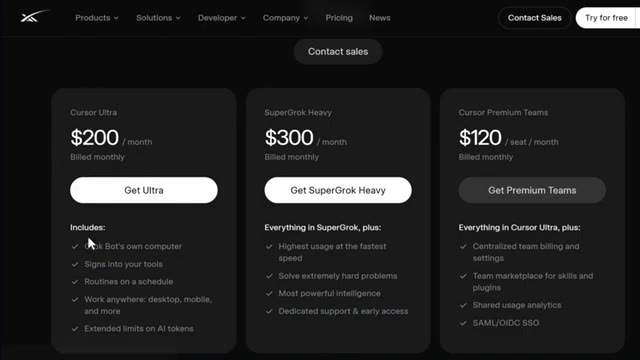
*⏱️ 00:09:28 — Page de tarification présentant les offres Cursor Ultra à 200 $ par mois, SuperGrok Heavy à 300 $ par mois et Cursor Premium Teams à 120 $ par siège et par mois.*

---

### ⏱️ `[00:09:45 - 00:10:19]` | Segment #24

**🔊 Audio (Transcription Intégrale Mot pour Mot en Français) :**
> l'utilisation à la vitesse la plus rapide, la capacité à résoudre des problèmes extrêmement difficiles, l'intelligence la plus puissante et un support dédié en accès anticipé. Cursor Premium Teams coûte 120 dollars par utilisateur et par mois, facturé mensuellement, et cela comprend tout ce qu'il y a dans Cursor Ultra, plus la facturation et les paramètres d'équipe centralisés, un marché d'équipe pour les compétences et les plugins, des analyses d'utilisation partagées et SAML ou O-I-D-C-S-S-O. Maintenant, comparez ce prix à d'autres modèles comme ChatGPT, Google Gemini et Claude d'Anthropic. ChatGPT Plus coûte 20 dollars par mois.

**👁️ Analyse Visuelle d'Écran (gemini-3.5-flash-lite) :**
**Interface & Outils** : Page web de tarification (Pricing) avec des cartes d'abonnements.

**Contenu textuel & Code** : Tarifs des abonnements : Cursor Ultra ($200/month), SuperGrok Heavy ($300/month) et Cursor Premium Teams ($120/seat/month) avec le détail des fonctionnalités incluses pour chaque offre.

**Action / Démonstration** : Présentation des différentes offres d'abonnement et de leurs tarifs respectifs.

*⏱️ 00:09:53 — Capture d'écran montrant la page de tarification d'une plateforme avec trois offres différentes : Cursor Ultra à 200 $/mois, SuperGrok Heavy à 300 $/mois et Cursor Premium Teams à 120 $/siège/mois.*

---

### ⏱️ `[00:10:20 - 00:10:57]` | Segment #25

**🔊 Audio (Transcription Intégrale Mot pour Mot en Français) :**
> ce qui vous donne l'expérience standard à laquelle la plupart des gens sont habitués. Mais si vous voulez leur modèle de raisonnement haut de gamme, ChatGPT Pro coûte 200 dollars par mois. Donc, rien que là, vous payez la même chose que pour le niveau supérieur de GrokBot, mais vous obtenez toujours juste une conversation, et non un agent toujours actif doté de son propre ordinateur. Gemini est similaire. Google AI Pro, qui s'appelait auparavant Gemini Advanced, coûte 19,99 dollars par mois pour le niveau standard. Mais si vous voulez leur niveau ultra avec le plus de capacités, cela passe à 99,99 dollars par mois, et il y a un niveau encore plus élevé à 199,99 dollars par mois. Encore une fois,

**👁️ Analyse Visuelle d'Écran (gemini-3.5-flash-lite) :**
**Interface & Outils** : Navigateur web affichant des pages web de comparaison d'abonnements et de tarifs d'IA.

**Contenu textuel & Code** : Tarifs d'abonnement pour ChatGPT/Gemini (Pro à 100$, Pro à 200$, Google AI Ultra à 99.99$/mois) et descriptifs des limites d'utilisation.

**Action / Démonstration** : Comparaison des coûts et des niveaux de service des différents abonnements d'intelligence artificielle.

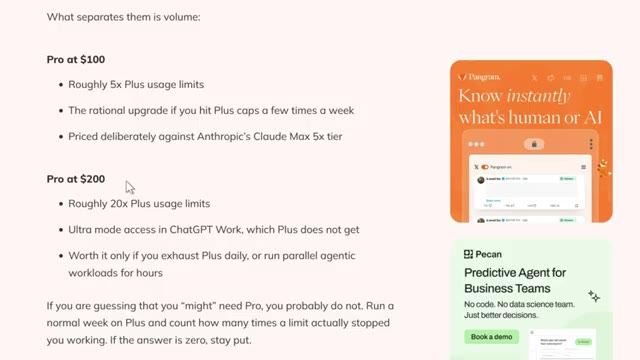
*⏱️ 00:10:29 — Une page de texte détaillant les abonnements Pro à 100$ et 200$ avec des limites d'utilisation et des encarts publicitaires sur le côté.*

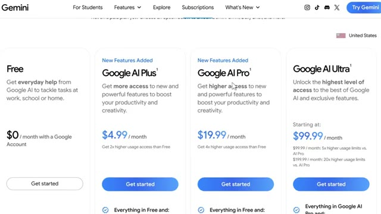
*⏱️ 00:10:38 — La page des abonnements Gemini de Google montrant les offres Free, Google AI Plus, Google AI Pro et Google AI Ultra.*

---

### ⏱️ `[00:10:57 - 00:11:35]` | Segment #26

**🔊 Audio (Transcription Intégrale Mot pour Mot en Français) :**
> c'est de l'argent réel pour un modèle qui ne fonctionne encore que lorsque vous le sollicitez activement. Et Claude, le maximum cinq fois coûte 100 dollars par mois et le maximum 20 fois, leur niveau le plus élevé est à 200 dollars par mois. Vous payez donc le prix de GrokBot pour l'intelligence de Claude, sauf qu'il faut encore le surveiller, ouvrir le chat et entretenir la conversation vous-même. Donc, quand on met tout bout à bout, 20 à 300 dollars pour ChatGPT, 20 à 200 dollars pour Gemini, 100 à 200 dollars pour Claude, vous dépensez déjà de l'argent réel pour les niveaux supérieurs de n'importe lequel d'entre eux. La différence avec GrokBot à cette même fourchette de prix de 200 à 300 dollars

**👁️ Analyse Visuelle d'Écran (gemini-3.5-flash-lite) :**
**Interface & Outils** : Navigateur web affichant le site officiel et le blog de tarification de Claude (Anthropic).

**Contenu textuel & Code** : Tarifs des abonnements Claude : plan Pro à 17-20 $/mois, Max 5x à 100 $/mois, et Max 20x à 200 $/mois.

**Action / Démonstration** : Présentation des grilles tarifaires et comparaison des différents niveaux d'abonnement et de leurs multiplicateurs d'utilisation.

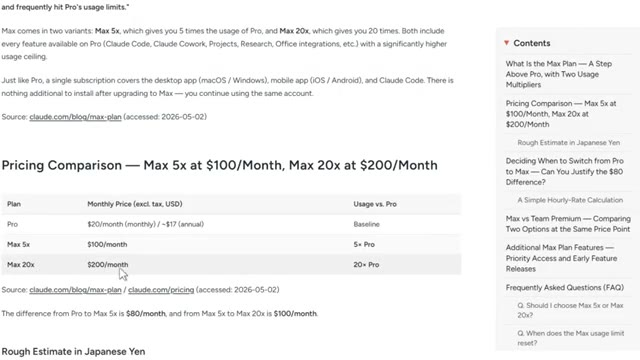
*⏱️ 00:11:07 — Capture d'écran montrant un tableau comparatif des prix pour Claude (plans Max 5x à 100 $/mois et Max 20x à 200 $/mois).*

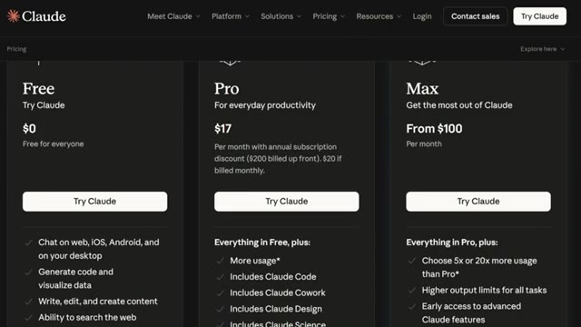
*⏱️ 00:11:16 — Capture d'écran de la page de tarification officielle de Claude présentant les offres Free, Pro et Max.*

---

### ⏱️ `[00:11:35 - 00:12:09]` | Segment #27

**🔊 Audio (Transcription Intégrale Mot pour Mot en Français) :**
> c'est que vous ne payez pas pour une conversation plus intelligente. Vous payez pour quelque chose qui fonctionne 24 heures sur 24 et 7 jours sur 7 sans vous. Écoutez, 200 dollars, c'est beaucoup, et je ne vais pas faire semblant que ce n'est pas le cas. Ce n'est pas pour quelqu'un qui se contente de mettre un orteil dans la crypto avec un abonnement de 20 dollars. C'est pour les personnes qui dépensent déjà de l'argent réel en crédits d'API ou en plusieurs abonnements à des IA et qui veulent que ce soit regroupé en un seul système toujours actif. Si ce n'est pas encore votre cas, c'est tout à fait correct. Vous pouvez tirer une énorme valeur des outils gratuits et continuer à trader intelligemment. Maintenant, avant de conclure, laissez-moi passer rapidement en revue un

**👁️ Analyse Visuelle d'Écran (gemini-3.5-flash-lite) :**
**Interface & Outils** : Page web de tarification et d'abonnement (Grok Bot / Cursor) avec interface utilisateur sombre.

**Contenu textuel & Code** : Offres tarifaires : Cursor Ultra ($200/mois), SuperGrok Heavy ($300/mois), Cursor Premium Teams ($120/siège/mois), et essai gratuit d'une semaine.

**Action / Démonstration** : Présentation des grilles tarifaires et des fonctionnalités associées aux abonnements haut de gamme pour l'automatisation et les outils d'IA.

*⏱️ 00:11:44 — Page de tarification affichant les abonnements Cursor Ultra à 200 $ par mois et SuperGrok Heavy à 300 $ par mois.*

*⏱️ 00:12:01 — Page d'inscription pour Grok Bot montrant l'option d'essai gratuit d'une semaine et l'abonnement Ultra à 200 $ par mois.*

---

### ⏱️ `[00:12:09 - 00:12:33]` | Segment #28

**🔊 Audio (Transcription Intégrale Mot pour Mot en Français) :**
> FAQ parce que je sais que beaucoup d'entre vous vont avoir exactement ces questions dans les commentaires. En quoi GrokBot est-il différent des assistants IA ? Les bots ont leur propre ordinateur, donc ils peuvent travailler au sein de vos applications et de vos outils. Ils fonctionnent également en parallèle, 24h/24 et 7j/7, même lorsque votre ordinateur portable est fermé. Pour qui GrokBot est-il disponible aujourd'hui ? GrokBot est accessible dès aujourd'hui pour les abonnés de Cursor Ultra, Super Grok Heavy et Cursor Premium Team.

**👁️ Analyse Visuelle d'Écran (gemini-3.5-flash-lite) :**
**Interface & Outils** : Site web officiel de présentation de Grok Bot.

**Contenu textuel & Code** : Texte de la FAQ expliquant la différence entre Grok Bot et les assistants IA ('Bots have their own computer...').

**Action / Démonstration** : Présentation visuelle de la foire aux questions pour appuyer les explications audio.

*⏱️ 00:12:15 — Capture d'écran montrant la section FAQ d'un site web, avec le titre 'FAQs' et la question 'How is Grok Bot different from AI assistants?' développée.*

---

### ⏱️ `[00:12:34 - 00:12:55]` | Segment #29

**🔊 Audio (Transcription Intégrale Mot pour Mot en Français) :**
> Est-ce que GrokBot est disponible pour les entreprises ? Bientôt. Nous prévoyons d'ouvrir GrokBot aux équipes et aux entreprises dans les semaines à venir. Pour l'instant, vous pouvez vous inscrire sur la liste d'attente. Je mettrai le lien ci-dessous. Où est-ce que je peux parler à GrokBot ? Travaillez avec GrokBot depuis votre bureau, sur macOS ou Windows, ou depuis votre téléphone avec l'application iOS. Est-ce que les bots partagent un seul ordinateur ? Oui. Chaque GrokBot partage un seul ordinateur virtuel persistant dans le cloud.

**👁️ Analyse Visuelle d'Écran (gemini-3.5-flash-lite) :**
**Interface & Outils** : Navigateur web affichant une page de FAQ officielle.

**Contenu textuel & Code** : Texte de la FAQ concernant Grok Bot : "Is Grok Bot available for enterprises?", réponse "Soon. We expect to open Grok Bot to teams and enterprises in the coming weeks. For now, you can join our waitlist here."

**Action / Démonstration** : Navigation et affichage des réponses de la FAQ concernant les options et la disponibilité de Grok Bot.

*⏱️ 00:12:39 — Capture d'écran montrant une section de FAQ sur un site web, avec la question sur la disponibilité de Grok Bot pour les entreprises et le lien vers la liste d'attente.*

---

### ⏱️ `[00:12:56 - 00:13:18]` | Segment #30

**🔊 Audio (Transcription Intégrale Mot pour Mot en Français) :**
> Vos bots partagent cette machine, ces fichiers, ce navigateur, ces identifiants, afin de pouvoir se transmettre le travail et conserver le contexte. L'isolation se fait par utilisateur, et non par GrokBot. Comment GrokBot traite-t-il mes données et ma confidentialité ? GrokBot utilise le même SSO de Cursor, la même authentification et le même mode de confidentialité en qui vous avez déjà confiance. Votre ordinateur cloud est chiffré en transit et au repos, avec une option de désactivation de l'entraînement.

**👁️ Analyse Visuelle d'Écran (gemini-3.5-flash-lite) :**
**Interface & Outils** : Site web officiel / Page FAQ de Grok Bot.

**Contenu textuel & Code** : Texte affiché : « Do Bots share one computer? Yes. Every Grok Bot shares one persistent cloud computer. Your Bots share that machine (files, browser, logins), so they can hand work off and keep context. Isolation is per user, not per Grok Bot. »

**Action / Démonstration** : Le présentateur survole ou zoome sur la FAQ du site de Grok Bot pour illustrer le fonctionnement technique et la gestion de l'isolation des données entre utilisateurs.

*⏱️ 00:13:01 — Capture d'écran montrant la foire aux questions (FAQ) officielle du site web de Grok Bot, avec une section développée sur le partage de la machine par les bots.*

---

### ⏱️ `[00:13:18 - 00:13:37]` | Segment #31

**🔊 Audio (Transcription Intégrale Mot pour Mot en Français) :**
> Les actions sensibles peuvent passer par une révision automatique avant d'être exécutées. Les administrateurs d'entreprise peuvent configurer la prévention des pertes de données, les règles d'information de sécurité, les proxys et les contrôles réseau au démarrage. Très bien, et regardez, pour les quelques années à venir, deux types de traders existeront. Ceux qui utilisent l'intelligence artificielle et ceux qui font encore tout manuellement. Même marché, des résultats très différents.

**👁️ Analyse Visuelle d'Écran (gemini-3.5-flash-lite) :**
**Interface & Outils** : Page web FAQ et interface du réseau social X.

**Contenu textuel & Code** : Texte de la FAQ concernant la confidentialité des données, l'authentification et les contrôles administrateur (DLP, proxys).

**Action / Démonstration** : Navigation sur la page web présentant les spécifications de sécurité du bot.

*⏱️ 00:13:23 — Capture d'écran montrant une page web avec une FAQ sur les fonctionnalités de Grok Bot, incluant la gestion de la sécurité et des données.*

---

### ⏱️ `[00:13:37 - 00:13:56]` | Segment #32

**🔊 Audio (Transcription Intégrale Mot pour Mot en Français) :**
> Voici comment vous vous mettez du bon côté de cela. J'ai rassemblé tout ce qui se trouve au sein de la communauté AI Trade Edge. Chaque prompt, chaque bot, chaque modèle, chaque guide étape par étape que j'utilise personnellement, le tout au même endroit. Et tout ce que je construirai à l'avenir sera ajouté directement dans le groupe dès sa sortie.

**👁️ Analyse Visuelle d'Écran (gemini-3.5-flash-lite) :**
**Interface & Outils** : Navigateur web affichant la plateforme de formation et d'outils d'Alex Carter (Whop et site de documentation interne).

**Contenu textuel & Code** : Liste des fonctionnalités des outils d'IA incluant la lecture de graphiques, l'extraction de données OHLCV, la lecture d'indicateurs (RSI, MACD, EMA, Bollinger Bands) et le contrôle de TradingView.

**Action / Démonstration** : Présentation des ressources de la communauté et des guides d'utilisation des outils d'IA pour le trading.

*⏱️ 00:13:47 — Capture d'écran d'un guide étape par étape détaillant les fonctionnalités de contrôle de TradingView par l'IA ('What It Can Do', 78 tools give Claude full control).*

---

### ⏱️ `[00:13:57 - 00:14:34]` | Segment #33

**🔊 Audio (Transcription Intégrale Mot pour Mot en Français) :**
> Nous testons également des stratégies provenant de tout l'internet, en les automatisant à l'aide de PineScript, en les exécutant en direct et en partageant exactement ce qui fonctionne et ce qui ne fonctionne pas. Vous n'obtenez donc pas seulement des outils. Vous obtenez une opération de recherche en direct. À l'intérieur, il y a aussi un cours complet de trading agentique de 2 heures et demie, du débutant à l'expert, sans aucune base en codage nécessaire. À la fin, vous aurez votre propre système de trading IA fonctionnant en direct, quelque chose que la plupart des traders particuliers ne savent même pas être possible en ce moment. 79,99 dollars par mois, un bon trade couvre ce montant et les 100 premiers membres bloquent ce tarif de façon permanente.

**👁️ Analyse Visuelle d'Écran (gemini-3.5-flash-lite) :**
**Interface & Outils** : Graphique de trading TradingView intégré à une plateforme de courtage et page Web de formation en ligne.

**Contenu textuel & Code** : Graphique en chandeliers japonais, indicateur technique STC Combo en bas, signaux de trading visuels (BUY, SELL) et structure de cours en ligne.
[DESC_IMAGE_2] Affichage d'un graphique financier avec indicateurs techniques suivi d'une transition vers une interface de présentation de cours de trading en ligne.

**Action / Démonstration** : Présentation d'une stratégie de trading automatisée et de la plateforme pédagogique associée.

*⏱️ 00:14:06 — Capture d'écran d'un graphique de trading TradingView montrant l'actif ETHEREUM/USD TETHER PERPETUAL SWAP CONTRACT sur BloFin avec des indicateurs techniques et des signaux d'achat/vente (BUY/SELL).*

*⏱️ 00:14:15 — Capture d'écran d'une page Web de cours intitulée 'Trading AI Full Course' avec le texte 'The complete course map' et des options de navigation (Modules, Proof, Deliverables).*

---

### ⏱️ `[00:14:34 - 00:15:11]` | Segment #34

**🔊 Audio (Transcription Intégrale Mot pour Mot en Français) :**
> après cela, le prix augmente. Le lien est dans la description. Vous ne pouvez vraiment pas vous permettre de rater ça. C'est donc GrokBot. Ce que c'est, pourquoi je pense qu'il surpasse actuellement les alternatives pour un travail continu, exactement comment le configurer, et comment vous pouvez le pointer directement vers votre trading et vos investissements en crypto. Je vais continuer à tester cela au cours des prochaines semaines et voir comment il résiste aux conditions réelles du marché. Assurez-vous donc d'être abonné et d'avoir activé les notifications car je partagerai des mises à jour au fur et à mesure et si vous voulez le guide étape par étape complet sur la façon de construire votre propre système de trading agentique en utilisant Claude, cette vidéo apparaît

**👁️ Analyse Visuelle d'Écran (gemini-3.5-flash-lite) :**
**Interface & Outils** : Application de type interface de chat avec des agents IA (GrokBot ou similaire), barre latérale de gestion des agents et panneau de routines.

**Contenu textuel & Code** : Analyses de marché automatisées, rapports de rupture de structure (BOS), changements de caractère (ChoCh), pics de volume et configurations de prompts pour agents de trading.

**Action / Démonstration** : Démonstration de l'utilisation de GrokBot comme scanner de marché technique automatisé et outil de recherche crypto.

*⏱️ 00:14:52 — Interface de bot montrant un agent de recherche (Research Agent) avec des analyses techniques automatisées sur différentes cryptomonnaies (PEPE, WIF, AVAX, XRP, LINK, etc.).*

*⏱️ 00:15:01 — Interface de l'agent de recherche affichant des instructions détaillées (prompt) pour configurer l'agent en tant que scanner de marché automatisé et assistant en développement commercial.*

---

### ⏱️ `[00:15:11 - 00:15:22]` | Segment #35

**🔊 Audio (Transcription Intégrale Mot pour Mot en Français) :**
> à l'écran également allez voir ça ensuite si vous avez trouvé cela utile laissez un pouce bleu cela aide vraiment la chaîne abonnez-vous si ce n'est pas déjà fait et je vous vois dans la prochaine

**👁️ Analyse Visuelle d'Écran (gemini-3.5-flash-lite) :**
**Interface & Outils** : Aucune

**Contenu textuel & Code** : Aucun

**Action / Démonstration** : Aucune

---

