# 🎬 I Created A 3 Minute Scalping Strategy That Trades Itself Using Claude Code (Full Tutorial)

> **Chaîne** : [Alex Carter](https://www.youtube.com/@AlexCarterTrading)  
> **Lien YouTube** : [https://www.youtube.com/watch?v=0D9yyNrPwdY](https://www.youtube.com/watch?v=0D9yyNrPwdY)  
> **Date de publication** : 20261008  
> **Durée** : 00:11:45  
> **Identifiant vidéo** : `0D9yyNrPwdY`  
> **Transcription & Analyse** : `whisper-v3-large-turbo+gemini-3.5-flash-lite`  

---

## 📌 Synthèse Exécutive & Outils

### 💡 Résumé

Cette vidéo proposée par la chaîne Alex Carter lève le voile sur une approche hybride et optimisée du scalping algorithmique, conçue pour éliminer le stress du trading frénétique en unité de temps 1 minute tout en évitant l'inertie des graphiques en 15 minutes. Axée sur l'unité de temps charnière des 3 minutes, la stratégie repose sur le « scalp de compression de momentum », un système technique rigoureux combinant l'expansion de la volatilité, la direction du flux de ordres et la validation par les volumes institutionnels. L'objectif est d'identifier des opportunités nettes et récurrentes sur des actifs liquides majeurs (Bitcoin, Ethereum, Solana) sans nécessiter une surveillance humaine continue des graphiques.

Pour industrialiser ce processus, le créateur s'appuie sur la puissance de l'intelligence artificielle générative, et plus particulièrement sur **Claude Code**, pour traduire la logique algorithmique complexe en un script Pine Script prêt à l'emploi. De la conception initiale des indicateurs (Canaux de Keltner, CMO et Volume Relatif) jusqu'à l'implémentation directe sur TradingView et la configuration d'alertes distantes, ce tutoriel complet détaille chaque maillon d'une chaîne de trading automatisée. S'y ajoutent des recommandations concrètes de gestion des risques, l'utilisation de leviers modérés (5x à 10x) en marge isolée, ainsi que la sélection d'échanges crypto adaptés comme Bybit et BingX.

### 🛠️ Outils, Modèles & Logiciels Présentés

* **Claude Code** : Assistant de développement par IA utilisé pour coder, structurer et générer automatiquement l'intégralité du script Pine Script à partir d'un prompt textuel précis.
* **TradingView** : Plateforme de graphisme et d'analyse technique de référence, servant à héberger les indicateurs, exécuter le script Pine personnalisé et configurer les alertes en temps réel.
* **Bybit** : Échange centralisé de premier plan pour le trading de produits dérivés (futures), recommandé pour sa robustesse et ses bonus d'inscription.
* **BingX** : Échange alternatif proposé pour les utilisateurs recherchant une plateforme sans obligation de vérification KYC rigoureuse pour le trading de base.
* **Canal de Keltner (Keltner Channel)** : Indicateur de volatilité basé sur l'ATR (Average True Range), configuré avec une longueur de 20 et un multiplicateur de 1,5 pour détecter les véritables cassures de prix.
* **Chande Momentum Oscillator (CMO)** : Oscillateur de momentum hautement réactif sur les petites unités de temps, utilisé au seuil de la ligne zéro pour confirmer la dynamique haussière ou baissière.
* **Volume Relatif (R Vol)** : Filtre de confirmation comparant le volume de la bougie active à la moyenne des 20 dernières barres (seuil validé au-dessus de 1,5).
* **Pine Script** : Langage de programmation propriétaire de TradingView employé pour scripter l'indicateur personnalisé et automatiser la détection des signaux d'achat et de vente.

### 🔑 Points Clés & Enseignements Stratégiques

* **Le choix de l'unité de temps 3 minutes** : Un compromis stratégique idéal qui offre un juste milieu entre le bruit excessif du graphique en 1 minute et la lenteur excessive du graphique en 15 minutes, permettant de réagir sereinement sans panique.
* **La volatilité ciblée par les Canaux de Keltner** : Contrairement aux bandes de Bollinger basées sur l'écart-type, les canaux de Keltner s'appuient sur l'ATR pour réagir nettement aux véritables expansions de volatilité et déclencher l'alerte de cassure.
* **Le filtre de momentum avec le CMO** : L'utilisation du Chande Momentum Oscillator (période 14) permet d'exiger qu'un momentum strictement positif (au-dessus de 0) ou négatif (en dessous de 0) appuie la cassure du prix.
* **La validation institutionnelle par le Volume Relatif** : L'exigence d'un R Vol supérieur à 1,5 garantit que la configuration est portée par une participation réelle du marché, éliminant ainsi les faux signaux provoqués par des mèches isolées.
* **La confluence des trois signaux** : Un ordre d'achat ou de vente n'est déclenché qu'à la clôture de la bougie lorsque les trois conditions (cassure Keltner, CMO orienté et R Vol > 1,5) s'alignent simultanément.
* **La génération automatisée de code via l'IA** : L'utilisation de Claude Code permet de s'affranchir de la programmation manuelle en transformant instantanément une stratégie textuelle en un indicateur Pine Script fonctionnel.
* **La gestion rigoureuse des risques (Stop Loss)** : Le positionnement du stop loss s'effectue de manière technique, soit juste en dehors de la ligne médiane du canal de Keltner, soit au niveau du swing high ou swing low récent.
* **La prise de profits progressive (Trailing Stop)** : La stratégie recommande d'alléger la position par paliers (premier objectif à un ratio risque/rendement de 1:1) tout en faisant suivre le solde restant via un stop dynamique adossé à la ligne médiane de Keltner.
* **L'optimisation du levier financier** : Pour le scalping à haute fréquence relative, l'utilisation d'une marge isolée couplée à un effet de levier modéré de 5x à 10x prévient le risque de liquidation instantanée sur une mèche contraire.
* **L'automatisation des alertes distantes** : La configuration des conditions d'alerte sur TradingView permet de recevoir des notifications instantanées sur mobile dès que le script valide un signal, évitant ainsi de fixer l'écran en continu.

---

## ⏱️ Chronologie & Transcription Complète Audio & Visuelle (Mot pour Mot)

### ⏱️ `[00:00:00 - 00:00:28]` | Segment #01

**🔊 Audio (Transcription Intégrale Mot pour Mot en Français) :**
> Si vous ne supportez pas d'attendre des heures ou parfois des jours pour qu'un signal apparaisse enfin sur votre graphique, mais que passer en mode scalping sur une minute où vous entrez et sortez en littéralement quelques secondes vous paraît bien trop chaotique et stressant, j'ai le compromis idéal pour vous aujourd'hui. Dans cette vidéo, je vais vous présenter une stratégie de scalping en trois minutes qui vous offre juste assez de répit pour pouvoir réellement réfléchir, tout en vous permettant de saisir plusieurs opportunités par jour. Et le meilleur dans tout ça, c'est que j'ai demandé à Claude de concevoir l'intégralité de ce système pour en faire un indicateur sur TradingView.

**👁️ Analyse Visuelle d'Écran (gemini-3.5-flash-lite) :**
**Interface & Outils** : Graphique TradingView intégré à la plateforme de trading BloFin.

**Contenu textuel & Code** : Graphique de prix BTCUSDT Perpetual Contract, barre d'outils temporelle (1s, 5s, 30s, 1m, 2m, etc.), données OHLCV en haut et échelle de prix verticale.

**Action / Démonstration** : Sélection de l'unité de temps d'une minute sur le graphique pour illustrer le scalping.

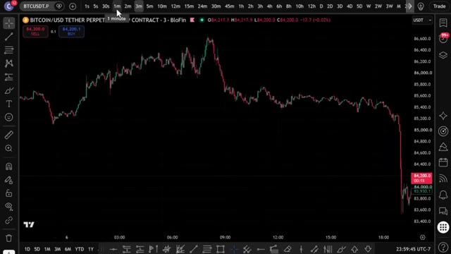
*⏱️ 00:00:07 — Un graphique en chandeliers japonais affichant le cours du Bitcoin (BTC/USDT) sur un intervalle de temps court, avec le curseur de la souris pointant sur l'unité de temps 1 minute.*

---

### ⏱️ `[00:00:28 - 00:00:52]` | Segment #02

**🔊 Audio (Transcription Intégrale Mot pour Mot en Français) :**
> donc tu n'as même pas besoin de regarder le graphique manuellement. Je vais te montrer la stratégie exacte, le prompt exact, et comment le faire fonctionner sur ton propre graphique dans les prochaines minutes. Donc sans plus attendre, entrons dans le vif du sujet. Très bien, les gars, étape numéro un, inscrivez-vous sur un échange. Pour cette stratégie, nous allons utiliser Bybit. C'est l'un de mes principaux échanges pour le trading de produits dérivés, et ils proposent des bonus fous en ce moment.

**👁️ Analyse Visuelle d'Écran (gemini-3.5-flash-lite) :**
**Interface & Outils** : TradingView, BloFin, Bybit

**Contenu textuel & Code** : Bitcoin/USD, indicateur de momentum/RSI, histogramme de volume, signaux d'achat/vente (Buy/Sell), page de parrainage (bonus de 30 100$).

**Action / Démonstration** : Analyse technique du cours du Bitcoin avec mise en évidence de configurations graphiques et de signaux de trading.

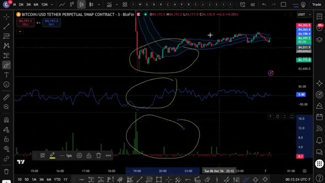
*⏱️ 00:00:34 — Graphique TradingView sur BloFin montrant Bitcoin avec des zones cerclées sur le prix, le RSI et le volume.*

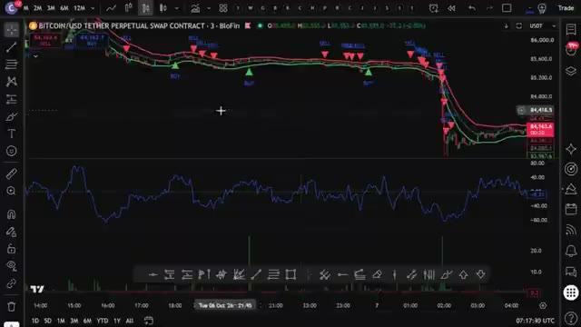
*⏱️ 00:00:40 — Graphique TradingView avec des signaux d'achat et de vente marqués par des flèches vertes et rouges.*

---

### ⏱️ `[00:00:52 - 00:01:29]` | Segment #03

**🔊 Audio (Transcription Intégrale Mot pour Mot en Français) :**
> Maintenant, voici la partie importante. Si Bybit n'est pas disponible dans votre pays ou que vous ne voulez pas faire de KYC, vous pouvez utiliser BingX comme alternative. Et le meilleur ? BingX n'exige pas de vérification KYC obligatoire pour le trading de base. BingX offre également jusqu'à 9 800 USDT de bonus de bienvenue. Je mettrai les deux liens en bas. Mais pour cette vidéo, nous allons utiliser Bybit. Pour vous inscrire sur Bybit et réclamer jusqu'à 30 000 USDT de bonus, cliquez sur le lien tout en haut de la description. Vous serez redirigé vers la page d'inscription où il vous suffit d'entrer vos informations et de créer un compte. Vous devrez compléter le KYC.

**👁️ Analyse Visuelle d'Écran (gemini-3.5-flash-lite) :**
**Interface & Outils** : Site web de l'échange de cryptomonnaies BingX, interface d'inscription et pop-up de récompenses Bybit.

**Contenu textuel & Code** : Offres promotionnelles, bonus de bienvenue en USDT, statistiques de la plateforme (40M+ d'inscriptions, 18+ langues) et paliers de récompenses.

**Action / Démonstration** : Présentation des alternatives de plateformes d'échange de cryptomonnaies (BingX et Bybit) et de leurs bonus respectifs pour les nouveaux utilisateurs.

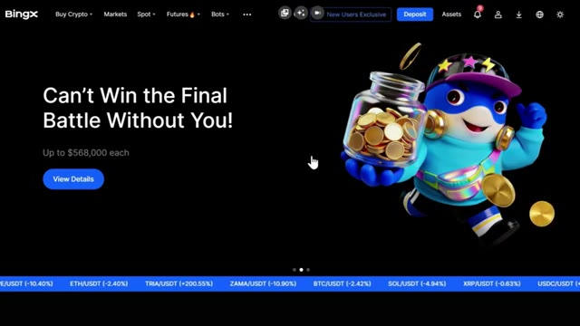
*⏱️ 00:01:02 — Page d'accueil du site Web de l'échange de cryptomonnaies BingX avec un titre promotionnel et un personnage animé.*

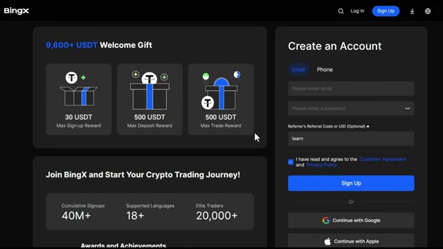
*⏱️ 00:01:11 — Formulaire de création de compte BingX et aperçu des récompenses de bienvenue allant jusqu'à 9 800+ USDT.*

*⏱️ 00:01:20 — Fenêtre pop-up promotionnelle de Bybit affichant des récompenses de bienvenue exclusives pour les nouveaux utilisateurs jusqu'à 30 100+.*

---

### ⏱️ `[00:01:29 - 00:02:04]` | Segment #04

**🔊 Audio (Transcription Intégrale Mot pour Mot en Français) :**
> vérification sur Bybit pour profiter de tous les services sur leur plateforme. Personnellement, je n'ai aucun problème avec le KYC. C'est rapide et sécurisé. Mais si vous préférez une option KYC non obligatoire, c'est pourquoi j'ai fourni BingX comme alternative ci-dessous. La deuxième étape consiste à déposer des fonds. Laissez-moi vous montrer comment déposer des fonds avant que nous ne plongions dans la stratégie. Une fois que vous êtes connecté à Bybit, cliquez sur Actifs dans le coin supérieur droit, puis cliquez sur Déposer. Choisissez la coin que vous voulez déposer. Je recommande l'USDT et sélectionnez le réseau blockchain correct. Assurez-vous de choisir le bon réseau pour éviter de perdre vos

**👁️ Analyse Visuelle d'Écran (gemini-3.5-flash-lite) :**
**Interface & Outils** : Présentation ou face-caméra explicatif du trader sans interface logicielle partagée.

**Contenu textuel & Code** : Explications orales des stratégies et mise en contexte méthodologique du marché.

**Action / Démonstration** : Explications face caméra et analyse conceptuelle des marchés.

---

### ⏱️ `[00:02:04 - 00:02:41]` | Segment #05

**🔊 Audio (Transcription Intégrale Mot pour Mot en Français) :**
> fonds. Nous confirmerons les détails, puis scannez le code QR ou copiez l'adresse de dépôt pour transférer vos fonds depuis votre portefeuille ou un autre échange. Si vous souhaitez déposer en monnaie fiat, cliquez sur Acheter des cryptos en haut du menu, puis sélectionnez Dépôt fiat. Choisissez votre devise, entrez le montant, sélectionnez votre mode de paiement et cliquez sur Continuer. Une fois vos fonds déposés, il est temps d'ouvrir une position. L'étape numéro trois consiste à ouvrir votre première position. Cliquez sur Trader dans le menu supérieur, puis sélectionnez Futures. Cela vous amènera à l'interface de trading. Choisissez l'actif que vous voulez

**👁️ Analyse Visuelle d'Écran (gemini-3.5-flash-lite) :**
**Interface & Outils** : Présentation ou face-caméra explicatif du trader sans interface logicielle partagée.

**Contenu textuel & Code** : Explications orales des stratégies et mise en contexte méthodologique du marché.

**Action / Démonstration** : Explications face caméra et analyse conceptuelle des marchés.

---

### ⏱️ `[00:02:41 - 00:03:13]` | Segment #06

**🔊 Audio (Transcription Intégrale Mot pour Mot en Français) :**
> pour trader dans le coin supérieur gauche. Pour cet exemple, j'utiliserai Bitcoin. Sélectionnez votre type d'ordre. Limite, au marché, ou conditionnel. Pour les débutants, je recommande de commencer par des ordres au marché pour une exécution instantanée. Entrez les détails de votre trade, tels que la quantité et le prix. Ensuite, choisissez votre type de effet de levier. Vous pouvez utiliser la marge croisée ou la marge isolée. Personnellement, j'utilise la marge isolée car elle limite votre risque à cette position spécifique uniquement. Vous pouvez utiliser jusqu'à 100 fois de levier sur un pari d'achat, mais pour les débutants, je recommande de commencer par 5 à 10 fois de levier jusqu'à ce que vous soyez

**👁️ Analyse Visuelle d'Écran (gemini-3.5-flash-lite) :**
**Interface & Outils** : Bybit (plateforme d'échange de cryptomonnaies)

**Contenu textuel & Code** : Paire BTCUSDT Perpetuel, graphique en chandeliers japonais avec indicateur Volume SMA 9, carnet d'ordres (Order Book), et panneau de configuration des ordres de trading (Limit, Market, Conditional).

**Action / Démonstration** : Sélection de l'onglet 'Market' pour un ordre au marché sur l'interface de trading Bybit.

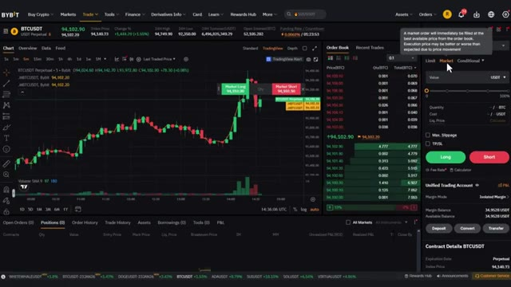
*⏱️ 00:02:49 — Capture d'écran de l'interface de trading Bybit montrant le graphique du Bitcoin (BTCUSDT) en timeframe 5 minutes, le carnet d'ordres au centre et le panneau de passage d'ordres à droite avec l'onglet 'Market' sélectionné.*

---

### ⏱️ `[00:03:13 - 00:03:49]` | Segment #07

**🔊 Audio (Transcription Intégrale Mot pour Mot en Français) :**
> confortable. Confirmez les détails de votre commande, puis cliquez sur acheter slash long ou vendre slash short pour ouvrir votre position. Une fois votre ordre exécuté, vous pouvez le consulter sous l'onglet des positions au bas de l'écran. Maintenant que vous savez comment utiliser les produits dérivés sur Bybit, passons à la stratégie proprement dite qui peut vous faire réaliser des profits importants par jour. Très bien les gars, voici donc la vraie stratégie. J'appelle cela le scalp de compression de momentum et je l'utilise sur Bitcoin USDT, mais gardez à l'esprit que cela fonctionne tout aussi bien sur Ethereum, Solana, ou honnêtement n'importe quelle paire liquide. N'hésitez donc pas à l'appliquer à peu importe

**👁️ Analyse Visuelle d'Écran (gemini-3.5-flash-lite) :**
**Interface & Outils** : Bybit, TradingView, BloFin

**Contenu textuel & Code** : Graphiques de prix en chandeliers, carnet d'ordres, panneau de configuration des ordres Market/Limit, boutons Long et Short, indicateur de volume.

**Action / Démonstration** : Navigation et présentation de l'interface de passage d'ordres d'achat et de vente sur une plateforme de produits dérivés crypto.

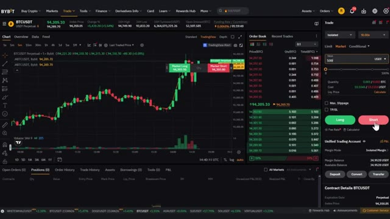
*⏱️ 00:03:22 — Interface de trading Bybit montrant un graphique BTCUSDT en chandelier japonais avec les boutons d'achat (Long) et de vente (Short).*

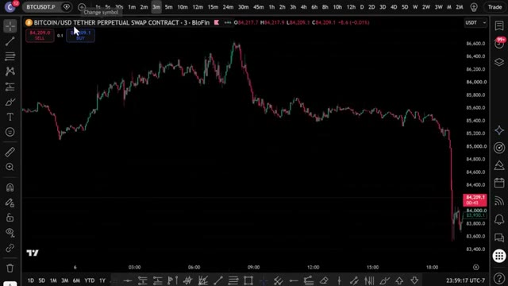
*⏱️ 00:03:40 — Graphique TradingView intégré montrant un contrat perpétuel Bitcoin/USD sur BloFin avec des bougies baissières sur plusieurs heures.*

---

### ⏱️ `[00:03:49 - 00:04:24]` | Segment #08

**🔊 Audio (Transcription Intégrale Mot pour Mot en Français) :**
> marché que vous tradez. Nous travaillons sur le graphique de trois minutes, pas d'une minute, parce qu'une minute est beaucoup trop bruyante et vous vous ferez avoir constamment. Pas de quinze minutes non plus, parce qu'alors vous attendez éternellement une configuration. Trois minutes est le juste milieu où vous obtenez des signaux fréquents, mais avez quand même quelques minutes pour réellement confirmer et exécuter au lieu de cliquer en panique. Très bien, avant d'aborder les indicateurs, un petit mot, si vous n'avez pas encore TradingView, cliquez sur le lien dans la description ci-dessous. Si vous achetez la version pro, vous obtiendrez une réduction et cela aide vraiment beaucoup la chaîne. Très bien, entrons dans le vif du sujet. L'indicateur numéro un est le Keltner

**👁️ Analyse Visuelle d'Écran (gemini-3.5-flash-lite) :**
**Interface & Outils** : Présentation ou face-caméra explicatif du trader sans interface logicielle partagée.

**Contenu textuel & Code** : Explications orales des stratégies et mise en contexte méthodologique du marché.

**Action / Démonstration** : Explications face caméra et analyse conceptuelle des marchés.

---

### ⏱️ `[00:04:24 - 00:04:58]` | Segment #09

**🔊 Audio (Transcription Intégrale Mot pour Mot en Français) :**
> canal. Contrairement aux bandes de Bollinger, les canaux de Keltner sont construits à partir de l'ATR, ils réagissent donc plus nettement à une réelle expansion de la volatilité plutôt qu'à un simple écart type. Nous utilisons ceci pour capturer le moment exact de la cassure lorsque le prix sort du canal. C'est notre déclencheur de volatilité. Pour activer le canal de Keltner, allez simplement dans les indicateurs en haut de votre graphique, recherchez le canal de Keltner et cliquez dessus pour l'ajouter. Ensuite, cliquez sur la petite icône de paramètres à côté. Modifiez la longueur à 20 et changez le multiplicateur à 1,5. Une fois que c'est fait, cliquez simplement sur OK et vous verrez le

**👁️ Analyse Visuelle d'Écran (gemini-3.5-flash-lite) :**
**Interface & Outils** : Interface de trading BloFin avec graphiques de type TradingView.

**Contenu textuel & Code** : Graphique Bitcoin/USD Tether Perpetual Swap, indicateur technique Canaux de Keltner (KC 20 2 close), prix du BTC autour de 85 400 - 86 500 USDT.

**Action / Démonstration** : Analyse graphique de la volatilité et des cassures de prix par rapport aux canaux de Keltner.

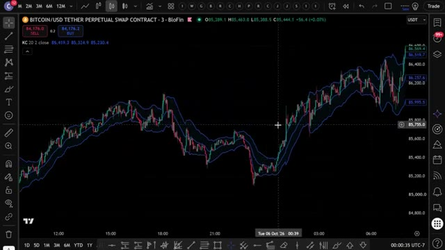
*⏱️ 00:04:32 — Graphique en chandeliers japonais illustrant l'évolution du cours du Bitcoin avec l'indicateur des canaux de Keltner.*

---

### ⏱️ `[00:04:58 - 00:05:34]` | Segment #10

**🔊 Audio (Transcription Intégrale Mot pour Mot en Français) :**
> tracé directement sur votre graphique. L'indicateur numéro deux est le CMO, ou Chande Momentum Oscillator. Celui-ci est beaucoup moins utilisé que le RSI, mais il est en réalité plus réactif sur les unités de temps inférieures. Lorsque le CMO est supérieur à zéro, le momentum est haussier. En dessous de zéro, le momentum est baissier. Nous l'utilisons pour confirmer la direction, car nous ne voulons pas d'une cassure sans véritable momentum derrière elle. Pour activer celui-ci, allez à nouveau dans les indicateurs, recherchez Chande Momentum Oscillator, et cliquez dessus pour l'ajouter à votre graphique. Cliquez ensuite sur les paramètres et changez la période pour 14.

**👁️ Analyse Visuelle d'Écran (gemini-3.5-flash-lite) :**
**Interface & Outils** : TradingView / BloFin

**Contenu textuel & Code** : Paire BITCOIN/USD TETHER PERPETUAL SWAP CONTRACT, indicateur KC (Keltner Channels) sur le graphique principal et ChandeMO (Chande Momentum Oscillator) dans le panneau inférieur.

**Action / Démonstration** : Analyse technique du graphique et affichage de l'indicateur CMO.

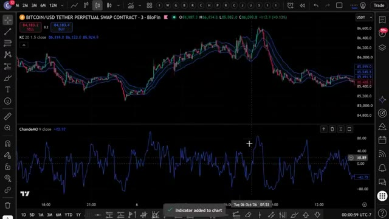
*⏱️ 00:05:07 — Graphique des prix de Bitcoin avec l'indicateur Chande Momentum Oscillator (CMO) affiché dans le panneau inférieur.*

---

### ⏱️ `[00:05:34 - 00:06:10]` | Segment #11

**🔊 Audio (Transcription Intégrale Mot pour Mot en Français) :**
> Cliquez sur OK et vous le verrez tracé dans son propre panneau sous votre graphique avec une ligne zéro qui passe au milieu. L'indicateur numéro trois est le volume relatif ou votre R vol. Celui-ci compare le volume de la bougie actuelle au volume moyen sur les 20 dernières barres. Si le R vol est supérieur à 1,5, cela signifie que nous voyons une réelle participation, et pas seulement une mèche aléatoire. C'est notre filtre de confirmation par le volume, afin de ne pas négocier sur des casses vides. Pour l'activer, allez dans les indicateurs une fois de plus, recherchez le volume relatif et ajoutez-le à votre graphique. Cliquez sur les paramètres et définissez la longueur sur 20.

**👁️ Analyse Visuelle d'Écran (gemini-3.5-flash-lite) :**
**Interface & Outils** : TradingView / Blofin (Contrat Perpetuel Bitcoin/USDT)

**Contenu textuel & Code** : Keltner Channels (KC 20 1.5), Chande Momentum Oscillator (ChandeMO 14 close), Rel vol (3 20 Cumulative).

**Action / Démonstration** : Analyse graphique et présentation des panneaux d'indicateurs techniques (momentum et volume relatif).

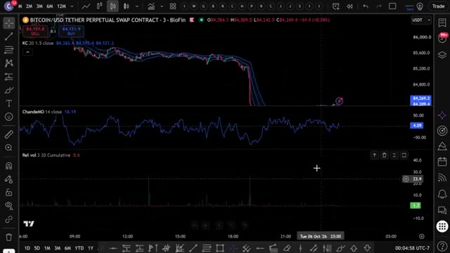
*⏱️ 00:05:43 — Graphique TradingView sur Blofin montrant le prix du Bitcoin avec les indicateurs Keltner Channels, Chande Momentum Oscillator et Volume Relatif.*

---

### ⏱️ `[00:06:10 - 00:06:45]` | Segment #12

**🔊 Audio (Transcription Intégrale Mot pour Mot en Français) :**
> Cliquez sur OK, et vous le verrez s'afficher sous forme d'histogramme avec une ligne horizontale située à 1,5, exactement là où nous voulons notre seuil de confirmation. Et c'est aussi simple que ça, les gars, vous avez les trois indicateurs empilés sur votre graphique exactement comme nous en avons besoin pour cette stratégie. Voici ce qu'il faut réellement rechercher. Pour une configuration acheteuse, le prix dépasse le canal de Keltner supérieur. Le CMO est supérieur à zéro, ce qui signifie un momentum haussier, et le R vol est supérieur à 1,5 fois la moyenne, et la bougie clôture en vert. Lorsque les trois s'alignent à la clôture de la même bougie de trois minutes, c'est votre signal d'achat.

**👁️ Analyse Visuelle d'Écran (gemini-3.5-flash-lite) :**
**Interface & Outils** : Plateforme de graphiques TradingView intégrée à l'exchange Blofin.

**Contenu textuel & Code** : Paire BITCOIN/USD TETHER PERPETUAL SWAP, avec les indicateurs techniques Keltner Channels (KC 20 1.5), ChandeMO (14 close) et Rel vol (1D 20 Cumulative).

**Action / Démonstration** : Visualisation des trois indicateurs empilés sur le graphique, affichant le seuil de confirmation et l'histogramme de volume relatif.

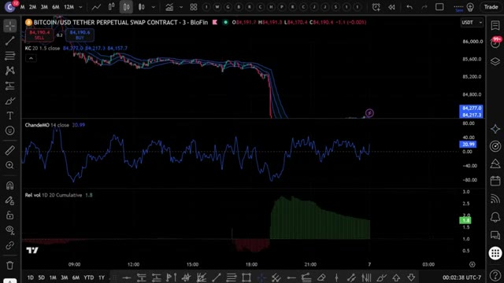
*⏱️ 00:06:19 — Graphique de trading montrant le prix du Bitcoin avec les indicateurs Keltner Channels, Chande Momentum Oscillator et Volume Relatif en histogramme.*

---

### ⏱️ `[00:06:46 - 00:07:08]` | Segment #13

**🔊 Audio (Transcription Intégrale Mot pour Mot en Français) :**
> Pour une configuration courte, c'est l'inverse. Le prix casse sous le canal de Keltner inférieur. Le CMO est sous zéro, la dynamique est baissière, et le R-ball est supérieur à 1,5 fois la moyenne, et la bougie clôture en rouge. Maintenant, parlons de la gestion des risques. Pour votre stop loss, placez-le juste en dehors du canal de Keltner, de la ligne médiane, ou au niveau du swing high ou low récent. Pour la prise de bénéfices, personnellement, j'aime alléger mes positions progressivement.

**👁️ Analyse Visuelle d'Écran (gemini-3.5-flash-lite) :**
**Interface & Outils** : Interface TradingView intégrée à la plateforme BloFin.

**Contenu textuel & Code** : Paire BITCOIN/USD TETHER PERPETUAL SWAP CONTRACT en unité de temps 3 minutes. Canaux de Keltner sur les prix, CMO (Chande Momentum Oscillator) en sous-fenêtre sous la ligne zéro, et histogramme de volumes en bas.

**Action / Démonstration** : Analyse d'une configuration de vente à découvert (short) avec cassure sous le canal de Keltner inférieur et CMO négatif.

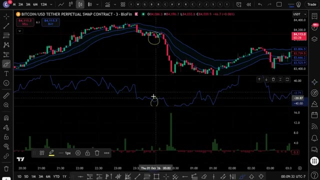
*⏱️ 00:06:51 — Graphique de trading montrant un canal de Keltner avec une cassure baissière sur Bitcoin, accompagné d'un indicateur de momentum (CMO) et de volumes.*

---

### ⏱️ `[00:07:09 - 00:07:42]` | Segment #14

**🔊 Audio (Transcription Intégrale Mot pour Mot en Français) :**
> Premier objectif à un ratio risque/rendement de un pour un, puis je fais suivre le reste en utilisant la ligne médiane de Keltner comme stop dynamique. Et pour l'effet de levier, gardez-le bas, 5x à 10x maximum. Comme nous faisons du scalping, vous ne voulez pas qu'une mèche vous liquide. Cette stratégie fonctionne parce que vous combinez l'expansion de la volatilité, la direction du momentum et la confirmation du volume, trois signaux complètement indépendants qui s'alignent rarement tous, à moins qu'un événement réel ne se produise. C'est ce qui vous évite les faux signaux. Au lieu de regarder le graphique toute la journée et de faire cela manuellement, j'ai donné exactement ceci

**👁️ Analyse Visuelle d'Écran (gemini-3.5-flash-lite) :**
**Interface & Outils** : Graphique de type TradingView / BloFin affichant un contrat perpétuel Bitcoin.

**Contenu textuel & Code** : Bandes de Keltner sur le graphique des prix, indicateur de momentum (oscillateur bleu) et histogramme de volume en bas, ainsi qu'un outil de position long (rectangle vert/rouge).

**Action / Démonstration** : Analyse graphique illustrant la configuration d'une position de scalping avec gestion du risque.

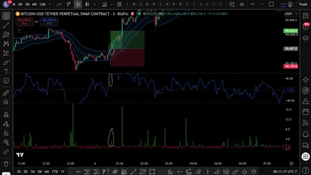
*⏱️ 00:07:17 — Un graphique de trading montrant les prix du Bitcoin avec des bandes de Keltner et des indicateurs de momentum et de volume.*

---

### ⏱️ `[00:07:42 - 00:08:05]` | Segment #15

**🔊 Audio (Transcription Intégrale Mot pour Mot en Français) :**
> stratégie à Claude et je lui ai demandé de m'écrire un script Pine complet, pour que TradingView puisse détecter automatiquement ces signaux pour moi. Et voici le prompt que j'ai utilisé. Je vais l'afficher à l'écran dès maintenant pour que vous puissiez le copier à l'identique. C'est tout. C'est le prompt complet. Vous le collez dans Claude. J'utilise Claude Code ici. Et en quelques secondes, il crache un script Pine complet et fonctionnel dans un fichier bloc-notes.

**👁️ Analyse Visuelle d'Écran (gemini-3.5-flash-lite) :**
**Interface & Outils** : TradingView, Claude Code

**Contenu textuel & Code** : Keltner Channels, Chande Momentum Oscillator (CMO), Relative Volume (RVOL), règles de signal d'achat et de vente, code Pine Script v5

**Action / Démonstration** : Présentation du prompt textuel utilisé avec l'assistant IA Claude pour automatiser la détection des signaux de trading.

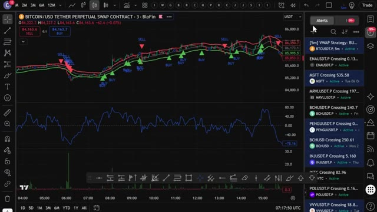
*⏱️ 00:07:48 — Graphique TradingView affichant Bitcoin avec des indicateurs techniques et des signaux d'achat/vente (marquages BUY/SELL).*

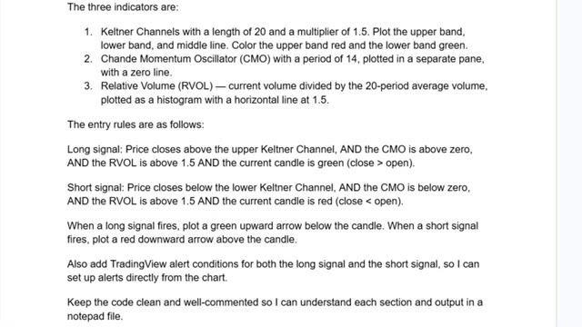
*⏱️ 00:07:54 — Texte détaillé listant les trois indicateurs (Keltner Channels, CMO, RVOL) et les règles d'entrée pour les signaux long et short.*

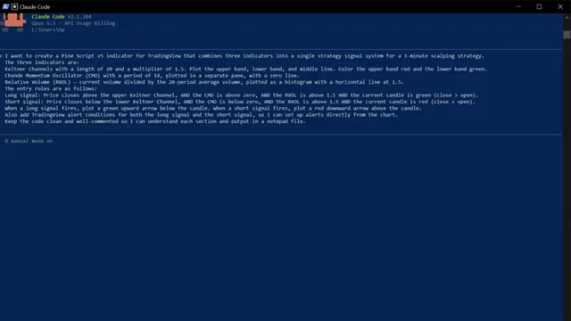
*⏱️ 00:07:59 — Interface du terminal Claude Code montrant le prompt complet utilisé pour générer l'indicateur Pine Script v5.*

---

### ⏱️ `[00:08:06 - 00:08:42]` | Segment #16

**🔊 Audio (Transcription Intégrale Mot pour Mot en Français) :**
> Maintenant, ce prompt exact, ainsi que le script Pine utilisé dans cette vidéo, est disponible dans mon groupe privé. Vous pouvez trouver le lien en bas. Ouvrez le fichier bloc-notes, appuyez sur contrôle plus A pour tout sélectionner le code, puis sur ctrl plus c pour le copier, c'est tout ce dont vous avez besoin. Maintenant, mettons-le dans TradingView. Ouvrez TradingView et allez sur n'importe quel graphique, j'utiliserai Bitcoin sur l'unité de temps de trois minutes. En bas de l'écran, cliquez sur l'onglet de l'éditeur de script Pine, si vous ne le voyez pas, allez dans la barre d'outils inférieure et cliquez sur l'éditeur de script Pine. Une fois l'éditeur ouvert, vous y verrez du code par défaut, sélectionnez-le entièrement et supprimez-le, puis collez le code que Claude vient de vous donner.

**👁️ Analyse Visuelle d'Écran (gemini-3.5-flash-lite) :**
**Interface & Outils** : Bloc-notes (Notepad) et plateforme de trading TradingView / Blofin.

**Contenu textuel & Code** : Code source Pine Script pour un système de scalpling à 3 minutes (calculs de volume, conditions d'entrée long/short, tracés graphiques) et graphique de prix BTC/USDT.

**Action / Démonstration** : Sélection du code source dans le bloc-notes et visualisation du graphique de trading des cryptomonnaies.

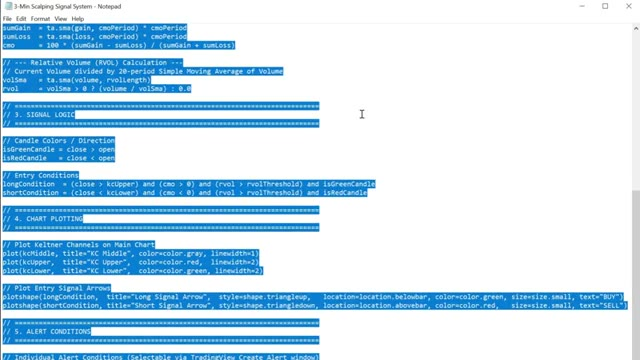
*⏱️ 00:08:15 — Capture d'écran du Bloc-notes montrant du code source Pine Script sélectionné en bleu, affichant la logique de signal et les tracés graphiques.*

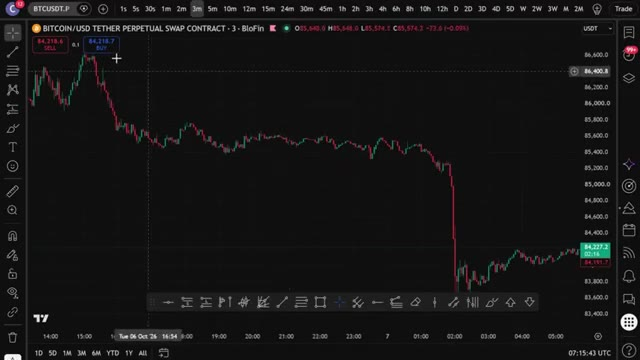
*⏱️ 00:08:24 — Graphique TradingView sur l'interface de Blofin montrant l'évolution du cours BTCUSDT en unité de temps 3 minutes.*

---

### ⏱️ `[00:08:42 - 00:09:21]` | Segment #17

**🔊 Audio (Transcription Intégrale Mot pour Mot en Français) :**
> cliquez sur Ajouter au graphique. C'est le bouton en haut à droite de l'éditeur PineScript. TradingView va compiler le script et l'appliquer directement sur votre graphique. Et voilà. Vous pouvez voir les canaux de Keltner sur le graphique, le panneau CMO en dessous, l'histogramme R vol, et les signaux d'achat et de vente tracés automatiquement. Flèches vertes pour les achats, flèches rouges pour les ventes. Tout se déclenche exactement de la manière dont nous l'avons configuré manuellement. Mais maintenant, cela le fait pour vous automatiquement. Maintenant, pour configurer des alarmes, cliquez sur l'icône de réveil en haut de TradingView, sélectionnez Créer une alerte, et dans le menu déroulant Condition, vous verrez les conditions d'alerte que Claude a ajoutées, signal d'achat et signal de vente.

**👁️ Analyse Visuelle d'Écran (gemini-3.5-flash-lite) :**
**Interface & Outils** : TradingView / BloFin

**Contenu textuel & Code** : Canaux de Keltner, signaux BUY/SELL avec flèches, indicateur CMO (Chande Momentum Oscillator), histogramme de volume et chandeliers japonais.

**Action / Démonstration** : Visualisation du graphique appliqué avec les indicateurs techniques et les signaux de trading générés par le script.

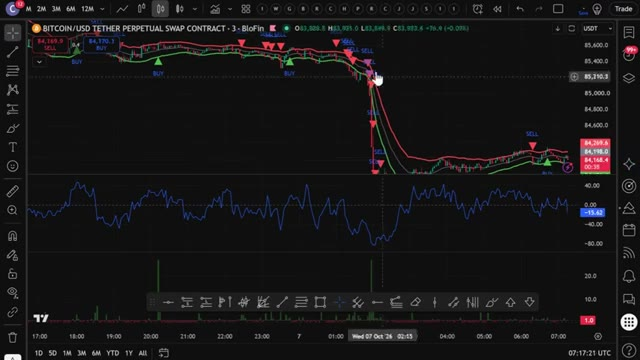
*⏱️ 00:08:52 — Un graphique TradingView affichant le contrat perpétuel Bitcoin/USDT avec les canaux de Keltner, les signaux d'achat/vente, l'indicateur CMO en panneau inférieur et l'histogramme de volume.*

---

### ⏱️ `[00:09:22 - 00:09:40]` | Segment #18

**🔊 Audio (Transcription Intégrale Mot pour Mot en Français) :**
> Configurez-les et TradingView vous préviendra dès qu'un signal se déclenche, directement sur votre téléphone. Donc maintenant, au lieu de surveiller trois indicateurs manuellement toutes les trois minutes, TradingView fait tout le travail pour vous. Dès que les trois conditions s'alignent, vous recevez une alerte. Vous vérifiez, vous exécutez sur Bybit, et c'est terminé.

**👁️ Analyse Visuelle d'Écran (gemini-3.5-flash-lite) :**
**Interface & Outils** : TradingView

**Contenu textuel & Code** : Graphique Bitcoin/USD Tether Perpetual Swap Contract (en unité de temps 3 minutes), indicateurs de type Scalp Strategy avec signaux d'achat/vente (BUY/SELL), panneau d'alertes à droite listant plusieurs actifs (BTCUSDT.P, ENAUSDT.P, MSFT, etc.) avec leurs statuts actifs.

**Action / Démonstration** : Visualisation et gestion des alertes techniques configurées pour automatiser la surveillance des signaux de trading sur plusieurs marchés.

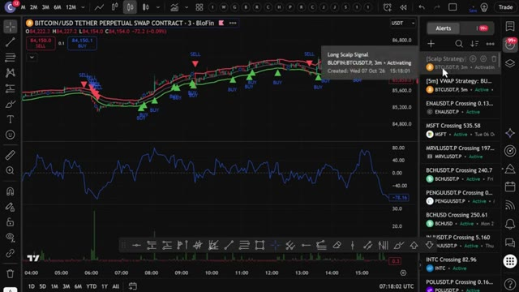
*⏱️ 00:09:26 — Capture d'écran montrant l'interface de TradingView avec un graphique des prix du Bitcoin et le panneau latéral droit affichant la liste des alertes configurées.*

---

### ⏱️ `[00:09:40 - 00:10:01]` | Segment #19

**🔊 Audio (Transcription Intégrale Mot pour Mot en Français) :**
> Maintenant, si vous voulez aller encore plus loin et faire en sorte qu'il effectue des trades automatiquement sur votre exchange dès qu'un signal est déclenché, j'ai ce qu'il vous faut. J'ai créé un groupe privé où je partage tous mes cas d'utilisation pour Claude Code, qu'il s'agisse de l'intégrer à Telegram, TradingView, ou de rechercher des baleines sur Hyperliquid. Tout cela automatiquement. Tout ce que je vous ai montré aujourd'hui, tout se trouve à l'intérieur du groupe.

**👁️ Analyse Visuelle d'Écran (gemini-3.5-flash-lite) :**
**Interface & Outils** : MEXC, site web d'Alex Carter Trading, Hyperliquid Leaderboard.

**Contenu textuel & Code** : Graphique de prix BTCUSDT, carnets d'ordres, liste de fonctionnalités de Claude Code pour TradingView (Chart Reading, Chart Control), tableau de classement Hyperliquid avec valeurs de comptes et PnL.

**Action / Démonstration** : Exécution d'un ordre de trading automatisé sur MEXC et présentation des capacités logicielles d'intégration.

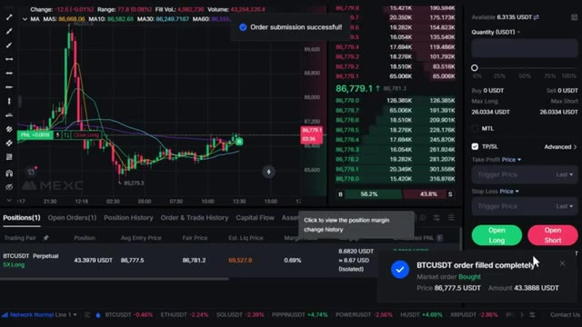
*⏱️ 00:09:45 — Interface de trading de la bourse MEXC affichant un graphique de prix Bitcoin, un carnet d'ordres et une notification de succès de commande de trading.*

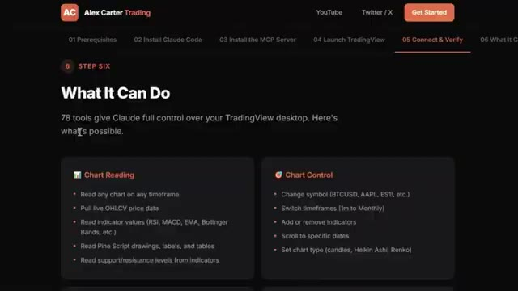
*⏱️ 00:09:51 — Page web du site d'Alex Carter détaillant les fonctionnalités de l'outil Claude Code et son intégration avec TradingView.*

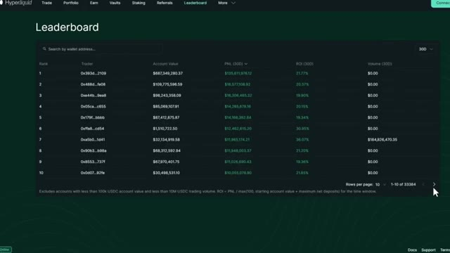
*⏱️ 00:09:56 — Tableau de classement (Leaderboard) de la plateforme de finance décentralisée Hyperliquid montrant les adresses de portefeuilles, valeurs de comptes et PnL.*

---

### ⏱️ `[00:10:01 - 00:10:23]` | Segment #20

**🔊 Audio (Transcription Intégrale Mot pour Mot en Français) :**
> Et j'ajoute constamment de nouvelles choses, de nouvelles stratégies, de nouveaux prompts, de nouvelles intégrations. Chaque fois que je construis quelque chose de nouveau, ça va directement là-dedans. Le prix est de 79,99 $ par mois. Et honnêtement, quand on pense à ce que c'est réellement, la configuration de trading IA la plus avancée disponible pour les traders particuliers en ce moment, constamment mise à jour avec tout inclus.

**👁️ Analyse Visuelle d'Écran (gemini-3.5-flash-lite) :**
**Interface & Outils** : Navigateur web affichant la plateforme de vente Whop et des pages de documentation technique.

**Contenu textuel & Code** : Offre d'abonnement "AI Trade Edge" à 79,99 $/mois (réduit de 99,99 $), et liste des 78 outils pour contrôler TradingView (Chart Reading, Chart Control).

**Action / Démonstration** : Présentation de la tarification et de la valeur de l'offre par le créateur.

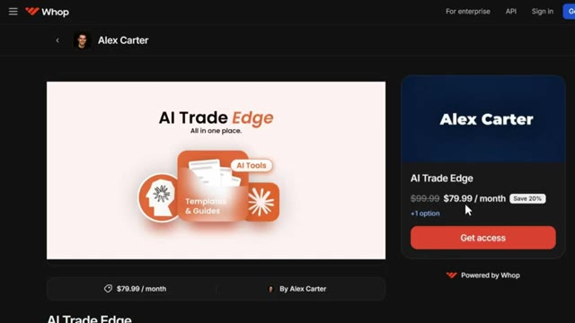
*⏱️ 00:10:12 — Page de vente Whop présentant l'abonnement "AI Trade Edge" d'Alex Carter au prix de 79,99 $ par mois.*

---

### ⏱️ `[00:10:24 - 00:10:50]` | Segment #21

**🔊 Audio (Transcription Intégrale Mot pour Mot en Français) :**
> À l'intérieur, il y a aussi un cours complet de trading agentique. 2,5 heures. Du débutant à l'expert. Aucune base en programmation n'est nécessaire. D'ici la fin, vous aurez votre propre système de trading par IA en direct, ce que la plupart des traders particuliers ne savent même pas être possible en ce moment. 79,99 $ par mois. Un seul bon trade couvre ce montant. Et les 100 premiers membres bloquent ce tarif de façon permanente. Après cela, le prix augmente. Le lien est dans la description.

**👁️ Analyse Visuelle d'Écran (gemini-3.5-flash-lite) :**
**Interface & Outils** : Plateforme de formation en ligne et site web Whop (interface e-commerce/communauté).

**Contenu textuel & Code** : Titres de modules de formation sur le trading agentique, l'intégration de webhooks, les bots de trading IA, et la grille tarifaire d'accès à la communauté.

**Action / Démonstration** : Présentation du contenu et du programme détaillé du cours complet de trading par IA inclus dans l'offre.

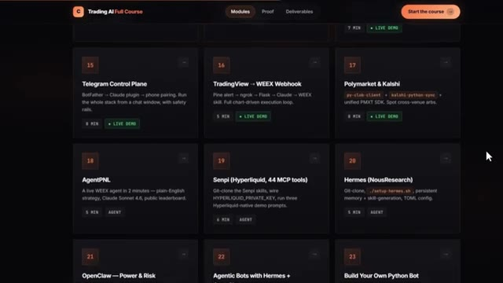
*⏱️ 00:10:30 — Vue d'interface d'une plateforme de cours en ligne montrant le programme détaillé du cours 'Trading AI Full Course' avec des modules numérotés comme Telegram Control Plane, TradingView -> WEEX Webhook, Polymarket & Kalshi, AgentPNL, Senpi, et Hermes.*

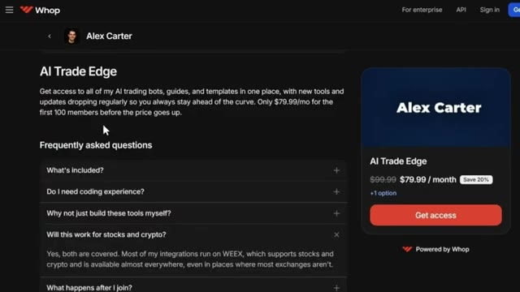
*⏱️ 00:10:43 — Page de vente de la plateforme Whop pour 'AI Trade Edge' par Alex Carter, affichant la description, le tarif à 79.99 $/mois et des sections de questions fréquentes.*

---

### ⏱️ `[00:10:50 - 00:11:27]` | Segment #22

**🔊 Audio (Transcription Intégrale Mot pour Mot en Français) :**
> Vous ne pouvez vraiment pas vous permettre de rater ça. Et voilà les gars. C'est comme ça qu'on prend une stratégie, qu'on la donne à Claude, et qu'on obtient un travail en PineScript sur TradingView. Pas de codage, pas de surveillance manuelle des graphiques. Si vous voulez vraiment mettre cela en pratique, assurez-vous d'utiliser Bybit ou BingX. Puisque cette stratégie y fonctionne beaucoup plus fluidement que sur la plupart des autres bourses. Les liens sont en bas. Si vous voulez voir une démonstration complète de la façon dont je trade en utilisant uniquement mon télégramme, la démonstration complète de tous les cas d'utilisation sur TradingView, et comment je trace automatiquement les plus gros trades des baleines sur Hyperliquid, cliquez sur la vidéo qui apparaît à l'écran dès maintenant.

**👁️ Analyse Visuelle d'Écran (gemini-3.5-flash-lite) :**
**Interface & Outils** : TradingView, terminal de commande CLI, plateforme BingX.

**Contenu textuel & Code** : Signaux Buy/Sell sur graphique, indicateur RSI, tableau de confluence multi-timeframe (EMA, RSI, MACD), niveaux de support/résistance et recommandations d'entrée/stop-loss.

**Action / Démonstration** : Présentation d'un graphique technique et d'une analyse automatisée multi-timeframe via un terminal.

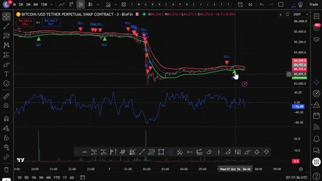
*⏱️ 00:10:59 — Graphique TradingView affichant le contrat perpétuel Bitcoin/USD Tether avec des indicateurs de signaux d'achat et de vente.*

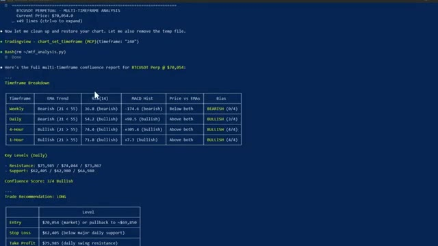
*⏱️ 00:11:17 — Terminal de commande affichant un rapport d'analyse multi-timeframe pour BTCUSDT avec tableau de tendance et recommandations de trade.*

---

### ⏱️ `[00:11:27 - 00:11:45]` | Segment #23

**🔊 Audio (Transcription Intégrale Mot pour Mot en Français) :**
> Et si vous voulez le guide complet étape par étape sur la façon de construire votre propre système de trading agentique en utilisant Claude, cette vidéo apparaît également à l'écran. Allez la voir ensuite. Si vous avez trouvé cela utile, laissez un pouce levé. Cela aide vraiment la chaîne. Abonnez-vous si ce n'est pas déjà fait, et je vous vois dans la prochaine.

**👁️ Analyse Visuelle d'Écran (gemini-3.5-flash-lite) :**
**Interface & Outils** : Aucune interface visible.

**Contenu textuel & Code** : Aucun contenu technique, graphique ou textuel affiché.

**Action / Démonstration** : Aucune action ou manipulation en cours.

---

