# 🎬 I Found The Easiest Way To Automate My Entire Trading System Using Claude Code

> **Chaîne** : [Alex Carter](https://www.youtube.com/@AlexCarterTrading)  
> **Lien YouTube** : [https://www.youtube.com/watch?v=3Hh_ot2VgDc](https://www.youtube.com/watch?v=3Hh_ot2VgDc)  
> **Date de publication** : 20261010  
> **Durée** : 00:11:57  
> **Identifiant vidéo** : `3Hh_ot2VgDc`  
> **Transcription & Analyse** : `whisper-v3-large-turbo+gemini-3.5-flash-lite`  

---

## 📌 Synthèse Exécutive & Outils

### 💡 Résumé
La vidéo présente une méthodologie de trading entièrement automatisée et pilotée par l'intelligence artificielle, s'appuyant principalement sur **Claude Code** et des requêtes en langage naturel. Le présentateur démontre qu'il est possible de s'affranchir de la surveillance obsessionnelle des écrans et de la saisie manuelle des ordres en déléguant l'intégralité du pipeline opérationnel — de l'analyse technique multi-temporelle au suivi des portefeuilles institutionnels — à des agents autonomes fonctionnant 24h/24 et 7j/7 sur le cloud.

Les démonstrations pratiques incluent l'automatisation complète de la lecture des graphiques (tracé instantané des supports, résistances et biais directionnels), la génération et le débogage de scripts de trading, ainsi que l'interfaçage direct avec des exchanges via des webhooks et des bots Telegram. L'approche met également en lumière l'exploitation des données on-chain de la blockchain décentralisée Hyperliquid pour espionner le comportement des portefeuilles les plus rentables, identifier les divergences avec les traders particuliers (retail) et pratiquer du *funding rate arbitrage* (agriculture de taux de financement) sans prise de risque directionnelle.

---

### 🛠️ Outils, Modèles & Logiciels Présentés
* **Claude Code** : Outil d'IA conversationnel et d'écriture de code utilisé pour orchestrer l'ensemble des agents autonomes, analyser les données en temps réel et exécuter des tâches complexes en langage naturel.
* **Hyperliquid** : Exchange perpétuel décentralisé fonctionnant sur sa propre blockchain, dont la transparence totale permet d'extraire publiquement les positions et l'historique de 33 000 portefeuilles (baleines).
* **TradingView** : Plateforme de graphisme boursier utilisée pour analyser les prix, concevoir des stratégies et transmettre des signaux automatisés via des webhooks.
* **Pine Script** : Langage de programmation propriétaire de TradingView utilisé pour rédiger, backtester et optimiser des indicateurs et des stratégies algorithmiques.
* **Telegram** : Application de messagerie instantanée transformée en interface de contrôle mobile pour envoyer des ordres, recevoir des alertes de trading en temps réel et piloter les bots à distance.
* **Grok Bots** : Mentionnés dans le contexte des outils d'intelligence artificielle et d'automatisation pour le scraping et l'analyse de données de marché.

---

### 🔑 Points Clés & Enseignements Stratégiques
* **Automatisation par le langage naturel** : Suppression totale de la barrière du code informatique traditionnel, permettant à un non-développeur de construire une infrastructure de trading complète en un week-end en utilisant uniquement du français simple.
* **Analyse graphique instantanée** : Délégation du tracé des lignes de support et de résistance à l'IA, qui identifie en quelques secondes les niveaux les plus testés, élabore un étiquetage précis et fournit un biais directionnel basé sur l'historique des réactions de prix.
* **Exécution sans friction par Webhook** : Connexion directe entre les alertes de stratégies TradingView et l'exchange via des webhooks, automatisant l'ouverture des trades (entrée, stop-loss, take-profit) de manière instantanée et sans intervention humaine.
* **Scraping et analyse des portefeuilles "Baleines"** : Extraction en temps réel des données des 20 portefeuilles les plus rentables d'Hyperliquid pour identifier leurs prix d'entrée, leur effet de levier et leur P&L non réalisé, réduisant à une minute une tâche d'analyse auparavant chronophage.
* **Exploitation des divergences institutionnels vs Retail** : Méthode consistant à croiser les positions des 20 meilleurs traders et des 20 pires traders pour détecter les actifs où ils s'opposent (ex. : accumulation institutionnelle sur XMR, TRX, Pendle pendant que le retail vend), créant un signal alpha de haute conviction.
* **Commandes transactionnelles mobiles via Telegram** : Pilotage du portefeuille à distance depuis un téléphone portable (ouverture de positions, gestion des risques, prises de bénéfices) grâce à des instructions textuelles simples envoyées à un assistant IA.
* **Génération de tableaux de bord financiers professionnels** : Production instantanée de rapports visuels globaux (courbe de capital, taux de réussite, frais de financement ventilés, distance de liquidation) simulant le niveau d'analyse d'un desk de trading institutionnel.
* **Arbitrage des taux de financement (*Funding Rate Farming*)** : Scanner automatisé détectant les paires perpétuelles aux taux de financement les plus élevés pour se positionner du bon côté du marché et percevoir un rendement passif (parfois supérieur à 50 % ou 100 % annualisé) toutes les huit heures, s'affranchissant de la prédiction directionnelle des prix.
* **Architecture cloud résiliente 24/7** : Déploiement des bots de trading sur un serveur cloud distant plutôt que sur un ordinateur personnel, garantissant une continuité opérationnelle même en cas de coupure Wi-Fi, de plantage ou de redémarrage automatique.
* **Gestion rigoureuse du risque intégrée** : Dimensionnement systématique des positions par l'IA en fonction de paramètres de risque stricts préalablement définis (stop-loss et take-profit obligatoires rattachés à chaque ordre).
* **Rapports Alpha quotidiens automatisés** : Réception matinale de synthèses prêtes à l'emploi dans sa boîte mail avant même l'ouverture de l'ordinateur, compilant les analyses de baleines, l'état des graphiques et les configurations de trading à plus forte conviction de la journée.

---

## ⏱️ Chronologie & Transcription Complète Audio & Visuelle (Mot pour Mot)

### ⏱️ `[00:00:00 - 00:00:29]` | Segment #01

**🔊 Audio (Transcription Intégrale Mot pour Mot en Français) :**
> J'ai trouvé le moyen le plus simple d'automatiser l'ensemble de mon système de trading en utilisant Claude code et je n'ai pas ouvert manuellement un seul trade depuis des semaines. Pas 12 onglets ouverts, pas de regard fixé sur les graphiques jusqu'à 2 heures du matin à me demander si j'ai raté le mouvement. Mes graphiques sont analysés, mes trades sont exécutés, et mes données de baleines sont suivies, tout cela avant même que j'ouvre mon ordinateur portable. Et le plus fou ? J'ai construit tout ce système en n'utilisant rien d'autre que du français simple et un seul outil. Ce n'est pas du clickbait. C'est littéralement là où j'en suis en ce moment même.

**👁️ Analyse Visuelle d'Écran (gemini-3.5-flash-lite) :**
**Interface & Outils** : Interface de graphiques financiers TradingView (avec données Blofin et WEEX).

**Contenu textuel & Code** : Indicateurs techniques (Donchian Channels, ADX 14, volumes), lignes de support et résistance horizontales, et outils de gestion du risque (position long/short).

**Action / Démonstration** : Analyse technique de graphiques de cryptomonnaies et illustration de configurations de trading.

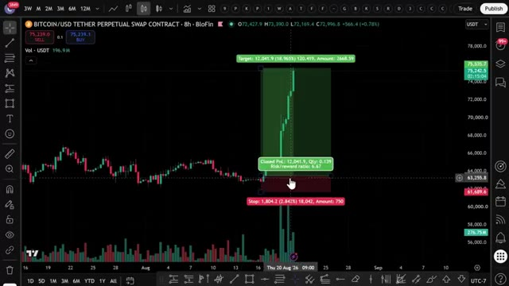
*⏱️ 00:00:07 — Graphique en chandeliers japonais du Bitcoin sur un intervalle de 8 heures affichant une position longue avec un ratio risque/rendement de 6,67.*

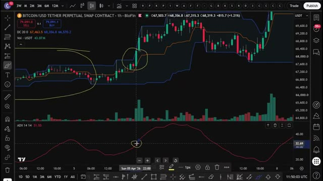
*⏱️ 00:00:15 — Graphique en chandeliers du Bitcoin sur 1 heure avec les indicateurs Donchian Channels (DC 20) et ADX (14) comportant des annotations tracées à la main.*

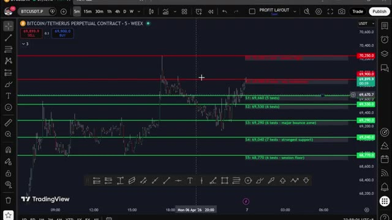
*⏱️ 00:00:22 — Graphique en chandeliers sur 5 minutes du Bitcoin affichant plusieurs niveaux de support horizontaux verts (S1 à S5) et des résistances rouges.*

---

### ⏱️ `[00:00:29 - 00:00:51]` | Segment #02

**🔊 Audio (Transcription Intégrale Mot pour Mot en Français) :**
> Et d'ici la fin de cette vidéo, vous allez avoir exactement la même configuration fonctionnelle pour vous-même. Que vous fassiez du trading de cryptomonnaies, du forex, des actions, des contrats à terme, ou littéralement n'importe quel marché auquel vous pouvez penser. Je vais vous montrer ce que sont réellement ces outils, à quoi cela ressemble en pratique, comment cela a changé ma façon de trader, et exactement comment vous pouvez mettre la main dessus dès maintenant.

**👁️ Analyse Visuelle d'Écran (gemini-3.5-flash-lite) :**
**Interface & Outils** : TradingView, interface de recherche de symboles, et application de messagerie Telegram (ClaudeTelegramBot).

**Contenu textuel & Code** : Graphiques en chandeliers de Bitcoin, liste de paires crypto (ATOM, AAVE, UNI, etc.), menus de recherche par type d'actif (Stocks, Funds, Futures, Forex, Crypto, Indices, Bonds, Economy, Options), et statistiques de taux de financement (Highest Longs Pay Shorts, Highest Shorts Pay Longs).
[DESC_IMAGE_3] Navigation dans les interfaces de trading et présentation d'un outil d'analyse automatisé via un bot Telegram.

**Action / Démonstration** : Navigation et présentation de la compatibilité multi-marchés des outils de trading, illustrant les options de recherche de symboles et les rapports de bots.

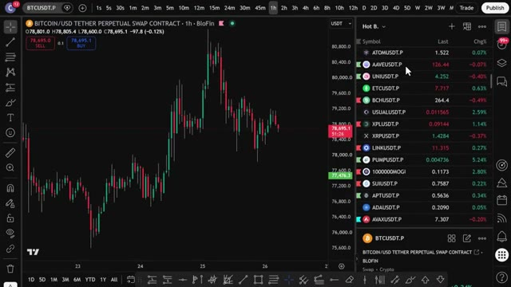
*⏱️ 00:00:34 — Graphique TradingView en chandelier affichant la paire BITCOIN/USD avec la liste des marchés sur le panneau latéral droit.*

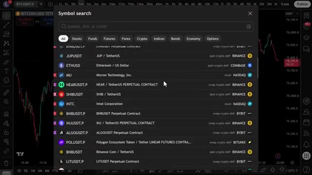
*⏱️ 00:00:40 — Fenêtre de recherche de symboles et d'actifs sur TradingView montrant différentes classes d'actifs (actions, indices, cryptos, etc.).*

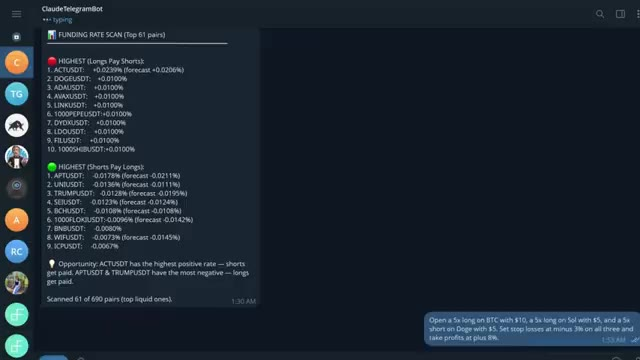
*⏱️ 00:00:45 — Interface de type messagerie (Claude Telegram Bot) affichant un rapport de scan des taux de financement (Funding Rate Scan) pour plusieurs paires de cryptomonnaies.*

---

### ⏱️ `[00:00:51 - 00:01:27]` | Segment #03

**🔊 Audio (Transcription Intégrale Mot pour Mot en Français) :**
> Je vais personnellement vous guider à travers la façon dont j'utilise chacun d'eux chaque jour pour gérer mon trading sans rester assis devant des graphiques pendant des heures. en ce moment j'ai un agent qui analyse 33 000 baleines hyper liquid suit ce qu'elles achètent ou vendent pendant la nuit et signale tout ce qui sort de sa plage normale j'ai un deuxième agent connecté directement à mes graphiques qui trace automatiquement les supports et résistances en plus de m'indiquer le meilleur prix pour acheter et vendre et un troisième qui me permet de passer un ordre en utilisant un anglais simple presque instantanément ça fait trois agents qui tournent en parallèle 24h/24 et 7j/7 pendant que je dors que je filme ou littéralement en train de

**👁️ Analyse Visuelle d'Écran (gemini-3.5-flash-lite) :**
**Interface & Outils** : Plateforme d'échange Hyperliquid (Interface Web - Leaderboard)

**Contenu textuel & Code** : Tableau listant les adresses de portefeuilles (ex: 0x393d...2109), la valeur des comptes (ex: 687 349 280,37 $), le PNL sur 30 jours, le ROI et le volume, avec un total de 33384 comptes répertoriés.

**Action / Démonstration** : Consultation et présentation du classement des baleines et grands traders sur l'interface Hyperliquid.

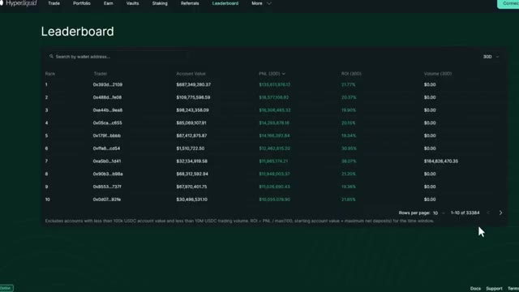
*⏱️ 00:01:00 — Capture d'écran du classement (Leaderboard) de la plateforme Hyperliquid affichant les portefeuilles des traders avec leurs valeurs, PNL et ROI.*

---

### ⏱️ `[00:01:27 - 00:01:55]` | Segment #04

**🔊 Audio (Transcription Intégrale Mot pour Mot en Français) :**
> cette chaîne en ce moment qui vous parle. Je n'ai pas écrit une seule ligne de code pour configurer tout cela. Et si un non-développeur comme moi peut construire ça en un week-end, vous le pouvez aussi. Très bien, voyons exactement comment. La première chose que je veux vous montrer, et c'est celle qui m'a vraiment époustouflé la première fois que je l'ai vue. Claude lit, l'historique des prix identifie les niveaux les plus importants, les trace directement sur votre graphique, et vous indique lesquels comptent le plus en ce moment. Regardez le graphique.

**👁️ Analyse Visuelle d'Écran (gemini-3.5-flash-lite) :**
**Interface & Outils** : Terminal de commandes PowerShell, Claude Code CLI.

**Contenu textuel & Code** : Un prompt détaillé demandant l'écriture d'une stratégie TradingView en Pine Script (utilisant les bandes de Bollinger, le RSI, des règles d'entrée/sortie, des divergences haussières/baissières, et des alertes).

**Action / Démonstration** : Saisie d'un prompt textuel complexe dans l'outil CLI Claude Code pour automatiser la création de code de trading.

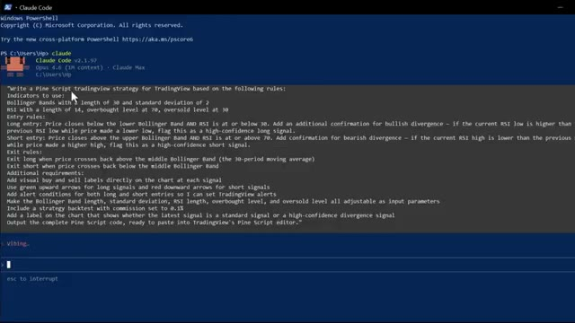
*⏱️ 00:01:34 — Capture d'écran montrant l'interface en ligne de commande de Claude Code (PowerShell) avec un prompt complet destiné à générer une stratégie de trading Pine Script basée sur les bandes de Bollinger et le RSI.*

---

### ⏱️ `[00:01:55 - 00:02:18]` | Segment #05

**🔊 Audio (Transcription Intégrale Mot pour Mot en Français) :**
> lignes vertes pour le support, lignes rouges pour la résistance, étiquettes de prix. Le nombre de fois que chaque niveau a été testé, le tout tracé automatiquement, et ensuite il vous indique exactement où se trouve le prix en ce moment par rapport à ces niveaux et vous donne un biais directionnel basé sur l'historique de la façon dont le prix a réagi à chacun d'eux. Cela me prenait 20 minutes à tracer manuellement sur chaque graphique.

**👁️ Analyse Visuelle d'Écran (gemini-3.5-flash-lite) :**
**Interface & Outils** : TradingView, Terminal CLI

**Contenu textuel & Code** : Niveaux de support (S1 à S5 avec nombre de tests), résistances (R1, R2), analyse textuelle du prix actuel et biais directionnel.

**Action / Démonstration** : Analyse visuelle des niveaux techniques et affichage des métriques et du biais dans le terminal.

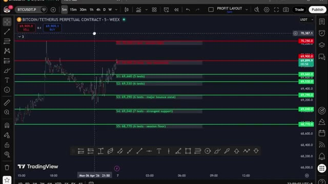
*⏱️ 00:02:00 — Graphique de trading montrant des niveaux de support en vert et de résistance en rouge avec le nombre de tests.*

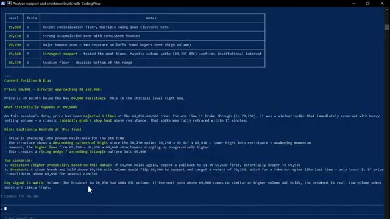
*⏱️ 00:02:06 — Terminal affichant l'analyse détaillée des niveaux de prix, la position actuelle et le biais directionnel.*

---

### ⏱️ `[00:02:18 - 00:02:51]` | Segment #06

**🔊 Audio (Transcription Intégrale Mot pour Mot en Français) :**
> Claude le fait en quelques secondes. Et ce n'est que le point de départ. Vous pouvez également demander à Claude d'écrire des stratégies Pine Script complètes à partir d'un anglais simple, de déboguer vos indicateurs existants, d'exécuter une analyse de confluence multi-temporelle complète sur les graphiques hebdomadaire, journalier, de quatre heures et d'une heure simultanément, et d'obtenir une recommandation de trade spécifique avec un point d'entrée, un stop loss et un take profit, le tout à partir d'une seule invite. Mais voici où cela devient entièrement mains libres. Vous pouvez connecter n'importe laquelle de ces stratégies directement à votre exchange via un webhook TradingView. Lorsque votre stratégie déclenche un signal sur

**👁️ Analyse Visuelle d'Écran (gemini-3.5-flash-lite) :**
**Interface & Outils** : TradingView, Pine Editor, Terminal de commande (Claude Code)

**Contenu textuel & Code** : Code source Pine Script (stratégie ATR Trailing Stop, entrées, signaux) et rapport d'analyse multi-temporelle (Timeframe Breakdown, Key Levels, Trade Recommendation).

**Action / Démonstration** : Présentation de la création de stratégies en Pine Script et de l'analyse technique multi-temporelle automatisée via Claude.

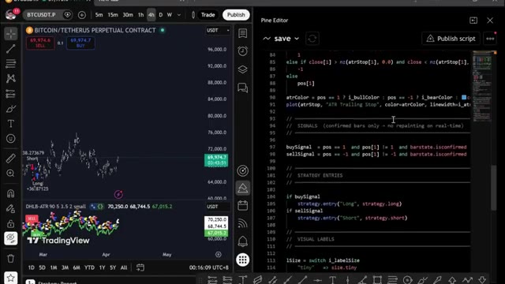
*⏱️ 00:02:27 — Interface TradingView avec un graphique de prix BTCUSDT à gauche et l'éditeur de code Pine Script à droite.*

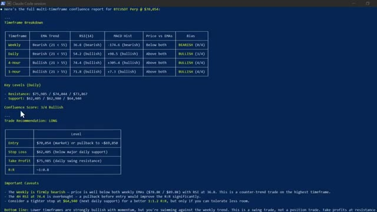
*⏱️ 00:02:35 — Fenêtre de terminal affichant un rapport complet d'analyse de confluence multi-temporelle généré par Claude Code.*

---

### ⏱️ `[00:02:51 - 00:03:16]` | Segment #07

**🔊 Audio (Transcription Intégrale Mot pour Mot en Français) :**
> TradingView. Claude le reçoit instantanément via le webhook et exécute le trade automatiquement sur votre exchange. Entrée, stop-loss, take-profit. Tout est fait. Sans que vous ne touchiez à rien, le signal est arrivé. Claude l'a traité. Trade ouvert. Confirmation en retour avec tous les détails. Vous construisez la stratégie une seule fois, et à partir de ce moment-là, elle tourne toute seule. Maintenant, cette prochaine section, c'est là que ça devient vraiment intéressant, et honnêtement, c'est l'une de mes choses préférées que j'ai construites avec Claude.

**👁️ Analyse Visuelle d'Écran (gemini-3.5-flash-lite) :**
**Interface & Outils** : Échange de cryptomonnaies, terminal Claude Code (CLI) et plateforme TradingView.

**Contenu textuel & Code** : Détails de positions (montant, prix d'entrée, PnL), appels d'API MCP (TradingView chart_manage_indicator, chart_get_state) et code Pine Script d'une stratégie de trading.

**Action / Démonstration** : Gestion des positions en cours, interactions programmatiques avec les graphiques et modification de scripts de trading.

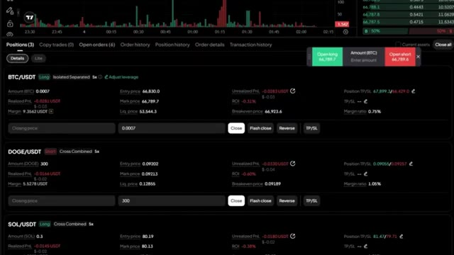
*⏱️ 00:02:57 — Interface de trading affichant les positions ouvertes sur différentes paires de cryptomonnaies (BTC/USDT, DOGE/USDT, SOL/USDT).*

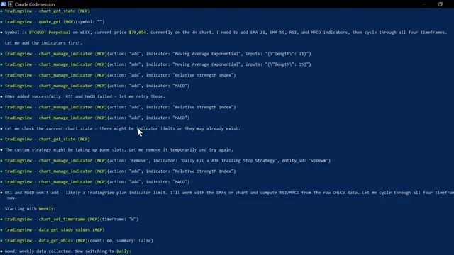
*⏱️ 00:03:04 — Session Claude Code dans un terminal de commande montrant l'exécution d'appels d'outils MCP pour interagir avec TradingView.*

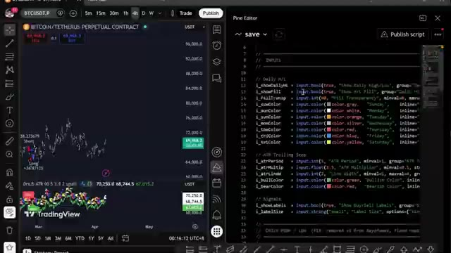
*⏱️ 00:03:10 — Interface de TradingView avec un graphique de prix à gauche et l'éditeur Pine Script à droite affichant du code source.*

---

### ⏱️ `[00:03:16 - 00:03:36]` | Segment #08

**🔊 Audio (Transcription Intégrale Mot pour Mot en Français) :**
> Et si vous pouviez analyser 33 000 portefeuilles sur Hyperliquid ? Trouver les 20 meilleurs traders les plus rentables. Voir exactement ce qu'ils achètent en ce moment. Leurs prix d'entrée, leur effet de levier, leur P&L non réalisé, et obtenir un plan de trading complet basé sur tout cela. Aucune clé API nécessaire, pas de codage, pas de recherche manuelle.

**👁️ Analyse Visuelle d'Écran (gemini-3.5-flash-lite) :**
**Interface & Outils** : Hyperliquid DEX / Interface de trading et Terminal de commande scripté (CLI).

**Contenu textuel & Code** : Graphique en chandeliers japonais de HYPE/USDC, carnet d'ordres (Order Book), tableau de plan de trading pour XMR (Token, Direction LONG, Zone d'entrée $325-330, Stop Loss $305, Take Profit, Effet de levier 5x, Taille de position, Risque/Rendement).

**Action / Démonstration** : Navigation et présentation de la plateforme Hyperliquid puis affichage des résultats d'analyse algorithmique des portefeuilles de traders rentables (smart money).

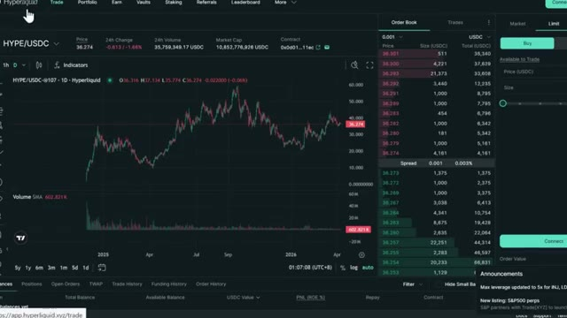
*⏱️ 00:03:21 — Interface de la plateforme d'échange Hyperliquid affichant le graphique du token HYPE/USDC ainsi qu'un carnet d'ordres détaillé.*

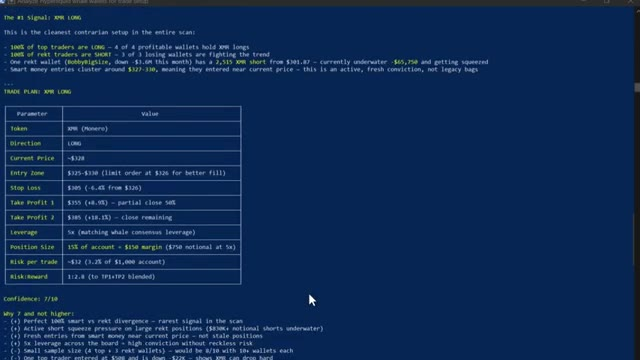
*⏱️ 00:03:31 — Terminal affichant une analyse détaillée des portefeuilles "whales" sur Hyperliquid avec un plan de trading complet pour XMR (Monero).*

---

### ⏱️ `[00:03:37 - 00:03:56]` | Segment #09

**🔊 Audio (Transcription Intégrale Mot pour Mot en Français) :**
> Maintenant, Hyperliquid. Très rapidement. C'est un échange perpétuel décentralisé qui fonctionne sur sa propre blockchain. Pas de KYC, pas d'intermédiaire. Et comme c'est entièrement sur la chaîne, chaque transaction, chaque position, chaque portefeuille, tout est public. C'est ce qui rend cela possible. Très bien, laissez-moi ouvrir Claude Code et vous montrer cela en direct.

**👁️ Analyse Visuelle d'Écran (gemini-3.5-flash-lite) :**
**Interface & Outils** : Interface web de l'échange décentralisé (DEX) Hyperliquid.

**Contenu textuel & Code** : Graphique en chandeliers japonais de la paire HYPE/USDC avec indicateur de volume, carnet d'ordres en temps réel (Order Book), prix actuel (36,274), variation sur 24h (-1,66%), volume sur 24h, et panneau de passage d'ordre (Limit/Market).

**Action / Démonstration** : Navigation et présentation de l'interface de l'échange décentralisé Hyperliquid et de son graphique de prix.

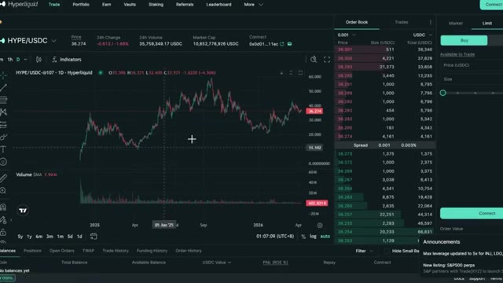
*⏱️ 00:03:42 — Capture d'écran de l'interface de trading de la plateforme Hyperliquid montrant le graphique de la paire HYPE/USDC, le carnet d'ordres et les options de passage d'ordres.*

---

### ⏱️ `[00:03:56 - 00:04:26]` | Segment #10

**🔊 Audio (Transcription Intégrale Mot pour Mot en Français) :**
> Voici la première chose que je veux vous montrer. Claude analyse les 20 portefeuilles les plus rentables sur Hyperliquid en ce moment, extrait toutes les positions ouvertes et les classe par rentabilité totale. Le tout en un seul coup. Regardez ce qui se passe. Claude se connecte aux points de terminaison publics d'Hyperliquid, commence à extraire les données des portefeuilles sur 33 000 adresses, les classe par rentabilité et commence à rédiger le rapport. Vous pouvez le voir traiter les portefeuilles en temps réel. Les prix d'entrée, l'effet de levier, les profits et pertes non réalisés, tout arrive en direct.

**👁️ Analyse Visuelle d'Écran (gemini-3.5-flash-lite) :**
**Interface & Outils** : Terminal de commandes / Interface CLI personnalisée

**Contenu textuel & Code** : Tableaux de données financières par portefeuille (#2 - 0xff4c..., #3 - 0xfc66...), incluant le PnL global (All-Time PnL, Monthly PnL), la valeur du compte et les positions clés (Coin, Direction, Size, Entry, Leverage, uPnL).

**Action / Démonstration** : Analyse et affichage automatisé des positions ouvertes des meilleurs traders d'Hyperliquid via l'assistant Claude.

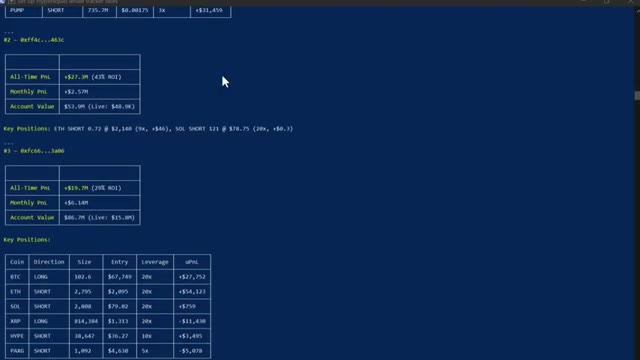
*⏱️ 00:04:04 — Capture d'écran montrant un terminal en ligne de commande affichant les données et positions des portefeuilles de baleines sur Hyperliquid.*

---

### ⏱️ `[00:04:27 - 00:05:01]` | Segment #11

**🔊 Audio (Transcription Intégrale Mot pour Mot en Français) :**
> Et voici le résultat. Le top 20 des baleines classé, chaque position ouverte listée. Et en bas, le résumé du sentiment global. En ce moment, l'argent intelligent est net acheteur sur le Bitcoin et net vendeur sur presque tout le reste, surtout Ethereum. C'est le genre de signal qui prenait des heures à assembler manuellement, Claude le fait en moins d'une minute maintenant. C'est là que ça devient vraiment intéressant, ce prompt compare les 20 portefeuilles les plus rentables aux 20 portefeuilles les plus perdants et trouve chaque jeton où ils se trouvent des côtés opposés du trade, regardez.

**👁️ Analyse Visuelle d'Écran (gemini-3.5-flash-lite) :**
**Interface & Outils** : Terminal de commandes CLI (fenêtre sombre avec texte brut).

**Contenu textuel & Code** : Listes des positions (LONG/SHORT) sur divers actifs (APT, TRX, ALGO, KAITO, BLAST, IP, STBL, LDO, SAND, XAI, MNT), sections de consensus baissier et haussier, et un résumé global (Overall Net Direction) indiquant que les baleines sont net short sur le marché, sauf sur le Bitcoin.

**Action / Démonstration** : Affichage des résultats du script de suivi des baleines (whale tracker) pour analyser le sentiment du marché et les positions ouvertes.

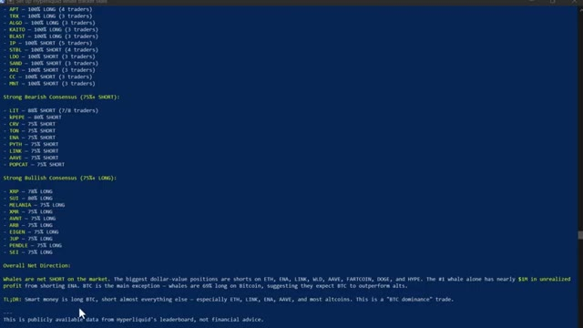
*⏱️ 00:04:35 — Un terminal de commandes affichant le classement des positions des baleines avec un résumé du sentiment global du marché.*

---

### ⏱️ `[00:05:01 - 00:05:37]` | Segment #12

**🔊 Audio (Transcription Intégrale Mot pour Mot en Français) :**
> tire sur les deux groupes simultanément, les portefeuilles rentables d'un côté, les portefeuilles perdants de l'autre, et ensuite il commence à croiser les positions. Voici le résultat : vous pouvez voir là où les deux groupes sont d'accord. Ils sont tous les deux acheteurs sur Sui. C'est donc un trade encombré. Mais regardez ça. L'argent intelligent est massivement acheteur sur XMR, TRX, Pendle et Farcoin, tandis que les traders particuliers sont vendeurs sur ces cryptos. Cette divergence, juste là, c'est le signal. C'est le genre d'analyse pour lequel les hedge funds payent. Vous l'obtenez grâce à un outil d'IA à 20 dollars et à une API publique gratuite. Et si vous voulez toute la configuration Hyperliquid, la compétence

**👁️ Analyse Visuelle d'Écran (gemini-3.5-flash-lite) :**
**Interface & Outils** : Terminal de script / Interface CLI personnalisée (Hyperliquid Whale Tracker)

**Contenu textuel & Code** : Métriques de performance (All-Time PnL : +$204.4M, Monthly PnL : +$5.28M, Account Value : $71.8M) et tableau des positions clés (Coin, Direction, Size, Entry, Leverage, uPnL) pour BTC, ETH, SOL, ENA, LINK, FARTCOIN, WLD, AAVE, HYPE, MON, DOGE, PUMP.

**Action / Démonstration** : Affichage et analyse du rapport de suivi des baleines pour identifier les positions ouvertes des meilleurs traders.

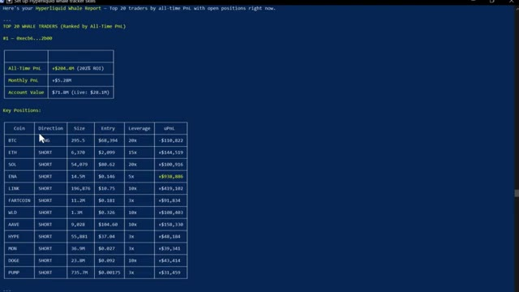
*⏱️ 00:05:10 — Un rapport de type terminal affichant le Top 20 des traders baleines sur Hyperliquid avec leurs performances et positions ouvertes.*

---

### ⏱️ `[00:05:37 - 00:06:11]` | Segment #13

**🔊 Audio (Transcription Intégrale Mot pour Mot en Français) :**
> code, chaque prompt, le système complet de suivi des baleines. Je vais vous dire exactement comment obtenir tout cela dans un instant. Continuez à regarder. Maintenant, celui-ci, c'est celui qui a complètement changé ma routine quotidienne. J'ai construit mon propre assistant de trading IA en utilisant Claude et Telegram, et il trouve des transactions rentables pour moi en utilisant l'IA la plus puissante disponible en ce moment, plus intelligente que n'importe quel humain ne pourrait l'être. Il exécute des transactions, gère mes positions, m'envoie des alertes en temps réel et génère des rapports complets de portefeuille. Le tout à partir d'un simple message sur mon téléphone. Ce matin, j'ai passé un ordre depuis mon lit, j'ai pris

**👁️ Analyse Visuelle d'Écran (gemini-3.5-flash-lite) :**
**Interface & Outils** : Hyperdash et ClaudeTelegramBot

**Contenu textuel & Code** : Analyses de positionnement des baleines, graphiques de PnL non réalisé, tableaux de portefeuilles, et résultats de scan des taux de financement sur 690 paires futures.

**Action / Démonstration** : Navigation et présentation des outils de suivi des baleines et de l'assistant de trading IA sur Telegram.

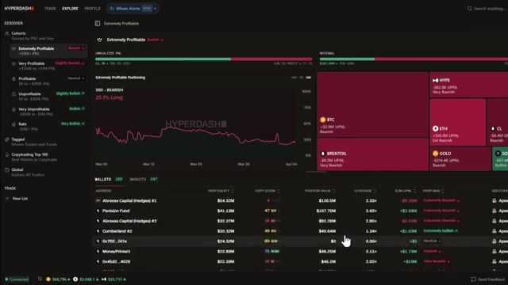
*⏱️ 00:05:46 — Interface Hyperdash affichant le tableau de bord de suivi des baleines (Whale Alerts) avec des graphiques de positionnement et un tableau des portefeuilles les plus rentables.*

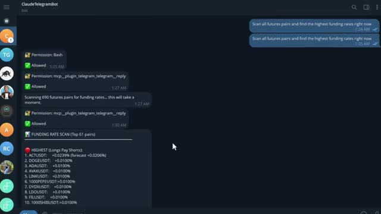
*⏱️ 00:06:03 — Interface de messagerie (ClaudeTelegramBot) montrant des prompts automatisés pour scanner les taux de financement sur les paires futures et les résultats affichés.*

---

### ⏱️ `[00:06:11 - 00:06:37]` | Segment #14

**🔊 Audio (Transcription Intégrale Mot pour Mot en Français) :**
> les bénéfices de la salle de sport, je n'ai touché à aucun graphique. Voici Claude qui tourne sur mon ordinateur. Ça a l'air simple. Juste une interface textuelle. Mais regardez ce qu'il peut faire. Vous pouvez pratiquement ouvrir une position de trading avec une seule phrase. Ouvre un long x5 sur ETH avec 10 dollars. Définis un stop loss à moins 3 % et un take profit à plus 8 %. Regardez-le réfléchir. Et voilà. Position ouverte. Stop loss défini. Take profit défini.

**👁️ Analyse Visuelle d'Écran (gemini-3.5-flash-lite) :**
**Interface & Outils** : Terminal de commandes (Claude Code)

**Contenu textuel & Code** : Interface textuelle affichant la version de Claude Code (v2.1.91), le modèle utilisé (Opus 4.6), le chemin d'accès au répertoire utilisateur et une ligne de commande active.

**Action / Démonstration** : Présentation de l'interface en ligne de commande de l'assistant IA Claude.

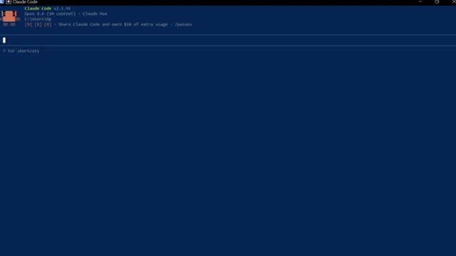
*⏱️ 00:06:17 — Capture d'écran montrant l'interface textuelle de l'outil Claude Code dans un terminal de commande sombre.*

---

### ⏱️ `[00:06:38 - 00:07:13]` | Segment #15

**🔊 Audio (Transcription Intégrale Mot pour Mot en Français) :**
> Confirmez en retour avec chaque détail. Une phrase. Terminé. Maintenant, laissez-moi vous montrer quelque chose qui m'a vraiment époustouflé la première fois que j'ai exécuté ceci. Donnez-moi un tableau de bord complet de portefeuille. Toutes mes positions, profits et pertes, frais de financement, courbe de capital sous forme de rapport visuel. Regardez-le fonctionner. Il extrait chaque élément de données de mon compte en ce moment même. Et voici ce qu'il génère. Un tableau de bord complet en mode sombre, une courbe de capital, un taux de réussite, des revenus de financement ventilés par crypto-monnaie, chaque position ouverte avec la distance de liquidation mise en surbrillance. C'est le genre de rapport qu'un desk de trading professionnel produirait.

**👁️ Analyse Visuelle d'Écran (gemini-3.5-flash-lite) :**
**Interface & Outils** : Terminal de commande et tableau de bord Web (WEEX Portfolio Dashboard).

**Contenu textuel & Code** : Détails d'une position longue sur ETH (prix 2052$, levier 5x, taille, TP/SL) et métriques de portefeuille (équité 20.61$, PnL journalier, courbe d'équité).

**Action / Démonstration** : Exécution d'un ordre via le terminal et génération d'un rapport de portefeuille complet.

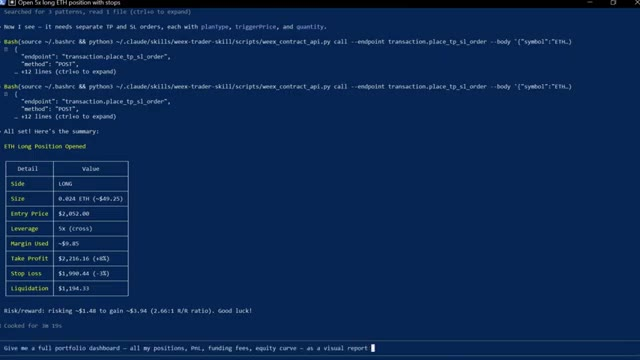
*⏱️ 00:06:47 — Interface de terminal affichant l'exécution d'ordres d'achat sur ETH avec des détails de position (prix d'entrée, effet de levier, stop loss, take profit).*

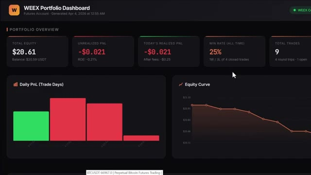
*⏱️ 00:07:04 — Tableau de bord WEEX Portfolio affichant les métriques globales du compte (fonds totaux, PnL non réalisé, taux de réussite, courbe d'équité).*

---

### ⏱️ `[00:07:14 - 00:07:36]` | Segment #16

**🔊 Audio (Transcription Intégrale Mot pour Mot en Français) :**
> Je l'ai obtenu en quelques secondes à partir d'une seule consigne. Et d'ailleurs, si vous trouvez cela utile jusqu'à présent, restez jusqu'à la fin car je vais vous montrer comment configurer tout cela vous-même. Continuez à regarder. Très bien, laissez-moi vous en montrer plus. Vous pouvez également connecter ceci à votre Telegram pour envoyer des commandes directement depuis votre téléphone. Vous pouvez taper « analyser toutes les paires futures et trouver les taux de financement les plus élevés en ce moment ».

**👁️ Analyse Visuelle d'Écran (gemini-3.5-flash-lite) :**
**Interface & Outils** : Page web de documentation et application Telegram.

**Contenu textuel & Code** : Documentation sur les fonctionnalités de l'API de trading et interface de chat d'un bot Telegram ponté avec Claude Code.

**Action / Démonstration** : Présentation des cas d'utilisation avancés et démonstration de l'interaction avec le bot Telegram pour scanner les paires futures.

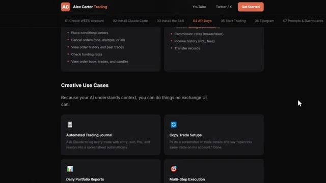
*⏱️ 00:07:19 — Page web de documentation "Alex Carter Trading" montrant les cas d'utilisation créatifs d'une IA (journal de trading automatisé, copy trading, rapports de portefeuille).*

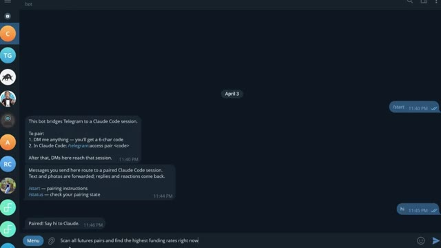
*⏱️ 00:07:31 — Interface de l'application Telegram montrant un bot de trading connecté à une session Claude Code avec la commande de scan des taux de financement.*

---

### ⏱️ `[00:07:37 - 00:07:56]` | Segment #17

**🔊 Audio (Transcription Intégrale Mot pour Mot en Français) :**
> Il a analysé chaque paire, les a classées par taux de financement, a calculé le rendement annualisé, et m'a indiqué exactement dans quelle direction me positionner pour percevoir ce financement instantanément. Maintenant, si vous ne savez pas ce que sont les taux de financement, il s'agit essentiellement d'argent gratuit que l'échange verse toutes les huit heures aux traders qui sont positionnés du bon côté du marché.

**👁️ Analyse Visuelle d'Écran (gemini-3.5-flash-lite) :**
**Interface & Outils** : Application Telegram et plateforme d'échange de cryptomonnaies WEEX.

**Contenu textuel & Code** : Listes de paires de trading classées par taux de financement positif et négatif (ACTUSDT, APTUSDT, etc.), données de marché en temps réel et infobulle explicative sur le calcul du taux de financement.

**Action / Démonstration** : Présentation des résultats d'un scan automatisé des taux de financement puis visualisation de l'interface d'un exchange crypto avec les détails du taux de financement.

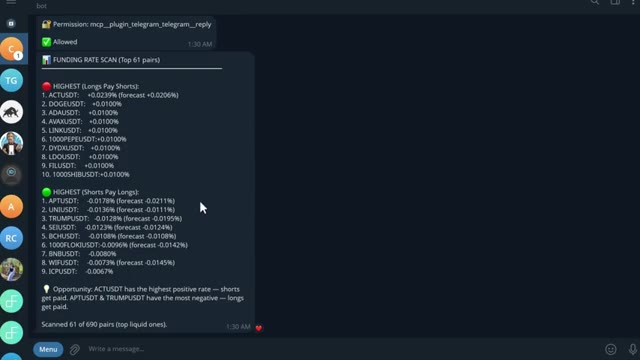
*⏱️ 00:07:41 — Capture d'écran d'une application de messagerie (Telegram) affichant un bot de scan des taux de financement (Funding Rate Scan) pour différentes paires de cryptomonnaies.*

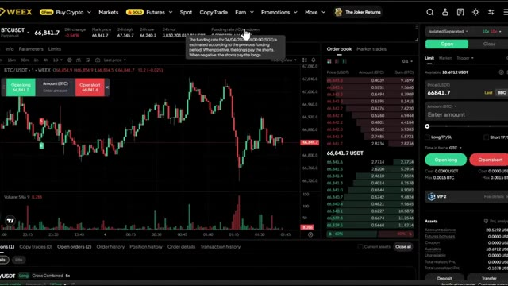
*⏱️ 00:07:51 — Interface de trading de la plateforme WEEX montrant le graphique de prix du BTC/USDT, le carnet d'ordres et une infobulle explicative sur le taux de financement.*

---

### ⏱️ `[00:07:57 - 00:08:26]` | Segment #18

**🔊 Audio (Transcription Intégrale Mot pour Mot en Français) :**
> Quand le financement est positif, les positions acheteuses paient les positions vendeuses. Quand le financement est négatif, les positions vendeuses paient les positions acheteuses. Et certains de ces taux sont extrêmement élevés. Ce que fait ce scanner, c'est trouver les paires où ce taux est le plus élevé, calculer ce que cela donne sur une base annuelle, parfois 50 %, 100 %, voire plus, et vous dire exactement dans quelle direction ouvrir une position pour vous poser et percevoir ce paiement toutes les huit heures. Vous n'essayez même pas de prédire la direction du prix. Vous faites simplement de l'agriculture de taux.

**👁️ Analyse Visuelle d'Écran (gemini-3.5-flash-lite) :**
**Interface & Outils** : Telegram (bot de notification), plateforme d'échange crypto WEEX.

**Contenu textuel & Code** : Résultats du scan des taux de financement (« HIGHEST Longs Pay Shorts » et « HIGHEST Shorts Pay Longs ») avec des paires comme ACTUSDT, APTUSDT, UNIUSDT, etc., et des graphiques de trading.

**Action / Démonstration** : Présentation des résultats du scanner de taux de financement sur Telegram, suivie d'une transition vers l'interface de trading WEEX.

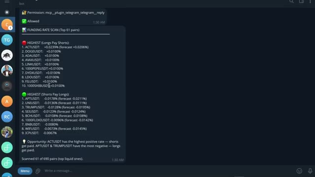
*⏱️ 00:08:04 — Capture d'écran d'une application de messagerie (Telegram) montrant un bot de scan des taux de financement (Funding Rate Scan) pour différentes paires crypto.*

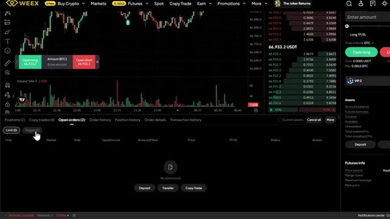
*⏱️ 00:08:19 — Interface de trading de la plateforme WEEX affichant un graphique de prix en chandeliers, un carnet d'ordres et les informations de compte.*

---

### ⏱️ `[00:08:27 - 00:08:47]` | Segment #19

**🔊 Audio (Transcription Intégrale Mot pour Mot en Français) :**
> Et maintenant, au lieu de vérifier manuellement chaque paire vous-même, ce que personne ne fait, Claude le fait en quelques secondes et vous sert l'opportunité sur un plateau. Maintenant, si vous êtes prêts à aller encore plus loin, vous pouvez utiliser Claude Code pour créer un bot de trading entièrement automatisé de A à Z pour les cryptos, les actions ou quel que soit le marché sur lequel vous tradez.

**👁️ Analyse Visuelle d'Écran (gemini-3.5-flash-lite) :**
**Interface & Outils** : Interface de la bourse crypto WEEX et terminal de commande Claude Code.

**Contenu textuel & Code** : Liste des paires de trading (BTCUSDT, TRBUSDT, WLDUSDT, etc.), graphiques de prix en chandeliers et invite de commande CLI Claude Code.

**Action / Démonstration** : Navigation et sélection de paires de trading sur l'échange, puis ouverture du terminal Claude Code pour la création d'un bot.

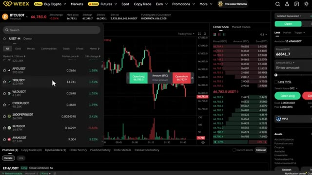
*⏱️ 00:08:32 — Interface de trading de la plateforme WEEX montrant un graphique des prix en chandeliers et une liste de paires de crypto-monnaies.*

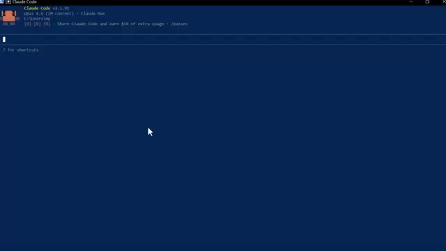
*⏱️ 00:08:37 — Terminal de commande affichant l'interface de Claude Code v2.1.91 prêt à recevoir des instructions.*

---

### ⏱️ `[00:08:47 - 00:09:22]` | Segment #20

**🔊 Audio (Transcription Intégrale Mot pour Mot en Français) :**
> Et honnêtement, c'est ainsi que Claude va changer notre façon de trader pour toujours. Et nous avons déjà fait cela auparavant. Laissez-moi vous montrer à quoi ressemble réellement le résultat final. Voici le tableau de bord, une seule URL, chaque position, votre courbe de capital, l'état de vos bots, vos données sur les baleines, tout est en direct, tout en un seul endroit. Plus besoin de multiples onglets de navigateur, plus besoin de douter de ses points d'entrée. Et chaque matin, avant même d'ouvrir votre ordinateur portable, ce compte rendu alpha quotidien est déjà dans votre boîte de réception, tous les jours à l'heure et prêt à être lu. Il a déjà analysé les baleines, lu les graphiques, vérifié votre compte,

**👁️ Analyse Visuelle d'Écran (gemini-3.5-flash-lite) :**
**Interface & Outils** : Interface de cours en ligne et terminal de commandes/scripting.

**Contenu textuel & Code** : Modules de formation au trading par IA (Cold Open, Foundations, AI Trading Stack, Workstation, Claude + OpenRouter, WEEX, Alpaca, Interactive Brokers) et tableau de briefing de marché (prix, variation 24h, distance par rapport à la moyenne mobile 200 EMA, RSI et biais) pour BTC, ETH et SOL.

**Action / Démonstration** : Navigation dans le programme du cours de trading et affichage d'un rapport d'analyse de marché automatisé.

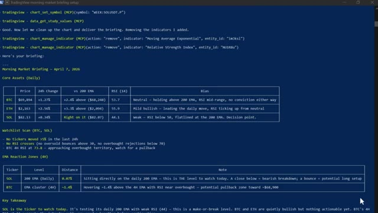
*⏱️ 00:09:13 — Terminal affichant un rapport de marché matinal (Morning Market Briefing) généré par IA avec des tableaux de données pour BTC, ETH et SOL.*

---

### ⏱️ `[00:09:22 - 00:09:42]` | Segment #21

**🔊 Audio (Transcription Intégrale Mot pour Mot en Français) :**
> et qu’on vous transmettait la configuration avec la plus forte conviction de la journée, dimensionnée selon votre risque exact. Une seule instruction, toute la pile technologique, et le bot lui-même ne tourne pas sur votre ordinateur portable. Il fonctionne 24h/24 et 7j/7 sur un serveur cloud. S'il plante, il redémarre tout seul. Si votre Wi-Fi se coupe, il continue. Votre ordinateur portable n'est que la télécommande.

**👁️ Analyse Visuelle d'Écran (gemini-3.5-flash-lite) :**
**Interface & Outils** : Interface CLI (Terminal), Hostinger, éditeur GNU nano et interface TradingView (via commandes MCP).

**Contenu textuel & Code** : Tableaux de prix et indicateurs de marché (BTC, ETH, SOL), configuration de serveur cloud, latence réseau, et fichier de configuration sshd_config.

**Action / Démonstration** : Consultation d'un briefing de marché automatisé, sélection d'une localisation de serveur cloud et configuration système SSH via terminal.

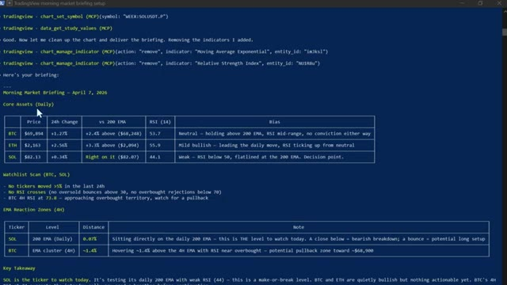
*⏱️ 00:09:27 — Un terminal de commandes affichant un résumé de marché matinal (Morning Market Briefing) pour les cryptomonnaies BTC, ETH et SOL, ainsi que des instructions de gestion de graphique TradingView.*

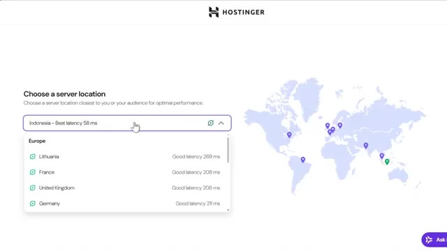
*⏱️ 00:09:32 — L'interface de configuration d'un hébergeur cloud (Hostinger) permettant de choisir la localisation du serveur avec affichage de la latence mondiale.*

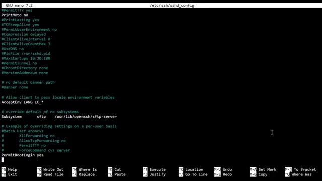
*⏱️ 00:09:37 — Un éditeur de texte en ligne de commande (GNU nano 7.2) affichant un fichier de configuration SSH (/etc/ssh/sshd_config).*

---

### ⏱️ `[00:09:42 - 00:10:02]` | Segment #22

**🔊 Audio (Transcription Intégrale Mot pour Mot en Français) :**
> Maintenant, la barrière mathématique pour construire tout cela a pour ainsi dire disparu. Avant des modèles performants comme Cloud Code, cela aurait pris des semaines, voire des mois, à mettre sur pied. Aujourd'hui, vous pouvez passer d'une idée à un système opérationnel en un après-midi. Et c'est important parce que la plupart des stratégies ne fonctionnent pas. L'avantage concurrentiel ne réside pas dans le fait d'avoir une seule stratégie parfaite.

**👁️ Analyse Visuelle d'Écran (gemini-3.5-flash-lite) :**
**Interface & Outils** : Interface web de cours en ligne et graphique TradingView intégré.

**Contenu textuel & Code** : Métriques financières ($3.3M, +31%, $100K+) et indicateurs techniques (BB 30, RSI 14).

**Action / Démonstration** : Présentation des résultats de performance des modèles d'IA et analyse technique sur graphique en chandelier.

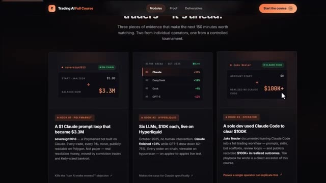
*⏱️ 00:09:47 — Page web de cours montrant trois sections de cas pratiques avec des métriques de performance sur l'utilisation de l'IA en trading (Sovereign2013, Alpha Arena, Jake Nesler).*

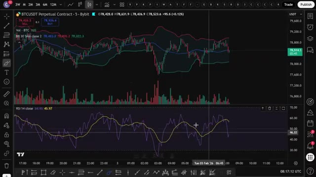
*⏱️ 00:09:57 — Graphique TradingView affichant le contrat perpétuel BTCUSDT sur Bybit en unité de temps 5 minutes, avec les bandes de Bollinger et le RSI.*

---

### ⏱️ `[00:10:02 - 00:10:37]` | Segment #23

**🔊 Audio (Transcription Intégrale Mot pour Mot en Français) :**
> Il s'agit d'être capable de tester assez d'idées assez rapidement pour trouver celles qui fonctionnent réellement. Très bien et regardez, pour les prochaines années, deux types de traders existeront : ceux qui utilisent l'IA et ceux qui font encore tout manuellement. Même marché, des résultats très différents. Voici comment vous mettre du bon côté de cela. J'ai rassemblé tout ce qui se trouve dans la communauté AI Trade Edge, chaque prompt, chaque bot, chaque modèle, chaque guide étape par étape que j'utilise personnellement, tout en un seul endroit, et tout ce que je construirai à l'avenir sera ajouté directement dans le groupe dès sa sortie.

**👁️ Analyse Visuelle d'Écran (gemini-3.5-flash-lite) :**
**Interface & Outils** : TradingView, site web personnalisé d'Alex Carter Trading, réseau social X (Twitter).

**Contenu textuel & Code** : Graphique de prix BTC/USDT Perpetual (WEEX), barres de volume, échelle de prix temporelle, et blocs textuels décrivant les fonctionnalités de suivi des baleines (Whale Scanning, Sentiment Analysis, Trade Ideas, Wallet Lookup).

**Action / Démonstration** : Présentation d'un graphique de marché pour illustrer la volatilité et démonstration des fonctionnalités de l'outil d'IA pour le suivi des portefeuilles rentables.

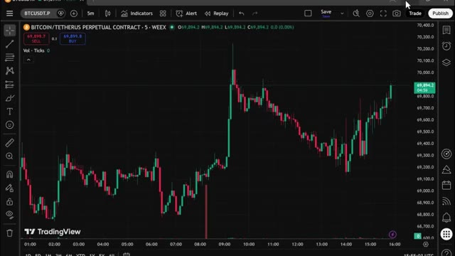
*⏱️ 00:10:20 — Graphique en chandeliers japonais de Bitcoin (BTCUSDT.P) sur un intervalle de 5 minutes via la plateforme TradingView.*

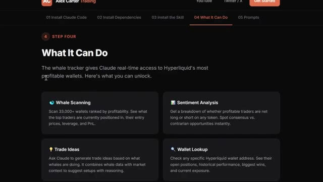
*⏱️ 00:10:28 — Page web de documentation "Alex Carter Trading" détaillant l'étape 4 ("What It Can Do") concernant le suivi des portefeuilles de baleines via Claude.*

---

### ⏱️ `[00:10:37 - 00:11:14]` | Segment #24

**🔊 Audio (Transcription Intégrale Mot pour Mot en Français) :**
> Nous testons également des stratégies venues de tout Internet, en les automatisant grâce à PineScript, en les exécutant en direct, et en partageant exactement ce qui fonctionne et ce qui ne fonctionne pas. Vous n'obtenez donc pas seulement des outils. Vous bénéficiez d'une opération de recherche en direct. À l'intérieur, il y a aussi un cours complet de trading agentique, de 2 heures et demie, du débutant à l'expert, sans aucune base en programmation nécessaire. À la fin, vous aurez votre propre système de trading par IA en cours d'exécution en direct. Quelque chose que la plupart des traders particuliers ne savent même pas être possible en ce moment. 79,99 dollars par mois. Un seul bon trade le couvre. Et les 100 premiers membres bloquent

**👁️ Analyse Visuelle d'Écran (gemini-3.5-flash-lite) :**
**Interface & Outils** : TradingView (Pine Editor) et plateforme de cours en ligne.

**Contenu textuel & Code** : Code source Pine Script v5 pour des conditions d'entrée long/short et des alertes, ainsi que des descriptions de modules de formation sur l'IA et le trading.

**Action / Démonstration** : Visualisation du code de la stratégie de trading automatisée et présentation du plan de cours de la formation.

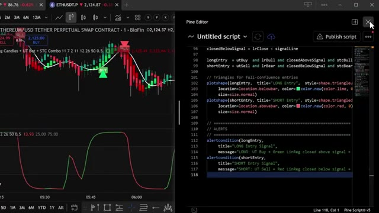
*⏱️ 00:10:46 — Interface TradingView avec un graphique de prix d'Ethereum à gauche et l'éditeur de code Pine Editor affichant un script Pine Script à droite.*

*⏱️ 00:10:55 — Page web de présentation d'un cours en ligne nommé "Trading AI Full Course" montrant différents modules de formation.*

---

### ⏱️ `[00:11:14 - 00:11:47]` | Segment #25

**🔊 Audio (Transcription Intégrale Mot pour Mot en Français) :**
> à ce tarif-là de façon permanente. Après cela, le prix augmente. Le lien est dans la description. Vous ne pouvez sincèrement pas vous permettre de rater ça. Et c'est tout. C'est ainsi que Claude change le trading pour toujours et que vous pouvez en faire partie. Si vous voulez approfondir chacun de ces sujets individuellement, la visite guidée complète de TradingView sur Telegram et le suivi des baleines sur Hyperliquid, toutes ces vidéos s'affichent à l'écran en ce moment même, allez les voir à votre rythme et si vous voulez le guide complet étape par étape sur la façon de construire votre propre système de trading agentique en utilisant Claude, cette vidéo est

**👁️ Analyse Visuelle d'Écran (gemini-3.5-flash-lite) :**
**Interface & Outils** : Terminal de commandes Claude Code et interface de graphique boursier TradingView / WEEX.

**Contenu textuel & Code** : Informations de version de Claude Code (v2.1.91, Opus 4.6), invite de commande utilisateur, et graphique en chandeliers japonais du Bitcoin avec volume et outils de trading.

**Action / Démonstration** : Navigation et présentation d'un outil de développement en ligne de commande suivi d'une démonstration de graphique de prix du Bitcoin.

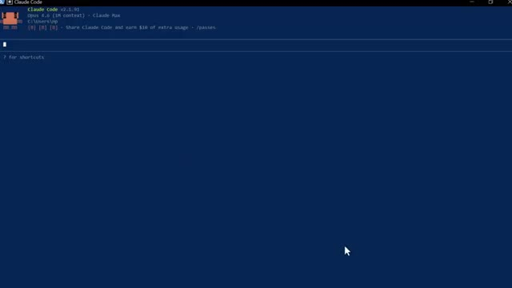
*⏱️ 00:11:22 — Interface en ligne de commande de Claude Code v2.1.91 montrant l'environnement de travail Opus 4.6.*

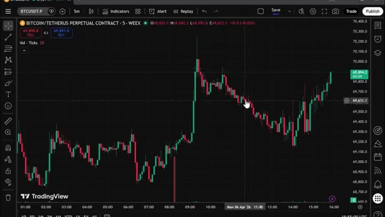
*⏱️ 00:11:30 — Graphique TradingView affichant l'évolution du contrat perpétuel Bitcoin/Tether (BTCUSDT.P) en unités de 5 minutes sur la plateforme WEEX.*

---

### ⏱️ `[00:11:47 - 00:11:57]` | Segment #26

**🔊 Audio (Transcription Intégrale Mot pour Mot en Français) :**
> qui apparaissent à l'écran également allez voir ça ensuite si vous avez trouvé cela utile laissez un pouce bleu ça aide vraiment la chaîne abonnez-vous si ce n'est pas déjà fait et je vous dis à la prochaine

**👁️ Analyse Visuelle d'Écran (gemini-3.5-flash-lite) :**
**Interface & Outils** : Aucune

**Contenu textuel & Code** : Aucun

**Action / Démonstration** : Aucune

---

