# 🎬 Meta Just Dropped Muse Wonder... Is It The Best AI Model For Trading?

> **Chaîne** : [Alex Carter](https://www.youtube.com/@AlexCarterTrading)  
> **Lien YouTube** : [https://www.youtube.com/watch?v=nfr7IDbHKOQ](https://www.youtube.com/watch?v=nfr7IDbHKOQ)  
> **Date de publication** : 20261013  
> **Durée** : 00:10:56  
> **Identifiant vidéo** : `nfr7IDbHKOQ`  
> **Transcription & Analyse** : `whisper-v3-large-turbo+gemini-3.5-flash-lite`  

---

## 📌 Synthèse Exécutive & Outils

### 💡 Résumé
Dans cette vidéo intitulée **Meta vient de lancer Muse Wonder... Est-ce le meilleur modèle d'IA pour le trading ?**, Alex Carter détaille une approche stratégique et pratique du trading et de l'automatisation par agents IA.

### 🛠️ Outils, Modèles & Logiciels Présentés
- **TradingView & Claude Code** : Analyse technique avancée et automatisation algorithmique.

### 🔑 Points Clés & Enseignements Stratégiques
- Respect rigoureux du ratio risque/rendement et du money management.
- Automatisation méthodique des déclencheurs d'ordres via des agents intelligents.

---

## ⏱️ Chronologie & Transcription Complète Audio & Visuelle (Mot pour Mot)

### ⏱️ `[00:00:00 - 00:00:33]` | Segment #01

**🔊 Audio (Transcription Intégrale Mot pour Mot en Français) :**
> Mark Zuckerberg et Meta viennent de lancer Muse Wonder, une toute nouvelle famille de modèles de pointe, et Meta le présente comme son modèle le plus avancé à ce jour pour le travail d'agent personnel et professionnel. Aujourd'hui, Internet a déjà des avis bien arrêtés sur ses performances réelles. Certaines personnes disent qu'il est meilleur que Claude Opus. D'autres disent qu'il n'arrive même pas à la cheville. Donc dans la vidéo d'aujourd'hui, je vais décortiquer exactement ce qu'est Muse Wonder, comment il se positionne par rapport aux autres modèles de pointe, ce que disent réellement les benchmarks, à quel point cette chose est vraiment sûre, et combien cela va

**👁️ Analyse Visuelle d'Écran (gemini-3.5-flash-lite) :**
**Interface & Outils** : Navigateur web affichant les plateformes X (Twitter) et le site web officiel de Meta.

**Contenu textuel & Code** : Tableaux de benchmarks et scores de performance comparant les modèles d'IA (Muse Wonder, Claude Fable 5.1, GPT-6 Astra) sur divers critères (Personal Superintelligence Index, Legal agent work, Financial analyst research).
[SCÉNARIO] Présentation et analyse comparative des performances des nouveaux modèles d'intelligence artificielle de Meta par rapport à la concurrence.

**Action / Démonstration** : Explications face caméra et analyse conceptuelle des marchés.

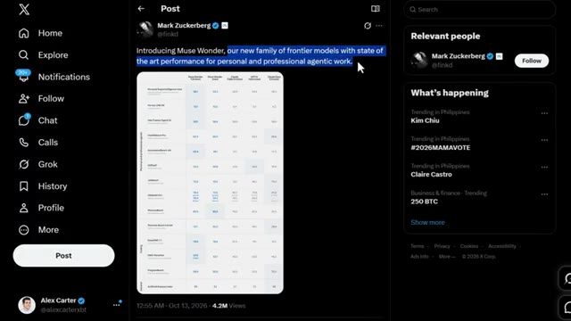
*⏱️ 00:00:08 — Capture d'écran de l'interface X (Twitter) affichant un post de Mark Zuckerberg présentant les modèles Muse Wonder avec un tableau comparatif des performances.*

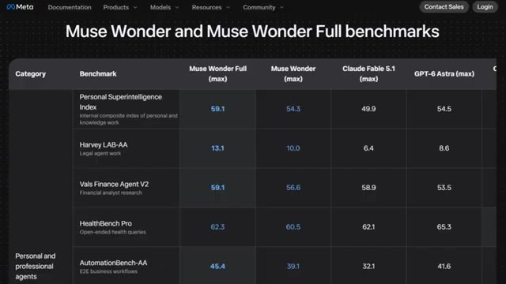
*⏱️ 00:00:25 — Capture d'écran du site officiel de Meta affichant les benchmarks détaillés de Muse Wonder et Muse Wonder Full par rapport à d'autres modèles de pointe.*

---

### ⏱️ `[00:00:33 - 00:01:11]` | Segment #02

**🔊 Audio (Transcription Intégrale Mot pour Mot en Français) :**
> ça vous coûte de l'utiliser. Et restez jusqu'à la fin, car je vais vous montrer exactement qui devrait utiliser ce modèle et qui devrait s'en tenir à autre chose. Rien que cette partie pourrait vous faire économiser beaucoup d'argent. Bref, entrons dans le vif du sujet. Alors tout d'abord, qu'est-ce que c'est réellement que Muse Wonder ? Meta vient de lancer deux modèles ici, pas un seul. Muse Wonder et une version plus grande appelée Muse wonderful. Tous deux sont conçus spécifiquement pour des tâches agentiques personnelles et professionnelles, ce qui signifie qu'ils ne sont pas de simples chatbots qui répondent à des questions. Ils sont conçus pour aller réellement faire des choses pour vous. Naviguer sur le web, écrire du code, gérer de longues tâches en plusieurs étapes, ce genre de choses.

**👁️ Analyse Visuelle d'Écran (gemini-3.5-flash-lite) :**
**Interface & Outils** : Site web officiel Meta (documentation, produits, modèles, API).

**Contenu textuel & Code** : Options d'intégration et de développement : Muse Code (coding multi-agent avec Muse Wonder / Muse Wonder Full), Meta Model API, et OpenRouter.

**Action / Démonstration** : Présentation des différentes méthodes pour accéder et utiliser les modèles d'IA de Meta.

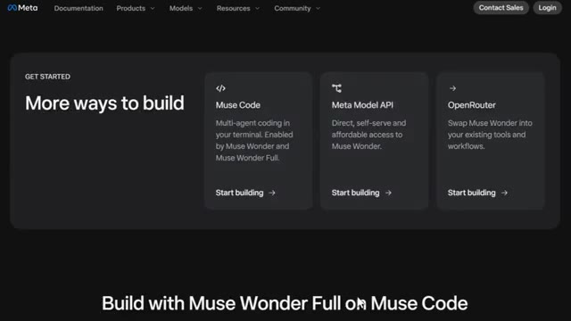
*⏱️ 00:00:43 — Capture d'écran montrant le site web de Meta avec la page "More ways to build" présentant les options Muse Code, Meta Model API et OpenRouter.*

---

### ⏱️ `[00:01:12 - 00:01:37]` | Segment #03

**🔊 Audio (Transcription Intégrale Mot pour Mot en Français) :**
> Ce qui est intéressant, c'est que Meta construit tout cela autour de deux idées principales, la mémoire active et l'attention active. La mémoire active signifie fondamentalement que le modèle se souvient de ce qui compte pour vous d'une conversation à l'autre. Il ne repart donc pas de zéro à chaque fois. Et l'attention active signifie qu'il s'accroche réellement à la tâche difficile. En essayant différentes approches, en surmontant les obstacles, en s'adaptant quand quelque chose ne fonctionne pas du premier coup, au lieu d'abandonner ou d'inventer une réponse.

**👁️ Analyse Visuelle d'Écran (gemini-3.5-flash-lite) :**
**Interface & Outils** : Site web de recherche Meta AI Research affichant de la documentation technique et des benchmarks de performance d'IA.

**Contenu textuel & Code** : Texte explicatif sur la mémoire active et l'attention active, accompagné de graphiques à barres de benchmarks (MemoryBench, SWE-Marathon, FocusBench) avec des pourcentages de score.

**Action / Démonstration** : Présentation visuelle et explication des concepts clés de recherche en IA de Meta (mémoire et attention active).

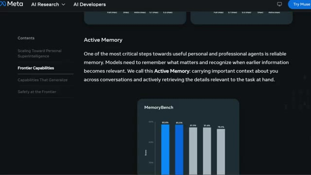
*⏱️ 00:01:18 — Capture d'écran du site Meta AI Research présentant la section 'Active Memory' avec des explications textuelles et un graphique d'évaluation 'MemoryBench'.*

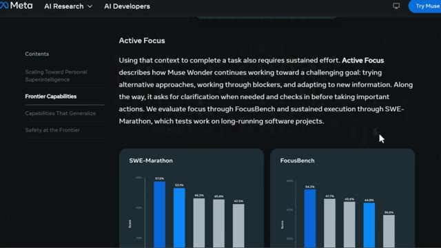
*⏱️ 00:01:31 — Capture d'écran du site Meta AI Research présentant la section 'Active Focus' avec des graphiques de performance 'SWE-Marathon' et 'FocusBench'.*

---

### ⏱️ `[00:01:37 - 00:02:01]` | Segment #04

**🔊 Audio (Transcription Intégrale Mot pour Mot en Français) :**
> En ce moment, Muse Wonder est en direct sur la première API de Meta et à l'intérieur de Muse Code. Muse Wonderful, le plus grand, est actuellement disponible uniquement pour les abonnés de Muse Code. C'est donc un bref aperçu. Maintenant, parlons de la façon dont nous sommes réellement arrivés ici. Voici quelque chose que je trouve assez fou. Toute cette sortie s'est produite seulement six semaines après le modèle précédent de Meta, Muse Spark 1.3.

**👁️ Analyse Visuelle d'Écran (gemini-3.5-flash-lite) :**
**Interface & Outils** : Page web de la plateforme Meta présentant différentes versions de modèles d'IA et de tarifications.

**Contenu textuel & Code** : Informations tarifaires (Input $4.00, Cached input $0.20, Output $20.00) et description des modèles Muse Wonder et Muse Spark 1.3.

**Action / Démonstration** : Navigation et présentation des fonctionnalités et tarifs des nouveaux modèles d'IA de Meta.

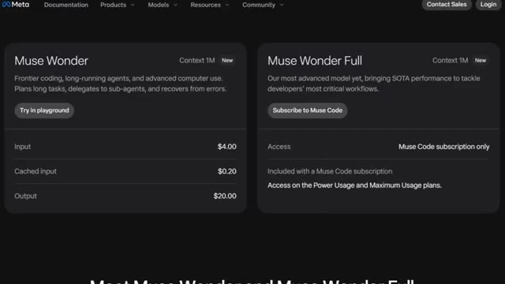
*⏱️ 00:01:43 — Capture d'écran montrant les options 'Muse Wonder' et 'Muse Wonder Full' sur une interface web Meta avec les tarifs associés.*

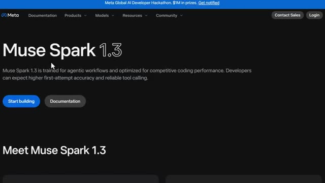
*⏱️ 00:01:55 — Capture d'écran présentant le modèle 'Muse Spark 1.3' sur une page web Meta dédiée aux workflows d'agents.*

---

### ⏱️ `[00:02:01 - 00:02:36]` | Segment #05

**🔊 Audio (Transcription Intégrale Mot pour Mot en Français) :**
> Il y a 14 mois, Meta a fondamentalement refondu l'ensemble de ses efforts en matière d'IA. Ils ont reconstruit leur architecture à partir des principes fondamentaux, et Muse Wonder est le résultat de ce travail qui atteint enfin la pointe de la technologie. Les deux modèles ont été entraînés au centre de données Prometheus de Meta, d'une échelle gigawatt, et Meta qualifie cela de démarche de mise à l'échelle prévisible et rigoureuse, ce qui signifie que chaque sortie est censée constituer une étape intentionnelle et mesurable, et non pas simplement une amélioration aléatoire, et honnêtement, quand on regarde le bond de MuseSpark 1.3 à MuseWonder en seulement six semaines, on a bien l'impression que cette approche de mise à l'échelle fonctionne. Alors, penchons-nous maintenant sur les chiffres.

**👁️ Analyse Visuelle d'Écran (gemini-3.5-flash-lite) :**
**Interface & Outils** : Site web officiel de Meta / Recherche IA

**Contenu textuel & Code** : Graphique 'Artificial Intelligence Index' comparant les performances de différents modèles (Claude Opus 5.5, Muse Wonder Full, GPT-6, Gemini, etc.) avec des scores allant de 30 à 58.

**Action / Démonstration** : Présentation des résultats de performance et du classement des nouveaux modèles de Meta sur un graphique comparatif.

*⏱️ 00:02:28 — Graphique en barres de l'Artificial Intelligence Index montrant le classement comparatif des modèles d'IA avec des scores chiffrés.*

---

### ⏱️ `[00:02:36 - 00:03:13]` | Segment #06

**🔊 Audio (Transcription Intégrale Mot pour Mot en Français) :**
> Parce que c'est là que ça devient intéressant. Sur l'indice d'intelligence d'Artificial Analysis, MuseWonder a obtenu un score de 52 et MuseWonder Full a obtenu 56 avec un effort de raisonnement maximal. Comparez cela à MUSE Spark 1.3, qui était à 48. C'est donc un gain solide en seulement six semaines. Maintenant, là où ça devient vraiment intéressant, c'est du côté des agents. MUSE Wonderful a fait un bond de 24 points sur Terminal Bench 4.0, passant de 33 % à 57 %. Sur GDPVAL, qui teste le travail professionnel réel, il a gagné 176 points ELO.

**👁️ Analyse Visuelle d'Écran (gemini-3.5-flash-lite) :**
**Interface & Outils** : Navigateur web affichant un tableau de documentation Meta et le réseau social X (Twitter).

**Contenu textuel & Code** : Scores de benchmarks et texte de publication (Artificial Analysis Index, scores de 52 et 56 pour Muse Wonder et Muse Wonder Full).

**Action / Démonstration** : Présentation des résultats d'évaluation des performances des modèles d'IA par le présentateur.

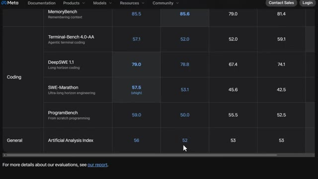
*⏱️ 00:02:45 — Un tableau de performances comparatives de modèles d'IA montrant les scores sur différents benchmarks incluant l'Artificial Analysis Index.*

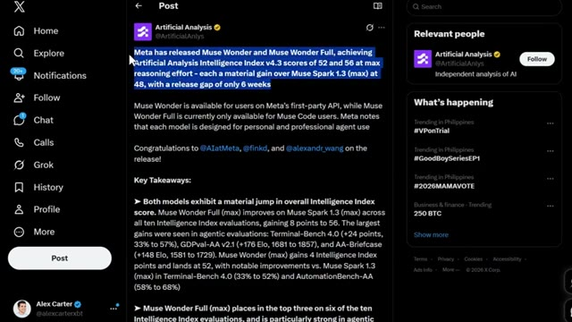
*⏱️ 00:02:55 — Une publication sur le réseau social X par Artificial Analysis détaillant les scores des modèles Muse Wonder et Muse Wonder Full.*

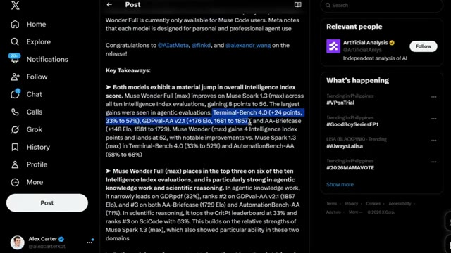
*⏱️ 00:03:04 — Une suite de la publication sur X détaillant les gains de performance et les scores spécifiques par benchmark agentique.*

---

### ⏱️ `[00:03:13 - 00:03:35]` | Segment #07

**🔊 Audio (Transcription Intégrale Mot pour Mot en Français) :**
> Et sur AA Briefcase, il a gagné 148 points de concessionnaire. Ce ne sont pas de petites améliorations. Ce sont le genre de bons en avant qui changent réellement ce que le modèle peut faire pour vous en pratique. Muse Wonderful se classe également dans le top trois sur six des dix évaluations de l'indice d'intelligence. Il est particulièrement fort dans le travail de connaissance agentique et le raisonnement scientifique.

**👁️ Analyse Visuelle d'Écran (gemini-3.5-flash-lite) :**
**Interface & Outils** : Navigateur web affichant une interface de type réseau social (X) et un site de recherche en IA (Meta).

**Contenu textuel & Code** : Texte descriptif des performances des modèles Muse Wonder Full et Muse Wonder, scores d'évaluation, indices d'intelligence et classements (scores chiffrés, pourcentages et classements ELO).

**Action / Démonstration** : Défilement de texte et affichage d'un graphique comparatif de performance des modèles d'IA.

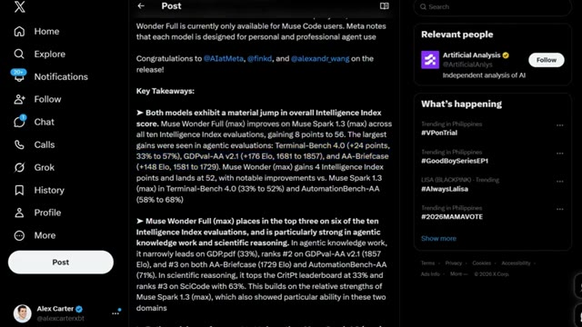
*⏱️ 00:03:18 — Capture d'écran d'une publication sur le réseau social X détaillant les performances et les scores d'évaluation des modèles d'intelligence artificielle Muse.*

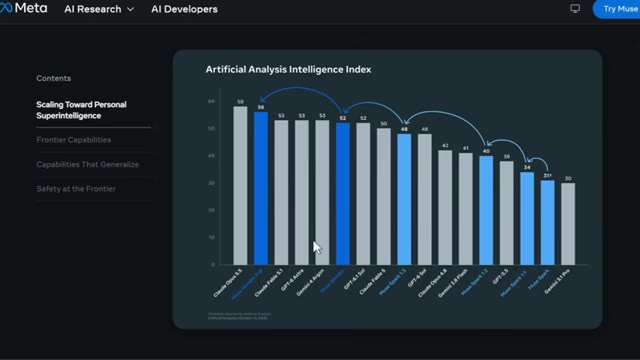
*⏱️ 00:03:24 — Graphique comparatif "Artificial Analysis Intelligence Index" affichant les différents modèles et leurs scores, avec des flèches illustrant la progression.*

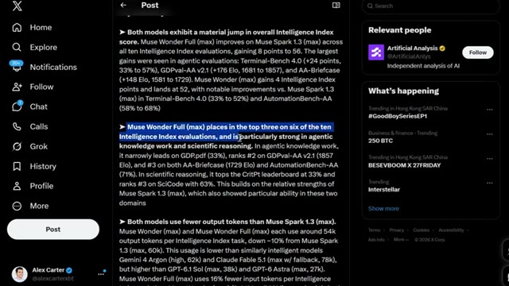
*⏱️ 00:03:29 — Capture d'écran similaire à la première montrant le texte sur les performances de Muse Wonder Full avec une phrase en surbrillance bleue.*

---

### ⏱️ `[00:03:35 - 00:03:54]` | Segment #08

**🔊 Audio (Transcription Intégrale Mot pour Mot en Français) :**
> Il est en fait en tête du classement pour le PIB.PDF à 33 %, se classe au deuxième rang pour le PIBVAL et arrive en tête du classement CRIT-PT pour le raisonnement scientifique à 33 %. Maintenant, voici quelque chose que je trouvais vraiment surprenant. Les deux modèles utilisent en fait moins de jetons de sortie que MuseSpark 1.3.

**👁️ Analyse Visuelle d'Écran (gemini-3.5-flash-lite) :**
**Interface & Outils** : Navigateur web affichant un tableau de benchmarks, un post sur X (Twitter) et une page de tarification de modèles d'IA.

**Contenu textuel & Code** : Scores de performance sur des benchmarks (GDP.pdf, CritPt), détails de tarification (Input : 4,00 $, Output : 20,00 $).

**Action / Démonstration** : Présentation des résultats de benchmarks et des spécificités tarifaires des nouveaux modèles d'intelligence artificielle.

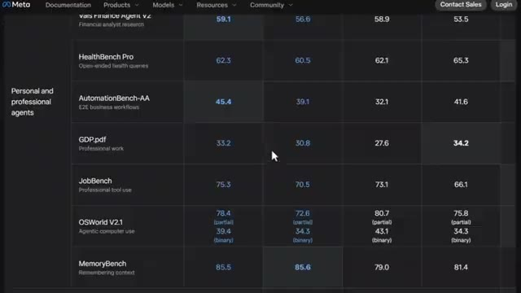
*⏱️ 00:03:40 — Tableau de benchmarks affichant les performances de différents modèles d'IA sur plusieurs métriques (GDP.pdf, JobBench, OSWorld V2.1).*

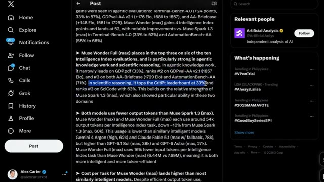
*⏱️ 00:03:45 — Publication sur le réseau social X détaillant les performances du modèle Muse Wonder Full (max) sur divers benchmarks (GDP.pdf, CritPt).*

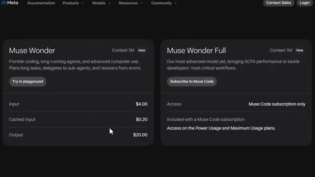
*⏱️ 00:03:50 — Interface de tarification et de description des modèles Muse Wonder et Muse Wonder Full avec les coûts d'utilisation (Input, Cached input, Output).*

---

### ⏱️ `[00:03:55 - 00:04:14]` | Segment #09

**🔊 Audio (Transcription Intégrale Mot pour Mot en Français) :**
> On parle d'environ 54 000 jetons de sortie par tâche, soit une baisse d'environ 10 % par rapport à avant. C'est inférieur à Gemini 4 Argon et Claude Fable 5.1, mais supérieur à GPT 6.1 Sol et GPT 6 Astra. Ce n'est donc pas le modèle le plus efficace du marché, mais ce n'est certainement pas le moins efficace non plus.

**👁️ Analyse Visuelle d'Écran (gemini-3.5-flash-lite) :**
**Interface & Outils** : Interface web de X (Twitter) avec un panneau latéral de navigation et un fil d'actualité central contenant du texte formaté.

**Contenu textuel & Code** : Texte détaillé comparant le nombre de jetons de sortie et d'entrée, ainsi que le coût par tâche (ex: 4$ par million de jetons d'entrée, 20$ par million de jetons de sortie, totalisant 4,52$ par tâche) pour différents modèles d'IA comme Muse Wonder, Claude Fable 5.1, GPT-6 Astra et Gemini 4 Argon.

**Action / Démonstration** : Affichage et lecture à l'écran du post X détaillant les métriques d'efficacité en jetons et les coûts des différents modèles d'IA comparés dans la vidéo.

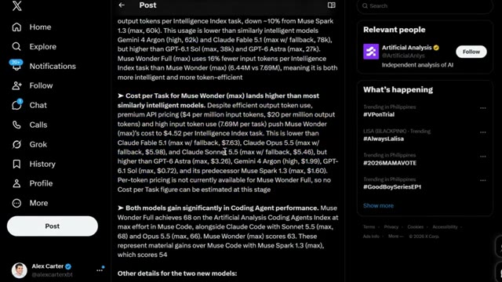
*⏱️ 00:04:00 — Capture d'écran de l'interface du réseau social X (Twitter) affichant un post détaillé sur les performances et les coûts par tâche des modèles d'intelligence artificielle (Muse Wonder, Gemini 4 Argon, Claude Fable 5.1, GPT-6.1 Sol, etc.).*

---

### ⏱️ `[00:04:15 - 00:04:38]` | Segment #10

**🔊 Audio (Transcription Intégrale Mot pour Mot en Français) :**
> Mais voici la partie qui pourrait vraiment importer le plus si vous êtes développeur. Le coût. Bien qu'il soit efficace avec les jetons de sortie, le coût par tâche de Muse Wonders s'élève à 4,52 dollars, principalement en raison du nombre de jetons d'entrée qu'il utilise. À titre de comparaison, c'est moins cher que Claude Opus 5.5 à 5,98 dollars et que Claude Fable 5.1 à 7,63 dollars.

**👁️ Analyse Visuelle d'Écran (gemini-3.5-flash-lite) :**
**Interface & Outils** : Page web de documentation et de tarification (Meta / Modèles IA).

**Contenu textuel & Code** : Tarifs affichés par million de jetons : Input ($4.00), Cached input ($0.20), Output ($20.00) pour Muse Wonder, et tableau comparatif pour Claude Opus (Cache reads $0.20 vs $0.50, Input tokens $4 vs $5, Output tokens $20 vs $25, Cache writes $5 vs $6.25).

**Action / Démonstration** : Présentation et analyse détaillée des coûts par tâche et par jeton pour les différents modèles de langages.

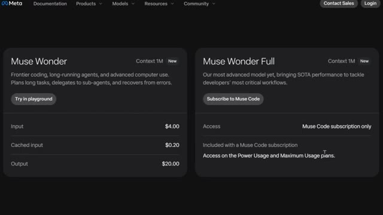
*⏱️ 00:04:20 — Capture d'écran montrant les détails tarifaires des modèles 'Muse Wonder' et 'Muse Wonder Full'.*

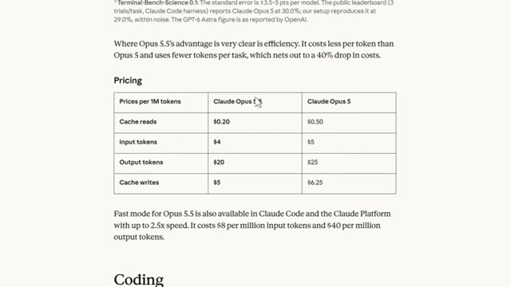
*⏱️ 00:04:32 — Tableau de tarification comparant les coûts par million de jetons entre Claude Opus 5.5 et Claude Opus 5.*

---

### ⏱️ `[00:04:38 - 00:04:58]` | Segment #11

**🔊 Audio (Transcription Intégrale Mot pour Mot en Français) :**
> Mais c'est plus cher que GPT-6 Astra à 3,26 dollars et Gemini 4 Argon à seulement 1,99 dollar. Donc, selon ce que vous cherchez à optimiser, l'intelligence brute, le coût ou l'efficacité des jetons, le meilleur modèle change honnêtement. Et c'est exactement pourquoi Internet n'arrive pas à se mettre d'accord sur celui-ci.

**👁️ Analyse Visuelle d'Écran (gemini-3.5-flash-lite) :**
**Interface & Outils** : Navigateur web affichant la documentation et les pages de tarification d'OpenAI et les benchmarks de Meta.

**Contenu textuel & Code** : Tarifs d'API d'OpenAI ($10/M tokens d'entrée, $50/M tokens de sortie) et tableau de scores de performance par benchmark (JobBench, OSWorld V2.1, MemoryBench, Terminal-Bench 4.0-AA, DeepSWE 1.1).

**Action / Démonstration** : Présentation des spécifications techniques, des tarifs et des performances comparatives des différents modèles d'IA sur le web.

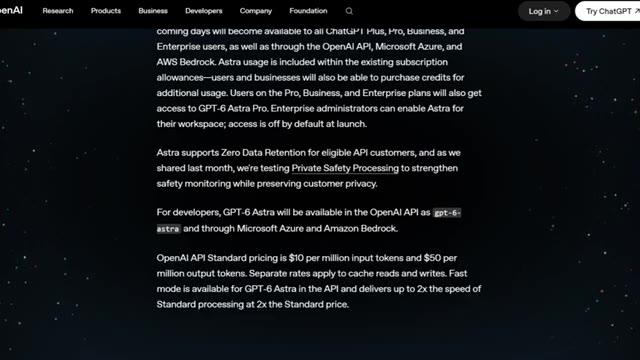
*⏱️ 00:04:43 — Capture d'écran montrant la page web d'OpenAI avec des détails techniques sur le modèle GPT-6 Astra, incluant les tarifs d'API de 10 $ par million de jetons d'entrée et 50 $ par million de jetons de sortie.*

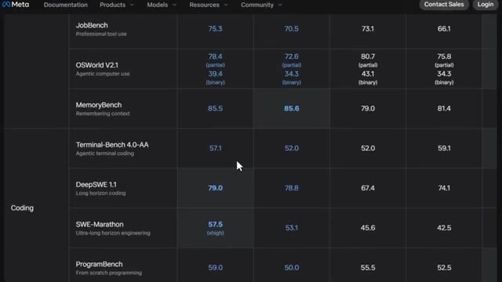
*⏱️ 00:04:48 — Capture d'écran d'un tableau comparatif de performances sur le site de Meta montrant des métriques de benchmarks pour différents modèles sur des tâches de programmation et de raisonnement (JobBench, OSWorld, MemoryBench, Terminal-Bench, DeepSWE).*

---

### ⏱️ `[00:04:58 - 00:05:31]` | Segment #12

**🔊 Audio (Transcription Intégrale Mot pour Mot en Français) :**
> Maintenant parlons de programmation, car c'est là que beaucoup de gens utilisent réellement ces modèles au jour le jour. Sur l'indice des agents de programmation d'Artificial Analysis, Muse Wonderful a atteint 68 à l'effort maximum dans Muse Code, se plaçant juste aux côtés de Claude Sonnet 5.5, qui a également obtenu 68. Claude Opus 5.5 est arrivé à 66. Muse Wonder, le modèle plus petit, a obtenu 63. Pour situer le contexte, Muse Spark 1.3 n'était qu'à 54. Donc encore une fois, un vrai bond en avant, et non pas marginal. Mais il y a quelque chose de plus profond qui se passe et qui

**👁️ Analyse Visuelle d'Écran (gemini-3.5-flash-lite) :**
**Interface & Outils** : Navigateur web affichant le site web Artificial Analysis.

**Contenu textuel & Code** : Texte informatif et métriques de performance surlignées en bleu : « Muse Wonder Full achieves 68 on the Artificial Analysis Coding Agents Index at max effort in Muse Code, alongside Claude Code with Sonnet 5.5 (max, 68) and Opus 5.5 (max, 66) ».

**Action / Démonstration** : Le présentateur ou l'interface met en surbrillance le paragraphe concernant les performances en programmation (Coding Agent) des modèles comparés.

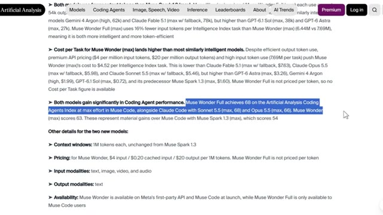
*⏱️ 00:05:07 — Capture d'écran du site Artificial Analysis montrant les performances des modèles d'IA, avec une ligne de texte surlignée en bleu détaillant le score de Muse Wonder Full sur l'indice des agents de programmation.*

---

### ⏱️ `[00:05:31 - 00:06:07]` | Segment #13

**🔊 Audio (Transcription Intégrale Mot pour Mot en Français) :**
> Je pense que c'est en réalité la partie la plus importante de toute cette version, et c'est quelque chose que la plupart des gens négligent complètement. Meta a testé dans quelle mesure ces modèles se généralisaient à des tâches pour lesquelles ils n'avaient pas été spécifiquement entraînés, essentiellement des problèmes hors distribution non familiers, et ce qu'ils ont découvert, c'est que Muse Wonderful performe encore mieux sur des tâches non familières que ce que l'on pourrait prédire sur la base de ses seules performances d'entraînement. L'explication de Meta est qu'il est construit sur un modèle de base plus grand et plus fort, et qu'une base plus forte a tendance à se reporter plus efficacement sur des situations que le modèle n'a jamais vues auparavant. Pourquoi est-ce que cela vous importe vraiment ? Parce qu'un agent personnel va exécuter

**👁️ Analyse Visuelle d'Écran (gemini-3.5-flash-lite) :**
**Interface & Outils** : Navigateur web affichant la documentation de recherche Meta AI Research.

**Contenu textuel & Code** : Texte technique décrivant la généralisation des modèles, les performances sur des tâches in-distribution et out-of-distribution, et les modèles Muse Spark 1.3 et Muse Wonder Full.

**Action / Démonstration** : Navigation et lecture de la documentation de recherche Meta AI sur la généralisation des modèles.

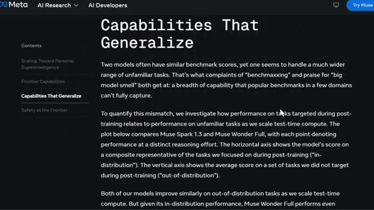
*⏱️ 00:05:40 — Capture d'écran du site web de recherche Meta affichant la section intitulée 'Capabilities That Generalize' qui explique comment les modèles gèrent des tâches non familières.*

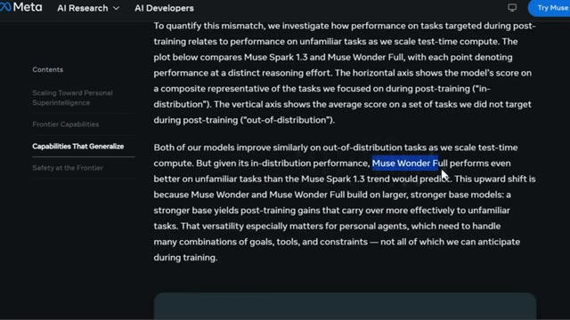
*⏱️ 00:05:49 — Suite du texte sur le site Meta AI Research, avec une sélection de texte en surbrillance sur le modèle 'Muse Wonder Full' et ses performances sur des tâches hors distribution.*

---

### ⏱️ `[00:06:07 - 00:06:29]` | Segment #14

**🔊 Audio (Transcription Intégrale Mot pour Mot en Français) :**
> dans des combinaisons d'objectifs et d'outils que personne n'avait anticipées pendant l'entraînement. Donc cette capacité de généralisation est honnêtement bien plus importante que n'importe quel score de référence. Maintenant, parlons de quelque chose qui ne reçoit pas assez d'attention : la sécurité. Et je pense vraiment que cela compte beaucoup plus ici qu'avec un chatbot normal, parce que nous parlons d'un agent qui peut prendre de véritables actions en votre nom.

**👁️ Analyse Visuelle d'Écran (gemini-3.5-flash-lite) :**
**Interface & Outils** : Navigateur web affichant le site web Meta AI Research.

**Contenu textuel & Code** : Graphiques de performance (In-Distribution vs Out-of-Distribution Performance) et statistiques de sécurité (Attack Success Rate, Violation Rate).

**Action / Démonstration** : Navigation sur la page web pour illustrer la capacité de généralisation et les aspects de sécurité des modèles d'IA.

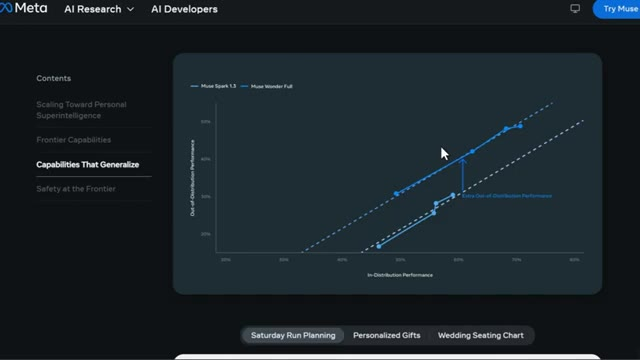
*⏱️ 00:06:13 — Interface Meta AI Research montrant un graphique de performance de généralisation (Capabilities That Generalize).*

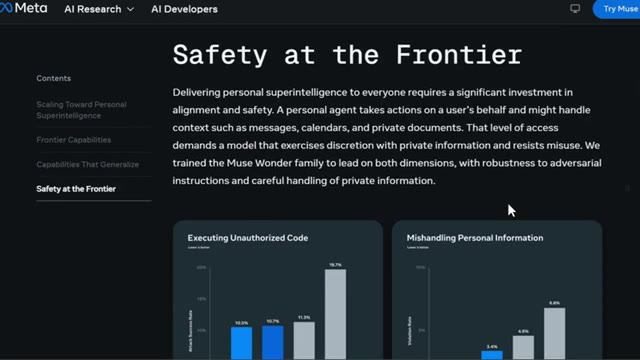
*⏱️ 00:06:18 — Interface Meta AI Research abordant la sécurité avec des graphiques sur l'exécution de code non autorisé et la gestion des informations personnelles (Safety at the Frontier).*

---

### ⏱️ `[00:06:30 - 00:07:06]` | Segment #15

**🔊 Audio (Transcription Intégrale Mot pour Mot en Français) :**
> Lecture de vos messages, de votre calendrier, de vos documents privés. Meta a entraîné la famille Muse Wonder spécifiquement pour être plus résistante aux instructions contradictoires et plus prudente avec les informations privées. Lors de tests d'attaques par exécution de code non autorisée, Muse Wonder présente un taux de réussite des attaques inférieur à celui des modèles concurrents. Et rappelez-vous, plus c'est bas, mieux c'est ici. En matière de gestion des informations personnelles, il présente également des taux de violation inférieurs. Meta qualifie également cela de sa protection la plus puissante à ce jour contre la mauvaise utilisation des agents CBRN. C'est-à-dire chimique, biologique, radiologique et nucléaire, tout en préservant

**👁️ Analyse Visuelle d'Écran (gemini-3.5-flash-lite) :**
**Interface & Outils** : Interface web de recherche Meta AI présentant la documentation de la famille de modèles Muse Wonder.

**Contenu textuel & Code** : Graphiques statistiques comparant les taux de réussite d'attaques et de violations (Muse Wonder, Claude Fable, GPT-6 Astra) ainsi que des benchmarks de cyber-sécurité.

**Action / Démonstration** : Présentation des métriques de sécurité et de robustesse des modèles face aux instructions contradictoires et aux informations privées.

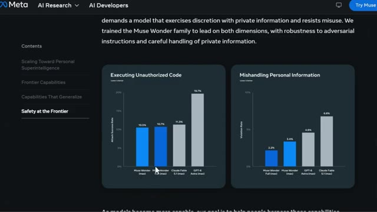
*⏱️ 00:06:39 — Graphiques de performance de sécurité montrant les taux de réussite d'exécution de code non autorisé et de mauvaise gestion d'informations personnelles pour Muse Wonder et d'autres modèles d'IA.*

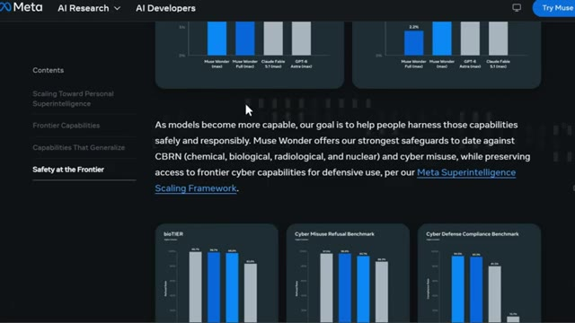
*⏱️ 00:06:57 — Texte explicatif de Meta sur la sécurité et la responsabilité, accompagné de graphiques supplémentaires évaluant les risques CBRN et la cyber-sécurité (bioTIER, Cyber Misuse Refusal Benchmark, Cyber Defense Compliance Benchmark).*

---

### ⏱️ `[00:07:06 - 00:07:40]` | Segment #16

**🔊 Audio (Transcription Intégrale Mot pour Mot en Français) :**
> des capacités cybernétiques de pointe pour un usage défensif légitime. Sur le banc d'essai de refus des risques biologiques et le banc d'essai de refus des utilisations cybernétiques malveillantes, Muse Wonder obtient des taux de refus plus élevés, ce qui est encore une fois la direction que l'on souhaite voir. Donc, pour être honnête, de tout ce qui se trouve dans cette version, c'est peut-être la partie que je respecte le plus. Parce qu'un agent plus intelligent qui n'est pas correctement aligné est bien plus dangereux qu'un simple chatbot intelligent qui se contente de répondre à des questions. Meta qualifie Muse Wonder de modèle le plus aligné à ce jour, et a annoncé qu'un rapport de sécurité complet serait bientôt publié. Très bien,

**👁️ Analyse Visuelle d'Écran (gemini-3.5-flash-lite) :**
**Interface & Outils** : Interface web de recherche Meta AI affichant des graphiques de performance.

**Contenu textuel & Code** : Trois graphiques en barres représentant les benchmarks 'bioTIER', 'Cyber Misuse Refusal Benchmark', et 'Cyber Defense Compliance Benchmark', avec des taux chiffrés pour différents modèles (Claude, Muse Wonder, GPT).

**Action / Démonstration** : Un curseur de souris pointe sur l'une des barres du graphique bioTIER pour mettre en avant les performances du modèle Muse Wonder.

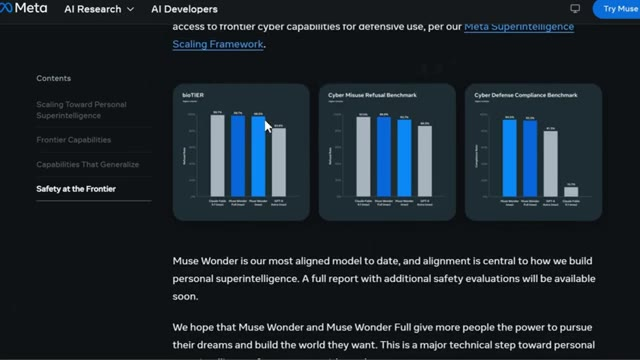
*⏱️ 00:07:15 — Capture d'écran montrant les résultats de benchmarks de sécurité et de refus pour les modèles IA, notamment 'Muse Wonder', sur le site de Meta AI.*

---

### ⏱️ `[00:07:40 - 00:08:13]` | Segment #17

**🔊 Audio (Transcription Intégrale Mot pour Mot en Français) :**
> Parlons des tarifs et de la façon dont vous pouvez réellement accéder à cette chose. Muse Wonder est facturé 4 dollars par million de tokens d'entrée, 0,20 dollar par million de tokens d'entrée en cache, et 20 dollars par million de tokens de sortie. Les deux modèles disposent d'une fenêtre de contexte d'un million de tokens, tout comme MuseSpark 1.3, et ils prennent en charge le texte, l'image, la vidéo et l'audio comme entrées, bien que la sortie soit textuelle uniquement pour l'instant. En termes de disponibilité, MuseWonder est en ligne dès maintenant sur l'API propriétaire de Meta et au sein de MuseCode. MuseWonder Full,

**👁️ Analyse Visuelle d'Écran (gemini-3.5-flash-lite) :**
**Interface & Outils** : Site web officiel (Meta / Documentation / Modèles)

**Contenu textuel & Code** : Tarifs affichés : Muse Wonder à 4,00 $ pour l'entrée (Input), 0,20 $ pour l'entrée en cache (Cached input), et 20,00 $ pour la sortie (Output). Muse Wonder Full accessible via abonnement Muse Code.

**Action / Démonstration** : Présentation des grilles tarifaires et des options d'accès aux différents modèles d'IA.

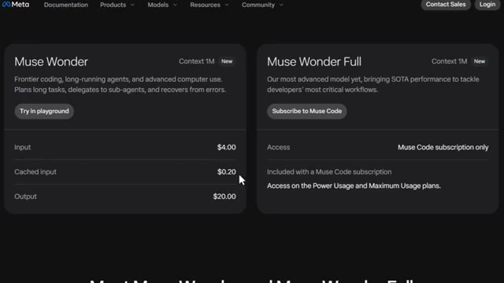
*⏱️ 00:07:48 — Capture d'écran montrant les grilles tarifaires et les détails des modèles Muse Wonder et Muse Wonder Full avec leurs coûts par million de tokens.*

---

### ⏱️ `[00:08:13 - 00:08:32]` | Segment #18

**🔊 Audio (Transcription Intégrale Mot pour Mot en Français) :**
> the more powerful one, is only available if you're subscribed to MuseCode, specifically on the power usage plan at $50 a month or the maximum usage plan at $200 a month. Pricing per token for Muse Wonderful hasn't actually been announced yet, so we don't have a clean cost per task number for it.

**👁️ Analyse Visuelle d'Écran (gemini-3.5-flash-lite) :**
**Interface & Outils** : Site web de Meta (Documentation, Products, Models, Resources, Community) présentant les tarifs de Muse Code et Muse Wonder.

**Contenu textuel & Code** : Tarifs d'abonnement (50 $ et 200 $ par mois), fenêtres de contexte (1M), coûts par Mtok input/output, et indications de disponibilité des modèles.

**Action / Démonstration** : Présentation comparative des abonnements et des coûts des différents modèles d'IA sur le site web.

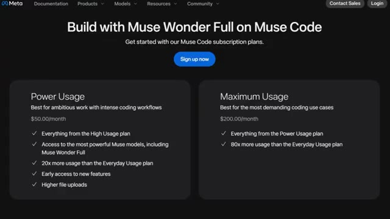
*⏱️ 00:08:18 — Capture d'écran montrant la page des plans d'abonnement de Muse Code avec les tarifs Power Usage à 50,00 $/mois et Maximum Usage à 200,00 $/mois.*

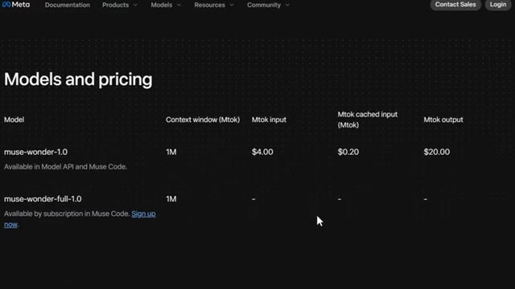
*⏱️ 00:08:27 — Tableau des modèles et des prix affichant les détails de tarification pour 'muse-wonder-1.0' et l'absence de prix annoncés pour 'muse-wonder-full-1.0'.*

---

### ⏱️ `[00:08:33 - 00:09:11]` | Segment #19

**🔊 Audio (Transcription Intégrale Mot pour Mot en Français) :**
> Mais au vu de ses performances, je pense vraiment qu'il sera proposé à un tarif premium une fois que ce sera annoncé. Si vous voulez simplement l'essayer sans vous engager dans un abonnement, vous pouvez passer directement par l'API du modèle ou même l'intégrer à vos outils existants via OpenRouter. Très bien, et regardez, au cours des prochaines années, deux types de traders existeront : ceux qui utilisent l'IA et ceux qui font encore tout manuellement. Même marché, des résultats très différents. Voici comment vous placer du bon côté. J'ai tout rassemblé au sein de la communauté AI TradeEdge. Chaque prompt, chaque bot, chaque modèle, chaque guide étape par étape que j'utilise personnellement.

**👁️ Analyse Visuelle d'Écran (gemini-3.5-flash-lite) :**
**Interface & Outils** : Navigateur web affichant le site officiel de Meta (Meta AI) et ses options de développement.

**Contenu textuel & Code** : Cartes interactives présentant les options 'Muse Code', 'Meta Model API' (accès direct et abordable) et 'OpenRouter' pour intégrer les modèles dans des workflows existants.

**Action / Démonstration** : Navigation et survol de la section 'Meta Model API' sur le site de Meta.

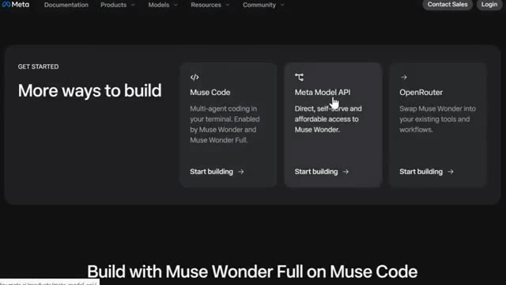
*⏱️ 00:08:42 — Capture d'écran du site web de Meta montrant les options d'intégration de ses modèles d'IA, avec les sections 'Muse Code', 'Meta Model API' et 'OpenRouter'.*

---

### ⏱️ `[00:09:11 - 00:09:47]` | Segment #20

**🔊 Audio (Transcription Intégrale Mot pour Mot en Français) :**
> tout au même endroit et tout ce que je construis à l'avenir est ajouté directement dans le groupe dès sa sortie. Nous testons également des stratégies provenant de tout l'internet, en les automatisant à l'aide de PineScript, en les exécutant en direct, et en partageant exactement ce qui fonctionne et ce qui ne fonctionne pas. Vous n'obtenez donc pas seulement des outils. Vous obtenez une opération de recherche en direct. À l'intérieur, il y a aussi un cours complet de trading agentique. 2,5 heures. Du débutant à l'expert. Aucune base en programmation n'est nécessaire. D'ici la fin, vous aurez votre propre système de trading par IA opérationnel en direct. Quelque chose que la plupart des traders particuliers ne savent même pas

**👁️ Analyse Visuelle d'Écran (gemini-3.5-flash-lite) :**
**Interface & Outils** : Plateforme Alex Carter Trading, TradingView (courtier Binance).

**Contenu textuel & Code** : Prompt de génération Pine Script v5 (RSI VWAP longueur 15, niveaux 10/90, Extreme Reversal Setup multiplicateur 3), graphique chandelier BTCUSD 2h (77 109,72 $), indicateur RSI-VWAP et boîte de statistiques de position/PnL non réalisé (-9 978,27 USD).

**Action / Démonstration** : Présentation de la structure de prompt IA pour générer le script Pine Script, puis affichage de l'exécution et des signaux de la stratégie sur un graphique de marché réel.

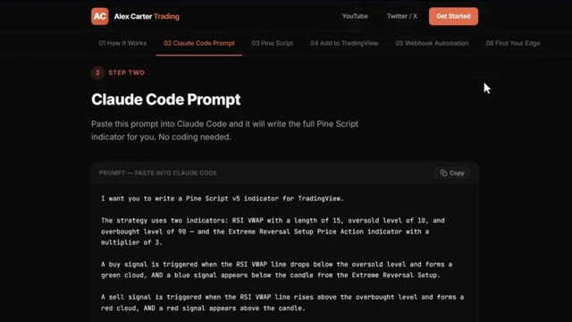
*⏱️ 00:09:20 — Page web présentant le prompt pour Claude Code destiné à générer automatiquement un indicateur Pine Script v5 (RSI-VWAP et Extreme Reversal Setup).*

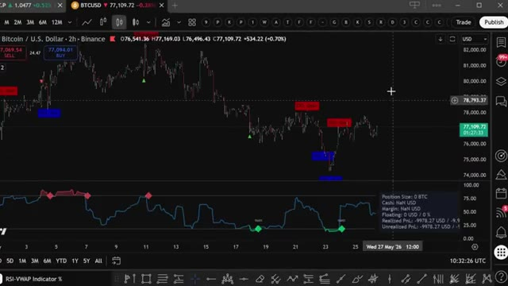
*⏱️ 00:09:29 — Graphique TradingView sur la paire BTC/USD en unités de 2 heures, affichant des signaux de trading automatisés et l'indicateur RSI-VWAP avec fenêtre de PnL.*

---

### ⏱️ `[00:09:47 - 00:10:05]` | Segment #21

**🔊 Audio (Transcription Intégrale Mot pour Mot en Français) :**
> possible dès maintenant. 79,99 $ par mois. Un seul bon trade le rembourse. Et les 100 premiers membres verrouillent ce tarif définitivement. Après cela, le prix augmente. Le lien est dans la description. Vous ne pouvez vraiment pas vous permettre de rater ça. Voilà donc l'analyse complète de Muse Wonder et Muse Wonderful.

**👁️ Analyse Visuelle d'Écran (gemini-3.5-flash-lite) :**
**Interface & Outils** : Plateforme de vente en ligne Whop.

**Contenu textuel & Code** : Tarification à 79,99 $/mois (réduction de 20 %), FAQ sur les outils de trading IA.

**Action / Démonstration** : Navigation et présentation de la page d'abonnement au service de trading.

---

### ⏱️ `[00:10:06 - 00:10:40]` | Segment #22

**🔊 Audio (Transcription Intégrale Mot pour Mot en Français) :**
> Ce que c'est réellement, comment il se positionne face à la concurrence, les vrais chiffres de benchmark, les améliorations en matière de sécurité, et exactement ce que cela va vous coûter. Écoutez, je pense vraiment que c'est une étape véritablement majeure pour Meta. Le bond réalisé en seulement six semaines est franchement incroyable. Et les chiffres de généralisation sont la partie qui m'enthousiasme le plus pour la suite. Pas seulement les scores de benchmark sur lesquels tout le monde débat en ligne. Alors dites-moi dans les commentaires. Êtes-vous Team Claude, Team GPT, ou passez-vous à Trimuse Wonder ? Je suis curieux de voir ce que vous en pensez. Et si vous voulez

**👁️ Analyse Visuelle d'Écran (gemini-3.5-flash-lite) :**
**Interface & Outils** : Présentation ou face-caméra explicatif du trader sans interface logicielle partagée.

**Contenu textuel & Code** : Explications orales des stratégies et mise en contexte méthodologique du marché.

**Action / Démonstration** : Explications face caméra et analyse conceptuelle des marchés.

---

### ⏱️ `[00:10:40 - 00:10:56]` | Segment #23

**🔊 Audio (Transcription Intégrale Mot pour Mot en Français) :**
> le guide complet étape par étape sur la façon de construire votre propre système de trading egenic en utilisant Claude, cette vidéo apparaît également à l'écran. Allez la voir ensuite. Quoi qu'il en soit, si cette vidéo a été utile, assurez-vous de l'aimer et de vous abonner pour plus d'analyses comme celle-ci. Je vous vois les gars dans la prochaine vidéo.

**👁️ Analyse Visuelle d'Écran (gemini-3.5-flash-lite) :**
**Interface & Outils** : Navigateur web affichant une page de recherche Meta AI.

**Contenu textuel & Code** : Présentation du projet 'Muse Kitchen' avec les contrôles de jeu (WASD, Espace, E, Shift).

**Action / Démonstration** : Navigation sur un site de recherche en intelligence artificielle, non pertinent pour le trading.

---

