# 🎬 How To Actually Build A Company of Research Agents Using Grok Bots (Beginner Tutorial)

> **Chaîne** : [Alex Carter](https://www.youtube.com/@AlexCarterTrading)  
> **Lien YouTube** : [https://www.youtube.com/watch?v=mcOSG1gvCw0](https://www.youtube.com/watch?v=mcOSG1gvCw0)  
> **Date de publication** : 20261015  
> **Durée** : 00:14:55  
> **Identifiant vidéo** : `mcOSG1gvCw0`  
> **Transcription & Analyse** : `whisper-v3-large-turbo+gemini-3.5-flash-lite`  

---

## 📌 Synthèse Exécutive & Outils

### 💡 Résumé
Cette vidéo de la chaîne Alex Carter aborde l'automatisation avancée de la recherche et de la veille stratégique pour le trading à travers les agents autonomes, en mettant l'accent sur l'écosystème xAI et l'outil GrokBot. L'animateur démontre comment s'affranchir de la surcharge informationnelle et de la surveillance manuelle des marchés (crypto, forex, actions, contrats à terme) grâce à des agents persistants capables de tourner 24h/24 et 7j/7 sans nécessiter de compétences en développement ou de configuration complexe de serveurs distants.

L'analyse démontre le passage d'une IA conversationnelle passive — qui ne réagit qu'aux sollicitations directes — à une architecture d'agents proactifs dotés d'un environnement informatique persistant. Les démonstrations pratiques se concentrent sur la création de bots spécialisés pour le scan des marchés, la gestion de portefeuille et l'analyse de données en arrière-plan, tout en maintenant une distinction stricte et sécurisée entre l'analyse automatisée et l'exécution réelle des ordres financiers.

Le tutoriel détaille pas à pas l'installation de l'application de bureau, la configuration des rôles opérationnels (comme le scanner de marché ou l'agent de portefeuille) et l'intégration de plugins de productivité (Google Sheets, Gmail, Slack). Enfin, une revue comparative des modèles de pointe (Grok 4.6, Claude Opus, GPT, Gemini) et des grilles tarifaires de la plateforme permet aux traders d'évaluer le retour sur investissement de ces infrastructures d'agents autonomes.

### 🛠️ Outils, Modèles & Logiciels Présentés
* **GrokBot** : Application de bureau autonome basée sur un cadre d'agents persistants fonctionnant 24h/24 et 7j/7 pour automatiser la recherche, l'analyse et la surveillance sans compétences en code.
* **Grok 4.6 (xAI)** : Modèle de pointe développé par l'entreprise d'Elon Musk, offrant des performances comparables aux modèles haut de gamme pour un coût optimisé et une intégration native.
* **Claude / Claude Opus (Anthropic)** : Modèle de raisonnement avancé hautement performant que GrokBot peut exécuter en arrière-plan, évitant ainsi des configurations de connexions MCP manuelles et complexes.
* **ChatGPT (OpenAI)** : Assistant conversationnel généraliste de référence, idéal pour les requêtes rapides et l'explication de concepts, mais limité par l'absence d'agents persistants en arrière-plan.
* **Gemini (Google)** : Modèle conversationnel performant pour la recherche ancrée et la récupération de données en direct, bien que dépourvu d'ordinateur persistant autonome.
* **TradingView** : Plateforme de référence mentionnée pour l'analyse technique, l'étude des graphiques et l'application des stratégies de scalping et de risk management.
* **Pine Script** : Langage de programmation propriétaire de TradingView utilisé pour concevoir et backtester des indicateurs et des scripts de trading algorithmique.
* **Claude Code** : Environnement et outil de développement avancé évoqué dans le contexte des configurations d'agents et de l'automatisation technique.
* **Google Sheets** : Tableur cloud connectable via les plugins du bot pour centraliser les requêtes API en direct et le suivi des positions.
* **Gmail & Slack** : Outils de communication et de messagerie intégrables pour la réception automatisée des rapports de marché et des alertes de portefeuille.

### 🔑 Points Clés & Enseignements Stratégiques
* **Dépassement du modèle conversationnel passif** : Contrairement aux chatbots traditionnels qui exigent une intervention humaine constante, les agents autonomes travaillent en arrière-plan de manière continue, éliminant la friction opérationnelle du trading quotidien.
* **Surveillance multi-marchés universelle** : L'infrastructure de recherche automatisée s'applique indifféremment au trading de cryptomonnaies, au forex, aux actions et aux contrats à terme, s'adaptant à toutes les classes d'actifs.
* **Architecture d'agent scanner de marché** : Configuration d'un bot dédié qui analyse chaque matin la liste de surveillance, détecte les actifs sortant de leur plage normale et génère un rapport avant l'ouverture des graphiques.
* **Automatisation du récapitulatif de portefeuille** : Connexion des agents aux échanges ou à des tableurs via des requêtes API en direct pour auditer les mouvements nocturnes et identifier les positions nécessitant une intervention.
* **Détection des valeurs atypiques (Outliers)** : Implémentation d'algorithmes de surveillance pour repérer les volumes inhabituels et les ruptures de structure clé, évitant ainsi le contrôle visuel manuel permanent des graphiques.
* **Principe de précaution en matière d'exécution** : Séparation stricte et recommandée entre l'utilisation des agents pour l'analyse, le reporting et la recherche, et l'autorisation d'exécuter de réels ordres financiers sur les marchés.
* **Rééquilibrage dynamique des allocations** : Programmation d'alertes automatisées pour notifier le trader dès qu'une position s'écarte d'un seuil critique (par exemple 10 %) par rapport à l'allocation cible du portefeuille.
* **Optimisation des coûts d'infrastructure** : Utilisation de Grok 4.6 comme alternative économique aux abonnements multiples, permettant d'accéder à une intelligence de pointe sans multiplier les charges fixes.
* **Apprentissage comportemental par rétroaction** : Capacité pour l'agent d'observer et d'assimiler progressivement les processus d'analyse technique propres au trader pour en reproduire les schémas au fil du temps.
* **Gestion des flux d'actualités et du bruit informationnel** : Filtrage continu des flux d'information sur X et les portails d'actualités pour ne conserver que les données directement pertinentes pour les actifs détenus ou surveillés.
* **Intégration d'outils tiers unifiés** : Centralisation des flux de travail grâce aux connecteurs natifs vers les suites bureautiques et de communication (Google Sheets, Slack, Gmail) sans configuration de serveurs VPS complexes.
* **Évolutivité des rôles opérationnels** : Flexibilité de la plateforme permettant d'assigner aux bots des missions variées allant de la recherche de projets et de la prospection jusqu'au rôle de chef de cabinet exécutif.

---

## ⏱️ Chronologie & Transcription Complète Audio & Visuelle (Mot pour Mot)

### ⏱️ `[00:00:00 - 00:00:37]` | Segment #01

**🔊 Audio (Transcription Intégrale Mot pour Mot en Français) :**
> Voici comment construire réellement une entreprise d'agents de recherche en utilisant GrokBot. Maintenant, voici le problème. Chaque fois que je faisais défiler les actualités, que je consultais X, que je lisais des annonces, je ratais toujours le seul détail qui importait vraiment. Non pas qu'il n'était pas là, mais parce que personne n'a le temps de lire entre les lignes sur tout, tous les jours. Alors ce que j'ai fait, c'est que j'ai construit une équipe d'agents de recherche qui fait ça pour moi maintenant, 24 heures sur 24, 7 jours sur 7 en arrière-plan. Et soit dit en passant, que vous fassiez du trading de crypto, de forex, d'actions ou de contrats à terme, peu importe, ce même système exact fonctionne pour vous aussi. Donc dans cette vidéo, je vous montre exactement comment je l'ai construit et comment vous pouvez construire le même.

**👁️ Analyse Visuelle d'Écran (gemini-3.5-flash-lite) :**
**Interface & Outils** : Navigateur web (site de la Fed) et plateforme de graphiques financiers (TradingView).
[DESC_IMAGE_1 CONTENT] Calendrier des réunions de mars, avril, juin et juillet avec liens vers les déclarations, notes d'implémentation et procès-verbaux (Minutes).
[DESC_IMAGE_2 CONTENT] Fenêtre de recherche de symboles filtrée sur les actions (Stocks) avec la liste des tickers NASDAQ et leurs cours/variations en arrière-plan.

**Contenu textuel & Code** : Explications orales des stratégies et mise en contexte méthodologique du marché.

**Action / Démonstration** : Navigation et consultation de données officielles macroéconomiques sur le site de la Fed, puis recherche de tickers boursiers sur une plateforme de trading.

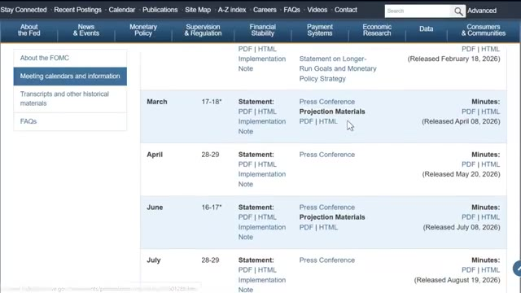
*⏱️ 00:00:09 — Capture d'écran du site officiel de la Réserve fédérale (Federal Reserve) montrant le calendrier des réunions du FOMC et les publications officielles.*

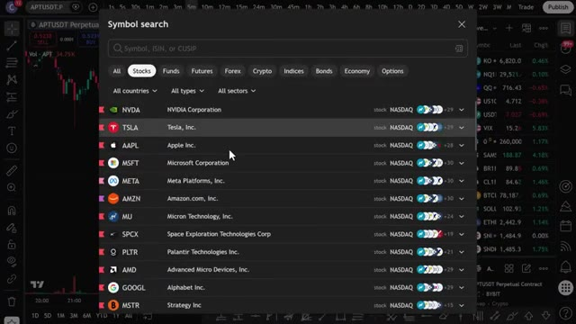
*⏱️ 00:00:28 — Interface de recherche de symboles sur une plateforme financière (type TradingView) affichant une liste de grandes actions technologiques (NVDA, TSLA, AAPL, MSFT, etc.).*

---

### ⏱️ `[00:00:37 - 00:00:58]` | Segment #02

**🔊 Audio (Transcription Intégrale Mot pour Mot en Français) :**
> par vous-même. À la fin de cette vidéo, vous allez comprendre pourquoi je pense sincèrement que c'est l'un des meilleurs outils sortis cette année, parce qu'il élimine pratiquement toute la friction qui empêche les traders ordinaires, des gens comme vous et moi, de faire tourner leur propre système fonctionnant en continu. Vous n'avez pas besoin d'être développeur. Vous n'avez pas besoin de connaître une seule ligne de code.

**👁️ Analyse Visuelle d'Écran (gemini-3.5-flash-lite) :**
**Interface & Outils** : X (Twitter), Terminal Linux (CLI), Interface de chat d'agent IA (Portfolio Agent)

**Contenu textuel & Code** : Commandes système Linux (ssh, ufw, systemctl, nano), instructions de prompt pour un assistant de rééquilibrage de portefeuille (allocation, dérive, alertes).

**Action / Démonstration** : Configuration du serveur via le terminal, consultation d'un post sur les agents IA et configuration d'un agent de gestion de portefeuille.

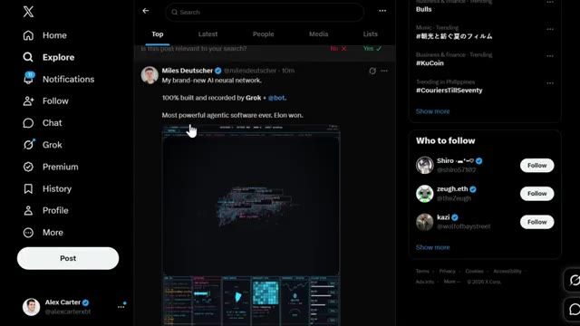
*⏱️ 00:00:43 — Capture d'écran d'un fil X (Twitter) montrant une publication de Miles Deutscher sur une IA neuronale et un logiciel agentique.*

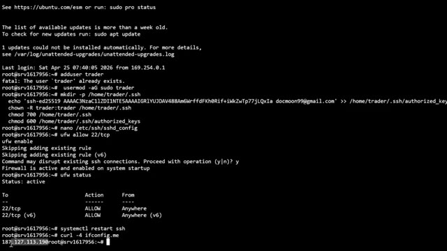
*⏱️ 00:00:48 — Terminal Linux affichant des commandes SSH, la configuration d'un pare-feu (ufw) et la gestion des utilisateurs (adduser, usermod).*

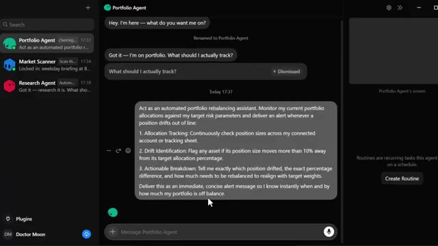
*⏱️ 00:00:53 — Interface de chat d'un agent IA nommé "Portfolio Agent" avec un prompt détaillé pour le rééquilibrage automatisé de portefeuille.*

---

### ⏱️ `[00:00:58 - 00:01:18]` | Segment #03

**🔊 Audio (Transcription Intégrale Mot pour Mot en Français) :**
> Suivez-moi simplement étape par étape. Donc, sans plus tarder, entrons dans le vif du sujet. Maintenant, avant d'aborder le bot lui-même, parlons de l'origine de tout cela. Parce que beaucoup d'entre vous connaissent le nom de Grok, mais vous ne connaissez pas vraiment son histoire. Grok a été créé par XAI, qu'Elon Musk a lancé en 2023 avec fondamentalement un seul objectif.

**👁️ Analyse Visuelle d'Écran (gemini-3.5-flash-lite) :**
**Interface & Outils** : Interface de bot Market Scanner / Navigateur web (pages d'actualités et article Forbes).

**Contenu textuel & Code** : Instructions de scan de marché automatisé pour la détection d'anomalies de volume et de structures de marché.

**Action / Démonstration** : Navigation et présentation de l'historique et des origines de Grok.

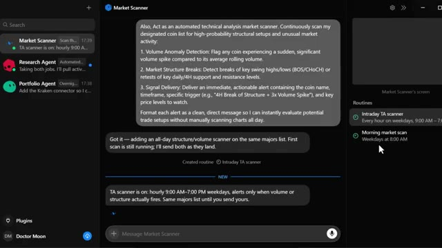
*⏱️ 00:01:03 — Image #1 @ 00:01:03 : Interface d'un bot de marché affichant des instructions de scan technique automatisé (Market Scanner) et des configurations de routines.*

---

### ⏱️ `[00:01:18 - 00:01:54]` | Segment #04

**🔊 Audio (Transcription Intégrale Mot pour Mot en Français) :**
> Construire une IA qui pouvait rivaliser avec OpenAI et comprendre réellement le monde, et pas seulement répondre à des questions. La première version, Grok 1, est sortie en novembre 2023 et a été intégrée directement dans X. Donc, si vous aviez X Premium, vous y aviez déjà accès sans même réaliser ce que vous utilisiez. À partir de là, ça a évolué vite. Grok 2, puis Grok 3, puis Grok 4. Chacune réduisant l'écart avec GPT et Claude. Et honnêtement, dès Grok 3, les gens ont arrêté de l'appeler l'IA de Twitter et ont commencé à la prendre au sérieux en tant que véritable modèle de pointe. Et maintenant, plus récemment, ils ont sorti Grok 4.6, ce que je vais

**👁️ Analyse Visuelle d'Écran (gemini-3.5-flash-lite) :**
**Interface & Outils** : Navigateur web affichant des pages de blogs, des sites d'actualités technologiques et la documentation officielle de xAI.

**Contenu textuel & Code** : Texte descriptif détaillant l'historique des versions de Grok (Grok-1, Grok-2, Grok-3) et leurs performances comparées.
[DESC_IMAGE_1] Lecture et présentation des caractéristiques techniques et des benchmarks de Grok-1 par le présentateur.

**Action / Démonstration** : Explications face caméra et analyse conceptuelle des marchés.

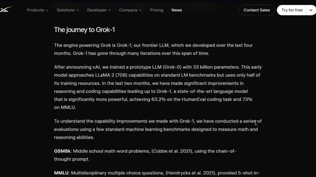
*⏱️ 00:01:27 — Capture d'écran montrant l'article officiel de xAI sur le développement et la sortie de Grok-1.*

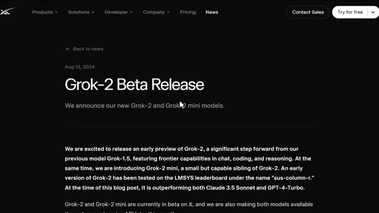
*⏱️ 00:01:36 — Capture d'écran montrant l'annonce officielle du modèle Grok-2 Beta Release datée du 13 août 2024.*

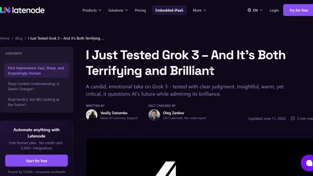
*⏱️ 00:01:45 — Capture d'écran d'un article de blog sur le site Latenode intitulé "I Just Tested Grok 3 - And It's Both Terrifying and Brilliant".*

---

### ⏱️ `[00:01:54 - 00:02:29]` | Segment #05

**🔊 Audio (Transcription Intégrale Mot pour Mot en Français) :**
> plus tard parce que ça compte vraiment pour la tarification. Mais voici la partie que la plupart des gens ratent. Grok a cessé d'être juste un chatbot il y a un moment. XAI a pris ce même modèle et a construit un cadre d'agents autour. C'est de ça qu'on est vraiment venus parler aujourd'hui. Donc ça, c'est GrokBot, et honnêtement, l'appeler juste un outil IA ne lui rend même pas justice. C'est fondamentalement une équipe complète d'agents qui ne pointent jamais, n'ont jamais besoin de rappels, et continuent juste de bosser en arrière-plan 24h/24 et 7j/7. Vous n'avez pas besoin d'un VPS qui tourne en continu. Vous n'avez pas besoin de configurer des fichiers de mémoire pendant des heures. Vous le téléchargez,

**👁️ Analyse Visuelle d'Écran (gemini-3.5-flash-lite) :**
**Interface & Outils** : Interface web et application de bureau Grok / xAI pour la gestion d'agents IA.

**Contenu textuel & Code** : Listes d'agents IA autonomes (Chief, Inbox Manager, Account Manager, Talent Scout, Expense Manager) avec des tâches assignées, des récapitulatifs de réunions et des statuts de suivi.

**Action / Démonstration** : Navigation à travers l'interface de xAI pour illustrer le fonctionnement des agents autonomes Grok Bot.

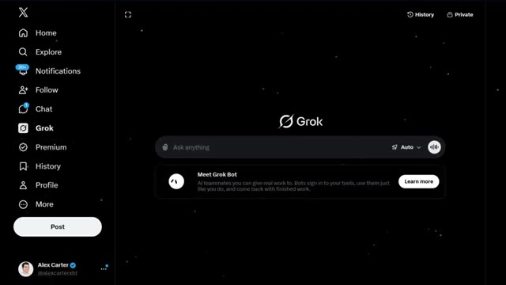
*⏱️ 00:02:03 — Interface de X avec le menu latéral et la section Grok affichant une bannière 'Meet Grok Bot'.*

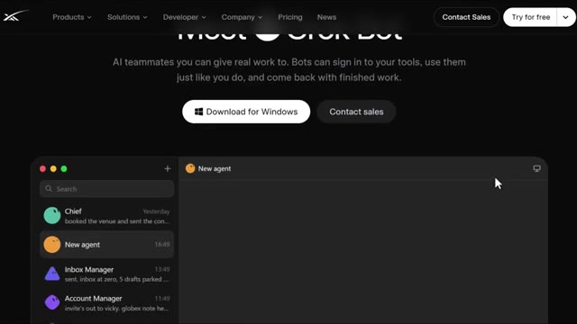
*⏱️ 00:02:12 — Page web de présentation de Grok Bot montrant un panneau d'application de bureau avec une liste d'agents et le créateur 'New agent'.*

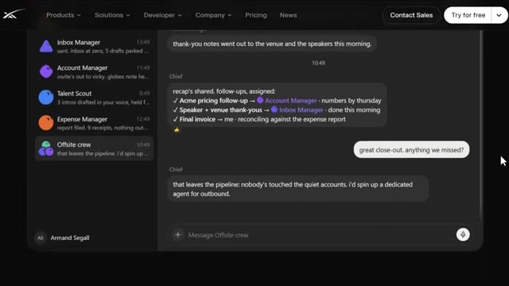
*⏱️ 00:02:20 — Interface de l'application Grok Bot affichant une conversation active avec différents agents spécialisés (Chief, Account Manager, Inbox Manager).*

---

### ⏱️ `[00:02:29 - 00:03:04]` | Segment #06

**🔊 Audio (Transcription Intégrale Mot pour Mot en Français) :**
> connectez-vous à un compte, et vous avez déjà une équipe d'agents prêts à travailler. Si vous vous êtes déjà senti submergé en essayant de configurer un système d'IA actif en permanence pour votre trading, vous n'êtes pas seul. Et ce n'est pas votre faute. La plupart de ces outils comportent beaucoup trop de frictions. Il peut exploiter pratiquement n'importe quel modèle. Grok, Opus, GPT, Gemini, tout ce que vous voulez faire tourner en arrière-plan. Et comme il possède sa propre machine, il peut analyser des graphiques, extraire des données, exécuter des scripts et continuer à travailler pendant que vous dormez littéralement ou que vous regardez une autre vidéo sur cette chaîne. Maintenant, la plupart d'entre vous paient déjà pour ChatGPT, Gemini,

**👁️ Analyse Visuelle d'Écran (gemini-3.5-flash-lite) :**
**Interface & Outils** : Terminal Linux, interface Web de Claude (Anthropic), plateforme TradingView.

**Contenu textuel & Code** : Commandes de configuration système (SSH, pare-feu UFW), invite de texte de l'IA (Sonnet 4.5), métriques de backtest (Open PnL, profit structure, ratio de Sharpe, graphiques de performance).

**Action / Démonstration** : Configuration d'un serveur distant, interaction avec un modèle d'intelligence artificielle, analyse des résultats d'un backtest de trading.

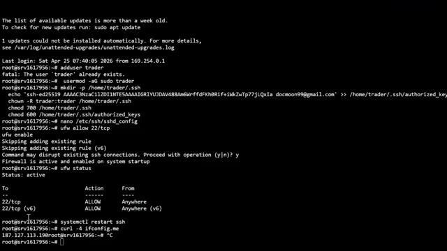
*⏱️ 00:02:38 — Un terminal de commandes Linux affichant des instructions de configuration serveur (adduser, ssh, ufw).*

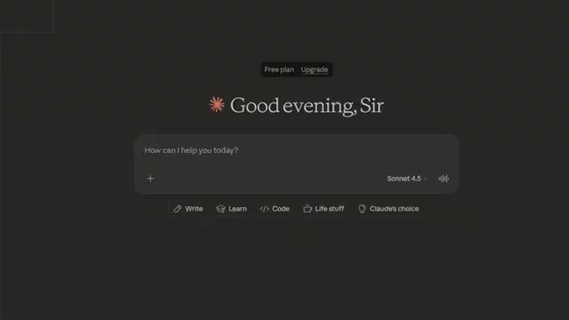
*⏱️ 00:02:46 — L'interface de l'assistant IA Claude (Anthropic) avec un message d'accueil et un champ de saisie de prompt.*

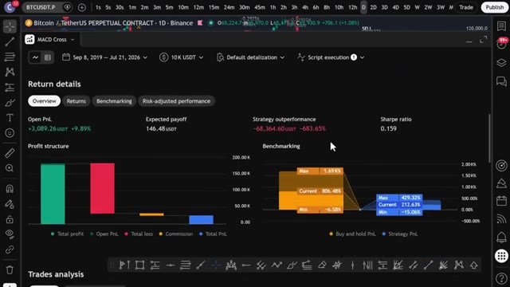
*⏱️ 00:02:55 — Un rapport de backtest sur TradingView pour une stratégie 'MACD Cross' montrant des métriques de performance et un graphique de rentabilité.*

---

### ⏱️ `[00:03:04 - 00:03:34]` | Segment #07

**🔊 Audio (Transcription Intégrale Mot pour Mot en Français) :**
> ou Claude. Donc soyons réalistes sur la raison pour laquelle c'est différent. ChatGPT est probablement toujours le meilleur assistant conversationnel généraliste sur le marché. Idéal pour des questions rapides, expliquer une configuration, rédiger quelque chose rapidement. Mais dès que vous voulez qu'il vérifie des prix pendant la nuit, qu'il analyse votre liste de surveillance pendant que vous dormez, il s'effondre. Parce que ce n'est pas un agent, c'est une conversation. Il répond quand vous le lui demandez. Il ne travaille pas quand vous ne le faites pas. Gemini s'en sort vraiment très bien pour tout ce qui est ancré dans la recherche, pour récupérer des données en direct, pour recouper des actualités.

**👁️ Analyse Visuelle d'Écran (gemini-3.5-flash-lite) :**
**Interface & Outils** : Interface web de ChatGPT et site web d'OpenAI.

**Contenu textuel & Code** : Texte généré par l'IA contenant des estimations de prix (ex: Range $90K - $180K pour 2027) et des analyses de tendances de marché.

**Action / Démonstration** : Navigation et présentation des capacités de ChatGPT en tant qu'assistant conversationnel.

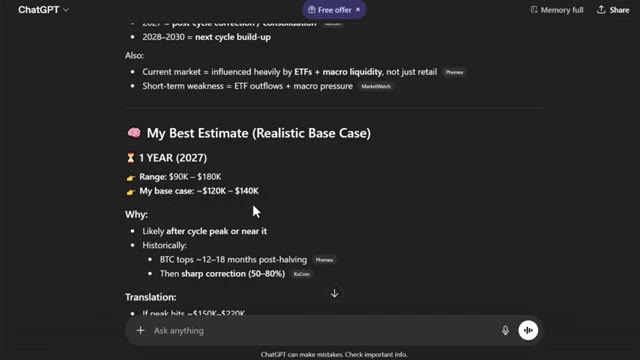
*⏱️ 00:03:19 — Interface de ChatGPT affichant une conversation structurée avec des prévisions de prix et des analyses de marché.*

---

### ⏱️ `[00:03:35 - 00:03:53]` | Segment #08

**🔊 Audio (Transcription Intégrale Mot pour Mot en Français) :**
> Mais même problème. Pas d'ordinateur persistant, pas de mémoire qui fait avancer une tâche toute seule. Dès que vous fermez l'onglet, le travail s'arrête. Claude, en particulier Opus, est généralement le modèle de raisonnement le plus puissant des trois, à mon avis. Et voici le point. GrokBot peut en fait faire tourner Opus en arrière-plan.

**👁️ Analyse Visuelle d'Écran (gemini-3.5-flash-lite) :**
**Interface & Outils** : Interfaces web de Google Gemini et du site d'Anthropic (Claude Opus).

**Contenu textuel & Code** : Texte d'analyse sur le Bitcoin (halving, outlook, adoption) et présentation des spécificités du modèle Claude Opus (fenêtre de contexte de 1M, agents IA).

**Action / Démonstration** : Présentation comparative des interfaces et capacités des modèles d'intelligence artificielle Gemini et Claude Opus.

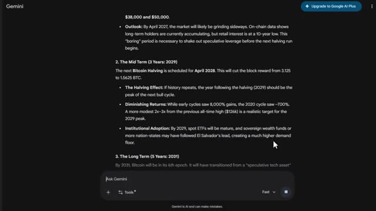
*⏱️ 00:03:39 — Interface sombre de Google Gemini affichant une analyse textuelle sur le Bitcoin, les cycles de halving et l'adoption institutionnelle.*

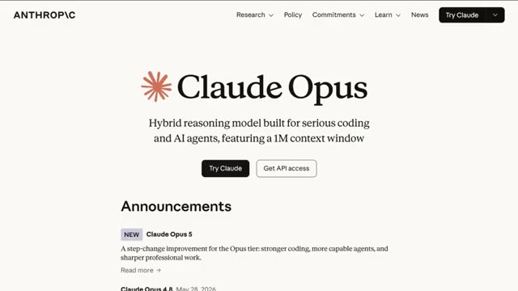
*⏱️ 00:03:44 — Page Web d'Anthropic présentant Claude Opus avec la description d'un modèle de raisonnement hybride pour le codage et les agents IA.*

---

### ⏱️ `[00:03:54 - 00:04:14]` | Segment #09

**🔊 Audio (Transcription Intégrale Mot pour Mot en Français) :**
> Il ne s'agit donc pas vraiment de GrokBot contre Claude. C'est l'intelligence de Claude, moins les jours de configuration manuelle qu'il faut normalement pour connecter l'utilisation de l'ordinateur, les fichiers de mémoire et les connexions MCP par vous-même. Vous pensez peut-être que votre configuration d'IA actuelle vous offre déjà une analyse solide. Pourquoi ai-je besoin d'une structure d'agent en plus ?

**👁️ Analyse Visuelle d'Écran (gemini-3.5-flash-lite) :**
**Interface & Outils** : Site web de Claude (Anthropic), plateforme d'échange de cryptomonnaies WEEX (API Management).

**Contenu textuel & Code** : Configuration de clé API (notes, passphrase, permissions Read-only/Spot/Futurs, adresse IP, code de vérification), prompt utilisateur pour analyser des données de trading au format CSV.

**Action / Démonstration** : Configuration d'une clé API sur l'exchange et exécution de scripts d'analyse de données de trading par l'IA.

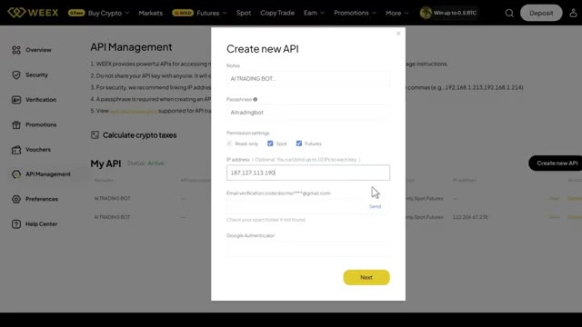
*⏱️ 00:04:04 — Interface de gestion des API d'une plateforme d'échange de cryptomonnaies (WEEX) affichant la fenêtre de création d'une nouvelle clé API pour un bot de trading.*

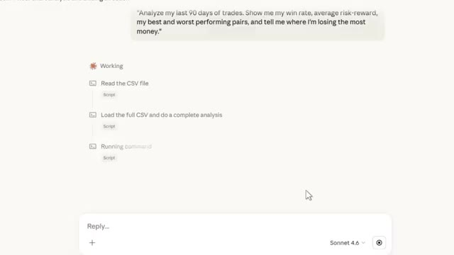
*⏱️ 00:04:09 — Interface de l'assistant IA Claude affichant un prompt d'analyse de trading ("Analyze my last 90 days of trades...") avec des étapes de traitement en cours de script.*

---

### ⏱️ `[00:04:14 - 00:04:35]` | Segment #10

**🔊 Audio (Transcription Intégrale Mot pour Mot en Français) :**
> Mais les données montrent quelque chose de différent. Un modèle de conversation répond quand vous lui demandez. Un cadre d'agent comme GrokBot fonctionne que vous demandiez ou non. Et le dernier élément, c'est le coût et la vitesse. L'équipe d'Elon vient de lancer Grok 4.6, qui est moins cher qu'Opus, mais qui atteint un niveau de performance très similaire. Vous obtenez donc une intelligence de pointe sans avoir à exécuter cinq abonnements en parallèle.

**👁️ Analyse Visuelle d'Écran (gemini-3.5-flash-lite) :**
**Interface & Outils** : Interface web d'un système d'agents conversationnels et page d'actualités technologiques.

**Contenu textuel & Code** : Historique de conversations avec des agents spécialisés (Chief, Sales Outbound, Account Manager, Expense Manager) et texte de présentation de Grok 4.6.

**Action / Démonstration** : Navigation à travers l'interface des agents autonomes et présentation de la nouvelle version du modèle.

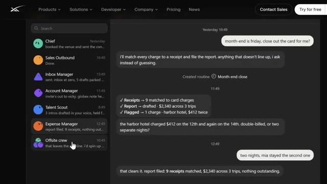
*⏱️ 00:04:20 — Capture d'écran montrant une interface de chat multi-agents avec des discussions sur la gestion des dépenses et des tâches automatisées.*

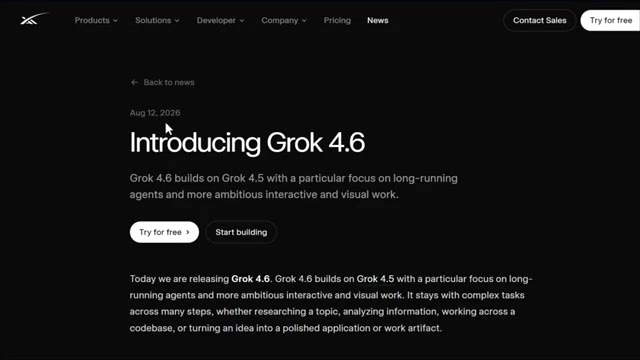
*⏱️ 00:04:25 — Capture d'écran affichant une page d'annonce officielle intitulée "Introducing Grok 4.6" avec une date au 12 août 2026.*

---

### ⏱️ `[00:04:35 - 00:05:10]` | Segment #11

**🔊 Audio (Transcription Intégrale Mot pour Mot en Français) :**
> C'est vraiment ça le fossé. Ce n'est pas que GrokBot soit plus intelligent que ChatGPT, Gemini ou Claude dans tous les cas. C'est qu'il est toujours actif. C'est du prêt-à-l'emploi et il ne vous pénalise pas pour le fait de ne pas être un développeur. Très bien, passons maintenant à la configuration parce que je sais que beaucoup d'entre vous apprennent le mieux en voyant les choses étape par étape, tout comme je le fais sur ma chaîne de tutoriels. Étape 1, allez sur la page d'inscription de GrokBot. Vous pouvez consulter le lien ci-dessous dans la description. Vous serez redirigé vers cette page où vous pourrez voir qu'il est en version bêta anticipée. Vous pouvez voir le message de lancement ici. Quand vous faites défiler

**👁️ Analyse Visuelle d'Écran (gemini-3.5-flash-lite) :**
**Interface & Outils** : Interface de Grok Bot, site web officiel et navigateur web (YouTube).

**Contenu textuel & Code** : Marketplace de plugins (Adobe, Airtable, Asana, Context.dev), options de téléchargement et description textuelle de la vidéo.

**Action / Démonstration** : Présentation des fonctionnalités, des intégrations de l'agent IA et transition vers la configuration de l'outil.

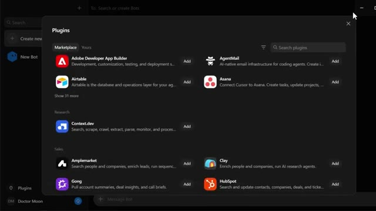
*⏱️ 00:04:44 — Interface de gestion des plugins de Grok Bot montrant la liste des intégrations disponibles comme Adobe, Airtable et Asana.*

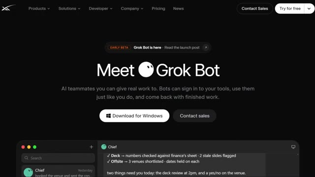
*⏱️ 00:04:53 — Page d'accueil officielle de présentation de Grok Bot, montrant le slogan d'introduction et le bouton de téléchargement pour Windows.*

---

### ⏱️ `[00:05:10 - 00:05:43]` | Segment #12

**🔊 Audio (Transcription Intégrale Mot pour Mot en Français) :**
> en bas, vous pouvez voir le bouton de téléchargement ici. Maintenant, cela dépend si vous avez un Mac ou Windows, mais pour ceci nous allons utiliser Windows. Puisque c'est ce que nous utilisons, cliquez dessus et une fenêtre de téléchargement apparaîtra. Suivez simplement l'installation sur votre appareil, attendez quelques minutes, et vous êtes prêts. Une fois que vous ouvrez l'application, une fenêtre de connexion apparaîtra, cliquez dessus, et suivez les instructions. Vous pouvez activer votre essai gratuit ici. Une fois que c'est configuré, vous serez de retour sur l'application de bureau. Deuxième étape, une fois que vous arrivez sur votre tableau de bord, c'est votre centre de contrôle. C'est ici que vous allez lancer vos agents. Étape

**👁️ Analyse Visuelle d'Écran (gemini-3.5-flash-lite) :**
**Interface & Outils** : Site web de téléchargement et application de bureau Grok Bot.

**Contenu textuel & Code** : Interface utilisateur de l'application Grok Bot, boutons de téléchargement et de connexion.

**Action / Démonstration** : Téléchargement du fichier d'installation, lancement de l'application et authentification réussie de l'utilisateur.

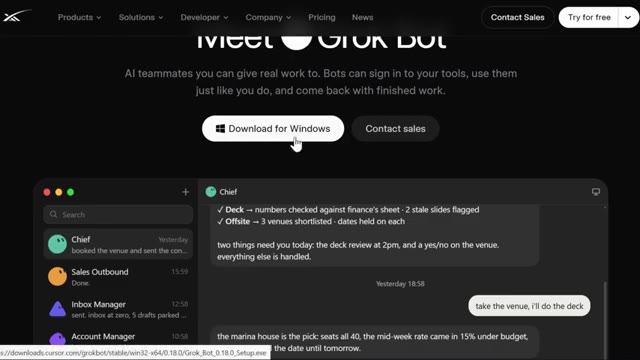
*⏱️ 00:05:18 — Page de téléchargement web du Grok Bot montrant le bouton "Download for Windows".*

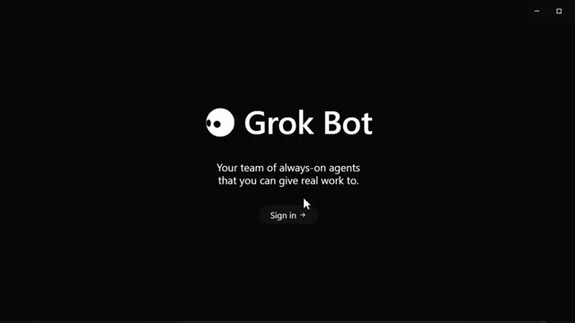
*⏱️ 00:05:26 — Écran d'accueil de l'application installée "Grok Bot" invitant l'utilisateur à se connecter ("Sign in").*

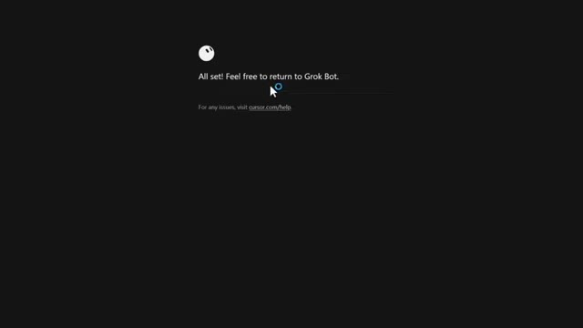
*⏱️ 00:05:35 — Écran de confirmation de connexion "All set! Feel free to return to Grok Bot." indiquant que la configuration est terminée.*

---

### ⏱️ `[00:05:43 - 00:06:10]` | Segment #13

**🔊 Audio (Transcription Intégrale Mot pour Mot en Français) :**
> Trois, clique sur nouveau bot ou clique sur l'icône plus et attribue-lui un rôle. Pour le trading de crypto, voici exactement ce que je configurerais. Un agent scanner de marché. Chaque matin, il vérifie votre liste de surveillance, signale toute crypto qui sort de sa plage normale et vous envoie un résumé avant même que vous n'ouvriez vos graphiques. Un agent de portefeuille. Avec ce bot, vous pouvez le connecter à votre échange, qu'il s'agisse de votre tableur avec des requêtes API en direct ou d'une connexion de lecture directe à votre compte.

**👁️ Analyse Visuelle d'Écran (gemini-3.5-flash-lite) :**
**Interface & Outils** : Application de création de bot / interface de chatbot (style interface desktop sombre).

**Contenu textuel & Code** : Champs de configuration du bot : "Name" (New Bot), "Title", "Describe what your agent does", "Description" (What this agent is for), et une option "Notifications" pour recevoir des alertes lorsque l'agent a terminé ou a besoin d'une entrée.

**Action / Démonstration** : Configuration d'un agent ou d'un bot avec attribution de rôle et de paramètres de notification.

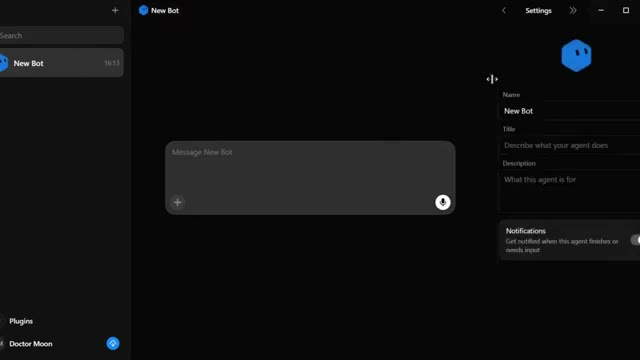
*⏱️ 00:05:50 — Interface de création d'un nouveau bot montrant le panneau de configuration avec les champs de nom, de description et les options de notification.*

---

### ⏱️ `[00:06:10 - 00:06:29]` | Segment #14

**🔊 Audio (Transcription Intégrale Mot pour Mot en Français) :**
> Et chaque matin, il vous donne un récapitulatif de la nuit. Qu'est-ce qui a bougé ? Qu'est-ce qui est au programme aujourd'hui ? Et si un élément de vos positions nécessite de l'attention. Un agent de recherche que vous pouvez configurer pour scanner les actualités crypto et X toutes les quelques heures et compiler uniquement ce qui est réellement pertinent pour les pièces que vous détenez ou surveillez.

**👁️ Analyse Visuelle d'Écran (gemini-3.5-flash-lite) :**
**Interface & Outils** : Application de type chat / assistant IA (interface sombre avec panneau de configuration latéral).

**Contenu textuel & Code** : Nom de l'agent : "Portfolio Agent", Titre : "Overnight Portfolio & Position Recap", Description détaillant la connexion à un compte d'échange pour obtenir un rapport matinal automatisé sur les mouvements nocturnes et les alertes de positions.

**Action / Démonstration** : Configuration et affichage des paramètres d'un bot d'analyse de portefeuille et de récapitulatif nocturne.

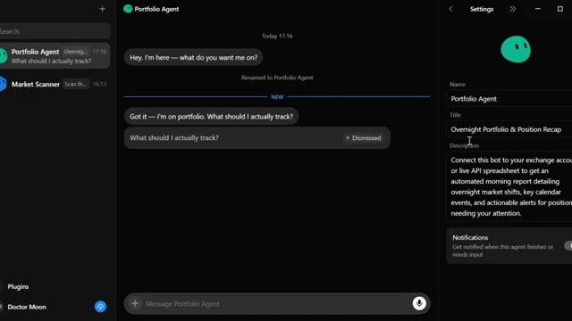
*⏱️ 00:06:15 — Interface d'un agent conversationnel de gestion de portefeuille avec des paramètres de configuration à droite.*

---

### ⏱️ `[00:06:29 - 00:06:47]` | Segment #15

**🔊 Audio (Transcription Intégrale Mot pour Mot en Français) :**
> Quatrième étape, dans les plugins, vous pouvez le connecter à Google Sheets, Gmail, Slack et d'autres outils. De la même manière que vous connecteriez un MCP dans Claude. C'est là que ça devient puissant pour le trading en particulier, car vous pouvez littéralement lui donner un accès en lecture à vos données d'échange et lui demander de vous faire un rapport comme le ferait un analyste.

**👁️ Analyse Visuelle d'Écran (gemini-3.5-flash-lite) :**
**Interface & Outils** : Interface de gestion des plugins d'une application d'intelligence artificielle ou d'agent de recherche.

**Contenu textuel & Code** : Liste des plugins disponibles par catégories (Intercom, Plain, Amplitude, Antimetal, Apify, Astronomer, Mobbin) avec des boutons d'ajout ("Add") et une barre de recherche.

**Action / Démonstration** : Le curseur de la souris survole le bouton "Add" du plugin Astronomer dans la marketplace.

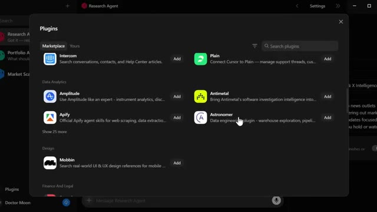
*⏱️ 00:06:34 — Fenêtre modale affichant le catalogue de plugins (Marketplace) d'un agent de recherche.*

---

### ⏱️ `[00:06:48 - 00:07:21]` | Segment #16

**🔊 Audio (Transcription Intégrale Mot pour Mot en Français) :**
> Note importante, et je dis cela à chaque fois que je parle d'automatisation et d'argent, en ce qui concerne l'exécution réelle des transactions, soyez beaucoup plus prudent. Pour le reporting et l'analyse, aucun problème. Laisser l'outil placer de vraies transactions en votre nom est une autre discussion et c'est quelque chose que vous devez évaluer sérieusement avant de le connecter. Maintenant, laissez-moi vous montrer exactement comment j'utiliserais ceci pour le trading et l'investissement, car c'est là que cela devient vraiment utile et pas seulement un jouet sympa : premier point, un récapitulatif du marché de la nuit. Au lieu de vous réveiller et de faire défiler 15 onglets, vous ouvrez un seul chat et

**👁️ Analyse Visuelle d'Écran (gemini-3.5-flash-lite) :**
**Interface & Outils** : Interface logicielle de type assistant IA/chatbot (panneau de configuration et historique des conversations).

**Contenu textuel & Code** : Paramètres d'un agent nommé Market Scanner, description du système automatisé, et prompt demandant une analyse de l'action des prix de Bitcoin et Ethereum, des événements de marché et des alertes de watchlist.

**Action / Démonstration** : Configuration des paramètres et affichage du prompt de briefing matinal pour l'agent de marché.

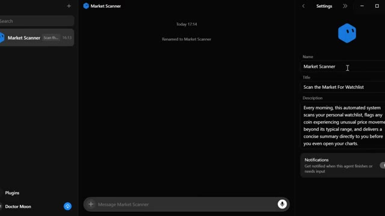
*⏱️ 00:06:56 — Configuration des paramètres d'un agent IA nommé 'Market Scanner' avec description de ses tâches de surveillance quotidienne.*

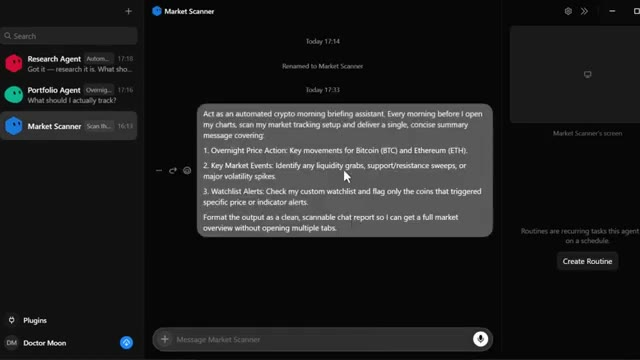
*⏱️ 00:07:13 — Interface de chat affichant un prompt détaillé pour un assistant de briefing crypto matinal automatisé (analyse des prix, liquidité, alertes).*

---

### ⏱️ `[00:07:21 - 00:07:45]` | Segment #17

**🔊 Audio (Transcription Intégrale Mot pour Mot en Français) :**
> il vous dit ce que Bitcoin et Ethereum ont fait pendant la nuit, s'il y a eu des chasses à la liquidité et si les cryptos de votre liste de surveillance ont déclenché des alertes. Deuxièmement, des suggestions de rééquilibrage de portefeuille. Si vous êtes comme beaucoup de traders qui oublient de rééquilibrer, vous pouvez littéralement dire : signalez-moi si une position s'écarte de plus de 10 % de l'allocation cible, et il vous dira exactement quand et de combien.

**👁️ Analyse Visuelle d'Écran (gemini-3.5-flash-lite) :**
**Interface & Outils** : Application de messagerie de type assistant IA dotée de différents agents spécialisés (Market Scanner, Research Agent, Portfolio Agent).

**Contenu textuel & Code** : Prompts textuels détaillant les instructions pour l'analyse automatisée des marchés crypto (mouvements overnight BTC/ETH, liquidations, alertes de watchlist) et le rééquilibrage de portefeuille (suivi d'allocation, identification de dérive, ventilation actionnable).

**Action / Démonstration** : Configuration et programmation de routines automatisées pour les agents IA afin d'automatiser le suivi matinal des cryptomonnaies et la gestion des risques du portefeuille.

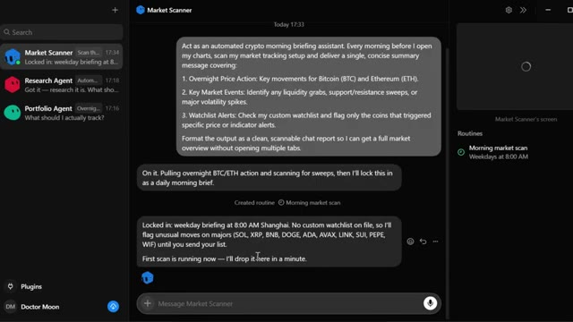
*⏱️ 00:07:27 — Interface de discussion avec le "Market Scanner" configuré comme un assistant automatisé de briefing matinal crypto pour analyser le Bitcoin, l'Ethereum et les alertes de la liste de surveillance.*

*⏱️ 00:07:33 — Interface de discussion avec le "Portfolio Agent" configuré comme un assistant automatisé de rééquilibrage de portefeuille pour surveiller les allocations d'actifs et détecter les dérives.*

---

### ⏱️ `[00:07:46 - 00:08:11]` | Segment #18

**🔊 Audio (Transcription Intégrale Mot pour Mot en Français) :**
> Trois, le scan des valeurs atypiques. De la même manière que j'utilise ce concept sur ma chaîne d'analyse technique. Vous pouvez lui faire scanner des cryptos qui montrent un volume inhabituel ou qui cassent une structure clé. Ainsi, vous ne vérifiez pas manuellement les graphiques toute la journée. Quatre, les sponsorisations et la recherche de projets. Si vous gérez une page ou une chaîne crypto comme je le fais, vous pouvez littéralement lui faire analyser quels projets effectuent les plus grosses dépenses publicitaires en ce moment.

**👁️ Analyse Visuelle d'Écran (gemini-3.5-flash-lite) :**
**Interface & Outils** : Application de type interface de chat avec des agents IA spécialisés (Market Scanner et Research Agent).

**Contenu textuel & Code** : Prompts structurés listant des tâches d'analyse technique automatisée (détection de volume, cassures de structure, livraison de signaux) et de veille marketing.

**Action / Démonstration** : Navigation et présentation des différents agents IA configurés pour automatiser la surveillance du marché des cryptomonnaies.

*⏱️ 00:07:52 — Interface de l'agent Market Scanner montrant un prompt configuré pour détecter les anomalies de volume et les cassures de structure de marché.*

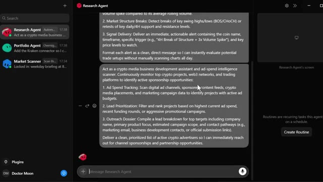
*⏱️ 00:08:04 — Interface de l'agent Research Agent affichant un prompt axé sur le suivi des dépenses publicitaires et l'analyse des opportunités de sponsoring crypto.*

---

### ⏱️ `[00:08:11 - 00:08:33]` | Segment #19

**🔊 Audio (Transcription Intégrale Mot pour Mot en Français) :**
> Comme ça, vous savez qui contacter. Cinq : la formation à l'apprentissage et au flux de travail. Vous pouvez vous enregistrer en train de faire votre propre processus d'analyse technique et il apprendra réellement à en reproduire des parties pour vous avec le temps. Mais voici le truc. GrokBot n'est pas seulement conçu pour le trading de cryptomonnaies. Si vous avez d'autres tâches pour gérer votre entreprise ou votre vie, GrokBot peut s'en occuper aussi.

**👁️ Analyse Visuelle d'Écran (gemini-3.5-flash-lite) :**
**Interface & Outils** : Interface de type application de chat IA (agents autonomes / bots de trading)

**Contenu textuel & Code** : Texte du prompt configurant l'assistant d'analyse technique ("Act as my personal technical analysis learning assistant..."), options pour ajouter Kraken ou utiliser un tableur, et liste des agents dans le panneau latéral gauche.

**Action / Démonstration** : Affichage d'un prompt textuel détaillé pour entraîner l'agent à reproduire les processus d'analyse technique et de trading de l'utilisateur.

*⏱️ 00:08:16 — Interface de l'agent conversationnel montrant un prompt détaillé pour configurer un assistant d'apprentissage d'analyse technique, avec des options de connexion à Kraken et un panneau latéral affichant différents agents (Portfolio Agent, Market Scanner, Research Agent).*

---

### ⏱️ `[00:08:33 - 00:09:06]` | Segment #20

**🔊 Audio (Transcription Intégrale Mot pour Mot en Français) :**
> Vous pouvez le configurer pour les ventes, la prospection, la recherche de talents, la gestion des médias payants, la gestion des dépenses, le suivi de la performance des produits, la reproduction des bugs, le suivi de la santé des comptes, et même un rôle complet de chef de cabinet. GrokBot peut vraiment tout faire. Les cas d'utilisation liés à la crypto sont simplement ce vers quoi je l'oriente en ce moment parce que c'est ce qui est pertinent pour vous et moi. Très bien, parlons des prix, parce que je sais que c'est là que beaucoup d'entre vous vont avoir des avis. Cursor Ultra est à 200 $ par mois, facturé mensuellement. Cela inclut le propre ordinateur de GrokBot. Il se connecte à vos outils, exécute des routines selon un calendrier déterminé,

**👁️ Analyse Visuelle d'Écran (gemini-3.5-flash-lite) :**
**Interface & Outils** : Site web officiel de Grok Bot, interface de tarification et interface de démonstration mobile.

**Contenu textuel & Code** : Liste des rôles configurables (Sales Outbound, Talent Scout, Paid Media, Bug Reproduction, etc.) et tableaux comparatifs des prix ($200, $300, $120/seat).

**Action / Démonstration** : Navigation sur le site web pour présenter les cas d'usage et les grilles tarifaires des abonnements.

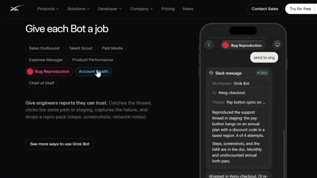
*⏱️ 00:08:42 — Capture montrant l'interface Web de présentation des différents rôles et fonctionnalités de Grok Bot, avec un aperçu mobile sur la droite.*

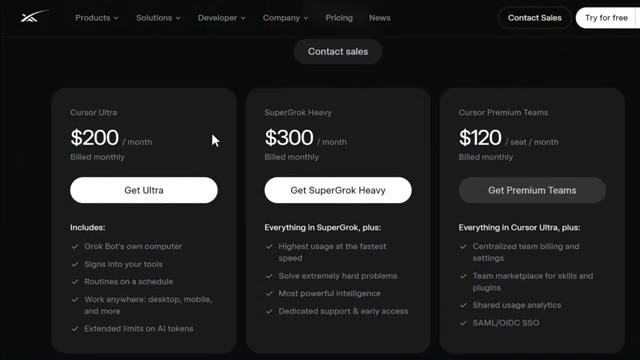
*⏱️ 00:08:58 — Capture affichant la page de tarification (pricing) de Grok Bot avec les offres Cursor Ultra, SuperGrok Heavy et Cursor Premium Teams.*

---

### ⏱️ `[00:09:07 - 00:09:43]` | Segment #21

**🔊 Audio (Transcription Intégrale Mot pour Mot en Français) :**
> fonctionne partout sur ordinateur, mobile et plus encore, et vous offre des limites étendues sur les jetons AE. Supergirl Heavy coûte 300 $ par mois facturé mensuellement, et cela comprend tout ce qu'il y a dans Supergirl plus l'utilisation maximale à la vitesse la plus rapide. La capacité à résoudre des problèmes extrêmement difficiles, l'intelligence la plus puissante et un support dédié en accès anticipé. Cursor Premium Teams coûte 120 $ par utilisateur et par mois, facturé mensuellement, et cela inclut tout ce qui se trouve dans Cursor Ultra plus la facturation et les paramètres d'équipe centralisés. Un marché d'équipe pour les compétences et les plugins, des analyses d'utilisation partagées et SAML,

**👁️ Analyse Visuelle d'Écran (gemini-3.5-flash-lite) :**
**Interface & Outils** : Page web de tarification (Pricing) avec un thème sombre.

**Contenu textuel & Code** : Tarifs affichés : 200 $/mois, 300 $/mois, 120 $/seat/month, ainsi que les fonctionnalités incluses pour chaque formule.

**Action / Démonstration** : Le curseur de la souris survole ou clique sur le bouton "Get SuperGrok Heavy".

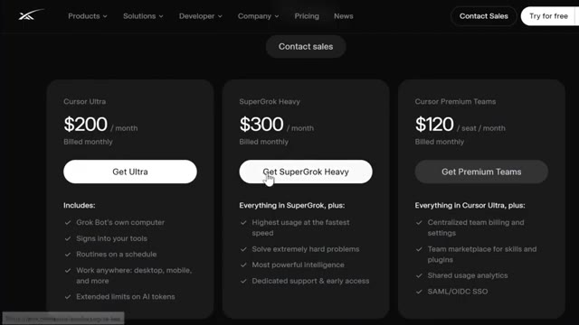
*⏱️ 00:09:16 — Capture d'écran montrant une page de tarification avec trois offres différentes : Cursor Ultra à 200 $, SuperGrok Heavy à 300 $ par mois et Cursor Premium Teams à 120 $ par mois.*

---

### ⏱️ `[00:09:43 - 00:10:19]` | Segment #22

**🔊 Audio (Transcription Intégrale Mot pour Mot en Français) :**
> ou O-I-D-C-S-S-O. Comparez maintenant les prix avec d'autres modèles comme ChatGPT, Google Gemini et Claude d'Anthropic. ChatGPT Plus coûte 20 dollars par mois, ce qui vous donne l'expérience standard à laquelle la plupart des gens sont habitués. Mais si vous voulez leur modèle de raisonnement de premier ordre, ChatGPT Pro coûte 200 dollars par mois. Donc, rien que là, vous payez la même chose que pour le niveau supérieur de GrokBot, mais vous obtenez toujours seulement une conversation, et non un agent toujours actif doté de son propre ordinateur. Gemini est similaire. Google AI Pro, qui s'appelait auparavant Gemini Advanced, coûte 19,99 dollars par mois pour le niveau standard. Mais si vous

**👁️ Analyse Visuelle d'Écran (gemini-3.5-flash-lite) :**
**Interface & Outils** : Pages web de tarification et de comparaison de modèles d'intelligence artificielle (ChatGPT, outils de développement).

**Contenu textuel & Code** : Tarifs mensuels affichés (0$, 8$, 20$, 100$, 200$, 300$), fonctionnalités incluses par abonnement (limites d'usage, modèles de raisonnement, agents).

**Action / Démonstration** : Navigation et présentation comparative des différentes offres tarifaires des services d'IA.

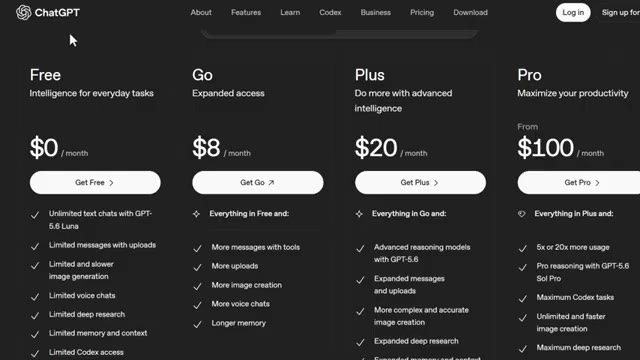
*⏱️ 00:09:52 — Capture d'écran montrant la page de tarification de ChatGPT avec les différentes offres (Free à 0$, Go à 8$, Plus à 20$ et Pro à 100$ par mois).*

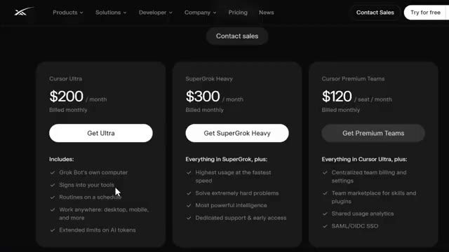
*⏱️ 00:10:10 — Capture d'écran présentant une grille de tarifs pour des abonnements avancés (Cursor Ultra à 200$, SuperGrok Heavy à 300$, Cursor Premium Teams à 120$).*

---

### ⏱️ `[00:10:19 - 00:10:40]` | Segment #23

**🔊 Audio (Transcription Intégrale Mot pour Mot en Français) :**
> veulent leur niveau ultra avec le plus de capacités, cela passe à 99,99 $ par mois. Et il y a un niveau encore plus élevé à 199,99 $ par mois. Encore une fois, c'est de l'argent réel pour un modèle qui ne fonctionne toujours que lorsque vous le sollicitez activement. Et Claude, maximum cinq fois, c'est 100 $ par mois et maximum 20 fois.

**👁️ Analyse Visuelle d'Écran (gemini-3.5-flash-lite) :**
**Interface & Outils** : Navigateur web affichant le site officiel de Gemini (Google).

**Contenu textuel & Code** : Tableau comparatif des prix des abonnements : Free ($0), Google AI Plus ($4.99), Google AI Pro ($19.99), et Google AI Ultra ($99.99 / mois).

**Action / Démonstration** : Présentation et surbrillance textuelle des tarifs des formules payantes de l'intelligence artificielle Gemini.

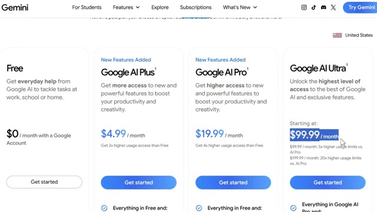
*⏱️ 00:10:24 — Capture d'écran de la page de tarification de Gemini affichant les différents abonnements, avec une mise en surbrillance sur l'offre Google AI Ultra à 99,99 $ par mois.*

---

### ⏱️ `[00:10:40 - 00:11:04]` | Segment #24

**🔊 Audio (Transcription Intégrale Mot pour Mot en Français) :**
> Leur niveau le plus élevé est de 200 $ par mois. Donc, vous payez le prix de GrokBot pour l'intelligence de Claude, sauf que vous devez toujours le surveiller, ouvrir le chat et faire avancer la conversation vous-même. Donc, quand on met tout bout à bout, 20 $ à 300 $ pour ChatGPT, 20 $ à 200 $ pour Gemini, 100 $ à 200 $ pour Claude, vous dépensez déjà de vrai argent pour les niveaux supérieurs de n'importe lequel d'entre eux.

**👁️ Analyse Visuelle d'Écran (gemini-3.5-flash-lite) :**
**Interface & Outils** : Pages web de tarification des services d'IA (Claude, ChatGPT, Gemini).

**Contenu textuel & Code** : Tableaux de prix, abonnements mensuels, comparaisons d'utilisation (de 0 $ à 200 $ par mois).

**Action / Démonstration** : Comparaison des coûts mensuels des différents abonnements d'intelligence artificielle.

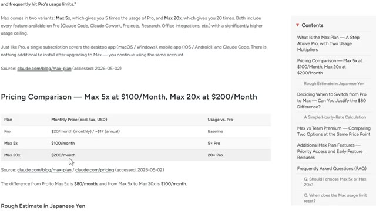
*⏱️ 00:10:46 — Capture d'écran montrant un tableau comparatif des tarifs pour Claude, avec le niveau Max 20x à 200 $ par mois.*

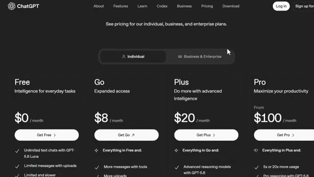
*⏱️ 00:10:52 — Capture d'écran du site officiel de ChatGPT affichant les différents abonnements (Free, Go, Plus à 20 $ et Pro jusqu'à 100 $).*

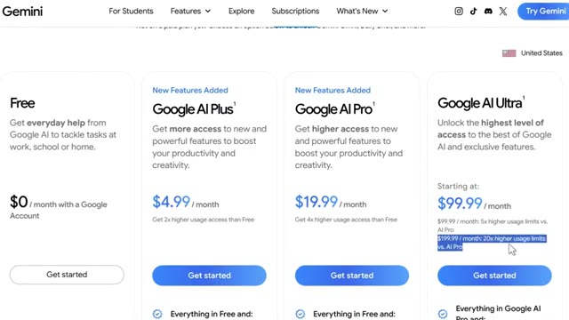
*⏱️ 00:10:58 — Capture d'écran du site de Gemini affichant les grilles tarifaires allant de gratuit à 199,99 $ par mois pour Google AI Ultra.*

---

### ⏱️ `[00:11:04 - 00:11:24]` | Segment #25

**🔊 Audio (Transcription Intégrale Mot pour Mot en Français) :**
> La différence avec GrokBot à cette même tranche de prix de 200 à 300 dollars, c'est que vous ne payez pas pour une conversation plus intelligente. Vous payez pour quelque chose qui fonctionne 24 heures sur 24 et 7 jours sur 7 sans vous. Écoutez, 200 dollars, c'est beaucoup, et je ne vais pas faire semblant que ça ne l'est pas. Ce n'est pas pour quelqu'un qui se lance tout juste dans la crypto avec un abonnement à 20 dollars.

**👁️ Analyse Visuelle d'Écran (gemini-3.5-flash-lite) :**
**Interface & Outils** : Site web de tarification et interface de chat d'un bot d'automatisation (Grok Bots / Market Scanner).

**Contenu textuel & Code** : Tarifs de 200$/mois et 300$/mois, fonctionnalités d'automatisation 24/7, routines programmées, et prompts de scan de marché.

**Action / Démonstration** : Présentation des coûts des abonnements d'agents IA autonomes et démonstration d'une interface de scanner de marché automatisé.

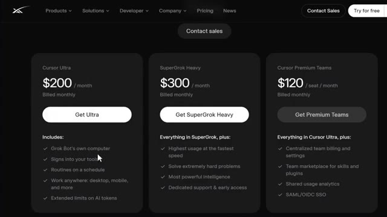
*⏱️ 00:11:09 — Page de tarification affichant les offres Cursor Ultra à 200$/mois et SuperGrok Heavy à 300$/mois, détaillant les fonctionnalités comme "Grok Bot's own computer".*

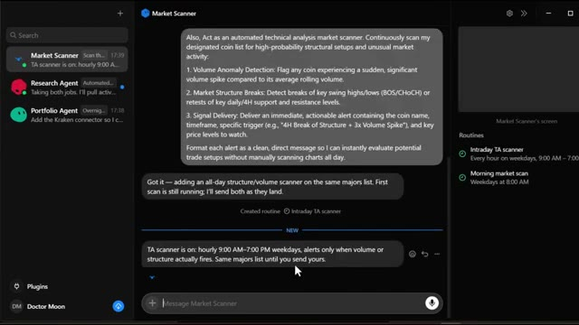
*⏱️ 00:11:14 — Interface de l'agent Market Scanner montrant un prompt d'analyse technique automatisée et des routines programmées.*

*⏱️ 00:11:19 — Page de tarification similaire à l'image 1, montrant les abonnements logiciels à 200$ et 300$ par mois.*

---

### ⏱️ `[00:11:25 - 00:12:01]` | Segment #26

**🔊 Audio (Transcription Intégrale Mot pour Mot en Français) :**
> C'est pour les personnes qui dépensent déjà de l'argent réel en crédits API ou en abonnements IA multiples et qui veulent les regrouper en un seul système toujours actif. Si ce n'est pas encore votre cas, il n'y a aucun problème. Vous pouvez tirer énormément de valeur des outils gratuits et continuer à trader intelligemment. Maintenant, avant de terminer, laissez-moi passer en revue une rapide foire aux questions car je sais qu'un grand nombre d'entre vous aura exactement ces questions dans les commentaires. En quoi GrokBot est-il différent des assistants IA ? Les bots ont leur propre ordinateur, donc ils peuvent travailler à l'intérieur de vos applications et de vos outils. Ils fonctionnent également en parallèle, 24h/24 et 7j/7, même lorsque votre ordinateur portable est fermé. Pour qui GrokBot est-il disponible aujourd'hui ?

**👁️ Analyse Visuelle d'Écran (gemini-3.5-flash-lite) :**
**Interface & Outils** : Site web de tarification et de FAQ (interface web sombre).

**Contenu textuel & Code** : Tarifs d'abonnements IA mensuels (200 $, 300 $, 120 $/siège) et foire aux questions sur Grok Bot et la sécurité des données.

**Action / Démonstration** : Présentation des différents abonnements payants et options de tarification pour les outils IA.

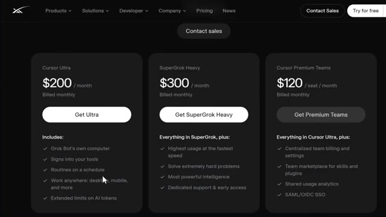
*⏱️ 00:11:34 — Capture d'écran montrant une page de tarification avec des abonnements IA (Cursor Ultra à 200 $/mois, SuperGrok Heavy à 300 $/mois).*

*⏱️ 00:11:43 — Capture d'écran montrant la section FAQ d'un site web liée à Grok Bot et ses fonctionnalités de confidentialité et de sécurité.*

---

### ⏱️ `[00:12:02 - 00:12:24]` | Segment #27

**🔊 Audio (Transcription Intégrale Mot pour Mot en Français) :**
> GrokBot est accessible aujourd'hui pour les abonnés de Cursor Ultra, Super Grok Heavy et Cursor Premium Team. Est-ce que GrokBot est disponible pour les entreprises ? Bientôt. Nous prévoyons d'ouvrir GrokBot aux équipes et aux entreprises dans les semaines à venir. Pour l'instant, vous pouvez vous inscrire sur la liste d'attente. Je mettrai le lien ci-dessous. Où puis-je parler à GrokBot ? Travaillez avec GrokBot depuis votre bureau, macOS ou Windows, ou depuis votre téléphone avec l'application iOS.

**👁️ Analyse Visuelle d'Écran (gemini-3.5-flash-lite) :**
**Interface & Outils** : Page web de FAQ sur fond sombre.

**Contenu textuel & Code** : Texte affichant : « Who is Grok Bot available for today? » avec la réponse indiquant la disponibilité pour les abonnés Cursor Ultra, SuperGrok Heavy et Cursor Premium Teams, ainsi que d'autres questions de FAQ.

**Action / Démonstration** : Navigation et consultation de la FAQ officielle concernant Grok Bot.

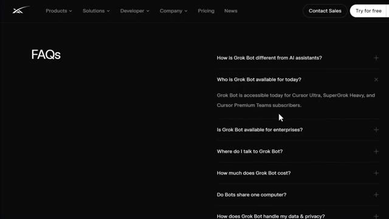
*⏱️ 00:12:07 — Capture d'écran montrant la section FAQ d'un site web, avec une question ouverte sur la disponibilité de Grok Bot.*

---

### ⏱️ `[00:12:24 - 00:12:47]` | Segment #28

**🔊 Audio (Transcription Intégrale Mot pour Mot en Français) :**
> Est-ce que les bots partagent un seul ordinateur ? Oui. Chaque GrokBot partage un unique ordinateur cloud persistant. Vos bots partagent cette machine, ces fichiers, ce navigateur, ces identifiants, afin de pouvoir se transmettre le travail et conserver le contexte. L'isolation se fait par utilisateur, et non par GrokBot. Comment GrokBot gère-t-il mes données et ma confidentialité ? GrokBot utilise le même SSO de Cursor, la même authentification et le même mode de confidentialité auquel vous faites déjà confiance.

**👁️ Analyse Visuelle d'Écran (gemini-3.5-flash-lite) :**
**Interface & Outils** : Page web officielle de présentation de Grok Bot / xAI avec menu supérieur (Products, Solutions, Developer, Company, Pricing, News) et interface de FAQ interactive.

**Contenu textuel & Code** : Texte de la FAQ expliquant que chaque Grok Bot partage un unique ordinateur cloud persistant (machine, fichiers, navigateur, identifiants) pour conserver le contexte et se transmettre le travail, l'isolation se faisant par utilisateur et non par bot.

**Action / Démonstration** : Affichage et lecture de la FAQ officielle pour illustrer le fonctionnement technique et l'architecture des bots partagés.

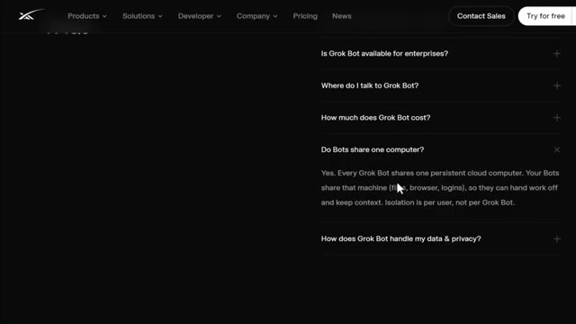
*⏱️ 00:12:30 — Capture d'écran montrant la foire aux questions (FAQ) officielle concernant Grok Bot, avec la question « Do Bots share one computer? » ouverte.*

---

### ⏱️ `[00:12:47 - 00:13:25]` | Segment #29

**🔊 Audio (Transcription Intégrale Mot pour Mot en Français) :**
> Votre ordinateur cloud est chiffré en transit et au repos avec une option de désactivation de l'entraînement. Les actions sensibles peuvent faire l'objet d'une révision automatique avant leur exécution. Les administrateurs d'entreprise peuvent configurer des certificats DLP, des proxys et des contrôles réseau au démarrage. Très bien, et regardez, pour les prochaines années, deux types de traders existeront : ceux qui utilisent l'IA et ceux qui font encore tout manuellement. Même marché, résultats très différents. Voici comment vous placer du bon côté. J'ai rassemblé tout cela au sein de la communauté AI Trade Edge : chaque invite, chaque bot, chaque modèle, chaque guide étape par étape que j'utilise personnellement, le tout au même endroit et

**👁️ Analyse Visuelle d'Écran (gemini-3.5-flash-lite) :**
**Interface & Outils** : Navigateur web affichant une page d'information et de FAQ sur la sécurité.

**Contenu textuel & Code** : Texte décrivant la sécurité des ordinateurs cloud, le chiffrement en transit et au repos, l'option de désactivation de l'entraînement et les configurations administrateur (DLP, certificats, proxys).

**Action / Démonstration** : Présentation des spécifications de confidentialité et de sécurité associées au bot d'intelligence artificielle.

*⏱️ 00:12:57 — Capture d'écran montrant la FAQ sur la confidentialité et la sécurité de Grok Bot, détaillant le chiffrement cloud et les modes de confidentialité.*

---

### ⏱️ `[00:13:25 - 00:14:04]` | Segment #30

**🔊 Audio (Transcription Intégrale Mot pour Mot en Français) :**
> Tout ce que je construis à l'avenir est ajouté directement dans le groupe dès sa sortie. Nous testons également des stratégies provenant de tout Internet, en les automatisant à l'aide de PineScript, en les exécutant en direct et en partageant exactement ce qui fonctionne et ce qui ne fonctionne pas. Vous n'obtenez donc pas seulement des outils, vous obtenez une opération de recherche en direct à l'intérieur. Il y a aussi un cours complet de trading agentique de 2,5 heures, du débutant à l'expert, sans aucune base en programmation nécessaire. À la fin, vous aurez votre propre système de trading IA fonctionnant en direct, quelque chose que la plupart des traders particuliers ne savent même pas être possible en ce moment, 79,99 $ par mois, un bon trade.

**👁️ Analyse Visuelle d'Écran (gemini-3.5-flash-lite) :**
**Interface & Outils** : Navigateur web, plateforme TradingView, interface de cours en ligne.

**Contenu textuel & Code** : Code Pine Script V5 (RSI VWAP + Extreme Reversal Setup), graphique de prix Bitcoin, modules de cours (OpenClaw, Agentic Bots, Python Bot, VPS, Live-Ops).

**Action / Démonstration** : Présentation du code source et de l'indicateur appliqué sur un graphique de trading.

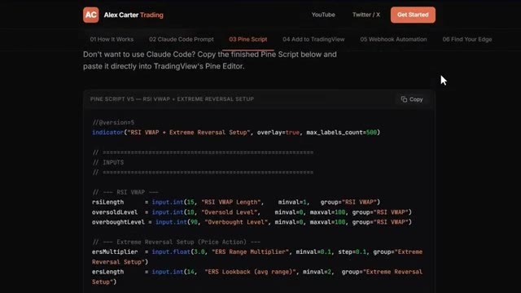
*⏱️ 00:13:35 — Code source Pine Script affiché sur le site web d'Alex Carter Trading.*

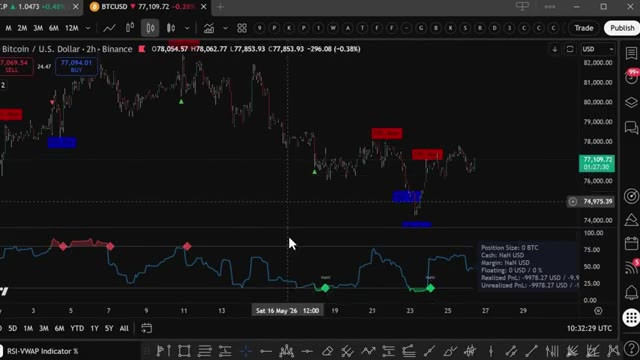
*⏱️ 00:13:44 — Graphique TradingView sur Binance montrant le Bitcoin (BTC/USD) en unité 2h avec l'indicateur personnalisé RSI-VWAP.*

*⏱️ 00:13:54 — Interface de cours en ligne montrant différents modules de formation sur le trading algorithmique et l'intelligence artificielle.*

---

### ⏱️ `[00:14:04 - 00:14:37]` | Segment #31

**🔊 Audio (Transcription Intégrale Mot pour Mot en Français) :**
> couvre cela et les 100 premiers membres bloquent ce tarif de façon permanente après cela le prix augmente le lien est dans la description vous ne pouvez vraiment pas vous permettre de manquez ça donc voilà grokbot ce que c'est pourquoi je pense qu'il bat actuellement les alternatives pour un travail permanent exactement comment le configurer et comment vous pouvez le pointer directement vers votre trading et investissement de crypto je vais continuer à tester ceci au cours des prochaines semaines et voir comment il tient face aux conditions réelles du marché alors assurez-vous d'être abonné et d'avoir les notifications activées car je partagerai des mises à jour au fur et à mesure et si

**👁️ Analyse Visuelle d'Écran (gemini-3.5-flash-lite) :**
**Interface & Outils** : Interface web de Grok Bot et panneau de l'agent de recherche avec historique des scans de marché et routines.

**Contenu textuel & Code** : Analyses techniques textuelles pour plusieurs cryptomonnaies (ruptures de structure, volumes, prix actuels) et agents actifs dans le panneau latéral (Research Agent, Market Scanner, Portfolio Agent).

**Action / Démonstration** : Navigation et présentation des fonctionnalités de l'agent de recherche et des analyses de cryptomonnaies automatisées par le bot.

*⏱️ 00:14:29 — Interface de l'agent de recherche (Research Agent) affichant des analyses de marché détaillées sur différentes cryptomonnaies (SUI, PEPE, WIF, AVAX, XRP, LINK, DOGE, ETH, BTC, SOL, BNB).*

---

### ⏱️ `[00:14:37 - 00:14:56]` | Segment #32

**🔊 Audio (Transcription Intégrale Mot pour Mot en Français) :**
> vous voulez le guide complet étape par étape sur la façon de construire votre propre système de trading agentique en utilisant Claude cette vidéo apparaît à l'écran également allez voir ça ensuite si vous avez trouvé cela utile laissez un pouce bleu cela aide vraiment la chaîne abonnez-vous si ce n'est pas déjà fait et je vous vois dans la prochaine

**👁️ Analyse Visuelle d'Écran (gemini-3.5-flash-lite) :**
**Interface & Outils** : Interface web de cours en ligne (Trading AI Full Course).

**Contenu textuel & Code** : Plan de cours structuré en modules (Cold Open + Sources, Foundations, The Complete AI Trading Stack).

**Action / Démonstration** : Présentation visuelle de la structure du cours pour construire un système de trading agentique.

*⏱️ 00:14:42 — Interface du cours 'Trading AI Full Course' montrant la carte complète des modules de formation avec les sections 00, 01 et 02.*

---

