# 🎬 I Built a 5-Minute Scalping Bot Using Claude Code (Full Beginner Tutorial)

> **Chaîne** : [Alex Carter](https://www.youtube.com/@AlexCarterTrading)  
> **Lien YouTube** : [https://www.youtube.com/watch?v=4iEKwDmbp9c](https://www.youtube.com/watch?v=4iEKwDmbp9c)  
> **Date de publication** : 20261017  
> **Durée** : 00:11:08  
> **Identifiant vidéo** : `4iEKwDmbp9c`  
> **Transcription & Analyse** : `whisper-v3-large-turbo+gemini-3.5-flash-lite`  

---

## 📌 Synthèse Exécutive & Outils

### 💡 Résumé
La vidéo de la chaîne Alex Carter aborde l'art du scalping sur le graphique de cinq minutes, considéré comme le « juste milieu » idéal pour capturer des configurations rentables sans subir le bruit excessif du graphique d'une minute ni l'attente stérile du graphique de quinze minutes. La stratégie présentée repose sur un système de retour à la moyenne combinant trois indicateurs techniques majeurs : le VWAP avec bandes d'écart-type, le RSI stochastique et le volume relatif (R Vol). Ensemble, ils permettent d'identifier les moments où le prix devient sur-étendu et s'apprête à effectuer un retournement brusque.

Pour s'affranchir de la surveillance manuelle et exténuante des graphiques tout au long de la journée, le présentateur démontre comment utiliser l'intelligence artificielle — plus précisément **Claude Code** — pour transformer cette stratégie en un script Pine entièrement automatisé en quelques secondes. Ce tutoriel pas à pas guide les débutants depuis l'inscription sur une plateforme de contrats à terme adaptée (comme UBIT ou Blofin) jusqu'à l'exécution du code sur **TradingView**, permettant de générer automatiquement des flèches de signal d'achat et de vente ainsi que des alertes mobiles en temps réel.

Enfin, l'intervention met en lumière l'émergence des bots de trading agentiques capables d'interagir avec les écosystèmes financiers. En combinant l'analyse technique rigoureuse, l'automatisation par IA et des outils de notification instantanée, les traders peuvent concevoir un système de scalping quasi-autonome, optimisant ainsi leur gestion du temps et leur réactivité sur les marchés des cryptomonnaies, des actions ou des indices.

### 🛠️ Outils, Modèles & Logiciels Présentés
* **Claude Code** : Modèle d'intelligence artificielle avancé utilisé pour générer instantanément et sans effort un script Pine complet et fonctionnel à partir d'un prompt textuel.
* **TradingView** : Plateforme de graphisme et d'analyse technique de pointe intégrant l'éditeur PineScript, l'affichage des indicateurs et la configuration d'alertes en temps réel.
* **UBIT** : Échange de contrats à terme sur cryptomonnaies favorisant le trading sans KYC obligatoire pour les dépôts directs, offrant de généreux bonus de bienvenue et plus de 500 paires de trading (USDT-M).
* **Blofin** : Alternative boursière recommandée ne nécessitant pas de vérification KYC pour le trading de base, proposant également des bonus attractifs pour les nouveaux utilisateurs.
* **Telegram** : Outil de messagerie instantanée intégré dans les cas d'utilisation avancés pour recevoir des notifications automatisées de signaux de trading.
* **Hyperliquid** : Plateforme décentralisée utilisée dans le cadre de stratégies avancées pour la recherche et le suivi d'activités de « baleines ».

### 🔑 Points Clés & Enseignements Stratégiques
1. **Juste milieu temporel (Timeframe 5 minutes)** : Le choix de l'unité de temps de 5 minutes offre le compromis parfait pour le scalping, générant assez d'opportunités quotidiennes tout en filtrant le bruit erratique du graphique en 1 minute.
2. **Logique de retour à la moyenne (*Mean Reversion*)** : La stratégie cherche à capitaliser sur les mouvements où le prix s'estompe ou s'étire excessivement au-delà de sa zone de juste valeur, anticipant un rebond ou une correction rapide.
3. **Indicateur 1 : Le VWAP et ses bandes d'écart-type** : Pondéré par le volume réel plutôt que par le simple prix, il sert de zone de référence centrale, les bandes positionnées à 1 et 2 écarts-types agissant comme des déclencheurs de sur-extension.
4. **Indicateur 2 : Le RSI Stochastique (14, 14, 3, 3)** : Utilisé comme validateur de momentum, il confirme la sur-extension du prix (sous 20 pour les achats, au-dessus de 80 pour les ventes) et repère l'incurvation des lignes vers le retournement.
5. **Indicateur 3 : Le Volume Relatif (R Vol, longueur 20)** : Cet indicateur jauge la participation réelle du marché en comparant le volume de la bougie actuelle à sa moyenne récente, exigeant un seuil supérieur à 1,5 pour valider la force du signal.
6. **Conditions strictes pour un Signal d'Achat (Long)** : Le prix doit casser la bande VWAP inférieure, le RSI stochastique doit être sous 20 et s'incurver vers le haut, et le R Vol doit dépasser 1,5 sur une bougie verte.
7. **Conditions strictes pour un Signal de Vente (Short)** : Le prix doit dépasser la bande VWAP supérieure, le RSI stochastique doit être au-dessus de 80 et s'incurver vers le bas, et le R Vol doit dépasser 1,5 sur une bougie rouge.
8. **Automatisation par IA (*Prompt Engineering*)** : L'utilisation de Claude Code permet d'automatiser la traduction d'une règle de trading complexe en un script Pine prêt à l'emploi, éliminant les biais psychologiques et la surveillance visuelle constante.
9. **Sécurité et gestion des dépôts (*Risk Management* opérationnel)** : Recommandation systématique d'effectuer un transfert test de faible montant (10 à 20 dollars) et d'utiliser des réseaux rapides et économiques comme le TRC20 pour éviter la perte définitive de fonds.
10. **Intégration d'alertes instantanées** : La configuration des alertes conditionnelles sur TradingView (signaux long et court) permet d'externaliser la surveillance du marché et d'être notifié directement sur mobile dès l'alignement des critères.
11. **Accessibilité sans KYC** : L'utilisation d'échanges comme UBIT ou Blofin permet de s'affranchir des contraintes d'identité pour les dépôts de cryptomonnaies existantes, accélérant l'accès opérationnel aux marchés des futures.
12. **Évolution vers des bots agentiques** : La centralisation des scripts, des intégrations Telegram et des flux de données préfigure la construction de systèmes de trading entièrement autonomes capables d'opérer sur les cryptos, actions et indices.

---

## ⏱️ Chronologie & Transcription Complète Audio & Visuelle (Mot pour Mot)

### ⏱️ `[00:00:00 - 00:00:32]` | Segment #01

**🔊 Audio (Transcription Intégrale Mot pour Mot en Français) :**
> Pendant que tout le monde se fait découper sur le graphique d'une minute ou s'endort en attendant sur le 15, le graphique de cinq minutes est tranquillement l'endroit où les vrais scalpeurs font du profit. C'est assez rapide pour attraper plusieurs configurations par jour, mais assez lent pour ne pas trader du simple bruit. Ce n'est pas une coïncidence. C'est le juste milieu. Et aujourd'hui, je ne vous donne pas seulement la stratégie. Je vous donne la configuration complète, étape par étape. Et ce n'est pas seulement un truc de crypto. Ça marche sur littéralement n'importe quelle paire liquide que vous lui lancez, et ensuite je vais vous montrer quelque chose qui change tout.

**👁️ Analyse Visuelle d'Écran (gemini-3.5-flash-lite) :**
**Interface & Outils** : TradingView (graphique financier avec panneau d'outils et indicateurs)

**Contenu textuel & Code** : Chandeliers japonais, bandes de Bollinger, oscillateur de momentum dans le panneau inférieur, volumes en bas, paire BITCOIN/USD TETHER PERPETUAL SWAP CONTRACT en unité de temps 5m.

**Action / Démonstration** : Analyse technique du graphique de 5 minutes illustrant une configuration de scalping avec des cercles jaunes dessinés pour mettre en évidence un signal.

*⏱️ 00:00:08 — Un graphique en chandeliers japonais en unité de temps 5 minutes sur TradingView montrant le contrat perpétuel Bitcoin/USDT, avec des bandes de Bollinger et un oscillateur de type RSI/Stochastique en sous-fenêtre, ainsi que des annotations manuscrites jaunes.*

---

### ⏱️ `[00:00:32 - 00:01:07]` | Segment #02

**🔊 Audio (Transcription Intégrale Mot pour Mot en Français) :**
> J'ai pris cette stratégie exacte, je l'ai donnée à Claude, et en quelques secondes, il m'a créé un script Pine entièrement automatisé qui attrape tous les signaux pour moi. Pas de graphiques ouverts toute la journée. Pas de devinettes. Et restez jusqu'à la fin parce que je vais vous montrer comment obtenir tous mes prompts, stratégies et configurations, et comment construire votre propre bot de trading agentique avec Claude qui peut trader des cryptos, des actions, des indices, et plus encore. Donc, entrons dans le vif du sujet. Très bien les gars, étape numéro one, inscrivez-vous sur un échange. Pour cette stratégie, nous allons utiliser UBIT. C'est l'un de mes échanges préférés.

**👁️ Analyse Visuelle d'Écran (gemini-3.5-flash-lite) :**
**Interface & Outils** : TradingView (Pine Editor et graphique de prix) et plateforme d'échange YUBIT.

**Contenu textuel & Code** : Code source en Pine Script (alertcondition, plot, stochastique, VWAP) et interface d'inscription YUBIT avec code de parrainage "ALEX".

**Action / Démonstration** : Présentation simultanée d'un script Pine automatisé et de la plateforme partenaire pour les utilisateurs mentionnée en fin de segment.

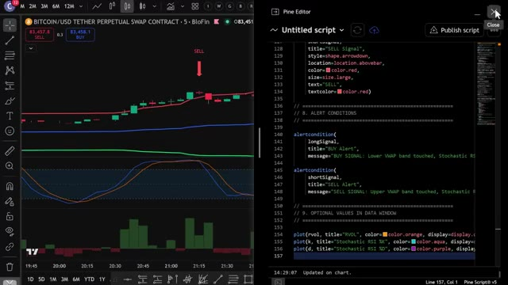
*⏱️ 00:00:41 — Capture d'écran divisée montrant à gauche un graphique TradingView avec un signal "SELL" et à droite l'éditeur Pine Script de TradingView contenant le code source.*

*⏱️ 00:00:58 — Page d'inscription de la plateforme YUBIT avec un visuel de boîte cadeau remplie de pièces et de trophées pour un programme d'affiliation.*

---

### ⏱️ `[00:01:07 - 00:01:29]` | Segment #03

**🔊 Audio (Transcription Intégrale Mot pour Mot en Français) :**
> pour le trading de contrats à terme en ce moment, et ils ont de sérieux bonus pour les nouveaux utilisateurs. Jusqu'à 50 000 dollars de bonus rien que pour votre inscription et en négociant via mon lien ci-dessous. Si UBIT ne vous convient pas, vous pouvez utiliser Blofin comme alternative. Blofin ne requiert pas de vérification KYC obligatoire pour le trading de base, ce qui signifie que vous pouvez commencer à trader immédiatement.

**👁️ Analyse Visuelle d'Écran (gemini-3.5-flash-lite) :**
**Interface & Outils** : Plateformes d'échange de cryptomonnaies YUBIT et BloFin.

**Contenu textuel & Code** : Détails des bonus de trading, montants de dépôts requis, volumes de trading et caractéristiques des bourses (frais, effet de levier).
[DESC_IMAGE_1] Interface web montrant les bonus d'inscription et de trading.
[DESC_IMAGE_2] Détails des bonus de parrainage et de dépôt.
[DESC_IMAGE_3] Présentation des avantages de BloFin.

**Action / Démonstration** : Navigation sur les pages de bonus et de présentation des courtiers.

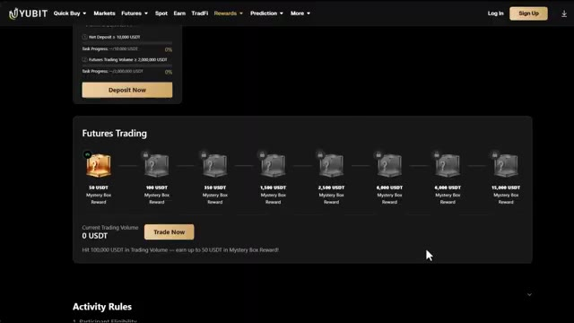
*⏱️ 00:01:13 — Interface du site YUBIT affichant les récompenses de trading de contrats à terme et de nouvelles boîtes mystères.*

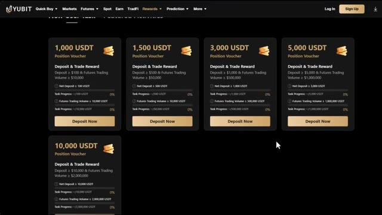
*⏱️ 00:01:18 — Page web de YUBIT montrant les bons de position et les programmes de récompenses pour les dépôts et le trading.*

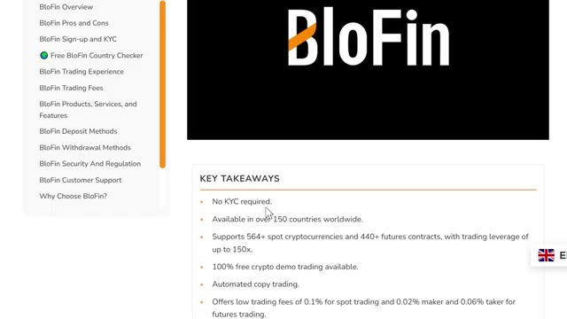
*⏱️ 00:01:24 — Page de revue et de présentation de la plateforme BloFin détaillant ses principales caractéristiques (pas de KYC, frais, etc.).*

---

### ⏱️ `[00:01:30 - 00:02:06]` | Segment #04

**🔊 Audio (Transcription Intégrale Mot pour Mot en Français) :**
> De plus, les nouveaux utilisateurs peuvent gagner jusqu'à 5 000 $USDT grâce à des bonus de dépôt et de volume de trading. Je mettrai les deux liens ci-dessous. Une fois sur la page d'UBIT, vous pouvez vous inscrire avec votre e-mail, votre numéro de téléphone, ou vous connecter via Google ou Apple ID. Pour ce tutoriel, j'utiliserai l'e-mail. Entrez simplement vos informations, créez un mot de passe fort, acceptez les conditions d'utilisation et cliquez sur s'inscrire. Entrez le code de vérification par e-mail et votre compte est prêt. Tout le processus prend moins de 30 secondes, et gardez à l'esprit qu'UBIT est une plateforme sans KYC, vous n'avez pas besoin de compléter la vérification d'identité.

**👁️ Analyse Visuelle d'Écran (gemini-3.5-flash-lite) :**
**Interface & Outils** : Site web de la plateforme d'échange YUBIT

**Contenu textuel & Code** : Formulaire d'inscription, champs pour e-mail/mot de passe, code de parrainage 'ALEX', et bannières promotionnelles pour les bonus de trading.

**Action / Démonstration** : Navigation et présentation de la page d'inscription et de la page d'accueil de la plateforme YUBIT.

*⏱️ 00:01:39 — Page d'inscription de la plateforme YUBIT avec un formulaire pour s'inscrire par e-mail ou téléphone et un code de parrainage.*

*⏱️ 00:01:57 — Page d'accueil de la plateforme d'échange YUBIT mettant en avant le trading de crypto, d'or et d'actions, ainsi qu'un bonus de dépôt.*

---

### ⏱️ `[00:02:06 - 00:02:43]` | Segment #05

**🔊 Audio (Transcription Intégrale Mot pour Mot en Français) :**
> vérification pour commencer à trader, ce qui le rend accessible même dans les régions restreintes, et cela signifie que vous pouvez commencer à trader presque instantanément après votre inscription. Allez dans votre portefeuille et cliquez sur déposer. Sélectionnez la cryptomonnaie que vous souhaitez déposer. L'USDT est idéal pour le trading. Ensuite, sélectionnez votre réseau de dépôt. Je recommande le TRC20. C'est rapide et les frais sont très bas. Vous verrez alors votre adresse de dépôt personnelle. Copiez-la soigneusement. Allez sur votre échange ou portefeuille actuel. Collez l'adresse et envoyez vos fonds. Envoyez toujours d'abord un petit montant test, peut-être 10 à 20 dollars, juste pour confirmer

**👁️ Analyse Visuelle d'Écran (gemini-3.5-flash-lite) :**
**Interface & Outils** : Site web et plateforme d'échange de cryptomonnaies Yubit (interfaces de dépôt et de retrait).

**Contenu textuel & Code** : Menus de sélection de cryptomonnaies (USDT, BTC, ETH), choix des réseaux de blockchain (Arbitrum One, Ethereum ERC20, BNB Smart Chain, Tron TRC20) et champs de saisie pour adresses de portefeuille.

**Action / Démonstration** : Navigation sur la plateforme, sélection des options de dépôt et configuration d'un transfert de fonds en cryptomonnaie.

*⏱️ 00:02:15 — Page d'accueil de la plateforme de trading Yubit montrant l'interface principale avec les options de dépôt et de navigation.*

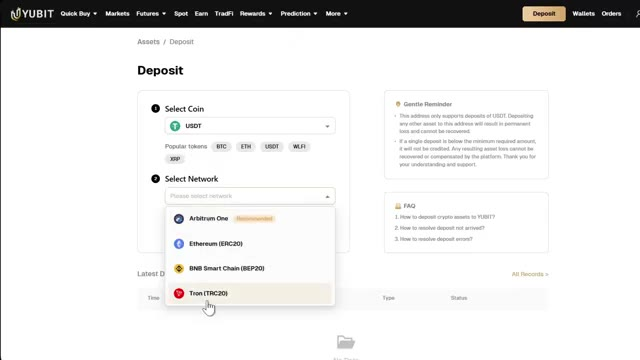
*⏱️ 00:02:24 — Interface de dépôt de la plateforme Yubit permettant de sélectionner la cryptomonnaie (USDT) et le réseau de transfert (Tron, Ethereum, BNB, etc.).*

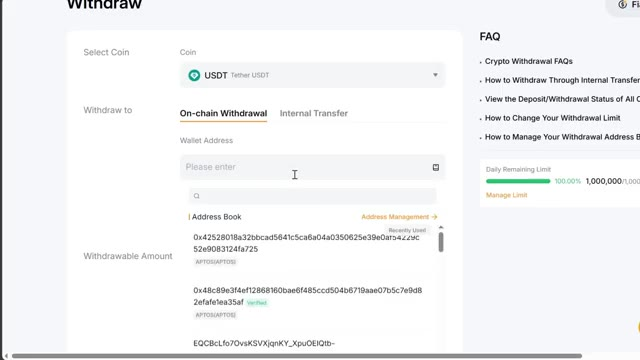
*⏱️ 00:02:34 — Interface de retrait de la plateforme Yubit affichant les options pour effectuer un retrait on-chain d'USDT avec le carnet d'adresses.*

---

### ⏱️ `[00:02:43 - 00:03:18]` | Segment #06

**🔊 Audio (Transcription Intégrale Mot pour Mot en Français) :**
> tout arrive correctement avant d'envoyer le montant total. C'est très important. Envoyer sur le mauvais réseau peut signifier la perte de vos fonds. Si vous n'avez pas encore de crypto et que vous souhaitez en acheter directement sur UBIT, c'est également possible. Mais pour cela, vous devrez d'abord compléter la procédure KYC. Allez sur l'icône de votre profil sur la page d'accueil et cliquez sur KYC. Cliquez sur vérifier maintenant. Fournissez votre e-mail, vos informations personnelles, vos documents de vérification et un selfie. Une fois que c'est approuvé, vous pouvez utiliser l'option d'achat rapide sur UBIT pour acheter de la crypto directement avec de la monnaie fiduciaire en utilisant une carte de crédit ou de débit. Si vous

**👁️ Analyse Visuelle d'Écran (gemini-3.5-flash-lite) :**
**Interface & Outils** : Plateforme d'échange de cryptomonnaies YUBIT

**Contenu textuel & Code** : Menus de navigation de la plateforme, options de compte, interfaces d'achat direct et processus de vérification d'identité KYC.

**Action / Démonstration** : Navigation sur la plateforme YUBIT pour montrer l'achat direct de cryptos et le processus de vérification d'identité.

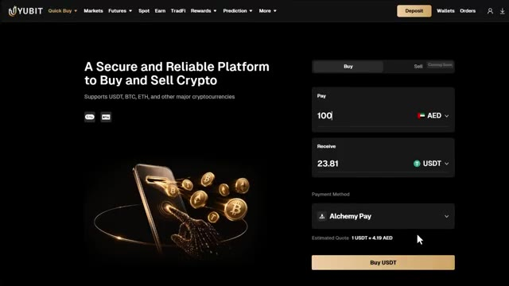
*⏱️ 00:02:51 — Interface de la plateforme YUBIT montrant l'outil 'Quick Buy' pour acheter des cryptomonnaies par carte ou paiement tiers.*

*⏱️ 00:03:00 — Page d'accueil de la plateforme YUBIT avec un menu déroulant affichant le profil utilisateur et les options de sécurité et de KYC.*

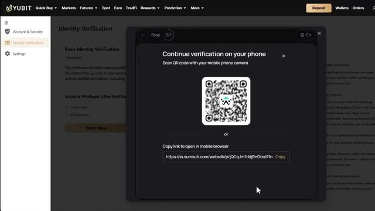
*⏱️ 00:03:09 — Fenêtre de vérification d'identité (KYC) sur YUBIT proposant de scanner un QR code ou de copier un lien pour continuer sur mobile.*

---

### ⏱️ `[00:03:18 - 00:03:40]` | Segment #07

**🔊 Audio (Transcription Intégrale Mot pour Mot en Français) :**
> avez déjà des cryptos sur un autre échange ou portefeuille, vous pouvez entièrement ignorer la procédure KYC et déposer directement, ce qui est l'option la plus rapide pour la plupart des gens. Cliquez sur futures dans la barre de navigation supérieure et cliquez sur USDT-M. Cela vous amènera à l'interface de trading des futures UBIT. Maintenant, cela peut sembler un peu intimidant au début, mais je vais décortiquer chaque section pour que tout devienne parfaitement clair.

**👁️ Analyse Visuelle d'Écran (gemini-3.5-flash-lite) :**
**Interface & Outils** : Plateforme d'échange de crypto-monnaies Yubit (section Dépôt et Futures).

**Contenu textuel & Code** : Formulaire de dépôt USDT, menu de sélection des marchés perpétuels USDT-M (BTCUSDT, ETHUSDT, etc.), et interface de trading Futures affichant le solde disponible de 51 USDT.

**Action / Démonstration** : Navigation à travers les menus de dépôt et d'accès aux marchés de contrats à terme (Futures USDT-M).

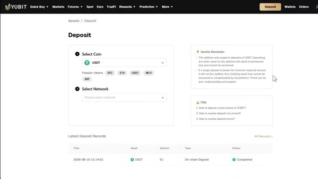
*⏱️ 00:03:23 — Interface de dépôt de fonds en crypto-monnaie sur la plateforme Yubit.*

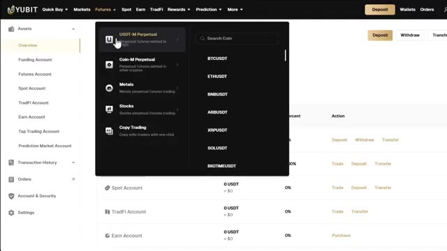
*⏱️ 00:03:29 — Menu déroulant de navigation affichant les options de compte et de trading (USDT-M Perpetual).*

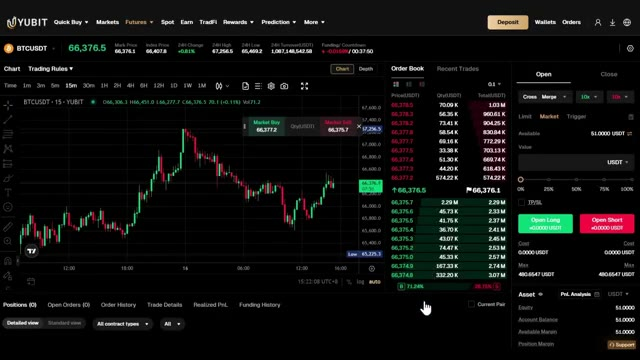
*⏱️ 00:03:34 — Interface de trading de contrats Futures BTCUSDT avec graphique de prix en chandeliers et carnet d'ordres.*

---

### ⏱️ `[00:03:40 - 00:04:09]` | Segment #08

**🔊 Audio (Transcription Intégrale Mot pour Mot en Français) :**
> En haut à gauche, vous avez le sélecteur de paires de trading. C'est ici que vous choisissez quel actif trader. UBIT propose plus de 500 paires de trading, du Bitcoin et de l'Ethereum jusqu'aux memecoins et aux principaux altcoins. Vous pouvez choisir entre les perpétuels sur marge USDT et les perpétuels sur marge de coin, qui sont des transactions réglées dans votre propre crypto au lieu de l'USDT. Au centre se trouve le graphique des prix propulsé par TradingView avec tous les outils de dessin et indicateurs techniques dont vous avez besoin pour l'analyse.

**👁️ Analyse Visuelle d'Écran (gemini-3.5-flash-lite) :**
**Interface & Outils** : Interface web de la plateforme de trading YUBIT (section Futures)

**Contenu textuel & Code** : Liste des paires de trading (FARTCOIN/USDT, LINK/USDT, AVAX/USDT, etc.) avec leurs prix, variations sur 24h et volumes, ainsi que les onglets de filtrage (Favorites, USDT-M, Coin-M, Metals, Stocks) et le carnet d'ordres à droite.

**Action / Démonstration** : Manipulation de l'interface pour parcourir et sélectionner des paires de trading dans le menu déroulant de gauche.

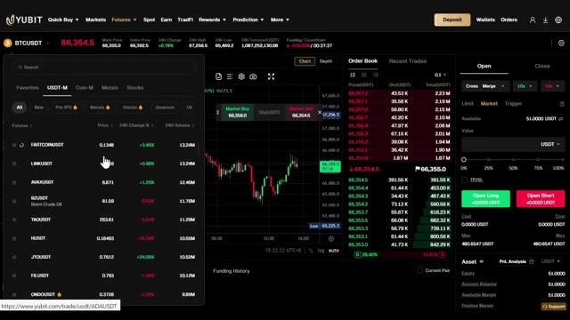
*⏱️ 00:03:47 — Capture d'écran de l'interface de la plateforme d'échange YUBIT montrant le sélecteur de paires de trading en haut à gauche avec la liste des cryptomonnaies disponibles en perpétuels USDT-M.*

---

### ⏱️ `[00:04:09 - 00:04:44]` | Segment #09

**🔊 Audio (Transcription Intégrale Mot pour Mot en Français) :**
> Sur le côté droit se trouve le carnet d'ordres qui montre tous les ordres d'achat et de vente en direct sur le marché. Et en bas se trouve votre panneau de gestion des ordres. C'est ici que vous suivez vos positions ouvertes, vos ordres ouverts et votre historique de trading. Tout ce dont vous avez besoin est ici même sur un seul écran. Très bien, avant d'aborder les indicateurs, une chose rapide. Si vous n'avez pas encore TradingView, cliquez sur le lien dans la description ci-dessous. Si vous achetez la version pro, vous obtiendrez une réduction et cela aide vraiment énormément la chaîne. Très bien, entrons dans le vif du sujet. Nous allons trader du Bitcoin USDT sur le graphique de cinq minutes, mais honnêtement, cela fonctionne tout aussi bien sur Ethereum,

**👁️ Analyse Visuelle d'Écran (gemini-3.5-flash-lite) :**
**Interface & Outils** : Plateforme d'échange de cryptomonnaies Yubit (interface Futures).

**Contenu textuel & Code** : Graphique de prix, carnet d'ordres en direct (carnet de commandes), boutons d'achat/vente (Open Long / Open Short) et panneau de suivi des positions et du solde du compte (Equity 51.00 USDT).

**Action / Démonstration** : Présentation de l'interface de trading, explication de la disposition des éléments de l'exchange (carnet d'ordres à droite et panneau de gestion des ordres en bas).

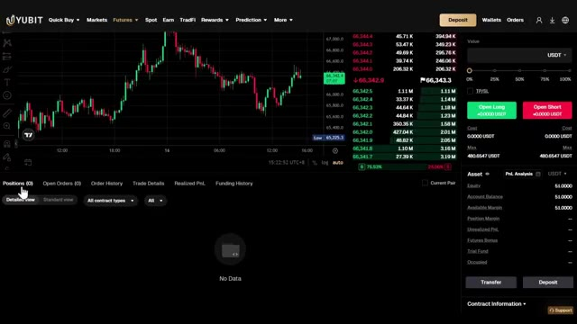
*⏱️ 00:04:18 — Interface de trading Yubit montrant un graphique en chandeliers au centre, le carnet d'ordres à droite et le panneau de gestion des positions en bas.*

---

### ⏱️ `[00:04:45 - 00:05:20]` | Segment #10

**🔊 Audio (Transcription Intégrale Mot pour Mot en Français) :**
> Solana, ou toute paire majeure liquide sur n'importe quel marché. La logique ne change pas. Cette stratégie utilise trois indicateurs superposés et toute l'idée est de capturer des mouvements de retour à la moyenne marqués. Fondamentalement, des moments où le prix devient sur-étendu et revient brusquement en arrière. Le premier indicateur est le VWAP avec des bandes d'écart-type. Contrairement à une moyenne mobile classique, ce VWAP est pondéré par le volume, il réagit donc là où l'argent réel s'échange et pas seulement au prix. Nous l'utilisons comme notre zone de juste valeur. Lorsque le prix dépasse les bandes, c'est notre déclencheur de retour à la moyenne. Pour l'activer

**👁️ Analyse Visuelle d'Écran (gemini-3.5-flash-lite) :**
**Interface & Outils** : Graphique de trading TradingView intégré à l'interface de l'échange BloFin.

**Contenu textuel & Code** : Graphique en chandeliers (bougies japonaises) du Bitcoin en unité de temps 5 minutes, superposition d'indicateurs de bandes de type moyenne mobile/enveloppes, oscillateur en sous-fenêtre (type RSI ou Stochastique) et histogramme de volume en bas. Annotations dessinées à main levée entourant une zone de sur-extension et de retournement.

**Action / Démonstration** : Analyse visuelle d'une configuration de retour à la moyenne (mean reversion) sur le prix du Bitcoin, en observant la sortie des bandes et la réaction de l'oscillateur.

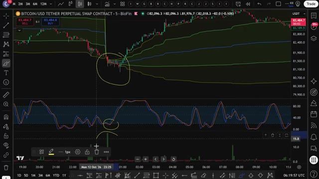
*⏱️ 00:04:53 — Graphique TradingView sur BloFin montrant le cours du Bitcoin (BTC/USDT Perpetual) avec des indicateurs techniques et des annotations sous forme de cercles jaunes.*

---

### ⏱️ `[00:05:20 - 00:05:54]` | Segment #11

**🔊 Audio (Transcription Intégrale Mot pour Mot en Français) :**
> allez simplement dans les indicateurs tout en haut de votre graphique, recherchez VWAP, et cliquez dessus pour l'ajouter. Ensuite, cliquez sur la petite icône de paramètres à côté. Sous l'onglet style ou paramètres, assurez-vous que les bandes sont activées, réglez-le sur l'écart type, et définissez les multiplicateur sur un et deux. Une fois que c'est fait, cliquez simplement sur OK et vous verrez le VWAP avec ses bandes tracées directement sur votre graphique. L'indicateur, l'indicateur numéro deux est le RSI stochastique. C'est notre confirmation de momentum. Il nous indique quand le prix est étiré et commence réellement à se replier. Pour l'activer, allez dans les indicateurs

**👁️ Analyse Visuelle d'Écran (gemini-3.5-flash-lite) :**
**Interface & Outils** : TradingView

**Contenu textuel & Code** : Paramètres VWAP avec onglets Inputs, Style, Visibility, et options pour les bandes (Bands Calculation Mode, Bands Multiplier).

**Action / Démonstration** : Configuration des paramètres et des multiplicateurs de bandes pour l'indicateur VWAP.

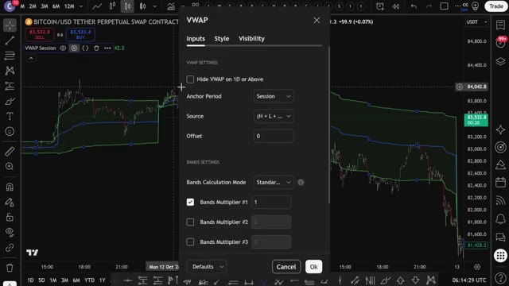
*⏱️ 00:05:28 — Fenêtre de configuration des paramètres de l'indicateur VWAP sur un graphique de trading.*

---

### ⏱️ `[00:05:54 - 00:06:26]` | Segment #12

**🔊 Audio (Transcription Intégrale Mot pour Mot en Français) :**
> Encore une fois, cherchez le RSI stochastique et cliquez dessus pour l'ajouter. Ensuite, cliquez sur l'icône des paramètres à côté. Changez la longueur du RSI à 14, la longueur du stochastique à 14, et laissez le lissage K et D à 3 et 3. Cliquez sur OK, et vous le verrez tracé dans son propre panneau sous votre graphique. Le troisième indicateur est le volume relatif, ou R vol pour faire court. Au lieu d'une simple barre de volume, le R vol compare le volume des bougies actuelles à leur moyenne récente afin que vous puissiez réellement dire quand une vraie participation entre sur le marché. Pour

**👁️ Analyse Visuelle d'Écran (gemini-3.5-flash-lite) :**
**Interface & Outils** : Graphique de trading (TradingView / BloFin)

**Contenu textuel & Code** : Paramètres du Stoch RSI : K=3, D=3, longueur du RSI=14, longueur du stochastique=14, source=Close.

**Action / Démonstration** : Modification et configuration des paramètres de l'indicateur technique Stoch RSI.

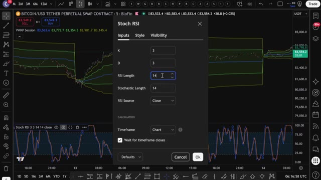
*⏱️ 00:06:02 — Fenêtre de configuration des paramètres du Stoch RSI sur un graphique de trading montrant le réglage de la longueur du RSI à 14.*

---

### ⏱️ `[00:06:26 - 00:06:59]` | Segment #13

**🔊 Audio (Transcription Intégrale Mot pour Mot en Français) :**
> activez-le, allez dans les indicateurs, recherchez le volume relatif et cliquez dessus pour l'ajouter. Ensuite, cliquez sur l'icône des paramètres et définissez la longueur sur 20. Cliquez sur OK et vous le verrez s'afficher dans son propre panneau à côté de votre volume. Voici ce que vous recherchez réellement. Pour une configuration d'achat, le prix doit passer sous la bande VWAP inférieure. Le RSI stochastique doit être inférieur à 20 et s'incurver vers le haut. Un Arvol doit dépasser 1,5 sur une bougie verte. Les trois réunis signifient que la baisse était exagérée et que les acheteurs viennent de revenir. Pour une configuration de vente, le prix doit dépasser

**👁️ Analyse Visuelle d'Écran (gemini-3.5-flash-lite) :**
**Interface & Outils** : TradingView

**Contenu textuel & Code** : Paramètres de l'indicateur "Rel vol" (Anchor Timeframe : 5 minutes, Length : 20, Calculation Mode : Cumulative) avec Stoch RSI et graphique de prix Bitcoin en arrière-plan.

**Action / Démonstration** : Configuration des paramètres de l'indicateur de volume relatif (Relative Volume) sur TradingView.

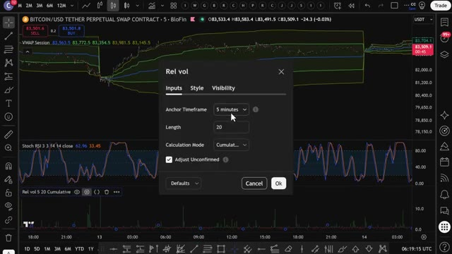
*⏱️ 00:06:34 — Fenêtre de configuration de l'indicateur "Rel vol" (Relative Volume) affichée par-dessus un graphique TradingView avec les paramètres de longueur et d'unité de temps.*

---

### ⏱️ `[00:06:59 - 00:07:31]` | Segment #14

**🔊 Audio (Transcription Intégrale Mot pour Mot en Français) :**
> la bande VWAP supérieure. Le RSI Stochastique doit être au-dessus de 80 et s'incurver vers le bas. Un Arvol doit dépasser 1,5 sur une bougie rouge. Les trois ensemble signifient que le mouvement s'essouffle et que les vendeurs viennent de prendre le contrôle. Lorsque ces trois conditions sont réunies en même temps sur le graphique en cinq minutes, c'est votre signal. Simple sur le papier, mais surveiller l'alignement de ces trois conditions manuellement, bougie par bougie, toute la journée ? C'est épuisant, et c'est exactement pour cela que je ne voulais plus le faire manuellement. Au lieu de regarder des graphiques toute la journée et de faire cela à l'œil, j'ai confié cette stratégie exacte à Claude et

**👁️ Analyse Visuelle d'Écran (gemini-3.5-flash-lite) :**
**Interface & Outils** : TradingView (Graphique de trading en ligne)

**Contenu textuel & Code** : Bitcoin/USD Tether Perpetual Swap Contract (en unité de temps 5 minutes), Bandes VWAP, Stochastique RSI avec niveau 80, indicateur de volume (Arvol).

**Action / Démonstration** : Analyse technique illustrant la stratégie de retournement avec la bande VWAP supérieure et le RSI stochastique au-dessus de 80 qui s'incurve vers le bas.

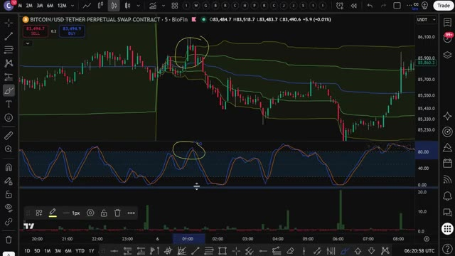
*⏱️ 00:07:07 — Graphique TradingView montrant le prix du Bitcoin avec des bandes VWAP, un RSI Stochastique au-dessus de 80 et des annotations en cercle jaune sur les zones clés.*

---

### ⏱️ `[00:07:31 - 00:08:05]` | Segment #15

**🔊 Audio (Transcription Intégrale Mot pour Mot en Français) :**
> je lui ai demandé de m'écrire un PineScript complet pour que Trade and View puisse détecter automatiquement ces signaux pour moi et voici le prompt que j'ai utilisé je vais l'afficher à l'écran dès maintenant pour que vous puissiez le copier exactement c'est le prompt complet collez ça dans Claude j'utilise Claude Code ici et en quelques secondes il crache un PineScript complet et fonctionnel dans un fichier bloc-notes maintenant ce prompt exact ainsi que le PineScript utilisé dans cette vidéo est disponible dans mon groupe privé vous pouvez trouver le lien en bas ouvrez ce fichier appuyez sur contrôle plus a pour tout sélectionner le code puis contrôle plus c pour le copier

**👁️ Analyse Visuelle d'Écran (gemini-3.5-flash-lite) :**
**Interface & Outils** : Explorateur de fichiers Windows, navigateur web (interface Alex Carter Trading), éditeur de texte.

**Contenu textuel & Code** : Règles de trading détaillées (VWAP, Stoch RSI, RVOL), liste de fichiers de scripts de trading, interface web présentant les conditions de signal (Buy Signal / Sell Signal).

**Action / Démonstration** : Présentation des instructions textuelles du prompt pour générer le script Pine Script et affichage de l'interface de ressources de trading.

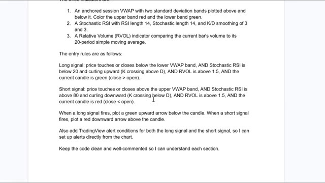
*⏱️ 00:07:40 — Un document texte affichant les règles d'entrée pour des signaux de trading Long et Short basés sur un VWAP ancré, un Stochastic RSI et le volume relatif (RVOL).*

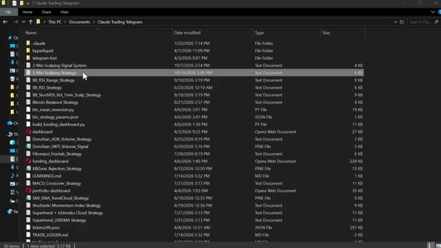
*⏱️ 00:07:48 — Un explorateur de fichiers Windows montrant un dossier contenant divers scripts et stratégies de trading de type Pine Script et Python.*

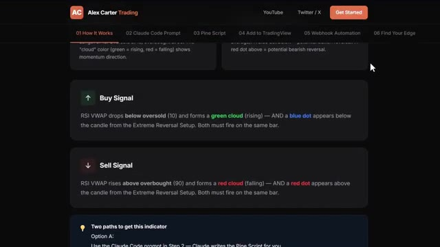
*⏱️ 00:07:57 — Une interface web de la plateforme Alex Carter Trading détaillant le fonctionnement des signaux d'achat et de vente basés sur des indicateurs techniques.*

---

### ⏱️ `[00:08:05 - 00:08:36]` | Segment #16

**🔊 Audio (Transcription Intégrale Mot pour Mot en Français) :**
> C'est tout ce dont vous avez besoin. Maintenant, introduisons cela dans TradingView. Ouvrez TradingView et allez sur n'importe quel graphique. Je vais utiliser à nouveau le Bitcoin. Au bas de l'écran, cliquez sur l'onglet Éditeur PineScript. Si vous ne le voyez pas, allez dans la barre d'outils inférieure et cliquez sur Éditeur PineScript. Une fois l'éditeur ouvert, vous y verrez du code par défaut. Sélectionnez-le entièrement et supprimez-le. Ensuite, collez le code que Claude vient de vous donner. Cliquez maintenant sur Ajouter au graphique. C'est le bouton en haut à droite de l'éditeur de script Pine. TradingView va compiler le script et l'appliquer directement sur votre graphique.

**👁️ Analyse Visuelle d'Écran (gemini-3.5-flash-lite) :**
**Interface & Outils** : Interface de TradingView.

**Contenu textuel & Code** : Graphique de prix du Bitcoin avec affichage du symbole BITCOIN/USD TETHER PERPETUAL SWAP CONTRACT sur le broker BloFin.

**Action / Démonstration** : Ouverture d'un graphique TradingView pour préparer l'intégration du code Pine Script.

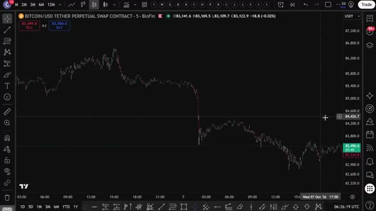
*⏱️ 00:08:13 — Un graphique en chandeliers du contrat perpétuel Bitcoin/USDT sur TradingView.*

---

### ⏱️ `[00:08:37 - 00:09:10]` | Segment #17

**🔊 Audio (Transcription Intégrale Mot pour Mot en Français) :**
> Et voilà. Vous pouvez voir les bandes VWAP sur le graphique, le panneau du RSI stochastique en dessous, l'indicateur RRVL, et les signaux d'achat et de vente tracés automatiquement. Flèches vertes pour les achats, flèches rouges pour les ventes. Tout se déclenche exactement de la manière dont nous l'avons configuré manuellement. Mais maintenant, cela le fait pour vous automatiquement toutes les cinq minutes sur Bitcoin USDT ou n'importe quelle paire que vous avez ciblée. Maintenant, pour configurer des alertes, cliquez sur l'icône de réveil en haut de TradingView, sélectionnez créer une alerte, et dans le menu déroulant des conditions, vous verrez les conditions d'alerte que Claude

**👁️ Analyse Visuelle d'Écran (gemini-3.5-flash-lite) :**
**Interface & Outils** : TradingView / BloFin (Bitcoin/USD Tether Perpetual Swap Contract, unité de temps 5m).

**Contenu textuel & Code** : Bandes VWAP sur le graphique principal, indicateur RSI stochastique dans le panneau inférieur, et indicateur de volume.

**Action / Démonstration** : Présentation et analyse des indicateurs techniques et des bandes VWAP sur le graphique du Bitcoin.

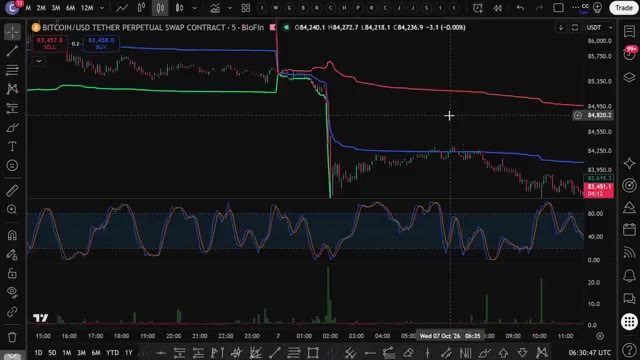
*⏱️ 00:08:45 — Graphique de trading montrant le cours du Bitcoin avec des bandes VWAP et un indicateur RSI stochastique en sous-panneau.*

---

### ⏱️ `[00:09:10 - 00:09:43]` | Segment #18

**🔊 Audio (Transcription Intégrale Mot pour Mot en Français) :**
> ajouté, signal long et signal court. Configurez-les et TradingView vous avertira dès qu'un signal se déclenche directement sur votre téléphone. Donc maintenant, au lieu de surveiller le graphique manuellement, TradingView fait tout le travail pour vous. Dès que les trois conditions sont réunies, vous recevez une alerte. Vous la vérifiez, vous l'exécutez sur UBIT et c'est tout. Maintenant, si vous voulez aller encore plus loin et faire en sorte qu'il s'exécute automatiquement sur votre exchange dès qu'un signal se déclenche, j'ai ce qu'il vous faut. J'ai créé un groupe privé où je partage tous mes cas d'utilisation pour Claude Code, de son intégration avec Telegram,

**👁️ Analyse Visuelle d'Écran (gemini-3.5-flash-lite) :**
**Interface & Outils** : TradingView, YUBIT (exchange crypto)

**Contenu textuel & Code** : Graphique de prix du Bitcoin, indicateurs techniques, panneau latéral d'alertes configurées sur TradingView, et carnet d'ordres / détails de position sur YUBIT.

**Action / Démonstration** : Configuration et démonstration d'alertes de trading automatiques, puis passage à l'exécution d'un ordre d'achat sur la plateforme de futures.

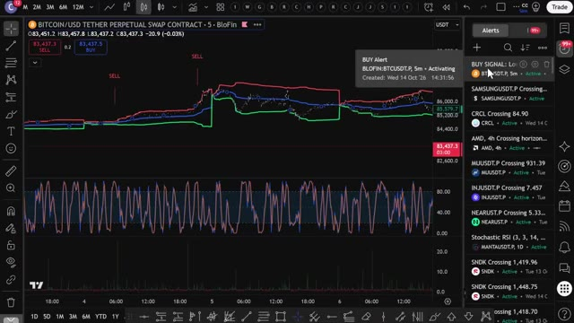
*⏱️ 00:09:18 — Graphique TradingView affichant le contrat perpétuel Bitcoin/USD sur BloFin, avec un panneau d'alertes actif sur la droite montrant une alerte d'achat configurée.*

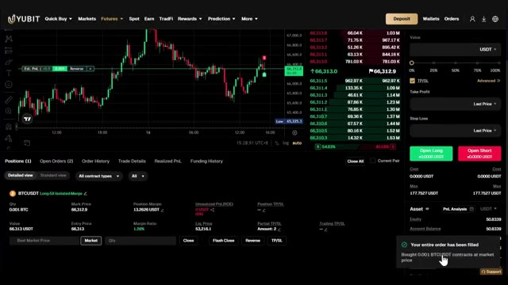
*⏱️ 00:09:35 — Interface de trading de la plateforme YUBIT affichant le graphique du Bitcoin (Futures), un carnet d'ordres, et une notification confirmant l'exécution d'un ordre d'achat.*

---

### ⏱️ `[00:09:43 - 00:10:11]` | Segment #19

**🔊 Audio (Transcription Intégrale Mot pour Mot en Français) :**
> TradingView, et la recherche de baleines sur Hyperliquid. Tout cela de manière automatique. Tout ce que je vous ai montré aujourd'hui, c'est entièrement inclus dans le groupe. Et j'ajoute constamment de nouvelles choses, de nouvelles stratégies, de nouveaux prompts, de nouvelles intégrations. Chaque fois que je construis quelque chose de nouveau, ça va directement là-dedans. Le prix est de 79,99 $ par mois. Et honnêtement, quand on y pense, quand on réalise ce que c'est vraiment, la configuration de trading par IA la plus avancée disponible pour les traders particuliers en ce moment, constamment mise à jour avec tout ce qui est inclus.

**👁️ Analyse Visuelle d'Écran (gemini-3.5-flash-lite) :**
**Interface & Outils** : Interface web Whop et documentation de plateforme de trading (WEEX / API).

**Contenu textuel & Code** : Listes des fonctionnalités de trading automatisé : Futures Trading (prix, positions, ordres long/short, effet de levier, stop-loss), Spot Trading (solde, achat/vente), et informations de compte (commissions, historique).

**Action / Démonstration** : Présentation des avantages inclus dans le groupe d'abonnement et des outils automatisés disponibles pour les membres.

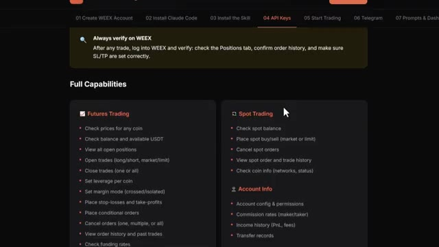
*⏱️ 00:09:50 — Interface web détaillant les fonctionnalités complètes d'API et de trading pour l'intégration de la plateforme WEEX, montrant les capacités sur les contrats futures et le marché au comptant (spot).*

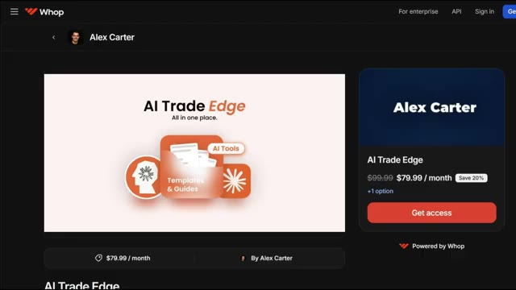
*⏱️ 00:09:57 — Page de la plateforme Whop présentant le groupe d'abonnement "AI Trade Edge" d'Alex Carter à 79,99 $ par mois.*

---

### ⏱️ `[00:10:12 - 00:10:47]` | Segment #20

**🔊 Audio (Transcription Intégrale Mot pour Mot en Français) :**
> À l'intérieur, il y a aussi un cours complet de trading agentique. 2 heures et demie. De débutant à expert. Aucun bagage en programmation n'est nécessaire. À la fin, vous aurez votre propre système de trading par IA en direct. Quelque chose que la plupart des traders particuliers ne savent même pas être possible en ce moment. 79,99 $ par mois. Un bon trade couvre ce montant. Et les 100 premiers membres bloquent ce tarif de façon permanente. Après cela, le prix augmente. Le lien est dans la description. Vous ne pouvez vraiment pas vous permettre de rater ça. Et c'est tout les gars. C'est comme ça qu'on prend une stratégie sur Internet, qu'on la confie à Claude et qu'on obtient un système fonctionnel.

**👁️ Analyse Visuelle d'Écran (gemini-3.5-flash-lite) :**
**Interface & Outils** : Plateforme de formation en ligne / Interface web Easypanel et plateforme de paiement Whop

**Contenu textuel & Code** : Titres des modules du cours de trading agentique incluant 'OpenClaw — Power & Risk', 'Agentic Bots with Hermes + OpenClaw', 'Build Your Own Python Bot', et 'Deploy to Hostinger VPS'.

**Action / Démonstration** : Navigation à travers les modules du programme complet de formation au trading par IA et présentation de l'offre commerciale.

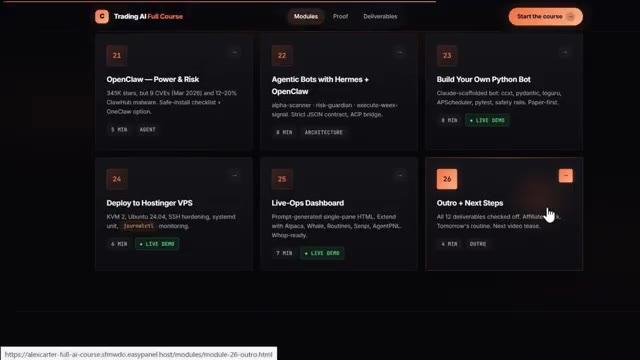
*⏱️ 00:10:21 — Interface du cours en ligne 'Trading AI Full Course' montrant les modules de formation sous forme de cartes interactives (modules 21 à 26).*

---

### ⏱️ `[00:10:47 - 00:11:08]` | Segment #21

**🔊 Audio (Transcription Intégrale Mot pour Mot en Français) :**
> PineScript dans TradingView. Pas de code, pas de surveillance manuelle des graphiques. Si vous voulez voir une démonstration complète de la façon dont je trade en utilisant uniquement mon Telegram et la démonstration complète de tous les cas d'utilisation sur TradingView, cliquez sur la vidéo qui apparaît à l'écran dès maintenant. Si vous avez trouvé cela utile, laissez un pouce bleu. Cela aide vraiment la chaîne. Abonnez-vous si ce n'est pas déjà fait, et je vous vois dans la prochaine.

**👁️ Analyse Visuelle d'Écran (gemini-3.5-flash-lite) :**
**Interface & Outils** : TradingView, Terminal de commande / CLI.

**Contenu textuel & Code** : Graphique de prix, indicateurs techniques (EMA, RSI, MACD), tableau d'analyse multi-timeframe (Weekly, Daily, 4-Hour, 1-Hour) avec scores de biais, niveaux clés (support/résistance) et configuration de trade (Entry, Stop Loss, Take Profit).

**Action / Démonstration** : Analyse technique de graphiques et affichage d'un rapport de confluence multi-timeframe avec recommandations de trading.

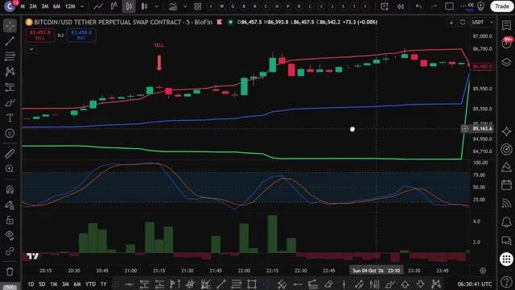
*⏱️ 00:10:52 — Graphique TradingView affichant la paire Bitcoin/USD Tether Perpetual Swap Contract sur un intervalle de 5 minutes, avec des indicateurs techniques et un signal de vente (SELL).*

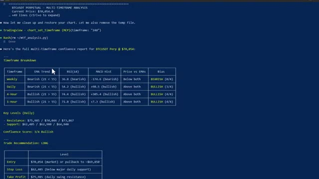
*⏱️ 00:10:57 — Interface de terminal de commande présentant un rapport d'analyse multi-timeframe complet pour BTCUSDT Perp avec des tableaux de métriques (EMA Trend, RSI, MACD) et des recommandations de trade (LONG).*

---

