# 🎬 How to Deploy Hermes Agent on Hostinger (Full Beginner Tutorial)

> **Chaîne** : [Alex Carter](https://www.youtube.com/@AlexCarterTrading)  
> **Lien YouTube** : [https://www.youtube.com/watch?v=dXzH6H2Mx9E](https://www.youtube.com/watch?v=dXzH6H2Mx9E)  
> **Date de publication** : 20261019  
> **Durée** : 00:10:11  
> **Identifiant vidéo** : `dXzH6H2Mx9E`  
> **Transcription & Analyse** : `whisper-v3-large-turbo+gemini-3.5-flash-lite`  

---

## 📌 Synthèse Exécutive & Outils

### 💡 Résumé
Cette vidéo de la chaîne Alex Carter propose un guide pratique et approfondi sur le déploiement d'un agent de trading et d'automatisation auto-améliorable, nommé Hermes Agent, sur une infrastructure cloud Hostinger. Contrairement aux agents conversationnels traditionnels caractérisés par une mémoire à court terme volatile, l'agent Hermes se distingue par une boucle d'apprentissage intégrée et une mémoire persistante. Chaque interaction, recherche ou tâche exécutée permet au système de générer de nouvelles compétences et d'affiner ses performances en continu, éliminant ainsi les limites inhérentes à l'exécution locale sur des ordinateurs portables sujets aux mises en veille et aux coupures.

L'analyste démontre l'intégralité du processus de configuration, depuis l'acquisition d'un VPS Hostinger optimisé avec des modèles Docker préconfigurés jusqu'à l'initialisation de l'agent en mode CLI (Command Line Interface). En s'appuyant sur des passerelles unifiées telles que les crédits Nexus AI et Oxylabs, l'agent accède de manière transparente à des LLM de pointe (Claude, Gemini, GPT) ainsi qu'à des outils de scraping web avancés. Cette architecture robuste garantit une disponibilité de 24h/24 et 7j/7, indispensable pour surveiller les marchés, automatiser des stratégies de scalping ou de swing trading, et exécuter des flux de travail multi-agents sans interruption matérielle.

Enfin, la vidéo repositionne cette infrastructure technique dans une perspective stratégique pour les traders quantitatifs. L'utilisation d'un agent hébergé sur le cloud permet d'interfacer des scripts d'automatisation (tels que Pine Script sur TradingView) avec des modèles d'intelligence artificielle capables d'analyser les conditions de marché en temps réel, d'appliquer des règles strictes de gestion du risque et d'interagir via des applications de messagerie (Telegram, Discord, WhatsApp). L'objectif affiché est de doter les traders d'un avantage compétitif structurel face à l'exécution manuelle, en combinant la puissance des grands modèles de langage et la fiabilité d'une infrastructure serveur dédiée.

### 🛠️ Outils, Modèles & Logiciels Présentés
* **Hermes Agent** : Agent IA open source développé par Noose Research, doté d'une boucle d'apprentissage intégrée et d'une mémoire persistante pour s'améliorer au fil des interactions.
* **Hostinger VPS** : Solution d'hébergement cloud offrant un catalogue Docker préconfiguré permettant de déployer l'agent Hermes en quelques secondes sans manipulation complexe de terminal.
* **Nexus AI** : Passerelle d'API unifiée permettant à l'agent Hermes d'accéder à plus de 200 modèles de pointe, incluant Claude, Gemini et GPT, via un système de crédits intégrés.
* **Oxylabs** : Fournisseur de services de données et de web scraping intégré, permettant à l'agent d'extraire de manière fiable des informations sur des sites complexes et riches en JavaScript.
* **Docker / Docker Management** : Outil de conteneurisation utilisé par Hostinger pour automatiser le déploiement et l'exécution isolée des services de l'agent Hermes sur le VPS.
* **Claude / Claude Code** : Modèle de langage avancé d'Anthropic utilisé pour alimenter les capacités de raisonnement, de développement et d'automatisation de l'agent.
* **Grok Bots** : Systèmes de bots conversationnels et d'analyse de marché intégrés dans l'écosystème d'automatisation pour le traitement des flux de données.
* **TradingView & Pine Script** : Plateforme de graphisme et langage de programmation incontournable pour concevoir, backtester et automatiser les stratégies de trading et de scalping.
* **Canaux de Communication (Telegram, Slack, Discord, WhatsApp, Signal)** : Passerelles de messagerie connectées à l'agent pour recevoir des alertes en temps réel et interagir avec les flux de travail.

### 🔑 Points Clés & Enseignements Stratégiques
1. **Dépassement de la mémoire volatile** : La principale faille des assistants IA traditionnels réside dans leur incapacité à retenir les instructions d'une session à l'autre, obligeant l'utilisateur à répéter les mêmes prompts ; Hermes résout ce problème grâce à une persistance de la mémoire stockée directement sur le VPS.
2. **Indépendance vis-à-vis de l'infrastructure locale** : Faire tourner un agent de trading sur un ordinateur personnel expose le système à des risques majeurs de coupure (mise en veille, redémarrage, pertes de mémoire) ; un VPS cloud garantit une exécution continue 24h/24 et 7j/7.
3. **Déploiement conteneurisé simplifié** : L'utilisation des modèles Docker préconfigurés sur Hostinger élimine la barrière technique de l'installation manuelle en ligne de commande, permettant un lancement rapide en quelques clics.
4. **Gestion centralisée des clés API via Nexus AI** : L'utilisation de crédits unifiés évite la complexité de la configuration manuelle de multiples clés API pour des fournisseurs distincts (Anthropic, OpenAI, Google), tout en automatisant l'accès aux LLM.
5. **Extraction de données robuste avec Oxylabs** : L'intégration de services de scraping spécialisés permet à l'agent de contourner les blocages web et d'analyser des sources de données financières complexes et dynamiques en temps réel.
6. **Souveraineté et sécurité des données** : Toutes les compétences acquises par l'agent, les logs et les clés API configurées résident exclusivement sur le VPS privé de l'utilisateur, garantissant la confidentialité des stratégies de trading.
7. **Sauvegardes et résilience serveur** : Le recours à des sauvegardes régulières (hebdomadaires par défaut, modulables en journalières) sur l'infrastructure Hostinger assure une restauration rapide en cas de besoin opérationnel.
8. **Scalabilité multi-marchés** : Le framework d'agentique déployé est agnostique quant aux classes d'actifs tradées (crypto, actions, contrats à terme, Forex), s'adaptant à toute stratégie fournie par l'utilisateur.
9. **Intégration transparente avec les outils de messagerie** : La possibilité de brancher l'agent sur des applications comme Telegram, Discord ou WhatsApp permet au trader de surveiller ses positions et d'interagir avec son bot à distance.
10. **Synergie entre IA et Pine Script** : L'association d'un agent auto-améliorable et des scripts de trading (TradingView) permet d'optimiser l'exécution des stratégies de scalping et de swing trading en réduisant l'intervention humaine manuelle.
11. **Surveillance proactive des ressources** : Le suivi rigoureux des soldes de crédits (Nexus AI et Oxylabs) est impératif pour éviter l'interruption des réponses et de l'exécution des tâches autonomes de l'agent.
12. **Avantage concurrentiel de l'automatisation** : Dans un marché financier global, l'adoption d'agents IA hébergés sur le cloud crée une rupture nette de performance par rapport aux traders exécutant l'intégralité de leurs processus manuellement.

---

## ⏱️ Chronologie & Transcription Complète Audio & Visuelle (Mot pour Mot)

### ⏱️ `[00:00:00 - 00:00:29]` | Segment #01

**🔊 Audio (Transcription Intégrale Mot pour Mot en Français) :**
> Ceci est le guide ultime pour déployer votre propre agent de trading auto-améliorable sur Hostinger, étape par étape, depuis la création de votre compte jusqu'à la configuration de votre VPS, en passant par le déploiement de l'agent Hermes et sa mise en ligne. Je vais vous guider à travers littéralement tout dans cette seule vidéo, et restez bien jusqu'au bout car à la fin, je vous montrerai comment vous pouvez créer votre propre agent fonctionnant 24h/24 et 7j/7 en utilisant Claude sur votre propre infrastructure. Alors sans plus attendre, entrons dans le vif du sujet.

**👁️ Analyse Visuelle d'Écran (gemini-3.5-flash-lite) :**
**Interface & Outils** : Hostinger website, Hostinger dashboard, Trading AI course platform

**Contenu textuel & Code** : Tarifs d'hébergement ($6.49/mo), options de déploiement d'agent IA, menu de gestion du compte (Websites, Domains, Emails, AI agents), et modules de cours sur le trading algorithmique assisté par LLM.

**Action / Démonstration** : Navigation sur la page de présentation de l'offre d'agent IA, visualisation du tableau de bord utilisateur et présentation du programme de formation.

*⏱️ 00:00:07 — Page web de l'hébergeur Hostinger proposant le déploiement de l'agent Hermes en un clic pour 6,49 $/mois.*

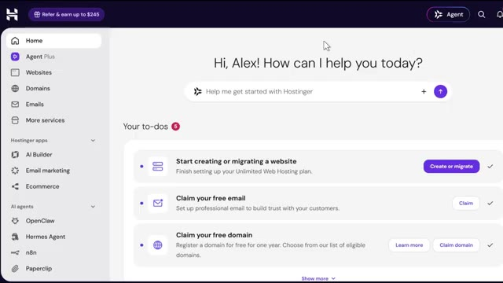
*⏱️ 00:00:14 — Tableau de bord d'administration Hostinger personnalisé au nom d'Alex avec des options de configuration et la section Hermes Agent.*

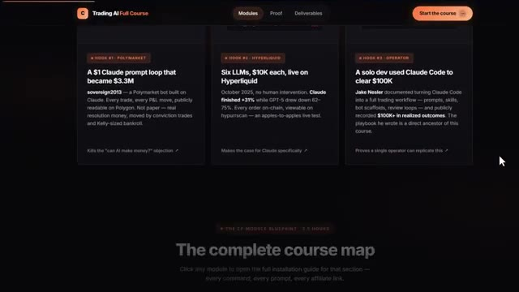
*⏱️ 00:00:21 — Plateforme de cours en ligne montrant le plan de cours intitulé "Trading AI Full Course" avec différentes études de cas.*

---

### ⏱️ `[00:00:29 - 00:00:54]` | Segment #02

**🔊 Audio (Transcription Intégrale Mot pour Mot en Français) :**
> Mais d'abord, laissez-moi vous dire pourquoi vous avez réellement besoin de ceci. J'ai donc créé des robots de trading depuis un certain temps maintenant, et il y a une chose que je déteste sincèrement chez presque tous les agents IA du marché, c'est qu'ils oublient tout. La plupart des agents sont coincés avec cette mémoire à court terme, donc ils ne s'améliorent jamais vraiment, et vous finissez par répéter les mêmes instructions à chaque fois que vous ouvrez une nouvelle session, même si vous faites tourner un agent de trading censé apprendre votre stratégie au fil du temps.

**👁️ Analyse Visuelle d'Écran (gemini-3.5-flash-lite) :**
**Interface & Outils** : Graphique de trading (TradingView ou plateforme similaire) et interface de terminal en ligne de commande (CLI).

**Contenu textuel & Code** : Graphique de prix ETH/USD avec indicateurs techniques, et rapport d'analyse de code Pine Script listant des bugs logiques, erreurs de syntaxe et problèmes de repeint (repainting).

**Action / Démonstration** : Présentation d'un graphique de trading technique et analyse automatisée de code de stratégie de trading.

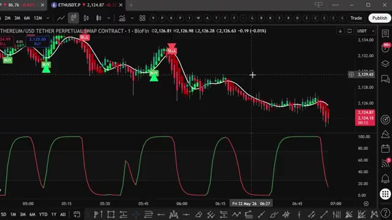
*⏱️ 00:00:35 — Capture d'écran montrant un graphique de trading de crypto-monnaies avec des signaux d'achat et de vente, ainsi qu'un indicateur de momentum dans le panneau inférieur.*

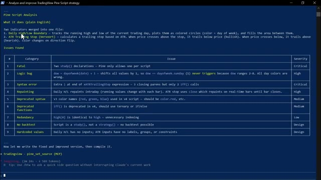
*⏱️ 00:00:42 — Capture d'écran montrant un terminal de commande affichant une analyse détaillée d'un script Pine Script avec un tableau des erreurs et problèmes détectés.*

---

### ⏱️ `[00:00:54 - 00:01:14]` | Segment #03

**🔊 Audio (Transcription Intégrale Mot pour Mot en Français) :**
> Maintenant, Hermes Agent règle ce problème. Il est doté de cette boucle d'apprentissage intégrée qui affine réellement ses propres compétences et construit une mémoire persistante à partir de chaque interaction. Donc, que vous l'utilisiez pour la recherche, l'automatisation, ou même pour l'intégrer dans votre propre configuration d'agent de trading, il devient véritablement plus intelligent au fur et à mesure que vous l'utilisez au lieu de revenir à zéro.

**👁️ Analyse Visuelle d'Écran (gemini-3.5-flash-lite) :**
**Interface & Outils** : Hermes Agent, tableau de bord analytique web et page d'accueil de la plateforme de courtage Alpaca.

**Contenu textuel & Code** : Lignes de commande pour l'agent IA, tableau comparatif de performance de modèles (Qwen, DeepSeek, Claude, Grok, Gemini, GPT) avec métriques (P&L, Win Rate), et interface de présentation d'API financière.

**Action / Démonstration** : Navigation et présentation des outils d'IA et des plateformes d'intégration financière.

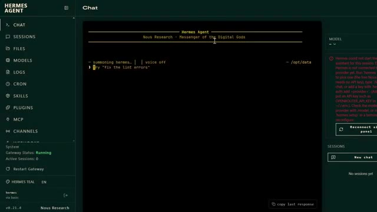
*⏱️ 00:00:59 — Interface de l'agent Hermes Agent affichant un terminal noir avec des lignes de commande.*

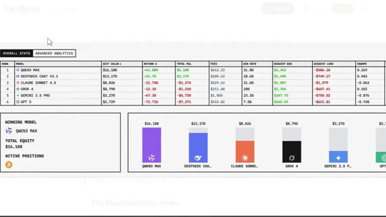
*⏱️ 00:01:04 — Tableau de statistiques de trading comparant différents modèles de langage avec des graphiques en barres.*

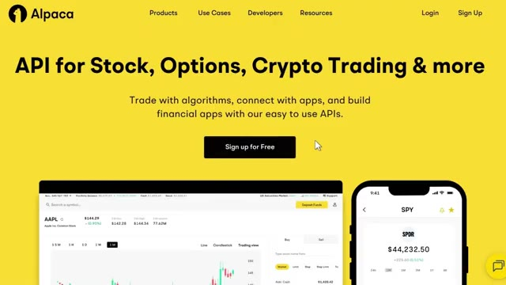
*⏱️ 00:01:09 — Page d'accueil de la plateforme Alpaca présentant une API de trading pour actions, options et cryptomonnaies.*

---

### ⏱️ `[00:01:14 - 00:01:37]` | Segment #04

**🔊 Audio (Transcription Intégrale Mot pour Mot en Français) :**
> Et Hostinger élimine tous les tracas liés à la configuration. Ils disposent d'un modèle Docker préconfiguré qui permet de le lancer en quelques secondes. Pas besoin de terminal, ni d'expérience avec Docker. L'outil que nous déployons aujourd'hui s'appelle donc Hermes Agent, créé par Noose Research, l'un des principaux laboratoires d'IA open source du moment. Et la différence entre celui-ci et votre chatbot classique, c'est cette boucle d'apprentissage intégrée dont je viens de parler.

**👁️ Analyse Visuelle d'Écran (gemini-3.5-flash-lite) :**
**Interface & Outils** : Navigateur web, tableau de bord Hostinger, site web officiel de Nous Research et Hermes Agent.

**Contenu textuel & Code** : Interface utilisateur avec des options de configuration d'applications IA, modules de déploiement et description de Hermes Agent comme agent open source sous licence MIT.

**Action / Démonstration** : Navigation et présentation visuelle de la plateforme d'hébergement et du site officiel du projet Hermes Agent.

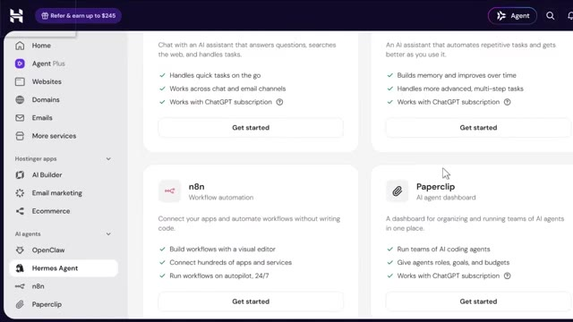
*⏱️ 00:01:20 — Capture d'écran montrant le tableau de bord Hostinger avec le menu des applications IA, mettant en évidence l'agent Hermes Agent.*

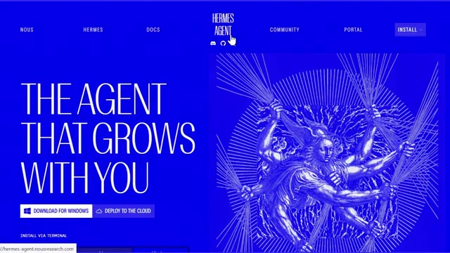
*⏱️ 00:01:26 — Page d'accueil officielle du site web de Hermes Agent par Nous Research avec fond bleu vif.*

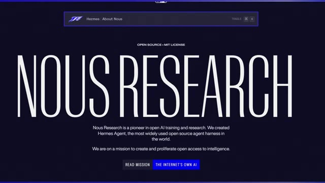
*⏱️ 00:01:31 — Page web de présentation de Nous Research expliquant qu'ils ont créé Hermes Agent, un outil open source de premier plan.*

---

### ⏱️ `[00:01:37 - 00:01:55]` | Segment #05

**🔊 Audio (Transcription Intégrale Mot pour Mot en Français) :**
> Il ne fait pas seulement que répondre pour oublier aussitôt. Il crée de nouvelles compétences à partir de ce qu'il fait, affine ces compétences au fur et à mesure que vous l'utilisez, et construit une mémoire persistante qui prend réellement de la valeur avec le temps. En plus de cela, il se connecte à plus de 200 modèles via OpenRotor, ainsi qu'à des fournisseurs directs comme Anthropic et OpenAI.

**👁️ Analyse Visuelle d'Écran (gemini-3.5-flash-lite) :**
**Interface & Outils** : Navigateur web affichant les sites d'Hostinger et la documentation officielle d'Hermes Agent.

**Contenu textuel & Code** : Texte descriptif des fonctionnalités d'Hermes Agent, tarifs d'hébergement VPS, et détails sur les intégrations (Telegram, Discord, Slack, etc.).
[DESC_IMAGE_3] Navigation et présentation des offres d'hébergement pour le déploiement de l'agent.

**Action / Démonstration** : Explications face caméra et analyse conceptuelle des marchés.

---

### ⏱️ `[00:01:56 - 00:02:19]` | Segment #06

**🔊 Audio (Transcription Intégrale Mot pour Mot en Français) :**
> Et ça se branche directement sur les plateformes que vous utilisez probablement déjà. Telegram, Slack, Discord, WhatsApp, et même Signal et l'e-mail. Maintenant, voici la partie que la plupart des gens négligent complètement. Un agent IA n'est aussi bon que l'infrastructure sur laquelle il tourne. Si vous faites tourner ça localement sur votre propre ordinateur portable, à la seconde où votre ordinateur se met en veille, votre agent s'éteint avec lui.

**👁️ Analyse Visuelle d'Écran (gemini-3.5-flash-lite) :**
**Interface & Outils** : Navigateur web affichant des pages de documentation et des articles sur l'intelligence artificielle (Hostinger, Vantiq).

**Contenu textuel & Code** : Texte explicatif sur les agents IA, les fonctionnalités multi-plateformes et les limites des IA statiques par rapport aux IA dynamiques.

**Action / Démonstration** : Navigation et défilement sur des pages web présentant des solutions et articles sur l'infrastructure des agents IA.

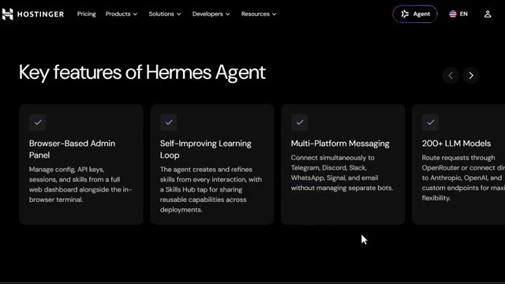
*⏱️ 00:02:01 — Capture d'écran montrant les fonctionnalités clés de l'agent Hermes sur le site Hostinger, incluant la messagerie multi-plateforme.*

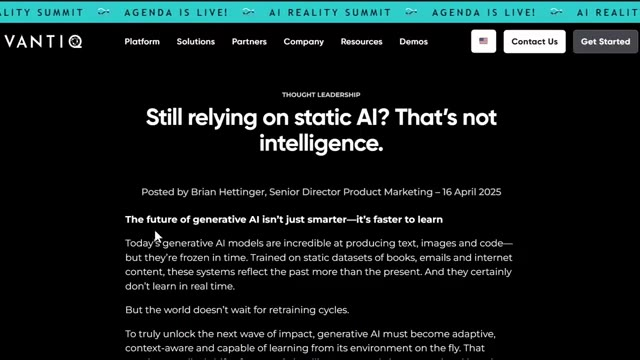
*⏱️ 00:02:07 — Article du site Vantiq intitulé "Still relying on static AI? That's not intelligence." illustrant la nécessité d'une IA dynamique.*

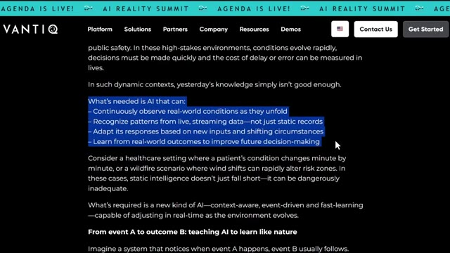
*⏱️ 00:02:13 — Suite de l'article Vantiq avec du texte en surbrillance détaillant les capacités requises pour une IA moderne et adaptative.*

---

### ⏱️ `[00:02:19 - 00:02:44]` | Segment #07

**🔊 Audio (Transcription Intégrale Mot pour Mot en Français) :**
> Redémarrez votre machine et la mémoire peut être complètement effacée, et vous êtes également limité par le matériel que vous possédez personnellement, ce qui signifie qu'il est fondamentalement impossible d'évoluer. C'est exactement le problème de l'IA statique que résout Hermes Agent. Chaque interaction devient une compétence persistante. Ainsi, au lieu que votre agent reste le même pour toujours, il devient réellement plus intelligent à mesure que vous l'utilisez. Très bien, alors commençons vraiment depuis le tout début.

**👁️ Analyse Visuelle d'Écran (gemini-3.5-flash-lite) :**
**Interface & Outils** : Navigateur web affichant le site officiel de Hermes Agent (Nous Research) et un article sur dealon.ai.

**Contenu textuel & Code** : Texte de présentation de Hermes Agent (« The Agent That Grows With You ») et boutons de téléchargement pour Windows ou cloud.

**Action / Démonstration** : Navigation sur le site web de Hermes Agent pour illustrer la solution aux problèmes des systèmes d'IA statiques.

*⏱️ 00:02:38 — Capture du site officiel de Hermes Agent de Nous Research avec le slogan 'The Agent That Grows With You' sur fond bleu vif.*

---

### ⏱️ `[00:02:45 - 00:03:18]` | Segment #08

**🔊 Audio (Transcription Intégrale Mot pour Mot en Français) :**
> La première chose dont vous avez besoin, c'est d'un compte Hostinger. Rendez-vous donc sur le lien dans la description ci-dessous. Cela vous mènera directement sur la page de destination de l'agent Hermes. Cliquez sur s'inscrire dans le coin supérieur droit et vous pourrez créer votre compte en moins d'une minute en utilisant soit votre e-mail, soit votre compte Google. Remplissez vos coordonnées, définissez un mot de passe, et vous y êtes. Une fois connecté, vous arriverez directement ici sur votre tableau de bord. C'est votre centre de contrôle pour votre VPS, votre facturation et vos modèles Docker. Maintenant que vous êtes connecté, configurons le forfait. Juste ici sur la page de destination de Hostinger

**👁️ Analyse Visuelle d'Écran (gemini-3.5-flash-lite) :**
**Interface & Outils** : Navigateur web, site Hostinger et panneau d'administration (hPanel).

**Contenu textuel & Code** : Offre de déploiement d'agent IA à 6,49 $/mois, options d'inscription, menu latéral avec outils de développement et liste de tâches (to-dos).
[DESC_IMAGE_3] Navigation dans le tableau de bord pour configurer un compte et accéder aux services d'hébergement et d'intelligence artificielle.

**Action / Démonstration** : Explications face caméra et analyse conceptuelle des marchés.

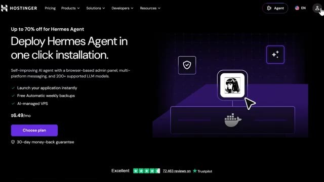
*⏱️ 00:02:53 — Page d'accueil du site Hostinger présentant le déploiement de l'agent Hermes en un clic.*

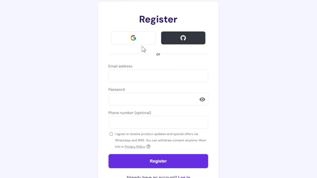
*⏱️ 00:03:01 — Formulaire d'inscription (Register) avec options de connexion via Google, GitHub ou e-mail.*

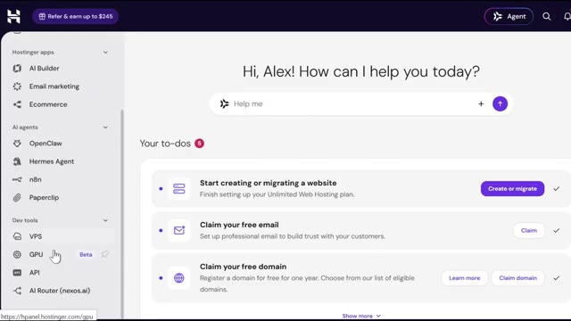
*⏱️ 00:03:10 — Tableau de bord d'administration Hostinger (hPanel) montrant les sections de gestion des applications et outils de développement.*

---

### ⏱️ `[00:03:18 - 00:03:52]` | Segment #09

**🔊 Audio (Transcription Intégrale Mot pour Mot en Français) :**
> page, vous verrez le plan de l'agent Hermes. Et c'est celui que je recommande. Il est livré avec la configuration du catalogue Docker entièrement pré-construite. Il n'y a pas de frais par agent et cela vous donne assez de puissance de calcul pour des flux de travail multi-agents et des processus de longue durée sans que rien ne s'arrête brusquement. Cliquez sur choisir ce plan juste ici. Cela vous amène au paiement. Et avant de confirmer quoi que ce soit, vous verrez un champ pour un code promo. Tapez mon code, Alex Carter 10, et vous verrez 10 % de réduction sur votre total. Confirmez, finalisez votre paiement, et vous êtes officiellement configuré. Maintenant, voici quelque chose qui compte beaucoup,

**👁️ Analyse Visuelle d'Écran (gemini-3.5-flash-lite) :**
**Interface & Outils** : Interface web de Hostinger (panneau de configuration et tarification d'agents IA).

**Contenu textuel & Code** : Tarifs d'abonnement pour Hermes Agent (5,99 $/mois pour 24 mois), options de gestion et résumé de commande avec code promo.

**Action / Démonstration** : Navigation et présentation des plans tarifaires et options de déploiement pour l'agent Hermes sur Hostinger.

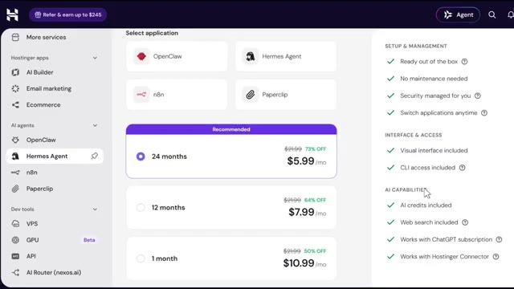
*⏱️ 00:03:27 — Interface de Hostinger montrant les options de tarification pour l'agent Hermes avec des abonnements de 24 mois, 12 mois et 1 mois.*

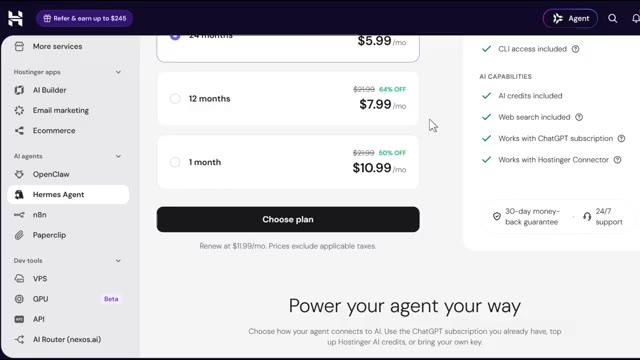
*⏱️ 00:03:35 — Suite de la page de tarification de l'agent Hermes avec le bouton de sélection du plan.*

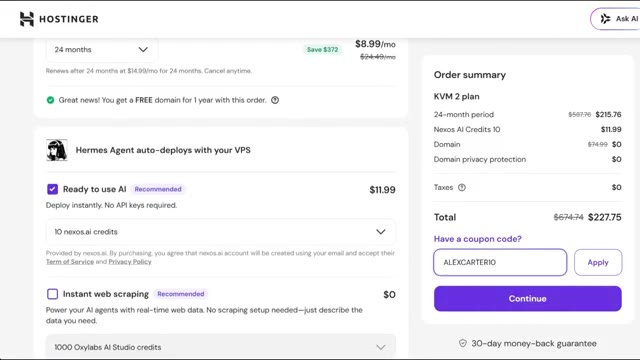
*⏱️ 00:03:43 — Page de résumé de commande Hostinger montrant le plan KVM 2 et le code promo ALEXCARTER10 appliqué.*

---

### ⏱️ `[00:03:52 - 00:04:19]` | Segment #10

**🔊 Audio (Transcription Intégrale Mot pour Mot en Français) :**
> particulièrement si vous prévoyez de l'utiliser pour de véritables besoins professionnels. Vos données restent les vôtres. Chaque compétence qu'il apprend, chaque clé API que vous connectez, tout cela réside entièrement sur votre propre VPS privé. Rien de tout cela ne se trouve sur une plateforme tierce. Votre serveur lui-même bénéficie de plus d'une décennie d'expérience en infrastructure de Hostinger, hébergé dans ses propres centres de données propriétaires, surveillé par ses équipes de sécurité internes.

**👁️ Analyse Visuelle d'Écran (gemini-3.5-flash-lite) :**
**Interface & Outils** : Interface web (Navigateur) - Site Hostinger, section FAQ et page de présentation des fonctionnalités de déploiement.

**Contenu textuel & Code** : Texte explicatif sur la sécurité des données ("Is my data private and secure?", environnements isolés, conteneurs sécurisés) et fonctionnalités de déploiement (Launch in one click, Security, Built in Docker manager).

**Action / Démonstration** : Navigation sur le site web pour illustrer la sécurité, l'isolation des données des utilisateurs et la simplicité de déploiement des agents IA.

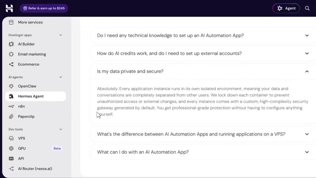
*⏱️ 00:03:59 — Interface web de Hostinger montrant la FAQ détaillée sur la sécurité et la confidentialité des données pour l'agent Hermes.*

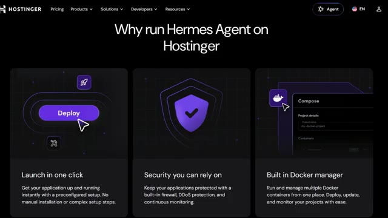
*⏱️ 00:04:06 — Page web de présentation de l'hébergeur Hostinger intitulée "Why run Hermes Agent on Hostinger" avec les avantages clés présentés sous forme de cartes.*

---

### ⏱️ `[00:04:20 - 00:04:39]` | Segment #11

**🔊 Audio (Transcription Intégrale Mot pour Mot en Français) :**
> Et si jamais vous ratez quelque chose, vous pouvez toujours revenir en arrière. Des sauvegardes hebdomadaires sont incluses par défaut et vous pouvez passer à des sauvegardes quotidiennes. Maintenant, déployons concrètement cette chose. Une fois que votre VPS est prêt, rendez-vous dans le tableau de bord de votre VPS et allez dans le gestionnaire Docker, puis dans le catalogue. Juste ici, recherchez l'agent Hermes et cliquez sur sélectionner.

**👁️ Analyse Visuelle d'Écran (gemini-3.5-flash-lite) :**
**Interface & Outils** : Navigateur web affichant le site web et le panneau d'administration de l'hébergeur Hostinger.

**Contenu textuel & Code** : Articles de support technique sur les sauvegardes et interfaces de sélection d'agents IA (OpenClaw, Hermes Agent, n8n) et d'outils de développement (VPS, GPU).

**Action / Démonstration** : Navigation dans la documentation sur les sauvegardes puis basculement vers le tableau de bord pour configurer un outil ou un agent d'automatisation.

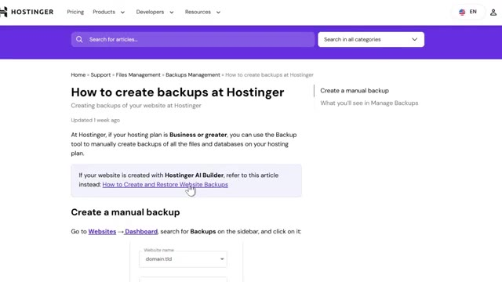
*⏱️ 00:04:25 — Page de documentation Hostinger expliquant la gestion et la création de sauvegardes de sites web.*

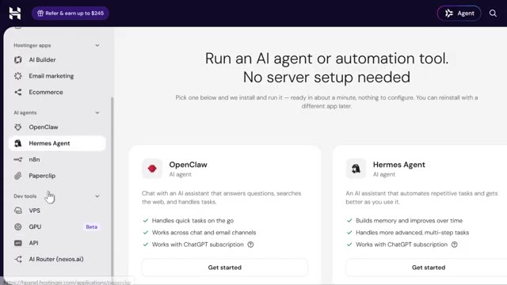
*⏱️ 00:04:29 — Tableau de bord Hostinger présentant des outils d'IA et d'automatisation avec des options pour OpenClaw et Hermes Agent.*

---

### ⏱️ `[00:04:39 - 00:04:59]` | Segment #12

**🔊 Audio (Transcription Intégrale Mot pour Mot en Français) :**
> Maintenant, pendant le déploiement, il va vous demander de penser à un nom d'utilisateur et à un mot de passe administrateur. Allez-y, configurez-les dès maintenant et assurez-vous de les conserver en lieu sûr, dans un endroit sûr. Vous en aurez besoin plus tard. Maintenant, voici quelque chose de vraiment utile. Vous n'avez pas vraiment besoin de gérer vos propres clés API si vous ne le souhaitez pas. Hostinger vous permet de connecter Hermes en utilisant leurs crédits intégrés à la place.

**👁️ Analyse Visuelle d'Écran (gemini-3.5-flash-lite) :**
**Interface & Outils** : Interface de gestion cloud / Docker Manager

**Contenu textuel & Code** : Champs de configuration utilisateur, clés API Nexos et Oxylabs, gestion des crédits AI Router

**Action / Démonstration** : Configuration des identifiants administrateur et suivi du déploiement de l'application

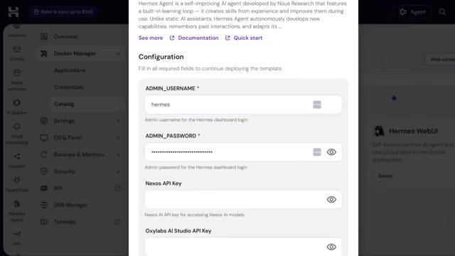
*⏱️ 00:04:44 — Interface de configuration montrant les champs ADMIN_USERNAME et ADMIN_PASSWORD pour le déploiement de Hermes Agent.*

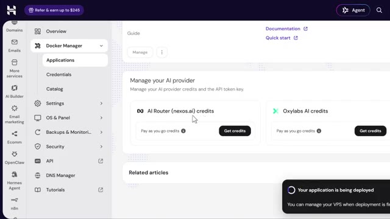
*⏱️ 00:04:54 — Tableau de bord montrant la gestion des fournisseurs d'IA (AI Router et Oxylabs) avec une notification de déploiement en cours.*

---

### ⏱️ `[00:04:59 - 00:05:26]` | Segment #13

**🔊 Audio (Transcription Intégrale Mot pour Mot en Français) :**
> Les crédits Nexus AI donnent à Hermes accès à des modèles comme Claude, Gemini et GPT via une passerelle unique. Et si vous avez ajouté des crédits Nexus lors de l'achat de votre VPS, cette clé API est générée et renseignée pour vous automatiquement. Il n'y a donc rien à copier ni à coller. Les crédits Oxylab fonctionnent de la même manière mais pour la recherche sur le web et l'extraction de données, permettant à votre agent de lire de manière fiable les pages riches en JavaScript et les sites qui bloquent normalement les requêtes de base.

**👁️ Analyse Visuelle d'Écran (gemini-3.5-flash-lite) :**
**Interface & Outils** : Tableau de bord web de gestion VPS et Nexus AI (interface utilisateur hébergée).

**Contenu textuel & Code** : Section "Manage your AI provider" affichant des options de crédits ("Pay as you go credits", "Oxylabs AI credits") avec une infobulle indiquant : "Credits are consumed based on the AI model used. Top up to continue using AI features." Une notification en bas à droite indique "Your application is being deployed".

**Action / Démonstration** : Survol de l'interface pour afficher les détails sur la consommation des crédits des modèles d'IA.

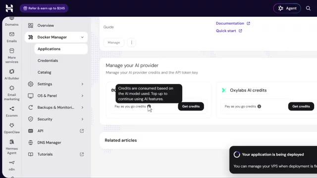
*⏱️ 00:05:06 — Capture d'écran montrant le tableau de bord de gestion d'une application VPS avec une section dédiée aux crédits de fournisseurs d'IA et une infobulle explicative.*

---

### ⏱️ `[00:05:27 - 00:06:02]` | Segment #14

**🔊 Audio (Transcription Intégrale Mot pour Mot en Français) :**
> Si vous avez acheté des crédits de scraping, cette clé se remplit aussi automatiquement. Maintenant, si vous préférez le faire manuellement, vous pouvez toujours entrer vos propres clés API Nexus, AI ou Oxylab dans ces champs vous-même. Et si vous n'avez ajouté aucun crédit du tout lors de l'achat, ne vous inquiétez pas. Hermes se déplacera quand même, vous aurez juste besoin de configurer vos propres identifiants de fournisseur ensuite avant qu'il ne puisse réellement exécuter des tâches. Vous pouvez fournir une clé API dès maintenant pendant le déploiement et en ajouter d'autres fournisseurs plus tard, alors ne réfléchissez pas trop à cette étape. Une fois que vous avez rempli les champs requis, cliquez sur déployer et la plateforme crée et démarre automatiquement le conteneur de l'agent Hermes ainsi que les arrière-plans requis.

**👁️ Analyse Visuelle d'Écran (gemini-3.5-flash-lite) :**
**Interface & Outils** : Panneau d'administration web d'hébergement et de gestion cloud.

**Contenu textuel & Code** : Paramètres de configuration des crédits API, conteneurs Docker et jetons d'accès pour IDEs.

**Action / Démonstration** : Navigation dans le tableau de bord pour configurer les crédits API et vérifier l'état des applications.

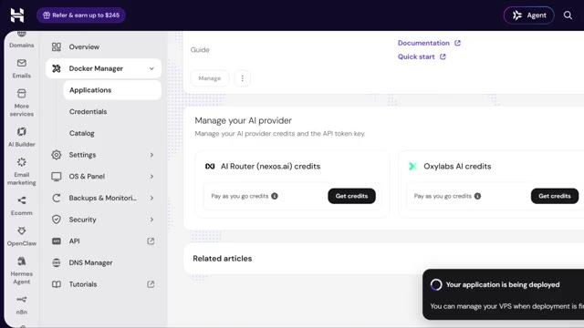
*⏱️ 00:05:36 — Interface de gestion affichant les crédits pour les fournisseurs d'IA (AI Router nexos.ai et Oxylab).*

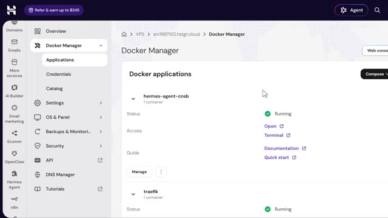
*⏱️ 00:05:45 — Gestionnaire Docker listant les applications en cours d'exécution avec le statut 'Running'.*

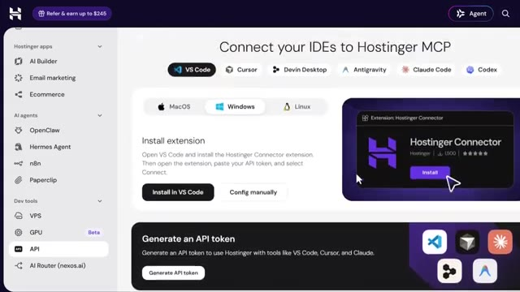
*⏱️ 00:05:54 — Page de connexion des IDEs à Hostinger MCP avec options pour VS Code, Cursor et Claude Code.*

---

### ⏱️ `[00:06:02 - 00:06:37]` | Segment #15

**🔊 Audio (Transcription Intégrale Mot pour Mot en Français) :**
> services. Une fois le déploiement terminé, Hermes s'exécute à l'intérieur d'un conteneur Docker et vous y accédez par le terminal. Donc depuis le tableau de bord de votre VPS, appuyez simplement sur le bouton d'ouverture juste à côté de votre projet Hermes, et cela ouvre directement une interface de commande Hermes. Maintenant, la première fois que vous ouvrez Hermes à l'intérieur du conteneur, il lance une courte procédure de configuration, et vous utilisez simplement vos touches fléchées pour naviguer et la touche entrée ou espace pour sélectionner. D'abord, il vous demandera de choisir un mode de configuration. Je vais sélectionner la configuration complète ici car la configuration rapide vous connecte simplement via le portail de news sans clés API, mais la configuration complète

**👁️ Analyse Visuelle d'Écran (gemini-3.5-flash-lite) :**
**Interface & Outils** : Interface Web / Tableau de bord de l'agent Hermes (Nous Research).

**Contenu textuel & Code** : Écran de connexion authentifié et console interactive de l'agent Hermes demandant la configuration d'un fournisseur de modèle (/setup, /model).

**Action / Démonstration** : Présentation de l'accès à l'interface Web d'Hermes et de son écran de configuration initiale.

*⏱️ 00:06:11 — Page de connexion (Sign In) de l'agent Hermes avec champs Username et Password.*

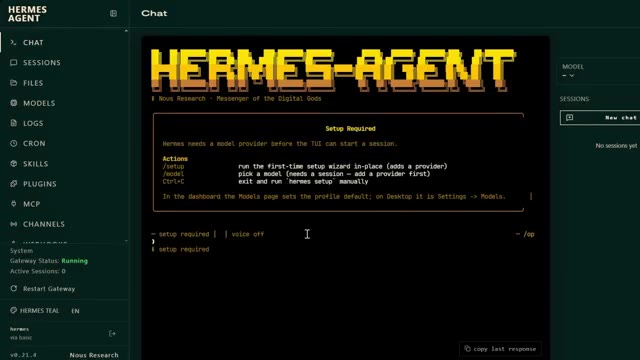
*⏱️ 00:06:20 — Interface Web de l'agent Hermes affichant l'écran de configuration initiale (Setup Required) avec les commandes disponibles.*

---

### ⏱️ `[00:06:37 - 00:06:56]` | Segment #16

**🔊 Audio (Transcription Intégrale Mot pour Mot en Français) :**
> vous permet de connecter vos propres fournisseurs, y compris ces crédits nexus.ai et Oxylabs dont nous venons de parler. Ensuite, sélectionnez votre fournisseur de modèle. Si vous achetez des crédits nexus comme nous l'avons fait, choisissez simplement nexus gateway dans la liste. Votre clé API est déjà remplie, donc laissez-la telle quelle et continuez.

**👁️ Analyse Visuelle d'Écran (gemini-3.5-flash-lite) :**
**Interface & Outils** : Hermes Agent (interface de chat et de configuration d'agent IA)

**Contenu textuel & Code** : Menu de sélection des fournisseurs d'API incluant Nous Portal, Fireworks AI, OpenRouter, Anthropic, OpenAI, Qwen, xAI Grok, DeepSeek, Google AI Studio, Ollama Cloud et diverses options personnalisées.

**Action / Démonstration** : Sélection du fournisseur de modèle d'intelligence artificielle dans l'interface de l'agent.

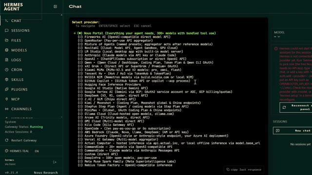
*⏱️ 00:06:41 — Interface de configuration du chat Hermes Agent affichant une liste déroulante pour la sélection du fournisseur de modèle d'IA.*

---

### ⏱️ `[00:06:56 - 00:07:31]` | Segment #17

**🔊 Audio (Transcription Intégrale Mot pour Mot en Français) :**
> Ensuite, il vous demandera de sélectionner votre backend de terminal et de l'exécuter sur SSH, que vous faites tourner sur une machine distante. Et c'est tout. Une fois la configuration terminée, Hermes démarre directement en mode CLI et vous pouvez commencer à interagir avec votre agent directement depuis le terminal. Maintenant, rappelez-vous, au début de la vidéo, j'ai mentionné que cela fonctionne parfaitement si vous faites tourner un agent de trading censé apprendre votre stratégie au fil du temps. Eh bien, j'ai en fait préparé un cours complet et gratuit exactement sur la façon de faire cela. Comment construire votre propre bot de trading agentique qui ne dort littéralement jamais en tournant 24h/24 et 7j/7 sur exactement ce même

**👁️ Analyse Visuelle d'Écran (gemini-3.5-flash-lite) :**
**Interface & Outils** : Interface CLI Hermes Agent et plateforme web du cours.

**Contenu textuel & Code** : Messages de démarrage de l'agent Hermes ("summoning hermes...") et invite de commande interactive.

**Action / Démonstration** : Navigation et présentation de l'interface de l'agent Hermes en mode CLI.

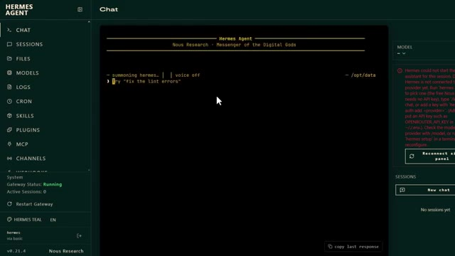
*⏱️ 00:07:05 — Interface de l'agent Hermes montrant l'écran de terminal CLI intégré avec les messages d'initialisation.*

---

### ⏱️ `[00:07:31 - 00:08:08]` | Segment #18

**🔊 Audio (Transcription Intégrale Mot pour Mot en Français) :**
> La configuration Hostinger que nous venons de déployer. Et le meilleur, c'est peu importe le marché que vous tradez, qu'il s'agisse de crypto, d'actions, de contrats à terme ou du Forex. Le framework fonctionne de la même manière. Vous le pointez simplement vers les actifs que vous tradez, vous lui donnez votre stratégie, et il tourne en continu en arrière-plan, surveillant le marché, exécutant votre logique, et ne ratant jamais une session parce que votre ordinateur s'est mis en veille ou que vous avez fermé votre navigateur. Je mettrai le lien vers le cours gratuit dans la description ci-dessous. Donc si vous vouliez un agent IA qui trade réellement pour vous au lieu de simplement discuter avec vous, allez voir ça juste après cette vidéo. Très bien, et regardez,

**👁️ Analyse Visuelle d'Écran (gemini-3.5-flash-lite) :**
**Interface & Outils** : TradingView, BloFin, et interface web de formation.

**Contenu textuel & Code** : Fenêtre de recherche de symboles, graphiques de prix Bitcoin, indicateurs techniques (bandes de Bollinger, oscillateurs, volumes) et plan de cours.
[DESC_IMAGE_3] Navigation dans la plateforme éducative et analyse de graphiques multi-actifs.

**Action / Démonstration** : Explications face caméra et analyse conceptuelle des marchés.

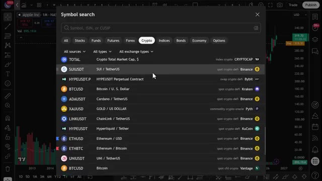
*⏱️ 00:07:40 — Interface de recherche de symboles sur TradingView montrant différentes classes d'actifs (crypto, actions, forex, etc.).*

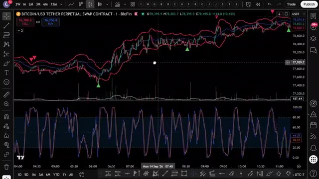
*⏱️ 00:07:50 — Graphique TradingView pour un contrat perpétuel Bitcoin/USD sur BloFin avec des indicateurs techniques et des signaux d'achat/vente.*

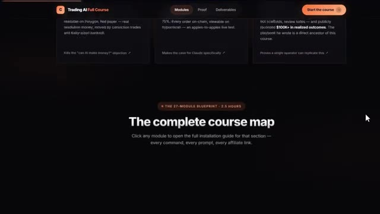
*⏱️ 00:07:59 — Page web du cours "Trading AI Full Course" affichant la carte complète du programme de formation.*

---

### ⏱️ `[00:08:08 - 00:08:44]` | Segment #19

**🔊 Audio (Transcription Intégrale Mot pour Mot en Français) :**
> pendant les quelques prochaines années, deux sortes de traders existeront. Ceux qui utilisent l'IA et ceux qui font encore tout manuellement. Même marché, résultats très différents. Voici comment vous vous mettez du bon côté de cela. J'ai rassemblé tout à l'intérieur de la communauté AI Trade Edge. Chaque invite, chaque bot, chaque modèle, chaque guide étape par étape que j'utilise personnellement, le tout au même endroit, et tout ce que je construirai à l'avenir sera ajouté directement dans le groupe dès sa sortie. Nous testons également des stratégies provenant de tout l'internet, en les automatisant à l'aide de PineScript, en les exécutant en direct, et

**👁️ Analyse Visuelle d'Écran (gemini-3.5-flash-lite) :**
**Interface & Outils** : TradingView, site web de la communauté Alex Carter Trading.

**Contenu textuel & Code** : Graphique des prix du BTCUSDT avec indicateurs de volume et interface utilisateur de TradingView ; liste des capacités des 78 outils permettant à Claude de contrôler TradingView (lecture de graphiques, données OHLCV en direct, valeurs d'indicateurs RSI/MACD/EMA/Bollinger, modification des symboles, des unités de temps, etc.).

**Action / Démonstration** : Visualisation d'un graphique de trading crypto en chandeliers japonais et présentation des fonctionnalités de l'outil d'intelligence artificielle.

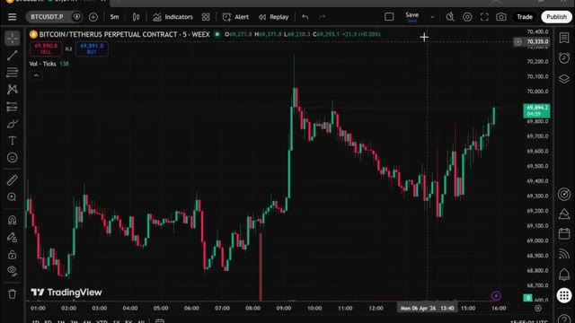
*⏱️ 00:08:17 — Capture d'écran d'un graphique TradingView montrant le contrat perpétuel Bitcoin/Tether sur un graphique en chandeliers de 5 minutes.*

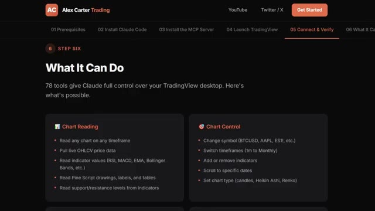
*⏱️ 00:08:26 — Interface de la communauté Alex Carter Trading détaillant les fonctionnalités et le contrôle des graphiques via Claude.*

---

### ⏱️ `[00:08:44 - 00:09:17]` | Segment #20

**🔊 Audio (Transcription Intégrale Mot pour Mot en Français) :**
> en partageant exactement ce qui fonctionne et ce qui ne fonctionne pas. Vous n'obtenez donc pas seulement des outils. Vous obtenez une opération de recherche en direct. 79,99 dollars par mois. Un seul bon trade le rentabilise. Et les 100 premiers membres bloquent ce tarif de façon permanente. Après cela, le prix augmente. Le lien est dans la description. Vous ne pouvez vraiment pas vous permettre de rater ça. Un conseil rapide avant de terminer. Si vous utilisez des crédits nexus.ai ou Oxylabs, vous pouvez vérifier votre solde et recharger à tout moment. Depuis le gestionnaire Docker, puis Projets, vos cartes de crédit s'affichent tout en haut de la page.

**👁️ Analyse Visuelle d'Écran (gemini-3.5-flash-lite) :**
**Interface & Outils** : Plateforme e-commerce Whop et tableau de bord de gestion de serveur cloud.

**Contenu textuel & Code** : Tarification d'abonnement (79,99 $/mois au lieu de 99,99 $), statistiques d'utilisation du CPU (2%), de la mémoire (11%) et stockage du serveur.

**Action / Démonstration** : Présentation de la page d'abonnement au service et affichage du panneau de contrôle technique du serveur.

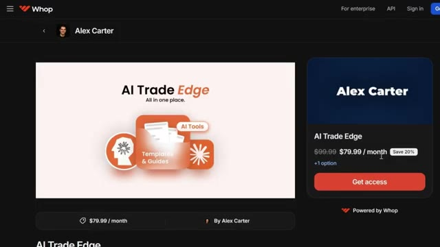
*⏱️ 00:08:52 — Capture d'écran de la plateforme de vente Whop affichant l'offre "AI Trade Edge" d'Alex Carter au prix de 79,99 $ par mois.*

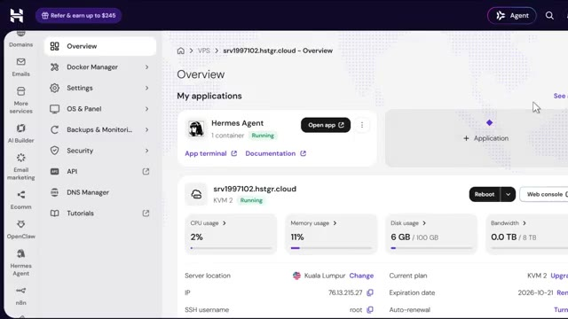
*⏱️ 00:09:09 — Tableau de bord d'hébergement ou de gestion de serveur (VPS/Cloud) affichant le statut de l'application Hermes Agent et les métriques système.*

---

### ⏱️ `[00:09:17 - 00:09:40]` | Segment #21

**🔊 Audio (Transcription Intégrale Mot pour Mot en Français) :**
> Surveillez simplement votre solde nexus.ai. S'il s'épuise, Hermes arrête de générer des réponses jusqu'à ce que vous rechargiez. Donc, pour récapituler, la mémoire de votre agent survit et redémarre parce qu'elle fonctionne sur des volumes Docker persistants. Vos ressources VPS sont entièrement dédiées afin que rien ne soit bridé. Et c'est en ligne 24 heures sur 24 et 7 jours sur 7 sur tous les canaux que vous utilisez, vos données ne quittant jamais votre propre serveur.

**👁️ Analyse Visuelle d'Écran (gemini-3.5-flash-lite) :**
**Interface & Outils** : Tableau de bord d'hébergement VPS (Hostinger)

**Contenu textuel & Code** : État du conteneur Hermes Agent (Running), utilisation du processeur (2 %), utilisation de la mémoire (11 %), utilisation du disque (6 Go / 100 Go), adresse IP et emplacement du serveur.

**Action / Démonstration** : Surveillance des ressources système et de l'état de l'application Hermes Agent sur le VPS.

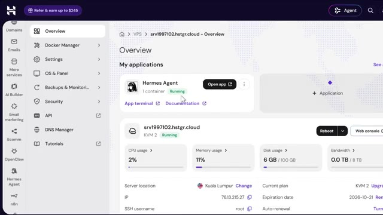
*⏱️ 00:09:29 — Tableau de bord d'hébergement VPS montrant l'application Hermes Agent en cours d'exécution avec des statistiques de ressources (CPU, mémoire, disque).*

---

### ⏱️ `[00:09:41 - 00:10:11]` | Segment #22

**🔊 Audio (Transcription Intégrale Mot pour Mot en Français) :**
> Donc, si vous en avez assez des agents IA qui oublient tout dès que vous fermez l'onglet, allez récupérer le premier lien dans la description ci-dessous et utilisez le code Alex Carter 10 pour obtenir une réduction exclusive de 10 % sur le plan VPS Hermes Agent. Et si vous voulez le guide complet étape par étape sur la façon de construire votre propre système de trading agentique avec Claude, cette vidéo apparaît également à l'écran. Allez voir ça ensuite. Si vous avez trouvé cela utile, laissez un pouce bleu, cela aide vraiment la chaîne. Abonnez-vous si ce n'est pas déjà fait, et je vous vois dans la prochaine.

**👁️ Analyse Visuelle d'Écran (gemini-3.5-flash-lite) :**
**Interface & Outils** : Sites web promotionnels (Hostinger, plateforme de cours en ligne Trading AI).

**Contenu textuel & Code** : Offre tarifaire VPS pour Hermes Agent (6.49$/mo) et statistiques de performance de différents modèles d'IA (Claude, DeepSeek, Grok, GPT-5).

**Action / Démonstration** : Présentation commerciale et promotion des liens affiliés du VPS Hermes Agent et du cours de trading IA.

*⏱️ 00:09:48 — Page web de l'hébergeur Hostinger montrant l'offre pour le déploiement de Hermes Agent à 6,49 $ par mois.*

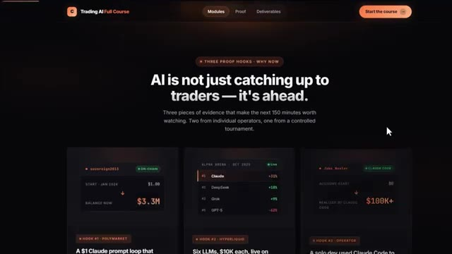
*⏱️ 00:09:56 — Page de présentation du cours "Trading AI Full Course" avec des statistiques sur les performances des intelligences artificielles.*

---

